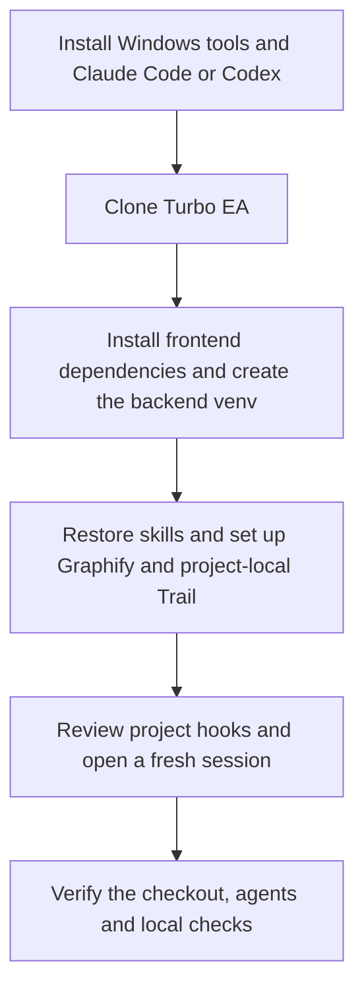
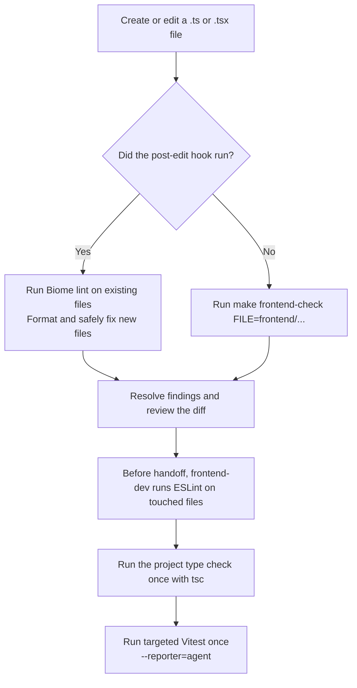
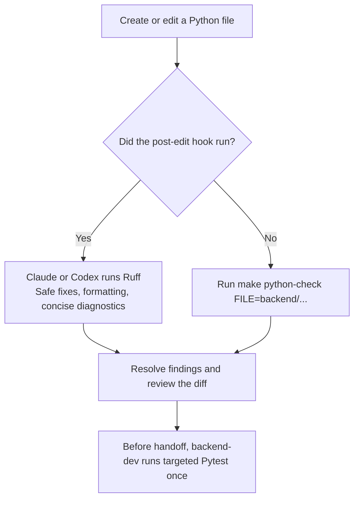
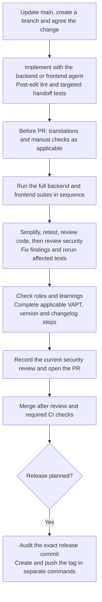

# Set up Turbo EA on Windows

Use this guide to prepare a Windows checkout for Claude Code or Codex. Install tools in user
space. Docker Desktop's per-user installation needs WSL 2 already enabled on the machine.

1. [System prerequisites](#1-system-prerequisites)
2. [Clone the repository](#2-clone-the-repository)
3. [Node and frontend](#3-node-and-frontend)
4. [Python and backend](#4-python-and-backend)
5. [User-level Claude Code plugins and skills](#5-user-level-claude-code-plugins-and-skills)
6. [Project skills, agents and review workflow](#6-project-level-claude-code-skills)
7. [Graphify and Trail](#7-tools)
8. [Final verification](#8-final-verification)



---

## 1. System prerequisites

| Program | Version verified on the reference checkout | Installation |
|---|---|---|
| Git for Windows | 2.54.0 | `%LOCALAPPDATA%\Programs\Git` |
| GitHub CLI (`gh`) | 2.97.0 | `%LOCALAPPDATA%\GitHub CLI\bin` |
| GNU Make | 4.4.1 | `%LOCALAPPDATA%\Programs\GNU-Make\4.4.1\bin` |
| Docker CLI and Compose | 29.9.2 and 5.6.1 | Docker Desktop in per-user mode with WSL 2 |
| Claude Code | 2.1.328 | Native Windows install |
| Codex CLI | 0.145.0 | Codex CLI or the Windows app for local chats |

Use the user installation options for [Git for Windows](https://git-scm.com/install/windows)
and the [GitHub CLI](https://cli.github.com/). Start a new terminal after
installing or changing the user PATH.

### Claude Code and Codex

Follow the [Claude Code Windows setup](https://code.claude.com/docs/en/setup#install-on-native-windows)
or use the [Codex Windows app](https://learn.chatgpt.com/docs/windows/windows-app). The
[Codex CLI](https://learn.chatgpt.com/docs/codex/cli) also provides the `/hooks` review menu.
Sign in to the host you use. For command-line installations, verify it in a new terminal.

```powershell
claude --version
claude auth status
codex --version
codex login status
```

### Git Bash for Claude Code

Claude Code's Bash tool uses `bin\bash.exe` from Git for Windows. Find it from the active Git
installation before setting the user variable.

```powershell
$gitRoot = Split-Path -Parent (Split-Path -Parent (Get-Command git.exe -ErrorAction Stop).Source)
$gitBash = Join-Path $gitRoot 'bin\bash.exe'
if (!(Test-Path -LiteralPath $gitBash -PathType Leaf)) { throw 'Find bin\bash.exe in your Git for Windows installation.' }
[Environment]::SetEnvironmentVariable('CLAUDE_CODE_GIT_BASH_PATH', $gitBash, 'User')
```

Restart Claude Code to pick up the user variable.

### `gh` and the PATH

`gh` lives in the **user** `PATH`, not the system one. Check:

```powershell
[Environment]::GetEnvironmentVariable("Path", "User") -split ";" | Select-String "GitHub CLI"
gh --version
gh auth status
```

If `gh` is installed but missing from PATH, add the folder containing `gh.exe` to the user
PATH. The reference machine uses the following folder.

```powershell
$ghBin = Join-Path $env:LOCALAPPDATA 'GitHub CLI\bin'
if (!(Test-Path -LiteralPath (Join-Path $ghBin 'gh.exe') -PathType Leaf)) { throw 'Use the actual folder containing gh.exe.' }
$p = [Environment]::GetEnvironmentVariable("Path", "User")
if (($p -split ';') -notcontains $ghBin) {
    [Environment]::SetEnvironmentVariable('Path', (@($p, $ghBin) -join ';'), 'User')
}
```

Open a new terminal and run `gh auth login` with access to `TommasoChi/turbo-ea`.

### GNU Make

Install the portable Windows build for your user. The archive is the ezwinports build listed in the
[Scoop manifest](https://github.com/ScoopInstaller/Main/blob/master/bucket/make.json).

```powershell
$makeArchive = Join-Path $env:TEMP 'make-4.4.1-without-guile-w32-bin.zip'
$makeDir = Join-Path $env:LOCALAPPDATA 'Programs\GNU-Make\4.4.1'
$makeUrl = 'https://downloads.sourceforge.net/project/ezwinports/make-4.4.1-without-guile-w32-bin.zip'
$expectedMakeHash = 'FB66A02B530F7466F6222CE53C0B602C5288E601547A034E4156A512DD895EE7'
if (Test-Path -LiteralPath $makeDir) { throw "Make is already present at $makeDir" }

curl.exe --fail --location --output $makeArchive $makeUrl
if ($LASTEXITCODE -ne 0) { throw 'GNU Make download failed.' }
if ((Get-FileHash -LiteralPath $makeArchive -Algorithm SHA256).Hash -ne $expectedMakeHash) {
    throw 'The GNU Make archive checksum does not match.'
}
Expand-Archive -LiteralPath $makeArchive -DestinationPath $makeDir
```

Open **Edit environment variables for your account** and add
`%LOCALAPPDATA%\Programs\GNU-Make\4.4.1\bin` to the user `Path`. Open a new PowerShell
and run `make --version`. Restart Claude Code or Codex if it still has the old `PATH`.

### Docker

With WSL 2 already enabled, download the latest stable
[Docker Desktop for Windows](https://docs.docker.com/desktop/setup/install/windows-install/).
In the installer choose the per-user mode and use WSL 2 as the backend. Start Docker Desktop before running the checks.

Docker is needed for `./scripts/test.sh` (it starts a throwaway Postgres), for building the
`turboea-fork-*:local` images and for `scripts/docs/docker-docs.sh`. After installing, check:

```powershell
docker --version
docker compose version
docker info --format '{{.ServerVersion}}'
```

---

## 2. Clone the repository

From the workspace folder, create a clone and enter its root.

```powershell
New-Item -ItemType Directory -Path software -Force | Out-Null
git clone https://github.com/TommasoChi/turbo-ea.git software\turbo-ea
Set-Location software\turbo-ea
git status --short --branch
```

The clone configures the fork as `origin`. If you maintain the upstream sync, add the upstream
remote once with `git remote add upstream https://github.com/vincentmakes/turbo-ea.git`.

The commands in the rest of this guide start from the repository root unless they specify
another directory. Open Claude Code or Codex on this directory after installing the local
dependencies and reviewing the project hooks.

### Folders outside the repository

Keep the local test instance in `../turbo-ea-conf` and the isolated VAPT stack in
`../turbo-ea-vapt`. Their environment files, Compose configuration, backups and reports stay
in those sibling directories. The scripted Pytest database is a separate temporary Compose
project named `turboea-test`.

---

## 3. Node and frontend

On the reference machine, **nvm-windows** manages Node under `%LOCALAPPDATA%\Programs\nvm`
and `%LOCALAPPDATA%\Programs\Nodejs`. If you need a portable install, extract the Windows ZIP
from [Node.js Downloads](https://nodejs.org/en/download) under your user directory and put the
folder containing `node.exe` on your user PATH.

| What | Verified version |
|---|---|
| Node | 26.13.1 |
| npm | 12.2.3 |

Use npm 11 or newer for this setup. The versions above describe the reference machine.

```powershell
node --version
npm --version
```

### User-level globals

No global (`-g`) package is needed for Turbo EA. To list the ones present: `npm ls -g --depth=0`.

### Frontend dependencies

From the repository root, install the frontend from its lockfile. `npm ci` recreates
`frontend/node_modules` and installs the pinned local Biome along with the other development
dependencies. The root Trail installation is a separate [step](#local-install-with-telemetry-turned-off).

```powershell
Push-Location frontend
npm ci
Pop-Location
```

Use the [final verification](#8-final-verification) after installing. Reserve the full suite
for the [pre-PR workflow](#local-workflow-from-change-to-pr-and-release).
`npm run dev` starts Vite on `localhost:5173` and proxies `/api` to the backend on port 8000.

### Frontend checks during development



#### While editing TypeScript

The shared post-edit hook runs Biome after Claude Code's `Edit` and `Write` and Codex's `apply_patch`.
It runs read-only lint on existing `.ts` and `.tsx` files. On new files absent from `HEAD`, Biome
can format, organize imports and apply safe fixes. It uses read-only lint for patch renames and
when Git cannot confirm that a file is new.
The formatter aims for lines of about 100 columns. This setting does not affect lint-only runs.
A clean result produces no Biome feedback. Remaining errors use `concise` output, one line per
diagnostic. The hook and the manual check honor existing ESLint waivers for the matching
`no-explicit-any` location. An `any` outside those waivers still produces an error.
See [project hook approval](#review-project-hooks).

For a file created or modified outside the hook, run this read-only check from the repository root.

```powershell
make frontend-check FILE=frontend/src/lib/costValue.ts
```

#### Before handing off frontend work

The [frontend-dev agent](.claude/agents/frontend-dev.md) runs ESLint on the touched files, checks
the project types once, then runs the relevant Vitest files together once with the compact
`agent` reporter. Use paths relative to `frontend/` for these commands.

```powershell
Push-Location frontend
npx eslint -- src/lib/costValue.ts src/lib/costValue.test.ts
npx tsc --noEmit --pretty false -p .
npx vitest run --reporter=agent src/lib/costValue.test.ts
Pop-Location
```

When the test files are unknown, use `npx vitest related --run --reporter=agent <changed source paths>`
and report an empty selection.

---

## 4. Python and backend

The backend requires Python **3.11 or newer**. Use **Python 3.12** for the development venv,
matching the backend test jobs. The reference machine uses **uv 0.13.7**.

### uv and Python

```powershell
winget install --id astral-sh.uv --scope user
uv python install 3.12
uv python find 3.12
```

If WinGet is unavailable, use the [uv installation guide](https://docs.astral.sh/uv/getting-started/installation/)
and put `uv` on your user PATH. Install Turbo EA's Python dependencies inside the checkout's venv.

### Project: the backend venv

From the repository root, create the venv if it is missing and install the development dependencies.
Use a venv created in this checkout. If a Windows checkout moves or you create a linked worktree,
create its own venv so its launchers point at the correct absolute path.

```powershell
Push-Location backend
if (!(Test-Path -LiteralPath 'venv\Scripts\python.exe')) {
    uv venv --python 3.12 --seed venv
}
uv pip install --python .\venv\Scripts\python.exe -e '.[dev]'
.\venv\Scripts\python.exe --version
Pop-Location
```

The development dependencies are in `backend/pyproject.toml`, section `[project.optional-dependencies] dev`:
`pytest` (below 9.2), `pytest-asyncio`, `pytest-cov`, `pytest-xdist`, `mutmut` (pinned version), `httpx`,
`ruff`, `vulture` (pinned version), `pip-audit`, `pip-tools`, `mypy`. `mutmut` and `vulture` are pinned
on purpose: do not upgrade them on your own.

The existing reference venv uses Python 3.12.10 and Ruff 0.17.6.

### Run the local development stack

Use the [local source build](README.md#development-from-source) to try a change in the browser.
From the project root, create `.env` from [.env.example](.env.example) if it is missing.

```powershell
if (!(Test-Path -LiteralPath .env)) { Copy-Item -LiteralPath .env.example -Destination .env }
```

Set development credentials and free values for `HOST_PORT` and `TLS_HOST_PORT`, and set
`TURBO_EA_PUBLIC_URL` to the URL you will open. Then start the source stack from this checkout.
The instances in `turbo-ea-conf` and `turbo-ea-vapt` have their own configuration and ports.

```powershell
make up-dev
docker compose -f docker-compose.yml -f dev/docker-compose.dev.yml ps
```

Open the configured public URL. Run `make down-dev` from the root to stop that stack.

### Check



#### While editing Python

The shared Ruff hook runs after Claude Code's `Edit` and `Write` and Codex's `apply_patch`.
It applies safe fixes from the standard rule set, formats the affected Python files under
`backend/`, then checks each whole file with the standard rules plus `B`, `S`, `C901` and `UP`.
The hook reports `F401` without removing the unused import, which an in-progress edit may still need.
The expanded check ignores `S101` in Pytest files under `backend/tests/`. A clean edit produces no
Ruff feedback. Remaining diagnostics use `concise` output, one line per finding.

See [project hook approval](#review-project-hooks).

For a Python file created or modified outside the hook, run this read-only check from the repository
root with that file's path. Both the hook and the Make target look for Ruff in `backend/venv`,
then `backend/.venv`, then on `PATH`.

```powershell
make python-check FILE=backend/app/services/license_status.py
```

#### Before handing off backend work

The [backend-dev agent](.claude/agents/backend-dev.md) runs the relevant Pytest files together once
from the repository root in Git Bash. Pass paths relative to `backend/`.

```bash
./scripts/test.sh tests/services/test_license_status.py
```

The runner provisions Postgres in the temporary `turboea-test` Compose project. Check the number of
collected tests, especially when passing a path. For the runner's built-in unit-only selection, use
`./scripts/test.sh --unit`. If dependency setup fails under Git Bash, complete the PowerShell venv setup
above first, then rerun the selected tests.

The repository-wide Ruff check still uses the standard rule set. Run it from `backend/` before
committing. For intentional bulk lint fixes, use `make format` from the repository root with the
backend venv activated and review `git diff -- backend/` afterwards.

```powershell
.\venv\Scripts\ruff.exe format .
.\venv\Scripts\ruff.exe check .
```

---

## 5. User-level Claude Code plugins and skills

Plugins are installed once per user and apply to every project. They live in
`%USERPROFILE%\.claude\plugins`; the list of enabled ones is in `%USERPROFILE%\.claude\settings.json`
under `enabledPlugins`.

### caveman

Makes Claude answer briefly ("caveman" mode). Version 4.1.0.
GitHub: <https://github.com/JuliusBrussee/caveman> (marketplace `caveman`).
From the terminal:

```powershell
claude plugin marketplace add JuliusBrussee/caveman
claude plugin install caveman@caveman
```

Or inside Claude Code:

```text
/plugin marketplace add JuliusBrussee/caveman
/plugin install caveman@caveman
```

Check: `"caveman@caveman": true` must appear in `settings.json`, and the folder
`%USERPROFILE%\.claude\plugins\cache\caveman\caveman\<version>` must exist.

To switch it off in a chat: type `normal mode` (or `stop caveman`). To switch it off completely: set
`false` on its line in `enabledPlugins`.

The npm package `@juliusbrussee/caveman-code` is a different program (a terminal agent with its own
API keys) and must **not** be installed: the plugin does not depend on it.

### superpowers

The project's working method: brainstorming, plans, task-by-task execution, TDD, review. Version 7.0.2.
GitHub: <https://github.com/obra/superpowers> (author Jesse Vincent). Installed from the
`claude-plugins-official` marketplace: <https://github.com/anthropics/claude-plugins-official>.

```powershell
claude plugin install superpowers@claude-plugins-official
```

Check: `"superpowers@claude-plugins-official": true` in `enabledPlugins`.

### claude-md-management

A skill to audit and improve `CLAUDE.md` files. Version 1.0.0.
GitHub: <https://github.com/anthropics/claude-plugins-official/tree/main/plugins/claude-md-management>
(marketplace `claude-plugins-official`, author Anthropic).

```powershell
claude plugin install claude-md-management@claude-plugins-official
```

Check: `"claude-md-management@claude-plugins-official": true` in `enabledPlugins`.

### ponytail

Keeps changes small: the "smallest change that fully solves the task" mode, plus the review and audit skills
(`ponytail:ponytail-review`, `ponytail:ponytail-audit`) that the `code-reviewer` and the development agents use.
Version 5.3.3.
GitHub: <https://github.com/DietrichGebert/ponytail> (marketplace `ponytail`, author Dietrich Gebert).

```powershell
claude plugin marketplace add DietrichGebert/ponytail
claude plugin install ponytail@ponytail
```

Check: the folder `%USERPROFILE%\.claude\plugins\cache\ponytail\ponytail\<version>` exists. The plugin is
**enabled by the project**: `.claude/settings.json` has `"ponytail@ponytail": true`, which arrives with the
clone, so its line in the user-level `enabledPlugins` may stay `false`. It adds its own context to every
session opened on Turbo EA.

### humanizer

A skill that rewrites AI-sounding text so it reads naturally without changing its meaning. It is not a
plugin: it is a user skill in `%USERPROFILE%\.claude\skills\humanizer` (repo `blader/humanizer`, version 4.0.0),
installed with the skills CLI.
GitHub: <https://github.com/blader/humanizer>.

```powershell
npx skills add blader/humanizer --global
```

Check: the folder `%USERPROFILE%\.claude\skills\humanizer` exists and `claude plugin list` shows
`humanizer@skills-dir` as loaded.

It is used on request only, for example on documents and presentations; no step of the development process
calls it. With caveman switched on, type `normal mode` first.

---

## 6. Project-level Claude Code skills

The project skills are versioned under [.claude/skills](.claude/skills). External skills have source commits and content hashes in [skills-lock.json](skills-lock.json). The commands below are for refreshing the project copies.

After installing Ponytail, run `./.agents/restore-skills.ps1` from the project root in PowerShell.
It restores the Codex junctions to the checked-in project skills and to six installed Ponytail skills.
By default it finds the Ponytail installation in the Claude plugin registry. If you keep those
skills elsewhere, pass `-PonytailSkills <directory>` with the directory containing the six skills.
The junctions should resolve to the installed skills so that plugin updates remain available.

### Static security review skills

The pre-PR `security-reviewer` uses both project adaptations in one invocation on Claude Code and Codex.

- [Trail of Bits differential review](.claude/skills/trailofbits-differential-review-static/SKILL.md)
  compares the patch with its baseline and traces changed protections to callers and tests.
- [GetSentry security review](.claude/skills/getsentry-security-review-static/SKILL.md)
  follows data and permissions through the implementation, including authenticated roles.

Each entry includes its source revision and license. The project copies contain the
instructions needed offline. The PowerShell restore command above exposes them to Codex.

### async-python-patterns

The [backend-dev](.claude/agents/backend-dev.md) agent loads it for asynchronous code and concurrency in Python.

- Re-import into the project with `npx skills add wshobson/agents --skill async-python-patterns --agent claude-code --copy`.
- Source on GitHub. [wshobson/agents](https://github.com/wshobson/agents/blob/9c61ab243def98f72da12abd41cfcf5bcd91af9d/plugins/python-development/skills/async-python-patterns/SKILL.md)

### python-error-handling

The [backend-dev](.claude/agents/backend-dev.md) agent loads it for validation, exceptions and handling of partial failures.

- Re-import into the project with `npx skills add wshobson/agents --skill python-error-handling --agent claude-code --copy`.
- Source on GitHub. [wshobson/agents](https://github.com/wshobson/agents/blob/9c61ab243def98f72da12abd41cfcf5bcd91af9d/plugins/python-development/skills/python-error-handling/SKILL.md)

### python-resource-management

The [backend-dev](.claude/agents/backend-dev.md) agent loads it to manage connections, files and other resources.

- Re-import into the project with `npx skills add wshobson/agents --skill python-resource-management --agent claude-code --copy`.
- Source on GitHub. [wshobson/agents](https://github.com/wshobson/agents/blob/9c61ab243def98f72da12abd41cfcf5bcd91af9d/plugins/python-development/skills/python-resource-management/SKILL.md)

### python-type-safety

Used on request for annotations, protocols and type checking in Python.

- Re-import into the project with `npx skills add wshobson/agents --skill python-type-safety --agent claude-code --copy`.
- Source on GitHub. [wshobson/agents](https://github.com/wshobson/agents/blob/9c61ab243def98f72da12abd41cfcf5bcd91af9d/plugins/python-development/skills/python-type-safety/SKILL.md)

### python-anti-patterns

The [code-reviewer](.claude/agents/code-reviewer.md) agent uses it during backend review.

- Re-import into the project with `npx skills add wshobson/agents --skill python-anti-patterns --agent claude-code --copy`.
- Source on GitHub. [wshobson/agents](https://github.com/wshobson/agents/blob/9c61ab243def98f72da12abd41cfcf5bcd91af9d/plugins/python-development/skills/python-anti-patterns/SKILL.md)

### material-ui-styling

The [frontend-dev](.claude/agents/frontend-dev.md) agent loads it to choose how to style MUI components.

- Re-import into the project with `npx skills add mui/material-ui --skill material-ui-styling --agent claude-code --copy`.
- Source on GitHub. [mui/material-ui](https://github.com/mui/material-ui/blob/80739f32f3ee8fb4e1a6cd29ccb35bac78e28cdf/skills/material-ui-styling/SKILL.md)

### material-ui-theming

The [frontend-dev](.claude/agents/frontend-dev.md) agent loads it for the MUI theme and design tokens.

- Re-import into the project with `npx skills add mui/material-ui --skill material-ui-theming --agent claude-code --copy`.
- Source on GitHub. [mui/material-ui](https://github.com/mui/material-ui/blob/80739f32f3ee8fb4e1a6cd29ccb35bac78e28cdf/skills/material-ui-theming/SKILL.md)

### vercel-composition-patterns

The [frontend-dev](.claude/agents/frontend-dev.md) and [code-reviewer](.claude/agents/code-reviewer.md) agents consult the relevant rules when designing or reviewing changes to component props, child composition, state or context.

- Install into the project with `npx skills add vercel-labs/agent-skills --skill vercel-composition-patterns --agent claude-code --copy`. In the repository the folder is `composition-patterns`, but the installer uses the name in the skill's frontmatter.
- Source on GitHub. [vercel-labs/agent-skills](https://github.com/vercel-labs/agent-skills/tree/1a2c79d4e6c4a2283dc2c614b6538cbe1ed5ca62/skills/composition-patterns) (MIT licence; checked at commit `1a2c79d4`).
- The installer also writes a copy in `.agents/skills/`, which is ignored by git.

### vercel-react-best-practices

Both agents read individual rules when the change affects data requests (`async-*`, `client-*`), initial bundle size (`bundle-*`), or grids, lists and frequent renders (`rerender-*`, `rendering-*`). They use `js-*` and `advanced-*` for identifiable costs only. Turbo EA uses client-side React with Vite, so server, Next.js and hydration rules are outside this scope. The developer applies project conventions during implementation. The reviewer identifies the concrete impact of the diff.

- Refresh using the same project install command as for composition patterns, with `--skill vercel-react-best-practices`. Run `./.agents/restore-skills.ps1` to expose the project copy to Codex.
- [Vercel source at the installed revision](https://github.com/vercel-labs/agent-skills/tree/5a37a6329fbad3666c3207392a6a7c0110e92efb/skills/react-best-practices).

### security-audit

Used for release audits or on request, following the [release rules](.claude/rules/release-audit.md).

- Re-import into the project with `npx skills add cloudflare/security-audit-skill --skill security-audit --agent claude-code --copy`.
- Source on GitHub. [cloudflare/security-audit-skill](https://github.com/cloudflare/security-audit-skill/blob/c1c8a8c1471069fb0e188eeaff69b8e8db6564a8/skills/security-audit/SKILL.md)

### translate

The `/translate` command starts the [translator](.claude/agents/translator.md) agent to bring the locales level with the English text.

- Installed through the Turbo EA clone.
- Source on GitHub. [translate skill in the fork](https://github.com/TommasoChi/turbo-ea/tree/main/.claude/skills/translate)
- Updated by the Turbo EA maintainers, through a PR to the repository.

The specialised agents are defined in `.claude/agents/`. The per-area rules are in `.claude/rules/` and are referenced from [CLAUDE.md](CLAUDE.md).

### Project agents for Claude Code and Codex

Each role has one shared definition in `.claude/agents/<name>.md`. Its Codex profile in `.codex/agents/<name>.toml` refers to that file and sets the model and reasoning effort. Both directories are versioned with Turbo EA.

| Agent | Responsibility | Claude Code definition | Claude model | Claude effort | Codex TOML profile | Codex model | Codex effort |
| --- | --- | --- | --- | --- | --- | --- | --- |
| backend-dev | Backend implementation and regression tests | [.claude/agents/backend-dev.md](.claude/agents/backend-dev.md) | sonnet | medium | [.codex/agents/backend-dev.toml](.codex/agents/backend-dev.toml) | gpt-6.1-terra | medium |
| frontend-dev | Frontend implementation and regression tests | [.claude/agents/frontend-dev.md](.claude/agents/frontend-dev.md) | sonnet | medium | [.codex/agents/frontend-dev.toml](.codex/agents/frontend-dev.toml) | gpt-6.1-terra | medium |
| translator | Nine non-English locales and translation parity checks | [.claude/agents/translator.md](.claude/agents/translator.md) | sonnet | medium | [.codex/agents/translator.toml](.codex/agents/translator.toml) | gpt-6-luna | medium |
| docs-keeper | Manual, screenshot references and screenshot capture | [.claude/agents/docs-keeper.md](.claude/agents/docs-keeper.md) | sonnet | medium | [.codex/agents/docs-keeper.toml](.codex/agents/docs-keeper.toml) | gpt-6.2-sol | medium |
| code-simplifier | Simplifies the changed code without changing behaviour, then re-runs the tests of the files it touched | [.claude/agents/code-simplifier.md](.claude/agents/code-simplifier.md) | opus | high | [.codex/agents/code-simplifier.toml](.codex/agents/code-simplifier.toml) | gpt-6-sol | medium |
| code-reviewer | Independent, read-only review with ponytail-review and project rules, plus targeted Python, React composition and React performance checks | [.claude/agents/code-reviewer.md](.claude/agents/code-reviewer.md) | opus | high | [.codex/agents/code-reviewer.toml](.codex/agents/code-reviewer.toml) | gpt-6.2-astra | high |
| security-reviewer | Independent, read-only Trail of Bits and GetSentry static reviews of the same diff, including permissions and CardReadScope | [.claude/agents/security-reviewer.md](.claude/agents/security-reviewer.md) | opus | high | [.codex/agents/security-reviewer.toml](.codex/agents/security-reviewer.toml) | gpt-6.2-astra | high |
| spec-plan-reviewer | Fresh, read-only review of each spec or plan before presentation | [.claude/agents/spec-plan-reviewer.md](.claude/agents/spec-plan-reviewer.md) | opus | medium | [.codex/agents/spec-plan-reviewer.toml](.codex/agents/spec-plan-reviewer.toml) | gpt-6.2-astra | high |
| vapt | Isolated security testing: shared Viewer check, passive traffic analysis and evidence review; full VAPT in Claude | [.claude/agents/vapt.md](.claude/agents/vapt.md) | opus | high | [.codex/agents/vapt.toml](.codex/agents/vapt.toml) | gpt-6.2-astra | high |

To change a role's duties on both hosts, edit the shared definition. To change its Codex model
or reasoning effort, edit its TOML profile. The calling session handles Git.

#### Review project hooks

The checked-in hook definitions are in [.claude/settings.json](.claude/settings.json) and
[.codex/hooks.json](.codex/hooks.json). Open the project at its repository root.
In Codex, review the exact project commands in **Settings → Hooks** or use `/hooks` in the CLI.
Under `PostToolUse`, identify the quality hook by the command `node scripts/quality/post-edit.cjs`.
Its progress message is **Ruff e Biome: controllo dopo la modifica**. The menu can show a numbered
entry. Review changed commands again when Codex asks and open a fresh chat after changing the hook configuration.

The shared quality hook selects Ruff or Biome from the paths in the edit event. Test runners and
type checking belong to the agent's handoff checks. Graphify's Git hooks schedule graph refreshes
after Git operations. Trail's chat hooks supply project context.

#### Local workflow from change to PR and release



The [project instructions](AGENTS.md#before-opening-a-pr-in-this-order) give the full order.
Review specs and implementation plans when applicable. Before the full suites, run
`/translate` for affected source strings and manual pages, then use `docs-keeper` for the
required manual checks. Run `./scripts/test.sh` from the root and `npm run test:run` from
`frontend/`, one after the other.

Start `code-simplifier`, `code-reviewer` and `security-reviewer` in that order, each in a
fresh context. The simplifier uses `ce-simplify-code` for code and tests and Ponytail for
project-maintained operational Markdown and configuration. Retest the files it touches.
The code reviewer uses `ponytail:ponytail-review`. In Codex, start read-only reviewers from a
read-only parent. Apply review fixes and rerun their tests before collecting fresh security
evidence.

Review applicable rules and proposed Trail learnings with the user. Route, table, permission,
auth and session changes also trigger the isolated [VAPT workflow](#run-the-codex-vapt-agent).
Apply the project's version and changelog rules, then use the PR template. The
[release audits](#release-audits-in-codex-and-claude-chat) are a separate step when preparing a tag.

#### Approve and verify the security review before a PR

In Codex, approve **Verifica security review prima della PR** under **Settings → Hooks** in the Turbo EA project. Both hosts run the shared [PR hook](.claude/hooks/check-security-review.cjs) before a direct GitHub CLI command. Use a fresh chat after changing project hook configuration.

1. The main chat takes a snapshot with `node .claude/hooks/security-review.cjs snapshot`. The scope ID covers the checkout, merge base with `origin/main`, HEAD, index, working changes and new non-ignored files. If the helper itself is under review, use a trusted copy from outside the proposed changes. Start the named `security-reviewer` in a fresh context. On Codex, use a read-only parent, set `fork_turns="none"` and verify the child's effective sandbox before supplying evidence. Give the reviewer the snapshot, branch and working-tree diffs (including staged changes), contents of new non-ignored files, and relevant indexed Trail sources. When both passes finish, send the same reviewer a fresh snapshot so it can compare the commit and scope ID.
2. The reviewer returns one JSON report containing `commit`, `scopeId`, `completedAt` and one entry per skill in `passes`. Each entry gives its status, findings and coverage gaps. The main chat follows up on findings and repeats the review after any fixes.
3. The main chat submits the reviewer's JSON verbatim to `node .claude/hooks/security-review.cjs record` on standard input. Save the UTF-8 report outside the checkout or in an already ignored directory. For example, with the report in the project's ignored `.cache` directory, run this from PowerShell to pass its original bytes:

   ```powershell
   cmd /d /c 'node .claude/hooks/security-review.cjs record < ".cache\security-review-report.json"'
   ```

4. Run `node .claude/hooks/security-review.cjs check` to verify the receipt without opening a PR. The PR hook checks the same receipt for the checkout used by the command. It requires both passes on the current diff and a completion time within the last 30 minutes. Re-submitting the same JSON preserves the original expiry. The receipt records the reviewer's conclusions, including outstanding findings.

For a historical comparison, supply both full commit SHAs, their diff and the matching historical contents of source files, callers and tests. The reviewer returns both pass results with the base SHA in `base`, the target SHA in `commit`, and null values for `scopeId` and `completedAt`. Run `python scripts/security/test_security_review_hooks.py` to exercise the host hooks in temporary local repositories.

### Release audits in Codex and Claude chat

For a stable tag or an `-rc.N` tag, audit the exact release commit from a clean checkout. If the maintainer hasn't specified the release type, ask before preparing the version. Run the full `security-audit` and `ponytail-audit`, read the completed reports and resolve blocking findings. Save each report with its findings and conclusion. Include these three lines in each passing report, using the name of the audit and the full SHA it covered:

```text
Audit: security-audit
Commit: <full-commit-sha>
Outcome: pass
```

Record each successful report using its actual file:

```text
node .claude/hooks/release-audits.cjs record security-audit <commit-sha> <security-report-file>
node .claude/hooks/release-audits.cjs record ponytail-audit <commit-sha> <ponytail-report-file>
```

Recording a report attests that the release chat checked its scope and outcome. The hook checks the two records and their report digests for the target commit. A later commit requires new audits. In chat, issue tag creation and the explicit tag push as separate, direct Git commands. A maintainer working directly in a terminal follows the release checklist in the manual.

Codex lists the command under the project's **Settings → Hooks**, where it can request approval for the new command. Run `node --test scripts/security/release-audits.test.cjs` to exercise the gate with temporary repositories.

On Windows, run the PR and release hook tests from an ordinary terminal. If Git's shell aliases
exit with code 66 inside a restricted agent shell, repeat the check in the ordinary terminal.

#### Run a read-only spec or plan review in Codex

The `spec-plan-reviewer` inherits the calling turn's filesystem permissions. Its TOML declares `sandbox_mode = "read-only"`, but starting the agent from a `workspace-write` turn still gives it write access.

1. Before delegating, select read-only permissions in the calling session. To keep working in a writable development chat, open a separate PowerShell terminal at the Turbo EA project root and start a review session:

   ```powershell
   codex -s read-only
   ```

2. Call `spawn_agent` with `agent_type="spec-plan-reviewer"` and **`fork_turns="none"`**. The default forwards the parent chat's history. Give the reviewer the repository-relative path to the committed spec and the review request. For the plan, start a separate instance with the same options and give it the plan and spec paths. Leave the design discussion in the parent chat.
3. To verify the effective settings, inspect the child session's `turn_context` record. The verified values are `model = gpt-6.2-astra`, `effort = high` and `sandbox_policy.type = read-only`. A `workspace-write` value means the review must be relaunched from a read-only turn.

See the [spec and plan review rule](.claude/rules/spec-and-plan-review.md) for what each review must cover.

#### Run the Codex VAPT agent

The `vapt` profile can run the [standalone Viewer check](.claude/agents/vapt.md#standalone-viewer-check-claude-code-and-codex) against the running `turboea-vapt` stack at `http://localhost:8930`, analyse its recorded traffic passively with ZAP, and review the diff and existing evidence. Its output belongs in `../turbo-ea-vapt/reports/`. The child inherits the parent session's permissions. Use a dedicated parent with a read-only filesystem and one writable directory.

From the Turbo EA checkout in PowerShell, launch the Codex desktop runtime. The default session keeps networking restricted. For the live check, approve only the individual fixture or test command after verifying its target and cleanup. A shell escalation runs outside the default sandbox. Keep the client on the fixed origin and disable redirects. Evidence-only reviews need no network approval.

```powershell
$codex = (Get-Command codex.exe -All | Where-Object Source -Like '*WindowsApps*' | Select-Object -First 1).Source
$reports = (Resolve-Path -LiteralPath '../turbo-ea-vapt/reports').Path
$vaptPermissions = @(
    '-c', "approval_policy='on-request'",
    '-c', "permissions.vapt_reports.extends=':read-only'",
    '-c', "permissions.vapt_reports.filesystem={'$reports'='write'}",
    '-c', 'permissions.vapt_reports.network.enabled=false',
    '-c', "default_permissions='vapt_reports'"
)
& $codex @vaptPermissions
```

Ask that session to start a fresh `vapt` by name. For a startup check, ask the child to reply `READY` without running any tools. In its `turn_context`, verify `gpt-6.2-astra`, `high`, and the resolved reports directory as the only writable filesystem entry. If the parent has broader permissions, start a session with the settings above before delegating.

For a change review, use the [Codex coverage instructions](.claude/agents/vapt.md#coverage-to-report-in-codex). The report must connect every triggering change to its evidence and identify gaps. A successful launch or Viewer check alone leaves other changed surfaces unverified.

---

## 7. Tools

### Graphify (code graph)

Builds a knowledge graph of the code (code only, no model calls). The Git hooks and worktree refresh instructions below describe when the graph updates.
`graphify-out/` stays untracked and is never referenced in a PR. Python package `graphifyy` (with two "y"), version 0.9.112, installed with **uv** as a
user tool; it exposes the `graphify` and `graphify-mcp` commands.
GitHub: <https://github.com/Graphify-Labs/graphify> (Apache-2.0 license; site <https://graphify.com>,
documentation <https://docs.graphify.com>, issues <https://github.com/Graphify-Labs/graphify/issues>).

```powershell
uv tool install graphifyy
graphify install
graphify install --platform codex
graphify install --platform agents
```

`graphify install` creates the user skill `%USERPROFILE%\.claude\skills\graphify`; the two variants with
`--platform` do the same for Codex and for the agents (`%USERPROFILE%\.agents\skills\graphify`).

Check:

```powershell
graphify --version
```

#### Git hooks that keep the graph current

The four Graphify hooks are versioned in [.githooks](.githooks). In a fresh clone with Graphify installed, select that directory for this repository:

```powershell
git config --local core.hooksPath .githooks
```

Check the effective hook directory with `git rev-parse --git-path hooks`. Use `git config --show-origin --get core.hooksPath` to identify an override. With no override, Git uses the hooks directory under its common Git directory. An existing installation there can keep using it. Check for other hooks before switching directories.

The four supplied hooks schedule background updates in the primary checkout and skip linked worktrees. A successful Git command can finish before its graph is current. In a linked worktree, or to include uncommitted changes, run `graphify update .` from the worktree you are investigating and wait for it to finish before querying its graph.

#### Graphify search reminder for Claude Code and Codex

Both tools use the same [search reminder](.claude/hooks/graphify-search.cjs). For an exact string or
filename, continue the search. For callers, dependencies or the impact of a change, consult Graphify
first. The reminder allows the search to proceed.

The project registers this handler in [.claude/settings.json](.claude/settings.json) for Claude's `Grep` and `Glob` and in [.codex/hooks.json](.codex/hooks.json) for Codex shell commands. In Codex it matches direct `rg` and `grep` commands, including `rg --files`.

In Codex, open **Settings → Hooks** for Turbo EA and approve the `PreToolUse` entry that runs
`graphify-search.cjs`.

### Trail

Trail reads the project's shared notes and builds a map of the code.
The project's `package-lock.json` pins `@trailhq/trail-code` (0.30.5) and its dependencies for both local and web installs. Trail runs from `node_modules/` at the root of Turbo EA. [Official source and documentation](https://github.com/trailhq/Trail-Code#readme).

The `.trail/` folder already comes with the repository: `learnings/` holds the shared notes,
`hook.cjs` is the entry point shared by Claude and Codex, and
`.gitignore` excludes the local cache. The hook finds the package in the
`node_modules/` at the project root.

#### Local install with telemetry turned off

Run it from PowerShell at the project root and finish all the commands before opening new Claude
or Codex chats on the project: hooks that are already configured can start
automatically when a session opens.

```powershell
# Start this PowerShell in the Turbo EA project root.

# This also protects the first command, before the persistent preference exists.
$env:DO_NOT_TRACK = '1'

# npm ci replaces node_modules. Use a fresh checkout or move existing packages aside first.
if (Test-Path -LiteralPath node_modules) { throw 'Preserve the existing node_modules before running npm ci.' }
npm.cmd ci --ignore-scripts --no-audit --no-fund
if ($LASTEXITCODE -ne 0) { throw 'Trail installation failed.' }

& .\node_modules\.bin\trail.cmd telemetry disable
if ($LASTEXITCODE -ne 0) { throw 'Turning telemetry off failed.' }

$trailTelemetryPath = Join-Path $env:USERPROFILE '.graft\telemetry.json'
$trailTelemetry = Get-Content -LiteralPath $trailTelemetryPath -Raw | ConvertFrom-Json
if ($trailTelemetry.enabled -ne $false) {
    throw 'Telemetry does not appear to be turned off persistently.'
}

& .\node_modules\.bin\trail.cmd --version
& .\node_modules\.bin\trail.cmd telemetry status
```

`npm ci` installs the exact dependency tree recorded in the lockfile and verifies the package integrity hashes. `--ignore-scripts` skips automatic install scripts. Invoke `node_modules/.bin/trail.cmd` relative to the project root. [npm ci reference](https://docs.npmjs.com/cli/commands/npm-ci/).

`DO_NOT_TRACK=1` applies to this PowerShell and the processes it starts.
`telemetry disable` instead saves `enabled: false` in
`%USERPROFILE%\.graft\telemetry.json`: this choice stays valid in new
sessions, even without the variable. The name `.graft` is still used by Trail
for this file. Do not run `telemetry enable`.

The first commands, including `telemetry disable`, and the hook may update
the configuration automatically: `.trail/hook.cjs`, `.trail/statusline.cjs`,
`.claude/settings.json`, `.claude/settings.local.json` and the registry under
`.trail/cache/.cache/`. They may also update the Trail hooks and skill
under `%USERPROFILE%\.claude\` and create personal state under
`%USERPROFILE%\.trail\`. The package install itself stays local.
`--ignore-scripts` does not prevent these writes the next time Trail starts.

#### Claude Code web sessions

The [web startup hook](.claude/hooks/session-start.sh) installs from the committed lockfile in a temporary directory and moves the completed install into the project root. It reuses its install while the npm manifests match. When the root already contains an unrecognized installation, or the manifests change, the hook preserves that directory and asks for a fresh web checkout. A fresh container needs Node, npm and access to the registry or a populated npm cache. Startup proceeds asynchronously, so the first prompt can arrive before the index is ready. Install and build failures go to the hook log. `DO_NOT_TRACK=1` disables telemetry for the bootstrap and the session.

The October learning about web sessions describes a disposable home directory. On persistent workstations, personal machine workarounds can be saved with `trail note --personal`. Shared team decisions belong in the repository.

#### Project-only PATH and Trail mode

These settings apply to Claude and Codex sessions opened on Turbo EA. They do
not change the Windows user or system PATH, or the environment of an ordinary
PowerShell opened separately. Changing directory to the project does not make
the bare `trail` command available in that terminal.

`TRAIL_INVOKED_AS=trail` selects Trail mode explicitly. The automatic detection
excludes `node_modules/.bin`, so adding that directory to PATH alone does not
enable all note automations. Keep `DO_NOT_TRACK=1` alongside it, in addition to
the persistent `telemetry disable` preference above.

From the project root, prepare the values for this installation. These commands
only calculate values; they do not write configuration files or change Windows
environment variables:

```powershell
$projectRoot = (Get-Location).Path
if (-not (Test-Path -LiteralPath '.\.trail\hook.cjs')) {
    throw 'Open PowerShell at the Turbo EA project root first.'
}
$trailBin = Join-Path $projectRoot 'node_modules\.bin'
$windowsPath = @(
    [Environment]::GetEnvironmentVariable('Path', 'Machine')
    [Environment]::GetEnvironmentVariable('Path', 'User')
) -join [IO.Path]::PathSeparator
$trailEnvironment = [ordered]@{
    TRAIL_INVOKED_AS = 'trail'
    DO_NOT_TRACK = '1'
    PATH = $trailBin + [IO.Path]::PathSeparator + $windowsPath
}
```

**Claude — `.claude/settings.local.json`.** The checked-in settings already set
`TRAIL_INVOKED_AS` and `DO_NOT_TRACK`. To make the bare `trail` command available to Claude's shell,
print the JSON below and merge its `env` values into the local file, preserving the other settings.

```powershell
[ordered]@{ env = $trailEnvironment } | ConvertTo-Json -Depth 3
```

**Codex.** The committed [.codex/config.toml](.codex/config.toml) sets `TRAIL_INVOKED_AS` and `DO_NOT_TRACK`. The Windows hooks put the checkout's `node_modules/.bin` on their own PATH. Use `.\node_modules\.bin\trail.cmd` for direct shell commands. To make the bare command available when launching Codex from this PowerShell session, prepend the local bin directory before launching it:

```powershell
$env:PATH = "$trailBin;$env:PATH"
codex
```

#### Verify from an ordinary PowerShell

Run these commands from the Turbo EA project root, including when Claude
and Codex are closed:

```powershell
$env:DO_NOT_TRACK = '1'
& .\node_modules\.bin\trail.cmd --version
& .\node_modules\.bin\trail.cmd telemetry status
```

The version check must print the installed version; the telemetry status must
report that collection is disabled. A bare `trail --version` in an ordinary
PowerShell may still report "command not found": the project-only agent
settings do not apply to it.

#### Shared hook for Claude and Codex

Claude uses the `SessionStart` entry already present in `.claude/settings.json`:

```sh
node "${CLAUDE_PROJECT_DIR:-.}/.trail/hook.cjs" session-start || exit 0
```

Codex loads the Windows command hooks from the versioned [.codex/hooks.json](.codex/hooks.json). Open the project from its root so the commands resolve the shared hook and local executable. The file also registers the Graphify search reminder.

All nine Trail handlers use the same `.trail/hook.cjs`:

| Codex event | Matcher | Trail handler | Purpose |
| --- | --- | --- | --- |
| `SessionStart` | `startup\|resume\|clear\|compact\|fork` | `session-start` | Load context and standing notes at startup and when the session resumes or its context restarts. |
| `UserPromptSubmit` | All prompts | `prompt` | Retrieve notes and code pointers relevant to the request. |
| `PreToolUse` | `^apply_patch$` | `pre-edit` | Recall relevant notes before a patch. |
| `PreToolUse` | `^Bash$` | `pre-edit` | Recall notes for files named by a shell command, including PowerShell reads through `exec_command`. |
| `PreToolUse` | `^Bash$` | `pre-bash` | Apply Trail's command checks before execution. |
| `PostToolUse` | `^Bash$` | `codex-post-bash` | Read the exit status and record successful and failed commands correctly. |
| `PostToolUse` | `^apply_patch$` | `post-edit` | Mark the map as needing an update and recall notes not already shown. |
| `Stop` | Every completed turn | `stop` | Run end-of-turn bookkeeping and start a local background index update when an edit marked it dirty. |
| `SessionEnd` | All session endings | `session-end` | Call Trail's closing handler; its telemetry flush stays disabled by `DO_NOT_TRACK=1`. |

Codex exposes shell commands as `Bash` to its hooks even on Windows.
Unlike Claude, Codex reports failed commands through `PostToolUse`, so it
uses Trail's existing `codex-post-bash` handler instead of `post-bash-fail`.
The existing `pre-edit` handler also accepts shell commands and delivers
file notes before execution. This replaces the earlier `tool-savings`
entry: running both post-command handlers could record one result twice
and treat a failed command as successful. No custom script or change to
the shared hook is needed. Each command keeps `TRAIL_INVOKED_AS=trail`,
`DO_NOT_TRACK=1` and the local bin path.

Open **Settings → Hooks** for Turbo EA and approve the project commands you have reviewed. Codex may request approval again when a command changes.

Claude's project events and status-line command are in [.claude/settings.json](.claude/settings.json). Keep personal permissions and any machine-specific PATH in `.claude/settings.local.json`.

Both hosts call the same script. Matching event coverage does not make every
upstream behavior identical: some note-saving reminders and command warnings
in the installed Trail version are specific to Claude. No automatic note
creation is enabled by this configuration.

#### Code map and check

If the map does not exist yet, from the project root:

```powershell
& .\node_modules\.bin\trail.cmd build --no-gitignore --no-ignore
```

The map is written to `.trail/cache/`, excluded from Git through
`.trail/.gitignore`. The flags tell Trail to leave `.gitignore` and `.ignore` as they are.
If the index is already there, check it without rebuilding:

```powershell
& .\node_modules\.bin\trail.cmd status
& .\node_modules\.bin\trail.cmd ask 'CardReadScope' --no-refresh --limit 3
& .\node_modules\.bin\trail.cmd telemetry status
```

The test search must find `backend/app/services/card_read_scope.py`.
`--no-refresh` is only meant to try the existing index; leave it out of
normal searches.

Before committing, run `trail check` against the intended branch base. The default is the remote's
default branch. For a working change stacked on a separate alignment branch, use
`trail check --base <ref>` to check the diff from that branch point. On large diffs, check for
the warning that only the first 400 KB were analysed.

#### When the index is updated

- Before searches (`ask`, `grep`, `skeleton`, `map` and other lookup commands),
  Trail checks whether the code has changed and updates the graph when
  needed. The structural update is local, with no LLM calls.
- In Claude and Codex, the edit hooks report that the map needs updating;
  the `Stop` hook can start a local structural update in the background at
  the end of a turn. This update makes no LLM calls. In Codex the edit event
  is `apply_patch`; changes made through other tools are still checked by
  the next Trail search.
- `SessionStart` loads the available context; it is not a full rebuild.

`--no-refresh` or `GRAFT_NO_REFRESH=1` turn off the update before the
search. If an update fails or is already running, Trail may answer
with the available graph and a warning: check the output.

#### When notes in learnings are saved and read

**Saving into the folder.** The shared notes are Markdown files in
`.trail/learnings/`, recorded with the `trail note` command when a conclusion,
a choice or a solution is worth keeping. Notes from other
collaborators arrive with the clone or with Git updates. `build`
builds the code map and does not copy sources into `learnings/`.
Notes saved with `--personal` live under `%USERPROFILE%\.trail\` instead.

**Reading into the agent's context.** At startup the hook presents the map and
the availability of the notes; it does not insert the contents of all the Markdown files.
Trail searches retrieve the notes that bear on the request. The Codex hooks
above also recall notes before shell commands and patches, and after patches,
that name a file listed in a note's `touches`. Repeated reads and the
pre/post pair do not repeat a note already shown in the session. Commands
that do not name a matching file do not receive file-related notes.

**Automatic note recall with the project settings above.** With
`TRAIL_INVOKED_AS=trail`, the startup hook can include the project's standing
notes (`standing: true`). Claude's configured file hooks also recall notes
relevant to a file read or edit. Codex receives file-related notes through
the file and command hooks above; the environment variable alone would not
register those events. `UserPromptSubmit` also retrieves notes relevant to
the message.

For a live check, open a fresh chat on the project with its normal settings. Ask about an area
that has a shared learning and check the title returned in the chat. If you change the package
or hook configuration, repeat the check on every host you use.

#### Update

To upgrade Trail, test the exact version in a fresh checkout with telemetry disabled. Update
the root `package.json` and `package-lock.json` together. The web bootstrap reads those files;
verify it with `scripts/test_trail_web_start.sh`. Verify the local executable, the persistent
telemetry setting and the shared hook in a fresh chat. An index rebuild uses the installed package.

---

## 8. Final verification

From an ordinary PowerShell at the repository root, confirm the checkout and the local binaries.

```powershell
git status --short --branch
make --version
node --version
& .\backend\venv\Scripts\ruff.exe --version
& .\frontend\node_modules\.bin\biome.cmd --version
& .\node_modules\.bin\trail.cmd --version
node -p "require.resolve('@trailhq/trail-code/package.json')"
```

The resolved Trail module should be under this checkout's `node_modules`. Check persistent
telemetry separately as shown in [Trail setup](#local-install-with-telemetry-turned-off).
Run the Ruff and Biome contract tests after installing both development environments.

```powershell
node --test scripts/quality/python-check.test.cjs scripts/quality/frontend-check.test.cjs
```

Open a fresh Claude Code or Codex chat on the root and verify that it can start the named
project agents. If you use both hosts, try one clean and one failing edit in each. A clean edit
produces no quality-hook feedback. For a remaining error, verify that the agent receives a
diagnostic in `concise` format. Remove the probe files afterwards.

For ordinary development, use the [frontend](#frontend-checks-during-development) and
[backend](#while-editing-python) handoff checks. Use the
[full workflow](#local-workflow-from-change-to-pr-and-release) when preparing a PR.
