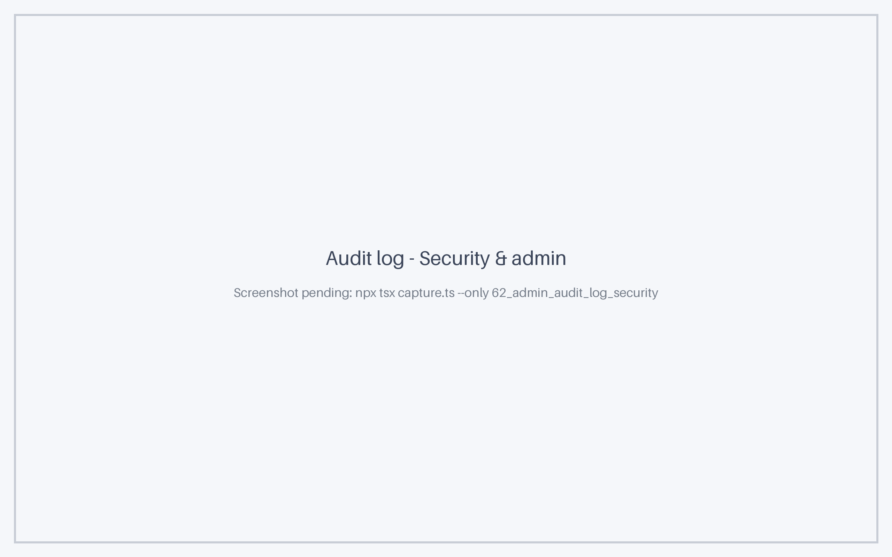

# Registro de auditoría

El **Registro de auditoría**, en **Admin → Configuración → Registro de auditoría** (`/admin/settings?tab=audit-log`), responde a las dos preguntas que una revisión de seguridad plantea a una instancia que contiene el mapa de todo el panorama de TI: *qué ha cambiado en él* y *quién ha iniciado sesión y cómo*. Se divide en dos subpestañas:

| Subpestaña | URL | Qué registra |
|------------|-----|--------------|
| **Cambios** | `/admin/settings?tab=audit-log` | Cada escritura en el panorama — fichas, relaciones, riesgos, etiquetas, roles de partes interesadas, borradores de decisión —, agrupada en lotes de mutación, con un diff por evento y un **Revertir (Rollback)** |
| **Seguridad y administración** | `/admin/settings?tab=audit-log&view=security` | Inicios y cierres de sesión, intentos fallidos, bloqueos, sesiones SSO y de proxy, eventos de contraseña, suplantación de rol y cada acción administrativa |

Las dos están separadas a propósito. **Cambios** es una herramienta de trabajo — existe para que pueda ver y deshacer una escritura errónea — y conserva un historial corto. **Seguridad y administración** es un rastro de evidencias: sus entradas no se pueden editar ni eliminar, y se conserva un año por defecto.

## Quién puede verlo

Ambas subpestañas requieren el permiso **`admin.events`** («Ver el rastro de auditoría y el flujo de eventos»), que por defecto solo tiene el rol **Admin**. Para dar acceso de lectura a un responsable de seguridad o cumplimiento sin hacerlo administrador, cree un rol con `admin.events` en [Usuarios y roles](users.md#roles) y asígneselo.

## Cambios

La subpestaña **Cambios** es el registro de lotes de mutación. Cada escritura que modifica datos llega aquí como un lote, junto con quién la hizo y de dónde vino:

| Origen | Significado |
|--------|-------------|
| **Web** | La interfaz web de Turbo EA |
| **API** | Una llamada directa a la API REST (un script, una integración) |
| **Herramienta de IA** | Un asistente de IA conectado a través del [servidor MCP](mcp.md) |
| **Extensión** | Una [extensión](extensions.md) instalada, registrada como lote `ext:<key>` |

Haga clic en un lote para abrir su panel: el diff por evento muestra el valor anterior y el nuevo de cada campo, y **Revertir** deshace las escrituras en fichas, relaciones, riesgos, roles de partes interesadas, etiquetas y borradores de decisión que realizó.

Los lotes se conservan **`MUTATION_BATCH_RETENTION_DAYS`** días (una variable de entorno, **15** por defecto) y después se purgan automáticamente. Los eventos en sí permanecen en la pestaña **Historial** de cada ficha cuando el lote ya ha desaparecido.

## Seguridad y administración



La subpestaña **Seguridad y administración** muestra una entrada por cada acción relevante para la seguridad, las más recientes primero:

- inicios y cierres de sesión, con contraseña, SSO o a través de un proxy inverso de confianza;
- intentos de inicio de sesión fallidos, cada uno con un **código de motivo** que indica por qué falló;
- bloqueos de cuenta tras fallos repetidos;
- registros de cuentas, y contraseñas establecidas, restablecidas o cambiadas;
- suplantación de rol — un administrador que inicia y detiene **Ver como rol…**;
- acciones administrativas — cambios en usuarios, roles, ajustes, el metamodelo, etiquetas, cálculos, extensiones, importaciones, integraciones, portales públicos y diagramas publicados, encuestas y el acceso de operador (consulte [Acciones administrativas](#administrative-actions));
- exportaciones de datos — las exportaciones CSV y JSON de fichas, las exportaciones del espacio de trabajo y las exportaciones para otra plataforma de EA (consulte [Exportaciones de datos](#data-exports)) — y las exportaciones de este mismo registro.

### Columnas

| Columna | Descripción |
|---------|-------------|
| **Cuándo** | Fecha y hora de la acción |
| **Categoría** | `auth` (autenticación), `admin` (acciones administrativas) o `access` (exportaciones y otros accesos a datos) |
| **Acción** | Qué ocurrió, por ejemplo `auth.login.failed` — consulte el [catálogo de acciones](#action-catalogue) |
| **Resultado** | **Éxito** o **Fallo** |
| **Actor** | El usuario con sesión iniciada que realizó la acción. Vacío cuando nadie había iniciado sesión — en un inicio de sesión fallido, por ejemplo |
| **Sujeto** | La cuenta a la que se refería la acción — la dirección de correo escrita en un inicio de sesión fallido, o el usuario cuya contraseña se restableció |
| **Destino** | El objeto sobre el que se actuó, si lo hay — por ejemplo, el rol elegido al iniciar una suplantación |
| **IP** | La dirección IP del cliente (consulte [Dirección IP del cliente](#client-ip-address)) |
| **Origen** | De dónde vino la solicitud: web, API, herramienta de IA, extensión, ops o sistema |
| **Rol suplantado** | Cuando un administrador estaba viendo la aplicación como otro rol, ese rol. El actor sigue siendo el administrador real |

Las columnas se pueden mostrar, ocultar, reordenar y fijar como en cualquier otra tabla de datos; **Cuándo** y **Acción** se muestran siempre.

### Filtros

La barra lateral de filtros de la izquierda acota la lista por **categoría**, **resultado**, **acción**, **actor**, **dirección IP** y un **intervalo de fechas**. Cada encabezado de sección indica cuántos valores hay seleccionados, y la barra contraída muestra el número de filtros activos. La pestaña **Columnas** de la misma barra muestra, oculta y fija columnas. Sus filtros y la disposición de columnas se recuerdan en este navegador.

Una búsqueda por dirección de correo coincide con el actor, el sujeto y el destino, de modo que escribir una sola dirección encuentra tanto lo que hizo esa persona como lo que se intentó contra su cuenta.

### Leer una entrada

Haga clic en una fila para abrir el panel de la entrada. Muestra cada campo de la entrada — cuándo, quién, desde qué dirección IP y con qué navegador — y, en **Detalles**, lo que la entrada registró, redactado en lenguaje claro en lugar de claves internas:

- **Cambios** — una frase por cambio. La edición de un tipo de ficha se lee, por ejemplo, *Campo «Criticidad de negocio» (Selección única) añadido a la sección «Gobierno»* u *Opción «Alta» del campo «Criticidad de negocio» renombrada a «Crítica»*. Los campos, secciones, opciones, roles y portales se nombran por su etiqueta, los permisos por su descripción y los idiomas por su nombre.
- **Antes / Después** — una tabla de los valores que cambiaron, una fila por campo, cada campo nombrado por su etiqueta. Los valores se formatean: Sí o No, fechas en el formato de fecha del espacio de trabajo, colores como muestra, tamaños de archivo en KB o MB. Los secretos nunca se almacenan: una contraseña, un token o un secreto de cliente se sustituye antes de escribir la entrada y se muestra como **Valor secreto**.
- **Contexto** — datos que enmarcan un cambio sin formar parte de él: la dirección actual de un portal y si está publicado, si se sustituyeron las credenciales de una conexión, cuántas filas afectó una importación.

Un inicio de sesión fallido muestra su **Motivo** encima de los detalles — una contraseña incorrecta, una cuenta desconocida, una cuenta bloqueada temporalmente.

Las entradas escritas antes de la versión 2.161.0 muestran sus detalles tal como se registraron: los valores anteriores y nuevos siguen apareciendo en la tabla, y lo que el panel no sabe leer se muestra como JSON sin procesar.

El panel no ofrece acciones. Las entradas no se pueden editar ni eliminar.

### Exportar CSV

**Exportar CSV**, en la barra de herramientas, descarga las entradas que coinciden con los filtros actuales como archivo CSV, hasta 50 000 filas. La exportación también se registra, como `access.audit_log.exported`, de modo que exportar el registro de seguridad siempre deja rastro en él.

## Catálogo de acciones { #action-catalogue }

| Acción | Se registra cuando |
|--------|--------------------|
| `auth.login.succeeded` | un usuario inicia sesión con correo y contraseña |
| `auth.login.failed` | se rechaza un inicio de sesión con contraseña. El **código de motivo** indica por qué (véase más abajo) |
| `auth.login.locked` | el quinto intento fallido seguido bloquea la cuenta durante 15 minutos. Los detalles indican la hora en que termina el bloqueo |
| `auth.logout` | un usuario con sesión iniciada cierra sesión. Un cierre de sesión sin una sesión válida no registra nada |
| `auth.sso.succeeded` | un usuario inicia sesión a través de un proveedor SSO. Los detalles indican el proveedor, el sujeto del proveedor de identidad y si la cuenta se creó con este inicio de sesión |
| `auth.sso.failed` | se rechaza un inicio de sesión SSO — un dominio no permitido, una dirección de correo ausente, una cuenta local con el mismo correo, una cuenta inactiva. Los detalles indican el proveedor y el motivo |
| `auth.proxy_session.succeeded` | un usuario inicia sesión a través de un [proxy inverso](sso.md#autenticacion-mediante-proxy-inverso) de confianza |
| `auth.proxy_session.failed` | se rechaza un inicio de sesión a través del proxy inverso |
| `auth.register` | un usuario crea una cuenta mediante el autorregistro |
| `auth.password.set` | un usuario invitado establece su primera contraseña |
| `auth.password.reset_requested` | Alguien solicita un correo de restablecimiento de contraseña. Siempre se registra como éxito con la dirección escrita, para que la respuesta no revele nada; los detalles indican si coincidió una cuenta y si se envió un correo |
| `auth.password.reset` | se cambia una contraseña mediante un enlace de restablecimiento |
| `auth.password.changed` | un usuario con sesión iniciada cambia su propia contraseña |
| `auth.impersonation.started` | un administrador inicia **Ver como rol…**. El destino es el rol elegido |
| `auth.impersonation.stopped` | el administrador vuelve a su propio rol |

**Códigos de motivo** de `auth.login.failed`:

| Motivo | Significado |
|--------|-------------|
| `unknown_user` | Ninguna cuenta tiene esa dirección de correo |
| `sso_account` | La cuenta inicia sesión por SSO y no tiene contraseña |
| `no_password` | La cuenta aún no tiene contraseña — una invitación que nunca se aceptó |
| `locked` | La cuenta está bloqueada tras fallos repetidos |
| `bad_password` | La contraseña es incorrecta |
| `inactive` | La cuenta está desactivada |

**Códigos de motivo** de `auth.sso.failed`, `auth.proxy_session.failed`, `auth.password.set` y `auth.password.reset`:

| Motivo | Significado |
|--------|-------------|
| `expired` | El acceso temporal de la cuenta ha terminado |
| `hd_mismatch` | La cuenta de Google pertenece a un dominio no permitido |
| `no_email` | El proveedor de identidad no devolvió ninguna dirección de correo |
| `no_subject` | El proveedor de identidad no devolvió ningún identificador de sujeto |
| `local_account` | Una cuenta local con contraseña ya usa ese correo |
| `no_account` | No existe ninguna cuenta y las cuentas no se crean automáticamente |
| `exchange_failed` | El proveedor de identidad no completó el inicio de sesión |
| `unauthenticated` | El proxy inverso no autenticó la solicitud |
| `identity_rejected` | La identidad transmitida fue rechazada (dominio o correo no verificado) |
| `invalid_token` | El enlace de invitación o de restablecimiento no era válido o ha caducado |

Una ráfaga de fallos `unknown_user` desde una misma dirección IP es el aspecto de un ataque de *password spraying*; una serie de `bad_password` contra una cuenta seguida de `auth.login.locked` es un intento de adivinar la contraseña de esa cuenta.

### Acciones administrativas { #administrative-actions }

Cada cambio que un administrador hace en la configuración de la instancia se registra en la categoría `admin`. El **actor** es el administrador, el **objetivo** es el objeto modificado — un usuario, un rol, un ajuste, un tipo de ficha — con su nombre tal como era en ese momento, y los **detalles** indican qué cambió como valores antiguos y nuevos, limitados a los campos que cambiaron realmente. Dos reglas se aplican a cada entrada:

- **Los secretos se enmascaran.** Una contraseña SMTP, un secreto de cliente SSO, una clave de proveedor de IA, una credencial de ServiceNow o cualquier otro valor secreto se escribe como `***`: la entrada muestra que cambió, nunca lo que era ni lo que pasó a ser.
- **Nunca se almacena el texto de una licencia ni una credencial.** Una licencia de extensión se identifica, no se copia, y una contraseña que un administrador establece para un usuario se registra como cambiada, nunca con su valor.

Un guardado que no cambia nada no se registra, como tampoco un usuario que edita su propio nombre o idioma en su perfil. La configuración extensa — los campos, las traducciones o el diseño de un tipo de ficha, los filtros de un portal — se resume por su tamaño en lugar de copiarse; cuando el tamaño no cambió, se añade una breve huella del contenido, de modo que la entrada sigue mostrando que algo cambió. Las anulaciones de permisos por rol de un tipo de ficha son la excepción: cada celda que cambió se muestra con su valor antiguo y nuevo, y un valor vacío significa que se aplica el permiso propio del rol.

| Área | Acciones | Qué se registra |
|------|---------|------------------|
| **Usuarios y roles** | `admin.user.created`, `.updated`, `.deleted`, `.bulk_updated`, `.bulk_deleted`, `.unlocked`; `admin.user.invitation.resent`, `.deleted`; `admin.role.created`, `.updated`, `.archived`, `.restored`; `admin.stakeholder_role.created`, `.updated`, `.deleted`, `.archived`, `.restored` | Cuentas creadas, editadas, activadas o desactivadas, eliminadas (una a una o en bloque) y desbloqueadas, con los campos cambiados — rol, correo electrónico, nombre, estado activo; invitaciones reenviadas o revocadas; roles de aplicación y roles de partes interesadas por tipo, con los permisos concedidos o retirados |
| **Ajustes** | `admin.settings.updated` | Una entrada por cada ajuste guardado — correo electrónico, autenticación y SSO, registro, IA, MCP, idiomas, activación de módulos, marca, logotipo y favicon, periodos de retención. El objetivo es el ajuste; los detalles son su valor antiguo y nuevo, con los secretos enmascarados |
| **Metamodelo** | `admin.metamodel.type.*` (including `.references_generated`), `admin.metamodel.relation_type.*`, `admin.metamodel.resource_type.*`, `admin.principle.*` (including `.imported`), `admin.regulation.*` | Tipos de ficha, tipos de relación y tipos de recurso creados, cambiados, eliminados o restaurados, con las propiedades cambiadas; referencias de fichas generadas para un tipo; principios EA, incluidos los importados del catálogo; regulaciones de cumplimiento |
| **Etiquetas y cálculos** | `admin.tag_group.*`, `admin.tag.*`, `admin.calculation.*` | Grupos de etiquetas y etiquetas; campos calculados creados, cambiados, eliminados, activados o desactivados, con la fórmula antigua y la nueva, y la ejecución de un cálculo sobre todas las fichas (`.recalculated`) |
| **Extensiones** | `admin.extension.install.uploaded`, `.applied`, `.discarded`; `admin.extension.store.claimed`, `.refreshed`, `.installed`; `admin.extension.enabled`, `.disabled`, `.uninstalled`; `admin.extension.license.updated`, `.removed` | Paquetes subidos, instalados o descartados; licencias y descargas de la tienda de extensiones; extensiones habilitadas, deshabilitadas y desinstaladas; la licencia sustituida o eliminada — con la extensión y su versión, nunca el texto de la licencia |
| **Transferencia de espacio de trabajo y migración** | `admin.workspace.import.uploaded`, `.applied`, `.completed`, `.discarded`; `admin.migration.uploaded`, `.field_mappings.updated`, `.applied`, `.deleted` | Un [paquete de espacio de trabajo](workspace-transfer.md) subido, su importación iniciada, completada o descartada; una [migración de plataforma](migration.md) subida, sus asignaciones de campos editadas, aplicada o eliminada |
| **Integraciones** | `admin.servicenow.connection.*`, `admin.servicenow.mapping.*`, `admin.servicenow.sync.pulled`, `.pushed`, `.applied` | Conexiones de ServiceNow, con las credenciales enmascaradas, y asignaciones; cada extracción, envío y aplicación de registros preparados |
| **Exposición pública** | `admin.web_portal.created`, `.updated`, `.deleted`; `admin.diagram.published`, `.unpublished` | [Portales web](web-portals.md) y diagramas publicados — todo lo que hace que los datos sean accesibles sin una cuenta |
| **Encuestas** | `admin.survey.sent`, `admin.survey.closed` | Una encuesta enviada a sus destinatarios, o cerrada |
| **Acceso de operador** | `admin.ops.rescue_access.granted`, `.revoked` | Acceso de rescate concedido o revocado a través de la [API de operaciones](ops-api.md), registrado junto a los eventos `ops.*` existentes |

### Exportaciones de datos { #data-exports }

Cada vez que los datos salen de la instancia de forma masiva, una entrada `access` registra quién se los llevó, cuántos y en qué formato. La entrada se escribe antes de enviar el archivo, así que una exportación cuya descarga nunca terminó también queda registrada.

| Acción | Se registra cuando | Detalles |
|--------|--------------------|----------|
| `access.export.cards` | Se exportan fichas mediante la exportación CSV o JSON de la API (`/cards/export/csv`, `/cards/export/json`), como hacen los scripts, las integraciones y los asistentes de IA | `format` (`csv` o `json`), `type` (el tipo o tipos de ficha) y `rows` (el número de fichas). El objetivo es el tipo de ficha cuando la exportación abarcó exactamente uno |
| `access.export.workspace` | Se descarga un [paquete de espacio de trabajo](workspace-transfer.md) completo — desde **Transferencia de espacio de trabajo**, o por un plano de control mediante la [API de operaciones](ops-api.md), que no registra ningún actor y sí `requested_by: ops` | `include_archived` y `size_bytes` |
| `access.export.migration` | Se exporta el espacio de trabajo para otra plataforma de EA en **Admin → Configuración → Migración** (consulte [Migración de plataforma](migration.md)) | La plataforma de destino, `include_archived` y `size_bytes` |
| `access.audit_log.exported` | Alguien exporta el registro de seguridad a CSV | `rows` |

## Qué no se registra

- **La renovación del token.** La aplicación web renueva su sesión de forma periódica, así que cada pestaña abierta añadiría entradas y ninguna significaría nada.
- **Las solicitudes rechazadas por un token de sesión caducado o no válido.** Ocurren cada vez que una sesión termina de forma natural.
- **Las lecturas de feeds OData.** Excel y Power BI consultan el feed OData de una vista guardada de forma programada, así que cada actualización añadiría una entrada.
- **Hojas de cálculo y presentaciones generadas en el navegador.** Las descargas de Excel y PowerPoint del inventario y de los informes se construyen con datos que la página ya ha cargado, así que son lecturas, no exportaciones desde el servidor.
- **El simple acceso de lectura** — abrir una ficha, ejecutar un informe, buscar en el inventario.

## Retención { #retention }

Las entradas se conservan **365 días** por defecto. Cámbielo en **Admin → Configuración → General → Gestión de datos → Retención del registro de seguridad**: cualquier número de días hasta 3650, o **0** para conservar las entradas indefinidamente. Una tarea elimina cada noche las entradas más antiguas que ese periodo y vuelve a leer la configuración en cada ejecución, de modo que un cambio surte efecto sin reiniciar.

Esa tarea de retención es lo único que elimina una entrada. No existe ninguna acción de edición ni de eliminación en la interfaz ni en la API, para ningún rol.

El registro **no** forma parte, a propósito, de la [Transferencia de workspace](workspace-transfer.md): es el historial de seguridad de esta instancia, no contenido del workspace, y clonar una instancia no lo copia.

## El flujo de auditoría JSON

El backend también escribe cada entrada como **una línea JSON** en el logger **`turbo_ea.audit`**, en el mismo momento en que se almacena. El backend registra en la salida estándar, así que el flujo llega a lo que ya recoja los registros de sus contenedores — `docker compose logs backend`, la recopilación de registros de Kubernetes o cualquier agente de envío a un SIEM —, sin configuración en Turbo EA:

```bash
docker compose logs -f backend | grep turbo_ea.audit
```

La línea se escribe en el momento en que se registra la entrada. Si la transacción de la solicitud falla después, la línea existe sin fila: la tabla es el registro y el flujo es la señal en directo.

Cada línea lleva los mismos campos que la entrada:

| Campo | Contenido |
|-------|-----------|
| `audit_id`, `created_at` | El identificador de la entrada y el momento en que se escribió |
| `category`, `action`, `outcome` | Qué ocurrió y si tuvo éxito |
| `actor_user_id`, `actor_email` | Quién lo hizo |
| `subject_email` | La cuenta afectada |
| `target_type`, `target_id`, `target_label` | Sobre qué actuó |
| `ip`, `user_agent` | El cliente |
| `origin` | web, api, mcp, ext, ops o system |
| `impersonator_user_id`, `impersonated_role` | Se rellenan mientras un administrador ve la aplicación como otro rol |
| `details` | Hasta cuatro claves, con los secretos ya enmascarados: `reason` (un código de fallo), `changes` (`{field: {old, new}}`), `items` (cambios semánticos, `{kind, …}` — p. ej. `field.added`) y `context` (datos simples) |

Enviar el flujo a un almacén central de registros guarda una copia fuera de la instancia, lejos del alcance de quien pueda administrarla — que es lo que necesita una revisión de amenazas internas. Consulte [Registros y flujo de auditoría](operations.md#logging-and-the-audit-stream) para recopilarlo.

## Dirección IP del cliente { #client-ip-address }

La columna **IP** registra la dirección del cliente, no la del proxy situado delante del backend. El nginx de borde incluido establece la cabecera `X-Real-IP` con la dirección desde la que recibió la conexión, y el backend lee esa cabecera porque la imagen publicada del backend define **`TRUST_PROXY_HEADERS=true`**. Un valor que no es una dirección IP válida se descarta en lugar de registrarse.

- **Deje `TRUST_PROXY_HEADERS` activado** mientras cada solicitud llegue al backend a través del nginx incluido — la pila por defecto, el [chart de Helm](kubernetes.md) y las [plantillas de contenedores gestionados](managed-containers.md) funcionan así.
- **Desactívelo** (`TRUST_PROXY_HEADERS=false`) si expone directamente el contenedor del backend, sin el nginx incluido delante: un cliente podría entonces enviar su propio `X-Real-IP` y elegir la dirección que se registra.
- **Detrás de un balanceador de carga, un controlador de ingress o una CDN**, el nginx incluido recibe cada conexión desde ese intermediario, por lo que por sí solo registra la dirección del balanceador para cada usuario. Defina **`NGINX_TRUSTED_PROXIES`** en el contenedor de nginx, como se describe a continuación.

### Detrás de un balanceador de carga { #behind-a-load-balancer }

`NGINX_TRUSTED_PROXIES` enumera las direcciones de los intermediarios situados delante del nginx incluido, como direcciones IP o rangos CIDR separados por comas o espacios. nginx lee entonces la dirección del cliente del encabezado `X-Forwarded-For` que añaden esos intermediarios —pero solo en una conexión que procede de una de las direcciones enumeradas— y omite cada dirección enumerada en ese encabezado, de modo que una cadena de proxies se resuelve en la primera dirección que no es una de las suyas. Esa dirección sustituye a la de la conexión, y el encabezado `X-Real-IP` que lee el backend la transmite sin cambios. Vacío, el valor predeterminado, no confía en nadie.

Para encontrar el valor, lea el registro de acceso del nginx perimetral (`docker compose logs nginx`, `kubectl logs deployment/turbo-ea-nginx` o el visor de registros de la plataforma): la dirección al principio de cada línea es el intermediario en el que hay que confiar, y el último campo entre comillas es el encabezado `X-Forwarded-For` que envió.

| Despliegue | Dónde definirlo | Valor habitual |
|------------|-----------------|----------------|
| Docker Compose, los navegadores llegan directamente a nginx | — | Dejar vacío |
| Docker Compose detrás de su propio proxy inverso | `NGINX_TRUSTED_PROXIES` en `.env` | La dirección del proxy inverso, tal como la ve nginx |
| [Kubernetes](kubernetes.md) detrás de un controlador de ingress | Valor del chart `nginx.trustedProxies` | El CIDR de pods del clúster, por ejemplo `10.244.0.0/16` |
| [AWS ECS Fargate](managed-containers.md#aws-ecs-fargate) | `NginxTrustedProxies` / Terraform `nginx_trusted_proxies` | Los rangos CIDR de las subredes del balanceador de carga |
| [Azure Container Apps](managed-containers.md#azure-container-apps) | `nginxTrustedProxies` / Terraform `nginx_trusted_proxies` | La subred de infraestructura del entorno |
| [Google Cloud Run](managed-containers.md#google-cloud-run) | `NGINX_TRUSTED_PROXIES` en el manifiesto / Terraform `nginx_trusted_proxies` | Las direcciones que muestra el registro de acceso |

Mantenga la lista tan estrecha como los propios intermediarios. Se cree a cada dirección enumerada cuando nombra al cliente, así que un rango desde el que se conectan sus usuarios —todo `10.0.0.0/8` en un despliegue interno, por ejemplo— permitiría a cualquiera de ellos escribir otra dirección en el registro. Sin configurar, la columna muestra el balanceador de carga: poco útil, pero nunca falsificado.

El límite de frecuencia del inicio de sesión cuenta los intentos por dirección de cliente a partir del mismo encabezado, así que detrás de un balanceador de carga este ajuste también evita que los intentos fallidos de una persona frenen a todos los demás. Esto se aplica a los inicios de sesión que llegan al backend a través del nginx perimetral; el servidor MCP inicia sesión directamente en el backend, por lo que sus propias llamadas de inicio de sesión siguen compartiendo la dirección del contenedor MCP.
