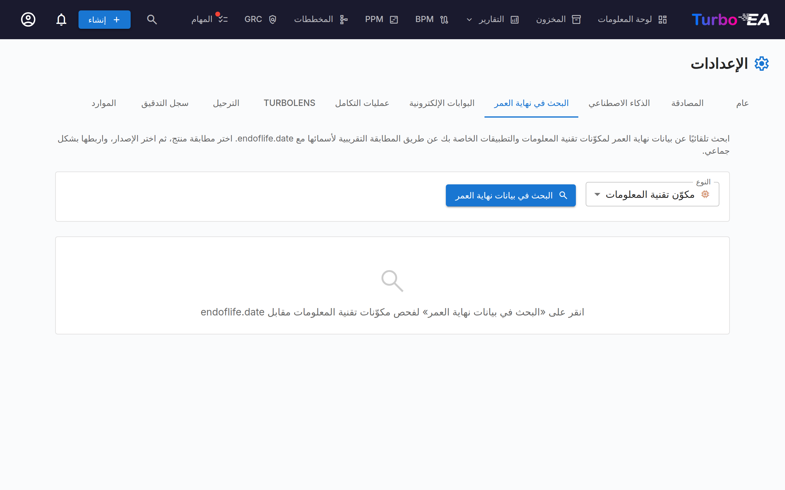
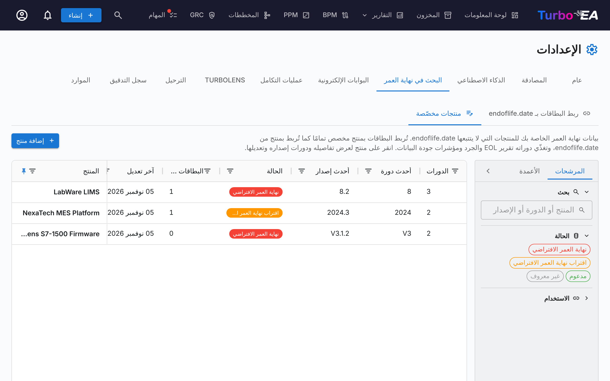
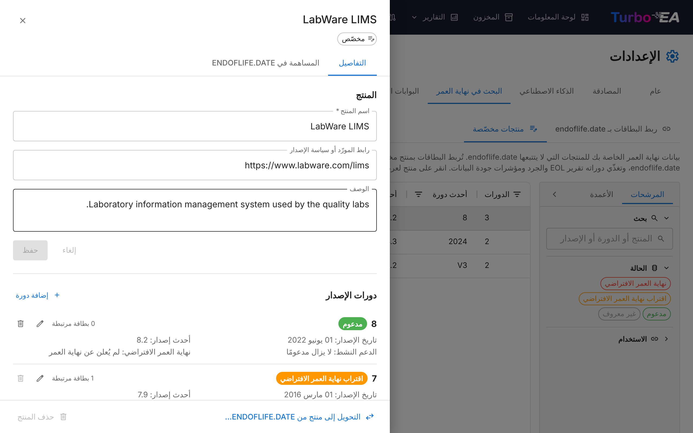

# إدارة نهاية العمر (EOL)

تساعدك صفحة إدارة **EOL** (**Admin > Settings > EOL**) على تتبّع دورات حياة المنتجات التقنية عبر ربط بطاقاتك بقاعدة البيانات العامة [endoflife.date](https://endoflife.date/).

## لماذا تتبّع EOL؟

معرفة متى تصل المنتجات التقنية إلى نهاية العمر أو نهاية الدعم أمر بالغ الأهمية من أجل:

- **إدارة المخاطر** — البرمجيات غير المدعومة عبء أمني
- **تخطيط الميزانية** — خطّط للترحيلات والترقيات قبل انتهاء الدعم
- **الامتثال** — تتطلّب لوائح كثيرة برمجيات مدعومة

## البحث الجماعي

تفحص ميزة البحث الجماعي بطاقات نوع يتتبّع نهاية العمر (**Application** و**IT Component** افتراضيًا، راجع نهاية العمر في أنواع البطاقات الأخرى) وتعثر تلقائيًا على المنتجات المطابقة في قاعدة بيانات endoflife.date.

### تشغيل بحث جماعي

1. انتقل إلى **Admin > Settings > EOL**
2. اختر نوع البطاقة المراد فحصه (أي نوع يتتبّع نهاية العمر)
3. انقر **Search**
4. يُجري النظام **مطابقة ضبابية** مقابل كتالوج منتجات endoflife.date

### مراجعة النتائج

لكل بطاقة، يُرجِع البحث:

- **درجة المطابقة** (0–100%) — مدى تطابق اسم البطاقة مع منتج معروف
- **اسم المنتج** — منتج endoflife.date المطابق
- **الإصدارات/الدورات المتاحة** — إصدارات إطلاق المنتج مع تواريخ دعمها

### تصفية النتائج

استخدم عناصر التحكّم في التصفية للتركيز على:

- **All items** — كل بطاقة جرى فحصها
- **Unlinked only** — البطاقات غير المرتبطة بعد بمنتج EOL
- **Already linked** — البطاقات التي لها بالفعل رابط EOL

يعرض ملخّص إحصائي: إجمالي البطاقات المفحوصة، والمرتبطة بالفعل، وغير المرتبطة، والمطابقات المعثور عليها.

### ربط البطاقات بالمنتجات

1. راجع المطابقة المقترحة لكل بطاقة
2. اختر **إصدار/دورة المنتج** الصحيح من القائمة المنسدلة
3. انقر **Link** لحفظ الارتباط

بمجرد الربط، تعرض صفحة تفاصيل البطاقة **قسم EOL** يتضمّن:

- **اسم المنتج وإصداره** — يُوسَم المنتج المخصّص بـ **مخصّص**
- **حالة الدعم** — مرمّزة بالألوان وبالقاعدة نفسها المتّبعة في تقرير EOL: مدعوم (أخضر)، يقترب من EOL (برتقالي، خلال ستة أشهر من تاريخ EOL أو بعد انتهاء الدعم النشط)، نهاية العمر (أحمر)
- **التواريخ الرئيسية** — تاريخ الإطلاق، نهاية الدعم النشط، تاريخ EOL، وأحدث إصدار وتاريخ إصداره
- **ملاحظات الإصدار** — رابط لصفحة المنتج على endoflife.date، أو **صفحة المورّد** للمنتج المخصّص

لا يرى أزرار **ربط** و**تغيير** و**إلغاء الربط** إلا المستخدمون المسموح لهم بتعديل البطاقة؛ أما الآخرون فيرون التفاصيل فقط. ويحصل مدير EOL أيضًا على اختصار إلى **إدارة المنتجات المخصّصة** عند ربط منتج مخصّص.

## نهاية العمر في أنواع البطاقات الأخرى

تُتتبَّع نهاية العمر افتراضيًا في **Application** و**IT Component**. ويمكن لأي نوع بطاقة آخر، مضمّن أو مخصّص، أن يتتبّعها أيضًا: افتح **Admin > Metamodel**، واختر النوع، وفي **تخطيط البطاقة** الخاص به عطّل **مخفي عن تفاصيل البطاقة** في قسم **نهاية العمر**. ويُخفي المفتاح نفسه نهاية العمر في Application أو IT Component إذا كنت لا تتتبّعها هناك.

هذا المفتاح الواحد يحدّد كل ما يتعلق بنهاية العمر للنوع:

- قسم **نهاية العمر** في بطاقاته (وخيار الربط عند إنشاء بطاقة)،
- مكان النوع في [تقرير EOL](../guide/reports.md) وفي مخطط **تغطية نهاية العمر** ضمن تقرير جودة البيانات وفي مرشّحات نهاية العمر وتجميعاتها في لوحات المعلومات،
- عمود **نهاية العمر** ومرشّحه في [المخزون](../guide/inventory.md)،
- محدّد النوع في **البحث الجماعي** في هذه الصفحة.

إخفاء القسم لا يحذف أي شيء أبدًا: تحتفظ البطاقات بارتباطاتها وتواريخ دورة حياتها، وتعود إلى جميع التقارير عند إظهار القسم من جديد.

## منتجات EOL المخصّصة

يتتبّع endoflife.date البرمجيات الشائعة، لكنه لا يتتبّع كل ما تشغّله: فالمنصة الداخلية أو أداة مورّد متخصصة أو جهاز مرخّص غالبًا لا يكون له إدخال هناك. لهذه الحالات، عرّف **منتج EOL مخصّصًا** — منتجك الخاص بدورات إصدار خاصة بك — واربط البطاقات به تمامًا كما تربطها بمنتج من endoflife.date. تغذّي المنتجات المخصّصة حالة البطاقة نفسها وعمود **نهاية العمر** في المخزون و[تقرير EOL](../guide/reports.md) ومؤشرات جودة البيانات.

تُعرض المنتجات المخصّصة في تبويب **منتجات مخصّصة** ضمن **Admin > Settings > EOL**، بصف واحد لكل منتج. انقر منتجًا لفتح لوحته، حيث تُعدَّل تفاصيله ودورات إصداره. يتطلب إنشاؤها وتعديلها صلاحية **إدارة EOL** (`eol.manage`)، ويمكن لأي شخص يستطيع عرض بيانات EOL رؤيتها ورؤية لوحتها.

### إنشاء منتج مخصّص

هناك طريقتان لإنشاء منتج:

- **من بطاقة** — في قسم **نهاية العمر** في البطاقة، يظهر تحت بحث المنتج سطر هادئ نصّه *ليس على endoflife.date؟* مع رابط **عرّفه كمنتج مخصّص…**، ويبقى ظاهرًا ما دام لم يُحدَّد أي منتج. يُفتح النموذج واسم المنتج معبّأ مسبقًا: بما كتبته في البحث، أو باسم البطاقة إن لم تكتب شيئًا. أضف دوراته الأولى ثم احفظ: تُربط البطاقة بالمنتج والدورة الجديدين دفعة واحدة.
- **من تبويب المنتجات المخصّصة** — انقر **إضافة منتج**.

لكل منتج:

- **اسم المنتج** — كما يظهر في كل مكان. يشتق Turbo EA منه معرّفًا لروابط البطاقات (يحصل منتجان بالاسم نفسه على معرّفين مرقّمين)؛ لا تكتبه أنت أبدًا، ولا يظهر إلا كاسم ملف عند اقتراح المنتج على endoflife.date.
- **رابط المورّد أو سياسة الإصدار** و**الوصف** — اختياريان. عند تفعيل [اقتراحات الذكاء الاصطناعي](ai.md)، يصوغ زر **اقتراح بالذكاء الاصطناعي** الوصف من اسم المنتج ورابط المورّد لتعدّله قبل تطبيقه.
- **دورات الإصدار** — لكل دورة اسم (مثل `2.4`) و**تاريخ الإصدار** ونهاية **الدعم النشط** و**نهاية العمر**، واختياريًا **أحدث إصدار** وتاريخ إصداره.

يقبل الدعم النشط ونهاية العمر كلٌّ منهما تاريخًا (**في تاريخ محدد…**)، أو إحدى إجابتين عندما لا يُعرف تاريخ: *لا يزال مدعومًا* / *انتهى الدعم بالفعل*، و*لم يُعلن عن نهاية العمر* / *انتهى بالفعل*. وكما في endoflife.date، **نهاية العمر مطلوبة** في كل دورة — تاريخ، أو *لم يُعلن عن نهاية العمر*، أو *انتهى بالفعل* — بينما يمكن أن يبقى الدعم النشط *غير معروف*. وتُحسب الحالة منهما بالقاعدة نفسها المطبّقة على منتجات endoflife.date: **نهاية العمر** عند بلوغ تاريخ نهاية العمر أو عند وسم الدورة بـ*انتهى بالفعل*؛ و**يقترب من EOL** خلال الأشهر الستة السابقة لذلك التاريخ، أو عند انتهاء الدعم النشط، سواء بتاريخ أو بـ*انتهى الدعم بالفعل*؛ و**مدعوم** فيما عدا ذلك. وتظهر أي مشكلة في دورة — كغياب الاسم أو غياب نهاية العمر أو نهاية سابقة لتاريخ الإصدار — على الحقل المعني، ولا يمكن حفظ المنتج قبل إصلاحها.

### قائمة المنتجات ولوحة المنتج

يعرض تبويب المنتجات المخصّصة صفًا لكل منتج: عدد **الدورات**، و**أحدث دورة** و**أحدث إصدار**، و**الحالة** — وهي الأسوأ بين دوراته، مع التفصيل لكل دورة في تلميح الشارة — و**البطاقات المرتبطة** التي يمكنك رؤيتها عبر جميع دوراته. ويعمل كالشبكات الأخرى: تثبيت الأعمدة وإعادة ترتيبها، وإظهارها أو إخفاؤها، والتصفية من اللوحة اليسرى بحسب الحالة (حالة المنتج) أو الاستخدام أو بحث في أسماء المنتجات وأسماء الدورات والإصدارات. كما أن **الوصف** و**الرابط** الخاصين بالمنتج متاحان كأعمدة؛ وهما مخفيان في البداية، فعّلهما من تبويب **الأعمدة** في اللوحة.

انقر منتجًا لفتح لوحته على اليمين. يضم تبويب **التفاصيل** اسم المنتج ورابطه ووصفه، ويُحفظ بزر **حفظ**، ودورات إصداره في صفوف، لكل صف حالته وتواريخه وبطاقاته المرتبطة. يفتح **تعديل** حقول الدورة في موضعها؛ ويضيف **إضافة دورة** دورة؛ ويزيل **حذف** دورة. وتُوسَم في القائمة الدورة التي حُفظت قبل أن تصبح نهاية العمر مطلوبة، ويجب تحديد قيمة لها عند تعديلها في المرة التالية. وفي أسفل اللوحة، يؤثر **التحويل إلى منتج من endoflife.date…** و**حذف المنتج** في المنتج بأكمله. وبدون صلاحية إدارة EOL تكون اللوحة للقراءة فقط.

لا يمكن حذف منتج أو دورة ما دامت بطاقات لا تزال مرتبطة به، بما في ذلك البطاقات التي لا يمكنك رؤيتها. ولإيقاف دورة تستخدمها بطاقات، أعد تسميتها بدلًا من ذلك (إعادة التسمية تنقل معها البطاقات المرتبطة بها)، أو اربط تلك البطاقات أولًا بدورة أخرى. ويُعرض رابط المنتج على بطاقاته بوصفه رابط صفحة المورّد.

يمكنك أيضًا إضافة دورة ناقصة من بطاقة: بمجرد اختيار منتج مخصّص في قسم نهاية العمر في البطاقة، تنتهي قائمة الدورات بالخيار **إضافة دورة…**.

### المساهمة بمنتج مخصّص في endoflife.date

إذا كان المنتج المخصّص منتجًا عامًا لمورّد، ففكّر في اقتراحه على endoflife.date ليستفيد الجميع. افتح لوحة المنتج وتبويب **المساهمة في endoflife.date** فيها:

1. اقرأ التحذير: الاقتراح ينشر اسم المنتج وتواريخه. لا تقترح أبدًا منتجات داخلية أو سرّية.
2. أكمل **قائمة التحقق من الجاهزية**: دورة واحدة على الأقل، ونهاية عمر وتاريخ إصدار لكل دورة، ورابط للمورّد أو لسياسة الإصدار، و**فئة** من endoflife.date، ووصف من سطر واحد. يبيّن كل بند غير مستوفى أين يمكن إصلاحه. وتُحفظ الفئة و**ملخص سياسة الإصدار** (الفقرة الواردة تحت البيانات الوصفية الأمامية للملف) في المنتج، فيمكنك العودة إلى المسودة لاحقًا.
3. راجع الملف بصيغة endoflife.date (`products/<identifier>.md`) ثم انقر **فتح على GitHub**. يفتح GitHub ملفًا جديدًا في مستودع endoflife.date مع تعبئة المحتوى (وينشئ نسخة fork من المستودع في حسابك إذا لم تكن لديك صلاحية الكتابة فيه). أودعه (commit) في فرع وافتح طلب السحب من حساب GitHub الخاص بك. وللملفات الطويلة، استخدم **نسخ الملف** بدلًا من ذلك والصقه في ملف جديد.

لا يرسل Turbo EA أي شيء إلى GitHub بنفسه ولا يخزّن أي بيانات اعتماد لـ GitHub. ويراجع endoflife.date كل اقتراح وفق [دليل المساهمة](https://github.com/endoflife-date/endoflife.date/blob/master/CONTRIBUTING.md) الخاص به.

### التحويل إلى endoflife.date

عندما يبدأ endoflife.date بتتبّع منتج كنت تحتفظ به كمنتج مخصّص، تعرض الشبكة بجانبه تلميح **على endoflife.date**. يظهر التلميح فقط عند تطابق وثيق (الاسم نفسه، أو اسم منتجك ضمن اسم endoflife.date)، لذا لا يؤدي إليه اسم قصير على endoflife.date يرد ببساطة داخل اسمك. انقر التلميح في القائمة أو في لوحة المنتج، أو اختر **التحويل إلى منتج من endoflife.date…** في أسفل اللوحة:

1. اختر منتج endoflife.date.
2. لكل دورة من دوراتك، اختر دورة endoflife.date التي يجب أن تنتقل إليها بطاقاتها (تُطابَق الدورات ذات الاسم نفسه تلقائيًا)، أو أبقِها على المنتج المخصّص.
3. اختياريًا، احذف المنتج المخصّص عندما لا ترتبط به أي بطاقة بعد ذلك.

تُنقل البطاقات التي يمكنك رؤيتها فقط. ولا تتغير تواريخ دورة الحياة في البطاقات أبدًا.

## تقرير EOL

تُغذّي بيانات EOL المرتبطة [تقرير EOL](../guide/reports.md)، الذي يوفّر عرض لوحة معلومات لحالة دعم مشهدك التقني عبر جميع البطاقات المرتبطة.

## العثور على ما لم يُربط بعد

يعرض موضعان خارج هذه الصفحة البطاقات التي لا تحمل أي معلومات نهاية عمر — لا ارتباط هنا ولا تاريخ نهاية عمر خاص بها:

- مرشّح **نهاية العمر** وعموده في [المخزون](../guide/inventory.md) — اختر نوع البطاقة، ثم الخيار **(فارغ)**.
- مؤشّر **لا توجد بيانات نهاية عمر** في [تقرير EOL](../guide/reports.md)، ومخطط **تغطية نهاية العمر** في نهاية تقرير جودة البيانات.
