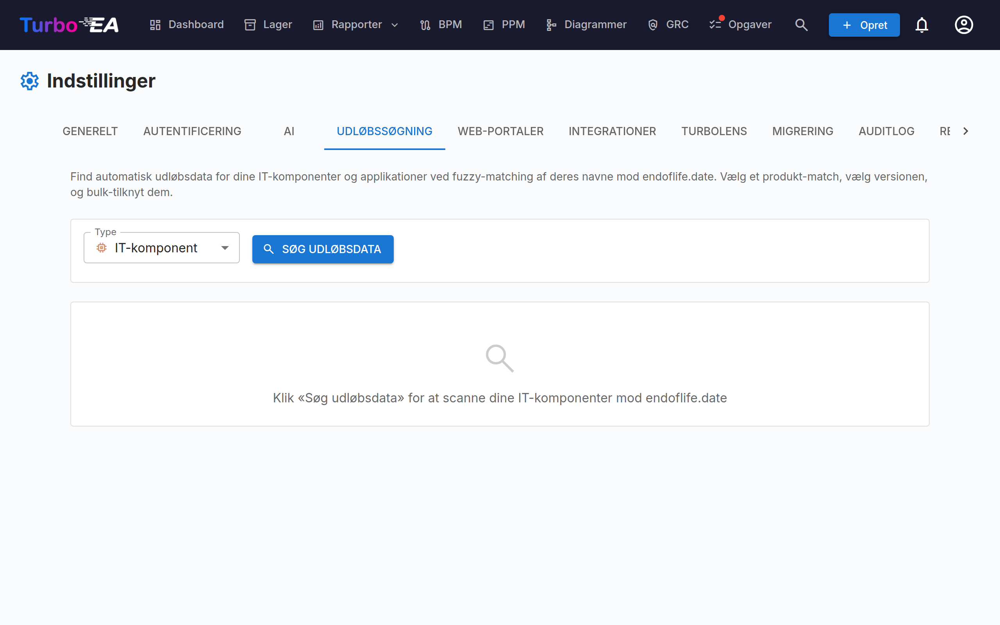
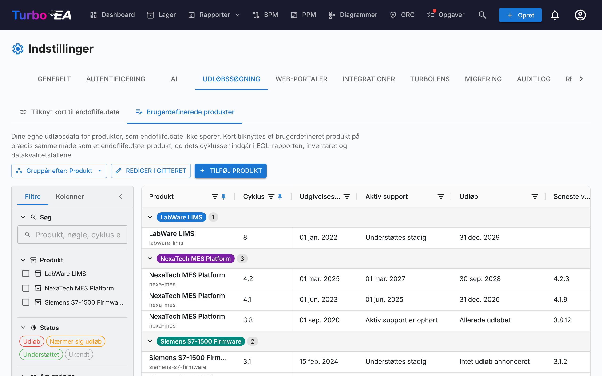

# End-of-Life (EOL)-administration

Administrationssiden **EOL** (**Admin > Indstillinger > EOL**) hjælper dig med at spore teknologi-produktlivscyklusser ved at tilknytte dine kort til den offentlige [endoflife.date](https://endoflife.date/)-database.

## Hvorfor spore EOL?

At vide, hvornår teknologiprodukter når udløb eller end-of-support, er kritisk for:

- **Risikohåndtering** — Ikke-understøttet software er et sikkerhedsansvar
- **Budgetplanlægning** — Planlæg migreringer og opgraderinger, før support slutter
- **Compliance** — Mange reguleringer kræver understøttet software

## Massesøgning

Massesøgningsfunktionen scanner kortene af en type, der sporer End of Life (som standard **Application** og **IT Component**, se [End of life på andre korttyper](#end-of-life-pa-andre-korttyper)), og finder automatisk matchende produkter i endoflife.date-databasen.

### Kørsel af en massesøgning

1. Naviger til **Admin > Indstillinger > EOL**
2. Vælg den korttype, der skal scannes (enhver type, der sporer End of Life)
3. Klik på **Søg**
4. Systemet udfører **fuzzy matching** mod endoflife.date-produktkataloget

### Gennemgang af resultater

For hvert kort returnerer søgningen:

- **Match-score** (0-100%) — Hvor tæt kortnavnet matcher et kendt produkt
- **Produktnavn** — Det matchede endoflife.date-produkt
- **Tilgængelige versioner/cykler** — Produktets udgivelsesversioner med deres supportdatoer

### Filtrering af resultater

Brug filterkontrollerne til at fokusere på:

- **Alle elementer** — Hvert kort, der blev scannet
- **Kun ikke-tilknyttede** — Kort, der endnu ikke er tilknyttet et EOL-produkt
- **Allerede tilknyttede** — Kort, der allerede har et EOL-link

En statistikoversigt viser: total scannede kort, allerede tilknyttede, ikke-tilknyttede og fundne matches.

### Tilknytning af kort til produkter

1. Gennemgå det foreslåede match for hvert kort
2. Vælg den korrekte **produktversion/cyklus** fra dropdown
3. Klik på **Tilknyt** for at gemme associationen

Når det er tilknyttet, viser kortets detaljeside en **EOL-sektion** med:

- **Produktnavn og version** – et brugerdefineret produkt er markeret **Brugerdefineret**
- **Supportstatus** — Farvekodet efter samme regel som EOL-rapporten: Supporteret (grøn), Nærmer sig EOL (orange, inden for seks måneder før EOL-datoen eller når den aktive support er ophørt), End of Life (rød)
- **Nøgledatoer** — Udgivelsesdato, aktiv supportafslutning, EOL-dato, den seneste version og dens udgivelsesdato
- **Udgivelsesnoter** — et link til produktets side på endoflife.date eller **Leverandørside** for et brugerdefineret produkt

Kun brugere, der må redigere kortet, ser **Tilknyt**, **Skift** og **Fjern tilknytning**; alle andre ser kun detaljerne. En EOL-administrator får desuden en genvej til **Administrer brugerdefinerede produkter**, når et brugerdefineret produkt er tilknyttet.

## End of life på andre korttyper

End of Life spores som standard på **Applications** og **IT Components**. Enhver anden korttype, indbygget eller brugerdefineret, kan også spore det: åbn **Admin > Metamodel**, vælg typen, og slå **Skjult fra kortdetalje** fra på sektionen **End of Life** i dens **Kortlayout**. Den samme kontakt skjuler End of Life på Applications eller IT Components, hvis du ikke sporer det dér.

Den ene kontakt afgør alt om End of Life for typen:

- sektionen **End of Life** på dens kort (og tilknytningsvalget, når du opretter et kort),
- typens plads i [EOL-rapporten](../guide/reports.md), i diagrammet **End-of-life-dækning** i Datakvalitetsrapporten og i dashboards' End of Life-filtre og -grupperinger,
- kolonnen og filteret **End of life** i [Inventaret](../guide/inventory.md),
- typevælgeren i **Massesøgning** på denne side.

At skjule sektionen sletter aldrig noget: kortene beholder deres links og livscyklusdatoer, og de vender tilbage i alle rapporter, når sektionen vises igen.

## Brugerdefinerede EOL-produkter

endoflife.date sporer populær software, men ikke alt, hvad du kører: en intern platform, et nicheværktøj fra en leverandør eller en licenseret appliance har ofte ingen post der. For dem kan du definere et **brugerdefineret EOL-produkt** – dit eget produkt med dine egne udgivelsescyklusser – og tilknytte kort til det på præcis samme måde som til et endoflife.date-produkt. Brugerdefinerede produkter indgår i den samme kortstatus, inventarets kolonne **Udløb**, [EOL-rapporten](../guide/reports.md) og datakvalitetstallene.

Brugerdefinerede produkter vises på fanen **Brugerdefinerede produkter** under **Admin > Indstillinger > EOL**. Oprettelse og redigering kræver tilladelsen **Administrer EOL** (`eol.manage`); alle, der kan se EOL-data, kan se dem.

### Oprettelse af et brugerdefineret produkt

Der er to måder at oprette et på:

- **Fra et kort** – søg efter produktet i kortets sektion **Udløb**. Når endoflife.date ikke har noget match, tilbyder sektionen **Opret brugerdefineret produkt**, forudfyldt med det, du skrev (eller kortets navn). Angiv produktnavnet og de første cyklusser, og gem: Kortet tilknyttes derefter det nye produkt og den nye cyklus i ét hug.
- **Fra fanen Brugerdefinerede produkter** – klik på **Tilføj produkt**.

Hvert produkt har:

- **Produktnavn** – sådan vises det overalt. Turbo EA udleder en identifikator ud fra det til korttilknytninger (to produkter med samme navn får nummererede identifikatorer); du indtaster den aldrig, og den vises kun som filnavn, når du foreslår produktet til endoflife.date.
- **Link til leverandør eller udgivelsespolitik** og **Beskrivelse** – valgfrit. Når [AI-forslag](ai.md) er aktiveret, udarbejder **Foreslå med AI** beskrivelsen ud fra produktnavnet og leverandørlinket, så du kan redigere den, før du anvender den.
- **Udgivelsescyklusser** – hver med et navn (for eksempel `2.4`), en **Udgivelsesdato**, et ophør af **Aktiv support**, et **Udløb** og eventuelt den **Seneste version** og dens udgivelsesdato.

Aktiv support og udløb tager hver en dato (**På en dato…**) eller et af to svar, når ingen dato er kendt: *Understøttes stadig* / *Support allerede udløbet* og *Intet udløb annonceret* / *Allerede udløbet*; *Ukendt* registrerer intet. Statussen (Understøttet, Nærmer sig EOL, Udløbet) udledes af dem efter samme regel som for endoflife.date-produkter. Et problem med en cyklus – intet navn, et slut før udgivelsesdatoen – vises på det berørte felt, og produktet kan ikke gemmes, før det er rettet.

### Administration af cyklusser i gitteret

Fanen Brugerdefinerede produkter viser én række pr. udgivelsescyklus, grupperet efter produkt. Den fungerer som de andre gitre: frys og omarranger kolonner, vis eller skjul dem, og filtrer efter produkt, status eller anvendelse i panelet til venstre. Kolonnen **Tilknyttede kort** viser, hvor mange af de kort, du kan se, der bruger hver cyklus. Produktets **Beskrivelse** og **Link** er også tilgængelige som kolonner; de er skjult fra start, så slå dem til fra fanen **Kolonner** i panelet.

Klik på **Rediger i gitteret** for at ændre celler direkte. Datoer og supportsvar åbner en lille editor, og du kan trække en celles værdi ned gennem en kolonne (som i Excel) for at kopiere den til flere cyklusser. Rækkemenuen (**⋮**) tilføjer en cyklus til produktet, redigerer produktets navn, link og beskrivelse eller sletter en cyklus eller produktet.

Et produkt eller en cyklus kan ikke slettes, så længe kort stadig er tilknyttet, heller ikke kort, du ikke kan se. For at udfase en cyklus, som kort bruger, skal du i stedet omdøbe den (omdøbning flytter de tilknyttede kort med) eller først tilknytte kortene til en anden cyklus. Et produkts link tilbydes på dets kort som link til udgivelsesnoter.

Du kan også tilføje en manglende cyklus fra et kort: Når et brugerdefineret produkt er valgt i kortets sektion Udløb, slutter cykluslisten med **Tilføj cyklus …**.

### Bidrag med et brugerdefineret produkt til endoflife.date

Hvis et brugerdefineret produkt er et offentligt leverandørprodukt, så overvej at foreslå det til endoflife.date, så alle får gavn af det. Vælg **Foreslå til endoflife.date** i rækkemenuen:

1. Læs advarslen: Et forslag offentliggør produktnavnet og dets datoer. Foreslå aldrig interne eller fortrolige produkter.
2. Vælg endoflife.date-**kategorien**. Dialogen viser en forhåndsvisning af produktfilen i endoflife.dates format (`products/<identifier>.md`).
3. Klik på **Åbn på GitHub**. GitHub åbner en ny fil i endoflife.date-repositoriet med indholdet udfyldt (det tilbyder at forke repositoriet, hvis du ikke kan skrive til det). Færdiggør beskrivelsen og resuméet af udgivelsespolitikken, og opret derefter pull requesten fra din egen GitHub-konto. Ved lange filer kan du i stedet bruge **Kopiér fil** og indsætte den i en ny fil.

Turbo EA sender aldrig selv noget til GitHub og gemmer ingen GitHub-legitimationsoplysninger. endoflife.date gennemgår hvert forslag ud fra sin [bidragsvejledning](https://github.com/endoflife-date/endoflife.date/blob/master/CONTRIBUTING.md).

### Skift til endoflife.date

Når endoflife.date begynder at spore et produkt, du havde beholdt som brugerdefineret, viser gitteret et tip **På endoflife.date** ved siden af det. Tippet vises kun ved et tæt match (samme navn, eller dit produkts navn indeholdt i endoflife.date-navnet), så et kort endoflife.date-navn, der blot forekommer inde i dit, udløser det ikke. Klik på tippet, eller vælg **Skift til et endoflife.date-produkt …** i rækkemenuen:

1. Vælg endoflife.date-produktet.
2. Vælg for hver af dine cyklusser den endoflife.date-cyklus, som dens kort skal flyttes til (cyklusser med samme navn matches automatisk), eller behold den på det brugerdefinerede produkt.
3. Slet eventuelt det brugerdefinerede produkt, når intet kort er tilknyttet det længere.

Kun de kort, du kan se, flyttes. Livscyklusdatoer på kortene ændres aldrig.

## EOL-rapport

Tilknyttede EOL-data fødes ind i [EOL-rapporten](../guide/reports.md), som leverer en dashboard-visning af dit teknologilandskabs supportstatus på tværs af alle tilknyttede kort.

## Find det, der endnu ikke er tilknyttet

To steder uden for denne side viser de kort, der slet ingen end-of-life-oplysninger har — hverken et link her eller en selvangivet End of Life-dato:

- Filteret og kolonnen **End of life** i [Inventaret](../guide/inventory.md) — vælg en korttype, og derefter **(tom)**.
- Tallet **Ingen EOL-data** i [EOL-rapporten](../guide/reports.md) og diagrammet **End-of-life-dækning** nederst i datakvalitetsrapporten.
