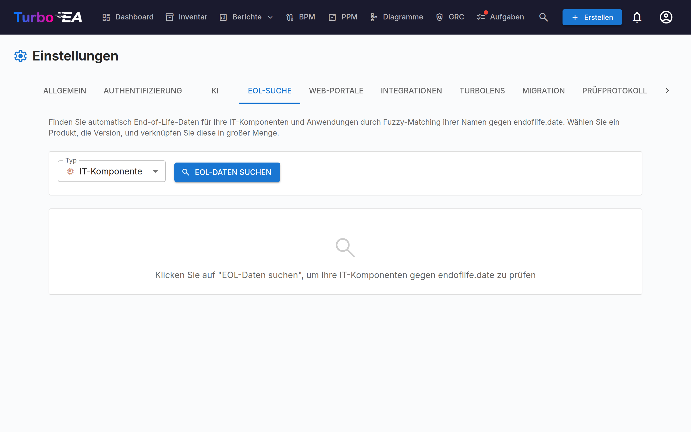
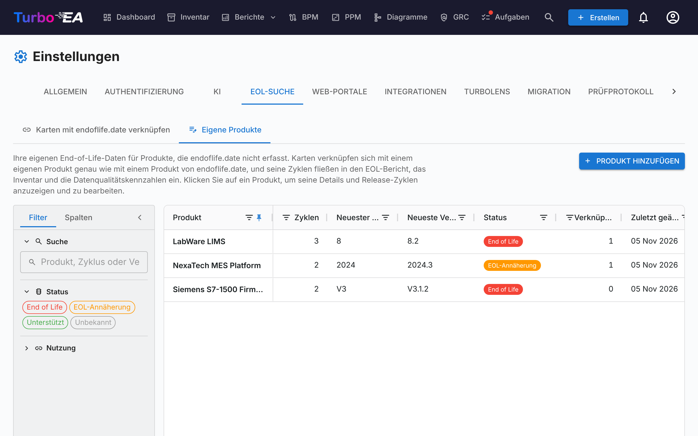
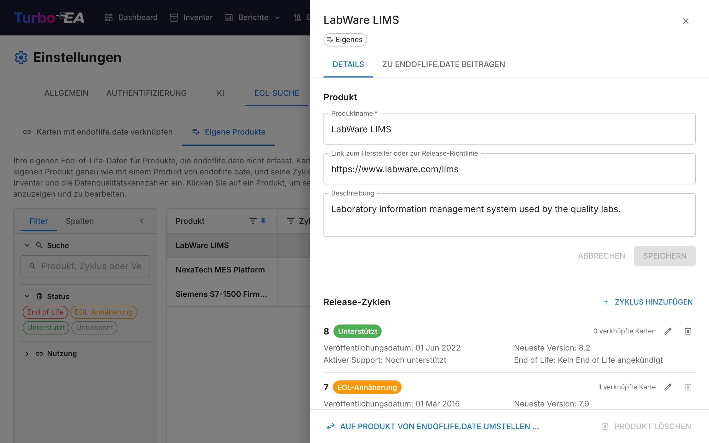

# End-of-Life (EOL) Verwaltung

Die **EOL**-Administrationsseite (**Admin > Einstellungen > EOL**) hilft Ihnen, Technologieprodukt-Lebenszyklen zu verfolgen, indem Sie Ihre Karten mit der öffentlichen [endoflife.date](https://endoflife.date/)-Datenbank verknüpfen.

## Warum EOL verfolgen?

Zu wissen, wann Technologieprodukte das Lebensende oder den Support-Ablauf erreichen, ist entscheidend für:

- **Risikomanagement** — Nicht unterstützte Software ist ein Sicherheitsrisiko
- **Budgetplanung** — Migrationen und Upgrades vor dem Support-Ende planen
- **Compliance** — Viele Vorschriften erfordern unterstützte Software

## Massensuche

Die Massensuchfunktion durchsucht die Karten eines Typs, der das Lebensende verfolgt (standardmäßig **Anwendung** und **IT-Komponente**, siehe [Lebensende bei anderen Kartentypen](#lebensende-bei-anderen-kartentypen)), und findet automatisch passende Produkte in der endoflife.date-Datenbank.

### Eine Massensuche ausführen

1. Navigieren Sie zu **Admin > Einstellungen > EOL**
2. Wählen Sie den zu durchsuchenden Kartentyp (jeder Typ, der das Lebensende verfolgt)
3. Klicken Sie auf **Suchen**
4. Das System führt einen **Fuzzy-Abgleich** mit dem endoflife.date-Produktkatalog durch

### Ergebnisse überprüfen

Für jede Karte liefert die Suche:

- **Übereinstimmungswert** (0–100%) — Wie genau der Kartenname mit einem bekannten Produkt übereinstimmt
- **Produktname** — Das übereinstimmende endoflife.date-Produkt
- **Verfügbare Versionen/Zyklen** — Die Produktversionen mit ihren Support-Daten

### Ergebnisse filtern

Verwenden Sie die Filtersteuerungen, um sich zu fokussieren auf:

- **Alle Einträge** — Jede gescannte Karte
- **Nur unverknüpfte** — Karten, die noch nicht mit einem EOL-Produkt verknüpft sind
- **Bereits verknüpfte** — Karten, die bereits eine EOL-Verknüpfung haben

Eine Statistikzusammenfassung zeigt: gescannte Karten insgesamt, bereits verknüpft, unverknüpft und gefundene Übereinstimmungen.

### Karten mit Produkten verknüpfen

1. Überprüfen Sie den vorgeschlagenen Abgleich für jede Karte
2. Wählen Sie die richtige **Produktversion/den richtigen Zyklus** aus dem Dropdown
3. Klicken Sie auf **Verknüpfen**, um die Zuordnung zu speichern

Einmal verknüpft, zeigt die Kartendetailseite einen **EOL-Abschnitt** mit:

- **Produktname und Version** — ein eigenes Produkt ist als **Eigenes** gekennzeichnet
- **Supportstatus** — Farbcodiert, nach derselben Regel wie im EOL-Bericht: Unterstützt (grün), EOL nähert sich (orange, innerhalb von sechs Monaten vor dem EOL-Datum oder sobald der aktive Support beendet ist), Lebensende (rot)
- **Wichtige Daten** — Veröffentlichungsdatum, Ende des aktiven Supports, EOL-Datum, die neueste Version und ihr Veröffentlichungsdatum
- **Versionshinweise** — ein Link zur Produktseite auf endoflife.date oder die **Herstellerseite** eines eigenen Produkts

Nur Benutzer, die die Karte bearbeiten dürfen, sehen **Verknüpfen**, **Ändern** und **Verknüpfung aufheben**; alle anderen sehen nur die Details. Ein EOL-Manager erhält zudem eine Verknüpfung zu **Eigene Produkte verwalten**, wenn ein eigenes Produkt verknüpft ist.

## Lebensende bei anderen Kartentypen

Das Lebensende wird standardmäßig bei **Anwendungen** und **IT-Komponenten** verfolgt. Jeder andere Kartentyp, ob vordefiniert oder benutzerdefiniert, kann es ebenfalls verfolgen: Öffnen Sie **Admin > Metamodell**, wählen Sie den Typ und deaktivieren Sie in seinem **Kartenlayout** beim Abschnitt **Lebensende** die Option **Im Kartendetail ausgeblendet**. Derselbe Schalter blendet das Lebensende bei Anwendungen oder IT-Komponenten aus, wenn Sie es dort nicht verfolgen.

Dieser eine Schalter entscheidet über alles, was das Lebensende des Typs betrifft:

- den Abschnitt **Lebensende** auf seinen Karten (und die Verknüpfungsoption beim Erstellen einer Karte),
- den Platz des Typs im [EOL-Bericht](../guide/reports.md), im Diagramm **End-of-Life-Abdeckung** des Datenqualitätsberichts sowie in den Lebensende-Filtern und -Gruppierungen der Dashboards,
- die Spalte und den Filter **Lebensende** im [Inventar](../guide/inventory.md),
- die Typauswahl der **Massensuche** auf dieser Seite.

Das Ausblenden des Abschnitts löscht nie etwas: Die Karten behalten ihre Verknüpfungen und Lebenszyklusdaten und erscheinen wieder in allen Berichten, sobald der Abschnitt erneut angezeigt wird.

## Eigene EOL-Produkte

endoflife.date erfasst verbreitete Software, aber nicht alles, was Sie betreiben: Eine hauseigene Plattform, ein Nischenwerkzeug eines Herstellers oder eine lizenzierte Appliance hat dort oft keinen Eintrag. Für diese definieren Sie ein **eigenes EOL-Produkt** – Ihr eigenes Produkt mit eigenen Release-Zyklen – und verknüpfen Karten damit genau wie mit einem Produkt von endoflife.date. Eigene Produkte speisen denselben Kartenstatus, die Inventarspalte **End of Life**, den [EOL-Bericht](../guide/reports.md) und die Datenqualitätskennzahlen.

Eigene Produkte werden auf dem Tab **Eigene Produkte** unter **Admin > Einstellungen > EOL** aufgelistet, eine Zeile pro Produkt. Klicken Sie auf ein Produkt, um sein Panel zu öffnen, in dem seine Details und Release-Zyklen bearbeitet werden. Zum Erstellen und Bearbeiten ist die Berechtigung **EOL verwalten** (`eol.manage`) erforderlich; jeder, der EOL-Daten sehen darf, kann sie und ihr Panel einsehen.

### Ein eigenes Produkt erstellen

Es gibt zwei Wege:

- **Von einer Karte aus** – unter der Produktsuche im Abschnitt **End of Life** der Karte steht eine dezente Zeile *Nicht bei endoflife.date?* mit einem Link **Als eigenes Produkt definieren …**, sichtbar, solange kein Produkt ausgewählt ist. Das Formular öffnet sich mit bereits ausgefülltem Produktnamen: Ihrer Eingabe in der Suche oder, falls Sie nichts eingegeben haben, dem Namen der Karte. Fügen Sie die ersten Zyklen hinzu und speichern Sie: Die Karte wird dann in einem Schritt mit dem neuen Produkt und Zyklus verknüpft.
- **Vom Tab Eigene Produkte aus** – klicken Sie auf **Produkt hinzufügen**.

Jedes Produkt hat:

- **Produktname** – so wird es überall angezeigt. Turbo EA leitet daraus einen Bezeichner für Kartenverknüpfungen ab (zwei Produkte mit demselben Namen erhalten nummerierte Bezeichner); Sie geben ihn nie ein, und er erscheint nur als Dateiname, wenn Sie das Produkt bei endoflife.date vorschlagen.
- **Link zum Hersteller oder zur Release-Richtlinie** und **Beschreibung** – optional. Sind [KI-Vorschläge](ai.md) aktiviert, verfasst **Mit KI vorschlagen** die Beschreibung aus dem Produktnamen und dem Herstellerlink, damit Sie sie vor dem Übernehmen bearbeiten können.
- **Release-Zyklen** – jeweils mit einem Namen (zum Beispiel `2.4`), einem **Veröffentlichungsdatum**, einem Ende des **aktiven Supports**, einem **End of Life** und optional der **Neuesten Version** samt Veröffentlichungsdatum.

Aktiver Support und End of Life nehmen jeweils ein Datum (**An einem Datum …**) oder eine von zwei Angaben, wenn kein Datum bekannt ist: *Noch unterstützt* / *Support bereits beendet* sowie *Kein End of Life angekündigt* / *Bereits beendet*. Wie bei endoflife.date ist **End of Life bei jedem Zyklus erforderlich** – ein Datum, *Kein End of Life angekündigt* oder *Bereits beendet* –, während Aktiver Support *Unbekannt* bleiben darf. Der Status wird daraus nach derselben Regel wie bei Produkten von endoflife.date berechnet: **End of Life**, sobald das End-of-Life-Datum erreicht ist oder *Bereits beendet* gesetzt wurde; **EOL nähert sich** innerhalb von sechs Monaten vor diesem Datum oder sobald der aktive Support beendet ist, sei es per Datum oder per *Support bereits beendet*; sonst **Unterstützt**. Ein Problem bei einem Zyklus – kein Name, kein End of Life, ein Ende vor dem Veröffentlichungsdatum – wird am betroffenen Feld angezeigt, und das Produkt kann erst gespeichert werden, wenn es behoben ist.

### Produktliste und Produkt-Panel

Der Tab „Eigene Produkte“ zeigt eine Zeile pro Produkt: die Anzahl seiner **Zyklen**, den **Neuesten Zyklus** und die **Neueste Version**, seinen **Status** – den schlechtesten über alle Zyklen, mit der Aufschlüsselung je Zyklus im Tooltip des Chips – sowie die **Verknüpften Karten**, die Sie über alle seine Zyklen hinweg sehen können. Er funktioniert wie die anderen Raster: Spalten fixieren und neu anordnen, ein- oder ausblenden und im linken Panel nach Status (dem Status des Produkts), Nutzung oder per Suche über Produktnamen, Zyklusnamen und Versionen filtern. **Beschreibung** und **Link** des Produkts sind ebenfalls als Spalten verfügbar; sie sind zunächst ausgeblendet, schalten Sie sie auf dem Tab **Spalten** des Panels ein.

Klicken Sie auf ein Produkt, um rechts sein Panel zu öffnen. Der Tab **Details** enthält Name, Link und Beschreibung des Produkts, die mit **Speichern** gesichert werden, sowie seine Release-Zyklen als Zeilen, jeweils mit Status, Daten und verknüpften Karten. **Bearbeiten** öffnet die Felder eines Zyklus direkt in der Zeile, **Zyklus hinzufügen** fügt einen hinzu und **Löschen** entfernt einen. Ein Zyklus, der gespeichert wurde, bevor End of Life erforderlich wurde, wird in der Liste markiert und braucht bei der nächsten Bearbeitung einen Wert. Am Ende des Panels wirken **Auf Produkt von endoflife.date umstellen …** und **Produkt löschen** auf das gesamte Produkt. Ohne die Berechtigung „EOL verwalten“ ist das Panel schreibgeschützt.

Ein Produkt oder ein Zyklus kann nicht gelöscht werden, solange noch Karten darauf verweisen – auch Karten, die Sie nicht sehen können. Um einen von Karten genutzten Zyklus auszumustern, benennen Sie ihn stattdessen um (die Umbenennung nimmt die mit ihm verknüpften Karten mit) oder verknüpfen Sie diese Karten zuerst mit einem anderen Zyklus. Der Link eines Produkts wird an seinen Karten als Link zur Herstellerseite angeboten.

Einen fehlenden Zyklus können Sie auch an einer Karte hinzufügen: Sobald im Abschnitt End of Life der Karte ein eigenes Produkt ausgewählt ist, endet die Zyklenliste mit **Zyklus hinzufügen …**.

### Ein eigenes Produkt zu endoflife.date beitragen

Ist ein eigenes Produkt ein öffentliches Herstellerprodukt, sollten Sie erwägen, es bei endoflife.date vorzuschlagen, damit alle profitieren. Öffnen Sie das Panel des Produkts und seinen Tab **Zu endoflife.date beitragen**:

1. Lesen Sie die Warnung: Das Vorschlagen veröffentlicht den Produktnamen und seine Daten. Schlagen Sie niemals hauseigene oder vertrauliche Produkte vor.
2. Arbeiten Sie die **Bereitschafts-Checkliste** ab: mindestens ein Zyklus, ein End of Life und ein Veröffentlichungsdatum bei jedem Zyklus, ein Link zum Hersteller oder zur Release-Richtlinie, eine **Kategorie** von endoflife.date und eine einzeilige Beschreibung. Jeder offene Punkt nennt, wo er zu beheben ist. Die Kategorie und die **Zusammenfassung der Release-Richtlinie** (der Absatz unter dem Front Matter der Datei) werden am Produkt gespeichert, sodass Sie später an einem Entwurf weiterarbeiten können.
3. Prüfen Sie die Datei im Format von endoflife.date (`products/<identifier>.md`) und klicken Sie dann auf **Auf GitHub öffnen**. GitHub öffnet eine neue Datei im Repository von endoflife.date mit ausgefülltem Inhalt (es legt einen Fork des Repositorys in Ihrem Konto an, wenn Sie nicht schreiben dürfen). Committen Sie sie in einen Branch und erstellen Sie den Pull Request von Ihrem eigenen GitHub-Konto aus. Bei langen Dateien verwenden Sie stattdessen **Datei kopieren** und fügen sie in eine neue Datei ein.

Turbo EA sendet selbst nie etwas an GitHub und speichert keine GitHub-Zugangsdaten. endoflife.date prüft jeden Vorschlag anhand seines [Beitragsleitfadens](https://github.com/endoflife-date/endoflife.date/blob/master/CONTRIBUTING.md).

### Auf endoflife.date umstellen

Beginnt endoflife.date, ein Produkt zu erfassen, das Sie als eigenes geführt haben, zeigt das Raster daneben den Hinweis **Auf endoflife.date** an. Der Hinweis erscheint nur bei einer engen Übereinstimmung, also bei gleichem Namen oder wenn der Name Ihres Produkts im Namen auf endoflife.date enthalten ist; ein kurzer Name auf endoflife.date, der nur zufällig in Ihrem vorkommt, löst ihn nicht aus. Klicken Sie auf den Hinweis, in der Liste oder im Panel des Produkts, oder wählen Sie am Ende des Panels **Auf Produkt von endoflife.date umstellen …**:

1. Wählen Sie das Produkt von endoflife.date.
2. Wählen Sie für jeden Ihrer Zyklen den Zyklus von endoflife.date, auf den seine Karten wechseln sollen (Zyklen mit demselben Namen werden automatisch zugeordnet), oder belassen Sie ihn beim eigenen Produkt.
3. Löschen Sie optional das eigene Produkt, sobald keine Karte mehr damit verknüpft ist.

Es werden nur die für Sie sichtbaren Karten umgestellt. Die Lebenszyklusdaten der Karten werden nie geändert.

## EOL-Bericht

Verknüpfte EOL-Daten fließen in den [EOL-Bericht](../guide/reports.md) ein, der eine Dashboard-Ansicht des Supportstatus Ihrer Technologielandschaft über alle verknüpften Karten hinweg bietet.

## Finden, was noch nicht verknüpft ist

Zwei Stellen außerhalb dieser Seite listen die Karten ganz ohne End-of-Life-Informationen — weder eine Verknüpfung hier noch ein eigenes Lebensende-Datum:

- Der Filter und die Spalte **Lebensende** im [Inventar](../guide/inventory.md) — Kartentyp wählen, dann die Option **(leer)**.
- Die Kennzahl **Keine EOL-Daten** im [EOL-Bericht](../guide/reports.md) und das Diagramm **End-of-Life-Abdeckung** am Ende des Datenqualitätsberichts.
