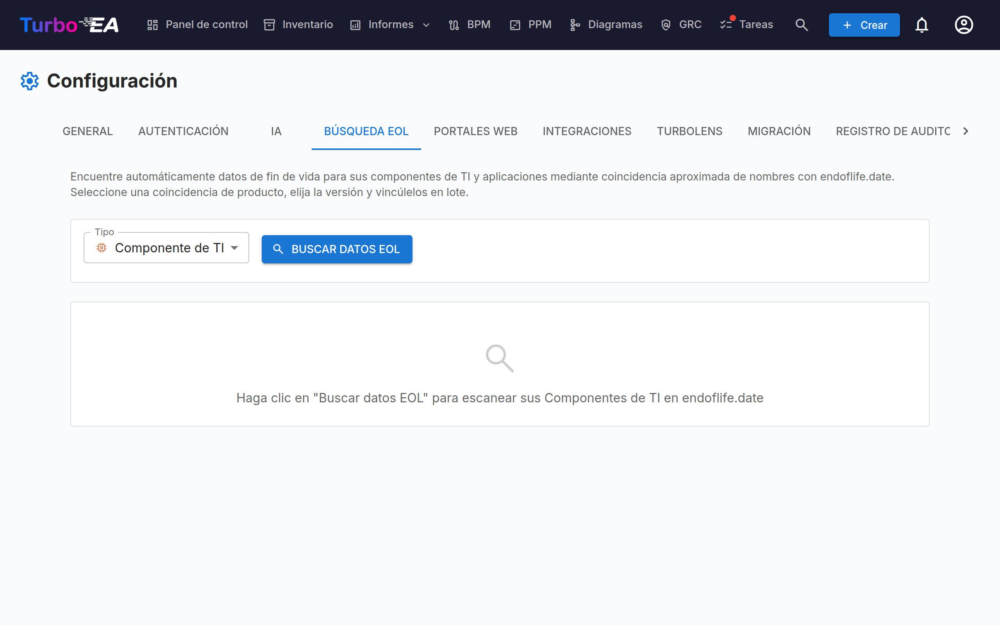
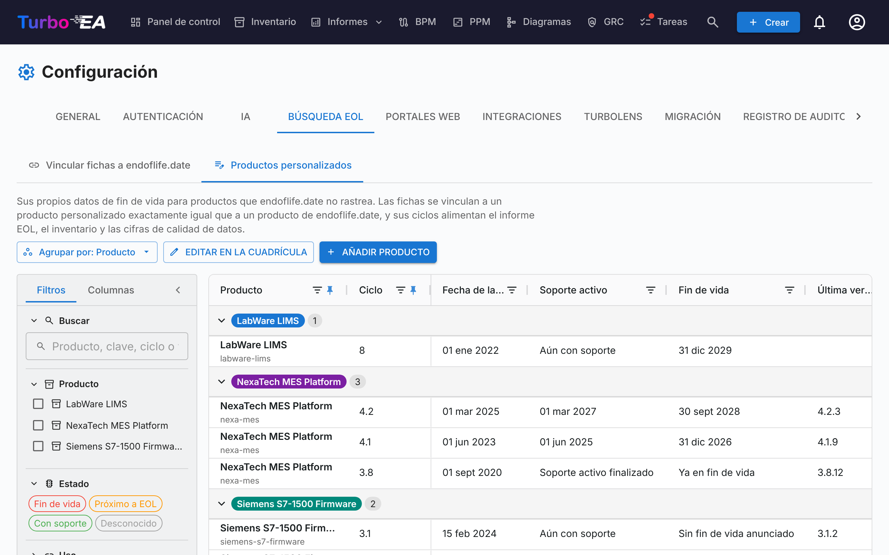

# Gestión de Fin de Vida (EOL)

La página de administración de **EOL** (**Administrador > Configuración > EOL**) le ayuda a realizar el seguimiento de los ciclos de vida de productos tecnológicos vinculando sus fichas a la base de datos pública [endoflife.date](https://endoflife.date/).

## ¿Por Qué Realizar el Seguimiento de EOL?

Saber cuándo los productos tecnológicos alcanzan el fin de vida o el fin de soporte es fundamental para:

- **Gestión de riesgos** — El software sin soporte es un riesgo de seguridad
- **Planificación presupuestaria** — Planifique migraciones y actualizaciones antes de que finalice el soporte
- **Cumplimiento normativo** — Muchas regulaciones exigen software con soporte vigente

## Búsqueda Masiva

La función de búsqueda masiva analiza las fichas de un tipo que realiza el seguimiento del fin de vida (**Aplicación** y **Componente TI** por defecto, véase [Fin de vida en otros tipos de ficha](#fin-de-vida-en-otros-tipos-de-ficha)) y encuentra automáticamente productos coincidentes en la base de datos endoflife.date.

### Ejecución de una Búsqueda Masiva

1. Navegue a **Administrador > Configuración > EOL**
2. Seleccione el tipo de ficha a analizar (cualquier tipo que realice el seguimiento del fin de vida)
3. Haga clic en **Buscar**
4. El sistema realiza una **coincidencia difusa** contra el catálogo de productos de endoflife.date

### Revisión de Resultados

Para cada ficha, la búsqueda devuelve:

- **Puntuación de coincidencia** (0-100%) — Qué tan estrechamente coincide el nombre de la ficha con un producto conocido
- **Nombre del producto** — El producto coincidente de endoflife.date
- **Versiones/ciclos disponibles** — Las versiones del producto con sus fechas de soporte

### Filtrado de Resultados

Utilice los controles de filtro para centrarse en:

- **Todos los elementos** — Todas las fichas que fueron analizadas
- **Solo sin vincular** — Fichas que aún no están vinculadas a un producto EOL
- **Ya vinculadas** — Fichas que ya tienen un vínculo EOL

Un resumen estadístico muestra: total de fichas analizadas, ya vinculadas, sin vincular y coincidencias encontradas.

### Vinculación de Fichas a Productos

1. Revise la coincidencia sugerida para cada ficha
2. Seleccione la **versión/ciclo del producto** correcta en el menú desplegable
3. Haga clic en **Vincular** para guardar la asociación

Una vez vinculada, la página de detalle de la ficha muestra una **sección EOL** con:

- **Nombre del producto y versión**
- **Estado de soporte** — Codificado por colores: Con soporte (verde), Próximo a EOL (naranja), Fin de Vida (rojo)
- **Fechas clave** — Fecha de lanzamiento, fin de soporte activo, fin de soporte de seguridad, fecha EOL

## Fin de vida en otros tipos de ficha

El fin de vida se sigue por defecto en las **Aplicaciones** y los **Componentes TI**. Cualquier otro tipo de ficha, integrado o personalizado, también puede seguirlo: abra **Administrador > Metamodelo**, elija el tipo y, en su **Diseño de ficha**, desactive **Oculta del detalle de ficha** en la sección **Fin de vida**. Ese mismo interruptor oculta el fin de vida en Aplicaciones o Componentes TI si no lo sigue allí.

Ese único interruptor decide todo lo relativo al fin de vida del tipo:

- la sección **Fin de vida** de sus fichas (y la opción de vinculación al crear una ficha),
- el lugar del tipo en el [Informe EOL](../guide/reports.md), en el gráfico **Cobertura de fin de vida** del informe de Calidad de datos y en los filtros y agrupaciones de fin de vida de los paneles,
- la columna y el filtro **Fin de vida** del [Inventario](../guide/inventory.md),
- el selector de tipo de la **Búsqueda masiva** de esta página.

Ocultar la sección nunca elimina nada: las fichas conservan sus vínculos y sus fechas de ciclo de vida, y vuelven a aparecer en todos los informes cuando la sección se muestra de nuevo.

## Productos EOL personalizados

endoflife.date rastrea el software más popular, pero no todo lo que usted ejecuta: una plataforma propia, una herramienta especializada de un proveedor o un equipo con licencia a menudo no tienen entrada allí. Para ellos, defina un **producto EOL personalizado** (su propio producto con sus propios ciclos de lanzamiento) y vincule fichas a él exactamente como lo haría con un producto de endoflife.date. Los productos personalizados alimentan el mismo estado de la ficha, la columna **Fin de vida** del inventario, el [Informe EOL](../guide/reports.es.md) y las cifras de calidad de datos.

Los productos personalizados se listan en la pestaña **Productos personalizados** de **Admin > Configuración > EOL**. Crearlos y editarlos requiere el permiso **Gestionar EOL** (`eol.manage`); cualquiera que pueda ver los datos EOL puede verlos.

### Crear un producto personalizado

Hay dos formas de crearlo:

- **Desde una ficha**: en la sección **Fin de vida** de la ficha, busque el producto. Cuando endoflife.date no tiene coincidencia, la sección ofrece **Crear producto personalizado**, rellenado con lo que escribió (o con el nombre de la ficha). Introduzca el nombre del producto y sus primeros ciclos y guarde: la ficha queda vinculada al nuevo producto y ciclo de una sola vez.
- **Desde la pestaña Productos personalizados**: haga clic en **Añadir producto**.

Cada producto tiene:

- **Nombre del producto**: cómo se muestra en todas partes.
- **Clave**: un identificador corto en minúsculas (letras, dígitos, puntos, guiones, guiones bajos) sugerido a partir del nombre. Los vínculos de las fichas la almacenan, por lo que **no se puede cambiar** después de la creación.
- **Enlace del proveedor o de la política de lanzamientos** y **Descripción**: opcionales.
- **Ciclos de lanzamiento**: cada uno con un nombre (por ejemplo `2.4`), una **Fecha de lanzamiento**, un fin de **Soporte activo**, un **Fin de vida** y, opcionalmente, la **Última versión** y su fecha de lanzamiento.

El soporte activo y el fin de vida admiten cada uno una **fecha**, o una de dos respuestas cuando no se conoce ninguna fecha: *Aún con soporte* / *Soporte activo finalizado*, y *Sin fin de vida anunciado* / *Ya en fin de vida*. El estado (Con soporte, Próximo a EOL, Fin de Vida) se calcula a partir de ellos con la misma regla que los productos de endoflife.date.

### Gestionar ciclos en la cuadrícula

La pestaña Productos personalizados muestra una fila por ciclo de lanzamiento, agrupada por producto. Funciona como las demás cuadrículas: fije y reordene columnas, muéstrelas u ocúltelas y filtre por producto, estado o uso desde el panel izquierdo. La columna **Fichas vinculadas** indica cuántas de las fichas que puede ver usan cada ciclo.

Haga clic en **Editar en la cuadrícula** para cambiar las celdas directamente. Las fechas y las respuestas de soporte abren un pequeño editor, y puede arrastrar el valor de una celda hacia abajo por una columna (como en Excel) para copiarlo a varios ciclos. El menú de fila (**⋮**) añade un ciclo al producto, edita el nombre, el enlace y la descripción del producto, o elimina un ciclo o el producto.

Un producto no se puede eliminar mientras haya fichas vinculadas a él. Eliminar un ciclo que usan fichas deja su estado de fin de vida **desconocido** hasta que alguien elija otro ciclo. Renombrar un ciclo mueve con él las fichas vinculadas.

También puede añadir un ciclo que falte desde una ficha: una vez seleccionado un producto personalizado en la sección Fin de vida de la ficha, la lista de ciclos termina con **Añadir ciclo…**.

### Aportar un producto personalizado a endoflife.date

Si un producto personalizado es un producto público de un proveedor, considere proponerlo a endoflife.date para que todos se beneficien. Elija **Proponer a endoflife.date** en el menú de fila:

1. Lea la advertencia: proponer publica el nombre del producto y sus fechas. No proponga nunca productos internos o confidenciales.
2. Elija la **categoría** de endoflife.date. El cuadro de diálogo muestra una vista previa del archivo del producto en el formato de endoflife.date (`products/<key>.md`).
3. Haga clic en **Abrir en GitHub**. GitHub abre un archivo nuevo en el repositorio de endoflife.date con el contenido rellenado (ofrece hacer un fork del repositorio si usted no puede escribir en él). Complete la descripción y el resumen de la política de lanzamientos y abra después la pull request desde su propia cuenta de GitHub. Para archivos largos, use **Copiar archivo** y péguelo en un archivo nuevo.

Turbo EA nunca envía nada a GitHub por sí mismo y no almacena credenciales de GitHub. endoflife.date revisa cada propuesta según su [guía de contribución](https://github.com/endoflife-date/endoflife.date/blob/master/CONTRIBUTING.md).

### Cambiar a endoflife.date

Cuando endoflife.date empieza a rastrear un producto que usted mantenía como personalizado, la cuadrícula muestra junto a él una indicación **En endoflife.date**. Haga clic en la indicación, o elija **Cambiar a un producto de endoflife.date…** en el menú de fila:

1. Elija el producto de endoflife.date.
2. Para cada uno de sus ciclos, elija el ciclo de endoflife.date al que deben pasar sus fichas (los ciclos con el mismo nombre se emparejan automáticamente), o manténgalo en el producto personalizado.
3. Opcionalmente, elimine el producto personalizado cuando ya no lo vincule ninguna ficha.

Solo se mueven las fichas que usted puede ver. Las fechas de ciclo de vida de las fichas nunca se modifican.

## Informe EOL

Los datos EOL vinculados alimentan el [Informe EOL](../guide/reports.es.md), que proporciona una vista de panel de control del estado de soporte de su panorama tecnológico a través de todas las fichas vinculadas.

## Encontrar lo que aún no está vinculado

Dos lugares fuera de esta página listan las fichas sin información alguna de fin de vida: ni un enlace aquí ni una fecha de fin de vida propia:

- El filtro y la columna **Fin de vida** del [Inventario](../guide/inventory.es.md): elige un tipo de ficha y luego la opción **(vacío)**.
- La cifra **Sin datos de fin de vida** del [Informe EOL](../guide/reports.es.md) y el gráfico **Cobertura de fin de vida** al final del informe de Calidad de datos.
