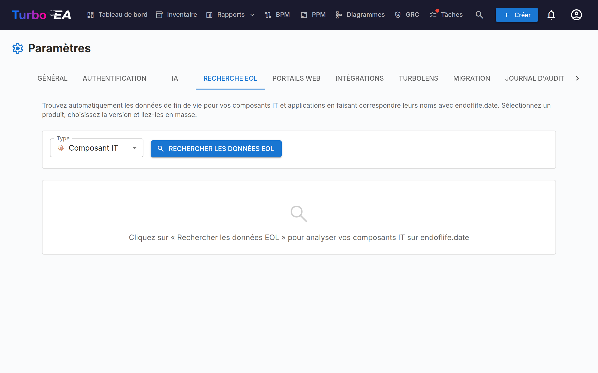
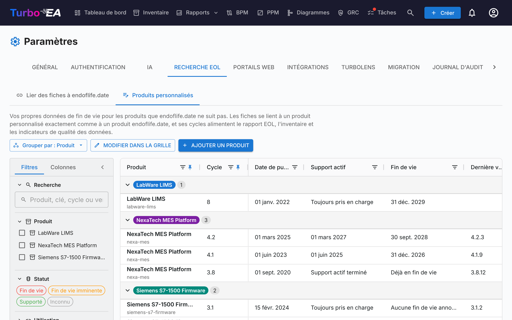
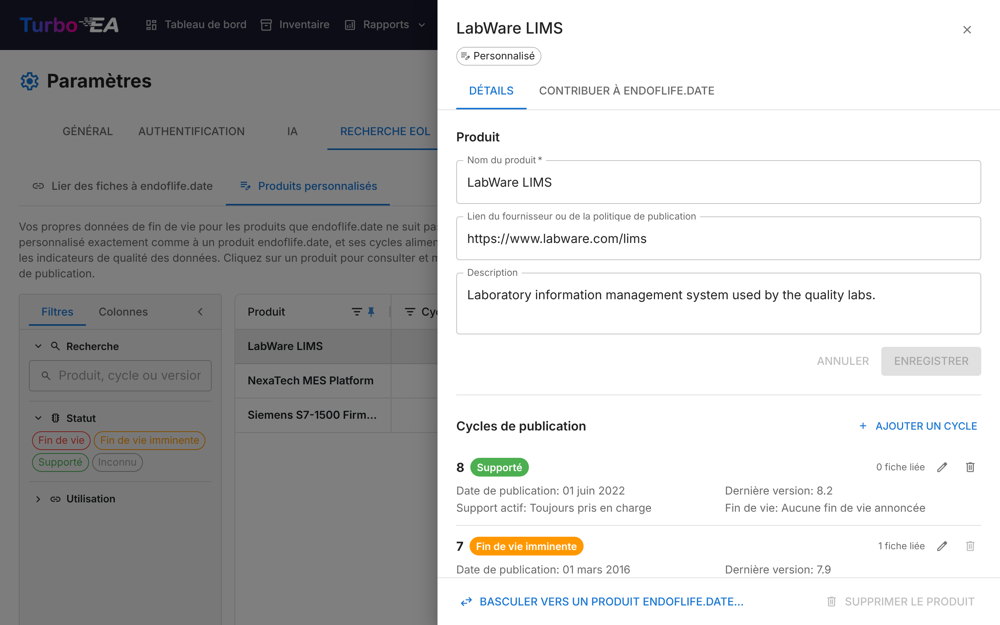

# Gestion de la fin de vie (EOL)

La page d'administration **EOL** (**Admin > Paramètres > EOL**) vous aide à suivre les cycles de vie des produits technologiques en liant vos fiches à la base de données publique [endoflife.date](https://endoflife.date/)

## Pourquoi suivre les EOL ?

Savoir quand les produits technologiques atteignent la fin de vie ou la fin de support est essentiel pour :

- **Gestion des risques** -- Les logiciels non supportés représentent un risque de sécurité
- **Planification budgétaire** -- Planifier les migrations et les mises à niveau avant la fin du support
- **Conformité** -- De nombreuses réglementations exigent des logiciels supportés

## Recherche en masse

La fonctionnalité de recherche en masse analyse les fiches d'un type qui suit la fin de vie (**Application** et **Composant IT** par défaut, voir [Fin de vie sur d'autres types de fiches](#fin-de-vie-sur-dautres-types-de-fiches)) et trouve automatiquement les produits correspondants dans la base de données endoflife.date.

### Lancer une recherche en masse

1. Naviguez vers **Admin > Paramètres > EOL**
2. Sélectionnez le type de fiche à analyser (tout type qui suit la fin de vie)
3. Cliquez sur **Rechercher**
4. Le système effectue une **correspondance approximative** avec le catalogue de produits endoflife.date

### Examen des résultats

Pour chaque fiche, la recherche retourne :

- **Score de correspondance** (0-100%) -- À quel point le nom de la fiche correspond à un produit connu
- **Nom du produit** -- Le produit endoflife.date correspondant
- **Versions/cycles disponibles** -- Les versions du produit avec leurs dates de support

### Filtrage des résultats

Utilisez les contrôles de filtre pour vous concentrer sur :

- **Tous les éléments** -- Chaque fiche analysée
- **Non liés uniquement** -- Fiches pas encore liées à un produit EOL
- **Déjà liés** -- Fiches qui ont déjà un lien EOL

Un résumé statistique affiche : nombre total de fiches analysées, déjà liées, non liées et correspondances trouvées.

### Lier les fiches aux produits

1. Examinez la correspondance suggérée pour chaque fiche
2. Sélectionnez la bonne **version/cycle du produit** dans la liste déroulante
3. Cliquez sur **Lier** pour sauvegarder l'association

Une fois liée, la page de détail de la fiche affiche une **section EOL** avec :

- **Nom du produit et version** -- un produit personnalisé est marqué **Personnalisé**
- **Statut de support** -- Code couleur, avec la même règle que le rapport EOL : Supporté (vert), Approchant la fin de vie (orange, à moins de six mois de la date de fin de vie ou une fois le support actif terminé), Fin de vie (rouge)
- **Dates clés** -- Date de sortie, fin du support actif, date de fin de vie, dernière version et sa date de publication
- **Notes de version** -- un lien vers la page du produit sur endoflife.date, ou la **Page éditeur** d'un produit personnalisé

Seuls les utilisateurs autorisés à modifier la fiche voient **Lier**, **Modifier** et **Dissocier** ; les autres ne voient que les détails. Un gestionnaire EOL dispose en plus d'un raccourci vers **Gérer les produits personnalisés** lorsqu'un produit personnalisé est lié.

## Fin de vie sur d'autres types de fiches

La fin de vie est suivie par défaut sur les **Applications** et les **Composants IT**. Tout autre type de fiche, natif ou personnalisé, peut aussi la suivre : ouvrez **Admin > Métamodèle**, choisissez le type et, dans sa **Mise en page de la fiche**, désactivez **Masqué du détail de la fiche** sur la section **Fin de vie**. Ce même interrupteur masque la fin de vie sur les Applications ou les Composants IT si vous ne la suivez pas pour eux.

Cet unique interrupteur détermine tout ce qui touche à la fin de vie pour le type :

- la section **Fin de vie** sur ses fiches (et l'option de liaison à la création d'une fiche),
- la place du type dans le [Rapport EOL](../guide/reports.md), dans le graphique **Couverture de fin de vie** du rapport Qualité des données ainsi que dans les filtres et regroupements de fin de vie des tableaux de bord,
- la colonne et le filtre **Fin de vie** de l'[Inventaire](../guide/inventory.md),
- le sélecteur de type de la **Recherche en masse** de cette page.

Masquer la section ne supprime jamais rien : les fiches conservent leurs liens et leurs dates de cycle de vie, et réapparaissent dans tous les rapports dès que la section est de nouveau affichée.

## Produits EOL personnalisés

endoflife.date suit les logiciels courants, mais pas tout ce que vous exploitez : une plateforme interne, un outil spécialisé d'un fournisseur ou une appliance sous licence n'y figurent souvent pas. Pour ceux-là, définissez un **produit EOL personnalisé** — votre propre produit, avec ses propres cycles de publication — et liez-y des fiches exactement comme vous le feriez avec un produit endoflife.date. Les produits personnalisés alimentent le même statut de fiche, la colonne **Fin de vie** de l'inventaire, le [rapport EOL](../guide/reports.md) et les indicateurs de qualité des données.

Les produits personnalisés sont listés dans l'onglet **Produits personnalisés** de **Admin > Paramètres > EOL**, à raison d'une ligne par produit. Cliquez sur un produit pour ouvrir son panneau, où l'on modifie ses détails et ses cycles de publication. Leur création et leur modification exigent la permission **Gérer l'EOL** (`eol.manage`) ; toute personne pouvant consulter les données EOL peut les voir, ainsi que leur panneau.

### Créer un produit personnalisé

Il y a deux façons d'en créer un :

- **Depuis une fiche** — dans la section **Fin de vie** de la fiche, une ligne discrète sous la recherche de produit indique *Absent d'endoflife.date ?* avec un lien **Le définir comme produit personnalisé…**, présent tant qu'aucun produit n'est sélectionné. Le formulaire s'ouvre avec le nom du produit déjà renseigné : ce que vous avez saisi dans la recherche, ou le nom de la fiche si vous n'avez rien saisi. Ajoutez ses premiers cycles et enregistrez : la fiche est alors liée en une seule fois au nouveau produit et cycle.
- **Depuis l'onglet Produits personnalisés** — cliquez sur **Ajouter un produit**.

Chaque produit comporte :

- **Nom du produit** -- la façon dont il est affiché partout. Turbo EA en déduit un identifiant pour les liens des fiches (deux produits portant le même nom reçoivent des identifiants numérotés) ; vous ne le saisissez jamais, et il n'apparaît que comme nom de fichier lorsque vous proposez le produit à endoflife.date.
- **Lien du fournisseur ou de la politique de publication** et **Description** — facultatifs. Lorsque les [suggestions IA](ai.md) sont activées, **Suggérer avec l'IA** rédige la description à partir du nom du produit et du lien du fournisseur, que vous pouvez modifier avant de l'appliquer.
- **Cycles de publication** — chacun avec un nom (par exemple `2.4`), une **Date de publication**, une fin de **Support actif**, une **Fin de vie** et, facultativement, la **Dernière version** et sa date de publication.

Le support actif et la fin de vie acceptent chacun une date (**À une date…**), ou l'une de deux réponses lorsqu'aucune date n'est connue : *Toujours pris en charge* / *Support déjà terminé*, et *Aucune fin de vie annoncée* / *Déjà terminée*. Comme sur endoflife.date, **la fin de vie est obligatoire** pour chaque cycle — une date, *Aucune fin de vie annoncée* ou *Déjà terminée* — tandis que le support actif peut rester *Inconnu*. Le statut en est déduit avec la même règle que pour les produits endoflife.date : **Fin de vie** dès que la date de fin de vie est atteinte ou que le cycle est marqué *Déjà terminée* ; **Approche de l'EOL** dans les six mois précédant cette date, ou dès que le support actif a pris fin, que ce soit par une date ou par *Support déjà terminé* ; **Pris en charge** dans les autres cas. Un problème sur un cycle — nom absent, fin de vie absente, fin antérieure à la date de publication — est signalé sur le champ concerné, et le produit ne peut pas être enregistré tant qu'il n'est pas corrigé.

### La liste des produits et le panneau du produit

L'onglet Produits personnalisés affiche une ligne par produit : son nombre de **Cycles**, le **Dernier cycle** et la **Dernière version**, son **Statut** — le pire parmi ses cycles, avec le détail par cycle dans l'infobulle de la pastille — et les **Fiches liées** que vous pouvez voir sur l'ensemble de ses cycles. Il fonctionne comme les autres grilles : figer et réorganiser les colonnes, les afficher ou les masquer, et filtrer par statut (celui du produit), par utilisation ou par une recherche portant sur les noms de produits, les noms de cycles et les versions depuis le panneau de gauche. La **Description** et le **Lien** du produit sont également disponibles comme colonnes ; elles sont masquées au départ, activez-les depuis l'onglet **Colonnes** du panneau.

Cliquez sur un produit pour ouvrir son panneau à droite. Son onglet **Détails** contient le nom, le lien et la description du produit, enregistrés avec **Enregistrer**, ainsi que ses cycles de publication sous forme de lignes, chacune avec son statut, ses dates et ses fiches liées. **Modifier** ouvre les champs d'un cycle directement dans la ligne ; **Ajouter un cycle** en ajoute un ; **Supprimer** en retire un. Un cycle enregistré avant que la fin de vie ne devienne obligatoire est signalé dans la liste et doit en recevoir une à sa prochaine modification. En bas du panneau, **Basculer vers un produit endoflife.date…** et **Supprimer le produit** s'appliquent à l'ensemble du produit. Sans la permission Gérer l'EOL, le panneau est en lecture seule.

Un produit ou un cycle ne peut pas être supprimé tant que des fiches y sont liées, y compris des fiches que vous ne pouvez pas voir. Pour retirer un cycle utilisé par des fiches, renommez-le plutôt (le renommage déplace avec lui les fiches qui y sont liées), ou liez d'abord ces fiches à un autre cycle. Le lien d'un produit est proposé sur ses fiches comme lien vers la page du fournisseur.

Vous pouvez aussi ajouter un cycle manquant depuis une fiche : une fois un produit personnalisé sélectionné dans la section Fin de vie de la fiche, la liste des cycles se termine par **Ajouter un cycle…**.

### Proposer un produit personnalisé à endoflife.date

Si un produit personnalisé est un produit public d'un fournisseur, envisagez de le proposer à endoflife.date pour que tout le monde en profite. Ouvrez le panneau du produit, puis son onglet **Contribuer à endoflife.date** :

1. Lisez l'avertissement : proposer un produit publie son nom et ses dates. Ne proposez jamais de produits internes ou confidentiels.
2. Parcourez la **liste de contrôle de préparation** : au moins un cycle, une fin de vie et une date de sortie pour chaque cycle, un lien vers le fournisseur ou la politique de publication, une **catégorie** endoflife.date et une description d'une ligne. Chaque point non satisfait indique où le corriger. La catégorie et le **résumé de la politique de publication** (le paragraphe sous l'en-tête du fichier) sont enregistrés sur le produit : vous pouvez donc reprendre un brouillon plus tard.
3. Relisez le fichier au format d'endoflife.date (`products/<identifier>.md`), puis cliquez sur **Ouvrir sur GitHub**. GitHub ouvre un nouveau fichier dans le dépôt endoflife.date avec le contenu prérempli (il duplique le dépôt dans votre compte si vous ne pouvez pas y écrire). Validez-le dans une branche et ouvrez la pull request depuis votre propre compte GitHub. Pour les fichiers longs, utilisez plutôt **Copier le fichier** et collez-le dans un nouveau fichier.

Turbo EA n'envoie jamais rien à GitHub lui-même et ne stocke aucun identifiant GitHub. endoflife.date examine chaque proposition selon son [guide de contribution](https://github.com/endoflife-date/endoflife.date/blob/master/CONTRIBUTING.md).

### Basculer vers endoflife.date

Lorsque endoflife.date commence à suivre un produit que vous aviez gardé comme personnalisé, la grille affiche à côté une indication **Sur endoflife.date**. L'indication n'apparaît que pour une correspondance étroite (même nom, ou le nom de votre produit contenu dans celui d'endoflife.date) ; un nom court d'endoflife.date qui figure simplement dans le vôtre ne la déclenche donc pas. Cliquez sur cette indication, dans la liste ou dans le panneau du produit, ou choisissez **Basculer vers un produit endoflife.date…** en bas du panneau :

1. Choisissez le produit endoflife.date.
2. Pour chacun de vos cycles, choisissez le cycle endoflife.date vers lequel ses fiches doivent passer (les cycles de même nom sont associés automatiquement), ou conservez-le sur le produit personnalisé.
3. Vous pouvez éventuellement supprimer le produit personnalisé dès qu'aucune fiche n'y est plus liée.

Seules les fiches que vous pouvez voir sont déplacées. Les dates de cycle de vie des fiches ne sont jamais modifiées.

## Rapport EOL

Les données EOL liées alimentent le [Rapport EOL](../guide/reports.md), qui fournit une vue tableau de bord du statut de support de votre paysage technologique sur toutes les fiches liées.

## Trouver ce qui n'est pas encore lié

Deux endroits hors de cette page listent les fiches sans aucune information de fin de vie — ni lien ici, ni date de fin de vie propre :

- Le filtre et la colonne **Fin de vie** de l'[Inventaire](../guide/inventory.md) — choisissez un type de fiche, puis la pastille **(vide)**.
- L'indicateur **Aucune donnée de fin de vie** du [Rapport EOL](../guide/reports.md) et le graphique **Couverture de fin de vie** en fin de rapport Qualité des données.
