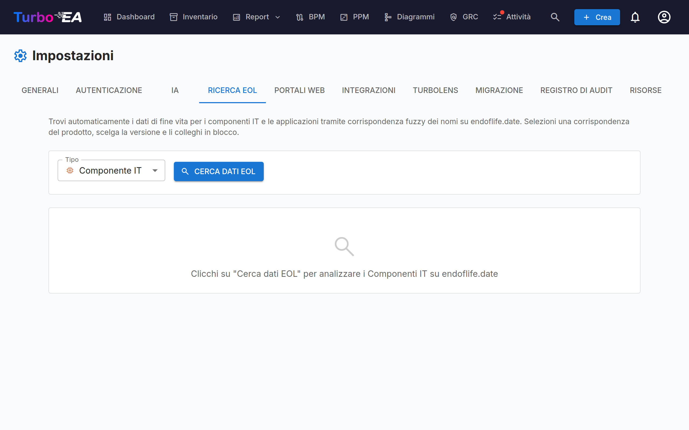
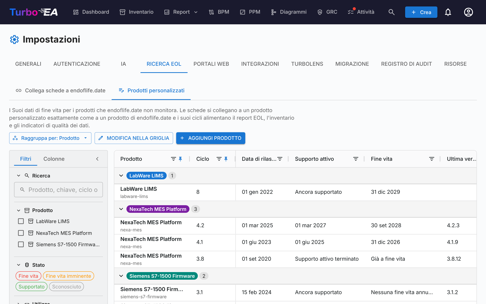
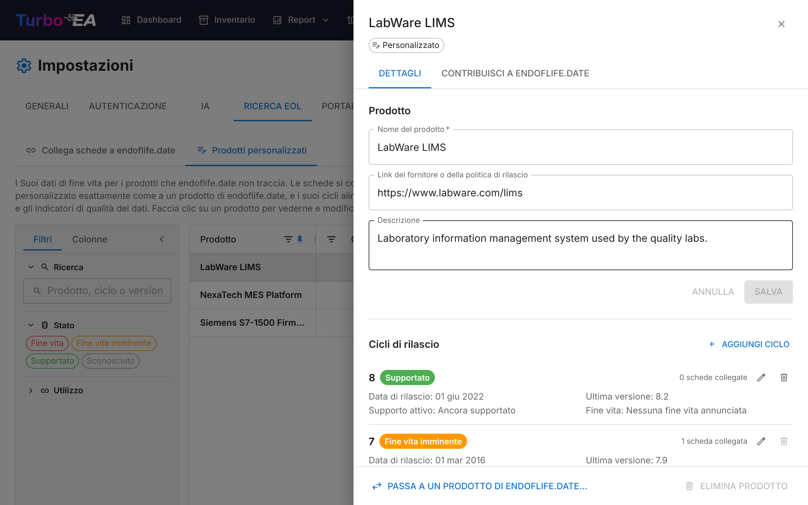

# Gestione End-of-Life (EOL)

La pagina di amministrazione **EOL** (**Admin > Impostazioni > EOL**) aiuta a tracciare il ciclo di vita dei prodotti tecnologici collegando le vostre card al database pubblico [endoflife.date](https://endoflife.date/)

## Perché tracciare l'EOL?

Sapere quando i prodotti tecnologici raggiungono l'end-of-life o la fine del supporto è fondamentale per:

- **Gestione del rischio** — Il software non supportato è una vulnerabilità di sicurezza
- **Pianificazione del budget** — Pianificate migrazioni e aggiornamenti prima che il supporto termini
- **Conformità** — Molte normative richiedono software supportato

## Ricerca massiva

La funzionalità di ricerca massiva analizza le card di un tipo che traccia il fine vita (**Application** e **IT Component** per impostazione predefinita, vedere [Fine vita su altri tipi di card](#fine-vita-su-altri-tipi-di-card)) e trova automaticamente i prodotti corrispondenti nel database endoflife.date.

### Eseguire una ricerca massiva

1. Navigate su **Admin > Impostazioni > EOL**
2. Selezionate il tipo di card da analizzare (qualsiasi tipo che traccia il fine vita)
3. Cliccate su **Cerca**
4. Il sistema esegue una **corrispondenza fuzzy** contro il catalogo prodotti endoflife.date

### Revisione dei risultati

Per ogni card, la ricerca restituisce:

- **Punteggio di corrispondenza** (0-100%) — Quanto il nome della card corrisponde a un prodotto noto
- **Nome del prodotto** — Il prodotto endoflife.date corrispondente
- **Versioni/cicli disponibili** — Le versioni di rilascio del prodotto con le rispettive date di supporto

### Filtro dei risultati

Utilizzate i controlli del filtro per concentrarvi su:

- **Tutti gli elementi** — Ogni card analizzata
- **Solo non collegati** — Card non ancora collegate a un prodotto EOL
- **Già collegati** — Card che hanno già un collegamento EOL

Un riepilogo delle statistiche mostra: card totali analizzate, già collegate, non collegate e corrispondenze trovate.

### Collegamento delle card ai prodotti

1. Revisionate la corrispondenza suggerita per ogni card
2. Selezionate la **versione/ciclo del prodotto** corretta dal menu a tendina
3. Cliccate su **Collega** per salvare l'associazione

Una volta collegata, la pagina di dettaglio della card mostra una **sezione EOL** con:

- **Nome del prodotto e versione** — un prodotto personalizzato è contrassegnato come **Personalizzato**
- **Stato del supporto** — Con codice colore, con la stessa regola del report EOL: Supportato (verde), In avvicinamento a EOL (arancione, entro sei mesi dalla data EOL o una volta terminato il supporto attivo), End of Life (rosso)
- **Date chiave** — Data di rilascio, fine supporto attivo, data EOL, l'ultima versione e la sua data di rilascio
- **Note di rilascio** — un link alla pagina del prodotto su endoflife.date, oppure la **Pagina del fornitore** di un prodotto personalizzato

Solo gli utenti che possono modificare la scheda vedono **Collega**, **Cambia** e **Scollega**; gli altri vedono soltanto i dettagli. Un gestore EOL dispone inoltre di una scorciatoia a **Gestisci i prodotti personalizzati** quando è collegato un prodotto personalizzato.

## Fine vita su altri tipi di card

Il fine vita è tracciato per impostazione predefinita su **Application** e **IT Component**. Anche qualsiasi altro tipo di card, predefinito o personalizzato, può tracciarlo: aprite **Admin > Metamodello**, scegliete il tipo e, nel suo **Layout scheda**, disattivate **Nascosta dal dettaglio scheda** nella sezione **Fine vita**. Lo stesso interruttore nasconde il fine vita su Application o IT Component se non lo tracciate lì.

Questo unico interruttore decide tutto ciò che riguarda il fine vita del tipo:

- la sezione **Fine vita** sulle sue card (e l'opzione di collegamento alla creazione di una card),
- il posto del tipo nel [Report EOL](../guide/reports.md), nel grafico **Copertura di fine vita** del report Qualità dei dati e nei filtri e raggruppamenti di fine vita delle dashboard,
- la colonna e il filtro **Fine vita** nell'[Inventario](../guide/inventory.md),
- il selettore del tipo della **Ricerca massiva** in questa pagina.

Nascondere la sezione non elimina mai nulla: le card mantengono i loro collegamenti e le date del ciclo di vita, e ricompaiono in tutti i report quando la sezione viene mostrata di nuovo.

## Prodotti EOL personalizzati

endoflife.date monitora i software più diffusi, ma non tutto ciò che utilizzate: una piattaforma interna, uno strumento di nicchia di un fornitore o un'appliance con licenza spesso non vi compaiono. Per questi, definite un **prodotto EOL personalizzato** — un vostro prodotto con i vostri cicli di rilascio — e collegatevi le schede esattamente come fareste con un prodotto di endoflife.date. I prodotti personalizzati alimentano lo stesso stato delle schede, la colonna **Fine vita** dell'inventario, il [Report EOL](../guide/reports.md) e gli indicatori di qualità dei dati.

I prodotti personalizzati sono elencati nella scheda **Prodotti personalizzati** di **Admin > Impostazioni > EOL**, una riga per prodotto. Fate clic su un prodotto per aprirne il pannello, dove si modificano i suoi dettagli e i cicli di rilascio. Crearli e modificarli richiede il permesso **Gestire EOL** (`eol.manage`); chiunque possa vedere i dati EOL può consultarli, insieme al loro pannello.

### Creare un prodotto personalizzato

Ci sono due modi per crearne uno:

- **Da una scheda** — nella sezione **Fine vita** della scheda, una riga discreta sotto la ricerca del prodotto riporta *Non è su endoflife.date?* con un link **Lo definisca come prodotto personalizzato…**, presente finché nessun prodotto è selezionato. Il modulo si apre con il nome del prodotto già compilato: quanto avete digitato nella ricerca oppure, se non avete digitato nulla, il nome della scheda. Aggiungete i primi cicli e salvate: la scheda viene collegata in un solo passaggio al nuovo prodotto e ciclo.
- **Dalla scheda Prodotti personalizzati** — fate clic su **Aggiungi prodotto**.

Ogni prodotto ha:

- **Nome del prodotto** — come viene mostrato ovunque. Turbo EA ne ricava un identificatore per i collegamenti delle schede (due prodotti con lo stesso nome ricevono identificatori numerati); non lo digitate mai e compare solo come nome del file quando proponete il prodotto a endoflife.date.
- **Link del fornitore o della politica di rilascio** e **Descrizione** — facoltativi. Quando i [suggerimenti IA](ai.md) sono abilitati, **Suggerisci con IA** redige la descrizione a partire dal nome del prodotto e dal link del fornitore, così potete modificarla prima di applicarla.
- **Cicli di rilascio** — ciascuno con un nome (ad esempio `2.4`), una **Data di rilascio**, una fine del **Supporto attivo**, una **Fine vita** e, facoltativamente, l'**Ultima versione** e la sua data di rilascio.

Supporto attivo e fine vita accettano ciascuno una data (**In una data…**), oppure una delle due risposte quando non si conosce alcuna data: *Ancora supportato* / *Supporto già terminato* e *Nessuna fine vita annunciata* / *Già terminato*. Come su endoflife.date, **la fine vita è obbligatoria** per ogni ciclo — una data, *Nessuna fine vita annunciata* o *Già terminato* — mentre il supporto attivo può restare *Sconosciuto*. Lo stato viene calcolato da questi valori con la stessa regola dei prodotti di endoflife.date: **Fine vita** quando la data di fine vita è raggiunta o il ciclo è segnato come *Già terminato*; **In avvicinamento a EOL** nei sei mesi precedenti quella data, o quando il supporto attivo è terminato, per data o con *Supporto già terminato*; **Supportato** negli altri casi. Un problema in un ciclo — nessun nome, nessuna fine vita, una fine precedente alla data di rilascio — viene mostrato sul campo interessato e il prodotto non può essere salvato finché non è risolto.

### L'elenco dei prodotti e il pannello del prodotto

La scheda Prodotti personalizzati mostra una riga per prodotto: il numero di **Cicli**, l'**Ultimo ciclo** e l'**Ultima versione**, lo **Stato** — il peggiore tra i suoi cicli, con il dettaglio per ciclo nel suggerimento del chip — e le **Schede collegate** che potete vedere su tutti i suoi cicli. Funziona come le altre griglie: bloccare e riordinare le colonne, mostrarle o nasconderle e filtrare dal pannello di sinistra per stato (quello del prodotto), utilizzo o una ricerca sui nomi dei prodotti, dei cicli e sulle versioni. Anche la **Descrizione** e il **Link** del prodotto sono disponibili come colonne; all'inizio sono nascoste, attivatele dalla scheda **Colonne** del pannello.

Fate clic su un prodotto per aprire il suo pannello a destra. La scheda **Dettagli** contiene nome, link e descrizione del prodotto, salvati con **Salva**, e i suoi cicli di rilascio come righe, ciascuna con stato, date e schede collegate. **Modifica** apre i campi di un ciclo direttamente nella riga; **Aggiungi ciclo** ne aggiunge uno; **Elimina** ne rimuove uno. Un ciclo salvato prima che la fine vita diventasse obbligatoria è segnalato nell'elenco e deve riceverne una alla modifica successiva. In fondo al pannello, **Passa a un prodotto di endoflife.date…** ed **Elimina prodotto** agiscono sull'intero prodotto. Senza il permesso Gestire EOL il pannello è di sola lettura.

Un prodotto o un ciclo non può essere eliminato finché esistono schede collegate, comprese quelle che non potete vedere. Per ritirare un ciclo usato da schede, rinominatelo (la ridenominazione sposta con sé le schede collegate) oppure collegate prima quelle schede a un altro ciclo. Il link di un prodotto viene proposto sulle sue schede come link alla pagina del fornitore.

È possibile aggiungere un ciclo mancante anche da una scheda: una volta selezionato un prodotto personalizzato nella sezione Fine vita della scheda, l'elenco dei cicli termina con **Aggiungi ciclo…**.

### Contribuire con un prodotto personalizzato a endoflife.date

Se un prodotto personalizzato è un prodotto pubblico di un fornitore, valutate di proporlo a endoflife.date, così che tutti ne traggano vantaggio. Aprite il pannello del prodotto e la sua scheda **Contribuisci a endoflife.date**:

1. Leggete l'avviso: la proposta pubblica il nome del prodotto e le sue date. Non proponete mai prodotti interni o riservati.
2. Completate la **checklist di idoneità**: almeno un ciclo, una fine vita e una data di rilascio per ogni ciclo, un link al fornitore o alla politica di rilascio, una **categoria** di endoflife.date e una descrizione di una riga. Ogni voce non soddisfatta indica dove correggerla. La categoria e il **riepilogo della politica di rilascio** (il paragrafo sotto il front matter del file) sono salvati sul prodotto, così potete riprendere una bozza in seguito.
3. Verificate il file nel formato di endoflife.date (`products/<identifier>.md`), quindi fate clic su **Apri su GitHub**. GitHub apre un nuovo file nel repository di endoflife.date con il contenuto precompilato (crea un fork del repository nel vostro account se non potete scriverci). Salvatelo con un commit in un branch e aprite la pull request dal vostro account GitHub. Per i file lunghi, usate invece **Copia file** e incollatelo in un nuovo file.

Turbo EA non invia mai nulla a GitHub da solo e non memorizza credenziali GitHub. endoflife.date esamina ogni proposta in base alla propria [guida al contributo](https://github.com/endoflife-date/endoflife.date/blob/master/CONTRIBUTING.md).

### Passare a endoflife.date

Quando endoflife.date inizia a monitorare un prodotto che avevate mantenuto come personalizzato, la griglia mostra accanto un suggerimento **Su endoflife.date**. Il suggerimento compare solo per una corrispondenza stretta (lo stesso nome, oppure il nome del vostro prodotto contenuto in quello di endoflife.date), quindi un nome breve di endoflife.date che compare solo all'interno del vostro non lo attiva. Fate clic sul suggerimento, nell'elenco o nel pannello del prodotto, oppure scegliete **Passa a un prodotto di endoflife.date…** in fondo al pannello:

1. Scegliete il prodotto di endoflife.date.
2. Per ciascuno dei vostri cicli, scegliete il ciclo di endoflife.date a cui le sue schede devono passare (i cicli con lo stesso nome vengono abbinati automaticamente), oppure mantenetelo sul prodotto personalizzato.
3. Facoltativamente, eliminate il prodotto personalizzato quando nessuna scheda lo collega più.

Vengono spostate solo le schede visibili. Le date del ciclo di vita sulle schede non vengono mai modificate.

## Report EOL

I dati EOL collegati alimentano il [Report EOL](../guide/reports.md), che fornisce una vista dashboard dello stato di supporto del vostro panorama tecnologico su tutte le card collegate.

## Trovare ciò che non è ancora collegato

Due punti fuori da questa pagina elencano le schede senza alcuna informazione di fine vita — né un collegamento qui né una data di fine vita propria:

- Il filtro e la colonna **Fine vita** nell'[Inventario](../guide/inventory.md): scegli un tipo di scheda, poi l'opzione **(vuoto)**.
- Il valore **Nessun dato di fine vita** nel [Report EOL](../guide/reports.md) e il grafico **Copertura di fine vita** in fondo al report Qualità dei dati.
