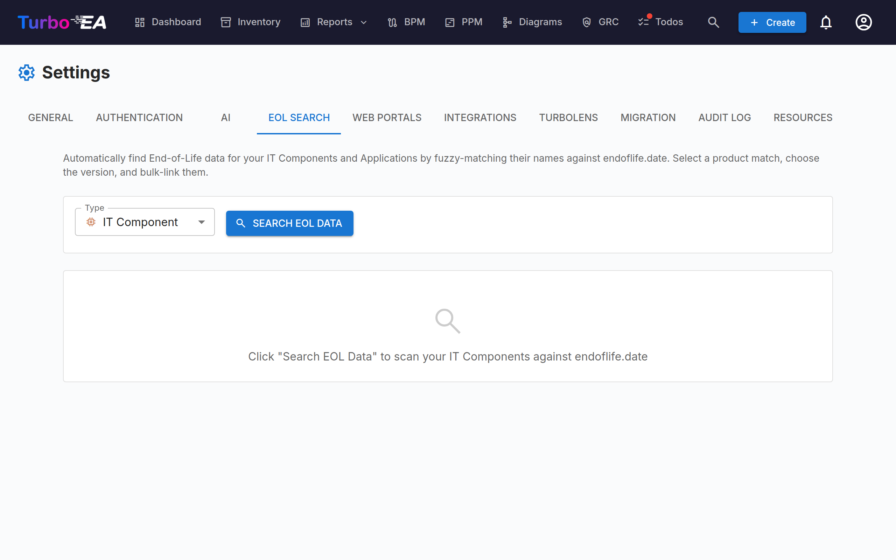
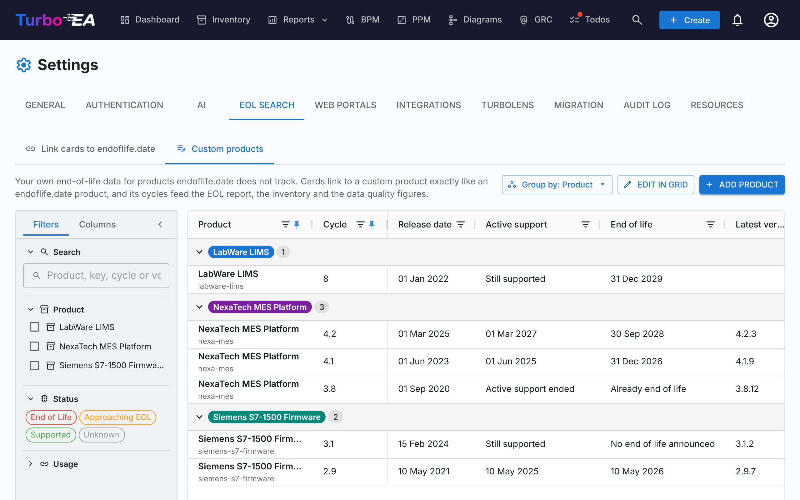

# End-of-Life (EOL) Management

The **EOL** administration page (**Admin > Settings > EOL**) helps you track technology product lifecycles by linking your cards to the public [endoflife.date](https://endoflife.date/) database.

## Why Track EOL?

Knowing when technology products reach end-of-life or end-of-support is critical for:

- **Risk management** — Unsupported software is a security liability
- **Budget planning** — Plan migrations and upgrades before support ends
- **Compliance** — Many regulations require supported software

## Mass Search

The mass search feature scans the cards of a type that tracks End of Life (**Application** and **IT Component** by default, see [End of Life on other card types](#end-of-life-on-other-card-types)) and automatically finds matching products in the endoflife.date database.

### Running a Mass Search

1. Navigate to **Admin > Settings > EOL**
2. Select the card type to scan (any type that tracks End of Life)
3. Click **Search**
4. The system performs **fuzzy matching** against the endoflife.date product catalog

### Reviewing Results

For each card, the search returns:

- **Match score** (0–100%) — How closely the card name matches a known product
- **Product name** — The matched endoflife.date product
- **Available versions/cycles** — The product's release versions with their support dates

### Filtering Results

Use the filter controls to focus on:

- **All items** — Every card that was scanned
- **Unlinked only** — Cards not yet linked to an EOL product
- **Already linked** — Cards that already have an EOL link

A statistics summary shows: total cards scanned, already linked, unlinked, and matches found.

### Linking Cards to Products

1. Review the suggested match for each card
2. Select the correct **product version/cycle** from the dropdown
3. Click **Link** to save the association

Once linked, the card's detail page shows an **EOL section** with:

- **Product name and version**
- **Support status** — Color-coded: Supported (green), Approaching EOL (orange), End of Life (red)
- **Key dates** — Release date, active support end, security support end, EOL date

## End of Life on other card types

End of Life is tracked on **Applications** and **IT Components** by default. Any other card type, built-in or custom, can track it too: open **Admin > Metamodel**, pick the type, and in its **Card Layout** turn off **Hidden from card detail** on the **End of Life** section. The same switch hides End of Life on Applications or IT Components if you do not track it there.

That one switch decides everything about End of Life for the type:

- the **End of Life** section on its cards (and the link option when creating a card),
- the type's place in the [EOL Report](../guide/reports.md), the Data Quality report's **End-of-life coverage** chart and the dashboards' End of Life filters and grouping,
- the **End of life** column and filter in the [Inventory](../guide/inventory.md),
- the type picker of **Mass Search** on this page.

Hiding the section never deletes anything: the cards keep their links and their lifecycle dates, and they come back in every report when the section is shown again.

## Custom EOL Products

endoflife.date tracks popular software, but not everything you run: an in-house platform, a niche vendor tool or a licensed appliance will often have no entry there. For those, define a **custom EOL product** — your own product with its own release cycles — and link cards to it exactly as you would link an endoflife.date product. Custom products feed the same card status, Inventory **End of life** column, [EOL Report](../guide/reports.md) and data quality figures.

Custom products are listed on the **Custom products** tab of **Admin > Settings > EOL**. Creating and editing them requires the **Manage EOL** permission (`eol.manage`); anyone who can view EOL data can see them.

### Creating a custom product

There are two ways to create one:

- **From a card** — in the card's **End of Life** section, search for the product. When endoflife.date has no match, the section offers **Create custom product**, pre-filled with what you typed (or the card's name). Enter the product name, its first cycles, and save: the card is then linked to the new product and cycle in one go.
- **From the Custom products tab** — click **Add product**.

Each product has:

- **Product name** — how it is shown everywhere.
- **Key** — a short lower-case identifier (letters, digits, dots, hyphens, underscores) suggested from the name. Card links store it, so it **cannot be changed** after creation.
- **Vendor or release policy link** and **Description** — optional.
- **Release cycles** — each with a name (for example `2.4`), a **Release date**, an **Active support** end, an **End of life**, and optionally the **Latest version** and its release date.

Active support and End of life each take a **date**, or one of two answers for when no date is known: *Still supported* / *Active support ended*, and *No end of life announced* / *Already end of life*. The status (Supported, Approaching EOL, End of Life) is worked out from them with the same rule as endoflife.date products.

### Managing cycles in the grid

The Custom products tab shows one row per release cycle, grouped by product. It works like the other grids: freeze and reorder columns, show or hide them and filter by product, status or usage from the left-hand panel. The **Linked cards** column shows how many of the cards you can see use each cycle.

Click **Edit in grid** to change cells in place. Dates and support answers open a small editor, and you can drag a cell's value down a column (Excel-style) to copy it to several cycles. The row menu (**⋮**) adds a cycle to the product, edits the product's name, link and description, or deletes a cycle or the product.

A product cannot be deleted while cards still link to it. Deleting a cycle that cards use leaves their End of Life status **unknown** until someone picks another cycle. Renaming a cycle moves the cards linked to it along with it.

You can also add a missing cycle from a card: once a custom product is selected in the card's End of Life section, the cycle list ends with **Add cycle…**.

### Contributing a custom product to endoflife.date

If a custom product is a public vendor product, consider proposing it to endoflife.date so everyone benefits. Choose **Propose to endoflife.date** from the row menu:

1. Read the warning: proposing publishes the product name and its dates. Never propose in-house or confidential products.
2. Pick the endoflife.date **category**. The dialog previews the product file in endoflife.date's format (`products/<key>.md`).
3. Click **Open on GitHub**. GitHub opens a new file in the endoflife.date repository with the content filled in (it offers to fork the repository if you cannot write to it). Complete the description and release-policy summary, then open the pull request from your own GitHub account. For long files, use **Copy file** and paste it into a new file instead.

Turbo EA never sends anything to GitHub itself and stores no GitHub credentials. endoflife.date reviews every proposal against its [contribution guide](https://github.com/endoflife-date/endoflife.date/blob/master/CONTRIBUTING.md).

### Switching to endoflife.date

When endoflife.date starts tracking a product you kept as a custom one, the grid shows an **On endoflife.date** hint next to it. Click the hint, or choose **Switch to endoflife.date product…** from the row menu:

1. Pick the endoflife.date product.
2. For each of your cycles, choose the endoflife.date cycle its cards should move to (cycles with the same name are matched for you), or keep it on the custom product.
3. Optionally delete the custom product once no card links it any more.

Only the cards you can see are moved. Lifecycle dates on the cards are never changed.

## EOL Report

Linked EOL data feeds into the [EOL Report](../guide/reports.md), which provides a dashboard view of your technology landscape's support status across all linked cards.

## Finding what is not linked yet

Two places outside this page list the cards with no end-of-life information at all — neither a link here nor an End of Life date of their own:

- The **End of life** filter and column in the [Inventory](../guide/inventory.md) — pick a card type, then the **(empty)** pill.
- The **No EOL data** figure on the [EOL Report](../guide/reports.md), and the **End-of-life coverage** chart at the foot of the Data Quality report.
