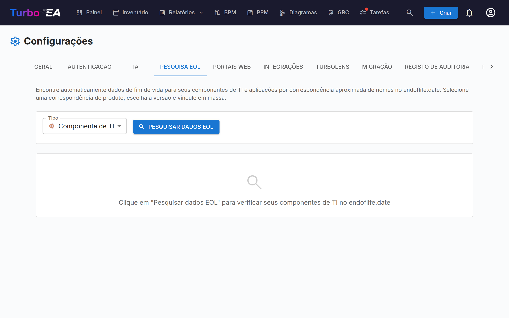
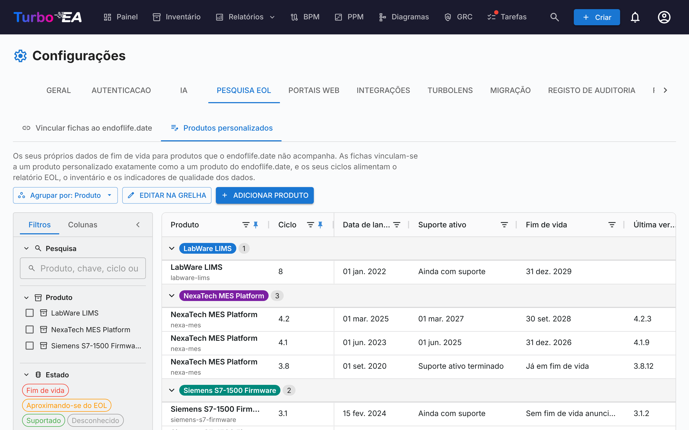
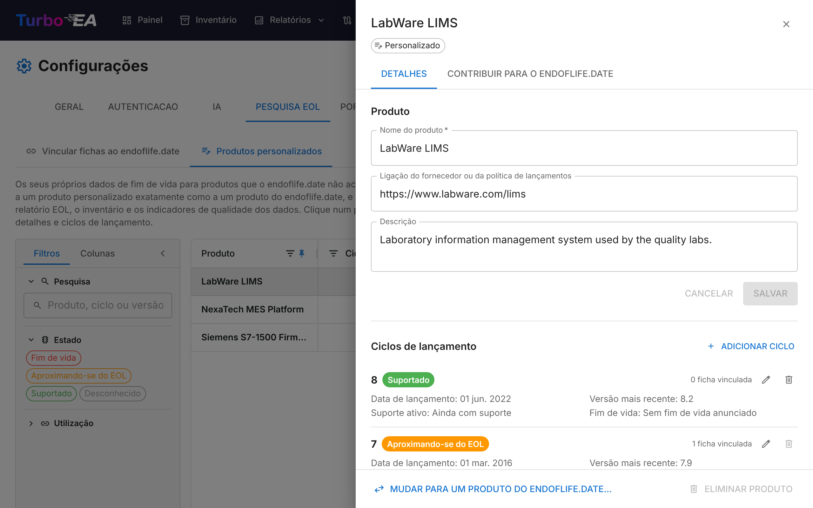

# Gestão de Fim de Vida (EOL)

A página de administração de **EOL** (**Admin > Configurações > EOL**) ajuda você a acompanhar os ciclos de vida de produtos tecnológicos vinculando seus cards ao banco de dados público [endoflife.date](https://endoflife.date/).

## Por que Rastrear EOL?

Saber quando produtos tecnológicos atingem o fim de vida ou fim de suporte é essencial para:

- **Gestão de risco** — Software sem suporte é uma vulnerabilidade de segurança
- **Planejamento orçamentário** — Planeje migrações e atualizações antes que o suporte termine
- **Conformidade** — Muitas regulamentações exigem software com suporte

## Busca em Massa

O recurso de busca em massa escaneia os cards de um tipo que rastreia o fim de vida (**Aplicação** e **Componente de TI** por padrão, veja [Fim de vida em outros tipos de card](#fim-de-vida-em-outros-tipos-de-card)) e encontra automaticamente produtos correspondentes no banco de dados do endoflife.date.

### Executando uma Busca em Massa

1. Navegue até **Admin > Configurações > EOL**
2. Selecione o tipo de card a escanear (qualquer tipo que rastreie o fim de vida)
3. Clique em **Buscar**
4. O sistema realiza **correspondência aproximada** contra o catálogo de produtos do endoflife.date

### Revisando Resultados

Para cada card, a busca retorna:

- **Pontuação de correspondência** (0-100%) — Quão próximo o nome do card corresponde a um produto conhecido
- **Nome do produto** — O produto correspondente no endoflife.date
- **Versões/ciclos disponíveis** — As versões de lançamento do produto com suas datas de suporte

### Filtrando Resultados

Use os controles de filtro para focar em:

- **Todos os itens** — Cada card que foi escaneado
- **Apenas não vinculados** — Cards ainda não vinculados a um produto EOL
- **Já vinculados** — Cards que já possuem um link EOL

Um resumo estatístico mostra: total de cards escaneados, já vinculados, não vinculados e correspondências encontradas.

### Vinculando Cards a Produtos

1. Revise a correspondência sugerida para cada card
2. Selecione a **versão/ciclo do produto** correto no dropdown
3. Clique em **Vincular** para salvar a associação

Uma vez vinculado, a página de detalhe do card mostra uma **seção EOL** com:

- **Nome do produto e versão** — um produto personalizado é marcado como **Personalizado**
- **Status de suporte** — Com código de cores, com a mesma regra do relatório de EOL: Suportado (verde), Aproximando-se do EOL (laranja, a menos de seis meses da data de EOL ou depois de terminado o suporte ativo), Fim de Vida (vermelho)
- **Datas importantes** — Data de lançamento, fim do suporte ativo, data de EOL, a última versão e a sua data de lançamento
- **Notas de lançamento** — uma ligação para a página do produto no endoflife.date, ou a **Página do fornecedor** de um produto personalizado

Só os utilizadores que podem editar a ficha veem **Vincular**, **Alterar** e **Desvincular**; os restantes veem apenas os detalhes. Um gestor de EOL dispõe ainda de um atalho para **Gerir produtos personalizados** quando há um produto personalizado vinculado.

## Fim de vida em outros tipos de card

O fim de vida é rastreado por padrão em **Aplicações** e **Componentes de TI**. Qualquer outro tipo de card, nativo ou personalizado, também pode rastreá-lo: abra **Admin > Metamodelo**, escolha o tipo e, no seu **Layout da ficha**, desative **Oculta do detalhe da ficha** na seção **Fim de vida**. O mesmo interruptor oculta o fim de vida em Aplicações ou Componentes de TI se você não o rastreia ali.

Esse único interruptor decide tudo sobre o fim de vida do tipo:

- a seção **Fim de vida** nos seus cards (e a opção de vincular ao criar um card),
- o lugar do tipo no [Relatório de EOL](../guide/reports.md), no gráfico **Cobertura de fim de vida** do relatório de Qualidade dos dados e nos filtros e agrupamentos de fim de vida dos painéis,
- a coluna e o filtro **Fim de vida** no [Inventário](../guide/inventory.md),
- o seletor de tipo da **Busca em massa** desta página.

Ocultar a seção nunca exclui nada: os cards mantêm seus vínculos e suas datas de ciclo de vida, e voltam a aparecer em todos os relatórios quando a seção é exibida novamente.

## Produtos EOL personalizados

O endoflife.date acompanha o software mais popular, mas não tudo o que executa: uma plataforma interna, uma ferramenta especializada de um fornecedor ou um equipamento licenciado muitas vezes não tem entrada aí. Para esses, defina um **produto EOL personalizado** — o seu próprio produto, com os seus próprios ciclos de lançamento — e vincule fichas a ele exatamente como faria com um produto do endoflife.date. Os produtos personalizados alimentam o mesmo estado da ficha, a coluna **Fim de vida** do inventário, o [Relatório de EOL](../guide/reports.md) e os indicadores de qualidade dos dados.

Os produtos personalizados são listados no separador **Produtos personalizados** de **Admin > Configurações > EOL**, uma linha por produto. Clique num produto para abrir o seu painel, onde se editam os seus detalhes e ciclos de lançamento. Criá-los e editá-los requer a permissão **Gerir EOL** (`eol.manage`); qualquer pessoa que possa ver os dados de EOL pode vê-los, bem como o seu painel.

### Criar um produto personalizado

Há duas formas de criar um:

- **A partir de uma ficha** — na secção **Fim de vida** da ficha, uma linha discreta sob a pesquisa de produto indica *Não está no endoflife.date?* com uma ligação **Defini-lo como produto personalizado…**, presente sempre que nenhum produto esteja selecionado. O formulário abre com o nome do produto já preenchido: o que escreveu na pesquisa ou, se não escreveu nada, o nome da ficha. Adicione os primeiros ciclos e guarde: a ficha fica vinculada ao novo produto e ciclo de uma só vez.
- **A partir do separador Produtos personalizados** — clique em **Adicionar produto**.

Cada produto tem:

- **Nome do produto** — como é apresentado em todo o lado. O Turbo EA deriva dele um identificador para as ligações das fichas (dois produtos com o mesmo nome recebem identificadores numerados); nunca o digita, e só aparece como nome de ficheiro quando propõe o produto ao endoflife.date.
- **Ligação do fornecedor ou da política de lançamentos** e **Descrição** — opcionais. Quando as [sugestões de IA](ai.md) estão ativadas, **Sugerir com IA** redige a descrição a partir do nome do produto e da ligação do fornecedor, para a editar antes de a aplicar.
- **Ciclos de lançamento** — cada um com um nome (por exemplo `2.4`), uma **Data de lançamento**, um fim de **Suporte ativo**, um **Fim de vida** e, opcionalmente, a **Última versão** e a sua data de lançamento.

O suporte ativo e o fim de vida aceitam cada um uma data (**Numa data…**), ou uma de duas respostas quando não se conhece nenhuma data: *Ainda com suporte* / *Suporte já terminado*, e *Sem fim de vida anunciado* / *Já terminado*. Tal como no endoflife.date, **o fim de vida é obrigatório** em cada ciclo — uma data, *Sem fim de vida anunciado* ou *Já terminado* —, enquanto o suporte ativo pode ficar *Desconhecido*. O estado é calculado a partir deles com a mesma regra dos produtos do endoflife.date: **Fim de vida** quando a data de fim de vida é atingida ou o ciclo está marcado como *Já terminado*; **Aproximando-se do EOL** nos seis meses anteriores a essa data, ou quando o suporte ativo terminou, por data ou por *Suporte já terminado*; **Suportado** nos restantes casos. Um problema num ciclo — sem nome, sem fim de vida, um fim anterior à data de lançamento — é mostrado no campo em causa, e o produto não pode ser guardado enquanto não for corrigido.

### A lista de produtos e o painel do produto

O separador Produtos personalizados mostra uma linha por produto: o seu número de **Ciclos**, o **Último ciclo** e a **Última versão**, o seu **Estado** — o pior entre os seus ciclos, com o detalhe por ciclo na dica do chip — e as **Fichas vinculadas** que pode ver em todos os seus ciclos. Funciona como as outras grelhas: fixar e reordenar colunas, mostrá-las ou ocultá-las e filtrar a partir do painel da esquerda por estado (o do produto), utilização ou uma pesquisa nos nomes de produtos, nomes de ciclos e versões. A **Descrição** e a **Ligação** do produto também estão disponíveis como colunas; ficam ocultas ao início, ative-as no separador **Colunas** do painel.

Clique num produto para abrir o seu painel à direita. O separador **Detalhes** contém o nome, a ligação e a descrição do produto, guardados com **Guardar**, e os seus ciclos de lançamento como linhas, cada uma com o seu estado, datas e fichas vinculadas. **Editar** abre os campos de um ciclo na própria linha; **Adicionar ciclo** adiciona um; **Eliminar** remove um. Um ciclo guardado antes de o fim de vida passar a ser obrigatório fica assinalado na lista e tem de receber um na próxima edição. No fim do painel, **Mudar para um produto do endoflife.date…** e **Eliminar produto** atuam sobre todo o produto. Sem a permissão Gerir EOL, o painel é só de leitura.

Um produto ou um ciclo não pode ser eliminado enquanto houver fichas vinculadas a ele, incluindo fichas que não pode ver. Para retirar um ciclo usado por fichas, mude-lhe antes o nome (a mudança de nome leva consigo as fichas vinculadas) ou vincule primeiro essas fichas a outro ciclo. A ligação de um produto é oferecida nas suas fichas como ligação para a página do fornecedor.

Também pode adicionar um ciclo em falta a partir de uma ficha: depois de selecionado um produto personalizado na secção Fim de vida da ficha, a lista de ciclos termina com **Adicionar ciclo…**.

### Contribuir com um produto personalizado para o endoflife.date

Se um produto personalizado for um produto público de um fornecedor, considere propô-lo ao endoflife.date para que todos beneficiem. Abra o painel do produto e o seu separador **Contribuir para o endoflife.date**:

1. Leia o aviso: propor publica o nome do produto e as suas datas. Nunca proponha produtos internos ou confidenciais.
2. Percorra a **lista de verificação de preparação**: pelo menos um ciclo, um fim de vida e uma data de lançamento em cada ciclo, uma ligação ao fornecedor ou à política de lançamentos, uma **categoria** do endoflife.date e uma descrição de uma linha. Cada item por cumprir indica onde o corrigir. A categoria e o **resumo da política de lançamentos** (o parágrafo abaixo do front matter do ficheiro) ficam guardados no produto, pelo que pode retomar um rascunho mais tarde.
3. Reveja o ficheiro no formato do endoflife.date (`products/<identifier>.md`) e clique em **Abrir no GitHub**. O GitHub abre um novo ficheiro no repositório do endoflife.date com o conteúdo preenchido (cria um fork do repositório na sua conta se não puder escrever nele). Faça commit para um branch e abra o pull request a partir da sua própria conta do GitHub. Para ficheiros longos, use antes **Copiar ficheiro** e cole-o num novo ficheiro.

O Turbo EA nunca envia nada para o GitHub por si próprio e não guarda credenciais do GitHub. O endoflife.date revê cada proposta de acordo com o seu [guia de contribuição](https://github.com/endoflife-date/endoflife.date/blob/master/CONTRIBUTING.md).

### Mudar para o endoflife.date

Quando o endoflife.date começa a acompanhar um produto que manteve como personalizado, a grelha mostra junto dele uma indicação **No endoflife.date**. A indicação só aparece para uma correspondência próxima (o mesmo nome, ou o nome do seu produto contido no do endoflife.date), pelo que um nome curto do endoflife.date que apenas ocorre dentro do seu não a ativa. Clique na indicação, na lista ou no painel do produto, ou escolha **Mudar para um produto do endoflife.date…** no fim do painel:

1. Escolha o produto do endoflife.date.
2. Para cada um dos seus ciclos, escolha o ciclo do endoflife.date para o qual as suas fichas devem passar (os ciclos com o mesmo nome são emparelhados automaticamente), ou mantenha-o no produto personalizado.
3. Opcionalmente, elimine o produto personalizado quando nenhuma ficha o vincular.

Só são movidas as fichas que pode ver. As datas de ciclo de vida nas fichas nunca são alteradas.

## Relatório de EOL

Dados de EOL vinculados alimentam o [Relatório de EOL](../guide/reports.md), que fornece uma visualização em painel do status de suporte do seu cenário tecnológico em todos os cards vinculados.

## Encontrar o que ainda não está ligado

Dois locais fora desta página listam os cartões sem qualquer informação de fim de vida — nem uma ligação aqui nem uma data de fim de vida própria:

- O filtro e a coluna **Fim de vida** no [Inventário](../guide/inventory.md) — escolha um tipo de cartão e depois a opção **(vazio)**.
- O valor **Sem dados de fim de vida** no [Relatório de EOL](../guide/reports.md) e o gráfico **Cobertura de fim de vida** no final do relatório de Qualidade dos dados.
