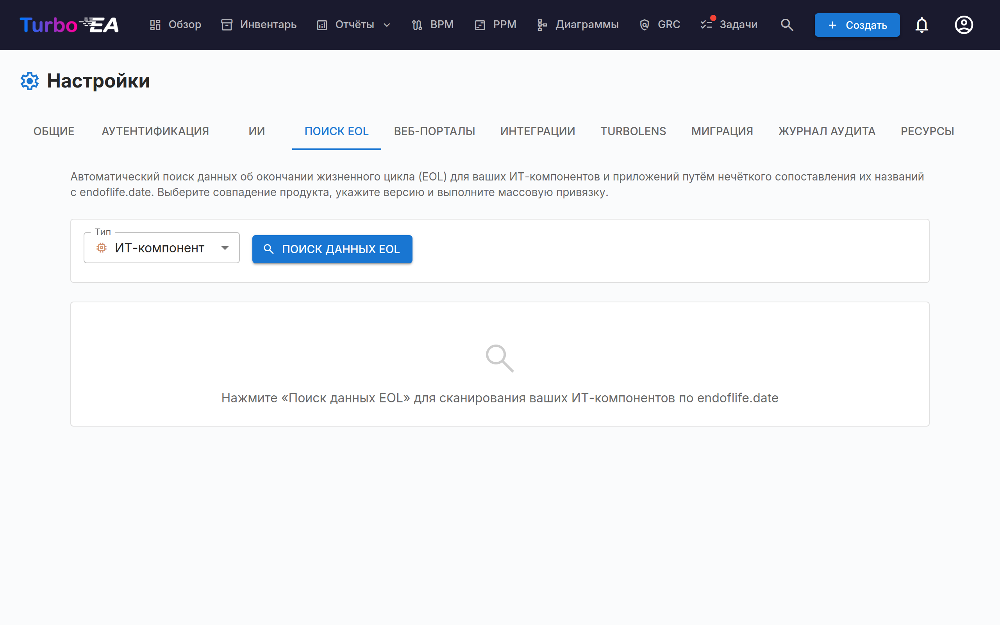
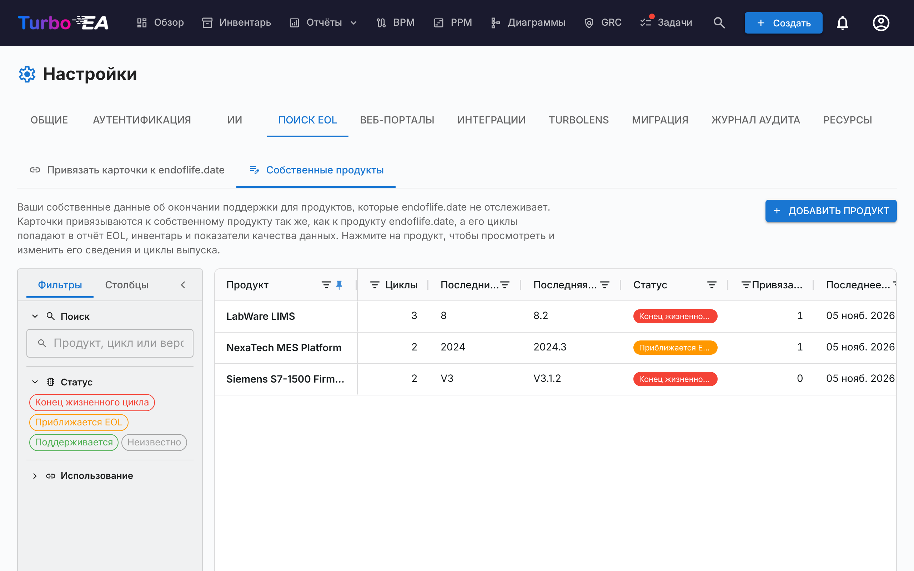
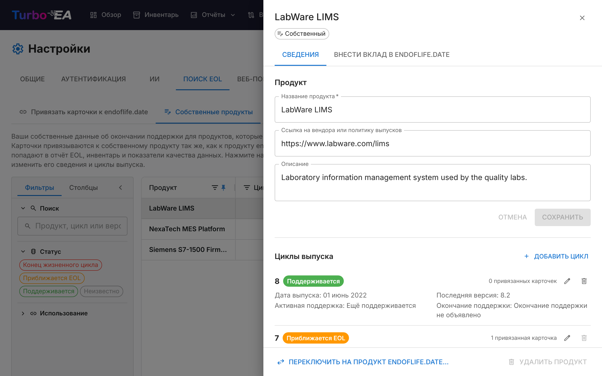

# Управление окончанием жизненного цикла (EOL)

Страница администрирования **EOL** (**Администрирование > Настройки > EOL**) помогает отслеживать жизненные циклы технологических продуктов, связывая ваши карточки с публичной базой данных [endoflife.date](https://endoflife.date/).

## Зачем отслеживать EOL?

Знание того, когда технологические продукты достигают окончания жизненного цикла или окончания поддержки, критически важно для:

- **Управление рисками** — неподдерживаемое программное обеспечение является угрозой безопасности
- **Планирование бюджета** — планирование миграций и обновлений до окончания поддержки
- **Соответствие требованиям** — многие нормативные акты требуют использования поддерживаемого программного обеспечения

## Массовый поиск

Функция массового поиска сканирует карточки типа, отслеживающего окончание поддержки (по умолчанию **Приложение** и **ИТ-компонент**, см. Окончание поддержки для других типов карточек), и автоматически находит соответствующие продукты в базе данных endoflife.date.

### Запуск массового поиска

1. Перейдите в **Администрирование > Настройки > EOL**
2. Выберите тип карточки для сканирования (любой тип, отслеживающий окончание поддержки)
3. Нажмите **Поиск**
4. Система выполняет **нечёткое сопоставление** с каталогом продуктов endoflife.date

### Просмотр результатов

Для каждой карточки поиск возвращает:

- **Оценка совпадения** (0–100%) — насколько точно имя карточки соответствует известному продукту
- **Название продукта** — найденный продукт endoflife.date
- **Доступные версии/циклы** — версии выпуска продукта с датами поддержки

### Фильтрация результатов

Используйте элементы управления фильтрами для фокусировки на:

- **Все элементы** — каждая просканированная карточка
- **Только несвязанные** — карточки, ещё не связанные с продуктом EOL
- **Уже связанные** — карточки, уже имеющие связь с EOL

Сводка статистики показывает: всего просканировано карточек, уже связано, не связано и найдено совпадений.

### Связывание карточек с продуктами

1. Просмотрите предложенное совпадение для каждой карточки
2. Выберите правильную **версию/цикл продукта** из выпадающего списка
3. Нажмите **Связать** для сохранения ассоциации

После связывания на странице деталей карточки отображается **раздел EOL** с:

- **Название и версия продукта** — собственный продукт помечается как **Собственный**
- **Статус поддержки** — цветовая кодировка по тому же правилу, что и в отчёте EOL: Поддерживается (зелёный), Приближается EOL (оранжевый, менее чем за шесть месяцев до даты EOL или после окончания активной поддержки), Конец жизненного цикла (красный)
- **Ключевые даты** — дата выпуска, окончание активной поддержки, дата EOL, последняя версия и дата её выпуска
- **Примечания к выпуску** — ссылка на страницу продукта на endoflife.date или **Страница производителя** собственного продукта

Кнопки **Связать**, **Изменить** и **Отвязать** видят только пользователи, которые могут редактировать карточку; остальные видят одни лишь сведения. Менеджер EOL также получает ярлык **Управление собственными продуктами**, если привязан собственный продукт.

## Окончание поддержки для других типов карточек

По умолчанию окончание поддержки отслеживается у **приложений** и **ИТ-компонентов**. Любой другой тип карточек, встроенный или пользовательский, тоже может его отслеживать: откройте **Администрирование > Метамодель**, выберите тип и в его **макете карточки** отключите **Скрыто на странице карточки** у секции **Окончание поддержки**. Тот же переключатель скрывает окончание поддержки у приложений или ИТ-компонентов, если вы не отслеживаете его там.

Этот единственный переключатель определяет всё, что связано с окончанием поддержки для типа:

- секцию **Окончание поддержки** в его карточках (и возможность привязки при создании карточки),
- место типа в [отчёте EOL](../guide/reports.md), на диаграмме **Покрытие данными об окончании поддержки** отчёта «Качество данных» и в фильтрах и группировках по окончанию поддержки на дашбордах,
- столбец и фильтр **Окончание поддержки** в [инвентаре](../guide/inventory.md),
- выбор типа в **массовом поиске** на этой странице.

Скрытие секции ничего не удаляет: карточки сохраняют свои связи и даты жизненного цикла и снова появляются во всех отчётах, как только секция показана.

## Собственные продукты EOL

endoflife.date отслеживает популярное программное обеспечение, но не всё, что вы эксплуатируете: у внутренней платформы, нишевого инструмента вендора или лицензируемого устройства там часто нет записи. Для таких случаев определите **собственный продукт EOL** — ваш продукт с вашими циклами выпуска — и привязывайте к нему карточки точно так же, как к продукту endoflife.date. Собственные продукты питают тот же статус карточки, столбец **Окончание поддержки** в инвентаре, [отчёт EOL](../guide/reports.ru.md) и показатели качества данных.

Собственные продукты перечислены на вкладке **Собственные продукты** в разделе **Админ > Настройки > EOL**, по одной строке на продукт. Нажмите на продукт, чтобы открыть его панель, где редактируются его сведения и циклы выпуска. Для их создания и изменения требуется разрешение **Управление EOL** (`eol.manage`); просматривать их и их панель может любой, кто видит данные EOL.

### Создание собственного продукта

Создать продукт можно двумя способами:

- **Из карточки** — в разделе **Окончание поддержки** карточки под поиском продукта находится ненавязчивая строка *Нет на endoflife.date?* со ссылкой **Определить как собственный продукт…**; она отображается, пока продукт не выбран. Форма открывается с уже заполненным названием продукта: тем, что вы ввели в поиске, или названием карточки, если ничего не вводили. Добавьте первые циклы и сохраните: карточка будет привязана к новому продукту и циклу за один шаг.
- **Со вкладки «Собственные продукты»** — нажмите **Добавить продукт**.

У каждого продукта есть:

- **Название продукта** — как он отображается везде. Turbo EA выводит из него идентификатор для привязок карточек (два продукта с одинаковым названием получают пронумерованные идентификаторы); вы никогда не вводите его, и он виден только как имя файла, когда вы предлагаете продукт на endoflife.date.
- **Ссылка на вендора или политику выпусков** и **Описание** — необязательно. Если [предложения ИИ](ai.md) включены, **Предложить с помощью ИИ** составляет описание по названию продукта и ссылке на вендора, чтобы вы могли отредактировать его перед применением.
- **Циклы выпуска** — у каждого есть название (например, `2.4`), **Дата выпуска**, окончание **Активной поддержки**, **Окончание поддержки** и, при желании, **Последняя версия** с датой выпуска.

Активная поддержка и окончание поддержки принимают дату (**В определённую дату…**) либо один из двух ответов, когда дата неизвестна: *Ещё поддерживается* / *Поддержка уже закончилась* и *Окончание поддержки не объявлено* / *Уже закончилась*. Как и на endoflife.date, **окончание поддержки обязательно** для каждого цикла — дата, *Окончание поддержки не объявлено* или *Уже закончилась* — тогда как активная поддержка может оставаться *Неизвестно*. Статус вычисляется из них по тому же правилу, что и для продуктов endoflife.date: **Окончание поддержки** — когда достигнута дата окончания поддержки или цикл помечен как *Уже закончилась*; **Приближается EOL** — за шесть месяцев до этой даты или когда активная поддержка уже закончилась, по дате либо по ответу *Поддержка уже закончилась*; **Поддерживается** — в остальных случаях. Проблема в цикле — нет названия, нет окончания поддержки, окончание раньше даты выпуска — отображается у соответствующего поля, и продукт нельзя сохранить, пока она не исправлена.

### Список продуктов и панель продукта

На вкладке «Собственные продукты» показана одна строка на продукт: число его **Циклов**, **Последний цикл** и **Последняя версия**, его **Статус** — худший среди его циклов, с разбивкой по циклам во всплывающей подсказке метки — и **Привязанные карточки**, которые вы видите по всем его циклам. Она работает как остальные таблицы: можно закреплять и переупорядочивать столбцы, показывать и скрывать их, а на левой панели фильтровать по статусу (статусу продукта), использованию или по поиску в названиях продуктов, названиях циклов и версиях. **Описание** и **Ссылка** продукта тоже доступны как столбцы; сначала они скрыты, включите их на вкладке **Столбцы** панели.

Нажмите на продукт, чтобы открыть его панель справа. На вкладке **Сведения** находятся название, ссылка и описание продукта, которые сохраняются кнопкой **Сохранить**, а также его циклы выпуска в виде строк — у каждой свой статус, даты и привязанные карточки. **Изменить** открывает поля цикла прямо в строке; **Добавить цикл** добавляет цикл; **Удалить** удаляет его. Цикл, сохранённый до того, как окончание поддержки стало обязательным, помечается в списке, и при следующем изменении для него нужно указать это значение. Внизу панели **Переключить на продукт endoflife.date…** и **Удалить продукт** относятся ко всему продукту. Без разрешения «Управление EOL» панель доступна только для чтения.

Продукт или цикл нельзя удалить, пока к нему привязаны карточки, включая те, которые вы не видите. Чтобы вывести из употребления цикл, который используют карточки, переименуйте его (при переименовании привязанные к нему карточки переходят вместе с ним) или сначала привяжите эти карточки к другому циклу. Ссылка продукта предлагается на его карточках как ссылка на страницу вендора.

Недостающий цикл можно добавить и из карточки: после выбора собственного продукта в разделе «Окончание поддержки» карточки список циклов заканчивается пунктом **Добавить цикл…**.

### Передача собственного продукта в endoflife.date

Если собственный продукт — это публичный продукт вендора, рассмотрите возможность предложить его в endoflife.date, чтобы выиграли все. Откройте панель продукта и её вкладку **Внести вклад в endoflife.date**:

1. Прочитайте предупреждение: предложение публикует название продукта и его даты. Никогда не предлагайте внутренние или конфиденциальные продукты.
2. Пройдите по **контрольному списку готовности**: хотя бы один цикл, окончание поддержки и дата выпуска у каждого цикла, ссылка на вендора или политику выпусков, **категория** endoflife.date и описание в одну строку. Для каждого невыполненного пункта указано, где его исправить. Категория и **краткое описание политики выпусков** (абзац под front matter файла) сохраняются в продукте, поэтому к черновику можно вернуться позже.
3. Проверьте файл в формате endoflife.date (`products/<identifier>.md`), затем нажмите **Открыть на GitHub**. GitHub откроет новый файл в репозитории endoflife.date с уже заполненным содержимым (если у вас нет прав на запись, он создаст форк репозитория в вашей учётной записи). Закоммитьте его в ветку и создайте pull request из своей учётной записи GitHub. Для длинных файлов используйте **Копировать файл** и вставьте его в новый файл.

Turbo EA сам никогда ничего не отправляет на GitHub и не хранит учётные данные GitHub. endoflife.date рассматривает каждое предложение в соответствии со своим [руководством по участию](https://github.com/endoflife-date/endoflife.date/blob/master/CONTRIBUTING.md).

### Переключение на endoflife.date

Когда endoflife.date начинает отслеживать продукт, который вы вели как собственный, в таблице рядом с ним появляется подсказка **На endoflife.date**. Подсказка появляется только при близком совпадении (то же название или название вашего продукта внутри названия на endoflife.date), поэтому короткое название на endoflife.date, которое просто встречается внутри вашего, её не вызывает. Нажмите на подсказку в списке или на панели продукта либо выберите **Переключить на продукт endoflife.date…** внизу панели:

1. Выберите продукт endoflife.date.
2. Для каждого из ваших циклов выберите цикл endoflife.date, на который должны перейти его карточки (циклы с одинаковым именем сопоставляются автоматически), либо оставьте его на собственном продукте.
3. При желании удалите собственный продукт, когда к нему не останется привязанных карточек.

Переносятся только доступные вам карточки. Даты жизненного цикла в карточках никогда не меняются.

## Отчёт EOL

Связанные данные EOL используются в [Отчёте EOL](../guide/reports.ru.md), который предоставляет обзорную панель состояния поддержки вашего технологического ландшафта по всем связанным карточкам.

## Как найти то, что ещё не связано

Два места за пределами этой страницы показывают карточки вообще без данных об окончании поддержки — ни связи здесь, ни собственной даты:

- Фильтр и столбец **Окончание поддержки** в [Инвентаре](../guide/inventory.ru.md) — выберите тип карточки, затем вариант **(пусто)**.
- Показатель **Нет данных об окончании поддержки** в [Отчёте EOL](../guide/reports.ru.md) и диаграмма **Покрытие данными об окончании поддержки** в конце отчёта о качестве данных.
