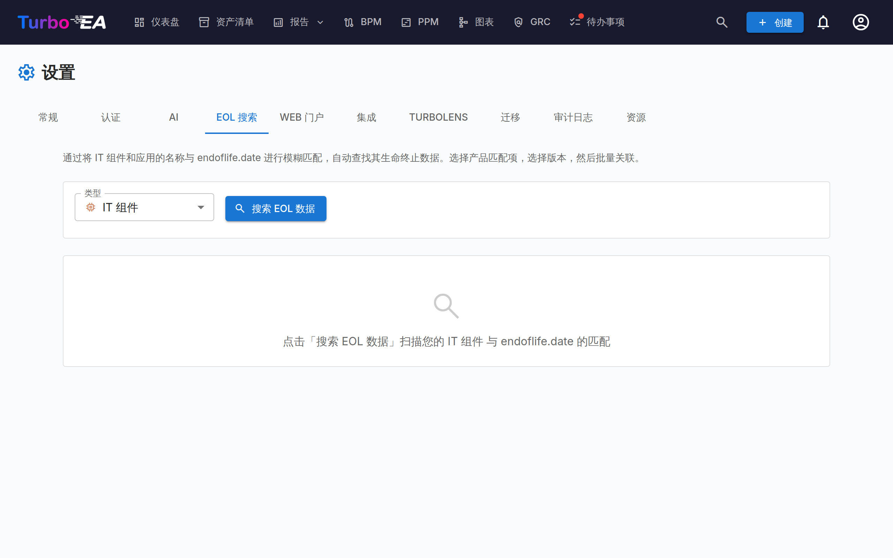
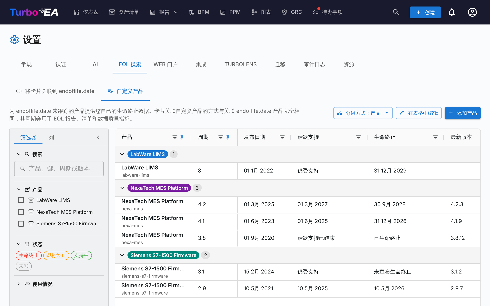

# 生命周期终止（EOL）管理

**EOL** 管理页面（**管理 > 设置 > EOL**）帮助您通过将卡片链接到公共 [endoflife.date](https://endoflife.date/) 数据库来跟踪技术产品的生命周期。

## 为什么要跟踪 EOL？

了解技术产品何时到达生命周期终止或停止支持对以下方面至关重要：

- **风险管理** —— 不受支持的软件是安全隐患
- **预算规划** —— 在支持结束前规划迁移和升级
- **合规性** —— 许多法规要求使用受支持的软件

## 批量搜索

批量搜索功能扫描跟踪生命周期终止的类型的卡片（默认为**应用程序**和 **IT 组件**，参见其他卡片类型上的生命周期终止），自动在 endoflife.date 数据库中查找匹配的产品。

### 运行批量搜索

1. 导航到**管理 > 设置 > EOL**
2. 选择要扫描的卡片类型（任何跟踪生命周期终止的类型）
3. 点击**搜索**
4. 系统对 endoflife.date 产品目录执行**模糊匹配**

### 查看结果

对于每张卡片，搜索返回：

- **匹配度评分**（0-100%）—— 卡片名称与已知产品的匹配程度
- **产品名称** —— 匹配的 endoflife.date 产品
- **可用版本/周期** —— 产品的发布版本及其支持日期

### 筛选结果

使用筛选控件聚焦于：

- **全部** —— 所有扫描的卡片
- **仅未链接** —— 尚未链接到 EOL 产品的卡片
- **已链接** —— 已有 EOL 链接的卡片

统计摘要显示：扫描的卡片总数、已链接、未链接和找到的匹配。

### 将卡片链接到产品

1. 查看每张卡片的建议匹配
2. 从下拉菜单中选择正确的**产品版本/周期**
3. 点击**链接**保存关联

链接后，卡片的详情页面显示 **EOL 分区**，包含：

- **产品名称和版本**——自定义产品带有**自定义**标记
- **支持状态** —— 颜色编码，规则与 EOL 报告相同：受支持（绿色）、即将到期（橙色，距 EOL 日期不足六个月，或主动支持已结束）、已到期（红色）
- **关键日期** —— 发布日期、主动支持结束日期、EOL 日期、最新版本及其发布日期
- **发布说明**——指向该产品在 endoflife.date 上页面的链接，或自定义产品的**厂商页面**

只有可编辑该卡片的用户才能看到**关联**、**更改**和**取消关联**；其他人只能看到详情。关联了自定义产品时，EOL 管理员还会看到通往**管理自定义产品**的快捷入口。

## 其他卡片类型上的生命周期终止

默认情况下，**应用程序**和 **IT 组件**会跟踪生命周期终止。任何其他卡片类型，无论是内置的还是自定义的，也可以跟踪：打开**管理 > 元模型**，选择该类型，在其**卡片布局**中关闭**生命周期终止**分区上的**从卡片详情中隐藏**。如果您不在应用程序或 IT 组件上跟踪生命周期终止，同一开关也可以将其隐藏。

这一个开关决定了该类型与生命周期终止有关的一切：

- 其卡片上的**生命周期终止**分区（以及创建卡片时的链接选项），
- 该类型在 [EOL 报告](../guide/reports.md)、数据质量报告的**生命周期终止覆盖率**图表以及仪表板的生命周期终止筛选和分组中的位置，
- [清单](../guide/inventory.md)中的**生命周期终止**列和筛选器，
- 本页**批量搜索**的类型选择器。

隐藏该分区不会删除任何内容：卡片保留其链接和生命周期日期，再次显示该分区后，它们会重新出现在所有报告中。

## 自定义 EOL 产品

endoflife.date 跟踪的是常见软件，但并非您运行的所有软件：自研平台、供应商的小众工具或授权设备往往没有对应条目。对于这些产品，请定义**自定义 EOL 产品**——带有您自己发布周期的产品——并像关联 endoflife.date 产品一样将卡片关联到它。自定义产品会驱动相同的卡片状态、资产清单的**生命终止**列、[EOL 报告](../guide/reports.md)以及数据质量指标。

自定义产品列在 **管理 > 设置 > EOL** 的**自定义产品**标签页中。创建和编辑需要**管理 EOL** 权限（`eol.manage`）；任何可以查看 EOL 数据的人都能看到它们。

### 创建自定义产品

有两种创建方式：

- **从卡片创建**——在卡片的**生命终止**部分，产品搜索框下方有一行不显眼的文字*endoflife.date 上没有？*，旁边是**将其定义为自定义产品…**链接，只要未选择产品就会显示。表单打开时产品名称已预先填好：即您在搜索框中输入的内容；如果未输入，则为卡片名称。添加最初的周期后保存：卡片会一次性关联到新产品和新周期。
- **从自定义产品标签页创建**——点击**添加产品**。

每个产品包含：

- **产品名称**——在各处显示的名称。Turbo EA 会据此为卡片关联生成标识符（同名产品会得到带编号的标识符）；您无需输入，它仅在您向 endoflife.date 提交该产品时作为文件名出现。
- **供应商或发布策略链接**和**描述**——可选。启用 [AI 建议](ai.md)后，**AI建议**会根据产品名称和供应商链接起草描述，供您在应用前编辑。
- **发布周期**——每个周期包含名称（例如 `2.4`）、**发布日期**、**活跃支持**结束、**生命终止**，以及可选的**最新版本**及其发布日期。

活跃支持和生命终止各可填写一个日期（**在某个日期…**）；在日期未知时，也可选择两种回答之一：*仍受支持* / *支持已结束*，以及*未宣布生命终止* / *已结束*；*未知*表示不记录任何内容。状态（受支持、接近 EOL、生命终止）按与 endoflife.date 产品相同的规则据此得出。周期存在问题（例如没有名称、结束日期早于发布日期）时，会在相关字段上显示，问题修复前无法保存该产品。

### 在表格中管理周期

自定义产品标签页按产品分组，每个发布周期占一行。它的工作方式与其他表格相同：冻结和重新排列列、显示或隐藏列，并可通过左侧面板按产品、状态或使用情况筛选。**已关联卡片**列显示您可见的卡片中有多少使用了各个周期。产品的**描述**和**链接**也可作为列使用；它们默认隐藏，请在面板的**列**标签页中开启。

点击**在表格中编辑**即可就地修改单元格。日期和支持回答会打开一个小型编辑器，您还可以沿列向下拖动单元格的值（类似 Excel）将其复制到多个周期。行菜单（**⋮**）可为产品添加周期、编辑产品的名称、链接和描述，或删除周期或产品。

只要仍有卡片关联到某个产品或周期（包括您看不到的卡片），就无法删除它。要停用被卡片使用的周期，请改为重命名它（重命名时，关联到它的卡片会随之移动），或先将这些卡片关联到其他周期。产品的链接会在其卡片上作为发布说明链接提供。

您也可以从卡片中添加缺失的周期：在卡片的生命终止部分选择自定义产品后，周期列表末尾会出现**添加周期…**。

### 向 endoflife.date 贡献自定义产品

如果某个自定义产品是供应商的公开产品，请考虑将其提交给 endoflife.date，让所有人受益。在行菜单中选择**提交到 endoflife.date**：

1. 阅读警告：提交会公开产品名称及其日期。切勿提交自研或机密产品。
2. 选择 endoflife.date **类别**。对话框会以 endoflife.date 的格式（`products/<identifier>.md`）预览产品文件。
3. 点击**在 GitHub 上打开**。GitHub 会在 endoflife.date 仓库中打开一个已填好内容的新文件（如果您没有写入权限，会提示您派生该仓库）。补充描述和发布策略摘要，然后从您自己的 GitHub 账户发起拉取请求。对于较长的文件，请改用**复制文件**并粘贴到新文件中。

Turbo EA 自身不会向 GitHub 发送任何内容，也不存储 GitHub 凭据。endoflife.date 会依据其[贡献指南](https://github.com/endoflife-date/endoflife.date/blob/master/CONTRIBUTING.md)审核每一项提交。

### 切换到 endoflife.date

当 endoflife.date 开始跟踪您之前作为自定义产品保留的产品时，表格会在其旁边显示**在 endoflife.date 上**的提示。仅当名称高度匹配（名称相同，或您产品的名称包含在 endoflife.date 的名称中）时才会显示该提示，因此 endoflife.date 上仅恰好出现在您名称内部的短名称不会触发它。点击该提示，或在行菜单中选择**切换到 endoflife.date 产品…**：

1. 选择 endoflife.date 产品。
2. 为您的每个周期选择其卡片应迁移到的 endoflife.date 周期（同名周期会自动匹配），或保留在自定义产品上。
3. 可选：当不再有卡片关联时删除该自定义产品。

只会迁移您可见的卡片。卡片上的生命周期日期不会更改。

## EOL 报告

链接的 EOL 数据汇入 [EOL 报告](../guide/reports.md)，该报告提供所有已链接卡片的技术架构支持状态仪表盘视图。

## 查找尚未关联的卡片

本页之外有两个地方会列出完全没有生命周期终止信息的卡片——既没有在此处建立关联，也没有自行填写生命周期终止日期：

- [清单](../guide/inventory.md)中的**生命周期终止**筛选条件与列——先选择卡片类型，再选择**（空）**。
- [EOL 报告](../guide/reports.md)中的**无生命周期终止数据**指标，以及数据质量报告末尾的**生命周期终止覆盖率**图表。
