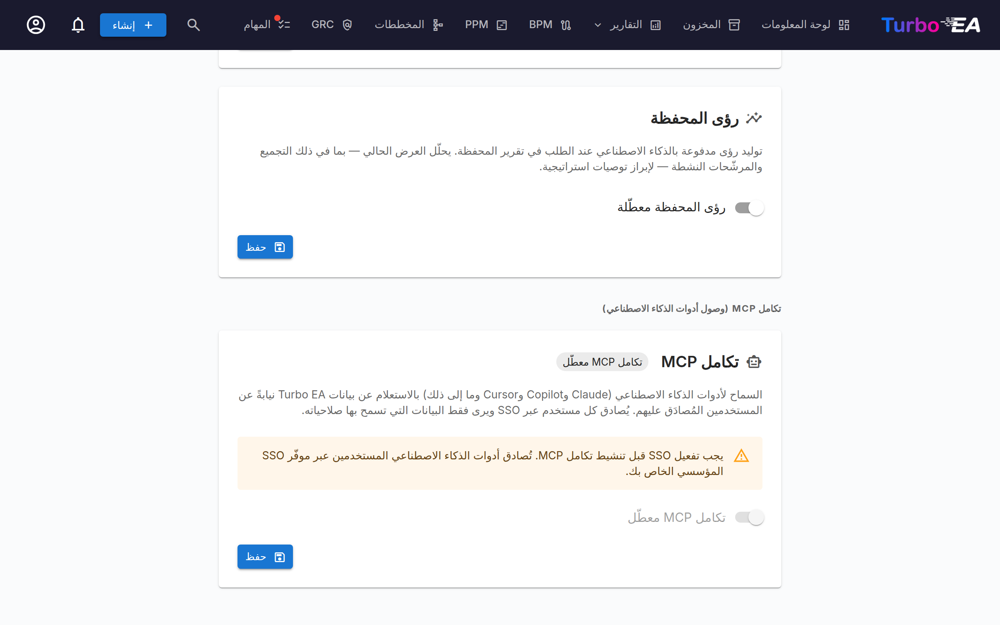

# تكامل MCP (وصول أدوات الذكاء الاصطناعي)

يتضمّن Turbo EA خادم **MCP** مدمجًا (Model Context Protocol) يتيح لأدوات الذكاء الاصطناعي — مثل Claude Desktop وGitHub Copilot وCursor وVS Code — الاستعلام عن بيانات هندسة المؤسسة لديك وتحديثها مباشرةً. ويمكن لأدوات الذكاء الاصطناعي أيضًا رفع المُخرجات (جداول البيانات، ومخططات BPMN، ومخططات DrawIO، والمستندات الحرّة) وتحويلها إلى بطاقات وعلاقات ومخططات تتلاءم مع النموذج الفوقي القائم. يصادق المستخدمون عبر مزوّد SSO الحالي لديك، وتحترم كل عملية أذوناتهم الفردية.

هذه الميزة **اختيارية** و**لا تبدأ تلقائيًا**. فهي تتطلب إعداد SSO، وتفعيل ملف MCP في Docker Compose، وقيام أحد المسؤولين بتشغيلها من واجهة الإعدادات.

---

## كيف يعمل

```
AI Tool (Claude, Copilot, etc.)
    │
    │  MCP protocol (streamable HTTP)
    ▼
Turbo EA MCP Server (:8001, internal)
    │
    │  OAuth 2.1 with PKCE
    │  delegates to your SSO provider
    ▼
Turbo EA Backend (:8000)
    │
    │  Per-user RBAC
    ▼
PostgreSQL
```

1. يضيف المستخدم عنوان URL لخادم MCP إلى أداة الذكاء الاصطناعي لديه.
2. عند أول اتصال، تفتح أداة الذكاء الاصطناعي نافذة متصفح للمصادقة عبر SSO.
3. بعد تسجيل الدخول، يصدر خادم MCP رمز وصول خاصًا به (مدعومًا بـ JWT الخاص بالمستخدم في Turbo EA).
4. تستخدم أداة الذكاء الاصطناعي هذا الرمز لجميع الطلبات اللاحقة. ويجري تحديث الرموز تلقائيًا.
5. يمرّ كل استعلام عبر نظام أذونات Turbo EA المعتاد — فلا يرى المستخدمون سوى البيانات التي يملكون صلاحية الوصول إليها.

---

## المتطلبات المسبقة

قبل تفعيل MCP، يجب أن يتوفّر لديك:

- **SSO مُعَدّ ويعمل** — يفوّض MCP المصادقة إلى مزوّد SSO لديك (Microsoft Entra ID أو Google Workspace أو Okta أو OIDC عام). راجع دليل [المصادقة والدخول الموحّد](sso.md).
- **HTTPS مع نطاق عام** — يتطلب تدفّق OAuth عنوان URI ثابتًا لإعادة التوجيه. انشر النظام خلف وكيل عكسي يُنهي اتصال TLS (Caddy أو Traefik أو Cloudflare Tunnel، وما إلى ذلك).

---

## الإعداد

### الخطوة 1: تشغيل خدمة MCP

خادم MCP هو ملف اختياري في Docker Compose. أضف `--profile mcp` إلى أمر بدء التشغيل:

```bash
docker compose --profile mcp up --build -d
```

يؤدي هذا إلى تشغيل حاوية Python خفيفة (المنفذ 8001، داخلي فقط) إلى جانب الواجهة الخلفية والواجهة الأمامية. ويوجّه Nginx طلبات `/mcp/` إليها تلقائيًا.

### الخطوة 2: ضبط متغيرات البيئة

أضف هذه المتغيرات إلى ملف `.env` لديك:

```dotenv
TURBO_EA_PUBLIC_URL=https://your-domain.example.com
MCP_PUBLIC_URL=https://your-domain.example.com/mcp
```

| المتغير | القيمة الافتراضية | الوصف |
|----------|---------|-------------|
| `TURBO_EA_PUBLIC_URL` | `http://localhost:8920` | عنوان URL العام لمثيل Turbo EA لديك |
| `MCP_PUBLIC_URL` | `http://localhost:8920/mcp` (docker compose) | عنوان URL العام لخادم MCP (يُستخدم في عناوين URI لإعادة توجيه OAuth). عند تشغيل الحاوية بشكل مستقل، تكون القيمة الافتراضية في الشيفرة `http://localhost:8001` |
| `MCP_PORT` | `8001` | المنفذ الداخلي لحاوية MCP (نادرًا ما يحتاج إلى تغيير) |
| `SECRET_KEY` | *(لا شيء)* | اضبطه على قيمة الخادم الخلفي نفسها. يوقّع معرّفات عملاء OAuth التي يصدرها خادم MCP، فيبقى العميل الذي سُجّل مرة واحدة عاملًا بعد إعادة التشغيل؛ ومن دونه يوقّع الخادم بمفتاح يزول مع العملية ويسجّل تحذيرًا. يمرّره Docker Compose ومخطط Helm وقوالب السحابة تلقائيًا |
| `MCP_ALLOWED_ORIGINS` | *(فارغ)* | مصادر (Origins) إضافية مفصولة بفواصل يقبل نقطة نهاية MCP طلبات المتصفح الواردة منها. تُقبل الطلبات التي لا تحمل الترويسة `Origin` دائمًا |
| `MCP_ALLOWED_HOSTS` | *(فارغ)* | أسماء مضيفين إضافية مفصولة بفواصل يقبلها نقطة نهاية MCP في ترويسة `Host`، إضافةً إلى مضيفَي `TURBO_EA_PUBLIC_URL` و`MCP_PUBLIC_URL`. لا حاجة إليها إلا عندما يمرّر وكيل اسم مضيف مختلفًا؛ راجع [خلف وكيل يغيّر اسم المضيف](#proxy-host-name) |

### الخطوة 3: إضافة عنوان URI لإعادة توجيه OAuth إلى تطبيق SSO لديك

في تسجيل التطبيق لدى مزوّد SSO الخاص بك (نفس التطبيق الذي أعددته لتسجيل الدخول إلى Turbo EA)، أضف عنوان URI التالي لإعادة التوجيه:

```
https://your-domain.example.com/mcp/oauth/callback
```

هذا ضروري لتدفّق OAuth الذي يصادق المستخدمين عند اتصالهم من أداة الذكاء الاصطناعي لديهم.

### الخطوة 4: تفعيل MCP في إعدادات المسؤول

1. انتقل إلى **الإعدادات** في منطقة الإدارة وحدّد علامة التبويب **AI**.
2. مرّر إلى قسم **MCP Integration (AI Tool Access)**.
3. حرّك المفتاح إلى وضع **التفعيل** لـ MCP.
4. ستعرض الواجهة عنوان URL لخادم MCP وتعليمات الإعداد لمشاركتها مع فريقك.



!!! warning
    يكون المفتاح معطّلًا إذا لم يكن SSO مُعَدًّا. أعدّ SSO أولًا.

---

## ربط أدوات الذكاء الاصطناعي

بمجرد تفعيل MCP، شارك **عنوان URL لخادم MCP** مع فريقك. ويضيفه كل مستخدم إلى أداة الذكاء الاصطناعي لديه:

### Claude Desktop

1. افتح **Settings > Connectors > Add custom connector**.
2. أدخل عنوان URL لخادم MCP: `https://your-domain.example.com/mcp`
3. انقر **Connect** — تُفتح نافذة متصفح لتسجيل الدخول عبر SSO.
4. بعد المصادقة، يمكن لـ Claude الاستعلام عن بيانات هندسة المؤسسة لديك.

### VS Code (GitHub Copilot / Cursor)

أضف ما يلي إلى ملف `.vscode/mcp.json` في مساحة العمل لديك:

```json
{
  "servers": {
    "turbo-ea": {
      "type": "http",
      "url": "https://your-domain.example.com/mcp"
    }
  }
}
```

استخدم `https://your-domain.example.com/mcp` كنقطة نهاية. لا يزال الشكل المزدوج القديم `https://your-domain.example.com/mcp/mcp` يعمل، لذا تستمر الموصّلات الحالية في العمل دون أي تغييرات.

### Microsoft Copilot Studio

يتصل Copilot Studio بخوادم MCP من سحابة Microsoft وليس من جهاز المستخدم. لذلك يجب أن تكون النسخة قابلة للوصول من الإنترنت العام عبر HTTPS بشهادة صادرة عن جهة تصديق عامة. النسخة التي لا تستجيب إلا على شبكة داخلية أو عبر VPN تعمل مع أدوات سطح المكتب لكنها تفشل في Copilot Studio.

1. في الوكيل الخاص بك، افتح **الأدوات > إضافة أداة > أداة جديدة > Model Context Protocol**.
2. أدخل عنوان URL للخادم `https://your-domain.example.com/mcp`.
3. ضمن **المصادقة**، اختر **OAuth 2.0** ثم **الاكتشاف الديناميكي** (Dynamic discovery).
4. أنشئ الاتصال وسجّل الدخول بحساب SSO الخاص بك عند المطالبة.

يسجّل Copilot Studio نفسه مرة واحدة ويحتفظ بمعرّف العميل الذي يتلقاه. يحمل هذا المعرّف عناوين إعادة التوجيه الخاصة به موقّعة بالمفتاح `SECRET_KEY` الخاص بالنسخة، فيستمر الاتصال في العمل عند إعادة تشغيل حاوية MCP أو ترقيتها. تغيير `SECRET_KEY` يُبطل جميع العملاء المسجّلين: أعد إنشاء الأداة في Copilot Studio بعد ذلك.

### خلف وكيل يغيّر اسم المضيف { #proxy-host-name }

تحمي نقطة نهاية MCP نفسها من هجمات DNS rebinding بفحص ترويسة `Host` في كل طلب. وهي تقبل أسماء المضيفين الواردة في `TURBO_EA_PUBLIC_URL` و`MCP_PUBLIC_URL` إضافةً إلى `localhost` و`127.0.0.1`. تسجّل حاوية MCP القائمة الكاملة مرة واحدة عند بدء التشغيل. يُرفض أي اسم مضيف آخر مع الرمز `421 Misdirected Request`، وتسجّل حاوية MCP الرسالة `Invalid Host header: <name>`.

تمرّر بعض الوكلاء اسم مضيف غير الاسم العام. فعلى سبيل المثال، يرسل Azure Front Door الموضوع أمام مسار HTTP في Azure Container Apps اسم المسار نفسه `<route>.<environment>.azurecontainerapps.io`. يظل تسجيل الدخول يعمل في هذه الحالة، لكن كل اتصال MCP يفشل. أدرج الاسم الممرَّر في `MCP_ALLOWED_HOSTS`:

```dotenv
MCP_ALLOWED_HOSTS=my-route.my-environment.westeurope.azurecontainerapps.io
```

المدخلات أسماء مضيفين فقط، مفصولة بفواصل، دون `https://` أو مسار؛ وتسجّل الحاوية تحذيرًا لمدخل لا يمكن أن يطابق أبدًا. المطابقة تامة، مع الترويسة كما يرسلها الوكيل، بأحرف صغيرة. أضف `:port` عندما يرسل الوكيل منفذًا، أو `:*` لقبول أي منفذ. أحرف البدل للنطاقات الفرعية غير مدعومة. على Kubernetes، اضبط المتغير عبر `mcp.extraEnv` في قيم Helm.

---

## الاختبار المحلي (وضع stdio)

للتطوير أو الاختبار المحلي دون SSO/HTTPS، يمكنك تشغيل خادم MCP في **وضع stdio** — حيث يشغّله Claude Desktop مباشرةً كعملية محلية.

**1. ثبّت حزمة خادم MCP:**

```bash
pip install ./mcp-server
```

**2. أضف ما يلي إلى ملف إعداد Claude Desktop** (`claude_desktop_config.json`):

```json
{
  "mcpServers": {
    "turbo-ea": {
      "command": "python",
      "args": ["-m", "turbo_ea_mcp", "--stdio"],
      "env": {
        "TURBO_EA_URL": "http://localhost:8000",
        "TURBO_EA_EMAIL": "your@email.com",
        "TURBO_EA_PASSWORD": "your-password"
      }
    }
  }
}
```

في هذا الوضع، يصادق الخادم باستخدام البريد الإلكتروني/كلمة المرور ويحدّث الرمز تلقائيًا في الخلفية.

---

## القدرات المتاحة

يعرض خادم MCP عدد **55 أداة** موزّعة على مجموعتين: **35 أداة قراءة** تستعلم عن بيانات هندسة المؤسسة، و**20 أداة كتابة** (15 إضافية و5 هدّامة) تنشئ البطاقات والعلاقات والمخططات والمخاطر وسجلات ADR وعروض المخزون المحفوظة وغيرها وتصونها — بما في ذلك تحويل المُخرجات التي تحتفظ بها أداة الذكاء الاصطناعي في سياقها الخاص (جداول البيانات، وملفات BPMN XML، وملفات DrawIO XML، والمستندات، والصور) إلى بيانات هندسة مؤسسة منظّمة. وتحمل كل أداة تعليقات `ToolAnnotations` الخاصة بـ MCP (تلميحات قراءة فقط / هدّامة / متساوية القوى idempotent) حتى تتمكّن الموصّلات من إظهار درجة الخطورة في واجهتها.

### أمان التشغيل التجريبي على عمليات الكتابة

تتخذ كل أداة كتابة القيمة الافتراضية **`dry_run=true`**، ولا يُحفظ أي شيء إلى أن تستدعيها أداة الذكاء الاصطناعي مرة أخرى بـ `dry_run=false` — وهو ما ينبغي ألا تفعله إلا بعد أن يطّلع المستخدم على المعاينة ويؤكدها. يمنع هذا أي وكيل متحمّس من بثّ مئات البطاقات بهدوء استنادًا إلى جدول بيانات أُسيء تفسيره. وتأتي المعاينة بنوعين:

- **يتحقق منها الخادم الخلفي.** حيثما تدعم نقطة النهاية الأساسية التشغيل التجريبي، تُشغّل الواجهة الخلفية كل أداة تحقق ومُحلِّل مراجع — الصلاحيات ومعرّفات البطاقات وما يحق للمستخدم قراءته —، وتبني النتيجة الكاملة، ثم **تتراجع عن المعاملة**. ويشمل ذلك البطاقات (`create_cards_bulk` و`update_cards_bulk`) والعلاقات (`upsert_relations_bulk`) والمخططات (`create_diagram` و`update_diagram`). وتُعيد معاينة المخطط روابط البطاقات التي قبلها الخادم الخلفي، وفي حالة التحديث التغيير بدقة: الحقول التي أُعيدت تسميتها، وروابط البطاقات المضافة والمزالة، وهل تغيّرت اللوحة.
- **يبنيها خادم MCP.** حيثما لا تتوفر لنقطة النهاية خاصية التشغيل التجريبي، تتحقق الأداة من مدخلاتها وتترجمها وتعرض الحمولة الدقيقة التي سيرسلها التنفيذ، دون استدعاء نقطة نهاية الكتابة: `import_bpmn` (مسار المسودة ← الإرسال ← الموافقة؛ وأعداد عقد التدفق فيه تقديرية وتذكر المعاينة `verified: false`)، `create_adr`, `update_adr`, `sign_adr`, `create_soaw`, `add_card_comment`, `transition_card_lifecycle`, `save_inventory_view` (تشغّل الاستعلام وتُبلغ بعدد البطاقات المطابقة مع بعض الأسماء كأمثلة)، `assign_stakeholders`, `create_risks`, `update_risks`، و`archive_cards` (التي تعرض أثر الأرشفة لكل بطاقة)، و`set_card_logos` / `clear_card_logos` (اللتان تبحثان عن نوع كل بطاقة وشعارها الحالي وتجلبان كل `image_url`).

وفي الحالتين تُسجَّل المعاينة في سجل التدقيق كدفعة تشغيل تجريبي، فيرى المسؤول ما اقترحه الوكيل وما نفّذه.

### أدوات القراءة

يعرض الخادم 35 أداة قراءة موزّعة على ثماني مجموعات.

**البطاقات والنموذج الفوقي**

| الأداة | الوصف |
|------|-------------|
| `search_cards` | البحث في البطاقات وتصفيتها حسب النوع أو الحالة أو النص الحرّ |
| `query_cards` | العثور على البطاقات عبر سلسلة من العلاقات مع شرط عند كل قفزة — انظر [استعلامات البطاقات متعددة القفزات](#multi-hop-card-queries) |
| `list_inventory_views` | سرد عروض المخزون المحفوظة التي يمكنك رؤيتها، مع استعلام كل عرض والقناة التي أنشأته |
| `get_card` | الحصول على التفاصيل الكاملة لبطاقة حسب UUID |
| `get_card_relations` | الحصول على جميع العلاقات المرتبطة ببطاقة |
| `get_card_hierarchy` | الحصول على أسلاف البطاقة وأبنائها |
| `list_card_types` | سرد جميع أنواع البطاقات في النموذج الفوقي؛ وحقل `category` لكل نوع هو مفتاح فئته (الطبقة الهندسية) |
| `get_relation_types` | سرد أنواع العلاقات، مع إمكانية التصفية حسب نوع البطاقة |
| `list_tag_groups` | سرد مجموعات الوسوم (مع أنواع البطاقات التي تنطبق عليها كل مجموعة) ووسومها؛ معرّفات الوسوم هي ما يقبله `query_cards` و`save_inventory_view` ضمن `where.tags` |
| `resolve_card_refs` | التحقق المسبق من مراجع البطاقات المستندة إلى الأسماء (الاسم ← UUID) قبل الاستيراد المجمّع — يحلّ المراجع فقط ولا يكتب أبدًا |
| `analyze_impact` | تحليل نطاق تأثير التبعيات لتغيير مقترح على بطاقة |

**لوحات المعلومات**

| الأداة | الوصف |
|------|-------------|
| `get_dashboard` | لوحة معلومات مؤشرات الأداء KPI (الأعداد، وجودة البيانات، والموافقات، والنشاط) |
| `get_landscape` | بطاقات من نوع واحد مجمّعة حسب نوع مرتبط |

**GRC — سجل المخاطر**

| الأداة | الوصف |
|------|-------------|
| `list_risks` | قائمة مخاطر هندسة المؤسسة مقسّمة إلى صفحات وقابلة للتصفية (TOGAF المرحلة G) |
| `get_risk` | تفاصيل مخاطرة واحدة مع البطاقات المرتبطة + مسار التدقيق |
| `get_risk_metrics` | مؤشرات الأداء KPI + مصفوفات الاحتمال × الأثر 4×4 الأولية/المتبقية |
| `get_card_risks` | جميع المخاطر المرتبطة حاليًا ببطاقة محددة |

**GRC — الامتثال**

| الأداة | الوصف |
|------|-------------|
| `list_compliance_findings` | نتائج الامتثال مجمّعة حسب اللائحة التنظيمية |
| `get_compliance_overview` | درجات الامتثال + مصفوفة الحالة لكل لائحة + بيانات وصفية لآخر فحص |

**الحوكمة والتسليم**

| الأداة | الوصف |
|------|-------------|
| `list_principles` | مبادئ هندسة المؤسسة المنشورة (البيان، والمبرّر، والتبعات) |
| `list_adrs` | سجلات قرارات البنية (ADR)، قابلة للتصفية حسب المبادرة/الحالة |
| `get_adr` | سجل ADR واحد مع الأقسام والبطاقات المرتبطة ومسار التوقيع |
| `list_soaws` | بيانات عمل البنية (SoAW) لمبادرة ما |

**التقارير**

| الأداة | الوصف |
|------|-------------|
| `get_portfolio_report` | بيانات مخطط الفقاعات لنوع بطاقة (الملاءمة الوظيفية × التقنية افتراضيًا) |
| `get_cost_treemap` | مخطط شجري لتكلفة البطاقات، مع إمكانية التجميع حسب نوع مرتبط |
| `get_capability_heatmap` | خريطة حرارية هرمية لقدرات الأعمال |
| `get_data_quality_report` | تفصيل اكتمال البيانات لكل نوع بطاقة |

**سياق البطاقة**

| الأداة | الوصف |
|------|-------------|
| `get_card_stakeholders` | المستخدمون والأدوار المُسندة إلى بطاقة |
| `get_card_comments` | التعليقات المتسلسلة على بطاقة |
| `get_card_documents` | روابط المستندات المرفقة ببطاقة |
| `get_card_logo` | A card's logo: mime, size and a sha256 of the stored bytes, so a write can be verified without transferring the image (pass `include_image` when you do want it) |
| `list_available_icons` | Search the built-in brand-icon pack for a slug to pass to `set_card_logos` |

**المخططات**

| الأداة | الوصف |
|------|-------------|
| `list_diagrams` | سرد المخططات الحرّة (DrawIO)، مع إمكانية التصفية إلى بطاقة واحدة |
| `get_diagram` | جلب مخطط واحد حسب المعرّف، بما في ذلك ملف DrawIO XML الخاص به |

**التدقيق وتاريخ التغييرات**

| الأداة | الوصف |
|------|-------------|
| `get_change_history` | الاستعلام عن سجل دفعات التعديلات (حسب معرّف الدفعة أو المنفّذ أو الأداة أو المصدر) لإعادة بناء ما غيّره تنفيذ MCP سابق على وجه الدقة |

تخضع جميع الأدوات لـ RBAC الخاص بالمستخدم المصادَق عليه — فيحصل المستخدم ذو صلاحية العرض فقط على قائمة فارغة (أو خطأ 403) للمناطق التي لا يمكنه رؤيتها؛ ولا يحتاج أي شيء على طبقة MCP إلى ضبط لكل أداة.

### أدوات الكتابة

يعرض الخادم 20 أداة كتابة، كل منها موسومة بأنها **إضافية** (تنشئ البيانات أو توسّعها) أو **هدّامة** (تعدّل البيانات القائمة أو تزيلها) حتى تتمكّن الموصّلات من التحذير وفقًا لذلك.

**الإضافية (15)**

| الأداة | الوصف |
|------|-------------|
| `create_cards_bulk` | إنشاء بطاقات كثيرة في استدعاء واحد (مثل صفوف جدول بيانات). يدعم مراجع الأب بالاسم ضمن الدفعة نفسها مع ترتيب طوبولوجي على جانب الخادم. |
| `transition_card_lifecycle` | نقل بطاقة عبر مراحل الموافقة أو دورة الحياة. |
| `create_risks` | إنشاء إدخالات في سجل مخاطر هندسة المؤسسة. |
| `update_risks` | تحديث إدخالات سجل المخاطر (الحقول والبطاقات المرتبطة). |
| `add_card_comment` | نشر تعليق على بطاقة — ملاحظة غير هدّامة قابلة للمراجعة بدلًا من تعديل الحقول. |
| `create_soaw` | إنشاء بيان عمل بنية (Statement of Architecture Work) لمبادرة. |
| `assign_stakeholders` | إسناد أدوار أصحاب المصلحة على البطاقات أو إزالتها. |
| `update_cards_bulk` | تعديلات على مستوى الحقول لبطاقات كثيرة في استدعاء واحد. |
| `create_adr` | إنشاء سجل قرار بنية (Architecture Decision Record). |
| `update_adr` | تحديث سجل ADR (العنوان والأقسام والحالة والبطاقات المرتبطة). |
| `sign_adr` | توقيع سجل ADR (يتطلب إذن `adr.sign`؛ وإلا يُعيد رابطًا عميقًا إلى الواجهة للتوقيع في المتصفح). |
| `create_diagram` | إنشاء مخطط DrawIO حرّ مع روابط اختيارية إلى بطاقات قائمة. |
| `save_inventory_view` | حفظ استعلام بطاقات متعدد القفزات كعرض مخزون (جديد، أو بديلًا عن استعلام عرض قائم يُحدَّد بـ `view_id`). يعيد المخزون تشغيل الاستعلام في كل مرة يُفتح فيها العرض؛ وتتضمن الاستجابة رابطًا يفتحه. لا يغيّر التحديث سوى الاسم والاستعلام، إضافةً إلى الرؤية والأعمدة عند تمريرهما؛ ويُحتفظ بتجميع العرض وتخطيطه. |
| `import_bpmn` | حفظ مخطط BPMN 2.0 XML مقابل بطاقة عملية أعمال **قائمة**. إذا لم تطابق أي بطاقة الاسم المُعطى، تُعيد الأداة خطأ `card_not_found` يوجّه الوكيل إلى `create_cards_bulk` — يُلزم هذا الوكيل بإنشاء البطاقة صراحةً بوصف ونوع فرعي وسمات أولًا، بدلًا من اختصار يُنتج بطاقة هزيلة. |
| `set_card_logos` | Set the custom logo on many cards at once — the bulk way to put product marks on an Application inventory. Three ways to supply the image, one per row: a built-in `icon_slug` (resolved server-side, nothing transferred), an `image_url` the MCP server downloads for you from an allowlisted icon host, or `image_base64` from the agent's own context. The packs are a shortcut, not the source of truth — a dry run lists the slugs they do not carry under `unknown_icon_slugs` **and** fetches every `image_url`, so a missing brand or a dead link is reported before anything is written rather than left as a logo nobody could set. `mime` is optional and sniffed from the bytes. PNG/JPEG/WebP/GIF only, 1 MB each. Each row echoes a sha256 so the caller can prove what landed. Use `clear_card_logos` to remove one. |

**الهدّامة (5)**

| الأداة | الوصف |
|------|-------------|
| `upsert_relations_bulk` | إنشاء أو حذف العلاقات بين البطاقات. يجري التحقق من المصدر/الهدف/النوع مقابل النموذج الفوقي. ويُرفض الحذف ما لم يفعّله المشغّل صراحةً (انظر الضوابط). |
| `archive_cards` | حذف مرن للبطاقات. قابل للاسترداد — يمكن استعادة البطاقات المؤرشفة خلال 30 يومًا قبل التطهير التلقائي. |
| `update_diagram` | استبدال ملف DrawIO XML لمخطط أو اسمه أو روابطه بالبطاقات. |
| `rollback_batch` | التراجع عن عمليات الكتابة المنفّذة ضمن دفعة تعديلات سابقة. |
| `clear_card_logos` | Remove the custom logo from cards, falling them back to their card-type icon. Recoverable — set it again to restore. |

### استعلامات البطاقات متعددة القفزات { #multi-hop-card-queries }

يجيب `query_cards` في استدعاء واحد عن سؤال يربط العلاقات في سلسلة — «المؤسسات التي تستخدم تطبيقًا مرحلة دورة حياته نشط وتؤثر فيه مبادرة حالتها On Track» — ويحتفظ `save_inventory_view` بالاستعلام نفسه كعرض مخزون محفوظ. يخزّن العرض الاستعلام لا نتائجه: يعيد المخزون تشغيله في كل مرة يفتح فيها أحدٌ العرض، فتبقى القائمة محدّثة.

الاستعلام كائن JSON صغير يتألف من **مفاتيح فقط** — مفاتيح نوع البطاقة ونوع العلاقة والحقل والخيار كما يعيدها `list_card_types` و`get_relation_types`؛ معرّفات البطاقات تحت `where.cards` فقط ومعرّفات الوسوم تحت `where.tags` فقط؛ ولا التسميات أبدًا:

```text
CardQuery = { type, where?, related?: [Hop] }
Hop       = { relation: "<relation type key>" | "<key>__out" | "<key>__in",
              type, where?, negate?: true|false, related?: [Hop] }
Where     = { lifecycle_phase?: [plan | phaseIn | active | phaseOut | endOfLife | none],
              subtype?: [subtype key],
              approval_status?: [status],
              data_quality_band?: [complete | partial | minimal],
              attributes?: { field key: [option key | "true" | "false" | text | "__empty__"] },
              tags?: [tag id],
              cards?: [card id],
              include_descendants?: true|false }
```

- تتطابق القفزة عندما تستوفي **أي** بطاقة مرتبطة من ذلك النوع شرط `where` الخاص بها (وقفزاتها المتداخلة). يحوّلها `negate: true` إلى «**لا** توجد بطاقة كهذه».
- يجب أن تتطابق جميع القفزات المتجاورة في المستوى نفسه (و)؛ والقيم داخل القائمة الواحدة بدائل (أو).
- يختار `<key>__out` و`<key>__in` جانبًا من نوع علاقة يربط نوع بطاقة بنفسه (البطاقة هي المصدر أو الهدف). وفي غير ذلك يكفي المفتاح العادي.
- يطابق `data_quality_band` درجة جودة بيانات البطاقة بحسب النطاق، كما يفعل مرشّح جودة البيانات في المخزون: `complete` (80 فأكثر) أو `partial` (من 40 حتى دون 80) أو `minimal` (أقل من 40). يُرفض أي قيمة أخرى مع `unknown_band`.
- يقبل `tags` معرّفات الوسوم من `list_tag_groups`، مجمّعة حسب مجموعة الوسوم: يجب أن تحمل البطاقة وسمًا واحدًا على الأقل من الوسوم المدرجة من **كل** مجموعة مذكورة (بدائل داخل المجموعة الواحدة، و بين المجموعات). يُرفض الوسم الذي لا تنطبق مجموعته على نوع بطاقة تلك القفزة بالخطأ `tag_not_for_type`؛ ويُرفض المعرّف المجهول بالخطأ `unknown_tag`.
- يثبّت `cards` تلك العقدة على البطاقات المدرجة (بدائل): خذ معرّفاتها من `search_cards` أو `resolve_card_refs`. ينبغي أن تكون كل واحدة بطاقة من نوع العقدة نفسه. لا يتحقق تشغيل الاستعلام من الاختيارات: فالمعرّف الذي لا يسمّي أي بطاقة، أو بطاقة من نوع آخر، أو بطاقة لا يستطيع المستخدم قراءتها، لا يطابق شيئًا ببساطة. أما حفظ العرض فيتحقق منها ويرفض اختيارًا كهذا مع `unknown_card`. لا تطابق البطاقة المؤرشفة شيئًا عند قفزة. يوسّع `include_descendants: true` كل اختيار ليشمل كل بطاقة تحته عبر رابط الأصل (القدرات الفرعية، المؤسسات التابعة)؛ وإذا ضُبط دون `cards` رُفض مع `descendants_without_cards`، وعلى نوع بطاقة بلا تسلسل هرمي مع `descendants_without_hierarchy`. ويُرفض معرّف بطاقة أو وسم في أي موضع آخر من الاستعلام مع `query_holds_an_id`.
- لا تُحتسب البطاقات المرتبطة إلا إذا كانت نشطة ويستطيع المستخدم قراءتها: فالبطاقة التي لا يراها المستخدم تقطع السلسلة، تمامًا كما في واجهة الويب. عند حفظ عرض، لا يستطيع الكاتب تثبيت بطاقة مخفية عنه (`unknown_card`)؛ ويحتفظ المتعاون الذي يحرّر عرضًا مشاركًا معه بالاختيارات التي يحتويها أصلًا، حتى تلك التي لا يستطيع قراءتها. أما القارئ الذي يفتح عرضًا تتضمن اختياراته بطاقة مخفية عنه فلا يُرفض — فالاختيارات المخفية لا تطابق شيئًا ببساطة.

مثال — المؤسسات التي تستخدم تطبيقًا نشطًا تؤثر فيه مبادرة حالتها *On Track*:

```json
{
  "type": "Organization",
  "related": [
    {
      "relation": "relOrgToApp",
      "type": "Application",
      "where": { "lifecycle_phase": ["active"] },
      "related": [
        {
          "relation": "relInitiativeToApp",
          "type": "Initiative",
          "where": { "attributes": { "initiativeStatus": ["onTrack"] } }
        }
      ]
    }
  ]
}
```

في المخزون، يعرض العرض المحفوظ بهذه الطريقة سلسلته مسارًا مقروءًا فوق الشبكة مع ملاحظة تفيد بأنه أُنشئ عبر MCP. ويمكن تغيير استعلامه في المخزون (القلم على شريط المسار) أو عبر `save_inventory_view` (مرّر معرّف العرض من `list_inventory_views` بوصفه `view_id`؛ يستبدل التحديث الاسم والاستعلام، ولا يغيّر الرؤية والأعمدة إلا عند تمريرهما، ويحتفظ بالتجميع والتخطيط المضبوطين في واجهة الويب — ما لم يبدأ الاستعلام الجديد من نوع بطاقة آخر، فتُعاد تهيئة مرشحات العرض وتجميعه لأنها كانت تخص النوع القديم؛ ويُرفض العرض الذي لا يمكنك تعديله بالخطأ `view_not_found` أو `view_not_editable`؛ ويُرفض تغيير الرؤية الذي لا يحق لك إجراؤه (لا يغيّرها إلا المالك، ويتطلب جعلها عامة أو مشتركة صلاحية `bookmarks.share`) بالخطأ `visibility_not_allowed`)؛ وفي واجهة الويب يمكن لمالكه أيضًا إعادة تسميته وتغيير مشاركته وإعداد OData وضبط تخطيط الأعمدة أو حذفه.

القيود:

- بحد أقصى **3 مستويات** من `related`، وبحد أقصى 10 قفزات متجاورة في المستوى الواحد، وبحد أقصى **12 قفزة في الاستعلام كله** (المتجاورة والمتداخلة معًا). يُرفض الاستعلام الأطول بالخطأ `too_many_hops`.
- بحد أقصى **50** بطاقة مختارة لكل شرط.
- تتطابق السمة النصية مع قيمتها **تمامًا** — لا توجد مطابقة جزئية ولا مطابقة غير حساسة لحالة الأحرف.
- **لا يستطيع `rollback_batch` التراجع عن عرض محفوظ.** يسجّل حفظ العرض دفعة تعديلات لكنه لا ينشر حدثًا يمكن للتراجع عكسه؛ احذف العرض غير المرغوب فيه من «العروض المحفوظة» في المخزون.

### رفع المُخرجات

تتيح مجموعة فرعية من أدوات الكتابة (`create_cards_bulk` و`upsert_relations_bulk` و`create_diagram` و`import_bpmn`) لوكيل الذكاء الاصطناعي تحويل المُخرجات إلى بيانات هندسة مؤسسة منظّمة. يقرأ الوكيل الملف المصدر من سياقه الخاص (الرؤية متعددة الوسائط، المرفقات)، ويستخرج صفوفًا منظّمة، ويستدعي هذه الأدوات. ولا يحلّل خادم MCP نفسه الملفات قط — فهو يتوقّع مُدخلات منظّمة بالفعل.

سير العمل النموذجي عندما يشارك المستخدم جدول بيانات مع وكيل الذكاء الاصطناعي:

1. يستدعي الوكيل `list_card_types` و`get_relation_types` لفهم النموذج الفوقي.
2. يحلّل الوكيل جدول البيانات (في سياقه الخاص، لا في MCP) ويبني قواميس صفوف.
3. يستدعي الوكيل `create_cards_bulk(cards=…, dry_run=True)` ويعرض المعاينة للمستخدم.
4. يؤكّد المستخدم؛ فيستدعي الوكيل مرة أخرى بـ `dry_run=False` للتنفيذ.
5. إذا توفّرت أعمدة علاقات، يستدعي الوكيل عندئذٍ `upsert_relations_bulk` بدورة التشغيل التجريبي/التأكيد نفسها.

### ضوابط أدوات الكتابة

دفاع متعدد الطبقات فوق التشغيل التجريبي، حتى لا تتسبب أي زلّة من LLM في أضرار جسيمة:

- **حدود قصوى لحجم كل استدعاء.** تفرض أدوات كتابة MCP حدًّا أصغر بكثير من نقاط نهاية مستورد Excel الأساسية: 200 صف لـ `create_cards_bulk`، و500 عملية لـ `upsert_relations_bulk`. كبير بما يكفي لأي رفع مُخرج واقعي مفرد، وصغير بما يكفي ليظل بالإمكان فحص معاينة التشغيل التجريبي.
- **لا حذف للعلاقات افتراضيًا.** ترفض `upsert_relations_bulk` عمليات `action: "delete"` — لإزالة العلاقات، استخدم الواجهة الإلكترونية حيث تُسجّل العملية تحت هوية المستخدم. يمكن للمشغّلين الاشتراك بضبط `MCP_ALLOW_RELATION_DELETE=true`.
- **مفتاح الإيقاف.** يوقف `MCP_WRITES_ENABLED=false` جميع أدوات الكتابة العشرين دون إعادة نشر الشيفرة. وتظل أدوات القراءة الأربع والثلاثون تعمل.
- **تنزيل الشعارات مقصور على مضيفين مسموح بهم.** لا تستطيع حزم الأيقونات المضمّنة تغطية كل منتج لدى العميل، وكثيرًا ما يعمل المساعد في بيئة معزولة بلا منفذ إلى الويب، لذلك تقبل `set_card_logos` قيمة `image_url` يتولى خادم MCP تنزيلها. `https` فقط، والمضيفون المذكورون في `MCP_LOGO_FETCH_HOSTS` فقط، وعناوين عامة فقط، وإعادتا توجيه على الأكثر (تُفحص كل واحدة من جديد)، وميغابايت واحد على الأكثر يُقرأ كتدفّق، ويجب أن تحمل البايتات توقيع PNG/JPEG/WebP/GIF حقيقيًا. يجري التنزيل عند حافة MCP لا في الواجهة الخلفية، ثم تُرفع الصورة عبر المسار المعتاد: فلا يصل رابط اختاره نموذج لغوي إلى العملية التي تحتفظ بقاعدة البيانات. و`MCP_LOGO_FETCH_ENABLED=false` يعطّل ذلك.
- **وسم مصدر التدقيق.** يحمل كل طلب من خادم MCP إلى الواجهة الخلفية ترويسة `X-Turbo-EA-Origin: mcp`. وتُوسَم الأحداث المنبثقة من تلك الطلبات بـ `origin: "mcp"` في حمولة سجل التدقيق، بحيث يمكن للمسؤولين تصفية عمليات الكتابة المدفوعة من MCP خارج المخطط الزمني تمييزًا لها عن إجراءات الواجهة الإلكترونية.
- **دفعات التعديلات.** يمثّل كل استدعاء كتابة عبر MCP — المعاينة والتنفيذ على حد سواء — دفعة تعديلات واحدة في سجل التدقيق، تُفتح قبل كتابة أي شيء؛ ويُوسَم كل حدث يُبثّ أثناء الاستدعاء بمعرّف الدفعة، وتُعيد كل أداة كتابة قيمة `batch_id` هذه. ويمكن للمسؤولين (أو أداة `get_change_history`) إعادة بناء الفرق الكامل حدثًا بحدث لأي تنفيذ من معرّف واحد، كما يمكن لـ `rollback_batch` التراجع عنه — بما في ذلك حذف مخطط أنشأته `create_diagram`، ما لم ينشره أحد منذ ذلك الحين. ويُبلَّغ عن تحديث المخطط على أنه غير قابل للتراجع، لأن اللوحة السابقة لا تُحفظ. ويجب على التنفيذات التي تتجاوز `MCP_BATCH_CONFIRMATION_THRESHOLD` صفًا إعادة رمز `confirm_token` أحادي الاستخدام الذي أعاده التشغيل التجريبي السابق. ويتحقق منه الخادم الخلفي عند فتح دفعة التنفيذ، قبل كتابة أي شيء: يجب أن يكون صادرًا عن تشغيل تجريبي للأداة نفسها، من المستخدم نفسه، قبل أقل من 15 دقيقة، ولا يجيز إلا تنفيذًا واحدًا. وتتبع كل أدوات الكتابة المجمّعة دورة المعاينة ثم التأكيد هذه: `create_cards_bulk`, `update_cards_bulk`, `archive_cards`, `upsert_relations_bulk`, `assign_stakeholders`, `create_risks`, `update_risks`, `set_card_logos`, `clear_card_logos`.
- **لا حذف نهائي.** تتعمّد مجموعة الأدوات إغفال الحذف الدائم للبطاقات. أما `archive_cards` و`update_cards_bulk` فهما *معروضتان* بالفعل، لكن الأرشفة حذف مرن قابل للاسترداد (نافذة استعادة مدتها 30 يومًا)، وكلتاهما موسومتان بالخطورة ومحكومتان بالتشغيل التجريبي. وستتطلب إضافة أي أداة تُجري تعديلًا لا رجعة فيه (حذف نهائي، تطهير قسري) مراجعة تصميم صريحة.

متغيرات البيئة الستة الخاصة بالضوابط على حاوية MCP:

| المتغير | القيمة الافتراضية | الأثر |
|----------|---------|--------|
| `MCP_WRITES_ENABLED` | `true` | المفتاح الرئيسي لأدوات الكتابة. `false` ← MCP للقراءة فقط. |
| `MCP_MAX_CARDS_PER_CALL` | `200` | حد أقصى صارم لصفوف `create_cards_bulk` / `update_cards_bulk` لكل طلب. |
| `MCP_MAX_RELATIONS_PER_CALL` | `500` | حد أقصى صارم لعمليات `upsert_relations_bulk` لكل طلب. |
| `MCP_MAX_LOGOS_PER_CALL` | `50` | Hard cap on `set_card_logos` rows per request. Lower than the card cap because each logo is its own upload and carries image bytes. |
| `MCP_ALLOW_RELATION_DELETE` | `false` | عند `true`، تقبل `upsert_relations_bulk` عمليات `action: "delete"`. |
| `MCP_LOGO_FETCH_ENABLED` | `true` | عند `true`، تقبل `set_card_logos` قيمة `image_url`: يقوم خادم MCP بتنزيل الصورة ورفعها عبر المسار المعتاد، لذا تظل جميع فحوص الصلاحيات والحجم والصيغة سارية. اضبطها على `false` لرفض مسار الرابط تمامًا — وتبقى معرّفات الأيقونات والبايتات الملصقة تعمل كما هي. |
| `MCP_LOGO_FETCH_HOSTS` | *(built-in)* | المضيفون المسموح بتنزيل الشعار منهم، مفصولون بفواصل ومطابقة تامة. الافتراضي: `raw.githubusercontent.com`, `cdn.jsdelivr.net`, `cdn.simpleicons.org`, `upload.wikimedia.org` — استضافة أيقونات عامة، حيث لا يحمل الطلب سوى اسم ملف ولا شيء عن مشهدك التقني. يمكن إضافة خدمة تبحث عن الشعار حسب النطاق، لكن ثمن ذلك إخبارها بالموردين الذين تستخدمهم. |
| `MCP_BATCH_CONFIRMATION_THRESHOLD` | `20` | تتطلب التنفيذات التي تمسّ صفوفًا أكثر من هذا الحد رمز `confirm_token` من تشغيل تجريبي سابق. ويطبّق الخادم الخلفي حدّه الخاص البالغ 20 صفًا أيًّا كانت هذه القيمة، لذا لا يمكن لهذه القيمة إلا خفض الحد، لا رفعه. |
| `MCP_REQUIRE_DRYRUN_FIRST` | `true` | عند `true` يرفض خادم MCP، قبل استدعاء الخادم الخلفي، أي تنفيذ يتجاوز الحد بلا `confirm_token` مع رسالة خطأ توضيحية. أما `false` فيعطّل هذا الخطأ المبكر فقط: إذ يظل الخادم الخلفي يشترط الرمز لكل تنفيذ يتجاوز 20 صفًا. |

### الموارد

| URI | الوصف |
|-----|-------------|
| `turbo-ea://types` | جميع أنواع البطاقات في النموذج الفوقي |
| `turbo-ea://relation-types` | جميع أنواع العلاقات |
| `turbo-ea://dashboard` | مؤشرات الأداء KPI للوحة المعلومات والإحصاءات الموجزة |

### المطالبات الموجّهة

| المطالبة | الوصف |
|--------|-------------|
| `analyze_landscape` | تحليل متعدد الخطوات: نظرة عامة على لوحة المعلومات، الأنواع، العلاقات |
| `find_card` | البحث عن بطاقة بالاسم، والحصول على التفاصيل والعلاقات |
| `explore_dependencies` | رسم خريطة لما تعتمد عليه البطاقة وما يعتمد عليها |

---

## الأذونات

| الدور | الوصول |
|------|--------|
| **المسؤول** | ضبط إعدادات MCP (إذن `admin.mcp`). قراءة + كتابة كاملة عبر MCP. |
| **جميع المستخدمين المصادَق عليهم** | وصول القراءة محكوم بـ RBAC الحالي لديهم. تتطلب أدوات الكتابة أذونات الواجهة الخلفية المطابقة — `inventory.create` / `inventory.edit` / `inventory.archive` (البطاقات)، و`relations.manage` (العلاقات)، و`diagrams.manage` (المخططات)، و`bpm.edit` (BPMN)، و`risks.manage` (سجل المخاطر)، و`comments.create` (التعليقات)، و`stakeholders.manage` (أصحاب المصلحة)، و`soaw.create` (SoAW)، و`adr.create` / `adr.sign` (سجلات ADR)، و`bookmarks.manage` / `bookmarks.share` (عروض المخزون المحفوظة). |

يتحكم إذن `admin.mcp` فيمن يمكنه إدارة إعدادات MCP. وهو متاح لدور المسؤول فقط افتراضيًا. ويمكن منح الأدوار المخصصة هذا الإذن عبر صفحة إدارة الأدوار.

يتبع الوصول إلى البيانات عبر MCP — قراءةً أو كتابةً — نموذج RBAC نفسه الخاص بالواجهة الإلكترونية. فإن تعذّر على مستخدم إنشاء بطاقات في واجهة المخزون، تعذّر عليه إنشاؤها عبر MCP أيضًا؛ فلا توجد أذونات بيانات منفصلة خاصة بـ MCP.

---

## الأمان

- **مصادقة مفوّضة إلى SSO**: يصادق المستخدمون عبر مزوّد SSO المؤسسي لديهم. ولا يرى خادم MCP كلمات المرور أو يخزّنها قط.
- **OAuth 2.1 مع PKCE**: يستخدم تدفّق المصادقة آلية Proof Key for Code Exchange (S256) لمنع اعتراض رمز التفويض.
- **RBAC لكل مستخدم**: يُشغّل كل استعلام عبر MCP — قراءةً أو كتابةً — بأذونات المستخدم المصادَق عليه. ولا توجد حسابات خدمة مشتركة.
- **التشغيل التجريبي افتراضيًا على عمليات الكتابة**: تتخذ أدوات الكتابة افتراضيًا معاينة تحقّق-وتراجع. ويجب على أداة الذكاء الاصطناعي أن تستدعي مرة أخرى صراحةً بـ `dry_run=false` قبل حفظ أي شيء، ويُدقَّق كل تغيير تحت هوية المستخدم.
- **كل سجل يذكر أنه جاء عبر MCP**: كل بطاقة ومخطط ومخاطرة وقرار وSoAW وتعليق وإصدار تدفق BPM ينشئه وكيل يحمل `created_via: mcp` إلى جانب الشخص الذي شغّل الوكيل، وأي تعديل لاحق من وكيل يضبط `updated_via: mcp`. تعرضه واجهة الويب كشارة **MCP** على السجل، ويسرد مرشّح **المصدر** في المخزون كل ما أنشأه وكيل.
- **لا تحليل للملفات في MCP**: لا يقبل خادم MCP نفسه ملفات PDF أو Excel أو الصور أو غيرها من المُخرجات الثنائية. فأداة الذكاء الاصطناعي المُستدعِية تحلّلها في سياقها الخاص وترسل صفوفًا منظّمة. يبقي هذا سطح الهجوم ضيّقًا ويتجنّب تعريض الخادم لمدخلات ثنائية مشوّهة.
- **تدوير الرموز**: تنتهي صلاحية رموز الوصول بعد ساعة واحدة. وتدوم رموز التحديث 30 يومًا. ورموز التفويض أحادية الاستخدام وتنتهي صلاحيتها بعد 10 دقائق.
- **منفذ داخلي فقط**: تكشف حاوية MCP المنفذ 8001 على شبكة Docker الداخلية فقط. ويمرّ كل وصول خارجي عبر وكيل Nginx العكسي.

---

## استكشاف الأخطاء وإصلاحها

| المشكلة | الحل |
|-------|----------|
| مفتاح MCP معطّل في الإعدادات | يجب إعداد SSO أولًا. انتقل إلى علامة التبويب Settings > Authentication وأعدّ مزوّد SSO. |
| ظهور "host not found" في سجلات Nginx | خدمة MCP لا تعمل. شغّلها بـ `docker compose --profile mcp up -d`. يعالج إعداد Nginx هذا بسلاسة (استجابة 502، دون تعطّل). |
| فشل ردّ نداء OAuth | تحقق من أنك أضفت `https://your-domain.example.com/mcp/oauth/callback` كعنوان URI لإعادة التوجيه في تسجيل تطبيق SSO لديك. |
| تعذّر اتصال أداة الذكاء الاصطناعي | تحقق من أن `MCP_PUBLIC_URL` يطابق العنوان القابل للوصول من جهاز المستخدم. وتأكد من عمل HTTPS. |
| حصول المستخدم على نتائج فارغة | يحترم MCP أذونات RBAC. فإن كان للمستخدم وصول مقيّد، فلن يرى سوى البطاقات التي يسمح بها دوره. |
| انقطاع الاتصال بعد ساعة واحدة | ينبغي لأداة الذكاء الاصطناعي معالجة تحديث الرمز تلقائيًا. وإن لم تفعل، أعد الاتصال. |
| يُبلغ Copilot Studio عن «Connection creation failed» | يتصل Copilot Studio من سحابة Microsoft. تحقّق من أن `https://your-domain.example.com/mcp` قابل للوصول من الإنترنت بشهادة موثوقة علنًا، وأن `MCP_PUBLIC_URL` هو هذا العنوان العام نفسه. يُظهر سجل Nginx أثناء المحاولة آخر طلب وصل؛ وإذا لم يصل أي طلب فالنسخة غير قابلة للوصول. |
| توقفت أداة Copilot Studio عن العمل بعد الترقية إلى 2.175.2 | الأدوات التي أُنشئت قبل 2.175.2 تحمل معرّف عميل لم يكن يصمد بعد إعادة التشغيل. احذف الأداة وأضفها مرة أخرى مرة واحدة؛ يصمد المعرّف الجديد عبر عمليات إعادة التشغيل اللاحقة. |
| تفشل اتصالات MCP مع `421 Misdirected Request`، ويعرض سجل MCP الرسالة `Invalid Host header` | يمرّر وكيل أمام Turbo EA اسم مضيف غير الاسم العام. أضف الاسم الوارد في سطر السجل إلى `MCP_ALLOWED_HOSTS` وأعد تشغيل حاوية MCP؛ راجع [خلف وكيل يغيّر اسم المضيف](#proxy-host-name). |
