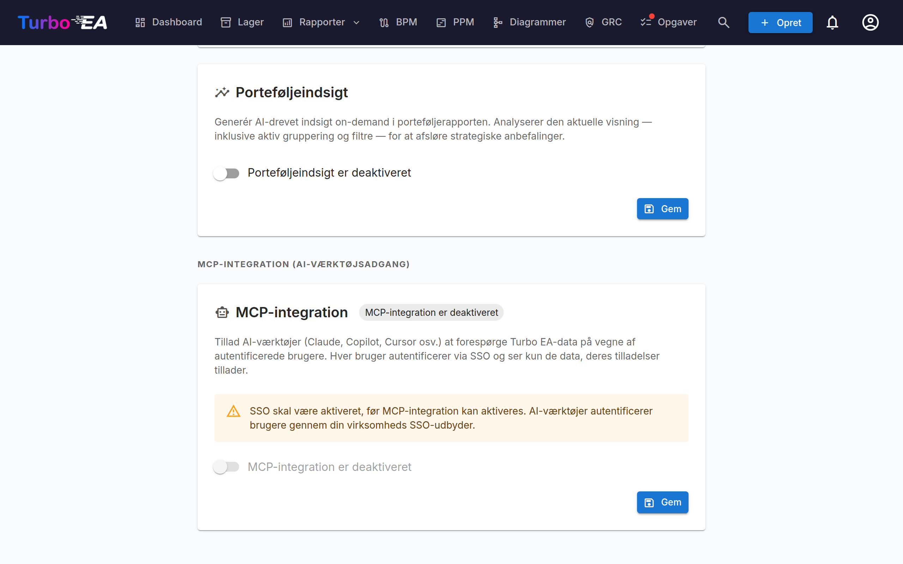

# MCP-integration (AI-værktøjsadgang)

Turbo EA inkluderer en indbygget **MCP-server** (Model Context Protocol), der gør det muligt for AI-værktøjer — såsom Claude Desktop, GitHub Copilot, Cursor og VS Code — at forespørge og opdatere dine EA-data direkte. AI-værktøjer kan også uploade artefakter (regneark, BPMN-diagrammer, DrawIO-diagrammer, fritformatede dokumenter) og omdanne dem til kort, relationer og diagrammer, der passer til den eksisterende metamodel. Brugere autentificerer sig gennem din eksisterende SSO-udbyder, og hver handling respekterer deres individuelle tilladelser.

Denne funktion er **valgfri** og **starter ikke automatisk**. Den kræver, at SSO er konfigureret, at MCP-profilen aktiveres i Docker Compose, og at en admin slår den til i indstillings-UI'et.

---

## Sådan fungerer det

```
AI Tool (Claude, Copilot, etc.)
    │
    │  MCP protocol (streamable HTTP)
    ▼
Turbo EA MCP Server (:8001, internal)
    │
    │  OAuth 2.1 with PKCE
    │  delegates to your SSO provider
    ▼
Turbo EA Backend (:8000)
    │
    │  Per-user RBAC
    ▼
PostgreSQL
```

1. En bruger tilføjer MCP-server-URL'en til sit AI-værktøj.
2. Ved første forbindelse åbner AI-værktøjet et browservindue til SSO-autentificering.
3. Efter login udsteder MCP-serveren sit eget access-token (understøttet af brugerens Turbo EA JWT).
4. AI-værktøjet bruger dette token til alle efterfølgende anmodninger. Tokens fornyes automatisk.
5. Hver forespørgsel går gennem det normale Turbo EA-tilladelsessystem — brugere ser kun data, de har adgang til.

---

## Forudsætninger

Før du aktiverer MCP, skal du have:

- **SSO konfigureret og fungerende** — MCP delegerer autentificering til din SSO-udbyder (Microsoft Entra ID, Google Workspace, Okta eller generisk OIDC). Se vejledningen [Autentificering og SSO](sso.md).
- **HTTPS med et offentligt domæne** — OAuth-flowet kræver en stabil redirect-URI. Implementér bag en TLS-terminerende reverse proxy (Caddy, Traefik, Cloudflare Tunnel osv.).

---

## Opsætning

### Trin 1: Start MCP-tjenesten

MCP-serveren er en opt-in Docker Compose-profil. Tilføj `--profile mcp` til din opstartskommando:

```bash
docker compose --profile mcp up --build -d
```

Dette starter en let Python-container (port 8001, kun intern) sammen med backend og frontend. Nginx proxyer `/mcp/`-anmodninger til den automatisk.

### Trin 2: Konfigurer miljøvariabler

Tilføj disse til din `.env`-fil:

```dotenv
TURBO_EA_PUBLIC_URL=https://your-domain.example.com
MCP_PUBLIC_URL=https://your-domain.example.com/mcp
```

| Variabel | Standard | Beskrivelse |
|----------|---------|-------------|
| `TURBO_EA_PUBLIC_URL` | `http://localhost:8920` | Den offentlige URL til din Turbo EA-instans |
| `MCP_PUBLIC_URL` | `http://localhost:8920/mcp` (docker compose) | Den offentlige URL til MCP-serveren (bruges i OAuth-redirect-URI'er). Når containeren køres selvstændigt, er kode-standarden `http://localhost:8001` |
| `MCP_PORT` | `8001` | Intern port for MCP-containeren (sjældent behov for at ændre) |
| `SECRET_KEY` | *(ingen)* | Sæt den til backends værdi. Signerer de OAuth-klient-id'er, MCP-serveren udsteder, så en klient, der er registreret én gang, fortsat virker efter en genstart; uden den signerer serveren med en nøgle, der forsvinder med processen, og logger en advarsel. Docker Compose, Helm-chartet og cloud-skabelonerne sender den automatisk med |
| `MCP_ALLOWED_ORIGINS` | *(tom)* | Kommaseparerede ekstra origins, hvis browserforespørgsler MCP-endpointet accepterer. Forespørgsler uden `Origin`-header accepteres altid |
| `MCP_ALLOWED_HOSTS` | *(tom)* | Kommaseparerede ekstra værtsnavne, som MCP-endpointet accepterer i `Host`-headeren ud over værterne i `TURBO_EA_PUBLIC_URL` og `MCP_PUBLIC_URL`. Kun nødvendig, når en proxy videresender et andet værtsnavn; se [Bag en proxy, der ændrer værtsnavnet](#proxy-host-name) |

### Trin 3: Tilføj OAuth-redirect-URI'en til din SSO-app

I din SSO-udbyders app-registrering (den samme, du har opsat til Turbo EA-login), skal du tilføje denne redirect-URI:

```
https://your-domain.example.com/mcp/oauth/callback
```

Dette kræves for OAuth-flowet, der autentificerer brugere, når de forbinder fra deres AI-værktøj.

### Trin 4: Aktivér MCP i admin-indstillinger

1. Gå til **Indstillinger** i admin-området og vælg fanebladet **AI**.
2. Rul til afsnittet **MCP Integration (AI Tool Access)**.
3. Slå kontakten til for at **aktivere** MCP.
4. UI'et vil vise MCP-server-URL'en og opsætningsinstruktioner til at dele med dit team.



!!! warning
    Kontakten er deaktiveret, hvis SSO ikke er konfigureret. Opsæt SSO først.

---

## Tilslutning af AI-værktøjer

Når MCP er aktiveret, så del **MCP-server-URL'en** med dit team. Hver bruger tilføjer den til sit AI-værktøj:

### Claude Desktop

1. Åbn **Settings > Connectors > Add custom connector**.
2. Indtast MCP-server-URL'en: `https://your-domain.example.com/mcp`
3. Klik på **Connect** — et browservindue åbner for SSO-login.
4. Efter autentificering kan Claude forespørge dine EA-data.

### VS Code (GitHub Copilot / Cursor)

Tilføj til dit workspace `.vscode/mcp.json`:

```json
{
  "servers": {
    "turbo-ea": {
      "type": "http",
      "url": "https://your-domain.example.com/mcp"
    }
  }
}
```

Brug `https://your-domain.example.com/mcp` som endpoint. Den tidligere dobbelte form `https://your-domain.example.com/mcp/mcp` fungerer stadig, så eksisterende connectorer fortsætter med at fungere uden ændringer.

### Microsoft Copilot Studio

Copilot Studio forbinder til MCP-servere fra Microsofts cloud, ikke fra brugerens computer. Instansen skal derfor kunne nås fra det offentlige internet via HTTPS med et certifikat fra en offentlig certifikatudsteder. En instans, der kun svarer på et internt netværk eller via VPN, virker med desktopværktøjer, men fejler i Copilot Studio.

1. Åbn **Værktøjer > Tilføj et værktøj > Nyt værktøj > Model Context Protocol** i din agent.
2. Indtast server-URL'en `https://your-domain.example.com/mcp`.
3. Vælg **OAuth 2.0** under **Godkendelse** og derefter **Dynamisk registrering** (Dynamic discovery).
4. Opret forbindelsen, og log ind med din SSO-konto, når du bliver bedt om det.

Copilot Studio registrerer sig én gang og beholder det klient-id, den får. Id'et bærer sine egne redirect-URI'er, signeret med instansens `SECRET_KEY`, så forbindelsen fortsat virker, når MCP-containeren genstartes eller opgraderes. Ændres `SECRET_KEY`, bliver alle registrerede klienter ugyldige: opret derefter værktøjet igen i Copilot Studio.

### Bag en proxy, der ændrer værtsnavnet { #proxy-host-name }

MCP-endpointet beskytter sig mod DNS rebinding ved at kontrollere `Host`-headeren i hver forespørgsel. Det accepterer værtsnavnene fra `TURBO_EA_PUBLIC_URL` og `MCP_PUBLIC_URL` samt `localhost` og `127.0.0.1`. MCP-containeren logger den fulde liste én gang ved start. Alle andre værtsnavne afvises med `421 Misdirected Request`, og MCP-containeren logger `Invalid Host header: <name>`.

Nogle proxyer videresender et andet værtsnavn end det offentlige. Azure Front Door foran en HTTP-rute i Azure Container Apps sender for eksempel rutens eget navn, `<route>.<environment>.azurecontainerapps.io`. Login fungerer stadig i så fald, men alle MCP-forbindelser fejler. Angiv det videresendte navn i `MCP_ALLOWED_HOSTS`:

```dotenv
MCP_ALLOWED_HOSTS=my-route.my-environment.westeurope.azurecontainerapps.io
```

Indtastningerne er kun værtsnavne, adskilt af kommaer, uden `https://` eller sti; containeren logger en advarsel for en indtastning, der aldrig kan matche. Matchningen er præcis, mod headeren som proxyen sender den, med små bogstaver. Tilføj `:port`, når proxyen sender en port, eller `:*` for at acceptere enhver port. Wildcards for underdomæner understøttes ikke. På Kubernetes sættes variablen via `mcp.extraEnv` i Helm-værdierne.

---

## Lokal test (stdio-tilstand)

Til lokal udvikling eller test uden SSO/HTTPS kan du køre MCP-serveren i **stdio-tilstand** — Claude Desktop spawnerer den direkte som en lokal proces.

**1. Installer MCP-serverpakken:**

```bash
pip install ./mcp-server
```

**2. Tilføj til din Claude Desktop-konfiguration** (`claude_desktop_config.json`):

```json
{
  "mcpServers": {
    "turbo-ea": {
      "command": "python",
      "args": ["-m", "turbo_ea_mcp", "--stdio"],
      "env": {
        "TURBO_EA_URL": "http://localhost:8000",
        "TURBO_EA_EMAIL": "your@email.com",
        "TURBO_EA_PASSWORD": "your-password"
      }
    }
  }
}
```

I denne tilstand autentificerer serveren sig med e-mail/adgangskode og fornyer tokenet automatisk i baggrunden.

---

## Tilgængelige funktioner

MCP-serveren eksponerer **63 værktøjer** på tværs af to grupper: **39 læseværktøjer**, der forespørger EA-data, og **24 skriveværktøjer** (19 additive, 5 destruktive), der opretter og vedligeholder kort, relationer, diagrammer, risici, ADR'er, gemte inventarvisninger og mere — herunder omdannelse af artefakter, som et AI-værktøj har i sin egen kontekst (regneark, BPMN XML, DrawIO XML, dokumenter, billeder), til strukturerede EA-data. Hvert værktøj bærer MCP-`ToolAnnotations` (skrivebeskyttet / destruktiv / idempotent-hints), så connectors kan vise destruktivitet i deres UI.

### Dry-run-sikkerhed på skrivninger

Hvert skriveværktøj har **`dry_run=true`** som standard, og intet persisteres, før AI-værktøjet kalder det igen med `dry_run=false` — hvilket det først bør gøre, når brugeren har set forhåndsvisningen og bekræftet. Dette forhindrer en entusiastisk agent i stille at seede hundredvis af kort på et fejltolket regneark. Forhåndsvisningen kommer i to slags:

- **Verificeret af backenden.** Hvor det underliggende endpoint understøtter en dry-run, kører backenden hver validator og resolver — rettigheder, kort-id'er, hvad brugeren må læse —, bygger det komplette resultat og **ruller derefter transaktionen tilbage**. Det gælder kort (`create_cards_bulk`, `update_cards_bulk`), relationer (`upsert_relations_bulk`) og diagrammer (`create_diagram`, `update_diagram`). En diagramforhåndsvisning returnerer de kortlinks, backenden accepterede, og for en opdatering den præcise ændring: omdøbte felter, tilføjede og fjernede kortlinks, og om lærredet er ændret.
- **Bygget af MCP-serveren.** Hvor endpointet ikke har nogen dry-run, validerer og oversætter værktøjet sit input og viser den præcise payload, en commit ville sende, uden at kalde skriveendpointet: `import_bpmn` (som finder den kladde, et commit ville gemme i; antallet af flowknuder er et skøn, så forhåndsvisningen siger `verified: false`), `submit_process_flow` og `approve_process_flow` (som læser versionen og rapporterer statusændringen, eller hvorfor den ikke er mulig), `create_adr`, `update_adr`, `sign_adr`, `revise_adr` (som læser beslutningen og rapporterer det revisionsnummer, den ville oprette, eller hvorfor backenden ville afvise), `create_soaw`, `add_card_comment`, `add_document_comment` (som læser diskussionen og rapporterer, om du må kommentere, og om den tråd, du svarer på, hører til det dokument), `transition_card_lifecycle`, `save_inventory_view` (der kører forespørgslen og rapporterer, hvor mange kort der matcher, med et par eksempelnavne), `assign_stakeholders`, `create_risks`, `update_risks`, `archive_cards` (som viser arkiveringspåvirkningen for hvert kort) og `set_card_logos` / `clear_card_logos` (som slår hvert korts type og nuværende logo op og henter hver `image_url`).

Uanset hvad registreres forhåndsvisningen i auditloggen som en dry-run-batch, så en administrator kan se, hvad en agent foreslog, og hvad den committede.

### Læseværktøjer

Serveren eksponerer 39 læseværktøjer grupperet i ti klynger.

**Kort og metamodel**

| Værktøj | Beskrivelse |
|------|-------------|
| `search_cards` | Søg og filtrer kort efter type, status eller fri tekst |
| `query_cards` | Find kort gennem en kæde af relationer med en betingelse ved hvert led — se [Forespørgsler på kort med flere led](#multi-hop-card-queries) |
| `list_inventory_views` | List de gemte inventarvisninger, du kan se, med hver visnings forespørgsel og den kanal, der oprettede den |
| `get_card` | Få fulde detaljer for et kort efter UUID |
| `get_card_relations` | Få alle relationer forbundet til et kort |
| `get_card_hierarchy` | Få forfædre og børn af et kort |
| `list_card_types` | Liste over alle korttyper i metamodellen; hver types `category` er nøglen til dens kategori (arkitekturlag) |
| `get_relation_types` | Liste over relationstyper, valgfrit filtreret efter korttype |
| `list_tag_groups` | Vis taggrupperne (med de korttyper, hver gælder for) og deres tags; tag-id'erne er det, `query_cards` og `save_inventory_view` tager under `where.tags` |
| `resolve_card_refs` | Forhåndsvalider navnebaserede kortreferencer (navn → UUID) før en bulk-import — opløser kun, skriver aldrig |
| `analyze_impact` | Afhængigheds-konsekvensanalyse (blast radius) for en foreslået ændring af et kort |

**Dashboards**

| Værktøj | Beskrivelse |
|------|-------------|
| `get_dashboard` | KPI-dashboard (antal, datakvalitet, godkendelser, aktivitet) |
| `get_landscape` | Kort af én type grupperet efter en relateret type |

**GRC — Risikoregister**

| Værktøj | Beskrivelse |
|------|-------------|
| `list_risks` | Pagineret, filterbar EA-risikoliste (TOGAF Phase G) |
| `get_risk` | Enkelt risikodetalje med tilknyttede kort + revisionsspor |
| `get_risk_metrics` | KPI'er + 4×4 initial/residual sandsynlighed × impact-matricer |
| `get_card_risks` | Alle risici, der i øjeblikket er tilknyttet et specifikt kort |

**GRC — Compliance**

| Værktøj | Beskrivelse |
|------|-------------|
| `list_compliance_findings` | Compliance-fund bundtet efter regulering |
| `get_compliance_overview` | Compliance-scores + per-regulering-statusmatrix + sidste scanning-metadata |

**Governance og Levering**

| Værktøj | Beskrivelse |
|------|-------------|
| `list_principles` | Publicerede EA-principper (statement, begrundelse, implikationer) |
| `list_adrs` | Architecture Decision Records, filterbare efter initiativ, status og gyldighed (`standing="in_force,amended"` viser de gældende beslutninger). Viser den aktuelle revision af hver beslutning; `include_earlier` tilføjer de tidligere revisioner |
| `get_adr` | Enkelt ADR-revision med sektioner, tilknyttede kort, signaturspor, gyldighed, typede tilknytninger til andre beslutninger, beslutningstagere og deltagere, datoer, revisioner og filnavne |
| `list_soaws` | Statements of Architecture Work for et initiativ (aktuelle revisioner; `include_earlier` tilføjer de tidligere) |
| `get_document_discussion` | Diskussionen om en beslutning eller en SoAW: tråde med deres svar, afsnit, forfatter og løst-tilstand, inklusive begrundelser for afvisning og noter til underskrift. Hver kommentar leveres som HTML og som ren tekst, med omtaler skrevet som `@Navn` eller `[restricted]` for et kort, du ikke må se; `include_earlier_revisions` tilføjer trådene fra tidligere revisioner |
| `get_document_history` | Tidslinjen for en beslutning eller en SoAW (oprettet, gemt, sendt til gennemgang, underskrevet, afvist, gendannet, …), side for side. At åbne, sammenligne og gendanne gemte versioner sker fortsat i webbrugerfladen |

**Rapporter**

| Værktøj | Beskrivelse |
|------|-------------|
| `get_portfolio_report` | Bubble-chart-data for en korttype (funktionel × teknisk fit som standard) |
| `get_cost_treemap` | Treemap over kortomkostninger, valgfrit grupperet efter en relateret type |
| `get_capability_heatmap` | Hierarkisk business-capability-heatmap |
| `get_data_quality_report` | Per-korttype-fuldførelsesopdeling |

**Kortkontekst**

| Værktøj | Beskrivelse |
|------|-------------|
| `get_card_stakeholders` | Brugere + roller tildelt et kort |
| `get_card_comments` | Trådede kommentarer på et kort |
| `get_card_documents` | Dokumentlinks vedhæftet et kort |
| `get_card_logo` | A card's logo: mime, size and a sha256 of the stored bytes, so a write can be verified without transferring the image (pass `include_image` when you do want it) |
| `list_available_icons` | Search the built-in brand-icon pack for a slug to pass to `set_card_logos` |

**Diagrammer**

| Værktøj | Beskrivelse |
|------|-------------|
| `list_diagrams` | Liste over fritformatede (DrawIO) diagrammer, valgfrit filtreret til ét kort |
| `get_diagram` | Hent et enkelt diagram efter id, inklusive dets DrawIO XML |

**Procesflows**

| Værktøj | Beskrivelse |
|------|-------------|
| `list_process_flow_versions` | List en Business Process' flowversioner — den publicerede samt, for en bruger der må se dem, kladderne og de afventende — hver med id, revision, status, den version den bygger på og et link, der åbner en kladde i editoren. Ingen BPMN XML. |
| `get_process_flow_version` | Læs én flowversion inklusive dens BPMN XML, så en agent kan revidere en kladde og gemme den igen med `import_bpmn`. |

**Revision og ændringshistorik**

| Værktøj | Beskrivelse |
|------|-------------|
| `get_change_history` | Forespørg mutations-batch-hovedbogen (efter batch-id, aktør, værktøj eller oprindelse) for at rekonstruere præcis, hvad en tidligere MCP-commit ændrede |

Alle værktøjer er bundet af den autentificerede brugers RBAC — en viewer vil simpelthen få en tom liste (eller 403) for områder, de ikke kan se; intet på MCP-laget skal konfigureres pr. værktøj.

### Skriveværktøjer

Serveren eksponerer 24 skriveværktøjer, hver annoteret som **additiv** (opretter eller udvider data) eller **destruktiv** (ændrer eller fjerner eksisterende data), så connectors kan advare tilsvarende.

**Additive (19)**

| Værktøj | Beskrivelse |
|------|-------------|
| `create_cards_bulk` | Opret mange kort i ét kald (f.eks. regnearksrækker). Understøtter samme-batch-forældrereferencer efter navn med server-side topologisk sortering. |
| `transition_card_lifecycle` | Flyt et kort gennem godkendelses- eller livscyklusfaser. |
| `create_risks` | Opret poster i EA-risikoregisteret. |
| `update_risks` | Opdater risikoregister-poster (felter, tilknyttede kort). |
| `add_card_comment` | Skriv en kommentar på et kort — en ikke-destruktiv, gennemgåelig note i stedet for at mutere felter. |
| `add_document_comment` | Skriv en kommentar på en beslutning eller en SoAW: en ny tråd, eventuelt knyttet til et afsnit, eller et svar på en tråd. Kommentaren er ren tekst; omtaler laves kun i webbrugerfladen. Kræver tilladelsen `adr.comment` / `soaw.comment` eller at være underskriver af dokumentet. En sendt kommentar kan ikke fortrydes med `rollback_batch`; slet den fra diskussionen i webbrugerfladen. |
| `create_soaw` | Opret et Statement of Architecture Work for et initiativ. |
| `assign_stakeholders` | Tildel eller fjern interessentroller på kort. |
| `update_cards_bulk` | Patches på feltniveau på mange kort i ét kald. |
| `create_adr` | Opret en Architecture Decision Record med typede tilknytninger til andre beslutninger (`replaces`, `amends`, `revokes`, `relates`), beslutningstagere, deltagere og datoer. Det er sådan, en beslutning erstattes eller ophæves: en ny beslutning med en `replaces`- / `revokes`-tilknytning, som træder i kraft, når den er underskrevet. |
| `update_adr` | Opdater en ADR i kladde (titel, sektioner, tilknyttede kort, typede tilknytninger, personer, datoer, ændringsoversigt). En beslutning under gennemgang accepterer kun ændringer af tilknyttede kort, og en underskrevet beslutning redigeres aldrig. |
| `sign_adr` | Signér en ADR (kræver tilladelsen `adr.sign`; ellers returneres et UI-dybdelink til at signere i browseren). |
| `revise_adr` | Start den næste revision af en underskrevet ADR: en kladde med samme reference og det næste revisionsnummer, eventuelt med konsolidering af ændrende beslutninger. Afvises, når en revision allerede er under udarbejdelse, en senere revision er underskrevet, eller beslutningen er ophævet eller erstattet. Registrering af en tidligere beslutning som truffet forbliver i webgrænsefladen. |
| `create_diagram` | Opret et fritformatet DrawIO-diagram med valgfri links til eksisterende kort. |
| `save_inventory_view` | Gem en kortforespørgsel med flere led som en inventarvisning (ny, eller som erstatning for forespørgslen i en eksisterende angivet med `view_id`). Inventaret kører forespørgslen igen, hver gang visningen åbnes; svaret indeholder et link, der åbner den. En opdatering ændrer kun navn og forespørgsel samt synlighed og kolonner, når de angives; visningens gruppering og layout bevares. |
| `import_bpmn` | Gem et BPMN 2.0 XML-diagram som en **kladde** til et procesflow på et **eksisterende** Business Process-kort. Kladden bliver aldrig indsendt eller publiceret. Som standard oprettes en ny kladde baseret på det publicerede flow, så de elementlinks, der allerede er lavet, følger med; `based_on_version_id` baserer den i stedet på en anden version, og `draft_version_id` erstatter diagrammet i en eksisterende kladde (samme revision, ingen ny kladde). Svaret indeholder kladdens id, revision og status og et link, der åbner den i editoren. Hvis intet kort matcher det angivne navn, returnerer værktøjet en `card_not_found`-fejl, der peger agenten mod `create_cards_bulk` — dette tvinger agenten til at oprette kortet eksplicit med beskrivelse, undertype og egenskaber først, i stedet for at tage en genvej, der lander et sparsomt kort. En gemt kladde kan ikke fortrydes med `rollback_batch`; slet den fra kortets underfane Procesflow → Kladder. |
| `submit_process_flow` | Indsend en procesflow-kladde til godkendelse (kladde → afventer), ligesom knappen **Indsend til godkendelse** i web-UI'et. Procesejerne får besked og en godkendelsesopgave. Kræver `bpm.edit`. Kan ikke fortrydes med `rollback_batch`: en godkender afviser revisionen i web-UI'et for at sende den tilbage til kladde. |
| `approve_process_flow` | Godkend et afventende procesflow, hvilket publicerer det og arkiverer den tidligere publicerede revision. Kræver godkendelsesret (`bpm.approve_flows` eller procesejerens interessentrolle) og overholder indstillingen, der kræver en separat godkender. Et afslag returnerer den begrundelse, backenden gav. Kan ikke fortrydes med `rollback_batch`: en revision, der er publiceret ved en fejl, trækkes tilbage i web-UI'et, som bevarer den i historikken og åbner en ny kladde. |
| `set_card_logos` | Set the custom logo on many cards at once — the bulk way to put product marks on an Application inventory. Three ways to supply the image, one per row: a built-in `icon_slug` (resolved server-side, nothing transferred), an `image_url` the MCP server downloads for you from an allowlisted icon host, or `image_base64` from the agent's own context. The packs are a shortcut, not the source of truth — a dry run lists the slugs they do not carry under `unknown_icon_slugs` **and** fetches every `image_url`, so a missing brand or a dead link is reported before anything is written rather than left as a logo nobody could set. `mime` is optional and sniffed from the bytes. PNG/JPEG/WebP/GIF only, 1 MB each. Each row echoes a sha256 so the caller can prove what landed. Use `clear_card_logos` to remove one. |

**Destruktive (5)**

| Værktøj | Beskrivelse |
|------|-------------|
| `upsert_relations_bulk` | Opret eller slet relationer mellem kort. Kilde/mål/type valideres mod metamodellen. Sletning afvises, medmindre operatøren tilvælger det (se rettesnore). |
| `archive_cards` | Soft-delete af kort. Kan genoprettes — arkiverede kort kan gendannes i 30 dage før auto-udrensning. |
| `update_diagram` | Erstat et diagrams DrawIO XML, navn eller kortlinks. |
| `rollback_batch` | Tilbagerul de skrivninger, der blev udført under en tidligere mutations-batch. |
| `clear_card_logos` | Remove the custom logo from cards, falling them back to their card-type icon. Recoverable — set it again to restore. |

### Forespørgsler på kort med flere led { #multi-hop-card-queries }

`query_cards` besvarer i ét kald et spørgsmål, der kæder relationer sammen — «Organisationer, der bruger en Applikation med livscyklus Aktiv, som berøres af et Initiativ med status On Track» — og `save_inventory_view` gemmer den samme forespørgsel som en gemt inventarvisning. Visningen gemmer forespørgslen, ikke dens resultater: Inventaret kører den igen, hver gang nogen åbner visningen, så listen altid er opdateret.

En forespørgsel er et lille JSON-objekt, der består **udelukkende af nøgler** — nøgler til korttype, relationstype, felt og valgmulighed, som `list_card_types` og `get_relation_types` returnerer dem; kort-id'er kun under `where.cards` og tag-id'er kun under `where.tags`; aldrig etiketter:

```text
CardQuery = { type, where?, related?: [Hop] }
Hop       = { relation: "<relation type key>" | "<key>__out" | "<key>__in",
              type, where?, negate?: true|false, related?: [Hop] }
Where     = { lifecycle_phase?: [plan | phaseIn | active | phaseOut | endOfLife | none],
              subtype?: [subtype key],
              approval_status?: [status],
              data_quality_band?: [complete | partial | minimal],
              eol_status?: [eol | approaching | supported | unknown | __empty__],
              attributes?: { field key: [option key | "true" | "false" | text | "__empty__"] },
              tags?: [tag id],
              cards?: [card id],
              include_descendants?: true|false }
```

Forespørgsler kan også **stables**, så én visning kombinerer flere komplette forespørgsler:

```text
Query = CardQuery | { all_of: [CardQuery, …] } | { any_of: [Group, …] }
Group = CardQuery | { all_of: [CardQuery, …] }
```

- `all_of` (**OG**): Et kort vises kun, når det matcher alle forespørgsler på listen. Alle dens forespørgsler starter fra samme korttype (ellers `all_of_type_mismatch`), og der skal være mindst to (`all_of_needs_two`).
- `any_of` (**ELLER**): Et kort vises, når det matcher en af grupperne, hver en almindelig forespørgsel eller et `all_of`. Der skal være mindst to grupper (`any_of_needs_two`). Grupperne kan starte fra forskellige korttyper, så **én visning kan liste flere korttyper**; en sådan visning åbner på dem alle, og gitteret viser de kolonner, de har til fælles.
- Et `any_of` kan ikke ligge inde i et andet `any_of` eller et `all_of`, og et `all_of` rummer kun almindelige forespørgsler (`invalid_query`).
- Forespørgslerne i et `all_of` mødes kun ved startkortet: »bruger en IT-komponent under udfasning« OG »er berørt af et initiativ« kan være to forskellige relaterede kort. For at stille to krav til **det samme** relaterede kort skal du lægge begge led på én linje, side om side under den.

- Et led matcher, når **et vilkårligt** relateret kort af den type opfylder sit `where` (og sine egne indlejrede led). `negate: true` gør det til «har **intet** sådant kort».
- Led side om side på samme niveau skal alle matche (OG); værdierne i én liste er alternativer (ELLER).
- `<key>__out` og `<key>__in` vælger en side af en relationstype, der forbinder en korttype med sig selv (kortet er kilden eller målet). Ellers er den almindelige nøgle nok.
- `data_quality_band` matcher et korts datakvalitetsscore efter bånd, som filteret Datakvalitet i inventaret: `complete` (80 og derover), `partial` (fra og med 40 til, men ikke med, 80) eller `minimal` (under 40). Enhver anden værdi afvises med `unknown_band`.
- `eol_status` matcher et korts End-of-Life-status, som inventarets kolonne End of life viser den, beregnet ud fra endoflife.date eller et brugerdefineret EOL-produkt: `eol`, `approaching`, `supported`, `unknown` eller `__empty__` for et kort uden EOL-link og uden manuelt End of Life. Enhver anden værdi afvises med `unknown_eol_status`, og en korttype, der ikke sporer End of Life, med `eol_not_tracked`. En sådan betingelse kræver tilladelsen til at se EOL-data: Lagring, forhåndsvisning og åbning af en visning, der indeholder en, afvises uden den (`eol_view_required`), ligesom kørsel af forespørgslen.
- `tags` tager tag-id'er fra `list_tag_groups`, grupperet efter taggruppe: Et kort skal bære mindst ét af de anførte tags fra **hver** nævnt gruppe (alternativer inden for en gruppe, OG på tværs af grupper). Et tag, hvis gruppe ikke gælder for ledets korttype, afvises med `tag_not_for_type`; et ukendt id med `unknown_tag`.
- `cards` fastlåser den node til de anførte kort (alternativer): tag deres id'er fra `search_cards` eller `resolve_card_refs`. Hvert skal være et kort af nodens egen type. Kørsel af en forespørgsel kontrollerer ikke valgene: et id, der ikke navngiver noget kort, et kort af en anden type eller et kort, brugeren ikke må læse, matcher blot ingenting. Gemning af en visning kontrollerer dem og afviser et sådant valg med `unknown_card`. Et arkiveret kort matcher ingenting i et led. `include_descendants: true` udvider hvert valg til alle kort under det via forælderlinket (underkapabiliteter, underordnede organisationer); sat uden `cards` afvises det med `descendants_without_cards`, og på en korttype uden hierarki med `descendants_without_hierarchy`. Et kort- eller tag-id andre steder i forespørgslen afvises med `query_holds_an_id`.
- Relaterede kort tæller kun med, når de er aktive, og brugeren må læse dem: Et kort, brugeren ikke kan se, bryder kæden, præcis som i webgrænsefladen. Når en visning gemmes, kan en skriver ikke fastlåse et kort, der er skjult for vedkommende (`unknown_card`); en samarbejdspartner, der redigerer en visning delt med vedkommende, beholder de valg, den allerede rummer, også dem vedkommende ikke kan læse. En læser, der åbner en visning, hvis valg inkluderer et kort skjult for vedkommende, afvises ikke — de skjulte valg matcher blot ingenting.

Eksempel — Organisationer, der bruger en aktiv Applikation, som berøres af et Initiativ med status *On Track*:

```json
{
  "type": "Organization",
  "related": [
    {
      "relation": "relOrgToApp",
      "type": "Application",
      "where": { "lifecycle_phase": ["active"] },
      "related": [
        {
          "relation": "relInitiativeToApp",
          "type": "Initiative",
          "where": { "attributes": { "initiativeStatus": ["onTrack"] } }
        }
      ]
    }
  ]
}
```

Eksempel — aktive applikationer på aldrende teknologi, som et initiativ berører, **eller** de organisationer, der bruger en applikation (en visning, der lister to korttyper):

```json
{
  "any_of": [
    {
      "all_of": [
        {
          "type": "Application",
          "where": { "lifecycle_phase": ["active"] },
          "related": [
            {
              "relation": "relAppToITC",
              "type": "ITComponent",
              "where": { "lifecycle_phase": ["phaseOut", "endOfLife"] }
            }
          ]
        },
        {
          "type": "Application",
          "related": [{ "relation": "relInitiativeToApp", "type": "Initiative" }]
        }
      ]
    },
    {
      "type": "Organization",
      "related": [{ "relation": "relOrgToApp", "type": "Application" }]
    }
  ]
}
```

I inventaret viser en visning, der er gemt på denne måde, sin kæde som en læsbar sti over gitteret med en note om, at den er oprettet via MCP. Dens forespørgsel kan ændres i inventaret (blyanten på stistrimlen) eller via `save_inventory_view` (angiv visningens id fra `list_inventory_views` som `view_id`; opdateringen erstatter navn og forespørgsel, ændrer synlighed og kolonner kun når de angives, og bevarer den gruppering og det layout, der er sat i webgrænsefladen — medmindre den nye forespørgsel starter fra andre korttyper, hvilket nulstiller visningens filtre og gruppering, da de hørte til de gamle typer; en visning, du ikke kan redigere, afvises med `view_not_found` eller `view_not_editable`; en ændring af synlighed, som du ikke må foretage (kun ejeren kan ændre den, og offentlig eller delt kræver `bookmarks.share`), afvises med `visibility_not_allowed`); i webgrænsefladen kan dens ejer også omdøbe den, ændre dens deling og OData-indstilling, justere kolonnelayoutet eller slette den.

En visnings `columns` kan også indeholde **matchende kolonner**, `via:<line>:<hop path>`: en kolonne, der pr. række viser kortene på ét trin i forespørgslen, som fik rækken til at matche (for »Organisationer, der bruger en applikation, der bruger en IT-komponent ved livets afslutning«: hvilke applikationer og hvilke IT-komponenter). `line` er linjens nulbaserede position blandt alle forespørgslens linjer i rækkefølge (en simpel forespørgsel er linje 0; linjerne i et `all_of`, og i hver `any_of`-gruppe efter tur, nummereres fortløbende), og `hop path` er de punktforbundne nulbaserede indekser i `related` fra linjens første kort ned til trinnet: `via:0:0` er første led i første linje, `via:0:0.1` det andet led under det, `via:2:0` første led i tredje linje. Det første kort i en linje og et trin bag »har ingen« (`negate`) har ingen. Matchene vises kun i webgrænsefladen: intet MCP-værktøj læser dem endnu. Opdateres en visnings `query` uden at sende `columns`, bevares dens gemte `via:`-nøgler som de er, så send `columns`, når trinnene ændres.

Begrænsninger:

- Højst **6 forespørgsler** i en stak (`too_many_lines`); forespørgslerne i et `all_of` deler én starttype for kort, mens grupperne i et `any_of` kan liste flere.
- Højst **3 niveauer** af `related` i hver forespørgsel, højst 10 led side om side på ét niveau og højst **12 led i hele forespørgslen** (side om side, indlejrede og over alle forespørgslerne i en stak tilsammen). En længere forespørgsel afvises med `too_many_hops`.
- Højst **50** valgte kort pr. betingelse.
- En tekstattribut matcher sin værdi **præcist** — der er ingen delvis eller store/små-bogstavs-uafhængig matchning.
- **`rollback_batch` kan ikke fortryde en gemt visning.** Når en visning gemmes, registreres en mutationsbatch, men der udsendes ingen hændelse, som tilbagerulningen kan vende; slet en uønsket visning fra inventarets Gemte visninger i stedet.

### Artefakt-upload

En delmængde af skriveværktøjerne (`create_cards_bulk`, `upsert_relations_bulk`, `create_diagram`, `import_bpmn`) lader en AI-agent omdanne artefakter til strukturerede EA-data. Agenten læser kildefilen fra sin egen kontekst (multimodal vision, filvedhæftninger), uddrager strukturerede rækker og kalder disse værktøjer. MCP-serveren selv parser aldrig filer — den forventer allerede-struktureret input.

Typisk arbejdsproces, når en bruger deler et regneark med AI-agenten:

1. Agenten kalder `list_card_types` og `get_relation_types` for at forstå metamodellen.
2. Agenten parser regnearket (i sin egen kontekst, ikke i MCP) og bygger række-dicts.
3. Agenten kalder `create_cards_bulk(cards=…, dry_run=True)` og viser forhåndsvisningen til brugeren.
4. Brugeren bekræfter; agenten kalder igen med `dry_run=False` for at committe.
5. Hvis relationskolonner er til stede, kalder agenten derefter `upsert_relations_bulk` med den samme dry-run/bekræft-cyklus.

Et BPMN-diagram gennemgår den samme godkendelsesproces som et, der er tegnet i web-UI'et, ét eksplicit trin ad gangen:

1. `import_bpmn` gemmer diagrammet som en **kladde** og returnerer et link til den. Intet bliver publiceret.
2. Brugeren gennemgår kladden. For at ændre den læser agenten den med `get_process_flow_version`, redigerer XML'en og kalder `import_bpmn` igen med `draft_version_id`, som opdaterer den samme kladde i stedet for at oprette en ny.
3. Når brugeren beder om det, indsender `submit_process_flow` kladden til godkendelse.
4. `approve_process_flow` publicerer den — kun for en bruger, der må godkende procesflows. Alle andre godkender den i web-UI'et fra kortets underfane **Procesflow → Kladder**.

### Skriveværktøjs-rettesnore

Forsvar i dybden ovenpå dry-run, så en LLM-fejltagelse ikke kan forårsage massiv skade:

- **Per-kald-størrelsesgrænser.** MCP-skriveværktøjerne håndhæver en meget mindre grænse end de underliggende Excel-importør-endpoints: 200 rækker for `create_cards_bulk`, 500 operationer for `upsert_relations_bulk`. Stort nok til enhver realistisk enkelt artefakt-upload, lille nok til, at en dry-run-forhåndsvisning stadig kan gennemses.
- **Ingen relationssletning som standard.** `upsert_relations_bulk` afviser `action: "delete"`-operationer — for at fjerne relationer, brug web-UI'et, hvor handlingen registreres under brugerens identitet. Operatører kan tilvælge ved at indstille `MCP_ALLOW_RELATION_DELETE=true`.
- **Kill switch.** `MCP_WRITES_ENABLED=false` slår alle 24 skriveværktøjer fra uden at re-deploye kode. De 39 læseværktøjer fortsætter med at virke.
- **Logo-hentning sker kun fra tilladte værter.** De medfølgende ikonpakker kan ikke dække alle produkter hos en kunde, og en assistent kører ofte i en sandkasse uden adgang til nettet, så `set_card_logos` accepterer en `image_url`, som MCP-serveren henter. Kun `https`, kun værter fra `MCP_LOGO_FETCH_HOSTS`, kun offentlige adresser, højst to omdirigeringer (hver kontrolleret på ny), højst 1 MB læst som stream, og byte-strømmen skal bære en ægte PNG/JPEG/WebP/GIF-signatur. Hentningen sker i MCP-kanten, aldrig i backend'en, og billedet uploades derefter ad den almindelige vej — en URL valgt af en sprogmodel når aldrig den proces, der holder databasen. `MCP_LOGO_FETCH_ENABLED=false` slår det fra.
- **Audit origin-tag.** Hver backend-anmodning fra MCP-serveren bærer en `X-Turbo-EA-Origin: mcp`-header. Hændelser udsendt fra disse anmodninger er tagget `origin: "mcp"` i revisions-log-payloaden, så admins kan filtrere MCP-drevne skrivninger ud af tidslinjen adskilt fra web-UI-handlinger.
- **Mutations-batches.** Hvert MCP-skrivekald — både forhåndsvisningen og commit'en — er én mutations-batch i auditloggen, åbnet før noget skrives; hver hændelse udsendt under kaldet stemples med batch-id'et, og hvert skriveværktøj returnerer dette `batch_id`. Admins (eller værktøjet `get_change_history`) kan rekonstruere den fulde per-hændelses-diff for en commit fra ét id, og `rollback_batch` kan tilbagerulle den — herunder sletning af et diagram, som `create_diagram` har oprettet, medmindre nogen har publiceret det siden. En diagramopdatering rapporteres som ikke reversibel, fordi det tidligere lærred ikke gemmes. En kommentar på en beslutning eller en SoAW er heller ikke reversibel: den kan allerede være læst, så den slettes i stedet fra diskussionen. Det er procesflow-trinnene heller ikke: `rollback_batch` rapporterer en indsendelse eller en godkendelse som ikke reversibel og ændrer intet — en godkender afviser en afventende revision, og en publiceret trækkes tilbage, begge dele i web-UI'et. En kladde gemt af `import_bpmn` er ikke reversibel, fordi den ikke registrerer nogen hændelse; den slettes fra underfanen Kladder. Commits over `MCP_BATCH_CONFIRMATION_THRESHOLD` rækker skal sende den engangs-`confirm_token` tilbage, som den forudgående dry-run returnerede. Backenden kontrollerer den, når commit-batchen åbnes, før noget skrives: den skal stamme fra en dry-run af samme værktøj, af samme bruger, for under 15 minutter siden, og den godkender én enkelt commit. Alle bulk-skriveværktøjer følger denne cyklus med forhåndsvisning og bekræftelse: `create_cards_bulk`, `update_cards_bulk`, `archive_cards`, `upsert_relations_bulk`, `assign_stakeholders`, `create_risks`, `update_risks`, `set_card_logos`, `clear_card_logos`.
- **Ingen hård sletning.** Værktøjssættet udelader bevidst permanent kortsletning. `archive_cards` og `update_cards_bulk` *er* eksponeret, men arkivering er en genoprettelig soft-delete (30-dages gendannelsesvindue), og begge er destruktivitets-annoterede og dry-run-gatede. Tilføjelse af et værktøj, der udfører en irreversibel mutation (hård sletning, tvungen udrensning), ville kræve en eksplicit designgennemgang.

De seks rettesnore-miljøvariabler på MCP-containeren:

| Variabel | Standard | Effekt |
|----------|---------|--------|
| `MCP_WRITES_ENABLED` | `true` | Hovedkontakt for skriveværktøjer. `false` → skrivebeskyttet MCP. |
| `MCP_MAX_CARDS_PER_CALL` | `200` | Hård grænse på `create_cards_bulk`- / `update_cards_bulk`-rækker pr. anmodning. |
| `MCP_MAX_RELATIONS_PER_CALL` | `500` | Hård grænse på `upsert_relations_bulk`-operationer pr. anmodning. |
| `MCP_MAX_LOGOS_PER_CALL` | `50` | Hard cap on `set_card_logos` rows per request. Lower than the card cap because each logo is its own upload and carries image bytes. |
| `MCP_ALLOW_RELATION_DELETE` | `false` | Når `true`, accepterer `upsert_relations_bulk` `action: "delete"`-operationer. |
| `MCP_LOGO_FETCH_ENABLED` | `true` | Når `true`, kan `set_card_logos` tage en `image_url`: MCP-serveren henter billedet og uploader det ad den almindelige vej, så alle kontroller af rettigheder, størrelse og format stadig gælder. Sæt `false` for helt at afvise URL-vejen — ikon-slugs og indsatte bytes virker fortsat. |
| `MCP_LOGO_FETCH_HOSTS` | *(built-in)* | Kommaseparerede værter, som et logo må hentes fra, med nøjagtigt match. Standard: `raw.githubusercontent.com`, `cdn.jsdelivr.net`, `cdn.simpleicons.org`, `upload.wikimedia.org` — offentlig ikon-hosting, hvor forespørgslen indeholder et filnavn og intet om dit landskab. En domæne-til-logo-tjeneste kan tilføjes, men så får den at vide, hvilke leverandører du bruger. |
| `MCP_BATCH_CONFIRMATION_THRESHOLD` | `20` | Commits, der berører flere rækker end dette, kræver `confirm_token` fra en forudgående dry-run. Backenden anvender sin egen grænse på 20 rækker uanset denne værdi, så værdien kan kun sænke grænsen, aldrig hæve den. |
| `MCP_REQUIRE_DRYRUN_FIRST` | `true` | Ved `true` afviser MCP-serveren en commit over tærsklen uden `confirm_token` med en forklarende fejl, før backenden kaldes. `false` slår kun denne tidlige fejl fra: backenden kræver stadig tokenet ved hver commit over 20 rækker. |

### Ressourcer

| URI | Beskrivelse |
|-----|-------------|
| `turbo-ea://types` | Alle korttyper i metamodellen |
| `turbo-ea://relation-types` | Alle relationstyper |
| `turbo-ea://dashboard` | Dashboard-KPI'er og oversigtsstatistik |

### Guidede prompts

| Prompt | Beskrivelse |
|--------|-------------|
| `analyze_landscape` | Flertrinsanalyse: dashboard-oversigt, typer, relationer |
| `find_card` | Søg efter et kort efter navn, få detaljer og relationer |
| `explore_dependencies` | Kortlæg, hvad et kort afhænger af, og hvad der afhænger af det |

---

## Tilladelser

| Rolle | Adgang |
|------|--------|
| **Admin** | Konfigurer MCP-indstillinger (`admin.mcp`-tilladelse). Fuld læse + skrive gennem MCP. |
| **Alle autentificerede brugere** | Læseadgang styres af deres eksisterende RBAC. Skriveværktøjer kræver de matchende backend-tilladelser — `inventory.create` / `inventory.edit` / `inventory.archive` (kort), `relations.manage` (relationer), `diagrams.manage` (diagrammer), `bpm.edit` (BPMN-kladder og indsendelse af dem), `bpm.approve_flows` (godkendelse af et procesflow), `risks.manage` (risikoregister), `comments.create` (kommentarer), `stakeholders.manage` (interessenter), `soaw.create` (SoAW), `adr.manage` / `adr.sign` (ADR'er), `adr.comment` / `soaw.comment` (diskussion af beslutninger og SoAW'er), `bookmarks.manage` / `bookmarks.share` (gemte inventarvisninger). |

Tilladelsen `admin.mcp` styrer, hvem der kan administrere MCP-indstillinger. Den er kun tilgængelig for Admin-rollen som standard. Brugerdefinerede roller kan tildeles denne tilladelse gennem Roller-administrationssiden.

Dataadgang gennem MCP — læse eller skrive — følger den samme RBAC-model som web-UI'et. Hvis en bruger ikke kan oprette kort i lager-UI'et, kan de heller ikke oprette dem gennem MCP; der er ingen separate MCP-specifikke datatilladelser.

---

## Sikkerhed

- **SSO-delegeret autentificering**: Brugere autentificerer sig via deres virksomheds SSO-udbyder. MCP-serveren ser eller gemmer aldrig adgangskoder.
- **OAuth 2.1 med PKCE**: Autentificeringsflowet bruger Proof Key for Code Exchange (S256) for at forhindre autorisationskode-aflytning.
- **Per-bruger RBAC**: Hver MCP-forespørgsel — læse eller skrive — kører med den autentificerede brugers tilladelser. Ingen delte servicekonti.
- **Dry-run som standard på skrivninger**: Skriveværktøjer har som standard en valider-og-tilbageruk-forhåndsvisning. AI-værktøjet skal eksplicit kalde igen med `dry_run=false`, før noget persisteres, og hver ændring revideres under brugerens identitet.
- **Hver post siger, at den kom via MCP**: hvert kort, diagram, risiko, beslutning, SoAW, kommentar og BPM-flowversion, en agent opretter, bærer `created_via: mcp` ved siden af den person, der kørte agenten, og en agents senere redigering sætter `updated_via: mcp`. Webgrænsefladen viser det som en **MCP**-chip på posten, og Lagerets filter **Oprindelse** viser alt, en agent har oprettet.
- **Ingen filparsing i MCP**: MCP-serveren selv accepterer ikke PDF'er, Excel-filer, billeder eller andre binære artefakter. Det kaldende AI-værktøj parser dem i sin egen kontekst og sender strukturerede rækker. Dette holder angrebsfladen smal og undgår at eksponere serveren for misformet binær input.
- **Token-rotation**: Access-tokens udløber efter 1 time. Refresh-tokens varer 30 dage. Autorisationskoder er engangsbrug og udløber efter 10 minutter.
- **Kun intern port**: MCP-containeren eksponerer port 8001 kun på det interne Docker-netværk. Al ekstern adgang går gennem Nginx reverse proxy.

---

## Fejlfinding

| Problem | Løsning |
|-------|----------|
| MCP-kontakten er deaktiveret i indstillinger | SSO skal konfigureres først. Gå til fanebladet Indstillinger > Autentificering og opsæt en SSO-udbyder. |
| "host not found" i Nginx-logs | MCP-tjenesten kører ikke. Start den med `docker compose --profile mcp up -d`. Nginx-konfigurationen håndterer dette elegant (502-svar, intet nedbrud). |
| OAuth-callback fejler | Bekræft, at du har tilføjet `https://your-domain.example.com/mcp/oauth/callback` som en redirect-URI i din SSO-app-registrering. |
| AI-værktøjet kan ikke oprette forbindelse | Tjek, at `MCP_PUBLIC_URL` matcher den URL, der er tilgængelig fra brugerens maskine. Sørg for, at HTTPS virker. |
| Brugeren får tomme resultater | MCP respekterer RBAC-tilladelser. Hvis en bruger har begrænset adgang, vil de kun se de kort, deres rolle tillader. |
| Forbindelse droppes efter 1 time | AI-værktøjet bør håndtere token-fornyelse automatisk. Hvis ikke, genopret forbindelse. |
| Copilot Studio melder "Connection creation failed" | Copilot Studio kalder fra Microsofts cloud. Tjek, at `https://your-domain.example.com/mcp` kan nås fra internettet med et offentligt betroet certifikat, og at `MCP_PUBLIC_URL` er netop den offentlige adresse. Nginx-loggen under et forsøg viser den sidste forespørgsel, der nåede frem; når der slet ingen kommer, kan instansen ikke nås. |
| Et Copilot Studio-værktøj holdt op med at virke efter opgradering til 2.175.2 | Værktøjer oprettet før 2.175.2 har et klient-id, der ikke overlevede en genstart. Slet værktøjet, og tilføj det igen én gang; det nye id overlever senere genstarter. |
| MCP-forbindelser fejler med `421 Misdirected Request`, og MCP-loggen viser `Invalid Host header` | En proxy foran Turbo EA videresender et andet værtsnavn end det offentlige. Tilføj navnet fra loglinjen til `MCP_ALLOWED_HOSTS`, og genstart MCP-containeren; se [Bag en proxy, der ændrer værtsnavnet](#proxy-host-name). |
