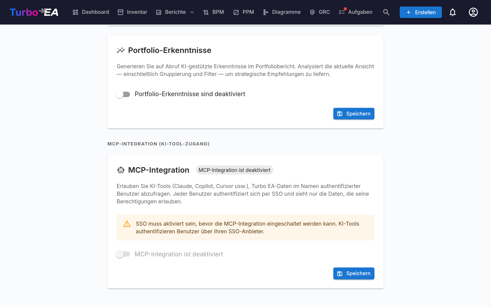

# MCP-Integration (KI-Werkzeug-Zugang)

Turbo EA enthält einen integrierten **MCP-Server** (Model Context Protocol), der KI-Werkzeugen — wie Claude Desktop, GitHub Copilot, Cursor und VS Code — ermöglicht, EA-Daten direkt abzufragen und zu aktualisieren. KI-Werkzeuge können außerdem Artefakte (Tabellen, BPMN-Diagramme, DrawIO-Diagramme, freie Dokumente) hochladen und in Karten, Beziehungen und Diagramme umwandeln, die in das bestehende Metamodell passen. Benutzer authentifizieren sich über ihren bestehenden SSO-Anbieter, und jede Aktion respektiert ihre individuellen Berechtigungen.

Diese Funktion ist **optional** und **startet nicht automatisch**. Sie erfordert, dass SSO konfiguriert ist, das MCP-Profil in Docker Compose aktiviert wird und ein Administrator es in der Einstellungsoberfläche einschaltet.

---

## Funktionsweise

```
KI-Werkzeug (Claude, Copilot usw.)
    │
    │  MCP-Protokoll (streamable HTTP)
    ▼
Turbo EA MCP-Server (:8001, intern)
    │
    │  OAuth 2.1 mit PKCE
    │  delegiert an SSO-Anbieter
    ▼
Turbo EA Backend (:8000)
    │
    │  RBAC pro Benutzer
    ▼
PostgreSQL
```

1. Ein Benutzer fügt die MCP-Server-URL zu seinem KI-Werkzeug hinzu.
2. Bei der ersten Verbindung öffnet das KI-Werkzeug ein Browserfenster für die SSO-Authentifizierung.
3. Nach der Anmeldung stellt der MCP-Server ein eigenes Zugriffstoken aus (gestützt durch das Turbo-EA-JWT des Benutzers).
4. Das KI-Werkzeug verwendet dieses Token für alle nachfolgenden Anfragen. Tokens werden automatisch erneuert.
5. Jede Abfrage durchläuft das normale Turbo-EA-Berechtigungssystem — Benutzer sehen nur Daten, auf die sie Zugriff haben.

---

## Voraussetzungen

Vor der Aktivierung von MCP müssen folgende Voraussetzungen erfüllt sein:

- **SSO konfiguriert und funktionsfähig** — MCP delegiert die Authentifizierung an Ihren SSO-Anbieter (Microsoft Entra ID, Google Workspace, Okta oder generisches OIDC). Siehe die Anleitung [Authentifizierung und SSO](sso.md).
- **HTTPS mit einer öffentlichen Domain** — Der OAuth-Ablauf erfordert eine stabile Weiterleitungs-URI. Betreiben Sie Turbo EA hinter einem TLS-terminierenden Reverse-Proxy (Caddy, Traefik, Cloudflare Tunnel usw.).

---

## Einrichtung

### Schritt 1: MCP-Dienst starten

Der MCP-Server ist ein optionales Docker-Compose-Profil. Fügen Sie `--profile mcp` zu Ihrem Startbefehl hinzu:

```bash
docker compose --profile mcp up --build -d
```

Dies startet einen leichtgewichtigen Python-Container (Port 8001, nur intern) neben Backend und Frontend. Nginx leitet `/mcp/`-Anfragen automatisch weiter.

### Schritt 2: Umgebungsvariablen konfigurieren

Fügen Sie diese zu Ihrer `.env`-Datei hinzu:

```dotenv
TURBO_EA_PUBLIC_URL=https://ihre-domain.beispiel.de
MCP_PUBLIC_URL=https://ihre-domain.beispiel.de/mcp
```

| Variable | Standard | Beschreibung |
|----------|---------|-------------|
| `TURBO_EA_PUBLIC_URL` | der Ursprung von `MCP_PUBLIC_URL`, sonst `http://localhost:8920` | Die öffentliche URL Ihrer Turbo-EA-Instanz. Jeder Link, den ein MCP-Werkzeug zurückgibt (ein Entwurf im Editor, eine gespeicherte Inventaransicht), baut darauf auf. Ist sie nicht gesetzt oder auf eine lokale Adresse gesetzt (`localhost`, `127.0.0.1` oder `[::1]`, beliebiger Port — `.env.example` liefert `http://localhost`), während `MCP_PUBLIC_URL` einen echten Host nennt, verwendet der MCP-Server stattdessen Schema und Host von `MCP_PUBLIC_URL` (`https://ea.example.com/mcp` ergibt `https://ea.example.com`), was immer dann stimmt, wenn MCP unter `/mcp` auf dem Host der Anwendung selbst bereitgestellt wird. Ein Wert auf einem echten Host wird immer verwendet; setzen Sie einen, wenn die Anwendung anderswo läuft |
| `MCP_PUBLIC_URL` | `http://localhost:8920/mcp` (docker compose) | Die öffentliche URL des MCP-Servers (wird in OAuth-Weiterleitungs-URIs verwendet). Wird der Container eigenständig betrieben, lautet der Code-Standard `http://localhost:8001` |
| `MCP_PORT` | `8001` | Interner Port des MCP-Containers (muss selten geändert werden) |
| `SECRET_KEY` | *(keiner)* | Auf den Wert des Backends setzen. Signiert die OAuth-Client-IDs, die der MCP-Server ausgibt, sodass ein einmal registrierter Client nach einem Neustart weiter funktioniert; ohne ihn signiert der Server mit einem Schlüssel, der mit dem Prozess verloren geht, und protokolliert eine Warnung. Docker Compose, das Helm-Chart und die Cloud-Vorlagen übergeben ihn automatisch |
| `MCP_ALLOWED_ORIGINS` | *(leer)* | Kommagetrennte zusätzliche Origins, deren Browser-Anfragen der MCP-Endpunkt akzeptiert. Anfragen ohne `Origin`-Header werden immer akzeptiert |
| `MCP_ALLOWED_HOSTS` | *(leer)* | Kommagetrennte zusätzliche Hostnamen, die der MCP-Endpunkt im `Host`-Header akzeptiert, über die Hosts von `TURBO_EA_PUBLIC_URL` und `MCP_PUBLIC_URL` hinaus. Nur erforderlich, wenn ein Proxy einen anderen Hostnamen weiterleitet; siehe [Hinter einem Proxy, der den Hostnamen ändert](#proxy-host-name) |

### Schritt 3: OAuth-Weiterleitungs-URI zur SSO-App hinzufügen

Fügen Sie in der App-Registrierung Ihres SSO-Anbieters (dieselbe, die Sie für die Turbo-EA-Anmeldung eingerichtet haben) diese Weiterleitungs-URI hinzu:

```
https://ihre-domain.beispiel.de/mcp/oauth/callback
```

Dies ist erforderlich für den OAuth-Ablauf, der Benutzer authentifiziert, wenn sie sich von ihrem KI-Werkzeug aus verbinden.

### Schritt 4: MCP in den Admin-Einstellungen aktivieren

1. Gehen Sie zu **Einstellungen** im Administrationsbereich und wählen Sie den Reiter **AI**.
2. Scrollen Sie zum Abschnitt **MCP-Integration (AI-Werkzeugzugriff)**.
3. Schalten Sie den Schalter auf **aktiviert**.
4. Die Oberfläche zeigt die MCP-Server-URL und Einrichtungsanweisungen zum Teilen mit Ihrem Team.



!!! warning
    Der Schalter ist deaktiviert, wenn SSO nicht konfiguriert ist. Richten Sie zuerst SSO ein.

---

## KI-Werkzeuge verbinden

Sobald MCP aktiviert ist, teilen Sie die **MCP-Server-URL** mit Ihrem Team. Jeder Benutzer fügt sie zu seinem KI-Werkzeug hinzu:

### Claude Desktop

1. Öffnen Sie **Einstellungen > Konnektoren > Benutzerdefinierten Konnektor hinzufügen**.
2. Geben Sie die MCP-Server-URL ein: `https://ihre-domain.beispiel.de/mcp`
3. Klicken Sie auf **Verbinden** — ein Browserfenster öffnet sich für die SSO-Anmeldung.
4. Nach der Authentifizierung kann Claude Ihre EA-Daten abfragen.

### VS Code (GitHub Copilot / Cursor)

Fügen Sie zu Ihrer Arbeitsbereich-Datei `.vscode/mcp.json` hinzu:

```json
{
  "servers": {
    "turbo-ea": {
      "type": "http",
      "url": "https://ihre-domain.beispiel.de/mcp"
    }
  }
}
```

Verwenden Sie `https://ihre-domain.beispiel.de/mcp` als Endpunkt. Die frühere doppelte Form `https://ihre-domain.beispiel.de/mcp/mcp` funktioniert weiterhin, sodass bestehende Konnektoren ohne Änderungen weiterarbeiten.

### Microsoft Copilot Studio

Copilot Studio verbindet sich aus der Microsoft-Cloud mit MCP-Servern, nicht vom Rechner des Benutzers. Die Instanz muss daher über HTTPS aus dem öffentlichen Internet erreichbar sein, mit einem Zertifikat einer öffentlichen Zertifizierungsstelle. Eine Instanz, die nur im internen Netz oder über VPN antwortet, funktioniert mit Desktop-Werkzeugen, scheitert aber in Copilot Studio.

1. Öffnen Sie in Ihrem Agenten **Tools > Tool hinzufügen > Neues Tool > Model Context Protocol**.
2. Geben Sie die Server-URL `https://ihre-domain.beispiel.de/mcp` ein.
3. Wählen Sie unter **Authentifizierung** **OAuth 2.0** und dann **Dynamische Erkennung** (Dynamic discovery).
4. Erstellen Sie die Verbindung und melden Sie sich bei Aufforderung mit Ihrem SSO-Konto an.

Copilot Studio registriert sich einmal und behält die erhaltene Client-ID. Diese ID trägt ihre eigenen Weiterleitungs-URIs, signiert mit dem `SECRET_KEY` der Instanz, sodass die Verbindung erhalten bleibt, wenn der MCP-Container neu startet oder aktualisiert wird. Eine Änderung von `SECRET_KEY` macht alle registrierten Clients ungültig: Legen Sie das Tool in Copilot Studio danach neu an.

### Hinter einem Proxy, der den Hostnamen ändert { #proxy-host-name }

Der MCP-Endpunkt schützt sich vor DNS-Rebinding, indem er den `Host`-Header jeder Anfrage prüft. Er akzeptiert die Hostnamen von `TURBO_EA_PUBLIC_URL` und `MCP_PUBLIC_URL` sowie `localhost` und `127.0.0.1`. Der MCP-Container protokolliert die vollständige Liste einmal beim Start. Jeder andere Hostname wird mit `421 Misdirected Request` abgewiesen, und der MCP-Container protokolliert `Invalid Host header: <name>`.

Manche Proxys leiten einen anderen Hostnamen als den öffentlichen weiter. Azure Front Door vor einer HTTP-Route von Azure Container Apps sendet zum Beispiel den eigenen Namen der Route `<route>.<environment>.azurecontainerapps.io`. Die Anmeldung funktioniert in diesem Fall weiterhin, aber jede MCP-Verbindung schlägt fehl. Tragen Sie den weitergeleiteten Namen in `MCP_ALLOWED_HOSTS` ein:

```dotenv
MCP_ALLOWED_HOSTS=my-route.my-environment.westeurope.azurecontainerapps.io
```

Die Einträge sind reine Hostnamen, durch Kommas getrennt, ohne `https://` und ohne Pfad; der Container protokolliert eine Warnung für einen Eintrag, der nie zutreffen kann. Der Abgleich ist exakt, gegen den Header, wie ihn der Proxy sendet, in Kleinbuchstaben. Ergänzen Sie `:port`, wenn der Proxy einen Port sendet, oder `:*`, um jeden Port zu akzeptieren. Subdomain-Wildcards werden nicht unterstützt. Unter Kubernetes setzen Sie die Variable über `mcp.extraEnv` in den Helm-Values.

---

## Lokales Testen (Stdio-Modus)

Für lokale Entwicklung oder Tests ohne SSO/HTTPS können Sie den MCP-Server im **Stdio-Modus** ausführen — Claude Desktop startet ihn direkt als lokalen Prozess.

**1. MCP-Server-Paket installieren:**

```bash
pip install ./mcp-server
```

**2. Zur Claude-Desktop-Konfiguration hinzufügen** (`claude_desktop_config.json`):

```json
{
  "mcpServers": {
    "turbo-ea": {
      "command": "python",
      "args": ["-m", "turbo_ea_mcp", "--stdio"],
      "env": {
        "TURBO_EA_URL": "http://localhost:8000",
        "TURBO_EA_EMAIL": "ihre@email.de",
        "TURBO_EA_PASSWORD": "ihr-passwort"
      }
    }
  }
}
```

In diesem Modus authentifiziert sich der Server mit E-Mail/Passwort und erneuert das Token automatisch im Hintergrund.

---

## Verfügbare Funktionen

Der MCP-Server stellt **65 Werkzeuge** in zwei Gruppen bereit: **40 Lese-Werkzeuge** zur Abfrage von EA-Daten und **25 Schreib-Werkzeuge** (20 additiv, 5 destruktiv), die Karten, Beziehungen, Diagramme, Risiken, ADRs, gespeicherte Inventaransichten und mehr erstellen und pflegen — einschließlich der Umwandlung von Artefakten, die ein KI-Werkzeug in seinem eigenen Kontext hat (Tabellen, BPMN-XML, DrawIO-XML, Dokumente, Bilder), in strukturierte EA-Daten. Jedes Werkzeug trägt MCP-`ToolAnnotations` (Hinweise auf schreibgeschützt / destruktiv / idempotent), sodass Konnektoren die Destruktivität in ihrer Oberfläche anzeigen können. Jedes Werkzeug lehnt außerdem ein Argument ab, das es nicht deklariert: Der Aufruf schlägt mit einem Fehler fehl, der das unbekannte Argument nennt und die gültigen auflistet, und es geschieht nichts. (Vor 2.203.0 wurde ein solches Argument stillschweigend ignoriert, sodass ein Aufruf Erfolg melden konnte, während ein Teil des Verlangten verloren ging.)

### Sicherheit beim Schreiben durch Trockenlauf

Jedes Schreib-Werkzeug verwendet standardmäßig **`dry_run=true`**, und nichts wird gespeichert, bis das KI-Werkzeug es erneut mit `dry_run=false` aufruft — was es erst tun sollte, nachdem der Benutzer die Vorschau gesehen und bestätigt hat. Dies verhindert, dass ein übereifriger Agent leise Hunderte von Karten auf Grundlage einer falsch interpretierten Tabelle anlegt. Die Vorschau gibt es in zwei Arten:

- **Vom Backend verifiziert.** Wo der zugrunde liegende Endpunkt einen Trockenlauf unterstützt, führt das Backend jeden Validator und Resolver aus — Berechtigungen, Karten-IDs, was der Benutzer lesen darf —, erstellt das vollständige Ergebnis und **macht die Transaktion dann rückgängig**. Das gilt für Karten (`create_cards_bulk`, `update_cards_bulk`), Beziehungen (`upsert_relations_bulk`) und Diagramme (`create_diagram`, `update_diagram`). Eine Diagramm-Vorschau liefert die vom Backend akzeptierten Kartenverknüpfungen, bei einer Aktualisierung die genaue Änderung: umbenannte Felder, hinzugefügte und entfernte Kartenverknüpfungen und ob sich die Zeichenfläche geändert hat.
- **Vom MCP-Server erstellt.** Wo der Endpunkt keinen Trockenlauf kennt, validiert und übersetzt das Werkzeug seine Eingabe und zeigt die exakte Nutzlast, die ein Commit senden würde, ohne den Schreib-Endpunkt aufzurufen: `import_bpmn` (ermittelt den Entwurf, in den ein Commit speichern würde; die Zahl der Flussknoten ist eine Schätzung, daher meldet die Vorschau `verified: false`), `submit_process_flow` und `approve_process_flow` (lesen die Version und melden die Statusänderung oder warum sie nicht möglich ist), `link_process_flow_elements` (liest die Version und ihre Schritte und meldet für jede Verknüpfung den aktuellen und den neuen Wert oder die Schritte, die es nicht kennt), `create_adr`, `update_adr`, `sign_adr`, `revise_adr` (liest die Entscheidung und meldet die Revisionsnummer, die es anlegen würde, oder warum das Backend ablehnen würde), `create_soaw`, `add_card_comment`, `add_document_comment` (liest die Diskussion und meldet, ob Sie kommentieren dürfen und ob der Diskussionsstrang, auf den Sie antworten, zu diesem Dokument gehört), `transition_card_lifecycle`, `save_inventory_view` (führt die Abfrage aus und meldet, wie viele Karten passen, mit einigen Beispielnamen), `assign_stakeholders`, `create_risks`, `update_risks`, `archive_cards` (zeigt die Archivierungsfolgen jeder Karte) sowie `set_card_logos` / `clear_card_logos` (die Typ und aktuelles Logo jeder Karte nachschlagen und jede `image_url` abrufen).

In beiden Fällen wird die Vorschau im Audit-Log als Trockenlauf-Batch aufgezeichnet, sodass ein Administrator sehen kann, was ein Agent vorgeschlagen hat und was er übernommen hat.

### Lese-Werkzeuge

Der Server stellt 40 Lese-Werkzeuge in zehn Gruppen bereit.

**Karten & Metamodell**

| Werkzeug | Beschreibung |
|----------|-------------|
| `search_cards` | Karten nach Typ, Status oder Freitext suchen und filtern |
| `query_cards` | Karten über eine Kette von Beziehungen finden, mit einer Bedingung an jedem Schritt — siehe [Mehrstufige Kartenabfragen](#multi-hop-card-queries) |
| `list_inventory_views` | Die gespeicherten Inventaransichten auflisten, die Sie sehen können, mit der Abfrage jeder Ansicht und dem Kanal, der sie erstellt hat |
| `get_card` | Vollständige Details einer Karte per UUID abrufen |
| `get_card_relations` | Alle Beziehungen einer Karte abrufen |
| `get_card_hierarchy` | Vorfahren und Kinder einer Karte abrufen |
| `list_card_types` | Alle Kartentypen im Metamodell auflisten; das Feld `category` jedes Typs ist der Schlüssel seiner Kategorie (Architekturebene) |
| `get_relation_types` | Beziehungstypen auflisten, optional nach Kartentyp gefiltert |
| `list_tag_groups` | Die Tag-Gruppen (mit den Kartentypen, für die jede gilt) und ihre Tags auflisten; die Tag-IDs sind das, was `query_cards` und `save_inventory_view` unter `where.tags` erwarten |
| `resolve_card_refs` | Vorvalidiert namensbasierte Karten-Referenzen (Name → UUID) vor einem Bulk-Import — löst nur auf, schreibt niemals |
| `analyze_impact` | Abhängigkeits-Wirkungsradius-Analyse für eine geplante Änderung an einer Karte |

**Dashboards**

| Werkzeug | Beschreibung |
|----------|-------------|
| `get_dashboard` | KPI-Dashboard (Anzahl, Datenqualität, Genehmigungen, Aktivität) |
| `get_landscape` | Karten eines Typs gruppiert nach einem verwandten Typ |

**GRC — Risikoregister**

| Werkzeug | Beschreibung |
|----------|-------------|
| `list_risks` | Paginierte, filterbare Liste der EA-Risiken (TOGAF Phase G) |
| `get_risk` | Detail eines einzelnen Risikos mit verknüpften Karten und Audit |
| `get_risk_metrics` | KPIs + 4×4-Matrizen für initial und residual |
| `get_card_risks` | Alle Risiken, die aktuell mit einer Karte verknüpft sind |

**GRC — Compliance**

| Werkzeug | Beschreibung |
|----------|-------------|
| `list_compliance_findings` | Compliance-Befunde gebündelt nach Regulierung |
| `get_compliance_overview` | Compliance-Scores + Statusmatrix pro Regulierung + Metadaten des letzten Scans |

**Governance & Bereitstellung**

| Werkzeug | Beschreibung |
|----------|-------------|
| `list_principles` | Veröffentlichte EA-Prinzipien (Aussage, Begründung, Auswirkungen) |
| `list_adrs` | Architekturentscheidungen (ADRs), filterbar nach Initiative, Status und Geltung (`standing="in_force,amended"` listet die geltenden Entscheidungen). Zeigt die aktuelle Revision jeder Entscheidung; `include_earlier` fügt die früheren Revisionen hinzu |
| `get_adr` | Einzelne ADR-Revision mit Abschnitten, verknüpften Karten, Unterschriftspfad, Geltung, typisierten Verknüpfungen zu anderen Entscheidungen, Entscheidungsträgern und Beteiligten, Daten, Revisionen und Dateinamen |
| `list_soaws` | Statements of Architecture Work einer Initiative (aktuelle Revisionen; `include_earlier` fügt die früheren hinzu) |
| `get_document_discussion` | Die Diskussion einer Entscheidung oder eines SoAW: Diskussionsstränge mit ihren Antworten, Abschnitt, Autor und Erledigt-Status, einschließlich Ablehnungsgründen und Unterzeichnungsnotizen. Jeder Kommentar kommt als HTML und als reiner Text, Erwähnungen als `@Name` oder `[restricted]` für eine Karte, die Sie nicht sehen dürfen; `include_earlier_revisions` fügt die Diskussionsstränge früherer Revisionen hinzu |
| `get_document_history` | Die Zeitleiste einer Entscheidung oder eines SoAW (erstellt, gespeichert, zur Prüfung gesendet, unterzeichnet, abgelehnt, wiederhergestellt, …), seitenweise. Gespeicherte Versionen öffnen, vergleichen und wiederherstellen bleibt der Weboberfläche vorbehalten |

**Berichte**

| Werkzeug | Beschreibung |
|----------|-------------|
| `get_portfolio_report` | Bubble-Chart-Daten für einen Kartentyp (Default: funktionaler × technischer Fit) |
| `get_cost_treemap` | Treemap der Kosten, optional gruppiert nach verwandtem Typ |
| `get_capability_heatmap` | Hierarchische Business-Capability-Heatmap |
| `get_data_quality_report` | Vollständigkeits-Aufschlüsselung pro Kartentyp |

**Karten-Kontext**

| Werkzeug | Beschreibung |
|----------|-------------|
| `get_card_stakeholders` | Der Karte zugewiesene Nutzer + Rollen |
| `get_card_comments` | Kommentar-Threads einer Karte |
| `get_card_documents` | Dokument-Links an einer Karte (URLs, keine Dateien) |
| `get_card_logo` | A card's logo: mime, size and a sha256 of the stored bytes, so a write can be verified without transferring the image (pass `include_image` when you do want it) |
| `list_available_icons` | Search the built-in brand-icon pack for a slug to pass to `set_card_logos` |

**Diagramme**

| Werkzeug | Beschreibung |
|----------|-------------|
| `list_diagrams` | Frei gestaltete (DrawIO-)Diagramme auflisten, optional gefiltert auf eine Karte |
| `get_diagram` | Ein einzelnes Diagramm per ID abrufen, einschließlich seines DrawIO-XML |

**Prozessabläufe**

| Werkzeug | Beschreibung |
|----------|-------------|
| `list_process_flow_versions` | Die Ablaufversionen eines Geschäftsprozesses auflisten — die veröffentlichte sowie, für einen Benutzer, der sie sehen darf, die Entwürfe und ausstehenden — jeweils mit ID, Revision, Status, der Version, auf der sie basiert, und einem Link, der einen Entwurf im Editor öffnet. Kein BPMN-XML. |
| `get_process_flow_version` | Eine Ablaufversion samt BPMN-XML lesen, damit ein Agent einen Entwurf überarbeiten und mit `import_bpmn` zurückspeichern kann. |
| `get_process_flow_elements` | Die Schritte einer Ablaufversion auflisten — für jeden Element-ID, Typ, Name, Bahn und Reihenfolge — sowie die Karten, mit denen jeder Schritt verknüpft ist: Anwendung, Datenobjekt, IT-Komponente, der Geschäftsprozess, an den er übergibt, und Organisationen. Eine verknüpfte Karte, die der Benutzer nicht sehen darf, erscheint als keine Verknüpfung. Gibt an, ob sich die Schrittverknüpfungen der Version setzen lassen (ein Entwurf oder eine ausstehende Revision). |

**Audit & Änderungshistorie**

| Werkzeug | Beschreibung |
|----------|-------------|
| `get_change_history` | Das Mutations-Batch-Register abfragen (nach Batch-ID, Akteur, Werkzeug oder Herkunft), um exakt zu rekonstruieren, was ein früherer MCP-Commit geändert hat |

Alle Werkzeuge respektieren das RBAC des authentifizierten Nutzers — eine Viewerin erhält für unzugängliche Bereiche eine leere Liste (oder 403); auf MCP-Ebene ist keine Pro-Tool-Konfiguration nötig.

### Schreib-Werkzeuge

Der Server stellt 25 Schreib-Werkzeuge bereit, jedes annotiert als **additiv** (erstellt oder erweitert Daten) oder **destruktiv** (verändert oder entfernt bestehende Daten), damit Konnektoren entsprechend warnen können.

**Additiv (20)**

| Werkzeug | Beschreibung |
|----------|--------------|
| `create_cards_bulk` | Erstellt mehrere Karten in einem Aufruf (z. B. Tabellenzeilen). Unterstützt Eltern-Referenzen per Name innerhalb desselben Batches mit serverseitiger topologischer Sortierung. |
| `transition_card_lifecycle` | Bewegt eine Karte durch Genehmigungs- oder Lebenszyklus-Phasen. |
| `create_risks` | Erstellt Einträge im EA-Risikoregister. |
| `update_risks` | Aktualisiert Risikoregister-Einträge (Felder, verknüpfte Karten). |
| `add_card_comment` | Hinterlässt einen Kommentar an einer Karte — eine nicht-destruktive, überprüfbare Notiz statt einer Feldänderung. |
| `add_document_comment` | Hinterlässt einen Kommentar an einer Entscheidung oder einem SoAW: einen neuen Diskussionsstrang, optional einem Abschnitt zugeordnet, oder eine Antwort auf einen Diskussionsstrang. Der Kommentar ist reiner Text; Erwähnungen sind nur in der Weboberfläche möglich. Erfordert die Berechtigung `adr.comment` / `soaw.comment` oder die Rolle als Unterzeichner des Dokuments. Ein geposteter Kommentar lässt sich nicht mit `rollback_batch` rückgängig machen; löschen Sie ihn in der Weboberfläche aus der Diskussion. |
| `create_soaw` | Erstellt ein Statement of Architecture Work für eine Initiative. |
| `assign_stakeholders` | Weist Stakeholder-Rollen an Karten zu oder entfernt sie. |
| `update_cards_bulk` | Feldweise Patches an vielen Karten in einem Aufruf. |
| `create_adr` | Erstellt ein Architecture Decision Record, mit typisierten Verknüpfungen zu anderen Entscheidungen (`replaces`, `amends`, `revokes`, `relates`), Entscheidungsträgern, Beteiligten und Daten. Eine Entscheidung wird auf diese Weise ersetzt oder widerrufen: durch eine neue Entscheidung mit einer Verknüpfung `replaces` / `revokes`, die wirksam wird, sobald sie unterzeichnet ist. |
| `update_adr` | Aktualisiert ein ADR im Entwurf (Titel, Abschnitte, verknüpfte Karten, typisierte Verknüpfungen, Personen, Daten, Änderungszusammenfassung). Eine Entscheidung in Prüfung akzeptiert nur Änderungen an verknüpften Karten, und eine unterzeichnete wird nie bearbeitet. |
| `sign_adr` | Unterschreibt ein ADR (erfordert die Berechtigung `adr.sign`; andernfalls wird ein UI-Deep-Link zum Unterschreiben im Browser zurückgegeben). |
| `revise_adr` | Beginnt die nächste Revision eines unterzeichneten ADR: einen Entwurf mit derselben Referenz und der nächsten Revisionsnummer, optional unter Konsolidierung ändernder Entscheidungen. Abgelehnt, wenn bereits eine Revision entworfen wird, eine spätere Revision unterzeichnet ist oder die Entscheidung widerrufen oder ersetzt wurde. Das Erfassen einer vergangenen Entscheidung als entschieden bleibt der Weboberfläche vorbehalten. |
| `create_diagram` | Erstellt ein frei gestaltetes DrawIO-Diagramm mit optionalen Verknüpfungen zu bestehenden Karten. |
| `save_inventory_view` | Speichert eine mehrstufige Kartenabfrage als Inventaransicht (neu oder, über `view_id`, als Ersatz der Abfrage einer bestehenden). Das Inventar führt die Abfrage bei jedem Öffnen der Ansicht erneut aus; die Antwort enthält einen Link, der sie öffnet. Eine Aktualisierung ändert nur Name und Abfrage sowie Sichtbarkeit und Spalten, wenn sie übergeben werden; Gruppierung und Layout der Ansicht bleiben erhalten. |
| `import_bpmn` | Speichert ein BPMN-2.0-XML-Diagramm als **Entwurf** eines Prozessablaufs an einer **bestehenden** Geschäftsprozess-Karte. Den Entwurf reicht es nie ein und veröffentlicht ihn nie. Standardmäßig legt es einen neuen Entwurf auf Basis des veröffentlichten Ablaufs an, sodass die bereits gesetzten Elementverknüpfungen erhalten bleiben; `based_on_version_id` legt ihn stattdessen auf Basis einer anderen Version an, und `draft_version_id` ersetzt das Diagramm eines bestehenden Entwurfs (gleiche Revision, kein neuer Entwurf). Die Antwort enthält ID, Revision und Status des Entwurfs sowie einen Link, der ihn im Editor öffnet. Existiert keine Karte mit dem angegebenen Namen, liefert das Werkzeug einen `card_not_found`-Fehler, der den Agenten an `create_cards_bulk` verweist — so muss die Karte zuerst explizit mit Beschreibung, Subtyp und Attributen angelegt werden, statt auf eine Abkürzung auszuweichen, die eine spärliche Karte erzeugt. Ein gespeicherter Entwurf lässt sich nicht mit `rollback_batch` rückgängig machen; löschen Sie ihn im Unterreiter Prozessablauf → Entwürfe der Karte. |
| `link_process_flow_elements` | Verknüpft die Schritte eines Prozessablaufs im Entwurf oder in ausstehender Genehmigung mit Karten: Anwendung, Datenobjekt, IT-Komponente, der Geschäftsprozess, an den ein Schritt übergibt, und Organisationen. Ein Eintrag pro Schritt, über seine Element-ID aus `get_process_flow_elements`; eine ausgelassene Verknüpfung bleibt, wie sie ist, und ein leerer Wert entfernt sie. Nur Karten-IDs (ermitteln Sie sie mit `search_cards` oder `resolve_card_refs`). Eine Schritt-ID, die das gespeicherte Diagramm nicht enthält, wird abgelehnt, bevor etwas geschrieben wird. Jede Verknüpfung nimmt eine aktive Karte ihres eigenen Typs (Anwendung, Datenobjekt, IT-Komponente, Geschäftsprozess, Organisation). Lehnt das Backend einen Schritt ab (eine Karte eines anderen Typs, eine archivierte Karte oder eine, die der Benutzer nicht sehen darf, eine Prozessverknüpfung an einem Datenobjekt), endet der Lauf dort, und die Antwort listet auf, welche Schritte verknüpft wurden und welche nicht. Die Verknüpfungen gelten für die veröffentlichten Schritte, sobald die Revision genehmigt ist. Sie zeichnen kein Ereignis auf, daher kann `rollback_batch` sie nicht rückgängig machen: Rufen Sie das Werkzeug erneut mit dem alten Wert auf. Erfordert `bpm.edit`. |
| `submit_process_flow` | Reicht einen Prozessablauf-Entwurf zur Genehmigung ein (Entwurf → ausstehend), wie es die Schaltfläche **Zur Genehmigung einreichen** in der Weboberfläche tut. Die Prozessverantwortlichen werden benachrichtigt und erhalten eine Genehmigungsaufgabe. Erfordert `bpm.edit`. Nicht mit `rollback_batch` umkehrbar: Ein Genehmigender lehnt die Revision in der Weboberfläche ab, um sie in den Entwurf zurückzuversetzen. |
| `approve_process_flow` | Genehmigt einen ausstehenden Prozessablauf, wodurch er veröffentlicht und die zuvor veröffentlichte Revision archiviert wird. Erfordert Genehmigungsbefugnis (`bpm.approve_flows` oder die Stakeholder-Rolle des Prozessverantwortlichen) und beachtet die Einstellung, die einen separaten Genehmigenden verlangt. Eine Ablehnung liefert den vom Backend genannten Grund. Nicht mit `rollback_batch` umkehrbar: Eine versehentlich veröffentlichte Revision wird in der Weboberfläche zurückgezogen, die sie protokolliert lässt und einen neuen Entwurf öffnet. |
| `set_card_logos` | Set the custom logo on many cards at once — the bulk way to put product marks on an Application inventory. Three ways to supply the image, one per row: a built-in `icon_slug` (resolved server-side, nothing transferred), an `image_url` the MCP server downloads for you from an allowlisted icon host, or `image_base64` from the agent's own context. The packs are a shortcut, not the source of truth — a dry run lists the slugs they do not carry under `unknown_icon_slugs` **and** fetches every `image_url`, so a missing brand or a dead link is reported before anything is written rather than left as a logo nobody could set. `mime` is optional and sniffed from the bytes. PNG/JPEG/WebP/GIF only, 1 MB each. Each row echoes a sha256 so the caller can prove what landed. Use `clear_card_logos` to remove one. |

**Destruktiv (5)**

| Werkzeug | Beschreibung |
|----------|--------------|
| `upsert_relations_bulk` | Erstellt oder löscht Beziehungen zwischen Karten. Quelle / Ziel / Typ werden gegen das Metamodell validiert. Löschungen werden abgelehnt, sofern der Operator nicht ausdrücklich zustimmt (siehe Schutzmechanismen). |
| `archive_cards` | Soft-Delete von Karten. Wiederherstellbar — archivierte Karten können 30 Tage lang wiederhergestellt werden, bevor sie automatisch endgültig gelöscht werden. |
| `update_diagram` | Ersetzt das DrawIO-XML, den Namen oder die Kartenverknüpfungen eines Diagramms. |
| `rollback_batch` | Macht die Schreibvorgänge eines früheren Mutations-Batches rückgängig. |
| `clear_card_logos` | Remove the custom logo from cards, falling them back to their card-type icon. Recoverable — set it again to restore. |

### Mehrstufige Kartenabfragen { #multi-hop-card-queries }

`query_cards` beantwortet eine Frage, die Beziehungen verkettet — „Organisationen, die eine Anwendung nutzen, deren Lebenszyklus Aktiv ist und von einer Initiative mit dem Status Im Plan betroffen ist" — in einem Aufruf, und `save_inventory_view` behält dieselbe Abfrage als gespeicherte Inventaransicht. Die Ansicht speichert die Abfrage, nicht ihre Ergebnisse: Das Inventar führt sie bei jedem Öffnen der Ansicht erneut aus, sodass die Liste aktuell bleibt.

Eine Abfrage ist ein kleines JSON-Objekt, das **ausschließlich aus Schlüsseln** besteht — Kartentyp-, Beziehungstyp-, Feld- und Optionsschlüssel, wie `list_card_types` und `get_relation_types` sie liefern; Karten-IDs nur unter `where.cards` und Tag-IDs nur unter `where.tags`; niemals Bezeichnungen:

```text
CardQuery = { type, where?, related?: [Hop] }
Hop       = { relation: "<relation type key>" | "<key>__out" | "<key>__in",
              type, where?, negate?: true|false, related?: [Hop] }
Where     = { lifecycle_phase?: [plan | phaseIn | active | phaseOut | endOfLife | none],
              subtype?: [subtype key],
              approval_status?: [status],
              data_quality_band?: [complete | partial | minimal],
              eol_status?: [eol | approaching | supported | unknown | __empty__],
              attributes?: { field key: [option key | "true" | "false" | text | "__empty__"] },
              tags?: [tag id],
              cards?: [card id],
              include_descendants?: true|false }
```

Abfragen lassen sich auch **stapeln**, sodass eine Ansicht mehrere vollständige Abfragen kombiniert:

```text
Query = CardQuery | { all_of: [CardQuery, …] } | { any_of: [Group, …] }
Group = CardQuery | { all_of: [CardQuery, …] }
```

- `all_of` (**UND**): Eine Karte wird nur aufgelistet, wenn sie jede Abfrage der Liste erfüllt. Alle Abfragen beginnen beim selben Kartentyp (sonst `all_of_type_mismatch`), und es braucht mindestens zwei (`all_of_needs_two`).
- `any_of` (**ODER**): Eine Karte wird aufgelistet, wenn sie irgendeine der Gruppen erfüllt, jeweils eine einfache Abfrage oder ein `all_of`. Es braucht mindestens zwei Gruppen (`any_of_needs_two`). Die Gruppen dürfen bei verschiedenen Kartentypen beginnen, sodass **eine Ansicht mehrere Kartentypen auflisten kann**; eine solche Ansicht öffnet sich mit allen davon, und das Raster zeigt die Spalten, die sie gemeinsam haben.
- Ein `any_of` darf nicht in einem anderen `any_of` oder einem `all_of` stehen, und ein `all_of` enthält nur einfache Abfragen (`invalid_query`).
- Die Abfragen eines `all_of` treffen sich nur an der Startkarte: „nutzt eine auslaufende IT-Komponente" UND „ist von einer Initiative betroffen" können zwei verschiedene verbundene Karten sein. Um zwei Dinge von **derselben** verbundenen Karte zu verlangen, setzen Sie beide Schritte auf eine Zeile, nebeneinander darunter.

- Ein Schritt trifft zu, wenn **irgendeine** verbundene Karte dieses Typs ihr `where` erfüllt (und ihre eigenen verschachtelten Schritte). `negate: true` macht daraus „hat **keine** solche Karte".
- Schritte nebeneinander auf einer Ebene müssen alle zutreffen (UND); die Werte innerhalb einer Liste sind Alternativen (ODER).
- `<key>__out` und `<key>__in` wählen eine Seite eines Beziehungstyps, der einen Kartentyp mit sich selbst verbindet (die Karte ist Quelle oder Ziel). Sonst genügt der einfache Schlüssel.
- `data_quality_band` gleicht den Datenqualitäts-Score einer Karte nach Band ab, wie der Filter Datenqualität im Inventar: `complete` (80 und mehr), `partial` (ab 40 bis ausschließlich 80) oder `minimal` (unter 40). Jeder andere Wert wird mit `unknown_band` abgelehnt.
- `eol_status` entspricht dem End-of-Life-Status einer Karte, wie ihn die Spalte „End of Life“ des Inventars zeigt, berechnet aus endoflife.date oder einem benutzerdefinierten EOL-Produkt: `eol`, `approaching`, `supported`, `unknown` oder `__empty__` für eine Karte ohne EOL-Verknüpfung und ohne manuelles End of Life. Jeder andere Wert wird mit `unknown_eol_status` abgelehnt, ein Kartentyp, der End of Life nicht erfasst, mit `eol_not_tracked`. Eine solche Bedingung erfordert die Berechtigung zum Anzeigen von EOL-Daten: Das Speichern, Vorschauen und Öffnen einer Ansicht, die eine enthält, wird ohne sie abgelehnt (`eol_view_required`), ebenso das Ausführen der Abfrage.
- `tags` nimmt Tag-IDs aus `list_tag_groups`, nach Tag-Gruppe gruppiert: Eine Karte muss aus **jeder** genannten Gruppe mindestens eines der aufgeführten Tags tragen (Alternativen innerhalb einer Gruppe, UND über Gruppen hinweg). Ein Tag, dessen Gruppe für den Kartentyp dieses Schritts nicht gilt, wird mit `tag_not_for_type` abgelehnt; eine unbekannte ID mit `unknown_tag`.
- `cards` legt diesen Knoten auf die aufgeführten Karten fest (Alternativen): Ihre IDs stammen aus `search_cards` oder `resolve_card_refs`. Jede sollte eine Karte des eigenen Typs des Knotens sein. Das Ausführen einer Abfrage prüft die Auswahl nicht: Eine ID, die keine Karte benennt, eine Karte eines anderen Typs oder eine Karte, die der Benutzer nicht lesen darf, trifft schlicht nichts. Das Speichern einer Ansicht prüft sie dagegen und lehnt eine solche Auswahl mit `unknown_card` ab. Eine archivierte Karte trifft bei einem Schritt nichts. `include_descendants: true` weitet jede Auswahl auf alle Karten darunter über die Eltern-Verknüpfung aus (Unter-Fähigkeiten, untergeordnete Organisationen); ohne `cards` gesetzt wird es mit `descendants_without_cards` abgelehnt, bei einem Kartentyp ohne Hierarchie mit `descendants_without_hierarchy`. Eine Karten- oder Tag-ID an jeder anderen Stelle der Abfrage wird mit `query_holds_an_id` abgelehnt.
- Verbundene Karten zählen nur, wenn sie aktiv sind und der Benutzer sie lesen darf: Eine Karte, die der Benutzer nicht sehen darf, unterbricht die Kette — genau wie in der Weboberfläche. Beim Speichern einer Ansicht kann ein Schreibender keine Karte festlegen, die für ihn verborgen ist (`unknown_card`); ein Mitarbeitender, der eine mit ihm geteilte Ansicht bearbeitet, behält die bereits enthaltenen Auswahlen, auch solche, die er nicht lesen kann. Ein Lesender, der eine Ansicht öffnet, deren Auswahl eine für ihn verborgene Karte enthält, wird nicht abgelehnt — die verborgenen Auswahlen treffen schlicht nichts.

Beispiel — Organisationen, die eine aktive Anwendung nutzen, von der eine Initiative mit dem Status *On Track* betroffen ist:

```json
{
  "type": "Organization",
  "related": [
    {
      "relation": "relOrgToApp",
      "type": "Application",
      "where": { "lifecycle_phase": ["active"] },
      "related": [
        {
          "relation": "relInitiativeToApp",
          "type": "Initiative",
          "where": { "attributes": { "initiativeStatus": ["onTrack"] } }
        }
      ]
    }
  ]
}
```

Beispiel — aktive Anwendungen auf alternder Technologie, von denen eine Initiative betroffen ist, **oder** die Organisationen, die eine Anwendung nutzen (eine Ansicht, die zwei Kartentypen auflistet):

```json
{
  "any_of": [
    {
      "all_of": [
        {
          "type": "Application",
          "where": { "lifecycle_phase": ["active"] },
          "related": [
            {
              "relation": "relAppToITC",
              "type": "ITComponent",
              "where": { "lifecycle_phase": ["phaseOut", "endOfLife"] }
            }
          ]
        },
        {
          "type": "Application",
          "related": [{ "relation": "relInitiativeToApp", "type": "Initiative" }]
        }
      ]
    },
    {
      "type": "Organization",
      "related": [{ "relation": "relOrgToApp", "type": "Application" }]
    }
  ]
}
```

Im Inventar zeigt eine so gespeicherte Ansicht ihre Kette als lesbaren Pfad über dem Raster mit einem Hinweis, dass sie über MCP erstellt wurde. Ihre Abfrage lässt sich im Inventar (der Stift im Pfadstreifen) oder über `save_inventory_view` ändern (die ID der Ansicht aus `list_inventory_views` als `view_id` übergeben; die Aktualisierung ersetzt Name und Abfrage, ändert Sichtbarkeit und Spalten nur, wenn sie übergeben werden, und behält die in der Weboberfläche festgelegte Gruppierung und das Layout — es sei denn, die neue Abfrage beginnt bei anderen Kartentypen: Dann werden Filter und Gruppierung der Ansicht zurückgesetzt, da sie zu den alten gehörten; eine Ansicht, die Sie nicht bearbeiten dürfen, wird mit `view_not_found` oder `view_not_editable` abgelehnt; eine Sichtbarkeitsänderung, die Ihnen nicht zusteht (nur der Eigentümer kann sie ändern, und öffentlich oder geteilt erfordert `bookmarks.share`), wird mit `visibility_not_allowed` abgelehnt); in der Weboberfläche kann ihr Eigentümer sie auch umbenennen, Freigabe und OData-Einstellung ändern, das Spaltenlayout anpassen oder sie löschen.

Die `columns` einer Ansicht können auch **Treffer-Spalten** enthalten, `via:<line>:<hop path>`: eine Spalte, die je Zeile die Karten eines Abfrageschritts zeigt, durch die die Zeile zutrifft (bei „Organisationen, die eine Anwendung nutzen, die eine IT-Komponente am Lebensende nutzt“: welche Anwendungen und welche IT-Komponenten). `line` ist die nullbasierte Position der Zeile unter allen Zeilen der Abfrage in ihrer Reihenfolge (eine einfache Abfrage ist Zeile 0; die Zeilen eines `all_of` und nacheinander jeder `any_of`-Gruppe werden fortlaufend nummeriert), und `hop path` sind die mit Punkten verbundenen nullbasierten Indizes in `related` von der ersten Karte der Zeile bis zum Schritt: `via:0:0` ist der erste Schritt der ersten Zeile, `via:0:0.1` der zweite Schritt darunter, `via:2:0` der erste Schritt der dritten Zeile. Die erste Karte einer Zeile und ein Schritt hinter „hat kein“ (`negate`) haben keine. Die Treffer werden nur in der Weboberfläche angezeigt: Noch liest kein MCP-Werkzeug sie. Wird die `query` einer Ansicht ohne `columns` aktualisiert, bleiben ihre gespeicherten `via:`-Schlüssel unverändert; senden Sie daher `columns`, wenn sich die Schritte ändern.

Einschränkungen:

- Höchstens **6 Abfragen** in einem Stapel (`too_many_lines`); die Abfragen eines `all_of` teilen sich einen Start-Kartentyp, die Gruppen eines `any_of` dürfen mehrere auflisten.
- Höchstens **3 Ebenen** von `related` in jeder Abfrage, höchstens 10 Schritte nebeneinander auf einer Ebene und höchstens **12 Schritte in der gesamten Abfrage** (nebeneinander, verschachtelt und über alle Abfragen eines Stapels zusammen). Eine längere Abfrage wird mit `too_many_hops` abgelehnt.
- Höchstens **50** ausgewählte Karten pro Bedingung.
- Ein Textattribut stimmt **exakt** mit seinem Wert überein — es gibt keinen Teil- oder Groß-/Kleinschreibung-unabhängigen Abgleich.
- **`rollback_batch` kann eine gespeicherte Ansicht nicht rückgängig machen.** Das Speichern einer Ansicht erfasst einen Mutations-Batch, veröffentlicht aber kein Ereignis, das der Rollback umkehren könnte; löschen Sie eine unerwünschte Ansicht stattdessen unter „Gespeicherte Ansichten" im Inventar.

### Artefakt-Upload

Eine Teilmenge der Schreib-Werkzeuge (`create_cards_bulk`, `upsert_relations_bulk`, `create_diagram`, `import_bpmn`) erlaubt einem KI-Agenten, Artefakte in strukturierte EA-Daten umzuwandeln. Der Agent liest die Quelldatei in seinem eigenen Kontext (multimodale Bildverarbeitung, Dateianhänge), extrahiert strukturierte Zeilen und ruft diese Werkzeuge auf. Der MCP-Server selbst analysiert niemals Dateien — er erwartet bereits strukturierte Eingaben.

Typischer Ablauf, wenn ein Benutzer dem KI-Agenten eine Tabelle freigibt:

1. Der Agent ruft `list_card_types` und `get_relation_types` auf, um das Metamodell zu verstehen.
2. Der Agent parst die Tabelle (in seinem eigenen Kontext, nicht in MCP) und baut Zeilen-Dicts.
3. Der Agent ruft `create_cards_bulk(cards=…, dry_run=True)` auf und zeigt dem Benutzer die Vorschau.
4. Der Benutzer bestätigt; der Agent ruft erneut mit `dry_run=False` auf, um zu übernehmen.
5. Falls Beziehungsspalten vorhanden sind, ruft der Agent anschließend `upsert_relations_bulk` mit demselben Trockenlauf-/Bestätigungszyklus auf.

Ein BPMN-Diagramm durchläuft denselben Genehmigungsworkflow wie ein in der Weboberfläche gezeichnetes, Schritt für Schritt und jeweils ausdrücklich:

1. `import_bpmn` speichert das Diagramm als **Entwurf** und liefert einen Link darauf. Nichts wird veröffentlicht.
2. Um die Schritte mit Karten zu verknüpfen, liest der Agent die Schritt-IDs mit `get_process_flow_elements` und setzt die Verknüpfungen mit `link_process_flow_elements` (wie immer zuerst als Trockenlauf). `import_bpmn` selbst nimmt keine Verknüpfungen entgegen.
3. Der Benutzer prüft den Entwurf. Um ihn zu ändern, liest der Agent ihn mit `get_process_flow_version`, bearbeitet das XML und ruft `import_bpmn` erneut mit `draft_version_id` auf; so wird derselbe Entwurf aktualisiert, statt einen weiteren anzulegen. Die Verknüpfungen jedes Schritts, dessen Element-ID das neue XML beibehält, bleiben bestehen.
4. Wenn der Benutzer es verlangt, reicht `submit_process_flow` den Entwurf zur Genehmigung ein.
5. `approve_process_flow` veröffentlicht ihn — nur für einen Benutzer, der Prozessabläufe genehmigen darf. Alle anderen genehmigen ihn in der Weboberfläche, im Unterreiter **Prozessablauf → Entwürfe** der Karte.

### Schutzmechanismen für Schreib-Werkzeuge

Verteidigung in der Tiefe zusätzlich zum Trockenlauf, damit ein Fehlverhalten des LLM keinen Massenschaden verursachen kann:

- **Größenbegrenzung pro Aufruf.** Die MCP-Schreib-Werkzeuge erzwingen eine wesentlich kleinere Obergrenze als die zugrunde liegenden Excel-Import-Endpunkte: 200 Zeilen für `create_cards_bulk`, 500 Operationen für `upsert_relations_bulk`. Groß genug für jeden realistischen Einzel-Artefakt-Upload, klein genug, dass eine Trockenlauf-Vorschau überprüfbar bleibt.
- **Standardmäßig keine Löschung von Beziehungen.** `upsert_relations_bulk` lehnt `action: "delete"`-Operationen ab — um Beziehungen zu entfernen, ist die Weboberfläche zu verwenden, wo die Aktion unter der Identität des Benutzers erfasst wird. Operatoren können dies aktivieren, indem sie `MCP_ALLOW_RELATION_DELETE=true` setzen.
- **Notausschalter.** `MCP_WRITES_ENABLED=false` schaltet alle 25 Schreib-Werkzeuge aus, ohne dass Code neu bereitgestellt werden muss. Die 40 Lese-Werkzeuge funktionieren weiter.
- **Logo-Abruf nur von erlaubten Hosts.** Die mitgelieferten Icon-Pakete können nicht jedes Produkt abdecken, und ein Assistent hat oft keinen Zugang zum Web, daher akzeptiert `set_card_logos` eine `image_url`, die der MCP-Server abruft. Nur `https`, nur Hosts aus `MCP_LOGO_FETCH_HOSTS`, nur öffentliche Adressen, höchstens zwei Weiterleitungen (jede erneut geprüft), höchstens 1 MB als Stream gelesen, und die Bytes müssen eine echte PNG/JPEG/WebP/GIF-Signatur tragen. Der Abruf erfolgt am MCP-Rand, nie im Backend, und das Bild wird anschließend über den normalen Weg hochgeladen — eine von einem LLM gewählte URL erreicht also nie den Prozess mit der Datenbank. `MCP_LOGO_FETCH_ENABLED=false` schaltet dies ab.
- **Audit-Herkunfts-Marker.** Jede Backend-Anfrage vom MCP-Server trägt einen `X-Turbo-EA-Origin: mcp`-Header. Ereignisse, die aus diesen Anfragen emittiert werden, werden im Audit-Log-Payload mit `origin: "mcp"` markiert, sodass Administratoren MCP-gesteuerte Schreibvorgänge getrennt von Web-UI-Aktionen aus der Zeitleiste filtern können.
- **Mutations-Batches.** Jeder MCP-Schreibaufruf — die Vorschau ebenso wie der Commit — ist ein Mutations-Batch im Audit-Log und wird geöffnet, bevor etwas geschrieben wird; jedes während des Aufrufs emittierte Ereignis wird mit der Batch-ID gestempelt, und jedes Schreibwerkzeug gibt diese `batch_id` zurück. Administratoren (oder das Werkzeug `get_change_history`) können aus einer einzigen ID den vollständigen Ereignis-Diff eines Commits rekonstruieren, und `rollback_batch` kann ihn rückgängig machen — auch das Löschen eines Diagramms, das `create_diagram` angelegt hat, sofern es inzwischen niemand veröffentlicht hat. Eine Diagrammaktualisierung wird als nicht umkehrbar gemeldet, weil die vorherige Zeichenfläche nicht aufbewahrt wird. Auch ein Kommentar an einer Entscheidung oder einem SoAW ist nicht umkehrbar: Er wurde möglicherweise bereits gelesen und wird deshalb stattdessen aus der Diskussion gelöscht. Ebenso wenig die Prozessablauf-Schritte: `rollback_batch` meldet eine Einreichung oder eine Genehmigung als nicht umkehrbar und ändert nichts — ein Genehmigender lehnt eine ausstehende Revision ab, und eine veröffentlichte wird zurückgezogen, beides in der Weboberfläche. Ein von `import_bpmn` gespeicherter Entwurf ist nicht umkehrbar, weil er kein Ereignis aufzeichnet; er wird im Unterreiter Entwürfe gelöscht. Auch die von `link_process_flow_elements` gesetzten Schrittverknüpfungen zeichnen kein Ereignis auf; setzen Sie sie erneut, um sie zu ändern. Commits oberhalb von `MCP_BATCH_CONFIRMATION_THRESHOLD` Zeilen müssen das einmalige `confirm_token` zurückgeben, das der vorherige Trockenlauf geliefert hat. Das Backend prüft es beim Öffnen des Commit-Batches, bevor etwas geschrieben wird: Es muss von einem Trockenlauf desselben Werkzeugs durch denselben Benutzer stammen, höchstens 15 Minuten alt sein, und es gibt genau einen Commit frei. Jedes Bulk-Schreibwerkzeug folgt diesem Zyklus aus Vorschau und Bestätigung: `create_cards_bulk`, `update_cards_bulk`, `archive_cards`, `upsert_relations_bulk`, `assign_stakeholders`, `create_risks`, `update_risks`, `set_card_logos`, `clear_card_logos`, `link_process_flow_elements`.
- **Kein endgültiges Löschen.** Die Werkzeugsammlung lässt bewusst das dauerhafte Löschen von Karten weg. `archive_cards` und `update_cards_bulk` *sind* verfügbar, aber die Archivierung ist ein wiederherstellbares Soft-Delete (30-Tage-Wiederherstellungsfenster) und beide sind mit Destruktivitäts-Annotationen versehen und durch den Trockenlauf abgesichert. Das Hinzufügen eines Werkzeugs, das eine irreversible Mutation durchführt (endgültiges Löschen, erzwungenes Bereinigen), würde eine explizite Designprüfung erfordern.

Die sechs Umgebungsvariablen für Schutzmechanismen auf dem MCP-Container:

| Variable | Standard | Wirkung |
|----------|----------|---------|
| `MCP_WRITES_ENABLED` | `true` | Hauptschalter für Schreib-Werkzeuge. `false` → schreibgeschützter MCP. |
| `MCP_MAX_CARDS_PER_CALL` | `200` | Harte Obergrenze für `create_cards_bulk`- / `update_cards_bulk`-Zeilen pro Anfrage. |
| `MCP_MAX_RELATIONS_PER_CALL` | `500` | Harte Obergrenze für `upsert_relations_bulk`-Operationen pro Anfrage. |
| `MCP_MAX_LOGOS_PER_CALL` | `50` | Hard cap on `set_card_logos` rows per request. Lower than the card cap because each logo is its own upload and carries image bytes. |
| `MCP_ALLOW_RELATION_DELETE` | `false` | Bei `true` akzeptiert `upsert_relations_bulk` `action: "delete"`-Operationen. |
| `MCP_LOGO_FETCH_ENABLED` | `true` | Bei `true` darf `set_card_logos` eine `image_url` verwenden: Der MCP-Server lädt das Bild herunter und lädt es über den normalen Weg hoch, sodass alle Berechtigungs-, Größen- und Formatprüfungen weiterhin greifen. Mit `false` wird der URL-Weg vollständig abgelehnt — Icon-Slugs und eingefügte Bytes funktionieren weiter. |
| `MCP_LOGO_FETCH_HOSTS` | *(built-in)* | Kommagetrennte Hosts, von denen ein Logo geladen werden darf (exakte Übereinstimmung). Standard: `raw.githubusercontent.com`, `cdn.jsdelivr.net`, `cdn.simpleicons.org`, `upload.wikimedia.org` — öffentliches Icon-Hosting, bei dem die Anfrage nur einen Dateinamen enthält und nichts über Ihre Landschaft verrät. Ein Domain-zu-Logo-Dienst lässt sich ergänzen, verrät diesem aber, welche Anbieter Sie einsetzen. |
| `MCP_BATCH_CONFIRMATION_THRESHOLD` | `20` | Commits, die mehr Zeilen als diesen Wert berühren, erfordern das `confirm_token` aus einem vorherigen Trockenlauf. Das Backend wendet unabhängig von dieser Einstellung seine eigene Grenze von 20 Zeilen an; der Wert kann die Grenze also nur senken, nie anheben. |
| `MCP_REQUIRE_DRYRUN_FIRST` | `true` | Bei `true` lehnt der MCP-Server einen Commit oberhalb des Schwellenwerts ohne `confirm_token` mit einer erklärenden Fehlermeldung ab, bevor er das Backend aufruft. `false` schaltet nur diese frühe Fehlermeldung ab: Das Backend verlangt das Token weiterhin bei jedem Commit über 20 Zeilen. |

### Ressourcen

| URI | Beschreibung |
|-----|-------------|
| `turbo-ea://types` | Alle Kartentypen im Metamodell |
| `turbo-ea://relation-types` | Alle Beziehungstypen |
| `turbo-ea://dashboard` | Dashboard-KPIs und zusammenfassende Statistiken |

### Geführte Prompts

| Prompt | Beschreibung |
|--------|-------------|
| `analyze_landscape` | Mehrstufige Analyse: Dashboard-Übersicht, Typen, Beziehungen |
| `find_card` | Karte nach Namen suchen, Details und Beziehungen abrufen |
| `explore_dependencies` | Abbilden, wovon eine Karte abhängt und was von ihr abhängt |

---

## Berechtigungen

| Rolle | Zugriff |
|-------|---------|
| **Administrator** | MCP-Einstellungen konfigurieren (Berechtigung `admin.mcp`). Vollständiger Lese- + Schreibzugriff über MCP. |
| **Alle authentifizierten Benutzer** | Lesezugriff gemäß ihrem bestehenden RBAC. Schreib-Werkzeuge erfordern die entsprechenden Backend-Berechtigungen — `inventory.create` / `inventory.edit` / `inventory.archive` (Karten), `relations.manage` (Beziehungen), `diagrams.manage` (Diagramme), `bpm.edit` (BPMN-Entwürfe, deren Schrittverknüpfungen und deren Einreichung), `bpm.approve_flows` (Genehmigung eines Prozessablaufs), `risks.manage` (Risikoregister), `comments.create` (Kommentare), `stakeholders.manage` (Stakeholder), `soaw.create` (SoAW), `adr.manage` / `adr.sign` (ADRs), `adr.comment` / `soaw.comment` (Diskussion von Entscheidungen und SoAWs), `bookmarks.manage` / `bookmarks.share` (gespeicherte Inventaransichten). |

Die Berechtigung `admin.mcp` steuert, wer MCP-Einstellungen verwalten kann. Sie ist standardmäßig nur für die Admin-Rolle verfügbar. Benutzerdefinierten Rollen kann diese Berechtigung über die Rollenverwaltungsseite gewährt werden.

Der Datenzugriff über MCP — lesend oder schreibend — folgt demselben RBAC-Modell wie die Weboberfläche. Wenn ein Benutzer in der Inventaroberfläche keine Karten erstellen kann, kann er sie auch nicht über MCP erstellen; es gibt keine separaten MCP-spezifischen Datenberechtigungen.

---

## Sicherheit

- **SSO-delegierte Authentifizierung**: Benutzer authentifizieren sich über ihren SSO-Anbieter des Unternehmens. Der MCP-Server sieht oder speichert niemals Passwörter.
- **OAuth 2.1 mit PKCE**: Der Authentifizierungsablauf verwendet Proof Key for Code Exchange (S256), um das Abfangen von Autorisierungscodes zu verhindern.
- **RBAC pro Benutzer**: Jede MCP-Aktion — lesend oder schreibend — läuft mit den Berechtigungen des authentifizierten Benutzers. Keine gemeinsamen Dienstkonten.
- **Trockenlauf standardmäßig beim Schreiben**: Schreib-Werkzeuge nutzen standardmäßig eine Validieren-und-Rückgängig-Vorschau. Das KI-Werkzeug muss explizit erneut mit `dry_run=false` aufrufen, bevor irgendetwas dauerhaft gespeichert wird, und jede Änderung wird unter der Identität des Benutzers protokolliert.
- **Jeder Datensatz zeigt, dass er über MCP kam**: Jede Karte, jedes Diagramm, Risiko, jede Entscheidung, SoAW, jeder Kommentar und jede BPM-Flow-Version, die ein Agent anlegt, trägt `created_via: mcp` neben der Person, die den Agenten ausgeführt hat, und eine spätere Bearbeitung durch einen Agenten setzt `updated_via: mcp`. Die Weboberfläche zeigt dies als **MCP**-Chip am Datensatz, und der Filter **Herkunft** im Inventar listet alles auf, was ein Agent angelegt hat.
- **Keine Dateiverarbeitung in MCP**: Der MCP-Server selbst nimmt keine PDFs, Excel-Dateien, Bilder oder anderen binären Artefakte entgegen. Das aufrufende KI-Werkzeug analysiert sie in seinem eigenen Kontext und sendet strukturierte Zeilen. Das hält die Angriffsfläche schmal und vermeidet, dass der Server fehlerhaften Binäreingaben ausgesetzt wird.
- **Token-Rotation**: Zugriffstoken laufen nach 1 Stunde ab. Erneuerungstoken gelten 30 Tage. Autorisierungscodes sind einmalig verwendbar und laufen nach 10 Minuten ab.
- **Nur interner Port**: Der MCP-Container gibt Port 8001 nur im internen Docker-Netzwerk frei. Jeglicher externer Zugriff läuft über den Nginx-Reverse-Proxy.

---

## Fehlerbehebung

| Problem | Lösung |
|---------|--------|
| MCP-Schalter ist in den Einstellungen deaktiviert | SSO muss zuerst konfiguriert werden. Gehen Sie zu Einstellungen > Reiter Authentifizierung und richten Sie einen SSO-Anbieter ein. |
| «host not found» in den Nginx-Logs | Der MCP-Dienst läuft nicht. Starten Sie ihn mit `docker compose --profile mcp up -d`. Die Nginx-Konfiguration behandelt dies problemlos (502-Antwort, kein Absturz). |
| OAuth-Callback schlägt fehl | Überprüfen Sie, dass Sie `https://ihre-domain.beispiel.de/mcp/oauth/callback` als Weiterleitungs-URI in Ihrer SSO-App-Registrierung hinzugefügt haben. |
| KI-Werkzeug kann sich nicht verbinden | Überprüfen Sie, dass `MCP_PUBLIC_URL` mit der URL übereinstimmt, die vom Rechner des Benutzers aus erreichbar ist. Stellen Sie sicher, dass HTTPS funktioniert. |
| Links, die ein KI-Werkzeug zurückgibt, öffnen `http://localhost:8920` | Der MCP-Container kennt die Adresse nicht, unter der Benutzer die Anwendung erreichen. Setzen Sie `TURBO_EA_PUBLIC_URL` (oder `MCP_PUBLIC_URL`, auf dessen Host es zurückfällt) auf die öffentliche URL und starten Sie den MCP-Container neu. |
| Ein Werkzeugaufruf schlägt mit `Unknown argument(s): …` fehl | Das KI-Werkzeug hat einen Parameter übergeben, den das Werkzeug nicht annimmt; der Fehler listet die gültigen auf, und es wurde nichts ausgeführt. Für Schrittverknüpfungen an einem Prozessablauf verwenden Sie `link_process_flow_elements` statt `import_bpmn`. |
| Benutzer erhält leere Ergebnisse | MCP respektiert RBAC-Berechtigungen. Wenn ein Benutzer eingeschränkten Zugriff hat, sieht er nur die Karten, die seine Rolle erlaubt. |
| Verbindung bricht nach 1 Stunde ab | Das KI-Werkzeug sollte die Token-Erneuerung automatisch durchführen. Falls nicht, verbinden Sie sich erneut. |
| Copilot Studio meldet „Connection creation failed“ | Copilot Studio ruft aus der Microsoft-Cloud auf. Prüfen Sie, dass `https://ihre-domain.beispiel.de/mcp` aus dem Internet mit einem öffentlich vertrauenswürdigen Zertifikat erreichbar ist und dass `MCP_PUBLIC_URL` genau diese öffentliche Adresse ist. Das Nginx-Log während eines Versuchs zeigt die letzte eingegangene Anfrage; kommt gar keine an, ist die Instanz nicht erreichbar. |
| Ein Copilot-Studio-Tool funktioniert nach dem Update auf 2.175.2 nicht mehr | Vor 2.175.2 angelegte Tools besitzen eine Client-ID, die keinen Neustart überstand. Löschen Sie das Tool einmal und fügen Sie es erneut hinzu; die neue ID übersteht spätere Neustarts. |
| MCP-Verbindungen schlagen mit `421 Misdirected Request` fehl, und das MCP-Log zeigt `Invalid Host header` | Ein Proxy vor Turbo EA leitet einen anderen Hostnamen als den öffentlichen weiter. Tragen Sie den Namen aus der Logzeile in `MCP_ALLOWED_HOSTS` ein und starten Sie den MCP-Container neu; siehe [Hinter einem Proxy, der den Hostnamen ändert](#proxy-host-name). |
