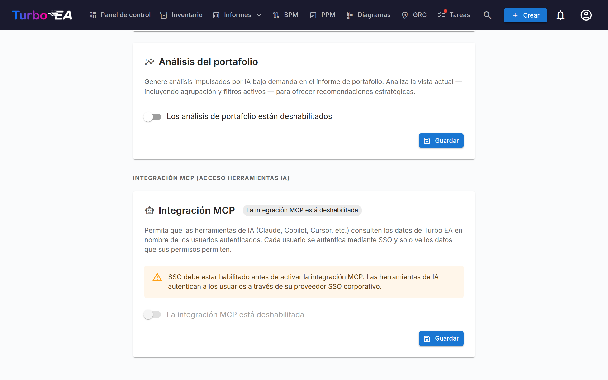

# Integración MCP (acceso para herramientas de IA)

Turbo EA incluye un **servidor MCP** (Model Context Protocol) integrado que permite a herramientas de IA — como Claude Desktop, GitHub Copilot, Cursor y VS Code — consultar y actualizar los datos de EA directamente. Las herramientas de IA también pueden cargar artefactos (hojas de cálculo, diagramas BPMN, diagramas DrawIO, documentos libres) y convertirlos en fichas, relaciones y diagramas que encajan en el metamodelo existente. Los usuarios se autentican a través de su proveedor SSO existente, y cada acción respeta sus permisos individuales.

Esta función es **opcional** y **no se inicia automáticamente**. Requiere que SSO esté configurado, que el perfil MCP esté activado en Docker Compose y que un administrador lo active en la interfaz de configuración.

---

## Cómo funciona

```
Herramienta de IA (Claude, Copilot, etc.)
    │
    │  Protocolo MCP (streamable HTTP)
    ▼
Servidor MCP de Turbo EA (:8001, interno)
    │
    │  OAuth 2.1 con PKCE
    │  delega al proveedor SSO
    ▼
Backend de Turbo EA (:8000)
    │
    │  RBAC por usuario
    ▼
PostgreSQL
```

1. Un usuario agrega la URL del servidor MCP a su herramienta de IA.
2. En la primera conexión, la herramienta abre una ventana del navegador para la autenticación SSO.
3. Tras el inicio de sesión, el servidor MCP emite su propio token de acceso (respaldado por el JWT del usuario en Turbo EA).
4. La herramienta de IA usa este token para todas las solicitudes posteriores. Los tokens se renuevan automáticamente.
5. Cada consulta pasa por el sistema de permisos normal de Turbo EA — los usuarios solo ven los datos a los que tienen acceso.

---

## Requisitos previos

Antes de habilitar MCP, debe tener:

- **SSO configurado y funcionando** — MCP delega la autenticación a su proveedor SSO (Microsoft Entra ID, Google Workspace, Okta o OIDC genérico). Consulte la guía de [Autenticación y SSO](sso.md).
- **HTTPS con un dominio público** — El flujo OAuth requiere una URI de redirección estable. Despliegue detrás de un proxy inverso con terminación TLS (Caddy, Traefik, Cloudflare Tunnel, etc.).

---

## Configuración

### Paso 1: Iniciar el servicio MCP

El servidor MCP es un perfil opcional de Docker Compose. Agregue `--profile mcp` a su comando de inicio:

```bash
docker compose --profile mcp up --build -d
```

Esto inicia un contenedor Python ligero (puerto 8001, solo interno) junto al backend y frontend. Nginx redirige automáticamente las solicitudes `/mcp/` hacia él.

### Paso 2: Configurar variables de entorno

Agregue estas a su archivo `.env`:

```dotenv
TURBO_EA_PUBLIC_URL=https://su-dominio.ejemplo.com
MCP_PUBLIC_URL=https://su-dominio.ejemplo.com/mcp
```

| Variable | Predeterminado | Descripción |
|----------|---------------|-------------|
| `TURBO_EA_PUBLIC_URL` | `http://localhost:8920` | La URL pública de su instancia de Turbo EA |
| `MCP_PUBLIC_URL` | `http://localhost:8920/mcp` (docker compose) | La URL pública del servidor MCP (usada en URIs de redirección OAuth). Cuando el contenedor se ejecuta de forma independiente, el valor predeterminado del código es `http://localhost:8001` |
| `MCP_PORT` | `8001` | Puerto interno del contenedor MCP (raramente necesita cambio) |
| `SECRET_KEY` | *(ninguno)* | Asígnele el valor del backend. Firma los identificadores de cliente OAuth que emite el servidor MCP, de modo que un cliente registrado una vez sigue funcionando tras un reinicio; sin ella, el servidor firma con una clave que desaparece con el proceso y registra una advertencia. Docker Compose, el chart de Helm y las plantillas en la nube la pasan automáticamente |
| `MCP_ALLOWED_ORIGINS` | *(vacío)* | Orígenes adicionales, separados por comas, cuyas solicitudes de navegador acepta el endpoint MCP. Las solicitudes sin cabecera `Origin` siempre se aceptan |
| `MCP_ALLOWED_HOSTS` | *(vacío)* | Nombres de host adicionales, separados por comas, que el endpoint MCP acepta en la cabecera `Host`, además de los hosts de `TURBO_EA_PUBLIC_URL` y `MCP_PUBLIC_URL`. Solo es necesario cuando un proxy reenvía un nombre de host distinto; consulte [Detrás de un proxy que cambia el nombre de host](#proxy-host-name) |

### Paso 3: Agregar la URI de redirección OAuth a su aplicación SSO

En el registro de aplicación de su proveedor SSO (el mismo que configuró para el inicio de sesión de Turbo EA), agregue esta URI de redirección:

```
https://su-dominio.ejemplo.com/mcp/oauth/callback
```

Esto es necesario para el flujo OAuth que autentica a los usuarios cuando se conectan desde su herramienta de IA.

### Paso 4: Habilitar MCP en la configuración de administrador

1. Vaya a **Configuración** en el área de administración y seleccione la pestaña **IA**.
2. Desplácese hasta la sección **Integración MCP (Acceso a herramientas IA)**.
3. Active el interruptor para **habilitar** MCP.
4. La interfaz mostrará la URL del servidor MCP e instrucciones de configuración para compartir con su equipo.



!!! warning
    El interruptor está deshabilitado si SSO no está configurado. Configure SSO primero.

---

## Conectar herramientas de IA

Una vez habilitado MCP, comparta la **URL del servidor MCP** con su equipo. Cada usuario la agrega a su herramienta de IA:

### Claude Desktop

1. Abra **Configuración > Conectores > Agregar conector personalizado**.
2. Ingrese la URL del servidor MCP: `https://su-dominio.ejemplo.com/mcp`
3. Haga clic en **Conectar** — se abre una ventana del navegador para el inicio de sesión SSO.
4. Tras la autenticación, Claude puede consultar sus datos de EA.

### VS Code (GitHub Copilot / Cursor)

Agregue a su `.vscode/mcp.json` del espacio de trabajo:

```json
{
  "servers": {
    "turbo-ea": {
      "type": "http",
      "url": "https://su-dominio.ejemplo.com/mcp"
    }
  }
}
```

Use `https://su-dominio.ejemplo.com/mcp` como punto de acceso. La antigua forma doble `https://su-dominio.ejemplo.com/mcp/mcp` sigue funcionando, por lo que los conectores existentes continúan funcionando sin cambios.

### Microsoft Copilot Studio

Copilot Studio se conecta a los servidores MCP desde la nube de Microsoft, no desde el equipo del usuario. Por eso la instancia debe ser accesible desde internet público por HTTPS, con un certificado de una autoridad de certificación pública. Una instancia que solo responde en una red interna o una VPN funciona con las herramientas de escritorio y falla en Copilot Studio.

1. En su agente, abra **Herramientas > Agregar una herramienta > Nueva herramienta > Model Context Protocol**.
2. Introduzca la URL del servidor `https://su-dominio.ejemplo.com/mcp`.
3. En **Autenticación**, elija **OAuth 2.0** y luego **Detección dinámica** (Dynamic discovery).
4. Cree la conexión e inicie sesión con su cuenta SSO cuando se le solicite.

Copilot Studio se registra una sola vez y conserva el identificador de cliente que recibe. Ese identificador lleva sus propias URI de redirección, firmadas con la `SECRET_KEY` de la instancia, por lo que la conexión sigue funcionando cuando el contenedor MCP se reinicia o se actualiza. Cambiar `SECRET_KEY` invalida todos los clientes registrados: vuelva a crear la herramienta en Copilot Studio después.

### Detrás de un proxy que cambia el nombre de host { #proxy-host-name }

El endpoint MCP se protege contra el DNS rebinding comprobando la cabecera `Host` de cada solicitud. Acepta los nombres de host de `TURBO_EA_PUBLIC_URL` y `MCP_PUBLIC_URL`, además de `localhost` y `127.0.0.1`. El contenedor MCP registra la lista completa una vez al iniciarse. Cualquier otro nombre de host se rechaza con `421 Misdirected Request`, y el contenedor MCP registra `Invalid Host header: <name>`.

Algunos proxies reenvían un nombre de host distinto del público. Azure Front Door delante de una ruta HTTP de Azure Container Apps, por ejemplo, envía el nombre propio de la ruta, `<route>.<environment>.azurecontainerapps.io`. El inicio de sesión sigue funcionando en ese caso, pero todas las conexiones MCP fallan. Indique el nombre reenviado en `MCP_ALLOWED_HOSTS`:

```dotenv
MCP_ALLOWED_HOSTS=my-route.my-environment.westeurope.azurecontainerapps.io
```

Las entradas son solo nombres de host, separados por comas, sin `https://` ni ruta; el contenedor registra una advertencia para una entrada que nunca podrá coincidir. La coincidencia es exacta, con la cabecera tal como la envía el proxy, en minúsculas. Añada `:port` cuando el proxy envíe un puerto, o `:*` para aceptar cualquier puerto. No se admiten comodines de subdominio. En Kubernetes, defina la variable mediante `mcp.extraEnv` en los valores de Helm.

---

## Prueba local (modo stdio)

Para desarrollo local o pruebas sin SSO/HTTPS, puede ejecutar el servidor MCP en **modo stdio** — Claude Desktop lo inicia directamente como proceso local.

**1. Instalar el paquete del servidor MCP:**

```bash
pip install ./mcp-server
```

**2. Agregar a la configuración de Claude Desktop** (`claude_desktop_config.json`):

```json
{
  "mcpServers": {
    "turbo-ea": {
      "command": "python",
      "args": ["-m", "turbo_ea_mcp", "--stdio"],
      "env": {
        "TURBO_EA_URL": "http://localhost:8000",
        "TURBO_EA_EMAIL": "su@correo.com",
        "TURBO_EA_PASSWORD": "su-contraseña"
      }
    }
  }
}
```

En este modo, el servidor se autentica con correo/contraseña y renueva el token automáticamente en segundo plano.

---

## Capacidades disponibles

El servidor MCP expone **55 herramientas** repartidas en dos grupos: **35 herramientas de lectura** que consultan datos de EA y **20 herramientas de escritura** (15 aditivas, 5 destructivas) que crean y mantienen fichas, relaciones, diagramas, riesgos, ADRs, vistas de inventario guardadas y más — incluida la conversión de artefactos que una herramienta de IA tiene en su propio contexto (hojas de cálculo, BPMN XML, DrawIO XML, documentos, imágenes) en datos EA estructurados. Cada herramienta lleva `ToolAnnotations` de MCP (indicaciones de solo lectura / destructiva / idempotente) para que los conectores puedan mostrar la destructividad en su interfaz.

### Seguridad mediante ejecución en seco en las escrituras

Cada herramienta de escritura usa por defecto **`dry_run=true`**, y no se persiste nada hasta que la herramienta de IA la vuelve a llamar con `dry_run=false`, algo que solo debe hacer después de que el usuario haya visto la vista previa y la haya confirmado. Esto evita que un agente entusiasta inserte silenciosamente cientos de fichas a partir de una hoja de cálculo mal interpretada. La vista previa es de uno de dos tipos:

- **Verificada por el backend.** Cuando el endpoint subyacente admite una ejecución en seco, el backend ejecuta cada validador y resolutor —permisos, ids de fichas, lo que el usuario puede leer—, construye el resultado completo y luego **revierte la transacción**. Esto abarca fichas (`create_cards_bulk`, `update_cards_bulk`), relaciones (`upsert_relations_bulk`) y diagramas (`create_diagram`, `update_diagram`). La vista previa de un diagrama devuelve los vínculos con fichas que el backend aceptó y, en una actualización, el cambio exacto: campos renombrados, vínculos con fichas añadidos y eliminados, y si el lienzo cambió.
- **Construida por el servidor MCP.** Cuando el endpoint no tiene ejecución en seco, la herramienta valida y traduce su entrada y muestra la carga útil exacta que enviaría un commit, sin llamar al endpoint de escritura: `import_bpmn` (el recorrido borrador → envío → aprobación; sus recuentos de nodos de flujo son una estimación y la vista previa indica `verified: false`), `create_adr`, `update_adr`, `sign_adr`, `create_soaw`, `add_card_comment`, `transition_card_lifecycle`, `save_inventory_view` (que ejecuta la consulta e indica cuántas fichas coinciden, con algunos nombres de ejemplo), `assign_stakeholders`, `create_risks`, `update_risks`, `archive_cards` (que muestra el impacto del archivado de cada ficha) y `set_card_logos` / `clear_card_logos` (que consultan el tipo y el logotipo actual de cada ficha y descargan cada `image_url`).

En ambos casos, la vista previa queda registrada en el registro de auditoría como un lote de ejecución en seco, para que un administrador vea lo que un agente propuso además de lo que confirmó.

### Herramientas de lectura

El servidor expone 35 herramientas de lectura agrupadas en ocho clusters.

**Fichas y metamodelo**

| Herramienta | Descripción |
|-------------|-------------|
| `search_cards` | Buscar y filtrar fichas por tipo, estado o texto libre |
| `query_cards` | Encuentra fichas a través de una cadena de relaciones con una condición en cada salto — véase [Consultas de fichas de varios saltos](#multi-hop-card-queries) |
| `list_inventory_views` | Lista las vistas de inventario guardadas que puede ver, con la consulta de cada vista y el canal que la creó |
| `get_card` | Obtener detalles completos de una ficha por UUID |
| `get_card_relations` | Obtener todas las relaciones conectadas a una ficha |
| `get_card_hierarchy` | Obtener ancestros e hijos de una ficha |
| `list_card_types` | Listar todos los tipos de ficha del metamodelo; el campo `category` de cada tipo es la clave de su categoría (capa de arquitectura) |
| `get_relation_types` | Listar tipos de relación, opcionalmente filtrados por tipo de ficha |
| `list_tag_groups` | Listar los grupos de etiquetas (con los tipos de ficha a los que se aplica cada uno) y sus etiquetas; los ids de etiqueta son lo que `query_cards` y `save_inventory_view` reciben en `where.tags` |
| `resolve_card_refs` | Prevalidar referencias de ficha basadas en nombre (nombre → UUID) antes de una importación masiva — solo resuelve, nunca escribe |
| `analyze_impact` | Análisis del radio de impacto de dependencias para un cambio propuesto en una ficha |

**Paneles**

| Herramienta | Descripción |
|-------------|-------------|
| `get_dashboard` | Panel de KPIs (conteos, calidad de datos, aprobaciones, actividad) |
| `get_landscape` | Fichas de un tipo agrupadas por un tipo relacionado |

**GRC — Registro de riesgos**

| Herramienta | Descripción |
|-------------|-------------|
| `list_risks` | Listado paginado y filtrable del registro de riesgos EA (TOGAF Fase G) |
| `get_risk` | Detalle de un riesgo con fichas vinculadas y pista de auditoría |
| `get_risk_metrics` | KPIs + matrices 4×4 inicial y residual |
| `get_card_risks` | Todos los riesgos vinculados a una ficha |

**GRC — Cumplimiento**

| Herramienta | Descripción |
|-------------|-------------|
| `list_compliance_findings` | Hallazgos de cumplimiento agrupados por regulación |
| `get_compliance_overview` | Puntuaciones de cumplimiento + matriz de estado por regulación + metadatos del último escaneo |

**Gobernanza y entrega**

| Herramienta | Descripción |
|-------------|-------------|
| `list_principles` | Principios EA publicados (declaración, justificación, implicaciones) |
| `list_adrs` | Architecture Decision Records, filtrables por iniciativa / estado |
| `get_adr` | ADR individual con secciones, fichas vinculadas y trazado de firmas |
| `list_soaws` | Statements of Architecture Work de una iniciativa |

**Informes**

| Herramienta | Descripción |
|-------------|-------------|
| `get_portfolio_report` | Datos de gráfico de burbujas para un tipo de ficha (por defecto: ajuste funcional × técnico) |
| `get_cost_treemap` | Mapa de árbol de costes, opcionalmente agrupado por un tipo relacionado |
| `get_capability_heatmap` | Mapa de calor jerárquico de capacidades de negocio |
| `get_data_quality_report` | Desglose de completitud por tipo de ficha |

**Contexto de ficha**

| Herramienta | Descripción |
|-------------|-------------|
| `get_card_stakeholders` | Usuarios + roles asignados a la ficha |
| `get_card_comments` | Hilo de comentarios de una ficha |
| `get_card_documents` | Enlaces a documentos adjuntos a una ficha (URL, no archivos) |
| `get_card_logo` | A card's logo: mime, size and a sha256 of the stored bytes, so a write can be verified without transferring the image (pass `include_image` when you do want it) |
| `list_available_icons` | Search the built-in brand-icon pack for a slug to pass to `set_card_logos` |

**Diagramas**

| Herramienta | Descripción |
|-------------|-------------|
| `list_diagrams` | Listar diagramas libres (DrawIO), opcionalmente filtrados a una ficha |
| `get_diagram` | Obtener un diagrama por id, incluido su XML de DrawIO |

**Auditoría e historial de cambios**

| Herramienta | Descripción |
|-------------|-------------|
| `get_change_history` | Consultar el registro de lotes de mutación (por id de lote, actor, herramienta u origen) para reconstruir exactamente qué cambió un commit MCP anterior |

Todas las herramientas respetan el RBAC del usuario autenticado — una visualizadora recibirá simplemente una lista vacía (o 403) para lo que no puede ver; no hace falta configurar nada por herramienta a nivel MCP.

### Herramientas de escritura

El servidor expone 20 herramientas de escritura, cada una anotada como **aditiva** (crea o amplía datos) o **destructiva** (modifica o elimina datos existentes) para que los conectores puedan advertir en consecuencia.

**Aditivas (15)**

| Herramienta | Descripción |
|-------------|-------------|
| `create_cards_bulk` | Crea varias fichas en una sola llamada (por ejemplo, filas de hoja de cálculo). Admite referencias al padre por nombre dentro del mismo lote, con ordenación topológica en el servidor. |
| `transition_card_lifecycle` | Mueve una ficha a través de las fases de aprobación o de ciclo de vida. |
| `create_risks` | Crea entradas en el registro de riesgos EA. |
| `update_risks` | Actualiza entradas del registro de riesgos (campos, fichas vinculadas). |
| `add_card_comment` | Publica un comentario en una ficha — una nota no destructiva y revisable en lugar de modificar campos. |
| `create_soaw` | Crea un Statement of Architecture Work para una iniciativa. |
| `assign_stakeholders` | Asigna o retira roles de partes interesadas en fichas. |
| `update_cards_bulk` | Parches a nivel de campo en muchas fichas en una sola llamada. |
| `create_adr` | Crea un Architecture Decision Record. |
| `update_adr` | Actualiza un ADR (título, secciones, estado, fichas vinculadas). |
| `sign_adr` | Firma un ADR (requiere el permiso `adr.sign`; de lo contrario devuelve un enlace profundo a la interfaz para firmar en el navegador). |
| `create_diagram` | Crea un diagrama libre DrawIO con vínculos opcionales a fichas existentes. |
| `save_inventory_view` | Guarda una consulta de fichas de varios saltos como vista de inventario (nueva, o sustituyendo la consulta de una existente indicada con `view_id`). El inventario vuelve a ejecutar la consulta cada vez que se abre la vista; la respuesta incluye un enlace que la abre. Una actualización solo cambia el nombre y la consulta, además de la visibilidad y las columnas cuando se indican; se conservan la agrupación y el diseño de la vista. |
| `import_bpmn` | Guarda un diagrama BPMN 2.0 XML contra una ficha de Proceso de negocio **existente**. Si no hay ficha con el nombre indicado, la herramienta devuelve un error `card_not_found` que dirige al agente a `create_cards_bulk` — esto obliga a crear la ficha explícitamente con descripción, subtipo y atributos antes, en vez de tomar un atajo que deja una ficha pobre. |
| `set_card_logos` | Set the custom logo on many cards at once — the bulk way to put product marks on an Application inventory. Three ways to supply the image, one per row: a built-in `icon_slug` (resolved server-side, nothing transferred), an `image_url` the MCP server downloads for you from an allowlisted icon host, or `image_base64` from the agent's own context. The packs are a shortcut, not the source of truth — a dry run lists the slugs they do not carry under `unknown_icon_slugs` **and** fetches every `image_url`, so a missing brand or a dead link is reported before anything is written rather than left as a logo nobody could set. `mime` is optional and sniffed from the bytes. PNG/JPEG/WebP/GIF only, 1 MB each. Each row echoes a sha256 so the caller can prove what landed. Use `clear_card_logos` to remove one. |

**Destructivas (5)**

| Herramienta | Descripción |
|-------------|-------------|
| `upsert_relations_bulk` | Crea o elimina relaciones entre fichas. Origen / destino / tipo se validan contra el metamodelo. La eliminación se rechaza salvo que el operador la habilite explícitamente (vea las salvaguardas). |
| `archive_cards` | Borrado suave de fichas. Recuperable — las fichas archivadas pueden restaurarse durante 30 días antes de la purga automática. |
| `update_diagram` | Reemplaza el XML de DrawIO, el nombre o los vínculos de fichas de un diagrama. |
| `rollback_batch` | Revierte las escrituras realizadas bajo un lote de mutación anterior. |
| `clear_card_logos` | Remove the custom logo from cards, falling them back to their card-type icon. Recoverable — set it again to restore. |

### Consultas de fichas de varios saltos { #multi-hop-card-queries }

`query_cards` responde en una sola llamada a una pregunta que encadena relaciones — «Organizaciones que usan una Aplicación cuyo ciclo de vida es Activo y a la que afecta una Iniciativa con estado En plazo» — y `save_inventory_view` conserva la misma consulta como vista de inventario guardada. La vista almacena la consulta, no sus resultados: el inventario la vuelve a ejecutar cada vez que alguien abre la vista, de modo que la lista se mantiene actualizada.

Una consulta es un pequeño objeto JSON formado **solo por claves** — claves de tipo de ficha, de tipo de relación, de campo y de opción tal como las devuelven `list_card_types` y `get_relation_types`; ids de ficha solo bajo `where.cards` e ids de etiqueta solo bajo `where.tags`; nunca etiquetas de texto:

```text
CardQuery = { type, where?, related?: [Hop] }
Hop       = { relation: "<relation type key>" | "<key>__out" | "<key>__in",
              type, where?, negate?: true|false, related?: [Hop] }
Where     = { lifecycle_phase?: [plan | phaseIn | active | phaseOut | endOfLife | none],
              subtype?: [subtype key],
              approval_status?: [status],
              data_quality_band?: [complete | partial | minimal],
              eol_status?: [eol | approaching | supported | unknown | __empty__],
              attributes?: { field key: [option key | "true" | "false" | text | "__empty__"] },
              tags?: [tag id],
              cards?: [card id],
              include_descendants?: true|false }
```

Las consultas también pueden **apilarse**, de modo que una vista combine varias consultas completas:

```text
Query = CardQuery | { all_of: [CardQuery, …] } | { any_of: [Group, …] }
Group = CardQuery | { all_of: [CardQuery, …] }
```

- `all_of` (**Y**): una ficha se lista solo cuando cumple todas las consultas de la lista. Todas parten del mismo tipo de ficha (si no, `all_of_type_mismatch`), y hacen falta al menos dos (`all_of_needs_two`).
- `any_of` (**O**): una ficha se lista cuando cumple cualquiera de los grupos, cada uno una consulta simple o un `all_of`. Hacen falta al menos dos grupos (`any_of_needs_two`). Los grupos pueden partir de tipos de ficha distintos, así que **una vista puede listar varios tipos de ficha**; una vista así se abre con todos ellos, y la cuadrícula muestra las columnas que tienen en común.
- Un `any_of` no puede ir dentro de otro `any_of` ni de un `all_of`, y un `all_of` contiene solo consultas simples (`invalid_query`).
- Las consultas de un `all_of` coinciden solo en la ficha inicial: «usa un Componente de TI en retirada» Y «es afectada por una Iniciativa» pueden ser dos fichas relacionadas distintas. Para exigir dos cosas de la **misma** ficha relacionada, ponga ambos saltos en una línea, uno junto a otro debajo de ella.

- Un salto coincide cuando **cualquier** ficha relacionada de ese tipo cumple su `where` (y sus propios saltos anidados). `negate: true` lo convierte en «**no** tiene ninguna ficha así».
- Los saltos en paralelo en un mismo nivel deben coincidir todos (Y); los valores dentro de una lista son alternativas (O).
- `<key>__out` y `<key>__in` eligen un lado de un tipo de relación que enlaza un tipo de ficha consigo mismo (la ficha es el origen o el destino). En los demás casos basta la clave simple.
- `data_quality_band` hace coincidir la puntuación de calidad de datos de una ficha por banda, como el filtro Calidad de datos del inventario: `complete` (80 o más), `partial` (de 40 inclusive hasta 80 sin incluir) o `minimal` (menos de 40). Cualquier otro valor se rechaza con `unknown_band`.
- `eol_status` coincide con el estado de fin de vida de una ficha tal como lo muestra la columna Fin de vida del inventario, calculado a partir de endoflife.date o de un producto EOL personalizado: `eol`, `approaching`, `supported`, `unknown`, o `__empty__` para una ficha sin vínculo EOL y sin fin de vida manual. Cualquier otro valor se rechaza con `unknown_eol_status`, y un tipo de ficha que no registra el fin de vida con `eol_not_tracked`. Una condición así requiere el permiso para ver los datos de EOL: guardar, previsualizar y abrir una vista que contenga una se rechaza sin él (`eol_view_required`), igual que ejecutar la consulta.
- `tags` recibe ids de etiqueta de `list_tag_groups`, agrupados por grupo de etiquetas: una ficha debe llevar al menos una de las etiquetas indicadas de **cada** grupo mencionado (alternativas dentro de un grupo, Y entre grupos). Una etiqueta cuyo grupo no se aplica al tipo de ficha de ese salto se rechaza con `tag_not_for_type`; un id desconocido, con `unknown_tag`.
- `cards` fija ese nodo a las fichas indicadas (alternativas): tome sus ids de `search_cards` o `resolve_card_refs`. Cada una debería ser una ficha del tipo propio del nodo. Ejecutar una consulta no comprueba las selecciones: un id que no nombra ninguna ficha, una ficha de otro tipo o una ficha que el usuario no puede leer simplemente no coincide con nada. Guardar una vista sí las comprueba y rechaza una selección así con `unknown_card`. Una ficha archivada no coincide con nada en un salto. `include_descendants: true` amplía cada selección a todas las fichas que cuelgan de ella mediante el vínculo de padre (subcapacidades, organizaciones hijas); si se indica sin `cards`, se rechaza con `descendants_without_cards`, y en un tipo de ficha sin jerarquía con `descendants_without_hierarchy`. Un id de ficha o de etiqueta en cualquier otro lugar de la consulta se rechaza con `query_holds_an_id`.
- Las fichas relacionadas solo cuentan si están activas y el usuario puede leerlas: una ficha que el usuario no puede ver rompe la cadena, exactamente como en la interfaz web. Al guardar una vista, un usuario con permiso de escritura no puede fijar una ficha que le está oculta (`unknown_card`); un colaborador que edita una vista compartida con él conserva las selecciones que ya contiene, incluso las que no puede leer. Un lector que abre una vista cuyas selecciones incluyen una ficha que le está oculta no es rechazado: las selecciones ocultas simplemente no coinciden con nada.

Ejemplo — Organizaciones que usan una Aplicación activa a la que afecta una Iniciativa con estado *On Track*:

```json
{
  "type": "Organization",
  "related": [
    {
      "relation": "relOrgToApp",
      "type": "Application",
      "where": { "lifecycle_phase": ["active"] },
      "related": [
        {
          "relation": "relInitiativeToApp",
          "type": "Initiative",
          "where": { "attributes": { "initiativeStatus": ["onTrack"] } }
        }
      ]
    }
  ]
}
```

Ejemplo — Aplicaciones activas sobre tecnología envejecida que afecta una Iniciativa, **o** las Organizaciones que usan una Aplicación (una vista que lista dos tipos de ficha):

```json
{
  "any_of": [
    {
      "all_of": [
        {
          "type": "Application",
          "where": { "lifecycle_phase": ["active"] },
          "related": [
            {
              "relation": "relAppToITC",
              "type": "ITComponent",
              "where": { "lifecycle_phase": ["phaseOut", "endOfLife"] }
            }
          ]
        },
        {
          "type": "Application",
          "related": [{ "relation": "relInitiativeToApp", "type": "Initiative" }]
        }
      ]
    },
    {
      "type": "Organization",
      "related": [{ "relation": "relOrgToApp", "type": "Application" }]
    }
  ]
}
```

En el inventario, una vista guardada así muestra su cadena como una ruta legible sobre la cuadrícula con una nota de que se creó mediante MCP. Su consulta puede cambiarse en el inventario (el lápiz de la tira de ruta) o con `save_inventory_view` (pase el id de la vista obtenido de `list_inventory_views` como `view_id`; la actualización sustituye el nombre y la consulta, cambia la visibilidad y las columnas solo cuando se indican, y conserva la agrupación y el diseño definidos en la interfaz web — salvo que la nueva consulta parta de otros tipos de ficha, lo que restablece los filtros y la agrupación de la vista, porque pertenecían a los anteriores; una vista que no puede editar se rechaza con `view_not_found` o `view_not_editable`; un cambio de visibilidad que no le está permitido (solo el propietario puede cambiarla, y pública o compartida requiere `bookmarks.share`) se rechaza con `visibility_not_allowed`); en la interfaz web su propietario también puede renombrarla, cambiar su uso compartido y su ajuste OData, modificar el diseño de columnas o eliminarla.

Limitaciones:

- Como máximo **6 consultas** en una pila (`too_many_lines`); las consultas de un `all_of` comparten un mismo tipo de ficha inicial, mientras que los grupos de un `any_of` pueden listar varios.
- Como máximo **3 niveles** de `related` en cada consulta, como máximo 10 saltos en paralelo en un nivel y como máximo **12 saltos en toda la consulta** (en paralelo, anidados y sobre todas las consultas de una pila en conjunto). Una consulta más larga se rechaza con `too_many_hops`.
- Como máximo **50** fichas seleccionadas por condición.
- Un atributo de texto coincide **exactamente** con su valor — no hay coincidencia parcial ni insensible a mayúsculas.
- **`rollback_batch` no puede deshacer una vista guardada.** Guardar una vista registra un lote de mutaciones pero no publica ningún evento que la reversión pueda deshacer; elimine una vista no deseada desde las Vistas guardadas del inventario.

### Carga de artefactos

Un subconjunto de las herramientas de escritura (`create_cards_bulk`, `upsert_relations_bulk`, `create_diagram`, `import_bpmn`) permite a un agente de IA convertir artefactos en datos EA estructurados. El agente lee el archivo origen en su propio contexto (visión multimodal, archivos adjuntos), extrae filas estructuradas y llama a estas herramientas. El servidor MCP en sí mismo nunca analiza archivos — espera entrada ya estructurada.

Flujo típico cuando un usuario comparte una hoja de cálculo con el agente de IA:

1. El agente llama a `list_card_types` y `get_relation_types` para entender el metamodelo.
2. El agente analiza la hoja de cálculo (en su propio contexto, no en MCP) y construye diccionarios de fila.
3. El agente llama a `create_cards_bulk(cards=…, dry_run=True)` y muestra la vista previa al usuario.
4. El usuario confirma; el agente vuelve a llamar con `dry_run=False` para confirmar.
5. Si hay columnas de relación, el agente llama después a `upsert_relations_bulk` con el mismo ciclo ejecución en seco / confirmación.

### Salvaguardas de las herramientas de escritura

Defensa en profundidad sobre la ejecución en seco, para que un descuido del LLM no pueda causar daños masivos:

- **Límite de tamaño por llamada.** Las herramientas de escritura MCP aplican un límite mucho menor que los endpoints subyacentes del importador de Excel: 200 filas para `create_cards_bulk`, 500 operaciones para `upsert_relations_bulk`. Suficientemente grandes para cualquier carga realista de un artefacto, suficientemente pequeñas para que una vista previa de ejecución en seco siga siendo revisable.
- **Sin eliminación de relaciones por defecto.** `upsert_relations_bulk` rechaza operaciones `action: "delete"` — para eliminar relaciones, use la interfaz web donde la acción queda registrada bajo la identidad del usuario. Los operadores pueden activarlo estableciendo `MCP_ALLOW_RELATION_DELETE=true`.
- **Interruptor de apagado.** `MCP_WRITES_ENABLED=false` desactiva las 20 herramientas de escritura sin redesplegar código. Las 35 herramientas de lectura siguen funcionando.
- **La descarga de logotipos está restringida a hosts permitidos.** Los paquetes de iconos incluidos no pueden cubrir todos los productos de un cliente, y un asistente suele estar aislado sin acceso a la web, así que `set_card_logos` acepta una `image_url` que descarga el servidor MCP. Solo `https`, solo los hosts de `MCP_LOGO_FETCH_HOSTS`, solo direcciones públicas, como máximo dos redirecciones (revisadas de nuevo cada una), como máximo 1 MB leído en streaming, y los bytes deben llevar una firma real de PNG/JPEG/WebP/GIF. La descarga ocurre en el borde MCP, nunca en el backend, y después la imagen se sube por la vía habitual: una URL elegida por un LLM nunca llega al proceso que guarda la base de datos. `MCP_LOGO_FETCH_ENABLED=false` lo desactiva.
- **Etiqueta de origen para auditoría.** Cada solicitud al backend desde el servidor MCP lleva un encabezado `X-Turbo-EA-Origin: mcp`. Los eventos emitidos desde esas solicitudes se etiquetan con `origin: "mcp"` en el payload del registro de auditoría, de modo que los administradores pueden filtrar las escrituras impulsadas por MCP de la línea de tiempo, separadas de las acciones de la interfaz web.
- **Lotes de mutación.** Cada llamada de escritura MCP —tanto la vista previa como el commit— es un lote de mutación en el registro de auditoría, abierto antes de escribir nada; cada evento emitido durante la llamada se sella con el id del lote, y cada herramienta de escritura devuelve ese `batch_id`. Los administradores (o la herramienta `get_change_history`) pueden reconstruir el diff completo, evento por evento, de un commit a partir de un solo id, y `rollback_batch` puede revertirlo, incluida la eliminación de un diagrama creado por `create_diagram`, salvo que alguien lo haya publicado desde entonces. Una actualización de diagrama se notifica como no reversible, porque no se conserva el lienzo anterior. Los commits que superan `MCP_BATCH_CONFIRMATION_THRESHOLD` filas deben devolver el `confirm_token` de un solo uso que entregó la ejecución en seco previa. El backend lo comprueba al abrir el lote del commit, antes de escribir nada: debe proceder de una ejecución en seco de la misma herramienta, del mismo usuario, hace menos de 15 minutos, y autoriza un único commit. Todas las herramientas de escritura masiva siguen este ciclo de vista previa y confirmación: `create_cards_bulk`, `update_cards_bulk`, `archive_cards`, `upsert_relations_bulk`, `assign_stakeholders`, `create_risks`, `update_risks`, `set_card_logos`, `clear_card_logos`.
- **Sin borrado permanente.** El conjunto de herramientas omite deliberadamente el borrado permanente de fichas. `archive_cards` y `update_cards_bulk` *sí* están expuestas, pero el archivado es un borrado suave recuperable (ventana de restauración de 30 días) y ambas están anotadas como destructivas y protegidas por la ejecución en seco. Añadir cualquier herramienta que realice una mutación irreversible (borrado permanente, purga forzada) requeriría una revisión de diseño explícita.

Las seis variables de entorno de salvaguarda en el contenedor MCP:

| Variable | Por defecto | Efecto |
|----------|-------------|--------|
| `MCP_WRITES_ENABLED` | `true` | Interruptor maestro de las herramientas de escritura. `false` → MCP de solo lectura. |
| `MCP_MAX_CARDS_PER_CALL` | `200` | Límite estricto de filas `create_cards_bulk` / `update_cards_bulk` por solicitud. |
| `MCP_MAX_RELATIONS_PER_CALL` | `500` | Límite estricto de operaciones `upsert_relations_bulk` por solicitud. |
| `MCP_MAX_LOGOS_PER_CALL` | `50` | Hard cap on `set_card_logos` rows per request. Lower than the card cap because each logo is its own upload and carries image bytes. |
| `MCP_ALLOW_RELATION_DELETE` | `false` | Cuando es `true`, `upsert_relations_bulk` acepta operaciones `action: "delete"`. |
| `MCP_LOGO_FETCH_ENABLED` | `true` | Si es `true`, `set_card_logos` admite una `image_url`: el servidor MCP descarga la imagen y la sube por la vía habitual, de modo que se siguen aplicando todas las comprobaciones de permisos, tamaño y formato. Con `false` se rechaza por completo la vía por URL — los slugs de iconos y los bytes pegados siguen funcionando. |
| `MCP_LOGO_FETCH_HOSTS` | *(built-in)* | Hosts desde los que se puede descargar un logotipo, separados por comas y con coincidencia exacta. Por defecto: `raw.githubusercontent.com`, `cdn.jsdelivr.net`, `cdn.simpleicons.org`, `upload.wikimedia.org` — alojamiento público de iconos, donde la petición lleva un nombre de archivo y nada sobre su panorama. Puede añadirse un servicio de búsqueda de logotipos por dominio, a cambio de revelarle qué proveedores utiliza. |
| `MCP_BATCH_CONFIRMATION_THRESHOLD` | `20` | Los commits que tocan más filas que este umbral requieren el `confirm_token` de una ejecución en seco previa. El backend aplica su propio límite de 20 filas sea cual sea este valor, así que solo puede reducir el límite, nunca ampliarlo. |
| `MCP_REQUIRE_DRYRUN_FIRST` | `true` | Con `true`, el servidor MCP rechaza con un error explicativo, antes de llamar al backend, un commit por encima del umbral que no lleve `confirm_token`. `false` solo desactiva ese error temprano: el backend sigue exigiendo el token en todo commit de más de 20 filas. |

### Recursos

| URI | Descripción |
|-----|-------------|
| `turbo-ea://types` | Todos los tipos de ficha del metamodelo |
| `turbo-ea://relation-types` | Todos los tipos de relación |
| `turbo-ea://dashboard` | KPIs del panel y estadísticas resumidas |

### Prompts guiados

| Prompt | Descripción |
|--------|-------------|
| `analyze_landscape` | Análisis paso a paso: resumen del panel, tipos, relaciones |
| `find_card` | Buscar una ficha por nombre, obtener detalles y relaciones |
| `explore_dependencies` | Mapear de qué depende una ficha y qué depende de ella |

---

## Permisos

| Rol | Acceso |
|-----|--------|
| **Administrador** | Configurar ajustes MCP (permiso `admin.mcp`). Acceso completo de lectura + escritura a través de MCP. |
| **Todos los usuarios autenticados** | Acceso de lectura regido por su RBAC existente. Las herramientas de escritura requieren los permisos backend correspondientes — `inventory.create` / `inventory.edit` / `inventory.archive` (fichas), `relations.manage` (relaciones), `diagrams.manage` (diagramas), `bpm.edit` (BPMN), `risks.manage` (registro de riesgos), `comments.create` (comentarios), `stakeholders.manage` (partes interesadas), `soaw.create` (SoAW), `adr.create` / `adr.sign` (ADRs), `bookmarks.manage` / `bookmarks.share` (vistas de inventario guardadas). |

El permiso `admin.mcp` controla quién puede gestionar la configuración de MCP. Solo está disponible para el rol de Administrador por defecto. Los roles personalizados pueden recibir este permiso a través de la página de administración de Roles.

El acceso a datos a través de MCP — lectura o escritura — sigue el mismo modelo RBAC que la interfaz web. Si un usuario no puede crear fichas en la interfaz de inventario, tampoco puede crearlas a través de MCP; no hay permisos de datos específicos de MCP.

---

## Seguridad

- **Autenticación delegada por SSO**: Los usuarios se autentican a través de su proveedor SSO corporativo. El servidor MCP nunca ve ni almacena contraseñas.
- **OAuth 2.1 con PKCE**: El flujo de autenticación utiliza Proof Key for Code Exchange (S256) para prevenir la interceptación de códigos de autorización.
- **RBAC por usuario**: Cada acción MCP — lectura o escritura — se ejecuta con los permisos del usuario autenticado. Sin cuentas de servicio compartidas.
- **Ejecución en seco por defecto en escrituras**: Las herramientas de escritura ofrecen por defecto una vista previa de validar-y-revertir. La herramienta de IA debe volver a llamar explícitamente con `dry_run=false` antes de que se persista cualquier dato, y cada cambio queda auditado bajo la identidad del usuario.
- **Cada registro indica que llegó por MCP**: cada ficha, diagrama, riesgo, decisión, SoAW, comentario y versión de flujo BPM que crea un agente lleva `created_via: mcp` junto a la persona que ejecutó al agente, y una edición posterior de un agente establece `updated_via: mcp`. La interfaz web lo muestra como una insignia **MCP** en el registro, y el filtro **Origen** del Inventario lista todo lo que creó un agente.
- **Sin análisis de archivos en MCP**: El servidor MCP en sí mismo no acepta PDF, archivos Excel, imágenes ni otros artefactos binarios. La herramienta de IA que llama los analiza en su propio contexto y envía filas estructuradas. Esto mantiene la superficie de ataque reducida y evita exponer el servidor a entradas binarias malformadas.
- **Rotación de tokens**: Los tokens de acceso expiran después de 1 hora. Los tokens de renovación duran 30 días. Los códigos de autorización son de un solo uso y expiran después de 10 minutos.
- **Puerto solo interno**: El contenedor MCP expone el puerto 8001 solo en la red interna de Docker. Todo acceso externo pasa por el proxy inverso Nginx.

---

## Solución de problemas

| Problema | Solución |
|----------|----------|
| El interruptor MCP está deshabilitado en la configuración | SSO debe estar configurado primero. Vaya a Configuración > pestaña Autenticación y configure un proveedor SSO. |
| «host not found» en los registros de Nginx | El servicio MCP no está en ejecución. Inícielo con `docker compose --profile mcp up -d`. La configuración de Nginx maneja esto de forma elegante (respuesta 502, sin caída). |
| La devolución de llamada OAuth falla | Verifique que agregó `https://su-dominio.ejemplo.com/mcp/oauth/callback` como URI de redirección en el registro de su aplicación SSO. |
| La herramienta de IA no puede conectarse | Verifique que `MCP_PUBLIC_URL` coincide con la URL accesible desde la máquina del usuario. Asegúrese de que HTTPS funciona. |
| El usuario obtiene resultados vacíos | MCP respeta los permisos RBAC. Si un usuario tiene acceso restringido, solo verá las fichas que su rol permite. |
| La conexión se interrumpe después de 1 hora | La herramienta de IA debería manejar la renovación de tokens automáticamente. Si no, reconecte. |
| Copilot Studio indica «Connection creation failed» | Copilot Studio llama desde la nube de Microsoft. Compruebe que `https://su-dominio.ejemplo.com/mcp` es accesible desde internet con un certificado de confianza pública y que `MCP_PUBLIC_URL` es esa dirección pública. El registro de Nginx durante un intento muestra la última solicitud recibida; si no llega ninguna, la instancia no es accesible. |
| Una herramienta de Copilot Studio dejó de funcionar tras actualizar a 2.175.2 | Las herramientas creadas antes de 2.175.2 tienen un identificador de cliente que no sobrevivía a un reinicio. Elimine la herramienta y agréguela de nuevo una vez; el nuevo identificador sobrevive a los reinicios posteriores. |
| Las conexiones MCP fallan con `421 Misdirected Request` y el registro de MCP muestra `Invalid Host header` | Un proxy situado delante de Turbo EA reenvía un nombre de host distinto del público. Añada el nombre de la línea del registro a `MCP_ALLOWED_HOSTS` y reinicie el contenedor MCP; consulte [Detrás de un proxy que cambia el nombre de host](#proxy-host-name). |
