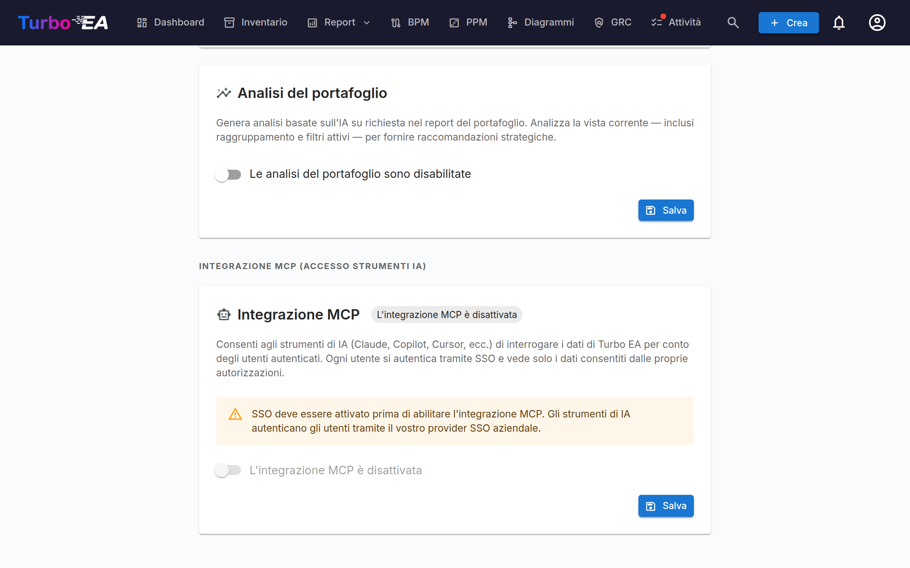

# Integrazione MCP (accesso per strumenti IA)

Turbo EA include un **server MCP** (Model Context Protocol) integrato che consente agli strumenti di IA — come Claude Desktop, GitHub Copilot, Cursor e VS Code — di interrogare e aggiornare i dati EA direttamente. Gli strumenti di IA possono inoltre caricare artefatti (fogli di calcolo, diagrammi BPMN, diagrammi DrawIO, documenti liberi) e trasformarli in card, relazioni e diagrammi che rispettano il metamodello esistente. Gli utenti si autenticano tramite il loro provider SSO esistente, e ogni azione rispetta i loro permessi individuali.

Questa funzionalità è **opzionale** e **non si avvia automaticamente**. Richiede che l'SSO sia configurato, che il profilo MCP sia attivato in Docker Compose e che un amministratore lo abiliti nell'interfaccia delle impostazioni.

---

## Come funziona

```
Strumento IA (Claude, Copilot, ecc.)
    │
    │  Protocollo MCP (streamable HTTP)
    ▼
Server MCP di Turbo EA (:8001, interno)
    │
    │  OAuth 2.1 con PKCE
    │  delega al provider SSO
    ▼
Backend Turbo EA (:8000)
    │
    │  RBAC per utente
    ▼
PostgreSQL
```

1. Un utente aggiunge l'URL del server MCP al proprio strumento IA.
2. Alla prima connessione, lo strumento IA apre una finestra del browser per l'autenticazione SSO.
3. Dopo il login, il server MCP emette il proprio token di accesso (supportato dal JWT Turbo EA dell'utente).
4. Lo strumento IA utilizza questo token per tutte le richieste successive. I token si rinnovano automaticamente.
5. Ogni query passa attraverso il normale sistema di permessi di Turbo EA — gli utenti vedono solo i dati a cui hanno accesso.

---

## Prerequisiti

Prima di abilitare MCP, è necessario avere:

- **SSO configurato e funzionante** — MCP delega l'autenticazione al provider SSO (Microsoft Entra ID, Google Workspace, Okta o OIDC generico). Consultare la guida [Autenticazione e SSO](sso.md).
- **HTTPS con un dominio pubblico** — Il flusso OAuth richiede un URI di reindirizzamento stabile. Distribuire dietro un reverse proxy con terminazione TLS (Caddy, Traefik, Cloudflare Tunnel, ecc.).

---

## Configurazione

### Passaggio 1: Avviare il servizio MCP

Il server MCP è un profilo opzionale di Docker Compose. Aggiungere `--profile mcp` al comando di avvio:

```bash
docker compose --profile mcp up --build -d
```

Questo avvia un container Python leggero (porta 8001, solo interno) accanto al backend e frontend. Nginx reindirizza automaticamente le richieste `/mcp/` verso di esso.

### Passaggio 2: Configurare le variabili d'ambiente

Aggiungere queste al file `.env`:

```dotenv
TURBO_EA_PUBLIC_URL=https://il-tuo-dominio.esempio.com
MCP_PUBLIC_URL=https://il-tuo-dominio.esempio.com/mcp
```

| Variabile | Predefinito | Descrizione |
|-----------|------------|-------------|
| `TURBO_EA_PUBLIC_URL` | l'origine di `MCP_PUBLIC_URL`, altrimenti `http://localhost:8920` | L'URL pubblico dell'istanza Turbo EA. Ogni link restituito da uno strumento MCP (una bozza nell'editor, una vista di inventario salvata) è costruito su di esso. Se non è impostato, o è impostato su un indirizzo locale (`localhost`, `127.0.0.1` o `[::1]`, qualsiasi porta — `.env.example` fornisce `http://localhost`) mentre `MCP_PUBLIC_URL` indica un host reale, il server MCP usa invece lo schema e l'host di `MCP_PUBLIC_URL` (`https://ea.example.com/mcp` dà `https://ea.example.com`), il che è corretto ogni volta che MCP è servito sotto `/mcp` sull'host stesso dell'applicazione. Un valore su un host reale viene sempre usato; impostarne uno quando l'applicazione si trova altrove |
| `MCP_PUBLIC_URL` | `http://localhost:8920/mcp` (docker compose) | L'URL pubblico del server MCP (usato negli URI di reindirizzamento OAuth). Quando il container viene eseguito in modalità standalone, il valore predefinito nel codice è `http://localhost:8001` |
| `MCP_PORT` | `8001` | Porta interna del container MCP (raramente necessita di modifica) |
| `SECRET_KEY` | *(nessuno)* | Impostarla al valore del backend. Firma gli identificativi client OAuth emessi dal server MCP, così un client registrato una volta continua a funzionare dopo un riavvio; senza di essa il server firma con una chiave che scompare con il processo e registra un avviso. Docker Compose, il chart Helm e i modelli cloud la passano automaticamente |
| `MCP_ALLOWED_ORIGINS` | *(vuoto)* | Origini aggiuntive, separate da virgole, le cui richieste del browser l'endpoint MCP accetta. Le richieste senza intestazione `Origin` sono sempre accettate |
| `MCP_ALLOWED_HOSTS` | *(vuoto)* | Nomi host aggiuntivi, separati da virgole, che l'endpoint MCP accetta nell'intestazione `Host`, oltre agli host di `TURBO_EA_PUBLIC_URL` e `MCP_PUBLIC_URL`. Necessario solo quando un proxy inoltra un nome host diverso; vedere [Dietro un proxy che cambia il nome host](#proxy-host-name) |

### Passaggio 3: Aggiungere l'URI di reindirizzamento OAuth all'app SSO

Nella registrazione dell'applicazione del provider SSO (la stessa configurata per il login di Turbo EA), aggiungere questo URI di reindirizzamento:

```
https://il-tuo-dominio.esempio.com/mcp/oauth/callback
```

Questo è necessario per il flusso OAuth che autentica gli utenti quando si connettono dal loro strumento IA.

### Passaggio 4: Abilitare MCP nelle impostazioni di amministrazione

1. Andare su **Impostazioni** nell'area di amministrazione e selezionare la scheda **AI**.
2. Scorrere fino alla sezione **Integrazione MCP (Accesso strumenti IA)**.
3. Attivare l'interruttore per **abilitare** MCP.
4. L'interfaccia mostrerà l'URL del server MCP e le istruzioni di configurazione da condividere con il team.



!!! warning
    L'interruttore è disabilitato se l'SSO non è configurato. Configurare prima l'SSO.

---

## Connettere gli strumenti IA

Una volta abilitato MCP, condividere l'**URL del server MCP** con il team. Ogni utente lo aggiunge al proprio strumento IA:

### Claude Desktop

1. Aprire **Impostazioni > Connettori > Aggiungi connettore personalizzato**.
2. Inserire l'URL del server MCP: `https://il-tuo-dominio.esempio.com/mcp`
3. Fare clic su **Connetti** — si apre una finestra del browser per il login SSO.
4. Dopo l'autenticazione, Claude può interrogare i dati EA.

### VS Code (GitHub Copilot / Cursor)

Aggiungere al file `.vscode/mcp.json` del workspace:

```json
{
  "servers": {
    "turbo-ea": {
      "type": "http",
      "url": "https://il-tuo-dominio.esempio.com/mcp"
    }
  }
}
```

Utilizzare `https://il-tuo-dominio.esempio.com/mcp` come endpoint. La precedente forma doppia `https://il-tuo-dominio.esempio.com/mcp/mcp` continua a funzionare, quindi i connettori esistenti continuano a funzionare senza modifiche.

### Microsoft Copilot Studio

Copilot Studio si connette ai server MCP dal cloud di Microsoft, non dal computer dell'utente. L'istanza deve quindi essere raggiungibile da internet pubblico tramite HTTPS, con un certificato rilasciato da un'autorità di certificazione pubblica. Un'istanza che risponde solo su una rete interna o una VPN funziona con gli strumenti desktop ma non in Copilot Studio.

1. Nel tuo agente, apri **Strumenti > Aggiungi uno strumento > Nuovo strumento > Model Context Protocol**.
2. Inserisci l'URL del server `https://il-tuo-dominio.esempio.com/mcp`.
3. In **Autenticazione**, scegli **OAuth 2.0**, poi **Individuazione dinamica** (Dynamic discovery).
4. Crea la connessione e accedi con il tuo account SSO quando richiesto.

Copilot Studio si registra una sola volta e conserva l'identificativo client ricevuto. Quell'identificativo contiene i propri URI di reindirizzamento, firmati con la `SECRET_KEY` dell'istanza, perciò la connessione continua a funzionare quando il container MCP viene riavviato o aggiornato. Cambiare `SECRET_KEY` invalida tutti i client registrati: ricrea poi lo strumento in Copilot Studio.

### Dietro un proxy che cambia il nome host { #proxy-host-name }

L'endpoint MCP si protegge dal DNS rebinding controllando l'intestazione `Host` di ogni richiesta. Accetta i nomi host di `TURBO_EA_PUBLIC_URL` e `MCP_PUBLIC_URL`, oltre a `localhost` e `127.0.0.1`. Il container MCP registra l'elenco completo una volta all'avvio. Qualsiasi altro nome host viene rifiutato con `421 Misdirected Request` e il container MCP registra `Invalid Host header: <name>`.

Alcuni proxy inoltrano un nome host diverso da quello pubblico. Azure Front Door davanti a una route HTTP di Azure Container Apps, ad esempio, invia il nome proprio della route, `<route>.<environment>.azurecontainerapps.io`. In questo caso l'accesso continua a funzionare, ma ogni connessione MCP fallisce. Indicare il nome inoltrato in `MCP_ALLOWED_HOSTS`:

```dotenv
MCP_ALLOWED_HOSTS=my-route.my-environment.westeurope.azurecontainerapps.io
```

Le voci sono solo nomi host, separati da virgole, senza `https://` e senza percorso; il container registra un avviso per una voce che non potrà mai corrispondere. La corrispondenza è esatta, rispetto all'intestazione così come la invia il proxy, in minuscolo. Aggiungere `:port` quando il proxy invia una porta, oppure `:*` per accettare qualsiasi porta. I caratteri jolly per i sottodomini non sono supportati. Su Kubernetes, impostare la variabile tramite `mcp.extraEnv` nei valori Helm.

---

## Test locale (modalità stdio)

Per lo sviluppo locale o i test senza SSO/HTTPS, è possibile eseguire il server MCP in **modalità stdio** — Claude Desktop lo avvia direttamente come processo locale.

**1. Installare il pacchetto del server MCP:**

```bash
pip install ./mcp-server
```

**2. Aggiungere alla configurazione di Claude Desktop** (`claude_desktop_config.json`):

```json
{
  "mcpServers": {
    "turbo-ea": {
      "command": "python",
      "args": ["-m", "turbo_ea_mcp", "--stdio"],
      "env": {
        "TURBO_EA_URL": "http://localhost:8000",
        "TURBO_EA_EMAIL": "tua@email.com",
        "TURBO_EA_PASSWORD": "tua-password"
      }
    }
  }
}
```

In questa modalità, il server si autentica con email/password e rinnova il token automaticamente in background.

---

## Funzionalità disponibili

Il server MCP espone **65 strumenti** suddivisi in due gruppi: **40 strumenti di lettura** che interrogano i dati EA e **25 strumenti di scrittura** (20 additivi, 5 distruttivi) che creano e mantengono card, relazioni, diagrammi, rischi, ADR, viste di inventario salvate e altro ancora — inclusa la trasformazione degli artefatti che uno strumento di IA ha nel proprio contesto (fogli di calcolo, BPMN XML, DrawIO XML, documenti, immagini) in dati EA strutturati. Ogni strumento porta `ToolAnnotations` MCP (indicazioni di sola lettura / distruttivo / idempotente) in modo che i connettori possano evidenziare la distruttività nella loro interfaccia. Ogni strumento rifiuta inoltre un argomento che non dichiara: la chiamata fallisce con un errore che nomina l'argomento sconosciuto ed elenca quelli validi, e non viene fatto nulla. (Prima della 2.203.0 un tale argomento veniva ignorato in silenzio, quindi una chiamata poteva segnalare successo mentre parte di quanto richiesto andava perso.)

### Sicurezza tramite esecuzione di prova nelle scritture

Ogni strumento di scrittura usa per impostazione predefinita **`dry_run=true`**, e nulla viene persistito finché lo strumento di IA non lo richiama con `dry_run=false` — cosa che dovrebbe fare solo dopo che l'utente ha visto l'anteprima e ha confermato. Questo evita che un agente troppo zelante crei silenziosamente centinaia di card a partire da un foglio di calcolo interpretato male. L'anteprima è di due tipi:

- **Verificata dal backend.** Dove l'endpoint sottostante supporta un'esecuzione di prova, il backend esegue ogni validatore e risolutore — permessi, id delle card, ciò che l'utente può leggere —, costruisce il risultato completo e poi **annulla la transazione**. Questo vale per le card (`create_cards_bulk`, `update_cards_bulk`), le relazioni (`upsert_relations_bulk`) e i diagrammi (`create_diagram`, `update_diagram`). L'anteprima di un diagramma restituisce i collegamenti alle card accettati dal backend e, per un aggiornamento, la modifica esatta: campi rinominati, collegamenti alle card aggiunti e rimossi, e se il canvas è cambiato.
- **Costruita dal server MCP.** Dove l'endpoint non prevede un'esecuzione di prova, lo strumento valida e traduce il proprio input e mostra il payload esatto che un commit invierebbe, senza chiamare l'endpoint di scrittura: `import_bpmn` (che individua la bozza in cui salverebbe un commit; i conteggi dei nodi di flusso sono una stima, quindi l'anteprima riporta `verified: false`), `submit_process_flow` e `approve_process_flow` (che leggono la versione e riportano il cambio di stato, o perché non è possibile), `link_process_flow_elements` (che legge la versione e i suoi passi e riporta il valore attuale e quello nuovo di ogni collegamento, oppure i passi che non conosce), `create_adr`, `update_adr`, `sign_adr`, `revise_adr` (che legge la decisione e indica il numero di revisione che creerebbe, o perché il backend rifiuterebbe), `create_soaw`, `add_card_comment`, `add_document_comment` (che legge la discussione e indica se si può commentare e se il thread a cui si risponde appartiene a quel documento), `transition_card_lifecycle`, `save_inventory_view` (che esegue la query e indica quante card corrispondono, con alcuni nomi di esempio), `assign_stakeholders`, `create_risks`, `update_risks`, `archive_cards` (che mostra l'impatto dell'archiviazione di ogni card) e `set_card_logos` / `clear_card_logos` (che cercano il tipo e il logo attuale di ogni card e scaricano ogni `image_url`).

In entrambi i casi l'anteprima viene registrata nel registro di audit come batch di esecuzione di prova, così un amministratore può vedere ciò che un agente ha proposto e ciò che ha confermato.

### Strumenti di lettura

Il server espone 40 strumenti di lettura raggruppati in dieci cluster.

**Card & metamodello**

| Strumento | Descrizione |
|-----------|-------------|
| `search_cards` | Cercare e filtrare le card per tipo, stato o testo libero |
| `query_cards` | Trova card attraverso una catena di relazioni con una condizione a ogni salto — vedi [Query di card a più salti](#multi-hop-card-queries) |
| `list_inventory_views` | Elenca le viste di inventario salvate che puoi vedere, con la query di ciascuna vista e il canale che l'ha creata |
| `get_card` | Ottenere i dettagli completi di una card tramite UUID |
| `get_card_relations` | Ottenere tutte le relazioni connesse a una card |
| `get_card_hierarchy` | Ottenere antenati e figli di una card |
| `list_card_types` | Elencare tutti i tipi di card nel metamodello; il campo `category` di ogni tipo è la chiave della sua categoria (livello architetturale) |
| `get_relation_types` | Elencare i tipi di relazione, con filtro opzionale per tipo di card |
| `list_tag_groups` | Elencare i gruppi di tag (con i tipi di card a cui si applica ciascuno) e i loro tag; gli id dei tag sono ciò che `query_cards` e `save_inventory_view` accettano in `where.tags` |
| `resolve_card_refs` | Pre-validare i riferimenti alle card basati sul nome (nome → UUID) prima di un'importazione di massa — risolve soltanto, non scrive mai |
| `analyze_impact` | Analisi del raggio d'impatto delle dipendenze per una modifica proposta a una card |

**Dashboard**

| Strumento | Descrizione |
|-----------|-------------|
| `get_dashboard` | Dashboard KPI (conteggi, qualità dei dati, approvazioni, attività) |
| `get_landscape` | Card di un tipo raggruppate per un tipo correlato |

**GRC — Registro dei rischi**

| Strumento | Descrizione |
|-----------|-------------|
| `list_risks` | Elenco paginato e filtrabile dei rischi EA (TOGAF Fase G) |
| `get_risk` | Dettaglio di un rischio con card collegate e percorso di audit |
| `get_risk_metrics` | KPI + matrici 4×4 iniziale e residua |
| `get_card_risks` | Tutti i rischi attualmente collegati a una card |

**GRC — Conformità**

| Strumento | Descrizione |
|-----------|-------------|
| `list_compliance_findings` | Riscontri di conformità raggruppati per regolamento |
| `get_compliance_overview` | Punteggi di conformità + matrice di stato per regolamento + metadati dell'ultima scansione |

**Governance & Consegna**

| Strumento | Descrizione |
|-----------|-------------|
| `list_principles` | Principi EA pubblicati (enunciato, motivazione, implicazioni) |
| `list_adrs` | Architecture Decision Records, filtrabili per iniziativa, stato e vigenza (`standing="in_force,amended"` elenca le decisioni in vigore). Mostra la revisione corrente di ogni decisione; `include_earlier` aggiunge le revisioni precedenti |
| `get_adr` | Singola revisione di un ADR con sezioni, card collegate, percorso di firma, vigenza, collegamenti tipizzati ad altre decisioni, decisori e partecipanti, date, revisioni e nomi dei file |
| `list_soaws` | Statements of Architecture Work di un'iniziativa (revisioni correnti; `include_earlier` aggiunge quelle precedenti) |
| `get_document_discussion` | La discussione di una decisione o di un SoAW: thread con le loro risposte, sezione, autore e stato risolto, inclusi motivi di rifiuto e note di firma. Ogni commento è fornito in HTML e in testo semplice, con le menzioni scritte come `@Nome`, o `[restricted]` per una card che non si può vedere; `include_earlier_revisions` aggiunge i thread delle revisioni precedenti |
| `get_document_history` | La cronologia di una decisione o di un SoAW (creato, salvato, inviato per la revisione, firmato, rifiutato, ripristinato, …), pagina per pagina. Aprire, confrontare e ripristinare le versioni salvate resta possibile solo nell'interfaccia web |

**Report**

| Strumento | Descrizione |
|-----------|-------------|
| `get_portfolio_report` | Dati di grafico a bolle per un tipo di card (default: fit funzionale × tecnico) |
| `get_cost_treemap` | Treemap dei costi, opzionalmente raggruppato per un tipo correlato |
| `get_capability_heatmap` | Heatmap gerarchica delle capacità di business |
| `get_data_quality_report` | Suddivisione della completezza per tipo di card |

**Contesto card**

| Strumento | Descrizione |
|-----------|-------------|
| `get_card_stakeholders` | Utenti + ruoli assegnati a una card |
| `get_card_comments` | Thread di commenti di una card |
| `get_card_documents` | Link a documenti allegati a una card (URL, non file) |
| `get_card_logo` | A card's logo: mime, size and a sha256 of the stored bytes, so a write can be verified without transferring the image (pass `include_image` when you do want it) |
| `list_available_icons` | Search the built-in brand-icon pack for a slug to pass to `set_card_logos` |

**Diagrammi**

| Strumento | Descrizione |
|-----------|-------------|
| `list_diagrams` | Elencare i diagrammi a disegno libero (DrawIO), con filtro opzionale su una card |
| `get_diagram` | Recuperare un singolo diagramma tramite id, incluso il suo XML DrawIO |

**Flussi di processo**

| Strumento | Descrizione |
|-----------|-------------|
| `list_process_flow_versions` | Elencare le versioni di flusso di un Processo di business — quella pubblicata e, per un utente che può vederle, le bozze e quelle in attesa — ciascuna con id, revisione, stato, la versione da cui deriva e un link che apre una bozza nell'editor. Senza XML BPMN. |
| `get_process_flow_version` | Leggere una versione di flusso, incluso il suo XML BPMN, così che un agente possa rivedere una bozza e risalvarla con `import_bpmn`. |
| `get_process_flow_elements` | Elencare i passi di una versione di flusso — per ciascuno id dell'elemento, tipo, nome, corsia e ordine — e le card a cui è collegato ogni passo: Applicazione, Oggetto dati, Componente IT, il Processo aziendale a cui passa il testimone e Organizzazioni. Una card collegata che l'utente non può vedere risulta come nessun collegamento. Indica se i collegamenti dei passi della versione possono essere impostati (una bozza o una revisione in attesa). |

**Audit & cronologia delle modifiche**

| Strumento | Descrizione |
|-----------|-------------|
| `get_change_history` | Interrogare il registro dei batch di mutazione (per id del batch, attore, strumento o origine) per ricostruire esattamente cosa ha modificato un precedente commit MCP |

Tutti gli strumenti rispettano l'RBAC dell'utente autenticato — un visualizzatore riceverà semplicemente una lista vuota (o 403) per ciò che non può vedere; non serve alcuna configurazione per-tool a livello MCP.

### Strumenti di scrittura

Il server espone 25 strumenti di scrittura, ciascuno annotato come **additivo** (crea o estende dati) o **distruttivo** (modifica o rimuove dati esistenti), in modo che i connettori possano avvertire di conseguenza.

**Additivi (20)**

| Strumento | Descrizione |
|-----------|-------------|
| `create_cards_bulk` | Crea più card in una sola chiamata (per esempio righe di foglio di calcolo). Supporta riferimenti al genitore per nome all'interno dello stesso batch, con ordinamento topologico lato server. |
| `transition_card_lifecycle` | Fa avanzare una card attraverso le fasi di approvazione o del ciclo di vita. |
| `create_risks` | Crea voci nel Registro dei rischi EA. |
| `update_risks` | Aggiorna le voci del Registro dei rischi (campi, card collegate). |
| `add_card_comment` | Pubblica un commento su una card — una nota non distruttiva e revisionabile invece di modificare i campi. |
| `add_document_comment` | Pubblica un commento su una decisione o un SoAW: un nuovo thread, facoltativamente associato a una sezione, o una risposta a un thread. Il commento è testo semplice; le menzioni si fanno solo nell'interfaccia web. Richiede il permesso `adr.comment` / `soaw.comment`, oppure essere firmatario del documento. Un commento pubblicato non può essere annullato con `rollback_batch`; eliminarlo dalla discussione nell'interfaccia web. |
| `create_soaw` | Crea uno Statement of Architecture Work per un'iniziativa. |
| `assign_stakeholders` | Assegna o rimuove ruoli di stakeholder sulle card. |
| `update_cards_bulk` | Patch a livello di campo su molte card in una sola chiamata. |
| `create_adr` | Crea un Architecture Decision Record, con collegamenti tipizzati ad altre decisioni (`replaces`, `amends`, `revokes`, `relates`), decisori, partecipanti e date. Sostituire o revocare una decisione si fa in questo modo: una nuova decisione con un collegamento `replaces` / `revokes`, che ha effetto una volta firmata. |
| `update_adr` | Aggiorna un ADR in bozza (titolo, sezioni, card collegate, collegamenti tipizzati, persone, date, riepilogo delle modifiche). Una decisione in revisione accetta solo modifiche alle card collegate, e una firmata non viene mai modificata. |
| `sign_adr` | Firma un ADR (richiede il permesso `adr.sign`; altrimenti restituisce un deep-link all'interfaccia per firmare nel browser). |
| `revise_adr` | Avvia la revisione successiva di un ADR firmato: una bozza con lo stesso riferimento e il numero di revisione successivo, che può consolidare le decisioni che la modificano. Rifiutato quando una revisione è già in fase di redazione, una revisione successiva è firmata, o la decisione è stata revocata o sostituita. La registrazione di una decisione passata come presa resta nell'interfaccia web. |
| `create_diagram` | Crea un diagramma DrawIO libero con collegamenti opzionali a card esistenti. |
| `save_inventory_view` | Salva una query di card a più salti come vista di inventario (nuova, oppure in sostituzione della query di una esistente indicata con `view_id`). L'inventario riesegue la query ogni volta che la vista viene aperta; la risposta contiene un link che la apre. Un aggiornamento modifica solo il nome e la query, più la visibilità e le colonne se vengono passate; raggruppamento e layout della vista restano invariati. |
| `import_bpmn` | Salva un diagramma BPMN 2.0 XML come **bozza** di flusso di processo di una card Processo di business **esistente**. Non invia né pubblica mai la bozza. Per impostazione predefinita crea una nuova bozza basata sul flusso pubblicato, così i collegamenti degli elementi già creati vengono mantenuti; `based_on_version_id` la basa invece su un'altra versione, e `draft_version_id` sostituisce il diagramma di una bozza esistente (stessa revisione, nessuna nuova bozza). La risposta riporta id, revisione e stato della bozza e un link che la apre nell'editor. Se nessuna card corrisponde al nome fornito, lo strumento restituisce un errore `card_not_found` che rimanda l'agente a `create_cards_bulk` — questo forza la creazione esplicita della card con descrizione, sottotipo e attributi prima, invece di una scorciatoia che produce una card scarna. Una bozza salvata non si può annullare con `rollback_batch`; eliminarla dalla sotto-scheda Flusso di processo → Bozze della card. |
| `link_process_flow_elements` | Collega i passi di un flusso di processo in bozza o in attesa alle card: Applicazione, Oggetto dati, Componente IT, il Processo aziendale a cui un passo passa il testimone e Organizzazioni. Una voce per passo, tramite il suo id dell'elemento ottenuto da `get_process_flow_elements`; un collegamento omesso resta com'è e un valore vuoto lo rimuove. Solo id di card (cercarli con `search_cards` o `resolve_card_refs`). Un id di passo che il diagramma salvato non contiene viene rifiutato prima di scrivere qualsiasi cosa. Ogni collegamento accetta una card attiva del proprio tipo (Applicazione, Oggetto dati, Componente IT, Processo aziendale, Organizzazione). Se il backend rifiuta un passo (una card di un altro tipo, una card archiviata o che l'utente non può vedere, un collegamento di processo su un oggetto dati), l'esecuzione si ferma lì e la risposta elenca quali passi sono stati collegati e quali no. I collegamenti hanno effetto sui passi pubblicati quando la revisione viene approvata. Non registrano alcun evento, quindi `rollback_batch` non può annullarli: richiamare lo strumento con il valore precedente. Richiede `bpm.edit`. |
| `submit_process_flow` | Invia una bozza di flusso di processo per l'approvazione (bozza → in attesa), come fa il pulsante **Invia per approvazione** dell'interfaccia web. I responsabili del processo ricevono una notifica e un'attività di approvazione. Richiede `bpm.edit`. Non reversibile con `rollback_batch`: un approvatore rifiuta la revisione nell'interfaccia web per riportarla in bozza. |
| `approve_process_flow` | Approva un flusso di processo in attesa, il che lo pubblica e archivia la revisione pubblicata in precedenza. Richiede l'autorità di approvazione (`bpm.approve_flows`, oppure il ruolo di stakeholder di responsabile del processo) e rispetta l'impostazione che richiede un approvatore distinto. Un rifiuto restituisce il motivo indicato dal backend. Non reversibile con `rollback_batch`: una revisione pubblicata per errore viene ritirata nell'interfaccia web, che la conserva nello storico e apre una nuova bozza. |
| `set_card_logos` | Set the custom logo on many cards at once — the bulk way to put product marks on an Application inventory. Three ways to supply the image, one per row: a built-in `icon_slug` (resolved server-side, nothing transferred), an `image_url` the MCP server downloads for you from an allowlisted icon host, or `image_base64` from the agent's own context. The packs are a shortcut, not the source of truth — a dry run lists the slugs they do not carry under `unknown_icon_slugs` **and** fetches every `image_url`, so a missing brand or a dead link is reported before anything is written rather than left as a logo nobody could set. `mime` is optional and sniffed from the bytes. PNG/JPEG/WebP/GIF only, 1 MB each. Each row echoes a sha256 so the caller can prove what landed. Use `clear_card_logos` to remove one. |

**Distruttivi (5)**

| Strumento | Descrizione |
|-----------|-------------|
| `upsert_relations_bulk` | Crea o elimina relazioni tra card. Sorgente / destinazione / tipo sono validati contro il metamodello. L'eliminazione è rifiutata a meno che l'operatore non la abiliti esplicitamente (vedere le salvaguardie). |
| `archive_cards` | Archivia le card (soft-delete). Recuperabile — le card archiviate possono essere ripristinate per 30 giorni prima dell'eliminazione automatica. |
| `update_diagram` | Sostituisce l'XML DrawIO di un diagramma, il nome o i collegamenti alle card. |
| `rollback_batch` | Annulla le scritture eseguite in un precedente batch di mutazione. |
| `clear_card_logos` | Remove the custom logo from cards, falling them back to their card-type icon. Recoverable — set it again to restore. |

### Query di card a più salti { #multi-hop-card-queries }

`query_cards` risponde in una sola chiamata a una domanda che concatena relazioni — «Organizzazioni che usano un'Applicazione con ciclo di vita Attivo, influenzata da un'Iniziativa con stato In linea» — e `save_inventory_view` conserva la stessa query come vista di inventario salvata. La vista memorizza la query, non i suoi risultati: l'inventario la riesegue ogni volta che qualcuno apre la vista, così l'elenco resta aggiornato.

Una query è un piccolo oggetto JSON composto **solo da chiavi** — chiavi di tipo di card, di tipo di relazione, di campo e di opzione così come le restituiscono `list_card_types` e `get_relation_types`; id di card solo sotto `where.cards` e id di tag solo sotto `where.tags`; mai etichette:

```text
CardQuery = { type, where?, related?: [Hop] }
Hop       = { relation: "<relation type key>" | "<key>__out" | "<key>__in",
              type, where?, negate?: true|false, related?: [Hop] }
Where     = { lifecycle_phase?: [plan | phaseIn | active | phaseOut | endOfLife | none],
              subtype?: [subtype key],
              approval_status?: [status],
              data_quality_band?: [complete | partial | minimal],
              eol_status?: [eol | approaching | supported | unknown | __empty__],
              attributes?: { field key: [option key | "true" | "false" | text | "__empty__"] },
              tags?: [tag id],
              cards?: [card id],
              include_descendants?: true|false }
```

Le query possono anche essere **impilate**, così una vista combina più query complete:

```text
Query = CardQuery | { all_of: [CardQuery, …] } | { any_of: [Group, …] }
Group = CardQuery | { all_of: [CardQuery, …] }
```

- `all_of` (**E**): una card viene elencata solo se corrisponde a ogni query dell'elenco. Le sue query partono tutte dallo stesso tipo di card (altrimenti `all_of_type_mismatch`) e ne servono almeno due (`all_of_needs_two`).
- `any_of` (**O**): una card viene elencata se corrisponde a uno qualsiasi dei gruppi, ciascuno una query semplice o un `all_of`. Servono almeno due gruppi (`any_of_needs_two`). I gruppi possono partire da tipi di card diversi, quindi **una vista può elencare più tipi di card**; una vista così si apre su tutti, e la griglia mostra le colonne che hanno in comune.
- Un `any_of` non può stare dentro un altro `any_of` né dentro un `all_of`, e un `all_of` contiene solo query semplici (`invalid_query`).
- Le query di un `all_of` si incontrano solo sulla card iniziale: «usa un Componente IT in dismissione» E «è interessata da un'Iniziativa» possono riguardare due card collegate diverse. Per richiedere due cose alla **stessa** card collegata, metti entrambi i salti sulla stessa riga, affiancati sotto di essa.

- Un salto corrisponde quando **una qualsiasi** card correlata di quel tipo soddisfa il suo `where` (e i suoi salti annidati). `negate: true` lo trasforma in «**non** ha nessuna card di questo tipo».
- I salti affiancati allo stesso livello devono corrispondere tutti (AND); i valori all'interno di un elenco sono alternative (OR).
- `<key>__out` e `<key>__in` scelgono un lato di un tipo di relazione che collega un tipo di card a sé stesso (la card è l'origine o la destinazione). Altrimenti basta la chiave semplice.
- `data_quality_band` fa corrispondere il punteggio di qualità dei dati di una card per fascia, come il filtro Qualità dei dati dell'inventario: `complete` (80 e oltre), `partial` (da 40 incluso a 80 escluso) o `minimal` (sotto 40). Qualsiasi altro valore viene rifiutato con `unknown_band`.
- `eol_status` corrisponde allo stato di fine vita di una card come lo mostra la colonna Fine vita dell'inventario, calcolato da endoflife.date o da un prodotto EOL personalizzato: `eol`, `approaching`, `supported`, `unknown`, oppure `__empty__` per una card senza collegamento EOL e senza fine vita manuale. Qualsiasi altro valore è rifiutato con `unknown_eol_status`, e un tipo di card che non tiene traccia della fine vita con `eol_not_tracked`. Una tale condizione richiede il permesso di visualizzare i dati EOL: salvare, visualizzare in anteprima e aprire una vista che ne contiene una sono rifiutati senza di esso (`eol_view_required`), così come l'esecuzione della query.
- `tags` accetta id di tag da `list_tag_groups`, raggruppati per gruppo di tag: una card deve avere almeno uno dei tag elencati di **ogni** gruppo indicato (alternative all'interno di un gruppo, AND tra i gruppi). Un tag il cui gruppo non si applica al tipo di card di quel salto viene rifiutato con `tag_not_for_type`; un id sconosciuto con `unknown_tag`.
- `cards` vincola quel nodo alle card elencate (alternative): prendi i loro id da `search_cards` o `resolve_card_refs`. Ognuna dovrebbe essere una card del tipo proprio del nodo. L'esecuzione di una query non verifica le scelte: un id che non indica alcuna card, una card di un altro tipo o una card che l'utente non può leggere semplicemente non corrisponde a nulla. Il salvataggio di una vista le verifica e rifiuta una scelta simile con `unknown_card`. Una card archiviata non corrisponde a nulla in un salto. `include_descendants: true` estende ogni scelta a tutte le card sottostanti tramite il legame di parentela (sotto-capacità, organizzazioni figlie); impostato senza `cards` viene rifiutato con `descendants_without_cards`, e su un tipo di card senza gerarchia con `descendants_without_hierarchy`. Un id di card o di tag in qualsiasi altro punto della query viene rifiutato con `query_holds_an_id`.
- Le card correlate contano solo se sono attive e l'utente può leggerle: una card che l'utente non può vedere interrompe la catena, esattamente come nell'interfaccia web. Quando una vista viene salvata, chi scrive non può vincolare una card che gli è nascosta (`unknown_card`); un collaboratore che modifica una vista condivisa con lui mantiene le scelte che contiene già, anche quelle che non può leggere. Un lettore che apre una vista le cui scelte includono una card a lui nascosta non viene rifiutato: le scelte nascoste semplicemente non corrispondono a nulla.

Esempio — Organizzazioni che usano un'Applicazione attiva influenzata da un'Iniziativa con stato *On Track*:

```json
{
  "type": "Organization",
  "related": [
    {
      "relation": "relOrgToApp",
      "type": "Application",
      "where": { "lifecycle_phase": ["active"] },
      "related": [
        {
          "relation": "relInitiativeToApp",
          "type": "Initiative",
          "where": { "attributes": { "initiativeStatus": ["onTrack"] } }
        }
      ]
    }
  ]
}
```

Esempio — Applicazioni attive su tecnologia obsoleta interessate da un'Iniziativa, **oppure** le Organizzazioni che usano un'Applicazione (una vista che elenca due tipi di card):

```json
{
  "any_of": [
    {
      "all_of": [
        {
          "type": "Application",
          "where": { "lifecycle_phase": ["active"] },
          "related": [
            {
              "relation": "relAppToITC",
              "type": "ITComponent",
              "where": { "lifecycle_phase": ["phaseOut", "endOfLife"] }
            }
          ]
        },
        {
          "type": "Application",
          "related": [{ "relation": "relInitiativeToApp", "type": "Initiative" }]
        }
      ]
    },
    {
      "type": "Organization",
      "related": [{ "relation": "relOrgToApp", "type": "Application" }]
    }
  ]
}
```

Nell'inventario, una vista salvata in questo modo mostra la sua catena come percorso leggibile sopra la griglia con una nota che indica che è stata creata tramite MCP. La sua query può essere modificata nell'inventario (la matita nella striscia del percorso) o tramite `save_inventory_view` (passa l'id della vista ottenuto da `list_inventory_views` come `view_id`; l'aggiornamento sostituisce nome e query, modifica visibilità e colonne solo se passate e mantiene il raggruppamento e il layout impostati nell'interfaccia web — a meno che la nuova query non parta da altri tipi di card, il che reimposta i filtri e il raggruppamento della vista, perché appartenevano ai precedenti; una vista che non puoi modificare viene rifiutata con `view_not_found` o `view_not_editable`; una modifica della visibilità che non ti è consentita (solo il proprietario può cambiarla, e pubblica o condivisa richiede `bookmarks.share`) viene rifiutata con `visibility_not_allowed`); nell'interfaccia web il suo proprietario può anche rinominarla, cambiarne la condivisione e l'impostazione OData, regolare il layout delle colonne o eliminarla.

Le `columns` di una vista possono contenere anche **colonne di corrispondenze**, `via:<line>:<hop path>`: una colonna che mostra, per ogni riga, le card di un passaggio della query che hanno fatto corrispondere la riga (per «Organizzazioni che usano un'Applicazione che usa un Componente IT a fine vita», quali Applicazioni e quali Componenti IT). `line` è la posizione, a partire da zero, della riga tra tutte le righe della query in ordine (una query semplice è la riga 0; le righe di un `all_of`, e di ogni gruppo `any_of` a turno, sono numerate una dopo l'altra), e `hop path` sono gli indici a partire da zero in `related`, uniti da punti, dalla prima card della riga fino al passaggio: `via:0:0` è il primo salto della prima riga, `via:0:0.1` il secondo salto sotto di esso, `via:2:0` il primo salto della terza riga. La prima card di una riga e un passaggio dietro «non ha» (`negate`) non ne hanno. Le corrispondenze sono mostrate solo nell'interfaccia web: nessuno strumento MCP le legge ancora. Aggiornare la `query` di una vista senza inviare `columns` mantiene invariate le sue chiavi `via:` salvate, quindi invia `columns` quando i passaggi cambiano.

Limitazioni:

- Al massimo **6 query** in una pila (`too_many_lines`); le query di un `all_of` condividono un solo tipo di card iniziale, mentre i gruppi di un `any_of` possono elencarne diversi.
- Al massimo **3 livelli** di `related` in ogni query, al massimo 10 salti affiancati a un livello e al massimo **12 salti nell'intera query** (affiancati, annidati e su tutte le query di una pila insieme). Una query più lunga viene rifiutata con `too_many_hops`.
- Al massimo **50** card scelte per condizione.
- Un attributo di testo corrisponde al suo valore **esattamente** — non esiste corrispondenza parziale né senza distinzione tra maiuscole e minuscole.
- **`rollback_batch` non può annullare una vista salvata.** Salvare una vista registra un batch di mutazioni ma non pubblica alcun evento che il rollback possa invertire; elimina una vista indesiderata dalle Viste salvate dell'inventario.

### Caricamento di artefatti

Un sottoinsieme degli strumenti di scrittura (`create_cards_bulk`, `upsert_relations_bulk`, `create_diagram`, `import_bpmn`) permette a un agente di IA di trasformare gli artefatti in dati EA strutturati. L'agente legge il file sorgente nel proprio contesto (visione multimodale, allegati), estrae righe strutturate e chiama questi strumenti. Il server MCP in sé non analizza mai i file — si aspetta un input già strutturato.

Flusso tipico quando un utente condivide un foglio di calcolo con l'agente di IA:

1. L'agente chiama `list_card_types` e `get_relation_types` per comprendere il metamodello.
2. L'agente analizza il foglio di calcolo (nel proprio contesto, non in MCP) e costruisce dizionari di riga.
3. L'agente chiama `create_cards_bulk(cards=…, dry_run=True)` e mostra l'anteprima all'utente.
4. L'utente conferma; l'agente richiama con `dry_run=False` per confermare.
5. Se sono presenti colonne di relazione, l'agente chiama poi `upsert_relations_bulk` con lo stesso ciclo esecuzione di prova / conferma.

Un diagramma BPMN segue lo stesso workflow di approvazione di uno disegnato nell'interfaccia web, un passo esplicito alla volta:

1. `import_bpmn` salva il diagramma come **bozza** e restituisce un link a essa. Nulla viene pubblicato.
2. Per collegare i passi alle card, l'agente legge gli id dei passi con `get_process_flow_elements` e imposta i collegamenti con `link_process_flow_elements` (prima in simulazione, come sempre). `import_bpmn` di per sé non accetta collegamenti.
3. L'utente rivede la bozza. Per modificarla, l'agente la legge con `get_process_flow_version`, modifica l'XML e richiama `import_bpmn` con `draft_version_id`, che aggiorna la stessa bozza invece di crearne un'altra. I collegamenti di ogni passo il cui id dell'elemento viene mantenuto dal nuovo XML restano al loro posto.
4. Quando l'utente lo chiede, `submit_process_flow` invia la bozza per l'approvazione.
5. `approve_process_flow` la pubblica — solo per un utente autorizzato ad approvare i flussi di processo. Chiunque altro la approva nell'interfaccia web, dalla sotto-scheda **Flusso di processo → Bozze** della card.

### Salvaguardie degli strumenti di scrittura

Difesa in profondità sopra l'esecuzione di prova, in modo che un errore del LLM non possa causare danni massicci:

- **Limite di dimensione per chiamata.** Gli strumenti di scrittura MCP applicano un limite molto più piccolo rispetto agli endpoint sottostanti dell'importatore Excel: 200 righe per `create_cards_bulk`, 500 operazioni per `upsert_relations_bulk`. Sufficientemente grande per qualsiasi caricamento realistico di un singolo artefatto, sufficientemente piccolo perché un'anteprima di esecuzione di prova rimanga visionabile.
- **Nessuna eliminazione di relazioni per impostazione predefinita.** `upsert_relations_bulk` rifiuta le operazioni `action: "delete"` — per rimuovere relazioni, utilizzare l'interfaccia web dove l'azione viene registrata sotto l'identità dell'utente. Gli operatori possono abilitarla impostando `MCP_ALLOW_RELATION_DELETE=true`.
- **Interruttore di spegnimento.** `MCP_WRITES_ENABLED=false` disattiva tutti i 25 strumenti di scrittura senza ridistribuire codice. I 40 strumenti di lettura continuano a funzionare.
- **Il download dei loghi passa da una lista di host consentiti.** I pacchetti di icone inclusi non possono coprire ogni prodotto di un cliente, e un assistente è spesso isolato senza accesso al web: perciò `set_card_logos` accetta un `image_url` che il server MCP scarica. Solo `https`, solo gli host di `MCP_LOGO_FETCH_HOSTS`, solo indirizzi pubblici, al massimo due reindirizzamenti (ricontrollati ogni volta), al massimo 1 MB letto in streaming, e i byte devono portare una vera firma PNG/JPEG/WebP/GIF. Il download avviene al bordo MCP, mai nel backend, e l'immagine viene poi caricata per la via ordinaria: un URL scelto da un LLM non raggiunge mai il processo che detiene il database. `MCP_LOGO_FETCH_ENABLED=false` lo disattiva.
- **Etichetta di origine per l'audit.** Ogni richiesta al backend dal server MCP porta un'intestazione `X-Turbo-EA-Origin: mcp`. Gli eventi emessi da queste richieste vengono etichettati con `origin: "mcp"` nel payload del log di audit, in modo che gli amministratori possano filtrare le scritture guidate da MCP fuori dalla timeline, separate dalle azioni dell'interfaccia web.
- **Batch di mutazione.** Ogni chiamata di scrittura MCP — sia l'anteprima sia il commit — è un batch di mutazione nel registro di audit, aperto prima che venga scritto qualsiasi dato; ogni evento emesso durante la chiamata viene marcato con l'id del batch, e ogni strumento di scrittura restituisce quel `batch_id`. Gli amministratori (o lo strumento `get_change_history`) possono ricostruire il diff completo per evento di un commit a partire da un singolo id, e `rollback_batch` può annullarlo, compresa l'eliminazione di un diagramma creato da `create_diagram`, a meno che nel frattempo qualcuno non lo abbia pubblicato. Un aggiornamento di diagramma viene segnalato come non reversibile, perché il canvas precedente non viene conservato. Nemmeno un commento pubblicato su una decisione o un SoAW è reversibile: potrebbe essere già stato letto, quindi viene invece eliminato dalla discussione. Né lo sono i passaggi del flusso di processo: `rollback_batch` segnala un invio o un'approvazione come non reversibile e non modifica nulla — un approvatore rifiuta una revisione in attesa, e una pubblicata viene ritirata, entrambe nell'interfaccia web. Una bozza salvata da `import_bpmn` non è reversibile perché non registra alcun evento; si elimina dalla sotto-scheda Bozze. Nemmeno i collegamenti dei passi impostati da `link_process_flow_elements` registrano un evento; reimpostarli per modificarli. I commit che superano `MCP_BATCH_CONFIRMATION_THRESHOLD` righe devono restituire il `confirm_token` monouso fornito dalla precedente esecuzione di prova. Il backend lo verifica all'apertura del batch del commit, prima di qualsiasi scrittura: deve provenire da un'esecuzione di prova dello stesso strumento, dello stesso utente, di meno di 15 minuti prima, e autorizza un solo commit. Ogni strumento di scrittura massiva segue questo ciclo di anteprima e conferma: `create_cards_bulk`, `update_cards_bulk`, `archive_cards`, `upsert_relations_bulk`, `assign_stakeholders`, `create_risks`, `update_risks`, `set_card_logos`, `clear_card_logos`, `link_process_flow_elements`.
- **Nessuna eliminazione definitiva.** Il set di strumenti omette deliberatamente l'eliminazione permanente delle card. `archive_cards` e `update_cards_bulk` *sono* esposti, ma l'archiviazione è un soft-delete recuperabile (finestra di ripristino di 30 giorni) ed entrambi sono annotati come distruttivi e protetti dall'esecuzione di prova. Aggiungere uno strumento che esegua una mutazione irreversibile (eliminazione definitiva, force-purge) richiederebbe una revisione di progettazione esplicita.

Le sei variabili di ambiente di salvaguardia sul container MCP:

| Variabile | Predefinito | Effetto |
|-----------|-------------|---------|
| `MCP_WRITES_ENABLED` | `true` | Interruttore principale degli strumenti di scrittura. `false` → MCP in sola lettura. |
| `MCP_MAX_CARDS_PER_CALL` | `200` | Limite massimo di righe `create_cards_bulk` / `update_cards_bulk` per richiesta. |
| `MCP_MAX_RELATIONS_PER_CALL` | `500` | Limite massimo di operazioni `upsert_relations_bulk` per richiesta. |
| `MCP_MAX_LOGOS_PER_CALL` | `50` | Hard cap on `set_card_logos` rows per request. Lower than the card cap because each logo is its own upload and carries image bytes. |
| `MCP_ALLOW_RELATION_DELETE` | `false` | Quando `true`, `upsert_relations_bulk` accetta operazioni `action: "delete"`. |
| `MCP_LOGO_FETCH_ENABLED` | `true` | Se `true`, `set_card_logos` accetta un `image_url`: il server MCP scarica l'immagine e la carica per la via ordinaria, quindi restano validi tutti i controlli di permesso, dimensione e formato. Impostare `false` rifiuta del tutto la via per URL — gli slug delle icone e i byte incollati continuano a funzionare. |
| `MCP_LOGO_FETCH_HOSTS` | *(built-in)* | Host da cui è possibile scaricare un logo, separati da virgole e confrontati in modo esatto. Predefiniti: `raw.githubusercontent.com`, `cdn.jsdelivr.net`, `cdn.simpleicons.org`, `upload.wikimedia.org` — hosting pubblico di icone, dove la richiesta contiene un nome di file e nulla sul vostro panorama. Si può aggiungere un servizio di ricerca logo per dominio, al prezzo di rivelargli quali fornitori utilizzate. |
| `MCP_BATCH_CONFIRMATION_THRESHOLD` | `20` | I commit che toccano più righe di questo valore richiedono il `confirm_token` di una precedente esecuzione di prova. Il backend applica comunque il proprio limite di 20 righe, qualunque sia questo valore: può quindi solo abbassare il limite, mai alzarlo. |
| `MCP_REQUIRE_DRYRUN_FIRST` | `true` | Con `true`, il server MCP rifiuta con un errore esplicativo, prima di chiamare il backend, un commit oltre la soglia privo di `confirm_token`. `false` disattiva solo quell'errore anticipato: il backend continua a richiedere il token per ogni commit oltre 20 righe. |

### Risorse

| URI | Descrizione |
|-----|-------------|
| `turbo-ea://types` | Tutti i tipi di card nel metamodello |
| `turbo-ea://relation-types` | Tutti i tipi di relazione |
| `turbo-ea://dashboard` | KPI del dashboard e statistiche riepilogative |

### Prompt guidati

| Prompt | Descrizione |
|--------|-------------|
| `analyze_landscape` | Analisi a più passaggi: panoramica del dashboard, tipi, relazioni |
| `find_card` | Cercare una card per nome, ottenere dettagli e relazioni |
| `explore_dependencies` | Mappare le dipendenze di una card |

---

## Permessi

| Ruolo | Accesso |
|-------|---------|
| **Amministratore** | Configurare le impostazioni MCP (permesso `admin.mcp`). Accesso completo in lettura + scrittura tramite MCP. |
| **Tutti gli utenti autenticati** | Accesso in lettura governato dal loro RBAC esistente. Gli strumenti di scrittura richiedono i corrispondenti permessi backend — `inventory.create` / `inventory.edit` / `inventory.archive` (card), `relations.manage` (relazioni), `diagrams.manage` (diagrammi), `bpm.edit` (bozze BPMN, i collegamenti dei loro passi e il loro invio), `bpm.approve_flows` (approvazione di un flusso di processo), `risks.manage` (Registro dei rischi), `comments.create` (commenti), `stakeholders.manage` (stakeholder), `soaw.create` (SoAW), `adr.manage` / `adr.sign` (ADR), `adr.comment` / `soaw.comment` (discussione di decisioni e SoAW), `bookmarks.manage` / `bookmarks.share` (viste di inventario salvate). |

Il permesso `admin.mcp` controlla chi può gestire le impostazioni MCP. È disponibile solo per il ruolo Amministratore per impostazione predefinita. Ai ruoli personalizzati può essere concesso questo permesso tramite la pagina di amministrazione dei Ruoli.

L'accesso ai dati tramite MCP — in lettura o in scrittura — segue lo stesso modello RBAC dell'interfaccia web. Se un utente non può creare card nell'interfaccia di inventario, non può crearle nemmeno tramite MCP; non ci sono permessi dati specifici per MCP.

---

## Sicurezza

- **Autenticazione delegata tramite SSO**: Gli utenti si autenticano tramite il provider SSO aziendale. Il server MCP non vede né memorizza mai le password.
- **OAuth 2.1 con PKCE**: Il flusso di autenticazione utilizza Proof Key for Code Exchange (S256) per prevenire l'intercettazione dei codici di autorizzazione.
- **RBAC per utente**: Ogni azione MCP — in lettura o in scrittura — viene eseguita con i permessi dell'utente autenticato. Nessun account di servizio condiviso.
- **Esecuzione di prova predefinita sulle scritture**: Gli strumenti di scrittura propongono per impostazione predefinita un'anteprima valida-e-annulla. Lo strumento di IA deve richiamare esplicitamente con `dry_run=false` prima che qualunque dato venga persistito, e ogni modifica è registrata sotto l'identità dell'utente.
- **Ogni record indica che è passato da MCP**: ogni card, diagramma, rischio, decisione, SoAW, commento e versione di flusso BPM creati da un agente riporta `created_via: mcp` accanto alla persona che ha eseguito l'agente, e una modifica successiva di un agente imposta `updated_via: mcp`. L'interfaccia web lo mostra come chip **MCP** sul record, e il filtro **Origine** dell'Inventario elenca tutto ciò che un agente ha creato.
- **Nessuna analisi di file in MCP**: Il server MCP in sé non accetta PDF, file Excel, immagini o altri artefatti binari. Lo strumento di IA chiamante li analizza nel proprio contesto e invia righe strutturate. Questo mantiene la superficie di attacco ridotta ed evita di esporre il server a input binari malformati.
- **Rotazione dei token**: I token di accesso scadono dopo 1 ora. I token di rinnovo durano 30 giorni. I codici di autorizzazione sono monouso e scadono dopo 10 minuti.
- **Porta solo interna**: Il container MCP espone la porta 8001 solo sulla rete Docker interna. Tutto l'accesso esterno passa attraverso il reverse proxy Nginx.

---

## Risoluzione dei problemi

| Problema | Soluzione |
|----------|----------|
| L'interruttore MCP è disabilitato nelle impostazioni | L'SSO deve essere configurato prima. Andare su Impostazioni > scheda Autenticazione e configurare un provider SSO. |
| «host not found» nei log di Nginx | Il servizio MCP non è in esecuzione. Avviarlo con `docker compose --profile mcp up -d`. La configurazione di Nginx gestisce questo in modo elegante (risposta 502, nessun crash). |
| Il callback OAuth fallisce | Verificare di aver aggiunto `https://il-tuo-dominio.esempio.com/mcp/oauth/callback` come URI di reindirizzamento nella registrazione dell'app SSO. |
| Lo strumento IA non riesce a connettersi | Verificare che `MCP_PUBLIC_URL` corrisponda all'URL accessibile dalla macchina dell'utente. Assicurarsi che HTTPS funzioni. |
| I link restituiti da uno strumento IA aprono `http://localhost:8920` | Il container MCP non conosce l'indirizzo con cui gli utenti raggiungono l'applicazione. Impostare `TURBO_EA_PUBLIC_URL` (o `MCP_PUBLIC_URL`, al cui host ricorre in mancanza) sull'URL pubblico e riavviare il container MCP. |
| Una chiamata a uno strumento fallisce con `Unknown argument(s): …` | Lo strumento IA ha passato un parametro che lo strumento non accetta; l'errore elenca quelli validi e non è stato fatto nulla. Per i collegamenti dei passi di un flusso di processo, usare `link_process_flow_elements` anziché `import_bpmn`. |
| L'utente ottiene risultati vuoti | MCP rispetta i permessi RBAC. Se un utente ha accesso limitato, vedrà solo le card consentite dal suo ruolo. |
| La connessione si interrompe dopo 1 ora | Lo strumento IA dovrebbe gestire il rinnovo dei token automaticamente. In caso contrario, riconnettersi. |
| Copilot Studio segnala «Connection creation failed» | Copilot Studio chiama dal cloud di Microsoft. Verificare che `https://il-tuo-dominio.esempio.com/mcp` sia raggiungibile da internet con un certificato pubblicamente attendibile e che `MCP_PUBLIC_URL` sia quell'indirizzo pubblico. Il log di Nginx durante un tentativo mostra l'ultima richiesta arrivata; se non ne arriva nessuna, l'istanza non è raggiungibile. |
| Uno strumento di Copilot Studio ha smesso di funzionare dopo l'aggiornamento a 2.175.2 | Gli strumenti creati prima della 2.175.2 hanno un identificativo client che non sopravviveva a un riavvio. Eliminare lo strumento e aggiungerlo di nuovo una volta; il nuovo identificativo sopravvive ai riavvii successivi. |
| Le connessioni MCP falliscono con `421 Misdirected Request` e il log MCP mostra `Invalid Host header` | Un proxy davanti a Turbo EA inoltra un nome host diverso da quello pubblico. Aggiungere il nome indicato nella riga del log a `MCP_ALLOWED_HOSTS` e riavviare il container MCP; vedere [Dietro un proxy che cambia il nome host](#proxy-host-name). |
