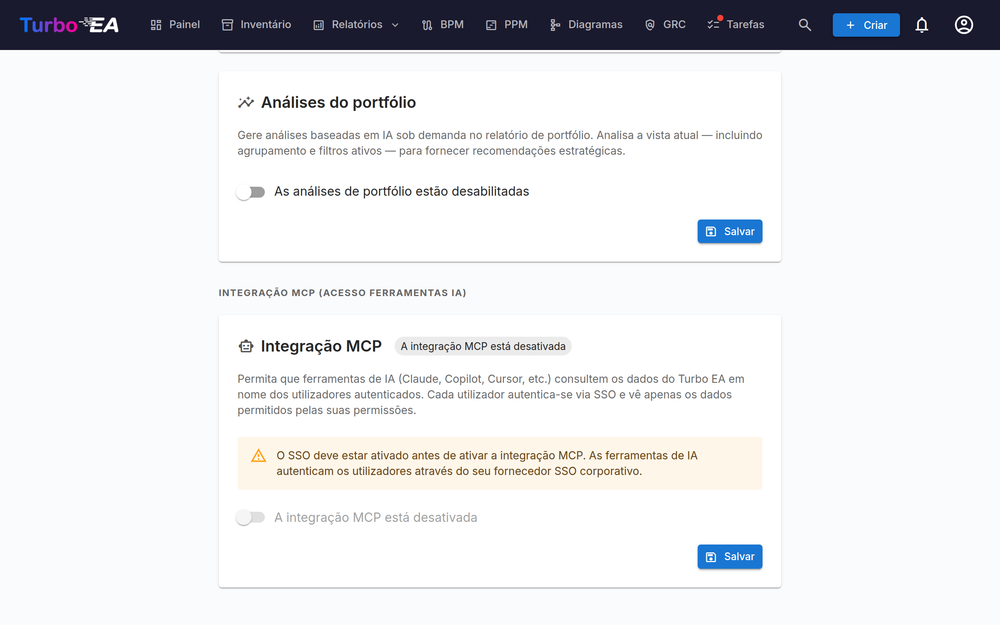

# Integração MCP (acesso para ferramentas de IA)

O Turbo EA inclui um **servidor MCP** (Model Context Protocol) integrado que permite que ferramentas de IA — como Claude Desktop, GitHub Copilot, Cursor e VS Code — consultem e atualizem seus dados de EA diretamente. As ferramentas de IA também podem carregar artefatos (planilhas, diagramas BPMN, diagramas DrawIO, documentos livres) e transformá-los em cards, relações e diagramas que se ajustam ao metamodelo existente. Os usuários se autenticam através do provedor SSO existente, e cada ação respeita suas permissões individuais.

Este recurso é **opcional** e **não inicia automaticamente**. Requer que o SSO esteja configurado, que o perfil MCP esteja ativado no Docker Compose e que um administrador o ative na interface de configurações.

---

## Como funciona

```
Ferramenta de IA (Claude, Copilot, etc.)
    │
    │  Protocolo MCP (streamable HTTP)
    ▼
Servidor MCP do Turbo EA (:8001, interno)
    │
    │  OAuth 2.1 com PKCE
    │  delega ao provedor SSO
    ▼
Backend do Turbo EA (:8000)
    │
    │  RBAC por usuário
    ▼
PostgreSQL
```

1. Um usuário adiciona a URL do servidor MCP à sua ferramenta de IA.
2. Na primeira conexão, a ferramenta abre uma janela do navegador para autenticação SSO.
3. Após o login, o servidor MCP emite seu próprio token de acesso (respaldado pelo JWT do Turbo EA do usuário).
4. A ferramenta de IA usa este token para todas as solicitações subsequentes. Os tokens se renovam automaticamente.
5. Cada consulta passa pelo sistema de permissões normal do Turbo EA — os usuários só veem os dados aos quais têm acesso.

---

## Pré-requisitos

Antes de habilitar o MCP, você deve ter:

- **SSO configurado e funcionando** — O MCP delega a autenticação ao seu provedor SSO (Microsoft Entra ID, Google Workspace, Okta ou OIDC genérico). Consulte o guia de [Autenticação e SSO](sso.md).
- **HTTPS com um domínio público** — O fluxo OAuth requer uma URI de redirecionamento estável. Implante atrás de um proxy reverso com terminação TLS (Caddy, Traefik, Cloudflare Tunnel, etc.).

---

## Configuração

### Passo 1: Iniciar o serviço MCP

O servidor MCP é um perfil opcional do Docker Compose. Adicione `--profile mcp` ao seu comando de inicialização:

```bash
docker compose --profile mcp up --build -d
```

Isso inicia um container Python leve (porta 8001, apenas interno) junto ao backend e frontend. O Nginx redireciona automaticamente as solicitações `/mcp/` para ele.

### Passo 2: Configurar variáveis de ambiente

Adicione estas ao seu arquivo `.env`:

```dotenv
TURBO_EA_PUBLIC_URL=https://seu-dominio.exemplo.com
MCP_PUBLIC_URL=https://seu-dominio.exemplo.com/mcp
```

| Variável | Padrão | Descrição |
|----------|--------|-----------|
| `TURBO_EA_PUBLIC_URL` | `http://localhost:8920` | A URL pública da sua instância Turbo EA |
| `MCP_PUBLIC_URL` | `http://localhost:8920/mcp` (docker compose) | A URL pública do servidor MCP (usada nas URIs de redirecionamento OAuth). Ao executar o container de forma independente (standalone), o padrão no código é `http://localhost:8001` |
| `MCP_PORT` | `8001` | Porta interna do container MCP (raramente precisa de alteração) |
| `SECRET_KEY` | *(nenhum)* | Defina com o valor do backend. Assina os identificadores de cliente OAuth emitidos pelo servidor MCP, para que um cliente registrado uma vez continue funcionando após uma reinicialização; sem ela, o servidor assina com uma chave que desaparece com o processo e registra um aviso. O Docker Compose, o chart Helm e os modelos de nuvem a repassam automaticamente |
| `MCP_ALLOWED_ORIGINS` | *(vazio)* | Origens adicionais, separadas por vírgulas, cujas requisições de navegador o endpoint MCP aceita. Requisições sem o cabeçalho `Origin` são sempre aceitas |
| `MCP_ALLOWED_HOSTS` | *(vazio)* | Nomes de host adicionais, separados por vírgulas, que o endpoint MCP aceita no cabeçalho `Host`, além dos hosts de `TURBO_EA_PUBLIC_URL` e `MCP_PUBLIC_URL`. Necessário apenas quando um proxy encaminha um nome de host diferente; consulte [Atrás de um proxy que altera o nome do host](#proxy-host-name) |

### Passo 3: Adicionar a URI de redirecionamento OAuth ao seu aplicativo SSO

No registro de aplicativo do seu provedor SSO (o mesmo que você configurou para o login do Turbo EA), adicione esta URI de redirecionamento:

```
https://seu-dominio.exemplo.com/mcp/oauth/callback
```

Isso é necessário para o fluxo OAuth que autentica os usuários quando se conectam a partir da ferramenta de IA.

### Passo 4: Habilitar MCP nas configurações de administração

1. Vá para **Configurações** na área de administração e selecione a aba **AI**.
2. Role até a seção **Integração MCP (Acesso a ferramentas de IA)**.
3. Ative o interruptor para **habilitar** o MCP.
4. A interface mostrará a URL do servidor MCP e instruções de configuração para compartilhar com sua equipe.



!!! warning
    O interruptor fica desabilitado se o SSO não estiver configurado. Configure o SSO primeiro.

---

## Conectar ferramentas de IA

Uma vez habilitado o MCP, compartilhe a **URL do servidor MCP** com sua equipe. Cada usuário a adiciona à sua ferramenta de IA:

### Claude Desktop

1. Abra **Configurações > Conectores > Adicionar conector personalizado**.
2. Insira a URL do servidor MCP: `https://seu-dominio.exemplo.com/mcp`
3. Clique em **Conectar** — uma janela do navegador abre para o login SSO.
4. Após a autenticação, o Claude pode consultar seus dados de EA.

### VS Code (GitHub Copilot / Cursor)

Adicione ao `.vscode/mcp.json` do seu workspace:

```json
{
  "servers": {
    "turbo-ea": {
      "type": "http",
      "url": "https://seu-dominio.exemplo.com/mcp"
    }
  }
}
```

Use `https://seu-dominio.exemplo.com/mcp` como endpoint. A antiga forma dupla `https://seu-dominio.exemplo.com/mcp/mcp` continua funcionando, de modo que os conectores existentes continuam funcionando sem alterações.

### Microsoft Copilot Studio

O Copilot Studio se conecta aos servidores MCP a partir da nuvem da Microsoft, não do computador do usuário. Por isso a instância precisa ser acessível pela internet pública via HTTPS, com um certificado de uma autoridade certificadora pública. Uma instância que só responde em uma rede interna ou VPN funciona com ferramentas de desktop e falha no Copilot Studio.

1. No seu agente, abra **Ferramentas > Adicionar uma ferramenta > Nova ferramenta > Model Context Protocol**.
2. Informe a URL do servidor `https://seu-dominio.exemplo.com/mcp`.
3. Em **Autenticação**, escolha **OAuth 2.0** e depois **Descoberta dinâmica** (Dynamic discovery).
4. Crie a conexão e entre com sua conta SSO quando solicitado.

O Copilot Studio se registra uma única vez e guarda o identificador de cliente recebido. Esse identificador carrega suas próprias URIs de redirecionamento, assinadas com a `SECRET_KEY` da instância, de modo que a conexão continua funcionando quando o container MCP é reiniciado ou atualizado. Alterar `SECRET_KEY` invalida todos os clientes registrados: recrie a ferramenta no Copilot Studio em seguida.

### Atrás de um proxy que altera o nome do host { #proxy-host-name }

O endpoint MCP protege-se contra DNS rebinding verificando o cabeçalho `Host` de cada requisição. Aceita os nomes de host de `TURBO_EA_PUBLIC_URL` e `MCP_PUBLIC_URL`, além de `localhost` e `127.0.0.1`. O contêiner MCP regista a lista completa uma vez no arranque. Qualquer outro nome de host é recusado com `421 Misdirected Request`, e o contêiner MCP regista `Invalid Host header: <name>`.

Alguns proxies encaminham um nome de host diferente do público. O Azure Front Door à frente de uma rota HTTP do Azure Container Apps, por exemplo, envia o nome próprio da rota, `<route>.<environment>.azurecontainerapps.io`. O início de sessão continua a funcionar nesse caso, mas todas as conexões MCP falham. Indique o nome encaminhado em `MCP_ALLOWED_HOSTS`:

```dotenv
MCP_ALLOWED_HOSTS=my-route.my-environment.westeurope.azurecontainerapps.io
```

As entradas são apenas nomes de host, separados por vírgulas, sem `https://` nem caminho; o contêiner regista um aviso para uma entrada que nunca poderá corresponder. A correspondência é exata, com o cabeçalho tal como o proxy o envia, em minúsculas. Adicione `:port` quando o proxy enviar uma porta, ou `:*` para aceitar qualquer porta. Curingas de subdomínio não são suportados. No Kubernetes, defina a variável através de `mcp.extraEnv` nos valores do Helm.

---

## Teste local (modo stdio)

Para desenvolvimento local ou testes sem SSO/HTTPS, você pode executar o servidor MCP em **modo stdio** — o Claude Desktop o inicia diretamente como processo local.

**1. Instalar o pacote do servidor MCP:**

```bash
pip install ./mcp-server
```

**2. Adicionar à configuração do Claude Desktop** (`claude_desktop_config.json`):

```json
{
  "mcpServers": {
    "turbo-ea": {
      "command": "python",
      "args": ["-m", "turbo_ea_mcp", "--stdio"],
      "env": {
        "TURBO_EA_URL": "http://localhost:8000",
        "TURBO_EA_EMAIL": "seu@email.com",
        "TURBO_EA_PASSWORD": "sua-senha"
      }
    }
  }
}
```

Neste modo, o servidor se autentica com email/senha e renova o token automaticamente em segundo plano.

---

## Capacidades disponíveis

O servidor MCP expõe **51 ferramentas** divididas em dois grupos: **32 ferramentas de leitura** que consultam dados de EA e **19 ferramentas de escrita** (14 aditivas, 5 destrutivas) que criam e mantêm cards, relações, diagramas, riscos, ADRs e mais — incluindo transformar artefatos que uma ferramenta de IA tem no seu próprio contexto (planilhas, BPMN XML, DrawIO XML, documentos, imagens) em dados de EA estruturados. Cada ferramenta carrega `ToolAnnotations` MCP (indicações de somente leitura / destrutiva / idempotente) para que os conectores possam sinalizar a destrutividade na sua interface.

### Segurança por execução simulada nas escritas

Cada ferramenta de escrita usa por padrão **`dry_run=true`**, e nada é persistido até que a ferramenta de IA a chame novamente com `dry_run=false` — o que só deve fazer depois que o usuário tiver visto a prévia e confirmado. Isso impede que um agente afoito introduza silenciosamente centenas de cards a partir de uma planilha interpretada de forma errada. A prévia é de um de dois tipos:

- **Verificada pelo backend.** Quando o endpoint subjacente oferece suporte a execução simulada, o backend executa cada validador e resolvedor — permissões, ids de cards, o que o usuário pode ler —, monta o resultado completo e então **reverte a transação**. Isso abrange cards (`create_cards_bulk`, `update_cards_bulk`), relações (`upsert_relations_bulk`) e diagramas (`create_diagram`, `update_diagram`). A prévia de um diagrama devolve os vínculos com cards que o backend aceitou e, numa atualização, a alteração exata: campos renomeados, vínculos com cards adicionados e removidos, e se o canvas mudou.
- **Montada pelo servidor MCP.** Quando o endpoint não tem execução simulada, a ferramenta valida e traduz a entrada e mostra o payload exato que um commit enviaria, sem chamar o endpoint de escrita: `import_bpmn` (o percurso rascunho → envio → aprovação; as contagens de nós de fluxo são uma estimativa e a prévia indica `verified: false`), `create_adr`, `update_adr`, `sign_adr`, `create_soaw`, `add_card_comment`, `transition_card_lifecycle`, `assign_stakeholders`, `create_risks`, `update_risks`, `archive_cards` (que mostra o impacto do arquivamento de cada card) e `set_card_logos` / `clear_card_logos` (que consultam o tipo e o logotipo atual de cada card e baixam cada `image_url`).

Nos dois casos, a prévia fica registrada no registro de auditoria como um lote de execução simulada, para que um administrador veja o que um agente propôs e também o que ele confirmou.

### Ferramentas de leitura

O servidor expõe 32 ferramentas de leitura agrupadas em oito clusters.

**Cards & metamodelo**

| Ferramenta | Descrição |
|------------|-----------|
| `search_cards` | Pesquisar e filtrar cards por tipo, status ou texto livre |
| `get_card` | Obter detalhes completos de um card por UUID |
| `get_card_relations` | Obter todas as relações conectadas a um card |
| `get_card_hierarchy` | Obter ancestrais e filhos de um card |
| `list_card_types` | Listar todos os tipos de card no metamodelo; o campo `category` de cada tipo é a chave da sua categoria (camada de arquitetura) |
| `get_relation_types` | Listar tipos de relação, opcionalmente filtrados por tipo de card |
| `resolve_card_refs` | Pré-validar referências a cards baseadas em nome (nome → UUID) antes de uma importação em massa — apenas resolve, nunca escreve |
| `analyze_impact` | Análise do raio de impacto das dependências para uma alteração proposta em um card |

**Painéis**

| Ferramenta | Descrição |
|------------|-----------|
| `get_dashboard` | Painel de KPIs (contagens, qualidade de dados, aprovações, atividade) |
| `get_landscape` | Cards de um tipo agrupados por um tipo relacionado |

**GRC — Registro de riscos**

| Ferramenta | Descrição |
|------------|-----------|
| `list_risks` | Lista paginada e filtrável de riscos EA (TOGAF Fase G) |
| `get_risk` | Detalhe de um risco com cards vinculados e trilha de auditoria |
| `get_risk_metrics` | KPIs + matrizes 4×4 inicial e residual |
| `get_card_risks` | Todos os riscos atualmente vinculados a um card |

**GRC — Conformidade**

| Ferramenta | Descrição |
|------------|-----------|
| `list_compliance_findings` | Achados de conformidade agrupados por regulação |
| `get_compliance_overview` | Pontuações de conformidade + matriz de status por regulação + metadados da última varredura |

**Governança & Entrega**

| Ferramenta | Descrição |
|------------|-----------|
| `list_principles` | Princípios EA publicados (declaração, justificativa, implicações) |
| `list_adrs` | Architecture Decision Records, filtráveis por iniciativa / status |
| `get_adr` | ADR único com seções, cards vinculados e trilha de assinaturas |
| `list_soaws` | Statements of Architecture Work de uma iniciativa |

**Relatórios**

| Ferramenta | Descrição |
|------------|-----------|
| `get_portfolio_report` | Dados de gráfico de bolhas para um tipo de card (padrão: ajuste funcional × técnico) |
| `get_cost_treemap` | Treemap de custos, opcionalmente agrupado por um tipo relacionado |
| `get_capability_heatmap` | Mapa de calor hierárquico das capacidades de negócio |
| `get_data_quality_report` | Distribuição de completude por tipo de card |

**Contexto do card**

| Ferramenta | Descrição |
|------------|-----------|
| `get_card_stakeholders` | Usuários + papéis atribuídos a um card |
| `get_card_comments` | Fio de comentários de um card |
| `get_card_documents` | Links de documentos anexados a um card (URLs, não arquivos) |
| `get_card_logo` | A card's logo: mime, size and a sha256 of the stored bytes, so a write can be verified without transferring the image (pass `include_image` when you do want it) |
| `list_available_icons` | Search the built-in brand-icon pack for a slug to pass to `set_card_logos` |

**Diagramas**

| Ferramenta | Descrição |
|------------|-----------|
| `list_diagrams` | Listar diagramas de desenho livre (DrawIO), opcionalmente filtrados por um card |
| `get_diagram` | Buscar um único diagrama por id, incluindo seu XML DrawIO |

**Auditoria & histórico de alterações**

| Ferramenta | Descrição |
|------------|-----------|
| `get_change_history` | Consultar o registro de lotes de mutação (por id do lote, autor, ferramenta ou origem) para reconstruir exatamente o que um commit MCP anterior alterou |

Todas as ferramentas respeitam o RBAC do usuário autenticado — um visualizador recebe simplesmente uma lista vazia (ou 403) para o que não pode ver; nenhuma configuração por ferramenta é necessária no nível MCP.

### Ferramentas de escrita

O servidor expõe 19 ferramentas de escrita, cada uma anotada como **aditiva** (cria ou estende dados) ou **destrutiva** (modifica ou remove dados existentes), para que os conectores possam alertar de acordo.

**Aditivas (14)**

| Ferramenta | Descrição |
|------------|-----------|
| `create_cards_bulk` | Cria vários cards em uma única chamada (por exemplo, linhas de planilha). Suporta referências ao pai por nome dentro do mesmo lote, com ordenação topológica no servidor. |
| `transition_card_lifecycle` | Move um card pelas fases de aprovação ou do ciclo de vida. |
| `create_risks` | Cria entradas no Registro de riscos EA. |
| `update_risks` | Atualiza entradas do Registro de riscos (campos, cards vinculados). |
| `add_card_comment` | Publica um comentário em um card — uma nota não destrutiva e revisável em vez de alterar campos. |
| `create_soaw` | Cria um Statement of Architecture Work para uma iniciativa. |
| `assign_stakeholders` | Atribui ou remove papéis de stakeholder em cards. |
| `update_cards_bulk` | Aplica patches no nível de campo em vários cards em uma única chamada. |
| `create_adr` | Cria um Architecture Decision Record. |
| `update_adr` | Atualiza um ADR (título, seções, status, cards vinculados). |
| `sign_adr` | Assina um ADR (requer a permissão `adr.sign`; caso contrário, retorna um deep-link da interface para assinar no navegador). |
| `create_diagram` | Cria um diagrama DrawIO livre com vínculos opcionais a cards existentes. |
| `import_bpmn` | Salva um diagrama BPMN 2.0 XML em um card de Processo de negócio **existente**. Se nenhum card corresponder ao nome fornecido, a ferramenta retorna um erro `card_not_found` que aponta o agente para `create_cards_bulk` — isso obriga a criação explícita do card com descrição, subtipo e atributos antes, em vez de um atalho que deixa um card pobre. |
| `set_card_logos` | Set the custom logo on many cards at once — the bulk way to put product marks on an Application inventory. Three ways to supply the image, one per row: a built-in `icon_slug` (resolved server-side, nothing transferred), an `image_url` the MCP server downloads for you from an allowlisted icon host, or `image_base64` from the agent's own context. The packs are a shortcut, not the source of truth — a dry run lists the slugs they do not carry under `unknown_icon_slugs` **and** fetches every `image_url`, so a missing brand or a dead link is reported before anything is written rather than left as a logo nobody could set. `mime` is optional and sniffed from the bytes. PNG/JPEG/WebP/GIF only, 1 MB each. Each row echoes a sha256 so the caller can prove what landed. Use `clear_card_logos` to remove one. |

**Destrutivas (5)**

| Ferramenta | Descrição |
|------------|-----------|
| `upsert_relations_bulk` | Cria ou exclui relações entre cards. Origem / destino / tipo são validados contra o metamodelo. A exclusão é recusada, a menos que o operador a habilite explicitamente (veja as salvaguardas). |
| `archive_cards` | Arquiva cards (soft-delete). Recuperável — cards arquivados podem ser restaurados por 30 dias antes da exclusão automática. |
| `update_diagram` | Substitui o XML DrawIO de um diagrama, o nome ou os vínculos a cards. |
| `rollback_batch` | Reverte as gravações realizadas em um lote de mutação anterior. |
| `clear_card_logos` | Remove the custom logo from cards, falling them back to their card-type icon. Recoverable — set it again to restore. |

### Upload de artefatos

Um subconjunto das ferramentas de escrita (`create_cards_bulk`, `upsert_relations_bulk`, `create_diagram`, `import_bpmn`) permite que um agente de IA transforme artefatos em dados EA estruturados. O agente lê o arquivo de origem no seu próprio contexto (visão multimodal, anexos), extrai linhas estruturadas e chama estas ferramentas. O próprio servidor MCP nunca faz parsing de arquivos — ele espera entrada já estruturada.

Fluxo típico quando um usuário compartilha uma planilha com o agente de IA:

1. O agente chama `list_card_types` e `get_relation_types` para entender o metamodelo.
2. O agente faz o parse da planilha (no seu próprio contexto, não no MCP) e monta dicionários de linha.
3. O agente chama `create_cards_bulk(cards=…, dry_run=True)` e mostra a prévia ao usuário.
4. O usuário confirma; o agente chama novamente com `dry_run=False` para confirmar.
5. Se houver colunas de relação, o agente chama em seguida `upsert_relations_bulk` com o mesmo ciclo execução simulada / confirmação.

### Salvaguardas das ferramentas de escrita

Defesa em profundidade além da execução simulada, para que um descuido do LLM não possa causar danos em massa:

- **Limite de tamanho por chamada.** As ferramentas de escrita MCP aplicam um limite muito menor que os endpoints subjacentes do importador Excel: 200 linhas para `create_cards_bulk`, 500 operações para `upsert_relations_bulk`. Grande o suficiente para qualquer carregamento realista de um único artefato, pequeno o suficiente para que uma prévia de execução simulada permaneça revisável.
- **Sem exclusão de relações por padrão.** `upsert_relations_bulk` recusa operações `action: "delete"` — para remover relações, use a interface web onde a ação é registrada sob a identidade do usuário. Operadores podem habilitar definindo `MCP_ALLOW_RELATION_DELETE=true`.
- **Interruptor de desligamento.** `MCP_WRITES_ENABLED=false` desliga todas as 19 ferramentas de escrita sem reimplantar código. As 32 ferramentas de leitura continuam funcionando.
- **O download de logótipos passa por uma lista de hosts permitidos.** Os pacotes de ícones incluídos não cobrem todos os produtos de um cliente, e um assistente está muitas vezes isolado sem acesso à web, por isso `set_card_logos` aceita um `image_url` que o servidor MCP vai buscar. Apenas `https`, apenas os hosts de `MCP_LOGO_FETCH_HOSTS`, apenas endereços públicos, no máximo dois redirecionamentos (cada um reverificado), no máximo 1 MB lido em streaming, e os bytes têm de trazer uma assinatura real de PNG/JPEG/WebP/GIF. O download acontece na borda MCP, nunca no backend, e a imagem é depois enviada pela via habitual: um URL escolhido por um LLM nunca chega ao processo que guarda a base de dados. `MCP_LOGO_FETCH_ENABLED=false` desliga tudo.
- **Marcador de origem para auditoria.** Cada requisição backend do servidor MCP carrega um cabeçalho `X-Turbo-EA-Origin: mcp`. Eventos emitidos dessas requisições são marcados com `origin: "mcp"` no payload do log de auditoria, de forma que administradores possam filtrar gravações dirigidas por MCP fora da linha do tempo, separadas das ações da interface web.
- **Lotes de mutação.** Cada chamada de escrita MCP — tanto a prévia quanto o commit — é um lote de mutação no registro de auditoria, aberto antes de qualquer gravação; cada evento emitido durante a chamada é marcado com o id do lote, e cada ferramenta de escrita devolve esse `batch_id`. Administradores (ou a ferramenta `get_change_history`) podem reconstruir o diff completo por evento de um commit a partir de um único id, e `rollback_batch` pode revertê-lo, inclusive excluindo um diagrama criado por `create_diagram`, a menos que alguém o tenha publicado desde então. Uma atualização de diagrama é informada como não reversível, porque o canvas anterior não é guardado. Commits acima de `MCP_BATCH_CONFIRMATION_THRESHOLD` linhas devem devolver o `confirm_token` de uso único retornado pela execução simulada anterior. O backend verifica-o ao abrir o lote do commit, antes de qualquer gravação: ele deve vir de uma execução simulada da mesma ferramenta, do mesmo usuário, há menos de 15 minutos, e autoriza um único commit. Todas as ferramentas de escrita em massa seguem este ciclo de prévia e confirmação: `create_cards_bulk`, `update_cards_bulk`, `archive_cards`, `upsert_relations_bulk`, `assign_stakeholders`, `create_risks`, `update_risks`, `set_card_logos`, `clear_card_logos`.
- **Sem exclusão definitiva.** O conjunto de ferramentas omite deliberadamente a exclusão permanente de cards. `archive_cards` e `update_cards_bulk` *estão* expostas, mas o arquivamento é um soft-delete recuperável (janela de restauração de 30 dias) e ambas são anotadas quanto à destrutividade e protegidas por execução simulada. Adicionar qualquer ferramenta que realize uma mutação irreversível (exclusão definitiva, force-purge) exigiria uma revisão de projeto explícita.

As seis variáveis de ambiente de salvaguarda no container MCP:

| Variável | Padrão | Efeito |
|----------|--------|--------|
| `MCP_WRITES_ENABLED` | `true` | Interruptor principal das ferramentas de escrita. `false` → MCP somente leitura. |
| `MCP_MAX_CARDS_PER_CALL` | `200` | Limite rígido de linhas `create_cards_bulk` / `update_cards_bulk` por requisição. |
| `MCP_MAX_RELATIONS_PER_CALL` | `500` | Limite rígido de operações `upsert_relations_bulk` por requisição. |
| `MCP_MAX_LOGOS_PER_CALL` | `50` | Hard cap on `set_card_logos` rows per request. Lower than the card cap because each logo is its own upload and carries image bytes. |
| `MCP_ALLOW_RELATION_DELETE` | `false` | Quando `true`, `upsert_relations_bulk` aceita operações `action: "delete"`. |
| `MCP_LOGO_FETCH_ENABLED` | `true` | Quando `true`, `set_card_logos` aceita um `image_url`: o servidor MCP baixa a imagem e a envia pela via habitual, de modo que todas as verificações de permissão, tamanho e formato continuam a valer. Defina `false` para recusar totalmente a via por URL — slugs de ícones e bytes colados continuam a funcionar. |
| `MCP_LOGO_FETCH_HOSTS` | *(built-in)* | Hosts de onde um logótipo pode ser baixado, separados por vírgulas e com correspondência exata. Padrão: `raw.githubusercontent.com`, `cdn.jsdelivr.net`, `cdn.simpleicons.org`, `upload.wikimedia.org` — alojamento público de ícones, onde o pedido leva um nome de ficheiro e nada sobre o seu panorama. É possível acrescentar um serviço de procura de logótipos por domínio, ao custo de lhe revelar que fornecedores utiliza. |
| `MCP_BATCH_CONFIRMATION_THRESHOLD` | `20` | Commits que tocam mais linhas do que este valor exigem o `confirm_token` de uma execução simulada anterior. O backend aplica seu próprio limite de 20 linhas qualquer que seja este valor, portanto ele só pode reduzir o limite, nunca aumentá-lo. |
| `MCP_REQUIRE_DRYRUN_FIRST` | `true` | Com `true`, o servidor MCP recusa com um erro explicativo, antes de chamar o backend, um commit acima do limite que não traga `confirm_token`. `false` desativa apenas esse erro antecipado: o backend continua exigindo o token em todo commit acima de 20 linhas. |

### Recursos

| URI | Descrição |
|-----|-----------|
| `turbo-ea://types` | Todos os tipos de card no metamodelo |
| `turbo-ea://relation-types` | Todos os tipos de relação |
| `turbo-ea://dashboard` | KPIs do painel e estatísticas resumidas |

### Prompts guiados

| Prompt | Descrição |
|--------|-----------|
| `analyze_landscape` | Análise em várias etapas: visão geral do painel, tipos, relações |
| `find_card` | Pesquisar um card por nome, obter detalhes e relações |
| `explore_dependencies` | Mapear as dependências de um card |

---

## Permissões

| Papel | Acesso |
|-------|--------|
| **Administrador** | Configurar ajustes MCP (permissão `admin.mcp`). Acesso completo de leitura + escrita através do MCP. |
| **Todos os usuários autenticados** | Acesso de leitura governado pelo seu RBAC existente. As ferramentas de escrita exigem as permissões backend correspondentes — `inventory.create` / `inventory.edit` / `inventory.archive` (cards), `relations.manage` (relações), `diagrams.manage` (diagramas), `bpm.edit` (BPMN), `risks.manage` (Registro de riscos), `comments.create` (comentários), `stakeholders.manage` (stakeholders), `soaw.create` (SoAW), `adr.create` / `adr.sign` (ADRs). |

A permissão `admin.mcp` controla quem pode gerenciar as configurações de MCP. Está disponível apenas para o papel de Administrador por padrão. Papéis personalizados podem receber esta permissão através da página de administração de Papéis.

O acesso a dados através do MCP — leitura ou escrita — segue o mesmo modelo RBAC da interface web. Se um usuário não pode criar cards na interface do inventário, também não pode criá-los via MCP; não há permissões de dados específicas do MCP.

---

## Segurança

- **Autenticação delegada por SSO**: Os usuários se autenticam através do provedor SSO corporativo. O servidor MCP nunca vê ou armazena senhas.
- **OAuth 2.1 com PKCE**: O fluxo de autenticação utiliza Proof Key for Code Exchange (S256) para prevenir a interceptação de códigos de autorização.
- **RBAC por usuário**: Cada ação MCP — leitura ou escrita — é executada com as permissões do usuário autenticado. Sem contas de serviço compartilhadas.
- **Execução simulada padrão nas escritas**: As ferramentas de escrita oferecem por padrão uma prévia validar-e-reverter. A ferramenta de IA deve chamar explicitamente novamente com `dry_run=false` antes de qualquer dado ser persistido, e cada alteração é auditada sob a identidade do usuário.
- **Todo registro informa que veio pelo MCP**: todo card, diagrama, risco, decisão, SoAW, comentário e versão de fluxo BPM que um agente cria leva `created_via: mcp` ao lado da pessoa que executou o agente, e uma edição posterior de um agente define `updated_via: mcp`. A interface web o mostra como um chip **MCP** no registro, e o filtro **Origem** do Inventário lista tudo o que um agente criou.
- **Sem parsing de arquivos no MCP**: O próprio servidor MCP não aceita PDFs, arquivos Excel, imagens ou outros artefatos binários. A ferramenta de IA chamadora os processa no seu próprio contexto e envia linhas estruturadas. Isso mantém a superfície de ataque reduzida e evita expor o servidor a entradas binárias malformadas.
- **Rotação de tokens**: Tokens de acesso expiram após 1 hora. Tokens de renovação duram 30 dias. Códigos de autorização são de uso único e expiram após 10 minutos.
- **Porta apenas interna**: O container MCP expõe a porta 8001 apenas na rede Docker interna. Todo acesso externo passa pelo proxy reverso Nginx.

---

## Solução de problemas

| Problema | Solução |
|----------|---------|
| O interruptor MCP está desabilitado nas configurações | O SSO deve ser configurado primeiro. Vá para Configurações > aba Autenticação e configure um provedor SSO. |
| «host not found» nos logs do Nginx | O serviço MCP não está em execução. Inicie-o com `docker compose --profile mcp up -d`. A configuração do Nginx lida com isso de forma elegante (resposta 502, sem queda). |
| O callback OAuth falha | Verifique se adicionou `https://seu-dominio.exemplo.com/mcp/oauth/callback` como URI de redirecionamento no registro do aplicativo SSO. |
| A ferramenta de IA não consegue conectar | Verifique se `MCP_PUBLIC_URL` corresponde à URL acessível a partir da máquina do usuário. Certifique-se de que o HTTPS está funcionando. |
| O usuário obtém resultados vazios | O MCP respeita as permissões RBAC. Se um usuário tem acesso restrito, verá apenas os cards que seu papel permite. |
| A conexão cai após 1 hora | A ferramenta de IA deveria lidar com a renovação de tokens automaticamente. Caso contrário, reconecte. |
| O Copilot Studio informa "Connection creation failed" | O Copilot Studio chama a partir da nuvem da Microsoft. Verifique se `https://seu-dominio.exemplo.com/mcp` é acessível pela internet com um certificado publicamente confiável e se `MCP_PUBLIC_URL` é esse endereço público. O log do Nginx durante uma tentativa mostra a última requisição recebida; se nenhuma chegar, a instância não está acessível. |
| Uma ferramenta do Copilot Studio parou de funcionar após a atualização para 2.175.2 | Ferramentas criadas antes da 2.175.2 têm um identificador de cliente que não sobrevivia a uma reinicialização. Exclua a ferramenta e adicione-a novamente uma vez; o novo identificador sobrevive às reinicializações seguintes. |
| As conexões MCP falham com `421 Misdirected Request` e o log do MCP mostra `Invalid Host header` | Um proxy à frente do Turbo EA encaminha um nome de host diferente do público. Adicione o nome da linha do log a `MCP_ALLOWED_HOSTS` e reinicie o contêiner MCP; consulte [Atrás de um proxy que altera o nome do host](#proxy-host-name). |
