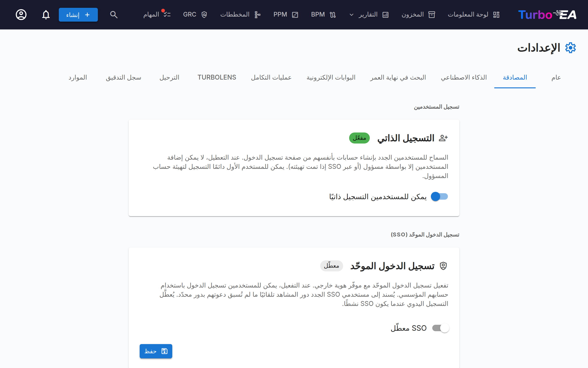

# المصادقة والدخول الموحّد



يتيح تبويب **Authentication** في الإعدادات للمسؤولين تهيئة كيفية تسجيل المستخدمين دخولهم إلى المنصة.

#### التسجيل الذاتي

- **Allow self-registration**: عند التمكين، يمكن للمستخدمين الجدد إنشاء حسابات بالنقر على «Sign Up» في صفحة تسجيل الدخول. عند التعطيل، يمكن للمسؤولين فقط إنشاء الحسابات عبر تدفّق دعوة المستخدم.

#### تهيئة الدخول الموحّد (SSO)

يتيح SSO للمستخدمين تسجيل الدخول باستخدام مزوّد الهوية المؤسسي بدلًا من كلمة مرور محلية. يدعم Turbo EA أربعة مزوّدي SSO:

| المزوّد | الوصف |
|----------|-------------|
| **Microsoft Entra ID** | للمؤسسات التي تستخدم Microsoft 365 / Azure AD |
| **Google Workspace** | للمؤسسات التي تستخدم Google Workspace |
| **Okta** | للمؤسسات التي تستخدم Okta كمنصّة هوية لديها |
| **Generic OIDC** | لأي مزوّد متوافق مع OpenID Connect (مثل Authentik، Keycloak، Auth0) |

**خطوات تهيئة SSO:**

1. انتقل إلى **Admin > Settings > Authentication**
2. بدّل **Enable SSO** إلى وضع التشغيل
3. اختر **SSO Provider** من القائمة المنسدلة
4. أدخل بيانات الاعتماد المطلوبة من مزوّد الهوية لديك:
   - **Client ID**: معرّف التطبيق/العميل من مزوّد الهوية لديك
   - **Client Secret**: سرّ التطبيق (يُخزَّن مشفّرًا في قاعدة البيانات)
   - حقول خاصة بالمزوّد:
     - **Microsoft**: Tenant ID (مثل `your-tenant-id` أو `common` لتعدّد المستأجرين)
     - **Google**: Hosted Domain (اختياري، يقيّد تسجيل الدخول بنطاق Google Workspace محدّد)
     - **Okta**: Okta Domain (مثل `your-org.okta.com`)
     - **Generic OIDC**: Issuer URL (مثل `https://auth.example.com/application/o/my-app/`). بالنسبة إلى Generic OIDC، يحاول النظام الاكتشاف التلقائي عبر نقطة الطرف `.well-known/openid-configuration`
5. انقر **Save**

**نقاط طرف OIDC اليدوية (متقدّم):**

إذا تعذّر على الواجهة الخلفية الوصول إلى مستند اكتشاف مزوّد الهوية لديك (مثلًا بسبب شبكة Docker أو الشهادات الموقّعة ذاتيًا)، فيمكنك تحديد نقاط طرف OIDC يدويًا:

- **Authorization Endpoint**: عنوان URL الذي يُعاد توجيه المستخدمين إليه للمصادقة
- **Token Endpoint**: عنوان URL المستخدم لمبادلة رمز التفويض بالرموز
- **JWKS URI**: عنوان URL لمجموعة مفاتيح الويب JSON المستخدمة للتحقّق من توقيعات الرموز

هذه الحقول اختيارية. إذا تُرِكت فارغة، يستخدم النظام الاكتشاف التلقائي. وعند ملئها، تتجاوز القيم المُكتشَفة تلقائيًا.

**اختبار SSO:**

بعد الحفظ، افتح تبويب متصفّح جديدًا (أو نافذة خفيّة) وتحقّق من ظهور زر تسجيل الدخول عبر SSO في صفحة تسجيل الدخول وأن المصادقة تعمل من البداية إلى النهاية.

**ملاحظات مهمّة:**
- يُخزَّن **Client Secret** مشفّرًا في قاعدة البيانات ولا يُكشَف أبدًا في استجابات API
- عند تمكين SSO، يبقى تسجيل الدخول بكلمة مرور محلية متاحًا كخيار احتياطي
- يمكنك تهيئة عنوان URI لإعادة التوجيه في مزوّد الهوية لديك على النحو التالي: `https://your-turbo-ea-domain/auth/callback`

**تعيين الأدوار:**

افتراضيًا يصل كل مستخدم SSO جديد بالدور الافتراضي (أو بدور دعوته)، ويغيّره المسؤول يدويًا من **الإدارة ← المستخدمون**. إذا كان موفّر الهوية لديك يعرف مسبقًا من يجب أن يكون مسؤولًا أو عضوًا أو مشاهدًا — عبر عضوية المجموعات أو أدوار التطبيق — فيمكن لـ Turbo EA قراءة ذلك من رمز ID وإسناد الدور بنفسه عند كل تسجيل دخول. تقع كتلة **تعيين الأدوار** في قسم SSO أسفل حقول الموفّر، وتُحفظ بزر **Save** نفسه:

- **اسم المطالبة**: مطالبة (claim) رمز ID التي تسرد مجموعات المستخدم أو أدواره، مثل `roles` (أدوار تطبيق Microsoft Entra) أو `groups` (Okta وKeycloak) أو `cognito:groups` (Amazon Cognito). اتركها فارغة، أو اترك التعيين بلا صفوف، فتبقى الأدوار يدوية بالكامل.
- **صفوف التعيين**: يقرن كل صف **قيمة دليل** (قيمة مجموعة أو دور تطبيق كما تحملها المطالبة) بدور في Turbo EA. استخدم الأسهم لترتيب الصفوف؛ ويفوز أول صف مطابق.
- **نطاقات إضافية**: نطاقات (scopes) مفصولة بمسافات تُطلب عند تسجيل الدخول إضافةً إلى `openid email profile` — مثل `groups` لـ Okta. ويطلب تسجيل دخول خادم MCP النطاقات نفسها.

القواعد، وقد اختيرت جميعها بحيث لا يتمكن خطأ في الإعداد من حجبك:

- **يُطبَّق التعيين عند كل تسجيل دخول**، لا عند إنشاء الحساب فقط. وهو يحل محل دور عُدِّل يدويًا، لذا فإن إزالة شخص من مجموعة في الدليل تسري عند تسجيل دخوله التالي.
- **يفوز أول صف مطابق**، بحسب ترتيب الصفوف لا بحسب الترتيب الذي يسرد به موفّر الهوية القيم. وتتجاهل المطابقة حالة الأحرف.
- **قيمة المطالبة التي لا تطابق أي صف** تمنح الدور الافتراضي.
- **الرمز الذي لا يحمل المطالبة، أو يحملها فارغة،** يترك دور المستخدم الحالي دون تغيير. وبذلك لا يمكن لاسم مطالبة مكتوب خطأً، أو لموفّر توقف عن إرسال المطالبة، أن يخفّض جميع المستخدمين دفعة واحدة.
- **الصف الذي دوره غير موجود أو مؤرشف** يمنح الدور الافتراضي. وتضع صفحة الإعدادات علامة على هذا الصف لتتمكن من اختيار دور نشط.
- **لا يُخفَّض آخر مسؤول نشط أبدًا.** فإذا كان التعيين سيسحب دور المسؤول من المسؤول النشط الوحيد، فإنه يحتفظ به، ويسجّل سجل الأمان والإدارة أن الدور أُبقي.
- **ما دام التعيين مضبوطًا، يكون دور مستخدمي SSO مقفلًا في الإدارة ← المستخدمون** (منتقي الدور معطّل مع تلميح؛ ويتخطى تغيير الأدوار الجماعي هذه الحسابات ويترك استيراد Excel أدوارها كما هي، وكلاهما يذكر ذلك). غيّر الدور في الدليل بدلًا من ذلك، أو حوّل الحساب إلى تسجيل دخول محلي لإدارته يدويًا. ولا تتأثر الحسابات المحلية أبدًا.

ملاحظات لكل موفّر هوية:

| الموفّر | ما يجب إعداده |
|---------|----------------|
| **Microsoft Entra ID** | فضّل **أدوار التطبيق**: أعلنها في تسجيل التطبيق، وأسند إليها مستخدمين أو مجموعات، واستخدم المطالبة `roles`. يتطلب تعيين الأدوار **معرّف مستأجر محددًا**: فمع `organizations` أو `common` أو `consumers` يمكن لأي مستأجر Microsoft تسجيل الدخول، ولا يمكن حفظ التعيين. تحمل المطالبة `groups` معرّفات كائنات المجموعات لا أسماءها، وتحذفها Entra من الرمز كليًا لمستخدم ينتمي إلى أكثر من 200 مجموعة. |
| **Okta** | أضف مطالبة مجموعات إلى رمز ID في خادم التفويض (أو في إعدادات تسجيل دخول التطبيق) وأضف `groups` ضمن **نطاقات إضافية**. استخدم اسم المطالبة الذي منحته لها، وهو عادةً `groups`. |
| **Keycloak** (Generic OIDC) | أضف إلى العميل مُعيِّنًا من نوع **Group Membership** باسم مطالبة الرمز `groups` مع تفعيل **Add to ID token**، ليصل `groups` على المستوى الأعلى إلى رمز ID (أوقف **Full group path** للحصول على أسماء مجموعات بسيطة). لا تُقرأ المطالبات المتداخلة مثل `realm_access.roles`. |
| **Amazon Cognito** (Generic OIDC) | استخدم المطالبة `cognito:groups`. |
| **Google Workspace** | غير متاح: لا تحمل رموز ID من Google مطالبة مجموعات، لذا تُخفى الكتلة مع Google. |

!!! warning "حدود يجب وضعها في الاعتبار"
    - **عيّن أدوار التطبيق أو معرّفات المجموعات، لا أسماء العرض التي يمكن للمستخدمين إنشاؤها بأنفسهم.** فإذا استطاع أي شخص إنشاء مجموعة باسم `ea-admins`، أمكن لأي شخص أن يصبح مسؤولًا.
    - **يجب أن تكون المطالبة موجودة في رمز ID.** يقرأ Turbo EA رمز ID فقط — لا نقطة userinfo ولا واجهة برمجية للدليل. يحتاج بعض موفّري الهوية إلى النطاق ضمن **نطاقات إضافية** وإلى إعداد المطالبة معًا حتى تظهر المجموعات في رمز ID؛ سجّل الدخول مرة وتحقق من النتيجة قبل الاعتماد عليها.
    - **يسري التغيير في الدليل عند تسجيل دخول المستخدم التالي**، لا أثناء جلسة مفتوحة بالفعل.
    - **يُستبدل دور الدعوة عند أول تسجيل دخول** إذا كان التعيين يمنح دورًا.
    - **المستخدم الذي لا يحمل رمزه المطالبة أبدًا يحتفظ بدوره الحالي**، وما دام التعيين مضبوطًا لا يستطيع أحد تغييره من الإدارة ← المستخدمون. أصلح المطالبة في موفّر الهوية، أو حوّل الحساب إلى تسجيل دخول محلي.
    - **المطالبة الفارغة تُعدّ غائبة**: فإزالة شخص من كل المجموعات المعيَّنة لا تخفّض دوره. أزل بدلًا من ذلك وصوله إلى التطبيق في موفّر الهوية.

#### المصادقة عبر الوكيل العكسي

إذا كان Turbo EA يعمل خلف وكيل يتولّى بالفعل تسجيل دخول مستخدميك — المصادقة المدمجة في Azure App Service («EasyAuth»)، أو oauth2-proxy، أو Authelia، أو Cloudflare Access — فيمكنه قبول تلك الهوية مباشرةً بدلًا من تشغيل SSO خاص به فوقها. لا حاجة إلى عميل OIDC، ولا تسجيل تطبيق، ولا سرّ عميل. يصل المستخدمون إلى Turbo EA وهم مسجّلو الدخول بالفعل.

تُهيَّأ هذه الميزة بالكامل عبر متغيّرات البيئة وهي **معطّلة افتراضيًا**.

**قبل أي شيء آخر، عيّن مسؤول التمهيد (bootstrap).** يُغلق التسجيل الذاتي أثناء تفعيل المصادقة عبر الوكيل، لذا هذه هي الطريقة التي يدخل بها أول مسؤول — يُمنح هذا البريد الإلكتروني دور المسؤول عند أول تسجيل دخول:

```
TURBO_EA_PROXY_AUTH_BOOTSTRAP_ADMIN_EMAIL=you@yourcompany.com
```

**Azure App Service (EasyAuth) — الإعداد الموصى به.** يتحقّق Turbo EA من رمز الهوية الموقّع الذي يمرّره Azure مع كل طلب (يتطلّب ذلك مخزن الرموز في App Service، وهو مفعّل افتراضيًا). `AUDIENCE` هو معرّف العميل لتسجيل تطبيق EasyAuth لديك؛ استبدل `TENANT` بمعرّف الدليل (المستأجر) لديك:

```
TURBO_EA_PROXY_AUTH_ENABLED=true
TURBO_EA_PROXY_AUTH_TRUST_PLATFORM_HEADERS=true
TURBO_EA_PROXY_AUTH_VERIFY_ID_TOKEN=true
TURBO_EA_PROXY_AUTH_ISSUER=https://login.microsoftonline.com/TENANT/v2.0
TURBO_EA_PROXY_AUTH_AUDIENCE=your-easyauth-app-client-id
TURBO_EA_PROXY_AUTH_JWKS_URI=https://login.microsoftonline.com/TENANT/discovery/v2.0/keys
TURBO_EA_PROXY_AUTH_ALLOWED_DOMAINS=yourcompany.com
TURBO_EA_PROXY_AUTH_LOGOUT_URL=/.auth/logout
```

!!! warning "`TRUST_PLATFORM_HEADERS` مطلوب على App Service"
    لا يستطيع App Service حقن ترويسة سرّية مخصّصة، ولذا يحلّ
    `TURBO_EA_PROXY_AUTH_TRUST_PLATFORM_HEADERS=true` محل
    `TURBO_EA_PROXY_AUTH_SHARED_SECRET` — وهو إقرار صريح بأنكم تعتمدون على قيام
    Azure بإزالة ترويسات الهوية الواردة قبل وصولها إلى تطبيقكم. ويجري هذا الفحص
    **قبل** تحليل رمز الهوية أصلًا، ومن ثمّ فإن التحقق من الرمز لا يغني عنه. وإذا
    غاب هذا الإعداد والسرّ المشترك معًا، فشل كل تسجيل دخول برسالة *Proxy
    authentication is enabled but not secured*، حتى مع
    `VERIFY_ID_TOKEN=true`.

إذا كان مخزن الرموز لديكم معطّلًا، فاضبطوا إضافةً إلى ذلك `TURBO_EA_PROXY_AUTH_VERIFY_ID_TOKEN=false` واعتمدوا على تنقية الترويسات وحدها. وبدون رمز متحقَّق منه **لا تُنشأ حسابات جديدة تلقائيًا** — ادعُوا المستخدمين أولًا، أو استخدموا بريد مسؤول التمهيد.

**وكيل عام (oauth2-proxy، Authelia، Traefik forwardAuth، …).** هيّئ الوكيل بحيث يحقن ترويسة سرّ مشترك في كل طلب، بحيث لا يمكن أبدًا الخلط بين طلب لم يمرّ عبر الوكيل وطلب مرّ عبره. ولّد القيمة باستخدام `openssl rand -hex 32`:

```
TURBO_EA_PROXY_AUTH_ENABLED=true
TURBO_EA_PROXY_AUTH_MODE=header
TURBO_EA_PROXY_AUTH_SHARED_SECRET=<generated value, also set on the proxy>
TURBO_EA_PROXY_AUTH_EMAIL_HEADER=X-Forwarded-Email
TURBO_EA_PROXY_AUTH_ALLOWED_DOMAINS=yourcompany.com
TURBO_EA_PROXY_AUTH_LOGOUT_URL=/oauth2/sign_out
```

**ملاحظات أمنية:**

- السرّ المشترك (أو، على Azure، رمز الهوية المتحقَّق منه) هو ما يجعل الهوية جديرة بالثقة — فالترويسة وحدها يمكن لأي شخص كتابتها. قائمة النطاقات المسموح بها إلزامية؛ لا تضبط `TURBO_EA_PROXY_AUTH_ALLOW_ANY_DOMAIN=true` إلا إذا كنت تقبل فعلًا أي نطاق بريد إلكتروني.
- الهوية التي لم يجرِ التحقّق منها تشفيريًا يمكنها تسجيل دخول المستخدمين الحاليين لكنها لا تُنشئ حسابًا جديدًا أبدًا، والدعوات المعلّقة لا تمنح دورها عبر هذا المسار.
- `TURBO_EA_PROXY_AUTH_LOGOUT_URL` هو المكان الذي يرسل إليه Turbo EA المتصفّح بعد **تسجيل الخروج** حتى تنتهي جلسة الوكيل أيضًا. بدونه يظل الوكيل يعتبر المستخدم مسجّل الدخول — فيعود إلى صفحة تسجيل الدخول ويمكنه الدخول مجددًا بنقرة واحدة.

**حجم ترويسات الطلب.** يضيف وكيل تسجيل الدخول ملفات تعريف الارتباط وترويسات الرموز إلى كل طلب. تحمل أطول طلبات Turbo EA في عنوان URL قائمة من معرّفات البطاقات — سطر طلب أقل بقليل من 8 كيلوبايت — لذا يجب أن تقبل كل محطة بين المتصفح وTurbo EA سطر طلب بحجم 8 كيلوبايت مع هذه الترويسات. يفعل ذلك nginx الطرفي المرفق (16 كيلوبايت لكل سطر ترويسة منذ الإصدار 2.217.1). وإذا كنت تشغّل أيضًا nginx أو ingress-nginx خاصًا بك في المقدمة فامنحه المساحة نفسها: `large_client_header_buffers 4 16k;` أو `large-client-header-buffers: "4 16k"` في ConfigMap الخاصة بـ ingress-nginx. وأي محطة أصغر من اللازم ترد بـ `400 Request Header Or Cookie Too Large` أو `414` على تصديرات المخزون والمخططات الكبيرة بينما يعمل كل شيء آخر.

**تعيين الأدوار (اختياري).** افتراضيًا يصل الجميع إلى الدور الافتراضي المُهيّأ ثم يرقّيهم المسؤول من هناك. وإذا كان مزوّد الهوية لديكم يعرف الإجابة أصلًا — تسجيل تطبيق Entra يعلن أدوار تطبيقه الخاصة، أو oauth2-proxy يمرّر عضوية المجموعات — فبإمكان Turbo EA قراءتها وإسناد الدور بنفسه:

```
TURBO_EA_PROXY_AUTH_ROLE_CLAIM=roles
TURBO_EA_PROXY_AUTH_ROLE_MAP=ADMIN:admin,MANAGER:member,READ-ONLY:viewer
```

كل زوج يُكتب `قيمة_الدليل:مفتاح-دور-turbo-ea`. وعندما يحمل المستخدم عدة أدوار من الدليل، **يفوز أول مدخل في التعيين** — ترتيب التعيين، لا الترتيب الذي أرسلها به المزوّد، لأن صيغتَي هوية Azure لا تتفقان عليه. وتتجاهل المطابقة حالة الأحرف في جانب الدليل. وفي وضع الوكيل العام يقرأ التعيين نفسه ترويسة مفصولة بفواصل بدلًا من مطالبة: `TURBO_EA_PROXY_AUTH_ROLE_HEADER=X-Forwarded-Groups`.

!!! warning "التعيين هو المرجع عند كل تسجيل دخول"
    وليس عند إنشاء الحساب فقط — فسحب دور أحدهم من الدليل يجب أن يسري فعلًا. لذلك ما دام التعيين ساريًا، يكون دور الحساب الذي يسجّل الدخول عبر الوكيل **مقفلًا في الإدارة ← المستخدمون**: منتقي الدور معطّل مع تلميح، ويتخطى تغيير الأدوار الجماعي الحساب ويترك استيراد Excel دوره كما هو، بدلًا من ترك تغيير يدوي يُستبدل بصمت عند تسجيل الدخول التالي. اترك `TURBO_EA_PROXY_AUTH_ROLE_MAP` غير مضبوط ولن يتغير شيء: تبقى الأدوار يدوية بالكامل.

الحالات الحدّية، وقد اختيرت جميعها كي لا يحبسك خطأ في التهيئة خارج نظامك:

- **`TURBO_EA_PROXY_AUTH_BOOTSTRAP_ADMIN_EMAIL` يفوز دائمًا** على التعيين. فإن اختلفا، فذلك العنوان هو المسؤول.
- **القيمة التي لا تطابق شيئًا في التعيين** — أو تشير إلى دور في Turbo EA غير موجود أو مؤرشف — تعود إلى الدور الافتراضي.
- **لا يُخفَّض آخر مسؤول نشط أبدًا.** فإذا كان التعيين سيسحب دور المسؤول من المسؤول النشط الوحيد، فإنه يحتفظ به، ويسجّل سجل الأمان والإدارة أن الدور أُبقي.
- **المطالبة الغائبة تمامًا** تترك دور المستخدم الحالي كما هو. وهذا مختلف عن الحالة السابقة عن قصد: فخطأ إملائي في `ROLE_CLAIM`، أو مخزن رموز توقف عن التمرير، كان سيخفّض رتبة كل مستخدمي المثيل دفعة واحدة.
- **يجب أن تكون الهوية جديرة بأن تُؤتمن على الصلاحيات.** يسري تعيين الأدوار عندما يكون رمز الهوية قد جرى التحقق منه (`TURBO_EA_PROXY_AUTH_VERIFY_ID_TOKEN=true`) أو عندما يكون هناك سر مشترك مُهيّأ. أما على App Service مع تعطيل مخزن الرموز ودون سر، فيُتجاهل التعيين ويُكتب في السجل سطر يوضح ذلك — وهو المنطق نفسه الذي يمنع ترويسة لم يجرِ التحقق منها من إنشاء حساب.

**جميع المتغيّرات:**

| المتغيّر | الافتراضي | الغرض |
|----------|---------|---------|
| `TURBO_EA_PROXY_AUTH_ENABLED` | `false` | المفتاح الرئيسي |
| `TURBO_EA_PROXY_AUTH_MODE` | `azure_easyauth` | `azure_easyauth` أو `header` |
| `TURBO_EA_PROXY_AUTH_SHARED_SECRET` | — | مطلوب في وضع `header`؛ يحقنه الوكيل |
| `TURBO_EA_PROXY_AUTH_SECRET_HEADER` | `X-Turbo-EA-Proxy-Secret` | الترويسة الحاملة للسرّ المشترك |
| `TURBO_EA_PROXY_AUTH_VERIFY_ID_TOKEN` | `false` | التحقّق من رمز الهوية المُمرَّر (وضع Azure) |
| `TURBO_EA_PROXY_AUTH_ISSUER` / `_AUDIENCE` / `_JWKS_URI` | — | إعدادات التحقّق من الرمز |
| `TURBO_EA_PROXY_AUTH_TRUST_PLATFORM_HEADERS` | `false` | لـ Azure فقط: الاعتماد على تنقية المنصّة للترويسات بدلًا من سرّ، ومطلوب على App Service |
| `TURBO_EA_PROXY_AUTH_EMAIL_HEADER` | `X-Forwarded-Email` | وضع `header`: ترويسة البريد الإلكتروني |
| `TURBO_EA_PROXY_AUTH_NAME_HEADER` | `X-Forwarded-User` | وضع `header`: ترويسة الاسم المعروض |
| `TURBO_EA_PROXY_AUTH_SUBJECT_HEADER` | `X-Forwarded-Subject` | وضع `header`: ترويسة معرّف الكيان الثابت |
| `TURBO_EA_PROXY_AUTH_ALLOWED_DOMAINS` | — | نطاقات البريد الإلكتروني المسموح بها مفصولة بفواصل (إلزامي) |
| `TURBO_EA_PROXY_AUTH_ALLOW_ANY_DOMAIN` | `false` | قبول أي نطاق بريد إلكتروني صراحةً |
| `TURBO_EA_PROXY_AUTH_BOOTSTRAP_ADMIN_EMAIL` | — | يُمنح دور المسؤول عند أول تسجيل دخول |
| `TURBO_EA_PROXY_AUTH_ROLE_MAP` | — | `قيمة_الدليل:مفتاح-الدور،…` — الفراغ يعني أن الأدوار تبقى يدوية |
| `TURBO_EA_PROXY_AUTH_ROLE_CLAIM` | `roles` | المطالبة التي تحمل دور الدليل (وضع Azure) |
| `TURBO_EA_PROXY_AUTH_ROLE_HEADER` | `X-Forwarded-Groups` | وضع `header`: ترويسة أدوار مفصولة بفواصل |
| `TURBO_EA_PROXY_AUTH_LOGOUT_URL` | — | الوجهة التي يُرسَل إليها المتصفّح عند تسجيل الخروج |

**القيود:** يتطلّب تدفّق OAuth الخاص بخادم MCP تهيئة SSO العادي؛ المصادقة عبر الوكيل وحدها لا تغطّيه.
