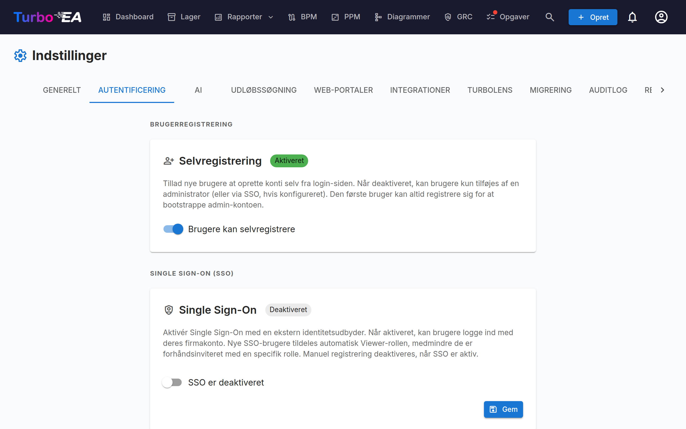

# Godkendelse og SSO



Fanen **Godkendelse** i Indstillinger giver administratorer mulighed for at konfigurere, hvordan brugere logger på platformen.

#### Selvregistrering

- **Tillad selvregistrering**: Når aktiveret, kan nye brugere oprette konti ved at klikke på "Tilmeld dig" på loginsiden. Når deaktiveret, kan kun administratorer oprette konti via Inviter bruger-flowet.

#### SSO (Single Sign-On)-konfiguration

SSO giver brugere mulighed for at logge på ved hjælp af deres virksomheds identitetsudbyder i stedet for en lokal adgangskode. Turbo EA understøtter fire SSO-udbydere:

| Udbyder | Beskrivelse |
|---------|-------------|
| **Microsoft Entra ID** | For organisationer, der bruger Microsoft 365 / Azure AD |
| **Google Workspace** | For organisationer, der bruger Google Workspace |
| **Okta** | For organisationer, der bruger Okta som deres identitetsplatform |
| **Generic OIDC** | For enhver OpenID Connect-kompatibel udbyder (f.eks. Authentik, Keycloak, Auth0) |

**Trin for at konfigurere SSO:**

1. Gå til **Admin > Indstillinger > Godkendelse**
2. Slå **Aktivér SSO** til
3. Vælg din **SSO-udbyder** fra dropdownen
4. Indtast de påkrævede legitimationsoplysninger fra din identitetsudbyder:
   - **Klient-ID**: Applikations-/klient-ID'et fra din identitetsudbyder
   - **Klienthemmelighed**: Applikationshemmeligheden (gemt krypteret i databasen)
   - Udbyder-specifikke felter:
     - **Microsoft**: Tenant-ID (f.eks. `your-tenant-id` eller `common` for multi-tenant)
     - **Google**: Hosted Domain (valgfri, begrænser login til et specifikt Google Workspace-domæne)
     - **Okta**: Okta-domæne (f.eks. `your-org.okta.com`)
     - **Generic OIDC**: Issuer-URL (f.eks. `https://auth.example.com/application/o/my-app/`). For Generic OIDC forsøger systemet auto-discovery via `.well-known/openid-configuration`-endpointet
5. Klik på **Gem**

**Manuelle OIDC-endpoints (avanceret):**

Hvis backenden ikke kan nå din identitetsudbyders discovery-dokument (f.eks. på grund af Docker-netværk eller selvsignerede certifikater), kan du manuelt specificere OIDC-endpointsne:

- **Authorization Endpoint**: URL'en, hvor brugere omdirigeres til at godkende
- **Token Endpoint**: URL'en, der bruges til at udveksle autorisationskoden for tokens
- **JWKS URI**: URL'en for JSON Web Key Set, der bruges til at verificere tokensignaturer

Disse felter er valgfrie. Hvis de efterlades tomme, bruger systemet auto-discovery. Når de er udfyldt, tilsidesætter de de auto-discovered værdier.

**Test af SSO:**

Efter at have gemt, åbn en ny browser-fane (eller inkognito-vindue), og verificér, at SSO-loginknappen vises på loginsiden, og at godkendelse fungerer end-to-end.

**Vigtige bemærkninger:**
- **Klienthemmeligheden** gemmes krypteret i databasen og eksponeres aldrig i API-responser
- Når SSO er aktiveret, forbliver lokalt adgangskodelogin tilgængeligt som fallback
- Du kan konfigurere redirect-URI'en i din identitetsudbyder som: `https://your-turbo-ea-domain/auth/callback`

**Rolletilknytning:**

Som standard ankommer hver ny SSO-bruger med standardrollen (eller rollen fra sin invitation), og en administrator ændrer den manuelt under **Administration → Brugere**. Hvis din identitetsudbyder allerede ved, hvem der skal være administrator, medlem eller læser — via gruppemedlemskab eller app-roller — kan Turbo EA læse det fra ID-tokenet og selv tildele rollen ved hvert login. Blokken **Rolletilknytning** ligger i SSO-sektionen under udbyderfelterne og gemmes med den samme knap **Gem**:

- **Claim-navn**: ID-token-claimet, der angiver brugerens grupper eller roller, for eksempel `roles` (Microsoft Entra-app-roller), `groups` (Okta, Keycloak) eller `cognito:groups` (Amazon Cognito). Lader du det stå tomt, eller lader du tilknytningen være uden rækker, forbliver roller helt manuelle.
- **Tilknytningsrækker**: hver række parrer en **katalogværdi** (en gruppe- eller app-rolleværdi, som claimet bærer den) med en Turbo EA-rolle. Brug pilene til at ordne rækkerne; den første matchende række vinder.
- **Ekstra scopes**: scopes adskilt af mellemrum, der anmodes om ved login ud over `openid email profile` — for eksempel `groups` for Okta. MCP-serverens login anmoder om de samme scopes.

Reglerne, alle valgt, så en konfigurationsfejl ikke kan låse dig ude:

- **Tilknytningen anvendes ved hvert login**, ikke kun når kontoen oprettes. Den overskriver en manuelt ændret rolle, så fjernelse af nogen fra en kataloggruppe træder i kraft ved deres næste login.
- **Den første matchende række vinder**, i rækkefølgen af rækkerne, ikke i den rækkefølge, identitetsudbyderen angiver værdierne i. Sammenligningen ignorerer store og små bogstaver.
- **En claim-værdi, der ikke matcher nogen række**, giver standardrollen.
- **Et token uden claimet, eller med et tomt claim**, lader brugerens nuværende rolle være uændret. Et forkert stavet claim-navn, eller en udbyder, der er holdt op med at sende claimet, kan derfor ikke nedgradere alle brugere på én gang.
- **En række, hvis rolle ikke findes eller er arkiveret**, giver standardrollen. Indstillingssiden markerer sådan en række, så du kan vælge en aktiv rolle.
- **Den sidste aktive administrator nedgraderes aldrig.** Hvis tilknytningen ville fratage den eneste aktive administrator administratorrollen, beholder vedkommende den, og loggen Sikkerhed og administration registrerer, at rollen blev bevaret.
- **Så længe en tilknytning er sat, er SSO-brugeres rolle låst under Administration → Brugere** (rollevælgeren er deaktiveret med et hint; en masseændring af rolle springer disse konti over, og en Excel-import lader deres rolle stå, og begge giver besked om det). Ændr i stedet rollen i kataloget, eller skift kontoen til lokalt login for at styre den manuelt. Lokale konti påvirkes aldrig.

Noter pr. identitetsudbyder:

| Udbyder | Hvad der skal konfigureres |
|---------|----------------------------|
| **Microsoft Entra ID** | Foretræk **app-roller**: deklarer dem i appregistreringen, tildel brugere eller grupper til dem, og brug claimet `roles`. Rolletilknytning kræver et **specifikt tenant-id**: med `organizations`, `common` eller `consumers` kan enhver Microsoft-tenant logge ind, og en tilknytning kan ikke gemmes. Claimet `groups` indeholder gruppernes objekt-id'er, ikke navne, og Entra udelader det helt fra tokenet for en bruger i mere end 200 grupper. |
| **Okta** | Tilføj et groups-claim til ID-tokenet i autorisationsserveren (eller i appens login-indstillinger), og tilføj `groups` under **Ekstra scopes**. Brug det claim-navn, du har givet det, normalt `groups`. |
| **Keycloak** (Generic OIDC) | Tilføj en **Group Membership**-mapper til klienten med token-claim-navnet `groups` og **Add to ID token** slået til, så et `groups`-claim på øverste niveau når ID-tokenet (slå **Full group path** fra for at få rene gruppenavne). Indlejrede claims som `realm_access.roles` læses ikke. |
| **Amazon Cognito** (Generic OIDC) | Brug claimet `cognito:groups`. |
| **Google Workspace** | Ikke tilgængelig: Googles ID-tokens indeholder intet groups-claim, så blokken er skjult for Google. |

!!! warning "Begrænsninger at holde øje med"
    - **Tilknyt app-roller eller gruppe-id'er, ikke visningsnavne, som brugerne selv kan oprette.** Hvis enhver kan oprette en gruppe kaldet `ea-admins`, kan enhver blive administrator.
    - **Claimet skal være til stede i ID-tokenet.** Turbo EA læser kun ID-tokenet — ikke userinfo-endpointet eller en katalog-API. Nogle identitetsudbydere kræver både scopet under **Ekstra scopes** og en claim-konfiguration, før grupperne dukker op i ID-tokenet; log ind én gang, og kontroller resultatet, før du stoler på det.
    - **En ændring i kataloget træder i kraft ved brugerens næste login**, ikke i en session, der allerede er åben.
    - **En invitations rolle overskrives ved det første login**, når tilknytningen tildeler en.
    - **En bruger, hvis token aldrig bærer claimet, beholder sin nuværende rolle**, og så længe en tilknytning er sat, kan ingen ændre den under Administration → Brugere. Ret claimet hos identitetsudbyderen, eller skift kontoen til lokalt login.
    - **Et tomt claim tæller som fraværende**: at fjerne nogen fra alle tilknyttede grupper nedgraderer dem ikke. Fjern i stedet deres adgang til applikationen hos identitetsudbyderen.

#### Godkendelse via reverse proxy

Hvis Turbo EA kører bag en proxy, der allerede logger dine brugere på — Azure App Services indbyggede godkendelse ("EasyAuth"), oauth2-proxy, Authelia, Cloudflare Access — kan den acceptere den identitet direkte i stedet for at køre sin egen SSO ovenpå. Ingen OIDC-klient, ingen app-registrering, ingen klienthemmelighed. Brugerne lander i Turbo EA allerede logget på.

Denne funktion konfigureres udelukkende via miljøvariabler og er **slået fra som standard**.

**Før alt andet skal du angive bootstrap-administratoren.** Selvregistrering er lukket, mens proxy-godkendelse er slået til, så det er sådan, den første administrator kommer ind — den e-mailadresse tildeles admin-rollen ved første login:

```
TURBO_EA_PROXY_AUTH_BOOTSTRAP_ADMIN_EMAIL=you@yourcompany.com
```

**Azure App Service (EasyAuth) — anbefalet opsætning.** Turbo EA verificerer det signerede identitetstoken, som Azure videresender med hver forespørgsel (dette kræver App Services token store, som er slået til som standard). `AUDIENCE` er client ID'et for din EasyAuth-app-registrering; erstat `TENANT` med dit directory-ID (tenant-ID):

```
TURBO_EA_PROXY_AUTH_ENABLED=true
TURBO_EA_PROXY_AUTH_TRUST_PLATFORM_HEADERS=true
TURBO_EA_PROXY_AUTH_VERIFY_ID_TOKEN=true
TURBO_EA_PROXY_AUTH_ISSUER=https://login.microsoftonline.com/TENANT/v2.0
TURBO_EA_PROXY_AUTH_AUDIENCE=your-easyauth-app-client-id
TURBO_EA_PROXY_AUTH_JWKS_URI=https://login.microsoftonline.com/TENANT/discovery/v2.0/keys
TURBO_EA_PROXY_AUTH_ALLOWED_DOMAINS=yourcompany.com
TURBO_EA_PROXY_AUTH_LOGOUT_URL=/.auth/logout
```

!!! warning "`TRUST_PLATFORM_HEADERS` er påkrævet på App Service"
    App Service kan ikke indsætte en egen hemmelig header, så
    `TURBO_EA_PROXY_AUTH_TRUST_PLATFORM_HEADERS=true` træder i stedet for
    `TURBO_EA_PROXY_AUTH_SHARED_SECRET` — det er en udtrykkelig anerkendelse af,
    at I forlader jer på, at Azure fjerner indgående identitetsheadere, før de
    når jeres app. Kontrollen sker **før** identitetstokenet overhovedet
    fortolkes, så tokenverifikation træder ikke i stedet for den. Mangler både
    denne indstilling og en delt hemmelighed, fejler hvert eneste login med
    *Proxy authentication is enabled but not secured* — også med
    `VERIFY_ID_TOKEN=true`.

Hvis dit token store er deaktiveret, skal du desuden sætte `TURBO_EA_PROXY_AUTH_VERIFY_ID_TOKEN=false` og forlade dig alene på header-saneringen. Uden et verificeret token **oprettes nye konti ikke automatisk** — invitér brugerne først, eller brug bootstrap-administratorens e-mail.

**Generisk proxy (oauth2-proxy, Authelia, Traefik forwardAuth, …).** Konfigurér proxyen til at injicere en header med en delt hemmelighed på hver forespørgsel, så en forespørgsel, der ikke kom gennem proxyen, aldrig kan forveksles med en, der gjorde. Generér værdien med `openssl rand -hex 32`:

```
TURBO_EA_PROXY_AUTH_ENABLED=true
TURBO_EA_PROXY_AUTH_MODE=header
TURBO_EA_PROXY_AUTH_SHARED_SECRET=<genereret værdi, sættes også på proxyen>
TURBO_EA_PROXY_AUTH_EMAIL_HEADER=X-Forwarded-Email
TURBO_EA_PROXY_AUTH_ALLOWED_DOMAINS=yourcompany.com
TURBO_EA_PROXY_AUTH_LOGOUT_URL=/oauth2/sign_out
```

**Sikkerhedsbemærkninger:**

- Den delte hemmelighed (eller, på Azure, det verificerede identitetstoken) er det, der gør identiteten troværdig — en header alene kan skrives af hvem som helst. Domæne-allowlisten er påkrævet; sæt kun `TURBO_EA_PROXY_AUTH_ALLOW_ANY_DOMAIN=true`, hvis du reelt accepterer ethvert e-maildomæne.
- En identitet, der ikke er kryptografisk verificeret, kan logge eksisterende brugere på, men opretter aldrig en ny konto, og afventende invitationer tildeler ikke deres rolle ad denne vej.
- `TURBO_EA_PROXY_AUTH_LOGOUT_URL` er der, hvor Turbo EA sender browseren hen efter **Log ud**, så proxy-sessionen også afsluttes. Uden den betragter proxyen stadig brugeren som logget på — de lander tilbage på loginsiden og kan komme ind igen med ét klik.

**Størrelse på anmodningens headere.** En login-proxy tilføjer cookies og token-headere til hver anmodning. Turbo EA's længste anmodninger bærer en liste af kort-id'er i URL'en — en anmodningslinje på knap 8 KB — så hvert led mellem browseren og Turbo EA skal acceptere en anmodningslinje på 8 KB sammen med disse headere. Den medfølgende edge-nginx gør det (16 KB pr. header-linje siden 2.217.1). Kører du desuden din egen nginx eller ingress-nginx foran, så giv den samme plads: `large_client_header_buffers 4 16k;` eller `large-client-header-buffers: "4 16k"` i ingress-nginx' ConfigMap. Et led, der er for småt, svarer `400 Request Header Or Cookie Too Large` eller `414` på eksporter fra Inventar og store diagrammer, mens alt andet virker.

**Rollekortlægning (valgfrit).** Som standard lander alle på den konfigurerede standardrolle, og en administrator forfremmer derfra. Hvis jeres identitetsudbyder allerede kender svaret — en Entra-appregistrering, der erklærer sine egne approller, eller en oauth2-proxy, der videresender gruppemedlemskab — kan Turbo EA læse det og tildele rollen selv:

```
TURBO_EA_PROXY_AUTH_ROLE_CLAIM=roles
TURBO_EA_PROXY_AUTH_ROLE_MAP=ADMIN:admin,MANAGER:member,READ-ONLY:viewer
```

Hvert par skrives `KATALOGVÆRDI:turbo-ea-rollenøgle`. Når en bruger har flere katalogroller, **vinder den første post i kortlægningen** — kortlægningens rækkefølge, ikke den rækkefølge udbyderen tilfældigvis sendte dem i, for de to Azure-identitetsformater er ikke enige om den. Matchningen skelner ikke mellem store og små bogstaver på katalogsiden. I generisk proxytilstand læser den samme kortlægning en kommasepareret header i stedet for et claim: `TURBO_EA_PROXY_AUTH_ROLE_HEADER=X-Forwarded-Groups`.

!!! warning "Kortlægningen er afgørende ved hvert log ind"
    Ikke kun ved oprettelsen af kontoen — det skal have effekt at fjerne nogens katalogrolle. Så længe tilknytningen er i kraft, er rollen på en konto, der logger ind via proxyen, derfor **låst under Administration → Brugere**: rollevælgeren er deaktiveret med et hint, en masseændring af rolle springer kontoen over, og en Excel-import lader dens rolle stå, i stedet for at lade en manuel ændring blive stille og roligt erstattet ved næste login. Lad `TURBO_EA_PROXY_AUTH_ROLE_MAP` være tom, og intet ændrer sig: roller forbliver helt manuelle.

Grænsetilfældene, alle valgt så en konfigurationsfejl ikke kan lukke jer ude:

- **`TURBO_EA_PROXY_AUTH_BOOTSTRAP_ADMIN_EMAIL` vinder altid** over kortlægningen. Hvis de to er uenige, er den adresse administrator.
- **En værdi, der ikke matcher noget i kortlægningen** — eller som peger på en Turbo EA-rolle, der ikke findes eller er arkiveret — falder tilbage til standardrollen.
- **Den sidste aktive administrator nedgraderes aldrig.** Hvis tilknytningen ville fratage den eneste aktive administrator administratorrollen, beholder vedkommende den, og loggen Sikkerhed og administration registrerer, at rollen blev bevaret.
- **Et claim, der mangler helt**, lader brugerens nuværende rolle være urørt. Det er bevidst forskelligt fra tilfældet ovenfor: et fejlskrevet `ROLE_CLAIM` eller et token-lager, der holder op med at videresende, ville ellers degradere alle brugere på instansen på én gang.
- **Identiteten skal være værd at betro rettigheder.** Rollekortlægning gælder, når identitetstokenet er blevet verificeret (`TURBO_EA_PROXY_AUTH_VERIFY_ID_TOKEN=true`), eller der er konfigureret en delt hemmelighed. På App Service med token-lageret slået fra og uden hemmelighed ignoreres kortlægningen, og der skrives en linje i loggen om det — samme ræsonnement som forhindrer en uverificeret header i at oprette en konto.

**Alle variabler:**

| Variabel | Standard | Formål |
|----------|---------|---------|
| `TURBO_EA_PROXY_AUTH_ENABLED` | `false` | Hovedafbryder |
| `TURBO_EA_PROXY_AUTH_MODE` | `azure_easyauth` | `azure_easyauth` eller `header` |
| `TURBO_EA_PROXY_AUTH_SHARED_SECRET` | — | Påkrævet i `header`-tilstand; proxyen injicerer den |
| `TURBO_EA_PROXY_AUTH_SECRET_HEADER` | `X-Turbo-EA-Proxy-Secret` | Header, der bærer den delte hemmelighed |
| `TURBO_EA_PROXY_AUTH_VERIFY_ID_TOKEN` | `false` | Verificér det videresendte identitetstoken (Azure-tilstand) |
| `TURBO_EA_PROXY_AUTH_ISSUER` / `_AUDIENCE` / `_JWKS_URI` | — | Indstillinger for tokenverifikation |
| `TURBO_EA_PROXY_AUTH_TRUST_PLATFORM_HEADERS` | `false` | Kun Azure: stol på platformens header-sanering i stedet for en hemmelighed. Påkrævet på App Service |
| `TURBO_EA_PROXY_AUTH_EMAIL_HEADER` | `X-Forwarded-Email` | `header`-tilstand: e-mail-header |
| `TURBO_EA_PROXY_AUTH_NAME_HEADER` | `X-Forwarded-User` | `header`-tilstand: header med visningsnavn |
| `TURBO_EA_PROXY_AUTH_SUBJECT_HEADER` | `X-Forwarded-Subject` | `header`-tilstand: header med stabilt subjekt-id |
| `TURBO_EA_PROXY_AUTH_ALLOWED_DOMAINS` | — | Kommaseparerede tilladte e-maildomæner (påkrævet) |
| `TURBO_EA_PROXY_AUTH_ALLOW_ANY_DOMAIN` | `false` | Acceptér eksplicit ethvert e-maildomæne |
| `TURBO_EA_PROXY_AUTH_BOOTSTRAP_ADMIN_EMAIL` | — | Tildeles admin-rollen ved første login |
| `TURBO_EA_PROXY_AUTH_ROLE_MAP` | — | `KATALOGVÆRDI:rollenøgle,…` — tom betyder, at roller forbliver manuelle |
| `TURBO_EA_PROXY_AUTH_ROLE_CLAIM` | `roles` | Claim, der bærer katalogrollen (Azure-tilstand) |
| `TURBO_EA_PROXY_AUTH_ROLE_HEADER` | `X-Forwarded-Groups` | `header`-tilstand: kommasepareret rolle-header |
| `TURBO_EA_PROXY_AUTH_LOGOUT_URL` | — | Hvor Log ud sender browseren hen |

**Begrænsninger:** MCP-serverens OAuth-flow kræver, at almindelig SSO er konfigureret; proxy-godkendelse alene dækker det ikke.
