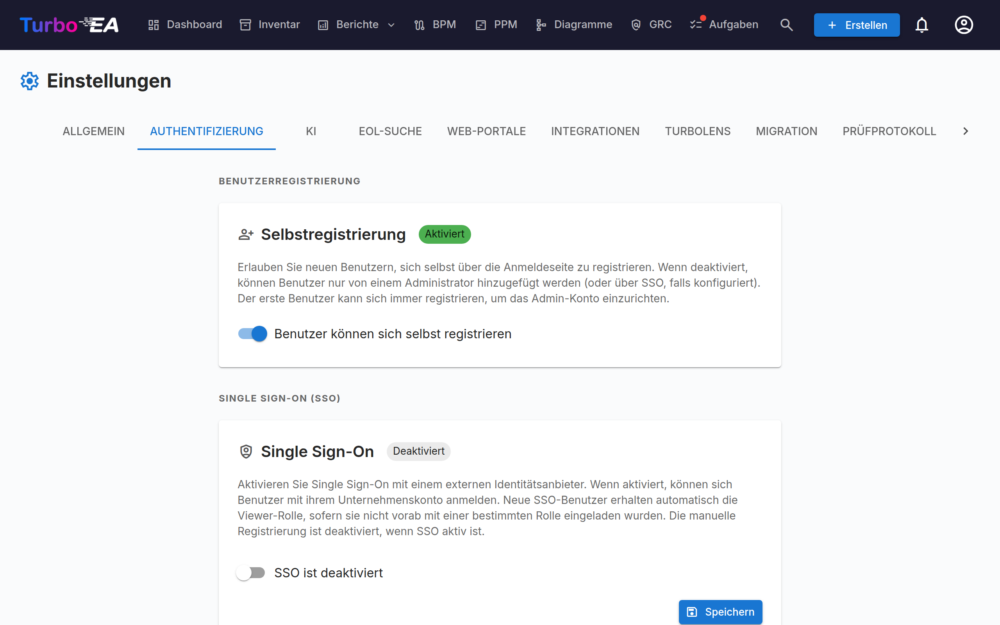

# Authentifizierung & SSO



Der Tab **Authentifizierung** in den Einstellungen ermöglicht Administratoren die Konfiguration der Benutzeranmeldung an der Plattform.

#### Selbstregistrierung

- **Selbstregistrierung erlauben**: Wenn aktiviert, können neue Benutzer Konten erstellen, indem sie auf der Anmeldeseite auf «Registrieren» klicken. Wenn deaktiviert, können nur Administratoren Konten über den Einladungsablauf erstellen.

#### SSO (Single Sign-On) Konfiguration

SSO ermöglicht es Benutzern, sich mit ihrem Unternehmens-Identitätsanbieter statt mit einem lokalen Passwort anzumelden. Turbo EA unterstützt vier SSO-Anbieter:

| Anbieter | Beschreibung |
|----------|-------------|
| **Microsoft Entra ID** | Für Organisationen, die Microsoft 365 / Azure AD nutzen |
| **Google Workspace** | Für Organisationen, die Google Workspace nutzen |
| **Okta** | Für Organisationen, die Okta als Identitätsplattform nutzen |
| **Generisches OIDC** | Für jeden OpenID-Connect-kompatiblen Anbieter (z.B. Authentik, Keycloak, Auth0) |

**Schritte zur SSO-Konfiguration:**

1. Gehen Sie zu **Admin > Einstellungen > Authentifizierung**
2. Schalten Sie **SSO aktivieren** ein
3. Wählen Sie Ihren **SSO-Anbieter** aus dem Dropdown
4. Geben Sie die erforderlichen Anmeldedaten Ihres Identitätsanbieters ein:
   - **Client-ID**: Die Anwendungs-/Client-ID von Ihrem Identitätsanbieter
   - **Client-Secret**: Das Anwendungsgeheimnis (verschlüsselt in der Datenbank gespeichert)
   - Anbieterspezifische Felder:
     - **Microsoft**: Mandanten-ID (z.B. `ihre-mandanten-id` oder `common` für Multi-Mandanten)
     - **Google**: Gehostete Domain (optional, beschränkt die Anmeldung auf eine bestimmte Google-Workspace-Domain)
     - **Okta**: Okta-Domain (z.B. `ihre-org.okta.com`)
     - **Generisches OIDC**: Aussteller-URL (z.B. `https://auth.example.com/application/o/my-app/`). Für generisches OIDC versucht das System eine automatische Erkennung über den `.well-known/openid-configuration`-Endpunkt
5. Klicken Sie auf **Speichern**

**Manuelle OIDC-Endpunkte (Fortgeschritten):**

Wenn das Backend das Discovery-Dokument Ihres Identitätsanbieters nicht erreichen kann (z.B. aufgrund von Docker-Netzwerkkonfiguration oder selbstsignierten Zertifikaten), können Sie die OIDC-Endpunkte manuell angeben:

- **Autorisierungsendpunkt**: Die URL, zu der Benutzer zur Authentifizierung weitergeleitet werden
- **Token-Endpunkt**: Die URL, die zum Austausch des Autorisierungscodes gegen Tokens verwendet wird
- **JWKS-URI**: Die URL für den JSON Web Key Set zur Überprüfung von Token-Signaturen

Diese Felder sind optional. Wenn sie leer gelassen werden, verwendet das System die automatische Erkennung. Wenn sie ausgefüllt sind, überschreiben sie die automatisch erkannten Werte.

**SSO testen:**

Öffnen Sie nach dem Speichern einen neuen Browser-Tab (oder ein Inkognito-Fenster) und überprüfen Sie, dass die SSO-Anmeldeschaltfläche auf der Anmeldeseite erscheint und die Authentifizierung durchgängig funktioniert.

**Wichtige Hinweise:**
- Das **Client-Secret** wird verschlüsselt in der Datenbank gespeichert und nie in API-Antworten offengelegt
- Wenn SSO aktiviert ist, bleibt die lokale Passwortanmeldung als Fallback verfügbar
- Sie können die Redirect-URI in Ihrem Identitätsanbieter konfigurieren als: `https://ihre-turbo-ea-domain/auth/callback`

**Rollenzuordnung:**

Standardmäßig erhält jeder neue SSO-Benutzer die Standardrolle (oder die Rolle seiner Einladung), und ein Administrator ändert sie von Hand unter **Administration → Benutzer**. Weiß Ihr Identitätsanbieter bereits, wer Administrator, Mitglied oder Betrachter sein soll — über Gruppenmitgliedschaft oder App-Rollen —, kann Turbo EA das aus dem ID-Token lesen und die Rolle bei jeder Anmeldung selbst vergeben. Der Block **Rollenzuordnung** befindet sich im SSO-Bereich unterhalb der Anbieterfelder und wird mit derselben Schaltfläche **Speichern** gespeichert:

- **Claim-Name**: der ID-Token-Claim, der die Gruppen oder Rollen des Benutzers auflistet, zum Beispiel `roles` (Microsoft-Entra-App-Rollen), `groups` (Okta, Keycloak) oder `cognito:groups` (Amazon Cognito). Lassen Sie ihn leer oder die Zuordnung ohne Zeilen, bleiben die Rollen vollständig manuell.
- **Zuordnungszeilen**: Jede Zeile verbindet einen **Verzeichniswert** (ein Gruppen- oder App-Rollenwert, wie ihn der Claim trägt) mit einer Turbo-EA-Rolle. Ordnen Sie die Zeilen mit den Pfeilen; die erste passende Zeile gewinnt.
- **Zusätzliche Scopes**: durch Leerzeichen getrennte Scopes, die bei der Anmeldung zusätzlich zu `openid email profile` angefordert werden — zum Beispiel `groups` für Okta. Die Anmeldung des MCP-Servers fordert dieselben Scopes an.

Die Regeln, alle so gewählt, dass ein Konfigurationsfehler Sie nicht aussperren kann:

- **Die Zuordnung wird bei jeder Anmeldung angewendet**, nicht nur bei der Kontoerstellung. Sie überschreibt eine von Hand geänderte Rolle, sodass das Entfernen aus einer Verzeichnisgruppe bei der nächsten Anmeldung wirksam wird.
- **Die erste passende Zeile gewinnt**, in der Reihenfolge der Zeilen, nicht in der Reihenfolge, in der der Identitätsanbieter die Werte auflistet. Beim Abgleich wird die Groß- und Kleinschreibung ignoriert.
- **Ein Claim-Wert, der zu keiner Zeile passt**, ergibt die Standardrolle.
- **Ein Token ohne den Claim oder mit leerem Claim** lässt die aktuelle Rolle des Benutzers unverändert. Ein falsch geschriebener Claim-Name oder ein Anbieter, der den Claim nicht mehr sendet, kann daher nicht alle Benutzer auf einmal herabstufen.
- **Eine Zeile, deren Rolle nicht existiert oder archiviert wurde**, ergibt die Standardrolle. Die Einstellungsseite markiert eine solche Zeile, damit Sie eine aktive Rolle wählen können.
- **Der letzte aktive Administrator wird nie herabgestuft.** Würde die Zuordnung dem einzigen aktiven Administrator die Administratorrolle nehmen, behält er sie, und das Protokoll Sicherheit & Administration hält fest, dass die Rolle beibehalten wurde.
- **Solange eine Zuordnung gesetzt ist, ist die Rolle von SSO-Benutzern unter Administration → Benutzer gesperrt** (die Rollenauswahl ist deaktiviert und zeigt einen Hinweis; eine Massenänderung der Rolle überspringt diese Konten und ein Excel-Import belässt ihre Rolle unverändert, beides mit entsprechender Meldung). Ändern Sie die Rolle stattdessen im Verzeichnis oder stellen Sie das Konto auf lokale Anmeldung um, um es von Hand zu verwalten. Lokale Konten sind nie betroffen.

Hinweise je Identitätsanbieter:

| Anbieter | Was zu konfigurieren ist |
|----------|-------------------------|
| **Microsoft Entra ID** | Bevorzugen Sie **App-Rollen**: Deklarieren Sie sie in der App-Registrierung, weisen Sie ihnen Benutzer oder Gruppen zu und verwenden Sie den Claim `roles`. Die Rollenzuordnung erfordert eine **konkrete Mandanten-ID**: Bei `organizations`, `common` oder `consumers` kann sich jeder Microsoft-Mandant anmelden, und eine Zuordnung kann nicht gespeichert werden. Der Claim `groups` enthält Objekt-IDs von Gruppen, keine Namen, und Entra lässt ihn bei einem Benutzer in mehr als 200 Gruppen ganz aus dem Token weg. |
| **Okta** | Fügen Sie im Autorisierungsserver (oder in den Anmeldeeinstellungen der App) dem ID-Token einen Groups-Claim hinzu und tragen Sie `groups` unter **Zusätzliche Scopes** ein. Verwenden Sie den Claim-Namen, den Sie vergeben haben, meist `groups`. |
| **Keycloak** (Generic OIDC) | Fügen Sie dem Client einen **Group-Membership**-Mapper hinzu, mit dem Token-Claim-Namen `groups` und aktiviertem **Add to ID token**, damit ein `groups`-Claim auf oberster Ebene im ID-Token ankommt (deaktivieren Sie **Full group path**, um reine Gruppennamen zu erhalten). Verschachtelte Claims wie `realm_access.roles` werden nicht gelesen. |
| **Amazon Cognito** (Generic OIDC) | Verwenden Sie den Claim `cognito:groups`. |
| **Google Workspace** | Nicht verfügbar: Google-ID-Tokens enthalten keinen Groups-Claim, daher wird der Block für Google ausgeblendet. |

!!! warning "Zu beachtende Grenzen"
    - **Ordnen Sie App-Rollen oder Gruppen-IDs zu, keine Anzeigenamen, die Benutzer selbst erstellen können.** Kann jeder eine Gruppe namens `ea-admins` anlegen, kann jeder Administrator werden.
    - **Der Claim muss im ID-Token enthalten sein.** Turbo EA liest nur das ID-Token — nicht den Userinfo-Endpunkt oder eine Verzeichnis-API. Manche Identitätsanbieter benötigen sowohl den Scope unter **Zusätzliche Scopes** als auch eine Claim-Konfiguration, damit die Gruppen im ID-Token erscheinen; melden Sie sich einmal an und prüfen Sie das Ergebnis, bevor Sie sich darauf verlassen.
    - **Eine Änderung im Verzeichnis wirkt bei der nächsten Anmeldung des Benutzers**, nicht in einer bereits geöffneten Sitzung.
    - **Die Rolle einer Einladung wird bei der ersten Anmeldung überschrieben**, wenn die Zuordnung eine Rolle vergibt.
    - **Ein Benutzer, dessen Token den Claim nie enthält, behält seine aktuelle Rolle**, und solange eine Zuordnung gesetzt ist, kann niemand sie unter Administration → Benutzer ändern. Korrigieren Sie den Claim im Identitätsanbieter oder stellen Sie das Konto auf lokale Anmeldung um.
    - **Ein leerer Claim gilt als nicht vorhanden**: Wer aus allen zugeordneten Gruppen entfernt wird, wird nicht herabgestuft. Entziehen Sie ihm stattdessen im Identitätsanbieter den Zugriff auf die Anwendung.

#### Reverse-Proxy-Authentifizierung

Wenn Turbo EA hinter einem Proxy läuft, der Ihre Benutzer bereits anmeldet — die integrierte Authentifizierung von Azure App Service («EasyAuth»), oauth2-proxy, Authelia, Cloudflare Access — kann es diese Identität direkt übernehmen, statt darüber ein eigenes SSO zu betreiben. Kein OIDC-Client, keine App-Registrierung, kein Client-Secret. Benutzer landen bereits angemeldet in Turbo EA.

Diese Funktion wird ausschließlich über Umgebungsvariablen konfiguriert und ist **standardmäßig deaktiviert**.

**Legen Sie zuallererst den Bootstrap-Administrator fest.** Die Selbstregistrierung ist geschlossen, solange die Proxy-Authentifizierung aktiv ist — auf diesem Weg gelangt also der erste Administrator hinein: Diese E-Mail-Adresse erhält bei der ersten Anmeldung die Admin-Rolle:

```
TURBO_EA_PROXY_AUTH_BOOTSTRAP_ADMIN_EMAIL=sie@ihrunternehmen.com
```

**Azure App Service (EasyAuth) — empfohlene Einrichtung.** Turbo EA überprüft das signierte Identitätstoken, das Azure mit jeder Anfrage weiterleitet (dies erfordert den App-Service-Token-Store, der standardmäßig aktiviert ist). `AUDIENCE` ist die Client-ID Ihrer EasyAuth-App-Registrierung; ersetzen Sie `TENANT` durch Ihre Verzeichnis-ID (Mandanten-ID):

```
TURBO_EA_PROXY_AUTH_ENABLED=true
TURBO_EA_PROXY_AUTH_TRUST_PLATFORM_HEADERS=true
TURBO_EA_PROXY_AUTH_VERIFY_ID_TOKEN=true
TURBO_EA_PROXY_AUTH_ISSUER=https://login.microsoftonline.com/TENANT/v2.0
TURBO_EA_PROXY_AUTH_AUDIENCE=your-easyauth-app-client-id
TURBO_EA_PROXY_AUTH_JWKS_URI=https://login.microsoftonline.com/TENANT/discovery/v2.0/keys
TURBO_EA_PROXY_AUTH_ALLOWED_DOMAINS=ihrunternehmen.com
TURBO_EA_PROXY_AUTH_LOGOUT_URL=/.auth/logout
```

!!! warning "`TRUST_PLATFORM_HEADERS` ist auf App Service erforderlich"
    App Service kann keinen eigenen Geheimnis-Header einfügen, daher tritt
    `TURBO_EA_PROXY_AUTH_TRUST_PLATFORM_HEADERS=true` an die Stelle von
    `TURBO_EA_PROXY_AUTH_SHARED_SECRET` — es ist eine ausdrückliche Bestätigung,
    dass Sie sich darauf verlassen, dass Azure eingehende Identitäts-Header
    entfernt, bevor sie Ihre Anwendung erreichen. Die Prüfung erfolgt **bevor**
    das Identitäts-Token überhaupt gelesen wird, die Token-Verifizierung ersetzt
    sie also nicht. Fehlen sowohl diese Einstellung als auch ein gemeinsames
    Geheimnis, schlägt jede Anmeldung mit *Proxy authentication is enabled but
    not secured* fehl — auch bei `VERIFY_ID_TOKEN=true`.

Wenn Ihr Token-Store deaktiviert ist, setzen Sie zusätzlich `TURBO_EA_PROXY_AUTH_VERIFY_ID_TOKEN=false` und verlassen sich allein auf die Header-Bereinigung. Ohne ein verifiziertes Token **werden neue Konten nicht automatisch erstellt** — laden Sie Benutzer zuerst ein oder verwenden Sie die Bootstrap-Admin-E-Mail.

**Generischer Proxy (oauth2-proxy, Authelia, Traefik forwardAuth, …).** Konfigurieren Sie den Proxy so, dass er bei jeder Anfrage einen Header mit einem gemeinsamen Geheimnis einfügt, damit eine Anfrage, die nicht über den Proxy kam, niemals mit einer verwechselt werden kann, die es tat. Generieren Sie den Wert mit `openssl rand -hex 32`:

```
TURBO_EA_PROXY_AUTH_ENABLED=true
TURBO_EA_PROXY_AUTH_MODE=header
TURBO_EA_PROXY_AUTH_SHARED_SECRET=<generierter Wert, auch auf dem Proxy gesetzt>
TURBO_EA_PROXY_AUTH_EMAIL_HEADER=X-Forwarded-Email
TURBO_EA_PROXY_AUTH_ALLOWED_DOMAINS=ihrunternehmen.com
TURBO_EA_PROXY_AUTH_LOGOUT_URL=/oauth2/sign_out
```

**Sicherheitshinweise:**

- Das gemeinsame Geheimnis (bzw. auf Azure das verifizierte Identitätstoken) ist es, was die Identität vertrauenswürdig macht — ein Header für sich allein kann von jedem geschrieben werden. Die Domain-Allowlist ist erforderlich; setzen Sie `TURBO_EA_PROXY_AUTH_ALLOW_ANY_DOMAIN=true` nur, wenn Sie wirklich jede E-Mail-Domain akzeptieren.
- Eine Identität, die nicht kryptografisch verifiziert wurde, kann bestehende Benutzer anmelden, erstellt aber niemals ein neues Konto, und ausstehende Einladungen übertragen auf diesem Weg nicht ihre Rolle.
- `TURBO_EA_PROXY_AUTH_LOGOUT_URL` ist die Adresse, an die Turbo EA den Browser nach **Abmelden** weiterleitet, damit auch die Proxy-Sitzung beendet wird. Ohne sie betrachtet der Proxy den Benutzer weiterhin als angemeldet — er landet wieder auf der Anmeldeseite und kann sich mit einem Klick erneut anmelden.

**Größe der Anfrage-Header.** Ein Anmelde-Proxy fügt jeder Anfrage Cookies und Token-Header hinzu. Die längsten Anfragen von Turbo EA tragen eine Liste von Karten-IDs in der URL — eine Anfragezeile von knapp 8 KB —, daher muss jede Station zwischen Browser und Turbo EA eine 8-KB-Anfragezeile zusammen mit diesen Headern akzeptieren. Der mitgelieferte Edge-nginx tut das (seit 2.217.1 16 KB pro Header-Zeile). Betreiben Sie zusätzlich einen eigenen nginx oder ingress-nginx davor, geben Sie diesem denselben Spielraum: `large_client_header_buffers 4 16k;` bzw. `large-client-header-buffers: "4 16k"` in der ConfigMap von ingress-nginx. Ist eine Station zu klein, antwortet sie bei Inventar-Exporten und großen Diagrammen mit `400 Request Header Or Cookie Too Large` oder `414`, während alles andere funktioniert.

**Rollenzuordnung (optional).** Standardmäßig landen alle auf der konfigurierten Standardrolle und ein Administrator befördert sie von dort aus. Wenn Ihr Identitätsanbieter die Antwort bereits kennt — eine Entra-App-Registrierung, die eigene App-Rollen deklariert, oder ein oauth2-proxy, der die Gruppenzugehörigkeit weiterleitet — kann Turbo EA sie auslesen und die Rolle selbst vergeben:

```
TURBO_EA_PROXY_AUTH_ROLE_CLAIM=roles
TURBO_EA_PROXY_AUTH_ROLE_MAP=ADMIN:admin,MANAGER:member,READ-ONLY:viewer
```

Jedes Paar hat die Form `VERZEICHNISWERT:turbo-ea-rollenschlüssel`. Hält ein Benutzer mehrere Verzeichnisrollen, **gewinnt der erste Eintrag der Zuordnung** — die Reihenfolge in der Zuordnung, nicht die Reihenfolge, in der der Anbieter sie zufällig gesendet hat, denn die beiden Azure-Identitätsformate sind sich darüber nicht einig. Bei der Zuordnung wird die Groß- und Kleinschreibung auf Verzeichnisseite ignoriert. Im generischen Proxy-Modus liest dieselbe Zuordnung einen kommagetrennten Header statt eines Claims: `TURBO_EA_PROXY_AUTH_ROLE_HEADER=X-Forwarded-Groups`.

!!! warning "Die Zuordnung ist bei jeder Anmeldung maßgeblich"
    Nicht nur bei der Kontoerstellung — das Entziehen einer Verzeichnisrolle muss wirksam werden. Solange die Zuordnung gilt, ist die Rolle eines Kontos, das sich über den Proxy anmeldet, daher **unter Administration → Benutzer gesperrt**: Die Rollenauswahl ist mit einem Hinweis deaktiviert, eine Massenänderung der Rolle überspringt das Konto und ein Excel-Import belässt seine Rolle unverändert, statt eine von Hand vorgenommene Änderung bei der nächsten Anmeldung stillschweigend zu ersetzen. Lassen Sie `TURBO_EA_PROXY_AUTH_ROLE_MAP` leer, ändert sich nichts: Rollen bleiben vollständig manuell.

Die Sonderfälle, alle so gewählt, dass ein Konfigurationsfehler Sie nicht aussperren kann:

- **`TURBO_EA_PROXY_AUTH_BOOTSTRAP_ADMIN_EMAIL` gewinnt immer** gegenüber der Zuordnung. Widersprechen sich beide, ist diese Adresse Administrator.
- **Ein Wert, der zu keinem Eintrag der Zuordnung passt** — oder auf eine Turbo-EA-Rolle verweist, die nicht existiert oder archiviert wurde — fällt auf die Standardrolle zurück.
- **Der letzte aktive Administrator wird nie herabgestuft.** Würde die Zuordnung dem einzigen aktiven Administrator die Administratorrolle nehmen, behält er sie, und das Protokoll Sicherheit & Administration hält fest, dass die Rolle beibehalten wurde.
- **Ein vollständig fehlender Claim** lässt die aktuelle Rolle des Benutzers unangetastet. Das unterscheidet sich bewusst vom Fall oben: ein falsch geschriebener `ROLE_CLAIM` oder ein Token-Speicher, der nichts mehr weiterleitet, würde sonst in einem einzigen Durchgang alle Benutzer der Instanz herabstufen.
- **Die Identität muss der Vergabe von Berechtigungen würdig sein.** Die Rollenzuordnung greift, wenn das Identitätstoken verifiziert wurde (`TURBO_EA_PROXY_AUTH_VERIFY_ID_TOKEN=true`) oder ein gemeinsames Geheimnis konfiguriert ist. Auf App Service mit deaktiviertem Token-Speicher und ohne Geheimnis wird die Zuordnung ignoriert und eine entsprechende Zeile ins Protokoll geschrieben — dieselbe Begründung, die einen unverifizierten Header daran hindert, ein Konto anzulegen.

**Alle Variablen:**

| Variable | Standard | Zweck |
|----------|---------|---------|
| `TURBO_EA_PROXY_AUTH_ENABLED` | `false` | Hauptschalter |
| `TURBO_EA_PROXY_AUTH_MODE` | `azure_easyauth` | `azure_easyauth` oder `header` |
| `TURBO_EA_PROXY_AUTH_SHARED_SECRET` | — | Erforderlich im `header`-Modus; der Proxy fügt es ein |
| `TURBO_EA_PROXY_AUTH_SECRET_HEADER` | `X-Turbo-EA-Proxy-Secret` | Header, der das gemeinsame Geheimnis trägt |
| `TURBO_EA_PROXY_AUTH_VERIFY_ID_TOKEN` | `false` | Das weitergeleitete Identitätstoken verifizieren (Azure-Modus) |
| `TURBO_EA_PROXY_AUTH_ISSUER` / `_AUDIENCE` / `_JWKS_URI` | — | Einstellungen für die Token-Verifizierung |
| `TURBO_EA_PROXY_AUTH_TRUST_PLATFORM_HEADERS` | `false` | Nur Azure: die Header-Bereinigung der Plattform statt eines Geheimnisses akzeptieren. Auf App Service erforderlich |
| `TURBO_EA_PROXY_AUTH_EMAIL_HEADER` | `X-Forwarded-Email` | `header`-Modus: E-Mail-Header |
| `TURBO_EA_PROXY_AUTH_NAME_HEADER` | `X-Forwarded-User` | `header`-Modus: Header für den Anzeigenamen |
| `TURBO_EA_PROXY_AUTH_SUBJECT_HEADER` | `X-Forwarded-Subject` | `header`-Modus: Header für die stabile Subjekt-ID |
| `TURBO_EA_PROXY_AUTH_ALLOWED_DOMAINS` | — | Kommagetrennte erlaubte E-Mail-Domains (erforderlich) |
| `TURBO_EA_PROXY_AUTH_ALLOW_ANY_DOMAIN` | `false` | Ausdrücklich jede E-Mail-Domain akzeptieren |
| `TURBO_EA_PROXY_AUTH_BOOTSTRAP_ADMIN_EMAIL` | — | Erhält bei der ersten Anmeldung die Admin-Rolle |
| `TURBO_EA_PROXY_AUTH_ROLE_MAP` | — | `VERZEICHNISWERT:rollenschlüssel,…` — leer bedeutet, Rollen bleiben manuell |
| `TURBO_EA_PROXY_AUTH_ROLE_CLAIM` | `roles` | Claim, der die Verzeichnisrolle trägt (Azure-Modus) |
| `TURBO_EA_PROXY_AUTH_ROLE_HEADER` | `X-Forwarded-Groups` | `header`-Modus: kommagetrennter Rollen-Header |
| `TURBO_EA_PROXY_AUTH_LOGOUT_URL` | — | Wohin Abmelden den Browser weiterleitet |

**Einschränkungen:** Der OAuth-Ablauf des MCP-Servers erfordert, dass reguläres SSO konfiguriert ist; die Proxy-Authentifizierung allein deckt ihn nicht ab.
