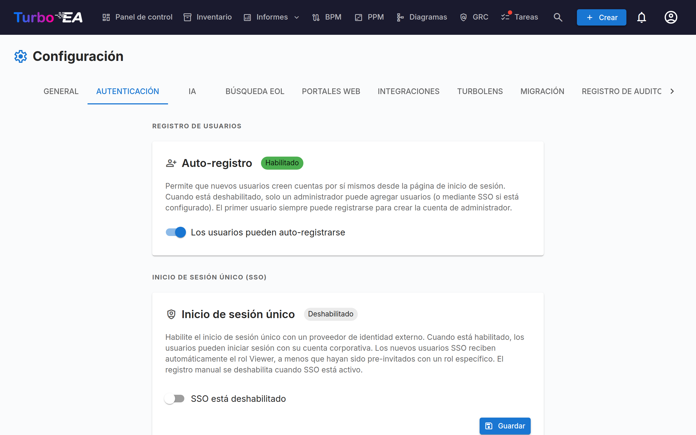

# Autenticación y SSO



La pestaña **Autenticación** en Configuración permite a los administradores configurar cómo los usuarios inician sesión en la plataforma.

#### Auto-registro

- **Permitir auto-registro**: Cuando está habilitado, los nuevos usuarios pueden crear cuentas haciendo clic en «Registrarse» en la página de inicio de sesión. Cuando está deshabilitado, solo los administradores pueden crear cuentas a través del flujo de Invitar usuario.

#### Configuración de SSO (Single Sign-On)

SSO permite a los usuarios iniciar sesión utilizando su proveedor de identidad corporativo en lugar de una contraseña local. Turbo EA soporta cuatro proveedores de SSO:

| Proveedor | Descripción |
|-----------|-------------|
| **Microsoft Entra ID** | Para organizaciones que utilizan Microsoft 365 / Azure AD |
| **Google Workspace** | Para organizaciones que utilizan Google Workspace |
| **Okta** | Para organizaciones que utilizan Okta como plataforma de identidad |
| **OIDC Genérico** | Para cualquier proveedor compatible con OpenID Connect (por ejemplo, Authentik, Keycloak, Auth0) |

**Pasos para configurar SSO:**

1. Vaya a **Admin > Configuración > Autenticación**
2. Active **Habilitar SSO**
3. Seleccione su **Proveedor SSO** en el desplegable
4. Ingrese las credenciales requeridas de su proveedor de identidad:
   - **Client ID**: El ID de aplicación/cliente de su proveedor de identidad
   - **Client Secret**: El secreto de la aplicación (almacenado cifrado en la base de datos)
   - Campos específicos del proveedor:
     - **Microsoft**: Tenant ID (por ejemplo, `su-tenant-id` o `common` para multi-tenant)
     - **Google**: Dominio alojado (opcional, restringe el inicio de sesión a un dominio específico de Google Workspace)
     - **Okta**: Dominio de Okta (por ejemplo, `su-org.okta.com`)
     - **OIDC Genérico**: URL del emisor (por ejemplo, `https://auth.ejemplo.com/application/o/mi-app/`). Para OIDC genérico, el sistema intenta el descubrimiento automático a través del endpoint `.well-known/openid-configuration`
5. Haga clic en **Guardar**

**Endpoints OIDC manuales (Avanzado):**

Si el backend no puede acceder al documento de descubrimiento de su proveedor de identidad (por ejemplo, debido a la red de Docker o certificados autofirmados), puede especificar manualmente los endpoints OIDC:

- **Authorization Endpoint**: La URL donde los usuarios son redirigidos para autenticarse
- **Token Endpoint**: La URL utilizada para intercambiar el código de autorización por tokens
- **JWKS URI**: La URL del JSON Web Key Set utilizado para verificar las firmas de los tokens

Estos campos son opcionales. Si se dejan en blanco, el sistema utiliza el descubrimiento automático. Cuando se completan, anulan los valores descubiertos automáticamente.

**Probar SSO:**

Después de guardar, abra una nueva pestaña del navegador (o ventana de incógnito) y verifique que el botón de inicio de sesión con SSO aparece en la página de inicio de sesión y que la autenticación funciona de extremo a extremo.

**Notas importantes:**
- El **Client Secret** se almacena cifrado en la base de datos y nunca se expone en las respuestas de la API
- Cuando SSO está habilitado, el inicio de sesión con contraseña local permanece disponible como respaldo
- Puede configurar la URI de redirección en su proveedor de identidad como: `https://su-dominio-turbo-ea/auth/callback`

**Asignación de roles:**

Por defecto, cada nuevo usuario de SSO llega con el rol predeterminado (o el de su invitación) y un administrador lo cambia a mano en **Administración → Usuarios**. Si su proveedor de identidad ya sabe quién debe ser administrador, miembro o lector —mediante la pertenencia a grupos o los roles de aplicación—, Turbo EA puede leerlo del token de ID y asignar el rol por sí mismo en cada inicio de sesión. El bloque **Asignación de roles** está en la sección SSO, debajo de los campos del proveedor, y se guarda con el mismo botón **Guardar**. Como la asignación concede roles, cambiar el nombre de la notificación o las filas de la asignación requiere el permiso para gestionar usuarios además del permiso para gestionar los ajustes; sin él, el bloque es de solo lectura y solo se pueden cambiar los ámbitos adicionales.

- **Nombre de la notificación**: la notificación (claim) del token de ID que enumera los grupos o roles del usuario, por ejemplo `roles` (roles de aplicación de Microsoft Entra), `groups` (Okta, Keycloak) o `cognito:groups` (Amazon Cognito). Se requiere un nombre de notificación mientras la asignación tenga filas. Para desactivar la asignación de roles, elimine todas las filas: los roles pasan a ser totalmente manuales.
- **Filas de asignación**: cada fila empareja un **valor del directorio** (un valor de grupo o de rol de aplicación tal como lo lleva la notificación) con un rol de Turbo EA. Use las flechas para ordenar las filas; gana la primera fila que coincide.
- **Ámbitos adicionales**: ámbitos (scopes) separados por espacios que se solicitan al iniciar sesión además de `openid email profile` — por ejemplo `groups` para Okta. Se solicitan tanto cuando el usuario es enviado al proveedor de identidad como cuando el código de inicio de sesión se intercambia por el token de ID. El inicio de sesión del servidor MCP solicita los mismos ámbitos. Nunca se envían a Google, que rechaza los ámbitos que no conoce.

Las reglas, todas elegidas para que un error de configuración no pueda dejarle fuera:

- **La asignación se aplica en cada inicio de sesión**, no solo al crear la cuenta. Sobrescribe un rol cambiado a mano, de modo que quitar a alguien de un grupo del directorio surte efecto en su siguiente inicio de sesión.
- **Gana la primera fila que coincide**, según el orden de las filas, no el orden en que el proveedor de identidad enumera los valores. La coincidencia ignora mayúsculas y minúsculas.
- **Un valor de la notificación que no coincide con ninguna fila** da el rol predeterminado.
- **Un token sin la notificación, o con la notificación vacía**, deja sin cambios el rol actual del usuario. Así, un nombre de notificación mal escrito, o un proveedor que dejó de enviarla, no puede degradar a todos los usuarios de golpe.
- **Una fila cuyo rol no existe o ha sido archivado** da el rol predeterminado. La página de ajustes marca esa fila para que pueda elegir un rol activo.
- **El último administrador activo nunca es degradado.** Si la asignación le quitara el rol de administrador al único administrador activo, este lo conserva y el registro de Seguridad y administración anota que se conservó el rol.
- **Mientras haya una asignación definida, el rol de los usuarios de SSO queda bloqueado en Administración → Usuarios** (el selector de rol está deshabilitado, con una indicación; un cambio de rol masivo omite esas cuentas y una importación de Excel deja su rol como está, y ambos lo indican). Cambie el rol en el directorio, o pase la cuenta a inicio de sesión local para gestionarla a mano. Las cuentas locales nunca se ven afectadas.

Notas por proveedor de identidad:

| Proveedor | Qué configurar |
|-----------|----------------|
| **Microsoft Entra ID** | Prefiera los **roles de aplicación**: declárelos en el registro de la aplicación, asígneles usuarios o grupos y use la notificación `roles`. La asignación de roles requiere un **ID de inquilino concreto**: con `organizations`, `common` o `consumers` cualquier inquilino de Microsoft puede iniciar sesión y no se puede guardar una asignación. La notificación `groups` contiene los ID de objeto de los grupos, no sus nombres, y Entra la omite por completo del token para un usuario en más de 200 grupos. |
| **Okta** | Añada una notificación de grupos al token de ID en el servidor de autorización (o en los ajustes de inicio de sesión de la aplicación) y añada `groups` en **Ámbitos adicionales**. Use el nombre de notificación que le haya dado, normalmente `groups`. |
| **Keycloak** (Generic OIDC) | Añada al cliente un mapeador **Group Membership**, con el nombre de notificación del token `groups` y **Add to ID token** activado, para que una notificación `groups` de nivel superior llegue al token de ID (desactive **Full group path** para obtener nombres de grupo simples). Las notificaciones anidadas como `realm_access.roles` no se leen. |
| **Amazon Cognito** (Generic OIDC) | Use la notificación `cognito:groups`. |
| **Google Workspace** | No disponible: los tokens de ID de Google no incluyen una notificación de grupos, por lo que el bloque se oculta para Google. |

!!! warning "Límites que conviene tener presentes"
    - **Asigne roles de aplicación o ID de grupo, no nombres visibles que los usuarios puedan crear ellos mismos.** Si cualquiera puede crear un grupo llamado `ea-admins`, cualquiera puede convertirse en administrador.
    - **La notificación debe estar presente en el token de ID.** Turbo EA lee solo el token de ID — no el endpoint userinfo ni una API de directorio. Algunos proveedores de identidad necesitan tanto el ámbito en **Ámbitos adicionales** como una configuración de la notificación para que los grupos aparezcan en el token de ID; inicie sesión una vez y compruebe el resultado antes de confiar en él.
    - **Un cambio en el directorio surte efecto en el siguiente inicio de sesión del usuario**, no durante una sesión ya abierta.
    - **El rol de una invitación se sobrescribe en el primer inicio de sesión** cuando la asignación otorga uno.
    - **Un usuario cuyo token nunca lleva la notificación conserva su rol actual**, y mientras haya una asignación definida nadie puede cambiarlo en Administración → Usuarios. Corrija la notificación en el proveedor de identidad, o pase la cuenta a inicio de sesión local.
    - **Una notificación vacía cuenta como ausente**: quitar a alguien de todos los grupos asignados no lo degrada. Retire en su lugar su acceso a la aplicación en el proveedor de identidad.

#### Autenticación mediante proxy inverso

Si Turbo EA se ejecuta detrás de un proxy que ya autentica a sus usuarios — la autenticación integrada de Azure App Service («EasyAuth»), oauth2-proxy, Authelia, Cloudflare Access — puede aceptar esa identidad directamente en lugar de ejecutar su propio SSO encima. Sin cliente OIDC, sin registro de aplicación, sin Client Secret. Los usuarios llegan a Turbo EA con la sesión ya iniciada.

Esta funcionalidad se configura completamente mediante variables de entorno y está **deshabilitada por defecto**.

**Antes que nada, establezca el administrador de arranque.** El auto-registro está cerrado mientras la autenticación por proxy está activa, así que esta es la forma en que entra el primer administrador — a ese correo electrónico se le concede el rol de admin en el primer inicio de sesión:

```
TURBO_EA_PROXY_AUTH_BOOTSTRAP_ADMIN_EMAIL=usted@suempresa.com
```

**Azure App Service (EasyAuth) — configuración recomendada.** Turbo EA verifica el token de identidad firmado que Azure reenvía con cada solicitud (esto requiere el almacén de tokens de App Service, que está activado por defecto). `AUDIENCE` es el Client ID del registro de aplicación de su EasyAuth; reemplace `TENANT` por el ID de su directorio (Tenant ID):

```
TURBO_EA_PROXY_AUTH_ENABLED=true
TURBO_EA_PROXY_AUTH_TRUST_PLATFORM_HEADERS=true
TURBO_EA_PROXY_AUTH_VERIFY_ID_TOKEN=true
TURBO_EA_PROXY_AUTH_ISSUER=https://login.microsoftonline.com/TENANT/v2.0
TURBO_EA_PROXY_AUTH_AUDIENCE=your-easyauth-app-client-id
TURBO_EA_PROXY_AUTH_JWKS_URI=https://login.microsoftonline.com/TENANT/discovery/v2.0/keys
TURBO_EA_PROXY_AUTH_ALLOWED_DOMAINS=suempresa.com
TURBO_EA_PROXY_AUTH_LOGOUT_URL=/.auth/logout
```

!!! warning "`TRUST_PLATFORM_HEADERS` es obligatorio en App Service"
    App Service no puede inyectar una cabecera secreta propia, por lo que
    `TURBO_EA_PROXY_AUTH_TRUST_PLATFORM_HEADERS=true` ocupa el lugar de
    `TURBO_EA_PROXY_AUTH_SHARED_SECRET`: es un reconocimiento explícito de que
    usted depende de que Azure elimine las cabeceras de identidad entrantes antes
    de que lleguen a su aplicación. La comprobación se realiza **antes** incluso
    de analizar el token de identidad, de modo que verificar el token no la
    sustituye. Si faltan tanto este ajuste como un secreto compartido, cada
    inicio de sesión falla con *Proxy authentication is enabled but not secured*,
    incluso con `VERIFY_ID_TOKEN=true`.

Si su almacén de tokens está deshabilitado, establezca además `TURBO_EA_PROXY_AUTH_VERIFY_ID_TOKEN=false` y confíe únicamente en el saneamiento de cabeceras. Sin un token verificado **las cuentas nuevas no se crean automáticamente**: invite primero a los usuarios, o utilice el correo del administrador de arranque.

**Proxy genérico (oauth2-proxy, Authelia, Traefik forwardAuth, …).** Configure el proxy para que inyecte una cabecera con un secreto compartido en cada solicitud, de modo que una solicitud que no pasó por el proxy nunca pueda confundirse con una que sí lo hizo. Genere el valor con `openssl rand -hex 32`:

```
TURBO_EA_PROXY_AUTH_ENABLED=true
TURBO_EA_PROXY_AUTH_MODE=header
TURBO_EA_PROXY_AUTH_SHARED_SECRET=<valor generado, establecido también en el proxy>
TURBO_EA_PROXY_AUTH_EMAIL_HEADER=X-Forwarded-Email
TURBO_EA_PROXY_AUTH_ALLOWED_DOMAINS=suempresa.com
TURBO_EA_PROXY_AUTH_LOGOUT_URL=/oauth2/sign_out
```

**Notas de seguridad:**

- El secreto compartido (o, en Azure, el token de identidad verificado) es lo que hace que la identidad sea confiable — una cabecera por sí sola puede ser escrita por cualquiera. La lista de dominios permitidos es obligatoria; establezca `TURBO_EA_PROXY_AUTH_ALLOW_ANY_DOMAIN=true` solo si realmente acepta cualquier dominio de correo electrónico.
- Una identidad que no fue verificada criptográficamente puede iniciar sesión con usuarios existentes, pero nunca crea una cuenta nueva, y las invitaciones pendientes no confieren su rol por esta vía.
- `TURBO_EA_PROXY_AUTH_LOGOUT_URL` es adonde Turbo EA envía el navegador después de **Cerrar sesión**, para que la sesión del proxy también termine. Sin ella, el proxy sigue considerando que el usuario tiene la sesión iniciada — vuelve a la página de inicio de sesión y puede reingresar con un clic.

**Tamaño de las cabeceras de la petición.** Un proxy de inicio de sesión añade cookies y cabeceras de token a cada petición. Las peticiones más largas de Turbo EA llevan en la URL una lista de ids de fichas — una línea de petición de casi 8 KB —, así que cada salto entre el navegador y Turbo EA debe aceptar una línea de petición de 8 KB junto con esas cabeceras. El nginx de borde incluido lo hace (16 KB por línea de cabecera desde la versión 2.217.1). Si además ejecuta su propio nginx o ingress-nginx por delante, déle el mismo margen: `large_client_header_buffers 4 16k;`, o `large-client-header-buffers: "4 16k"` en el ConfigMap de ingress-nginx. Un salto demasiado pequeño responde `400 Request Header Or Cookie Too Large` o `414` en las exportaciones del Inventario y en los diagramas grandes, mientras todo lo demás funciona.

**Asignación de roles (opcional).** De forma predeterminada todos aterrizan en el rol predeterminado configurado y un administrador los promociona desde ahí. Si su proveedor de identidad ya conoce la respuesta — un registro de aplicación de Entra que declara sus propios roles de aplicación, un oauth2-proxy que reenvía la pertenencia a grupos — Turbo EA puede leerla y asignar el rol por sí mismo:

```
TURBO_EA_PROXY_AUTH_ROLE_CLAIM=roles
TURBO_EA_PROXY_AUTH_ROLE_MAP=ADMIN:admin,MANAGER:member,READ-ONLY:viewer
```

Cada par se escribe `VALOR_DIRECTORIO:clave-de-rol-turbo-ea`. Cuando un usuario tiene varios roles de directorio, **gana la primera entrada de la asignación** — el orden de la asignación, no el orden en que el proveedor los haya enviado, porque los dos formatos de identidad de Azure no coinciden en eso. La coincidencia ignora mayúsculas y minúsculas en el lado del directorio. En modo de proxy genérico, la misma asignación lee una cabecera separada por comas en lugar de una reclamación: `TURBO_EA_PROXY_AUTH_ROLE_HEADER=X-Forwarded-Groups`.

!!! warning "La asignación es autoritativa en cada inicio de sesión"
    No solo al crear la cuenta — retirar el rol de directorio de alguien tiene que surtir efecto. Mientras la asignación esté en vigor, el rol de una cuenta que inicia sesión a través del proxy queda por tanto **bloqueado en Administración → Usuarios**: el selector de rol está deshabilitado con una indicación, un cambio de rol masivo omite la cuenta y una importación de Excel deja su rol como está, en lugar de dejar que un cambio hecho a mano se sustituya silenciosamente en el siguiente inicio de sesión. Deje `TURBO_EA_PROXY_AUTH_ROLE_MAP` sin definir y nada cambia: los roles siguen siendo totalmente manuales.

Los casos límite, todos elegidos para que un error de configuración no pueda dejarle fuera:

- **`TURBO_EA_PROXY_AUTH_BOOTSTRAP_ADMIN_EMAIL` siempre gana** frente a la asignación. Si ambos discrepan, esa dirección es administradora.
- **Un valor que no coincide con nada de la asignación** — o que nombra un rol de Turbo EA que no existe o está archivado — recae en el rol predeterminado.
- **El último administrador activo nunca es degradado.** Si la asignación le quitara el rol de administrador al único administrador activo, este lo conserva y el registro de Seguridad y administración anota que se conservó el rol.
- **Una reclamación completamente ausente** deja intacto el rol actual del usuario. Esto es deliberadamente distinto del caso anterior: un `ROLE_CLAIM` mal escrito, o un almacén de tokens que deja de reenviar, degradaría de lo contrario a todos los usuarios de la instancia de una sola vez.
- **La identidad debe merecer que se le confíen permisos.** La asignación de roles se aplica cuando el token de identidad se ha verificado (`TURBO_EA_PROXY_AUTH_VERIFY_ID_TOKEN=true`) o hay un secreto compartido configurado. En App Service con el almacén de tokens deshabilitado y sin secreto, la asignación se ignora y se escribe una línea en el registro indicándolo — el mismo razonamiento que impide que una cabecera no verificada cree una cuenta.

**Todas las variables:**

| Variable | Por defecto | Propósito |
|----------|---------|---------|
| `TURBO_EA_PROXY_AUTH_ENABLED` | `false` | Interruptor principal |
| `TURBO_EA_PROXY_AUTH_MODE` | `azure_easyauth` | `azure_easyauth` o `header` |
| `TURBO_EA_PROXY_AUTH_SHARED_SECRET` | — | Obligatorio en modo `header`; el proxy lo inyecta |
| `TURBO_EA_PROXY_AUTH_SECRET_HEADER` | `X-Turbo-EA-Proxy-Secret` | Cabecera que transporta el secreto compartido |
| `TURBO_EA_PROXY_AUTH_VERIFY_ID_TOKEN` | `false` | Verificar el token de identidad reenviado (modo Azure) |
| `TURBO_EA_PROXY_AUTH_ISSUER` / `_AUDIENCE` / `_JWKS_URI` | — | Ajustes de verificación del token |
| `TURBO_EA_PROXY_AUTH_TRUST_PLATFORM_HEADERS` | `false` | Solo Azure: aceptar el saneamiento de cabeceras de la plataforma en lugar de un secreto. Obligatorio en App Service |
| `TURBO_EA_PROXY_AUTH_EMAIL_HEADER` | `X-Forwarded-Email` | Modo `header`: cabecera del correo electrónico |
| `TURBO_EA_PROXY_AUTH_NAME_HEADER` | `X-Forwarded-User` | Modo `header`: cabecera del nombre para mostrar |
| `TURBO_EA_PROXY_AUTH_SUBJECT_HEADER` | `X-Forwarded-Subject` | Modo `header`: cabecera del identificador de sujeto estable |
| `TURBO_EA_PROXY_AUTH_ALLOWED_DOMAINS` | — | Dominios de correo permitidos, separados por comas (obligatorio) |
| `TURBO_EA_PROXY_AUTH_ALLOW_ANY_DOMAIN` | `false` | Aceptar explícitamente cualquier dominio de correo electrónico |
| `TURBO_EA_PROXY_AUTH_BOOTSTRAP_ADMIN_EMAIL` | — | Recibe el rol de admin en el primer inicio de sesión |
| `TURBO_EA_PROXY_AUTH_ROLE_MAP` | — | `VALOR_DIRECTORIO:clave-de-rol,…` — vacío significa que los roles siguen siendo manuales |
| `TURBO_EA_PROXY_AUTH_ROLE_CLAIM` | `roles` | Reclamación que porta el rol del directorio (modo Azure) |
| `TURBO_EA_PROXY_AUTH_ROLE_HEADER` | `X-Forwarded-Groups` | Modo `header`: cabecera de roles separados por comas |
| `TURBO_EA_PROXY_AUTH_LOGOUT_URL` | — | Adonde Cerrar sesión envía el navegador |

**Limitaciones:** el flujo OAuth del servidor MCP requiere que el SSO normal esté configurado; la autenticación por proxy por sí sola no lo cubre.
