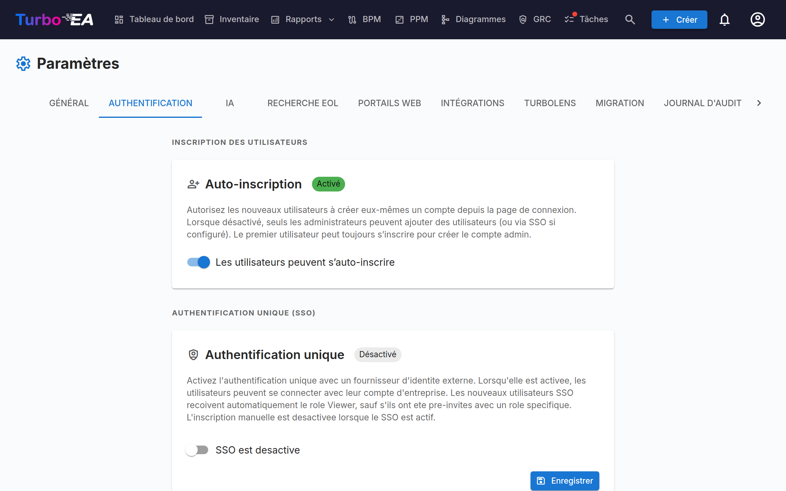

# Authentification et SSO



L'onglet **Authentification** dans les Paramètres permet aux administrateurs de configurer la manière dont les utilisateurs se connectent à la plateforme.

#### Auto-inscription

- **Autoriser l'auto-inscription** : Lorsque cette option est activée, les nouveaux utilisateurs peuvent créer des comptes en cliquant sur « S'inscrire » sur la page de connexion. Lorsqu'elle est désactivée, seuls les administrateurs peuvent créer des comptes via le flux d'invitation.

#### Configuration SSO (Single Sign-On)

Le SSO permet aux utilisateurs de se connecter en utilisant leur fournisseur d'identité d'entreprise au lieu d'un mot de passe local. Turbo EA prend en charge quatre fournisseurs SSO :

| Fournisseur | Description |
|-------------|-------------|
| **Microsoft Entra ID** | Pour les organisations utilisant Microsoft 365 / Azure AD |
| **Google Workspace** | Pour les organisations utilisant Google Workspace |
| **Okta** | Pour les organisations utilisant Okta comme plateforme d'identité |
| **OIDC générique** | Pour tout fournisseur compatible OpenID Connect (par ex. Authentik, Keycloak, Auth0) |

**Étapes pour configurer le SSO :**

1. Allez dans **Admin > Paramètres > Authentification**
2. Activez **Activer le SSO**
3. Sélectionnez votre **Fournisseur SSO** dans la liste déroulante
4. Entrez les identifiants requis de votre fournisseur d'identité :
   - **Client ID** : L'identifiant d'application/client de votre fournisseur d'identité
   - **Client Secret** : Le secret de l'application (stocké chiffré dans la base de données)
   - Champs spécifiques au fournisseur :
     - **Microsoft** : Tenant ID (par ex. `votre-tenant-id` ou `common` pour multi-tenant)
     - **Google** : Domaine hébergé (optionnel, restreint la connexion à un domaine Google Workspace spécifique)
     - **Okta** : Domaine Okta (par ex. `votre-org.okta.com`)
     - **OIDC générique** : URL de l'émetteur (par ex. `https://auth.example.com/application/o/my-app/`). Pour l'OIDC générique, le système tente la découverte automatique via le point de terminaison `.well-known/openid-configuration`
5. Cliquez sur **Sauvegarder**

**Points de terminaison OIDC manuels (avancé) :**

Si le backend ne peut pas atteindre le document de découverte de votre fournisseur d'identité (par ex. en raison du réseau Docker ou de certificats auto-signés), vous pouvez spécifier manuellement les points de terminaison OIDC :

- **Point de terminaison d'autorisation** : L'URL où les utilisateurs sont redirigés pour s'authentifier
- **Point de terminaison de jeton** : L'URL utilisée pour échanger le code d'autorisation contre des jetons
- **URI JWKS** : L'URL du jeu de clés web JSON utilisé pour vérifier les signatures des jetons

Ces champs sont optionnels. S'ils sont laissés vides, le système utilise la découverte automatique. Lorsqu'ils sont remplis, ils remplacent les valeurs découvertes automatiquement.

**Tester le SSO :**

Après avoir sauvegardé, ouvrez un nouvel onglet de navigateur (ou une fenêtre de navigation privée) et vérifiez que le bouton de connexion SSO apparaît sur la page de connexion et que l'authentification fonctionne de bout en bout.

**Notes importantes :**
- Le **Client Secret** est stocké chiffré dans la base de données et n'est jamais exposé dans les réponses API
- Lorsque le SSO est activé, la connexion par mot de passe local reste disponible comme solution de secours
- Vous pouvez configurer l'URI de redirection dans votre fournisseur d'identité comme suit : `https://votre-domaine-turbo-ea/auth/callback`

**Attribution des rôles :**

Par défaut, chaque nouvel utilisateur SSO arrive avec le rôle par défaut (ou celui de son invitation) et un administrateur le modifie à la main dans **Administration → Utilisateurs**. Si votre fournisseur d'identité sait déjà qui doit être administrateur, membre ou lecteur — via l'appartenance à des groupes ou des rôles d'application —, Turbo EA peut le lire dans le jeton d'ID et attribuer lui-même le rôle à chaque connexion. Le bloc **Attribution des rôles** se trouve dans la section SSO, sous les champs du fournisseur, et s'enregistre avec le même bouton **Sauvegarder**. Comme l'attribution distribue des rôles, modifier le nom de la revendication ou les lignes d'attribution exige la permission de gérer les utilisateurs en plus de la permission de gérer les paramètres ; sans elle, le bloc est en lecture seule et seuls les scopes supplémentaires peuvent être modifiés.

- **Nom de la revendication** : la revendication (claim) du jeton d'ID qui liste les groupes ou les rôles de l'utilisateur, par exemple `roles` (rôles d'application Microsoft Entra), `groups` (Okta, Keycloak) ou `cognito:groups` (Amazon Cognito). Un nom de revendication est obligatoire tant que l'attribution comporte des lignes. Pour désactiver l'attribution des rôles, supprimez toutes les lignes : les rôles restent alors entièrement manuels.
- **Lignes d'attribution** : chaque ligne associe une **valeur de l'annuaire** (une valeur de groupe ou de rôle d'application telle que la revendication la porte) à un rôle Turbo EA. Utilisez les flèches pour ordonner les lignes ; la première ligne correspondante l'emporte.
- **Scopes supplémentaires** : scopes séparés par des espaces, demandés à la connexion en plus de `openid email profile` — par exemple `groups` pour Okta. Ils sont demandés à la fois lorsque l'utilisateur est envoyé vers le fournisseur d'identité et lorsque le code de connexion est échangé contre le jeton d'ID. La connexion du serveur MCP demande les mêmes scopes. Ils ne sont jamais envoyés à Google, qui refuse les scopes qu'il ne connaît pas.

Les règles, toutes choisies pour qu'une erreur de configuration ne puisse pas vous verrouiller :

- **L'attribution est appliquée à chaque connexion**, pas seulement à la création du compte. Elle remplace un rôle modifié à la main : retirer quelqu'un d'un groupe de l'annuaire prend donc effet à sa connexion suivante.
- **La première ligne correspondante l'emporte**, dans l'ordre des lignes et non dans l'ordre dans lequel le fournisseur d'identité liste les valeurs. La correspondance ignore la casse.
- **Une valeur de revendication qui ne correspond à aucune ligne** donne le rôle par défaut.
- **Un jeton sans la revendication, ou avec une revendication vide**, laisse inchangé le rôle actuel de l'utilisateur. Un nom de revendication mal saisi, ou un fournisseur qui a cessé d'envoyer la revendication, ne peut donc pas rétrograder tous les utilisateurs d'un coup.
- **Une ligne dont le rôle n'existe pas ou a été archivé** donne le rôle par défaut. La page des paramètres signale une telle ligne pour que vous puissiez choisir un rôle actif.
- **Le dernier administrateur actif n'est jamais rétrogradé.** Si l'attribution retirait le rôle d'administrateur au seul administrateur actif, il le conserve et le journal Sécurité et administration enregistre que le rôle a été conservé.
- **Tant qu'une attribution est définie, le rôle des utilisateurs SSO est verrouillé dans Administration → Utilisateurs** (le sélecteur de rôle est désactivé, avec une indication ; un changement de rôle en masse ignore ces comptes et un import Excel laisse leur rôle tel quel, les deux le signalent). Modifiez plutôt le rôle dans l'annuaire, ou basculez le compte en connexion locale pour le gérer à la main. Les comptes locaux ne sont jamais concernés.

Remarques par fournisseur d'identité :

| Fournisseur | Ce qu'il faut configurer |
|-------------|--------------------------|
| **Microsoft Entra ID** | Privilégiez les **rôles d'application** : déclarez-les dans l'enregistrement de l'application, affectez-y des utilisateurs ou des groupes et utilisez la revendication `roles`. L'attribution des rôles exige un **ID de locataire précis** : avec `organizations`, `common` ou `consumers`, n'importe quel locataire Microsoft peut se connecter et une attribution ne peut pas être enregistrée. La revendication `groups` contient les ID d'objet des groupes, pas leurs noms, et Entra l'omet entièrement du jeton pour un utilisateur appartenant à plus de 200 groupes. |
| **Okta** | Ajoutez une revendication de groupes au jeton d'ID dans le serveur d'autorisation (ou dans les paramètres de connexion de l'application) et ajoutez `groups` sous **Scopes supplémentaires**. Utilisez le nom de revendication que vous lui avez donné, en général `groups`. |
| **Keycloak** (Generic OIDC) | Ajoutez au client un mappeur **Group Membership**, avec le nom de revendication de jeton `groups` et **Add to ID token** activé, afin qu'une revendication `groups` de premier niveau parvienne au jeton d'ID (désactivez **Full group path** pour obtenir des noms de groupes simples). Les revendications imbriquées comme `realm_access.roles` ne sont pas lues. |
| **Amazon Cognito** (Generic OIDC) | Utilisez la revendication `cognito:groups`. |
| **Google Workspace** | Indisponible : les jetons d'ID de Google ne contiennent pas de revendication de groupes, le bloc est donc masqué pour Google. |

!!! warning "Limites à garder à l'esprit"
    - **Attribuez des rôles d'application ou des ID de groupe, pas des noms d'affichage que les utilisateurs peuvent créer eux-mêmes.** Si n'importe qui peut créer un groupe nommé `ea-admins`, n'importe qui peut devenir administrateur.
    - **La revendication doit figurer dans le jeton d'ID.** Turbo EA lit uniquement le jeton d'ID — pas le point de terminaison userinfo ni une API d'annuaire. Certains fournisseurs d'identité exigent à la fois le scope sous **Scopes supplémentaires** et une configuration de la revendication pour que les groupes apparaissent dans le jeton d'ID ; connectez-vous une fois et vérifiez le résultat avant de vous y fier.
    - **Une modification dans l'annuaire prend effet à la connexion suivante de l'utilisateur**, pas pendant une session déjà ouverte.
    - **Le rôle d'une invitation est remplacé à la première connexion** lorsque l'attribution en donne un.
    - **Un utilisateur dont le jeton ne porte jamais la revendication conserve son rôle actuel**, et tant qu'une attribution est définie, personne ne peut le modifier dans Administration → Utilisateurs. Corrigez la revendication chez le fournisseur d'identité, ou basculez le compte en connexion locale.
    - **Une revendication vide compte comme absente** : retirer quelqu'un de tous les groupes attribués ne le rétrograde pas. Retirez plutôt son accès à l'application chez le fournisseur d'identité.

#### Authentification par proxy inverse

Si Turbo EA fonctionne derrière un proxy qui connecte déjà vos utilisateurs — l'authentification intégrée d'Azure App Service (« EasyAuth »), oauth2-proxy, Authelia, Cloudflare Access — il peut accepter cette identité directement au lieu d'exécuter son propre SSO par-dessus. Pas de client OIDC, pas d'enregistrement d'application, pas de Client Secret. Les utilisateurs arrivent dans Turbo EA déjà connectés.

Cette fonctionnalité se configure entièrement via des variables d'environnement et est **désactivée par défaut**.

**Avant toute chose, définissez l'administrateur d'amorçage.** L'auto-inscription est fermée lorsque l'authentification par proxy est activée ; c'est donc ainsi que le premier administrateur accède à la plateforme — cette adresse e-mail reçoit le rôle admin lors de la première connexion :

```
TURBO_EA_PROXY_AUTH_BOOTSTRAP_ADMIN_EMAIL=vous@votreentreprise.com
```

**Azure App Service (EasyAuth) — configuration recommandée.** Turbo EA vérifie le jeton d'identité signé qu'Azure transmet avec chaque requête (cela nécessite le magasin de jetons App Service, activé par défaut). `AUDIENCE` est le Client ID de votre enregistrement d'application EasyAuth ; remplacez `TENANT` par l'identifiant de votre annuaire (Tenant ID) :

```
TURBO_EA_PROXY_AUTH_ENABLED=true
TURBO_EA_PROXY_AUTH_TRUST_PLATFORM_HEADERS=true
TURBO_EA_PROXY_AUTH_VERIFY_ID_TOKEN=true
TURBO_EA_PROXY_AUTH_ISSUER=https://login.microsoftonline.com/TENANT/v2.0
TURBO_EA_PROXY_AUTH_AUDIENCE=your-easyauth-app-client-id
TURBO_EA_PROXY_AUTH_JWKS_URI=https://login.microsoftonline.com/TENANT/discovery/v2.0/keys
TURBO_EA_PROXY_AUTH_ALLOWED_DOMAINS=votreentreprise.com
TURBO_EA_PROXY_AUTH_LOGOUT_URL=/.auth/logout
```

!!! warning "`TRUST_PLATFORM_HEADERS` est obligatoire sur App Service"
    App Service ne peut pas injecter d'en-tête secret personnalisé ;
    `TURBO_EA_PROXY_AUTH_TRUST_PLATFORM_HEADERS=true` remplace donc
    `TURBO_EA_PROXY_AUTH_SHARED_SECRET` — c'est une reconnaissance explicite du
    fait que vous vous reposez sur la suppression par Azure des en-têtes
    d'identité entrants avant qu'ils n'atteignent votre application. Le contrôle
    a lieu **avant** même l'analyse du jeton d'identité : vérifier le jeton ne
    s'y substitue donc pas. Si ce paramètre et le secret partagé manquent tous
    les deux, chaque connexion échoue avec *Proxy authentication is enabled but
    not secured*, même avec `VERIFY_ID_TOKEN=true`.

Si votre magasin de jetons est désactivé, définissez en plus `TURBO_EA_PROXY_AUTH_VERIFY_ID_TOKEN=false` et reposez-vous uniquement sur l'assainissement des en-têtes. Sans jeton vérifié, **les nouveaux comptes ne sont pas créés automatiquement** — invitez d'abord les utilisateurs, ou utilisez l'e-mail de l'administrateur d'amorçage.

**Proxy générique (oauth2-proxy, Authelia, Traefik forwardAuth, …).** Configurez le proxy pour qu'il injecte un en-tête contenant un secret partagé sur chaque requête, afin qu'une requête qui n'est pas passée par le proxy ne puisse jamais être confondue avec une requête qui l'a fait. Générez la valeur avec `openssl rand -hex 32` :

```
TURBO_EA_PROXY_AUTH_ENABLED=true
TURBO_EA_PROXY_AUTH_MODE=header
TURBO_EA_PROXY_AUTH_SHARED_SECRET=<valeur générée, également définie sur le proxy>
TURBO_EA_PROXY_AUTH_EMAIL_HEADER=X-Forwarded-Email
TURBO_EA_PROXY_AUTH_ALLOWED_DOMAINS=votreentreprise.com
TURBO_EA_PROXY_AUTH_LOGOUT_URL=/oauth2/sign_out
```

**Notes de sécurité :**

- Le secret partagé (ou, sur Azure, le jeton d'identité vérifié) est ce qui rend l'identité digne de confiance — un en-tête seul peut être écrit par n'importe qui. La liste d'autorisation de domaines est obligatoire ; ne définissez `TURBO_EA_PROXY_AUTH_ALLOW_ANY_DOMAIN=true` que si vous acceptez réellement n'importe quel domaine d'e-mail.
- Une identité qui n'a pas été vérifiée cryptographiquement peut connecter des utilisateurs existants mais ne crée jamais de nouveau compte, et les invitations en attente ne confèrent pas leur rôle par ce chemin.
- `TURBO_EA_PROXY_AUTH_LOGOUT_URL` est l'adresse vers laquelle Turbo EA envoie le navigateur après **Se déconnecter**, afin que la session du proxy se termine aussi. Sans elle, le proxy considère toujours l'utilisateur comme connecté — il retombe sur la page de connexion et peut se reconnecter en un clic.

**Taille des en-têtes de requête.** Un proxy d'authentification ajoute des cookies et des en-têtes de jeton à chaque requête. Les requêtes les plus longues de Turbo EA portent dans l'URL une liste d'identifiants de fiches — une ligne de requête d'un peu moins de 8 Ko — ; chaque maillon entre le navigateur et Turbo EA doit donc accepter une ligne de requête de 8 Ko avec ces en-têtes. Le nginx de bordure fourni le fait (16 Ko par ligne d'en-tête depuis la version 2.217.1). Si vous exploitez en plus votre propre nginx ou ingress-nginx en amont, donnez-lui la même marge : `large_client_header_buffers 4 16k;`, ou `large-client-header-buffers: "4 16k"` dans la ConfigMap d'ingress-nginx. Un maillon trop étroit répond `400 Request Header Or Cookie Too Large` ou `414` sur les exports de l'Inventaire et les grands diagrammes alors que tout le reste fonctionne.

**Mappage des rôles (facultatif).** Par défaut, tout le monde arrive sur le rôle par défaut configuré et un administrateur promeut à partir de là. Si votre fournisseur d'identité connaît déjà la réponse — une inscription d'application Entra qui déclare ses propres rôles d'application, un oauth2-proxy qui transmet l'appartenance aux groupes — Turbo EA peut la lire et attribuer le rôle lui-même :

```
TURBO_EA_PROXY_AUTH_ROLE_CLAIM=roles
TURBO_EA_PROXY_AUTH_ROLE_MAP=ADMIN:admin,MANAGER:member,READ-ONLY:viewer
```

Chaque paire s'écrit `VALEUR_ANNUAIRE:clé-de-rôle-turbo-ea`. Lorsqu'un utilisateur détient plusieurs rôles d'annuaire, **la première entrée du mappage l'emporte** — l'ordre du mappage, et non celui dans lequel le fournisseur les a envoyés, car les deux formats d'identité Azure ne s'accordent pas là-dessus. La correspondance ignore la casse côté annuaire. En mode proxy générique, le même mappage lit un en-tête séparé par des virgules au lieu d'une revendication : `TURBO_EA_PROXY_AUTH_ROLE_HEADER=X-Forwarded-Groups`.

!!! warning "Le mappage fait autorité à chaque connexion"
    Pas seulement à la création du compte — le retrait d'un rôle d'annuaire doit prendre effet. Tant que l'attribution est en vigueur, le rôle d'un compte qui se connecte via le proxy est donc **verrouillé dans Administration → Utilisateurs** : le sélecteur de rôle est désactivé avec une indication, un changement de rôle en masse ignore le compte et un import Excel laisse son rôle tel quel, au lieu de laisser un changement fait à la main être remplacé silencieusement à la connexion suivante. Laissez `TURBO_EA_PROXY_AUTH_ROLE_MAP` vide et rien ne change : les rôles restent entièrement manuels.

Les cas limites, tous choisis pour qu'une erreur de configuration ne puisse pas vous verrouiller dehors :

- **`TURBO_EA_PROXY_AUTH_BOOTSTRAP_ADMIN_EMAIL` l'emporte toujours** sur le mappage. En cas de désaccord, cette adresse est administratrice.
- **Une valeur qui ne correspond à rien dans le mappage** — ou qui désigne un rôle Turbo EA inexistant ou archivé — retombe sur le rôle par défaut.
- **Le dernier administrateur actif n'est jamais rétrogradé.** Si l'attribution retirait le rôle d'administrateur au seul administrateur actif, il le conserve et le journal Sécurité et administration enregistre que le rôle a été conservé.
- **Une revendication totalement absente** laisse le rôle actuel de l'utilisateur intact. C'est délibérément différent du cas précédent : un `ROLE_CLAIM` mal saisi, ou un magasin de jetons qui cesse de transmettre, rétrograderait sinon tous les utilisateurs de l'instance d'un seul coup.
- **L'identité doit mériter qu'on lui confie des permissions.** Le mappage des rôles s'applique lorsque le jeton d'identité a été vérifié (`TURBO_EA_PROXY_AUTH_VERIFY_ID_TOKEN=true`) ou qu'un secret partagé est configuré. Sur App Service avec le magasin de jetons désactivé et sans secret, le mappage est ignoré et une ligne le signalant est écrite dans le journal — le même raisonnement qui empêche un en-tête non vérifié de créer un compte.

**Toutes les variables :**

| Variable | Défaut | Rôle |
|----------|---------|---------|
| `TURBO_EA_PROXY_AUTH_ENABLED` | `false` | Interrupteur principal |
| `TURBO_EA_PROXY_AUTH_MODE` | `azure_easyauth` | `azure_easyauth` ou `header` |
| `TURBO_EA_PROXY_AUTH_SHARED_SECRET` | — | Obligatoire en mode `header` ; le proxy l'injecte |
| `TURBO_EA_PROXY_AUTH_SECRET_HEADER` | `X-Turbo-EA-Proxy-Secret` | En-tête transportant le secret partagé |
| `TURBO_EA_PROXY_AUTH_VERIFY_ID_TOKEN` | `false` | Vérifier le jeton d'identité transmis (mode Azure) |
| `TURBO_EA_PROXY_AUTH_ISSUER` / `_AUDIENCE` / `_JWKS_URI` | — | Paramètres de vérification du jeton |
| `TURBO_EA_PROXY_AUTH_TRUST_PLATFORM_HEADERS` | `false` | Azure uniquement : accepter l'assainissement des en-têtes par la plateforme au lieu d'un secret. Obligatoire sur App Service |
| `TURBO_EA_PROXY_AUTH_EMAIL_HEADER` | `X-Forwarded-Email` | Mode `header` : en-tête de l'e-mail |
| `TURBO_EA_PROXY_AUTH_NAME_HEADER` | `X-Forwarded-User` | Mode `header` : en-tête du nom d'affichage |
| `TURBO_EA_PROXY_AUTH_SUBJECT_HEADER` | `X-Forwarded-Subject` | Mode `header` : en-tête de l'identifiant de sujet stable |
| `TURBO_EA_PROXY_AUTH_ALLOWED_DOMAINS` | — | Domaines d'e-mail autorisés, séparés par des virgules (obligatoire) |
| `TURBO_EA_PROXY_AUTH_ALLOW_ANY_DOMAIN` | `false` | Accepter explicitement n'importe quel domaine d'e-mail |
| `TURBO_EA_PROXY_AUTH_BOOTSTRAP_ADMIN_EMAIL` | — | Reçoit le rôle admin lors de la première connexion |
| `TURBO_EA_PROXY_AUTH_ROLE_MAP` | — | `VALEUR_ANNUAIRE:clé-de-rôle,…` — vide signifie que les rôles restent manuels |
| `TURBO_EA_PROXY_AUTH_ROLE_CLAIM` | `roles` | Revendication portant le rôle d'annuaire (mode Azure) |
| `TURBO_EA_PROXY_AUTH_ROLE_HEADER` | `X-Forwarded-Groups` | Mode `header` : en-tête de rôles séparés par des virgules |
| `TURBO_EA_PROXY_AUTH_LOGOUT_URL` | — | Où Se déconnecter envoie le navigateur |

**Limitations :** le flux OAuth du serveur MCP nécessite qu'un SSO classique soit configuré ; l'authentification par proxy seule ne le couvre pas.
