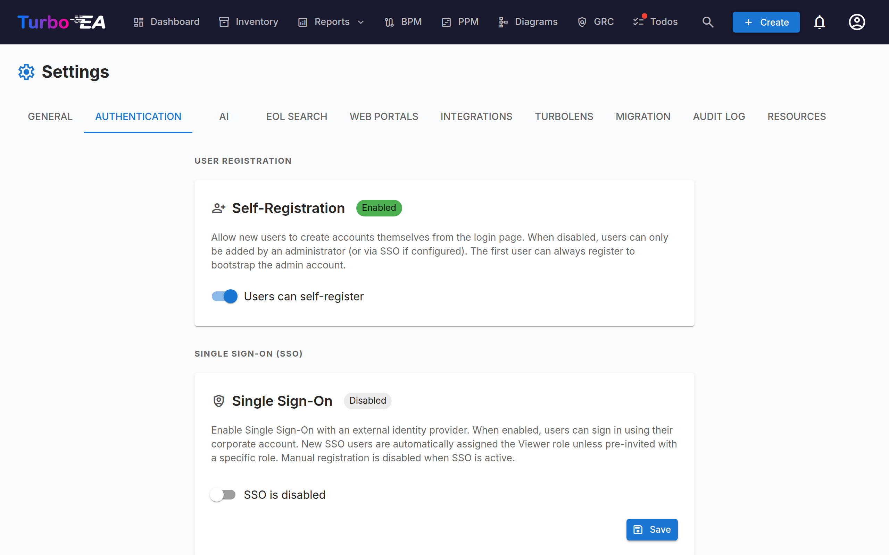

# Authentication & SSO



The **Authentication** tab in Settings allows administrators to configure how users sign in to the platform.

#### Self-Registration

- **Allow self-registration**: When enabled, new users can create accounts by clicking "Sign Up" on the login page. When disabled, only administrators can create accounts via the Invite User flow.

#### SSO (Single Sign-On) Configuration

SSO allows users to sign in using their corporate identity provider instead of a local password. Turbo EA supports four SSO providers:

| Provider | Description |
|----------|-------------|
| **Microsoft Entra ID** | For organizations using Microsoft 365 / Azure AD |
| **Google Workspace** | For organizations using Google Workspace |
| **Okta** | For organizations using Okta as their identity platform |
| **Generic OIDC** | For any OpenID Connect-compatible provider (e.g., Authentik, Keycloak, Auth0) |

**Steps to configure SSO:**

1. Go to **Admin > Settings > Authentication**
2. Toggle **Enable SSO** to on
3. Select your **SSO Provider** from the dropdown
4. Enter the required credentials from your identity provider:
   - **Client ID**: The application/client ID from your identity provider
   - **Client Secret**: The application secret (stored encrypted in the database)
   - Provider-specific fields:
     - **Microsoft**: Tenant ID (e.g., `your-tenant-id` or `common` for multi-tenant)
     - **Google**: Hosted Domain (optional, restricts login to a specific Google Workspace domain)
     - **Okta**: Okta Domain (e.g., `your-org.okta.com`)
     - **Generic OIDC**: Issuer URL (e.g., `https://auth.example.com/application/o/my-app/`). For Generic OIDC, the system attempts auto-discovery via the `.well-known/openid-configuration` endpoint
5. Click **Save**

**Manual OIDC Endpoints (Advanced):**

If the backend cannot reach your identity provider's discovery document (e.g., due to Docker networking or self-signed certificates), you can manually specify the OIDC endpoints:

- **Authorization Endpoint**: The URL where users are redirected to authenticate
- **Token Endpoint**: The URL used to exchange the authorization code for tokens
- **JWKS URI**: The URL for the JSON Web Key Set used to verify token signatures

These fields are optional. If left blank, the system uses auto-discovery. When filled in, they override the auto-discovered values.

**Testing SSO:**

After saving, open a new browser tab (or incognito window) and verify that the SSO login button appears on the login page and that authentication works end-to-end.

**Important notes:**
- The **Client Secret** is stored encrypted in the database and never exposed in API responses
- When SSO is enabled, local password login remains available as a fallback
- You can configure the redirect URI in your identity provider as: `https://your-turbo-ea-domain/auth/callback`

**Role mapping:**

By default every new SSO user arrives on the default role (or the role of their invitation) and an administrator changes it by hand in **Admin → Users**. If your identity provider already knows who should be an administrator, a member or a viewer — through group membership or app roles — Turbo EA can read that from the ID token and assign the role itself at each sign-in. The **Role mapping** block sits in the SSO section, below the provider fields, and is saved with the same **Save** button. Because the mapping hands out roles, changing the claim name or the mapping rows requires the permission to manage users in addition to the permission to manage settings; without it the block is read-only, and only the additional scopes can be changed.

- **Claim name**: the ID-token claim that lists the user's groups or roles, for example `roles` (Microsoft Entra app roles), `groups` (Okta, Keycloak) or `cognito:groups` (Amazon Cognito). A claim name is required as long as the mapping has rows. To turn role mapping off, remove all rows: roles then stay entirely manual.
- **Mapping rows**: each row pairs a **directory value** (a group or app-role value as the claim carries it) with a Turbo EA role. Use the arrows to order the rows; the first row that matches wins.
- **Additional scopes**: space-separated scopes requested at sign-in in addition to `openid email profile` — for example `groups` for Okta. They are requested both when the user is sent to the identity provider and when the sign-in code is exchanged for the ID token. The MCP server's sign-in requests the same scopes. They are never sent to Google, which refuses scopes it does not know.

The rules, all chosen so that a configuration mistake cannot lock you out:

- **The mapping is applied at every sign-in**, not only when the account is created. It overrides a role changed by hand, so removing someone from a directory group takes effect at their next sign-in.
- **The first matching row wins**, in the order of the rows, not the order in which the identity provider lists the values. Matching ignores case.
- **A claim value that matches no row** gives the default role.
- **A token without the claim, or with an empty claim**, leaves the user's current role unchanged. A mistyped claim name, or a provider that stopped sending the claim, therefore cannot demote every user at once.
- **A row whose role does not exist or has been archived** gives the default role. The settings page marks such a row so you can pick an active role.
- **The last active administrator is never demoted.** If the mapping would take the admin role from the only active administrator, they keep it and the Security & admin log records that the role was kept.
- **While a mapping is set, the role of SSO users is locked in Admin → Users** (the role picker is disabled, with a hint; a bulk role change skips those accounts and an Excel import leaves their role as it is, and both say so). Change the role in the directory instead, or switch the account to local sign-in to manage it by hand. Local accounts are never affected.

Notes per identity provider:

| Provider | What to configure |
|----------|-------------------|
| **Microsoft Entra ID** | Prefer **app roles**: declare them in the app registration, assign users or groups to them, and use the claim `roles`. Role mapping needs a **specific tenant ID**: with `organizations`, `common` or `consumers` any Microsoft tenant can sign in, and a mapping cannot be saved. The `groups` claim holds group object IDs, not names, and Entra leaves it out of the token entirely for a user in more than 200 groups. |
| **Okta** | Add a groups claim to the ID token in the authorization server (or the app's sign-on settings) and add `groups` under **Additional scopes**. Use the claim name you gave it, usually `groups`. |
| **Keycloak** (Generic OIDC) | Add a **Group Membership** mapper to the client, with the token claim name `groups` and **Add to ID token** on, so a top-level `groups` claim reaches the ID token (turn off **Full group path** to get plain group names). Nested claims such as `realm_access.roles` are not read. |
| **Amazon Cognito** (Generic OIDC) | Use the claim `cognito:groups`. |
| **Google Workspace** | Not available: Google ID tokens carry no groups claim, so the block is hidden for Google. |

!!! warning "Limits to keep in mind"
    - **Map app roles or group IDs, not display names that users can create themselves.** If anyone can create a group called `ea-admins`, anyone can become an administrator.
    - **The claim must be present in the ID token.** Turbo EA reads the ID token only — not the userinfo endpoint or a directory API. Some identity providers need both the scope under **Additional scopes** and a claim configuration before the groups appear in the ID token; sign in once and check the result before relying on it.
    - **A change in the directory takes effect at the user's next sign-in**, not during a session that is already open.
    - **An invitation's role is overridden at the first sign-in** when the mapping assigns one.
    - **A user whose token never carries the claim keeps their current role**, and while a mapping is set nobody can change it in Admin → Users. Fix the claim in the identity provider, or switch the account to local sign-in.
    - **An empty claim counts as absent**: removing someone from every mapped group does not demote them. Remove their access to the application in the identity provider instead.

#### Reverse proxy authentication

If Turbo EA runs behind a proxy that already signs your users in — Azure App Service's built-in authentication ("EasyAuth"), oauth2-proxy, Authelia, Cloudflare Access — it can accept that identity directly instead of running its own SSO on top. No OIDC client, no app registration, no client secret. Users land in Turbo EA already signed in.

This feature is configured entirely through environment variables and is **off by default**.

**Before anything else, set the bootstrap administrator.** Self-registration is closed while proxy authentication is on, so this is how the first administrator gets in — that email is granted the admin role on first sign-in:

```
TURBO_EA_PROXY_AUTH_BOOTSTRAP_ADMIN_EMAIL=you@yourcompany.com
```

**Azure App Service (EasyAuth) — recommended setup.** Turbo EA verifies the signed identity token Azure forwards with each request (this requires the App Service token store, which is on by default). `AUDIENCE` is your EasyAuth app registration's client ID; replace `TENANT` with your directory (tenant) ID:

```
TURBO_EA_PROXY_AUTH_ENABLED=true
TURBO_EA_PROXY_AUTH_TRUST_PLATFORM_HEADERS=true
TURBO_EA_PROXY_AUTH_VERIFY_ID_TOKEN=true
TURBO_EA_PROXY_AUTH_ISSUER=https://login.microsoftonline.com/TENANT/v2.0
TURBO_EA_PROXY_AUTH_AUDIENCE=your-easyauth-app-client-id
TURBO_EA_PROXY_AUTH_JWKS_URI=https://login.microsoftonline.com/TENANT/discovery/v2.0/keys
TURBO_EA_PROXY_AUTH_ALLOWED_DOMAINS=yourcompany.com
TURBO_EA_PROXY_AUTH_LOGOUT_URL=/.auth/logout
```

!!! warning "`TRUST_PLATFORM_HEADERS` is required on App Service"
    App Service cannot inject a custom secret header, so
    `TURBO_EA_PROXY_AUTH_TRUST_PLATFORM_HEADERS=true` is what takes the place of
    `TURBO_EA_PROXY_AUTH_SHARED_SECRET` — it is an explicit acknowledgement that
    you rely on Azure stripping inbound identity headers before they reach your
    app. It is checked **before** the identity token is even parsed, so
    verifying the token does not substitute for it. Omit both it and a shared
    secret and every sign-in fails with *Proxy authentication is enabled but not
    secured*, even with `VERIFY_ID_TOKEN=true`.

If your token store is disabled, additionally set
`TURBO_EA_PROXY_AUTH_VERIFY_ID_TOKEN=false` and rely on the header sanitisation
alone. Without a verified token **new accounts are not created automatically** —
invite users first, or use the bootstrap admin email.

**Generic proxy (oauth2-proxy, Authelia, Traefik forwardAuth, …).** Configure the proxy to inject a shared secret header on every request, so a request that did not come through the proxy can never be mistaken for one that did. Generate the value with `openssl rand -hex 32`:

```
TURBO_EA_PROXY_AUTH_ENABLED=true
TURBO_EA_PROXY_AUTH_MODE=header
TURBO_EA_PROXY_AUTH_SHARED_SECRET=<generated value, also set on the proxy>
TURBO_EA_PROXY_AUTH_EMAIL_HEADER=X-Forwarded-Email
TURBO_EA_PROXY_AUTH_ALLOWED_DOMAINS=yourcompany.com
TURBO_EA_PROXY_AUTH_LOGOUT_URL=/oauth2/sign_out
```

**Security notes:**

- The shared secret (or, on Azure, the verified identity token) is what makes the identity trustworthy — a header on its own can be written by anyone. The domain allowlist is required; set `TURBO_EA_PROXY_AUTH_ALLOW_ANY_DOMAIN=true` only if you genuinely accept any email domain.
- An identity that was not cryptographically verified can sign in existing users but never creates a new account, and pending invitations do not confer their role on this path.
- `TURBO_EA_PROXY_AUTH_LOGOUT_URL` is where Turbo EA sends the browser after **Sign out** so the proxy session ends too. Without it, the proxy still considers the user signed in — they land back on the login page and can re-enter with one click.

**Request header size.** A sign-in proxy adds cookies and token headers to every request. Turbo EA's longest requests carry a list of card ids in the URL — a request line of just under 8 KB — so every hop between the browser and Turbo EA must accept an 8 KB request line together with those headers. The bundled edge nginx does (16 KB per header line since 2.217.1). If you run your own nginx or ingress-nginx in front as well, give it the same room: `large_client_header_buffers 4 16k;`, or `large-client-header-buffers: "4 16k"` in the ingress-nginx ConfigMap. A hop that is too small answers `400 Request Header Or Cookie Too Large` or `414` on Inventory exports and large diagrams while everything else works.

**Role mapping (optional).** By default everyone arrives on the configured default role and an administrator promotes from there. If your identity provider already knows the answer — an Entra app registration that declares its own app roles, an oauth2-proxy that forwards group membership — Turbo EA can read it and assign the role itself:

```
TURBO_EA_PROXY_AUTH_ROLE_CLAIM=roles
TURBO_EA_PROXY_AUTH_ROLE_MAP=ADMIN:admin,MANAGER:member,READ-ONLY:viewer
```

Each pair is `DIRECTORY_VALUE:turbo-ea-role-key`. When a user holds several directory roles, **the first entry in the map wins** — map order, not the order the provider happened to send them, because the two Azure identity formats disagree on that. Matching ignores case on the directory side. In generic proxy mode the same map reads a comma-separated header instead of a claim: `TURBO_EA_PROXY_AUTH_ROLE_HEADER=X-Forwarded-Groups`.

!!! warning "The map is authoritative on every sign-in"
    Not only at account creation — removing someone's directory role has to take effect. While the map is in force, the role of an account that signs in through the proxy is therefore **locked in Admin → Users**: the role picker is disabled with a hint, a bulk role change skips the account and an Excel import leaves its role as it is, instead of letting a hand-made change be silently replaced at the next sign-in. Leave `TURBO_EA_PROXY_AUTH_ROLE_MAP` unset and nothing changes: roles stay entirely manual.

The edge cases, all chosen so a configuration mistake cannot lock you out:

- **`TURBO_EA_PROXY_AUTH_BOOTSTRAP_ADMIN_EMAIL` always wins** over the map. If the two disagree, that address is admin.
- **A value that matches nothing in the map** — or names a Turbo EA role that does not exist or has been archived — falls back to the default role.
- **The last active administrator is never demoted.** If the map would take the admin role from the only active administrator, they keep it, and the Security & admin log records that the role was kept.
- **A claim that is absent entirely** leaves the user's current role untouched. This is deliberately different from the case above: a mistyped `ROLE_CLAIM`, or a token store that stopped forwarding, would otherwise demote every user on the instance in one pass.
- **The identity has to be worth trusting with permissions.** Role mapping applies when the identity token was verified (`TURBO_EA_PROXY_AUTH_VERIFY_ID_TOKEN=true`) or a shared secret is configured. On App Service with the token store disabled and no secret, the map is ignored and a line is written to the log saying so — the same reasoning that stops an unverified header creating an account.

**All variables:**

| Variable | Default | Purpose |
|----------|---------|---------|
| `TURBO_EA_PROXY_AUTH_ENABLED` | `false` | Master switch |
| `TURBO_EA_PROXY_AUTH_MODE` | `azure_easyauth` | `azure_easyauth` or `header` |
| `TURBO_EA_PROXY_AUTH_SHARED_SECRET` | — | Required in `header` mode; the proxy injects it |
| `TURBO_EA_PROXY_AUTH_SECRET_HEADER` | `X-Turbo-EA-Proxy-Secret` | Header carrying the shared secret |
| `TURBO_EA_PROXY_AUTH_VERIFY_ID_TOKEN` | `false` | Verify the forwarded identity token (Azure mode) |
| `TURBO_EA_PROXY_AUTH_ISSUER` / `_AUDIENCE` / `_JWKS_URI` | — | Token verification settings |
| `TURBO_EA_PROXY_AUTH_TRUST_PLATFORM_HEADERS` | `false` | Azure only: accept the platform's header sanitisation instead of a secret. Required on App Service |
| `TURBO_EA_PROXY_AUTH_EMAIL_HEADER` | `X-Forwarded-Email` | `header` mode: email header |
| `TURBO_EA_PROXY_AUTH_NAME_HEADER` | `X-Forwarded-User` | `header` mode: display-name header |
| `TURBO_EA_PROXY_AUTH_SUBJECT_HEADER` | `X-Forwarded-Subject` | `header` mode: stable subject id header |
| `TURBO_EA_PROXY_AUTH_ALLOWED_DOMAINS` | — | Comma-separated allowed email domains (required) |
| `TURBO_EA_PROXY_AUTH_ALLOW_ANY_DOMAIN` | `false` | Explicitly accept any email domain |
| `TURBO_EA_PROXY_AUTH_BOOTSTRAP_ADMIN_EMAIL` | — | Granted admin on first sign-in |
| `TURBO_EA_PROXY_AUTH_ROLE_MAP` | — | `DIRECTORY_VALUE:role-key,…` — empty means roles stay manual |
| `TURBO_EA_PROXY_AUTH_ROLE_CLAIM` | `roles` | Claim carrying the directory role (Azure mode) |
| `TURBO_EA_PROXY_AUTH_ROLE_HEADER` | `X-Forwarded-Groups` | `header` mode: comma-separated role header |
| `TURBO_EA_PROXY_AUTH_LOGOUT_URL` | — | Where Sign out sends the browser |

**Limitations:** the MCP server's OAuth flow requires regular SSO to be configured; proxy authentication alone does not cover it.
