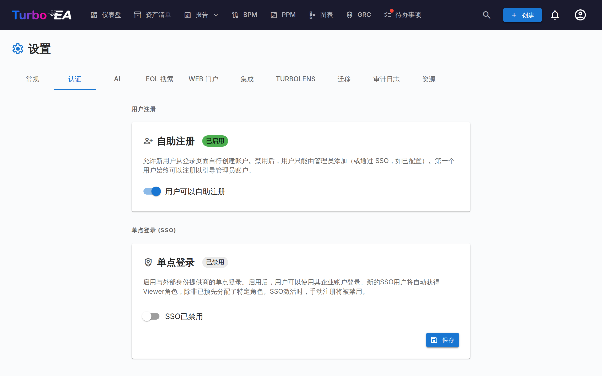

# 身份验证与 SSO



设置中的**身份验证**标签页允许管理员配置用户登录平台的方式。

#### 自助注册

- **允许自助注册**：启用后，新用户可以通过点击登录页面上的「注册」创建账户。禁用后，只有管理员可以通过邀请用户流程创建账户。

#### SSO（单点登录）配置

SSO 允许用户使用企业身份提供商登录，而不是本地密码。Turbo EA 支持四种 SSO 提供商：

| 提供商 | 描述 |
|--------|------|
| **Microsoft Entra ID** | 适用于使用 Microsoft 365 / Azure AD 的组织 |
| **Google Workspace** | 适用于使用 Google Workspace 的组织 |
| **Okta** | 适用于使用 Okta 作为身份平台的组织 |
| **通用 OIDC** | 适用于任何兼容 OpenID Connect 的提供商（例如 Authentik、Keycloak、Auth0） |

**配置 SSO 的步骤：**

1. 前往**管理 > 设置 > 身份验证**
2. 将**启用 SSO**切换为开启
3. 从下拉菜单中选择您的 **SSO 提供商**
4. 输入身份提供商提供的所需凭据：
   - **客户端 ID**：来自身份提供商的应用程序/客户端 ID
   - **客户端密钥**：应用程序密钥（在数据库中加密存储）
   - 特定于提供商的字段：
     - **Microsoft**：租户 ID（例如 `your-tenant-id` 或 `common` 用于多租户）
     - **Google**：托管域名（可选，限制登录到特定 Google Workspace 域名）
     - **Okta**：Okta 域名（例如 `your-org.okta.com`）
     - **通用 OIDC**：发行者 URL（例如 `https://auth.example.com/application/o/my-app/`）。对于通用 OIDC，系统会尝试通过 `.well-known/openid-configuration` 端点进行自动发现
5. 点击**保存**

**手动 OIDC 端点（高级）：**

如果后端无法访问身份提供商的发现文档（例如由于 Docker 网络或自签名证书），您可以手动指定 OIDC 端点：

- **授权端点**：用户被重定向进行身份验证的 URL
- **令牌端点**：用于交换授权码获取令牌的 URL
- **JWKS URI**：用于验证令牌签名的 JSON Web Key Set URL

这些字段是可选的。如果留空，系统使用自动发现。填写后，它们将覆盖自动发现的值。

**测试 SSO：**

保存后，打开新的浏览器标签页（或无痕窗口），验证 SSO 登录按钮是否出现在登录页面上，以及身份验证是否端到端正常工作。

**重要注意事项：**
- **客户端密钥**在数据库中加密存储，永远不会在 API 响应中暴露
- 启用 SSO 后，本地密码登录仍然可用作备用方案
- 您可以在身份提供商中将重定向 URI 配置为：`https://your-turbo-ea-domain/auth/callback`

**角色映射：**

默认情况下，每个新的 SSO 用户都使用默认角色（或其邀请中的角色）进入，由管理员在 **管理 → 用户** 中手动更改。如果您的身份提供商已经知道谁应该是管理员、成员或查看者（通过组成员身份或应用角色），Turbo EA 可以从 ID 令牌中读取这些信息，并在每次登录时自行分配角色。**角色映射** 区块位于 SSO 部分的提供商字段下方，并使用同一个**保存**按钮保存：

- **声明名称**：列出用户的组或角色的 ID 令牌声明，例如 `roles`（Microsoft Entra 应用角色）、`groups`（Okta、Keycloak）或 `cognito:groups`（Amazon Cognito）。将其留空，或让映射没有任何行，角色就完全保持手动维护。
- **映射行**：每一行将一个**目录值**（声明中携带的组或应用角色值）与一个 Turbo EA 角色配对。使用箭头调整行的顺序；第一条匹配的行优先。
- **附加范围**：登录时除 `openid email profile` 之外额外请求的范围（scope），以空格分隔，例如 Okta 的 `groups`。MCP 服务器的登录请求相同的范围。

这些规则的设计目的，都是让配置错误无法把您锁在门外：

- **映射在每次登录时应用**，而不仅仅是在创建账户时。它会覆盖手动更改的角色，因此将某人从目录组中移除会在其下次登录时生效。
- **第一条匹配的行优先**，按行的顺序，而不是身份提供商列出各值的顺序。匹配时忽略大小写。
- **不匹配任何行的声明值**会得到默认角色。
- **令牌中没有该声明，或声明为空**，则用户的当前角色保持不变。因此，声明名称拼写错误，或提供商不再发送该声明，都不会一次性降级所有用户。
- **角色不存在或已被归档的行**会得到默认角色。设置页面会标记这样的行，以便您选择一个有效角色。
- **最后一位活跃管理员永远不会被降级。** 如果映射会取走唯一活跃管理员的管理员角色，他会保留该角色，并且「安全与管理」日志会记录该角色被保留。
- **设置映射期间，SSO 用户的角色在 管理 → 用户 中被锁定**（角色选择器被禁用并附有提示；批量更改角色会跳过这些账户，Excel 导入会保持它们的角色不变，两者都会给出说明）。请改为在目录中更改角色，或将账户切换为本地登录以手动管理。本地账户永远不受影响。

各身份提供商的说明：

| 提供商 | 需要配置的内容 |
|--------|----------------|
| **Microsoft Entra ID** | 优先使用**应用角色**：在应用注册中声明它们，将用户或组分配给它们，并使用声明 `roles`。角色映射需要**具体的租户 ID**：使用 `organizations`、`common` 或 `consumers` 时，任何 Microsoft 租户都可以登录，因此无法保存映射。`groups` 声明包含的是组的对象 ID，而不是名称，并且对于属于 200 个以上组的用户，Entra 会把它从令牌中完全省略。 |
| **Okta** | 在授权服务器（或应用的登录设置）中为 ID 令牌添加组声明，并在**附加范围**下添加 `groups`。使用您为其指定的声明名称，通常是 `groups`。 |
| **Keycloak**（Generic OIDC） | 为客户端添加 **Group Membership** 映射器，令牌声明名称为 `groups` 并开启 **Add to ID token**，使顶层的 `groups` 声明进入 ID 令牌（关闭 **Full group path** 以获得纯组名）。不会读取 `realm_access.roles` 之类的嵌套声明。 |
| **Amazon Cognito**（Generic OIDC） | 使用声明 `cognito:groups`。 |
| **Google Workspace** | 不可用：Google 的 ID 令牌不含组声明，因此该区块对 Google 隐藏。 |

!!! warning "需要牢记的限制"
    - **映射应用角色或组 ID，而不是用户可以自行创建的显示名称。** 如果任何人都能创建名为 `ea-admins` 的组，那么任何人都可以成为管理员。
    - **声明必须出现在 ID 令牌中。** Turbo EA 只读取 ID 令牌，不读取 userinfo 端点或目录 API。有些身份提供商既需要在**附加范围**中填写范围，也需要配置声明，组才会出现在 ID 令牌中；请先登录一次并检查结果，再依赖它。
    - **目录中的更改在用户下次登录时生效**，而不是在已经打开的会话中生效。
    - **当映射分配了角色时，邀请中的角色会在首次登录时被覆盖。**
    - **令牌中始终不含该声明的用户保留其当前角色**，并且在设置映射期间，任何人都无法在 管理 → 用户 中更改它。请在身份提供商中修正声明，或将账户切换为本地登录。
    - **空声明视为不存在**：将某人从所有已映射的组中移除并不会将其降级。请改为在身份提供商中撤销其对该应用的访问权限。

#### 反向代理身份验证

如果 Turbo EA 运行在一个已经为用户完成登录的代理之后——Azure App Service 的内置身份验证（「EasyAuth」）、oauth2-proxy、Authelia、Cloudflare Access——它可以直接接受该身份，而无需在其之上再运行自己的 SSO。无需 OIDC 客户端、无需应用注册、无需客户端密钥。用户进入 Turbo EA 时即已处于登录状态。

此功能完全通过环境变量配置，且**默认关闭**。

**首先，请设置引导管理员。** 启用代理身份验证后自助注册将被关闭，因此这是第一位管理员进入系统的方式——该邮箱在首次登录时会被授予管理员角色：

```
TURBO_EA_PROXY_AUTH_BOOTSTRAP_ADMIN_EMAIL=you@yourcompany.com
```

**Azure App Service（EasyAuth）——推荐配置。** Turbo EA 会验证 Azure 随每个请求转发的已签名身份令牌（这需要 App Service 令牌存储，默认开启）。`AUDIENCE` 是您的 EasyAuth 应用注册的客户端 ID；请将 `TENANT` 替换为您的目录（租户）ID：

```
TURBO_EA_PROXY_AUTH_ENABLED=true
TURBO_EA_PROXY_AUTH_TRUST_PLATFORM_HEADERS=true
TURBO_EA_PROXY_AUTH_VERIFY_ID_TOKEN=true
TURBO_EA_PROXY_AUTH_ISSUER=https://login.microsoftonline.com/TENANT/v2.0
TURBO_EA_PROXY_AUTH_AUDIENCE=your-easyauth-app-client-id
TURBO_EA_PROXY_AUTH_JWKS_URI=https://login.microsoftonline.com/TENANT/discovery/v2.0/keys
TURBO_EA_PROXY_AUTH_ALLOWED_DOMAINS=yourcompany.com
TURBO_EA_PROXY_AUTH_LOGOUT_URL=/.auth/logout
```

!!! warning "在 App Service 上必须设置 `TRUST_PLATFORM_HEADERS`"
    App Service 无法注入自定义的密钥标头，因此
    `TURBO_EA_PROXY_AUTH_TRUST_PLATFORM_HEADERS=true` 取代了
    `TURBO_EA_PROXY_AUTH_SHARED_SECRET` 的位置——它是一种明确确认，表示您依赖
    Azure 在入站请求到达您的应用之前剥离身份标头。该检查发生在解析身份令牌
    **之前**，因此验证令牌并不能取代它。若这项设置与共享密钥都未提供，则每次登录
    都会以 *Proxy authentication is enabled but not secured* 失败，即便
    `VERIFY_ID_TOKEN=true` 也是如此。

如果您的令牌存储已禁用，请另外设置 `TURBO_EA_PROXY_AUTH_VERIFY_ID_TOKEN=false`，仅依赖标头清理机制。在没有已验证令牌的情况下**不会自动创建新账户**——请先邀请用户，或使用引导管理员邮箱。

**通用代理（oauth2-proxy、Authelia、Traefik forwardAuth 等）。** 请将代理配置为在每个请求上注入一个共享密钥标头，这样未经过代理的请求就永远不会被误认为是经过代理的请求。使用 `openssl rand -hex 32` 生成该值：

```
TURBO_EA_PROXY_AUTH_ENABLED=true
TURBO_EA_PROXY_AUTH_MODE=header
TURBO_EA_PROXY_AUTH_SHARED_SECRET=<生成的值，同时也要在代理上设置>
TURBO_EA_PROXY_AUTH_EMAIL_HEADER=X-Forwarded-Email
TURBO_EA_PROXY_AUTH_ALLOWED_DOMAINS=yourcompany.com
TURBO_EA_PROXY_AUTH_LOGOUT_URL=/oauth2/sign_out
```

**安全注意事项：**

- 共享密钥（在 Azure 上则是已验证的身份令牌）是身份可信的根本——单独的标头任何人都可以写入。域名允许列表是必需的；只有当您确实接受任何邮箱域名时，才设置 `TURBO_EA_PROXY_AUTH_ALLOW_ANY_DOMAIN=true`。
- 未经加密学验证的身份可以让现有用户登录，但永远不会创建新账户，且待处理的邀请在此路径上不会授予其预设角色。
- `TURBO_EA_PROXY_AUTH_LOGOUT_URL` 是用户点击**退出登录**后 Turbo EA 将浏览器重定向到的地址，以便同时结束代理会话。如果不设置，代理仍会认为用户处于登录状态——用户会回到登录页面，并且只需一次点击即可重新进入。

**请求头大小。** 登录代理会为每个请求添加 Cookie 和令牌头。Turbo EA 最长的请求在 URL 中携带一个卡片 ID 列表 —— 请求行接近 8 KB —— 因此浏览器与 Turbo EA 之间的每一跳都必须能接受 8 KB 的请求行以及这些请求头。自带的边缘 nginx 可以做到（自 2.217.1 起每行请求头 16 KB）。如果您在前面还运行了自己的 nginx 或 ingress-nginx，请给它同样的空间：`large_client_header_buffers 4 16k;`，或在 ingress-nginx 的 ConfigMap 中设置 `large-client-header-buffers: "4 16k"`。如果某一跳太小，库存导出和大型图表会返回 `400 Request Header Or Cookie Too Large` 或 `414`，而其他功能一切正常。

**角色映射（可选）。** 默认情况下，所有人都落在配置的默认角色上，再由管理员逐个提升。如果您的身份提供方已经知道答案 —— 例如声明了自有应用角色的 Entra 应用注册，或转发组成员身份的 oauth2-proxy —— Turbo EA 可以读取它并自行分配角色：

```
TURBO_EA_PROXY_AUTH_ROLE_CLAIM=roles
TURBO_EA_PROXY_AUTH_ROLE_MAP=ADMIN:admin,MANAGER:member,READ-ONLY:viewer
```

每一对写作 `目录取值:turbo-ea-角色键`。当用户同时拥有多个目录角色时，**映射中的第一条优先** —— 依据的是映射顺序，而不是提供方碰巧发送的顺序，因为两种 Azure 身份格式在这一点上并不一致。匹配时忽略目录一侧的大小写。在通用代理模式下，同一份映射读取的是以逗号分隔的请求头而非声明：`TURBO_EA_PROXY_AUTH_ROLE_HEADER=X-Forwarded-Groups`。

!!! warning "映射在每次登录时都具有决定权"
    不仅仅是在创建账户时 —— 撤销某人的目录角色必须真正生效。因此，只要映射生效，通过代理登录的账户的角色就会在 **管理 → 用户** 中被**锁定**：角色选择器被禁用并附有提示，批量更改角色会跳过该账户，Excel 导入会保持其角色不变，而不是让手工所做的更改在下次登录时被悄悄替换。将 `TURBO_EA_PROXY_AUTH_ROLE_MAP` 留空则一切照旧：角色完全由人工维护。

以下边界情况的处理方式，都是为了让配置失误不会把您锁在门外：

- **`TURBO_EA_PROXY_AUTH_BOOTSTRAP_ADMIN_EMAIL` 始终优先于**映射。两者冲突时，该地址就是管理员。
- **与映射中任何一条都不匹配的取值** —— 或指向不存在、已归档的 Turbo EA 角色 —— 回退到默认角色。
- **最后一位活跃管理员永远不会被降级。** 如果映射会取走唯一活跃管理员的管理员角色，他会保留该角色，并且「安全与管理」日志会记录该角色被保留。
- **完全缺失的声明**会让用户当前的角色保持不变。这与上一条是刻意区分开的：`ROLE_CLAIM` 拼错，或令牌存储不再转发，否则会在一次登录中把实例上的所有用户一并降级。
- **身份必须可信到足以托付权限。** 当身份令牌已通过验证（`TURBO_EA_PROXY_AUTH_VERIFY_ID_TOKEN=true`）或已配置共享密钥时，角色映射才会生效。在关闭了令牌存储且没有密钥的 App Service 上，映射会被忽略并在日志中写入一行说明 —— 与未经验证的请求头不得创建账户，出于同一个理由。

**全部变量：**

| 变量 | 默认值 | 用途 |
|----------|---------|---------|
| `TURBO_EA_PROXY_AUTH_ENABLED` | `false` | 总开关 |
| `TURBO_EA_PROXY_AUTH_MODE` | `azure_easyauth` | `azure_easyauth` 或 `header` |
| `TURBO_EA_PROXY_AUTH_SHARED_SECRET` | — | `header` 模式下必需；由代理注入 |
| `TURBO_EA_PROXY_AUTH_SECRET_HEADER` | `X-Turbo-EA-Proxy-Secret` | 携带共享密钥的标头 |
| `TURBO_EA_PROXY_AUTH_VERIFY_ID_TOKEN` | `false` | 验证转发的身份令牌（Azure 模式） |
| `TURBO_EA_PROXY_AUTH_ISSUER` / `_AUDIENCE` / `_JWKS_URI` | — | 令牌验证设置 |
| `TURBO_EA_PROXY_AUTH_TRUST_PLATFORM_HEADERS` | `false` | 仅限 Azure：信任平台对标头的清理机制，而非共享密钥，在 App Service 上为必填 |
| `TURBO_EA_PROXY_AUTH_EMAIL_HEADER` | `X-Forwarded-Email` | `header` 模式：邮箱标头 |
| `TURBO_EA_PROXY_AUTH_NAME_HEADER` | `X-Forwarded-User` | `header` 模式：显示名称标头 |
| `TURBO_EA_PROXY_AUTH_SUBJECT_HEADER` | `X-Forwarded-Subject` | `header` 模式：稳定主体 ID 标头 |
| `TURBO_EA_PROXY_AUTH_ALLOWED_DOMAINS` | — | 逗号分隔的允许邮箱域名列表（必需） |
| `TURBO_EA_PROXY_AUTH_ALLOW_ANY_DOMAIN` | `false` | 明确接受任何邮箱域名 |
| `TURBO_EA_PROXY_AUTH_BOOTSTRAP_ADMIN_EMAIL` | — | 首次登录时被授予管理员角色 |
| `TURBO_EA_PROXY_AUTH_ROLE_MAP` | — | `目录取值:角色键,…` —— 留空表示角色仍由人工维护 |
| `TURBO_EA_PROXY_AUTH_ROLE_CLAIM` | `roles` | 承载目录角色的声明（Azure 模式） |
| `TURBO_EA_PROXY_AUTH_ROLE_HEADER` | `X-Forwarded-Groups` | `header` 模式：以逗号分隔的角色请求头 |
| `TURBO_EA_PROXY_AUTH_LOGOUT_URL` | — | 退出登录后浏览器跳转的地址 |

**限制：** MCP 服务器的 OAuth 流程需要配置常规 SSO；仅有代理身份验证无法覆盖该场景。
