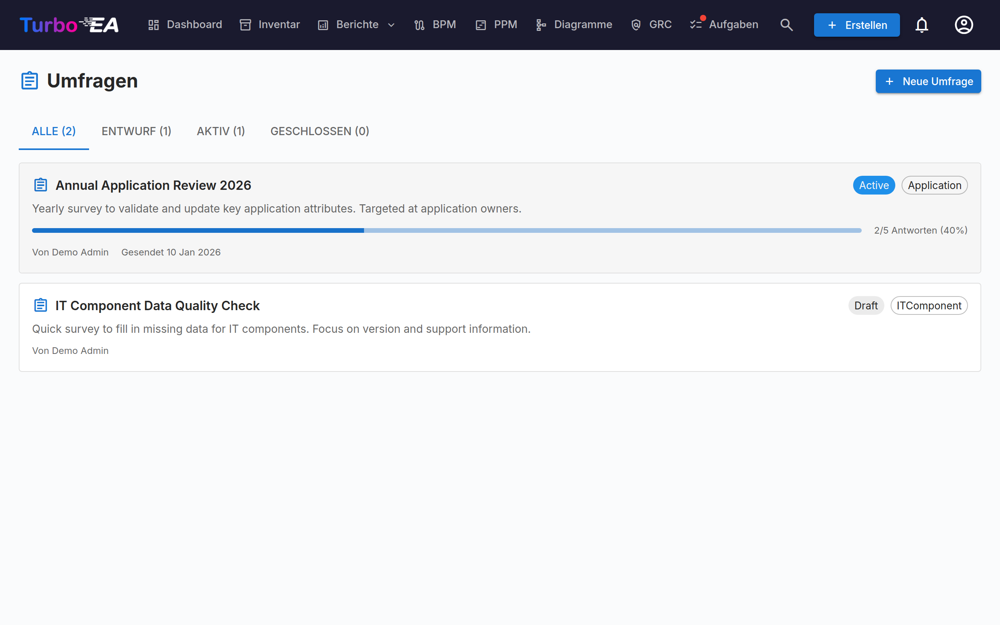

# Umfragen

Das **Umfragen**-Modul (**Admin > Umfragen**) ermöglicht Administratoren die Erstellung von **Datenpflege-Umfragen**, die strukturierte Informationen von Stakeholdern über bestimmte Karten sammeln.

## Anwendungsfall

Umfragen helfen dabei, Ihre Architekturdaten aktuell zu halten, indem Sie die Personen erreichen, die den einzelnen Komponenten am nächsten stehen. Zum Beispiel:

- Anwendungseigner jährlich bitten, Geschäftskritikalität und Lebenszyklus-Daten zu bestätigen
- Technische Eignungsbewertungen von IT-Teams einholen
- Kostenaktualisierungen von Budgetverantwortlichen sammeln

## Umfrage-Lebenszyklus

Jede Umfrage durchläuft drei Status:

| Status | Bedeutung |
|--------|-----------|
| **Entwurf** | Wird gestaltet, noch nicht für Befragte sichtbar |
| **Aktiv** | Offen für Antworten, zugewiesene Stakeholder sehen sie in ihren Aufgaben |
| **Geschlossen** | Nimmt keine Antworten mehr entgegen |

## Eine Umfrage erstellen

1. Navigieren Sie zu **Admin > Umfragen**
2. Klicken Sie auf **+ Neue Umfrage**
3. Der **Umfrage-Builder** öffnet sich mit folgender Konfiguration:

### Zieltyp

Wählen Sie aus, auf welchen Kartentyp sich die Umfrage bezieht (z.B. Anwendung, IT-Komponente). Die Umfrage wird für jede Karte dieses Typs gesendet, die Ihren Filtern entspricht.

### Filter

Schränken Sie den Umfang optional über Filter ein. Vier Filtertypen lassen sich beliebig kombinieren:

- **Bestimmte Karten** — Wählen Sie eine oder mehrere Karten direkt aus (eingeschränkt auf den gewählten Zieltyp). Geeignet, um eine einzelne oder eine handverlesene Auswahl von Karten anzusprechen.
- **Mit Karten verknüpft** — Nur Karten einbeziehen, die eine Beziehung zu einem der aufgeführten Elemente haben (z. B. alle Anwendungen, die mit der Organisation Vertrieb verknüpft sind).
- **Tags** und **Attributfilter** — Karten anhand von Tags oder Attributbedingungen treffen (z. B. Kosten größer als 10 000, TIME-Bewertung fehlt).
- **Letzte Änderung** — Nur Karten einbeziehen, die seit Längerem niemand geändert hat: 30 Tage, 90 Tage, 6 Monate, 1 Jahr oder eine eigene Anzahl von Tagen oder Monaten. Der Builder zeigt bei der Auswahl das resultierende Stichtagsdatum an. Das Zeitfenster bezieht sich auf den Zeitpunkt des **Versands**, nicht auf den der Erstellung — ein länger liegen gebliebener Entwurf findet also weiterhin die dann veralteten Karten. Gemessen wird das Änderungsdatum der Karte — dasselbe, das die Inventarspalte und der Verlauf der Karte anzeigen.

### Fragen

Gestalten Sie Ihre Fragen. Jede Frage kann sein:

- **Freitext** — Offene Antwort
- **Einfachauswahl** — Eine Option aus einer Liste wählen
- **Mehrfachauswahl** — Mehrere Optionen wählen
- **Zahl** — Numerische Eingabe
- **Datum** — Datumsauswahl
- **Boolean** — Auswahl aus einer Ja/Nein-Liste; **Keine** ist keine Antwort und lässt den Wert der Karte unverändert

### Beziehungen

Über Attribute hinaus kann eine Umfrage die Befragten auch bitten, die **Beziehungen** einer Karte aktuell zu halten. Im Schritt **Felder** listet der Abschnitt **Beziehungen** jede Beziehung auf, die der Ziel-Kartentyp haben kann, in beiden Richtungen (zum Beispiel für eine Anwendung: *unterstützt → IT-Komponente* und *genutzt von ← Organisation*). Ein Kartentyp, der Abstammung unterstützt, erscheint hier wie jede andere Beziehung, in beiden Richtungen und mit seinen eigenen Verben — bei einer Anwendung erfasst *folgt auf* die abgelösten Karten und *wird abgelöst durch* die ablösenden. Seiten, die eine Administratorin oder ein Administrator am Kartentyp ausgeblendet hat, werden nicht angeboten. Für jede ausgewählte Beziehung wählen Sie eine Aktion:

- **Pflegen** — Der Befragte sieht die aktuell verknüpften Karten und kann über eine Suchauswahl Verknüpfungen hinzufügen oder entfernen.
- **Bestätigen** — Der Befragte bestätigt lediglich, dass die aktuellen Verknüpfungen korrekt sind, oder schaltet den Schalter aus, um Änderungen vorzuschlagen.

Wenn Sie eine solche Antwort anwenden, fügt Turbo EA die neuen Verknüpfungen hinzu und entfernt die vom Befragten entfernten. Die Änderung wird im Verlauf der Karte festgehalten, genau wie eine manuelle Beziehungsänderung.

### Lebenszyklusdaten und Stakeholder-Rollen

Zwei weitere Tabellen im Schritt **Felder** erlauben Fragen zu Dingen, die keine Attribute sind:

- **Lebenszyklusdaten** — eine Zeile pro Phase (Planung, Einführung, Aktiv, Auslauf, End of Life). Die befragte Person sieht das aktuelle Datum der Karte und bestätigt es oder schlägt ein anderes vor; ein geleertes Datum schlägt vor, es zu entfernen. Eine Phase, die nach der folgenden Phase datiert ist, wird im Formular markiert – wie auf der Karte. Die Tabelle wird nicht angeboten, wenn der Kartentyp seinen Lebenszyklusabschnitt ausblendet.
- **Stakeholder-Rollen** — eine Zeile pro Stakeholder-Rolle des Zielkartentyps. Die befragte Person sieht, wer die Rolle heute innehat, und bearbeitet die Liste mit einer Personenauswahl. Beim Übernehmen der Antwort werden die hinzugefügten Personen ergänzt und die entfernten gestrichen; deaktivierte Benutzer werden nie hinzugefügt oder entfernt.

Jedes dieser Felder kann wie jedes andere **Pflegen** oder **Bestätigen** sein.

### Auto-Aktionen

Konfigurieren Sie Regeln, die Kartenattribute basierend auf Umfrageantworten automatisch aktualisieren. Zum Beispiel: Wenn ein Befragter «Mission Critical» für die Geschäftskritikalität auswählt, kann das `businessCriticality`-Feld der Karte automatisch aktualisiert werden.

## Eine Umfrage versenden

Sobald Ihre Umfrage im Status **Aktiv** ist:

1. Klicken Sie auf **Senden**, um die Umfrage zu verteilen
2. Für jede Zielkarte wird eine Aufgabe für die zugewiesenen Stakeholder generiert
3. Stakeholder sehen die Umfrage in ihrem Tab **Meine Umfragen** auf der [Aufgabenseite](../guide/tasks.md)
4. Jeder Stakeholder erhält **eine** Benachrichtigung — und, sofern aktiviert, eine E-Mail —, unabhängig davon, wie viele seiner Karten in der Umfrage sind; die E-Mail listet diese Karten auf und verlinkt jede direkt auf ihr Antwortformular

!!! note "Eine Karte braucht jemanden zum Fragen"

    Eine Karte wird nur befragt, wenn mindestens eine Person eine der **Ziel-Stakeholder-Rollen** auf ihr innehat. Karten, die Ihren Filtern entsprechen, aber keinen solchen Stakeholder haben, werden übersprungen. Der Schritt **Vorschau & Senden** nennt deren Anzahl, damit Sie Verantwortliche zuweisen können.

Eine Umfrage kann auch von einer installierten Erweiterung erstellt und gesendet werden — etwa von einer geplanten Regel, die die Verantwortlichen aller Karten, die eine Bedingung erfüllen, um Vervollständigung bittet. Eine solche Umfrage nennt keinen Autor, ihre Felder sind die des Kartentyps, und sie verhält sich wie jede andere: Sie schließen sie und übernehmen ihre Antworten hier. Das Zurückrollen des Erweiterungslaufs in **Admin → Audit-Log** schließt die Umfrage und zieht die noch unbeantworteten Anfragen zurück.

## Ergebnisse anzeigen

Navigieren Sie zu **Admin > Umfragen > [Umfragename] > Ergebnisse**, um zu sehen:

- Antwortstatus pro Karte (beantwortet, ausstehend)
- Einzelne Antworten mit Antworten pro Frage
- Eine **Anwenden**-Aktion, um Auto-Aktionsregeln auf Kartenattribute anzuwenden

Das Übernehmen einer Antwort durchläuft dieselben Prüfungen wie eine Bearbeitung direkt auf der Karte. Ein Wert, den die Karte ablehnt – etwa eine Option, die es nicht mehr gibt –, wird für diese Antwort gemeldet und nichts davon übernommen, während die übrigen Antworten trotzdem übernommen werden. Jede Änderung erscheint im Tab **Verlauf** der Karte unter der Administratorin bzw. dem Administrator, die sie übernommen hat, mit einer Markierung **über Umfrage**, die die Umfrage nennt; beim Darüberfahren wird angezeigt, wer geantwortet hat. Das gesamte Übernehmen ist ein Eintrag unter **Admin → Audit-Log** und kann dort zurückgerollt werden.

## Eine Umfrage löschen

Umfragen jedes Status können gelöscht werden: Öffnen Sie das Menü **⋮** in ihrer Zeile unter **Admin > Umfragen** oder verwenden Sie **Löschen** im Umfrage-Builder oder auf der Ergebnisseite. Die Bestätigung nennt, was mit entfernt wird: Anfragen, die noch auf eine Antwort warten, werden samt ihren Benachrichtigungen zurückgezogen, und noch nicht übernommene Antworten gehen verloren. Bereits übernommene Änderungen bleiben auf den Karten, und der Kartenverlauf nennt die Umfrage weiterhin.
