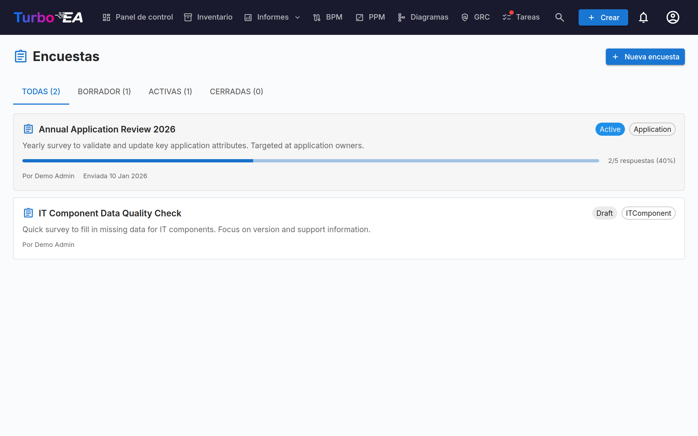

# Encuestas

El módulo de **Encuestas** (**Administrador > Encuestas**) permite a los administradores crear **encuestas de mantenimiento de datos** que recopilan información estructurada de las partes interesadas sobre fichas específicas.

## Caso de Uso

Las encuestas ayudan a mantener actualizados los datos de arquitectura contactando a las personas más cercanas a cada componente. Por ejemplo:

- Solicitar a los responsables de aplicaciones que confirmen la criticidad de negocio y las fechas de ciclo de vida anualmente
- Recopilar evaluaciones de idoneidad técnica de los equipos de TI
- Obtener actualizaciones de costos de los responsables de presupuesto

## Ciclo de Vida de la Encuesta

Cada encuesta progresa a través de tres estados:

| Estado | Significado |
|--------|-------------|
| **Borrador** | En diseño, aún no visible para los encuestados |
| **Activa** | Abierta para respuestas, las partes interesadas asignadas la ven en sus Tareas |
| **Cerrada** | Ya no acepta respuestas |

## Creación de una Encuesta

1. Navegue a **Administrador > Encuestas**
2. Haga clic en **+ Nueva Encuesta**
3. Se abre el **Constructor de Encuestas** con la siguiente configuración:

### Tipo de Ficha Objetivo

Seleccione a qué tipo de ficha se aplica la encuesta (por ejemplo, Aplicación, Componente TI). La encuesta se enviará para cada ficha de este tipo que coincida con sus filtros.

### Filtros

Limite opcionalmente el alcance mediante filtros. Hay cuatro tipos de filtros que pueden combinarse:

- **Fichas específicas** — Elija una o varias fichas directamente (restringidas al tipo objetivo). Útil para dirigirse a una sola ficha o a un subconjunto seleccionado manualmente.
- **Fichas relacionadas con** — Incluir solo fichas que tengan una relación con alguno de los elementos listados (por ejemplo, todas las aplicaciones relacionadas con la organización de Ventas).
- **Etiquetas** y **filtros de atributos** — Acotar las fichas por etiqueta o por condición de atributo (por ejemplo, coste superior a 10 000, calificación TIME ausente).
- **Última actualización** — Incluir solo las fichas que nadie ha modificado desde hace tiempo: 30 días, 90 días, 6 meses, 1 año o un número personalizado de días o meses. El generador muestra la fecha límite resultante mientras la elige. La ventana es relativa al momento del **envío**, no al del diseño, de modo que un borrador aparcado seguirá encontrando las fichas que estén desactualizadas entonces. Mide la fecha de modificación de la ficha: la misma que muestran la columna del inventario y el historial de la ficha.

### Preguntas

Diseñe sus preguntas. Cada pregunta puede ser:

- **Texto libre** — Respuesta abierta
- **Selección única** — Elegir una opción de una lista
- **Selección múltiple** — Elegir varias opciones
- **Número** — Entrada numérica
- **Fecha** — Selector de fecha
- **Booleano** — Interruptor Sí/No

### Relaciones

Más allá de los atributos, una encuesta también puede pedir a los encuestados que mantengan actualizadas las **relaciones** de una tarjeta. En el paso **Campos**, la sección **Relaciones** enumera todas las relaciones que puede tener el tipo de tarjeta objetivo, en ambas direcciones (por ejemplo, para una Aplicación: *admite → Componente de TI* y *usada por ← Organización*). Un tipo de tarjeta que admite linaje aparece aquí como cualquier otra relación, en ambas direcciones y con sus propios verbos: para una Aplicación, *sucede a* recopila las tarjetas a las que reemplazó y *es sucedido por* las que la reemplazan. Los lados que un administrador haya ocultado en el tipo de tarjeta no se ofrecen. Para cada una que elija, seleccione una acción:

- **Mantener** — El encuestado ve las tarjetas vinculadas actualmente y puede agregar o quitar vínculos mediante un selector de búsqueda.
- **Confirmar** — El encuestado simplemente reconoce que los vínculos actuales son correctos, o desactiva el interruptor para proponer cambios.

Cuando aplica una respuesta de este tipo, Turbo EA agrega los nuevos vínculos y elimina los que el encuestado quitó. El cambio se registra en el historial de la tarjeta, igual que una edición manual de relación.

### Fechas del ciclo de vida y roles de las partes interesadas

Dos tablas más en el paso **Campos** permiten preguntar por cosas que no son atributos:

- **Fechas del ciclo de vida** — una fila por fase (Planificación, Introducción, Activo, Retiro, Fin de vida). La persona encuestada ve la fecha actual de la ficha y la confirma o propone otra; vaciar la fecha propone eliminarla. Una fase fechada después de la que debería seguirla se señala en el formulario, igual que en la ficha. La tabla no se ofrece cuando el tipo de ficha oculta su sección de ciclo de vida.
- **Roles de las partes interesadas** — una fila por rol de parte interesada del tipo de ficha objetivo. La persona encuestada ve quién tiene hoy el rol y edita la lista con un selector de personas. Al aplicar la respuesta se añaden las personas que añadió y se quitan las que eliminó; los usuarios desactivados nunca se añaden ni se quitan.

Cada uno de estos campos puede ser **Mantener** o **Confirmar**, como cualquier otro.

### Acciones Automáticas

Configure reglas que actualicen automáticamente los atributos de las fichas en función de las respuestas de la encuesta. Por ejemplo, si un encuestado selecciona «Misión Crítica» para la criticidad de negocio, el campo `businessCriticality` de la ficha puede actualizarse automáticamente.

## Envío de una Encuesta

Una vez que su encuesta está en estado **Activa**:

1. Haga clic en **Enviar** para distribuir la encuesta
2. Cada ficha objetivo genera una tarea para las partes interesadas asignadas
3. Las partes interesadas ven la encuesta en su pestaña **Mis Encuestas** en la [página de Tareas](../guide/tasks.es.md)
4. Cada parte interesada recibe **una** notificación —y un solo correo, si está habilitado— sean cuantas sean sus fichas incluidas; el correo enumera esas fichas y enlaza cada una directamente con su formulario de respuesta

!!! note "Una tarjeta necesita a alguien a quien preguntar"

    Una tarjeta solo se incluye en la encuesta si al menos una persona ostenta en ella uno de los **roles de parte interesada seleccionados**. Las tarjetas que coinciden con sus filtros pero carecen de esa parte interesada se omiten; el paso **Vista previa y envío** indica cuántas son, para que pueda asignar responsables.

Una encuesta también puede ser creada y enviada por una extensión instalada — por ejemplo, una regla programada que pide a los responsables de cada tarjeta que cumple una condición que la completen. Esa encuesta no muestra autor, sus campos son los que define el tipo de tarjeta y se comporta como cualquier otra: aquí la cierra y aplica sus respuestas. Revertir la ejecución de la extensión en **Admin → Registro de auditoría** cierra la encuesta y retira las solicitudes que nadie había respondido todavía.

## Visualización de Resultados

Navegue a **Administrador > Encuestas > [Nombre de la Encuesta] > Resultados** para ver:

- Estado de respuesta por ficha (respondida, pendiente)
- Respuestas individuales con las respuestas por pregunta
- Una acción **Aplicar** para ejecutar las reglas de acción automática sobre los atributos de las fichas

Aplicar una respuesta pasa por las mismas comprobaciones que una edición hecha en la propia ficha. Un valor que la ficha rechaza — por ejemplo, una opción que ya no existe — se notifica para esa respuesta y no se aplica nada de ella, mientras que las demás respuestas se aplican igualmente. Cada cambio aparece en la pestaña **Historial** de la ficha bajo el administrador que lo aplicó, con una marca **mediante la encuesta** que nombra la encuesta; al pasar el ratón por encima se muestra quién respondió. Toda la aplicación es una sola entrada en **Admin → Registro de auditoría**, por lo que puede revertirse desde allí.

## Eliminación de una Encuesta

Se puede eliminar una encuesta en cualquier estado: abra el menú **⋮** de su fila en **Admin > Encuestas**, o use **Eliminar** en el generador de encuestas o en la página de resultados. La confirmación indica lo que se elimina con ella: las solicitudes que aún esperan respuesta se retiran, junto con sus notificaciones, y las respuestas aún no aplicadas se pierden. Los cambios ya aplicados permanecen en las fichas, y el historial de la ficha sigue nombrando la encuesta.
