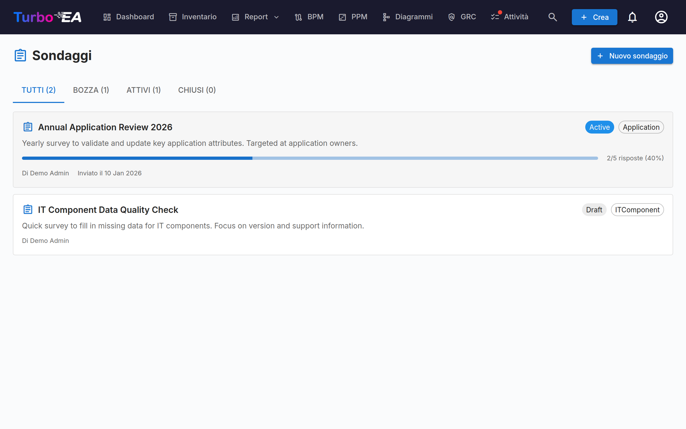

# Sondaggi

Il modulo **Sondaggi** (**Admin > Sondaggi**) consente agli amministratori di creare **sondaggi di manutenzione dati** che raccolgono informazioni strutturate dagli stakeholder su card specifiche.

## Caso d'uso

I sondaggi aiutano a mantenere aggiornati i dati architetturali contattando le persone più vicine a ciascun componente. Ad esempio:

- Chiedete ai proprietari delle applicazioni di confermare la criticità aziendale e le date del ciclo di vita annualmente
- Raccogliete valutazioni dell'idoneità tecnica dai team IT
- Raccogliete aggiornamenti sui costi dai responsabili del budget

## Ciclo di vita del sondaggio

Ogni sondaggio progredisce attraverso tre stati:

| Stato | Significato |
|-------|-------------|
| **Draft** | In fase di progettazione, non ancora visibile ai rispondenti |
| **Active** | Aperto alle risposte, gli stakeholder assegnati lo vedono nei loro Todo |
| **Closed** | Non accetta più risposte |

## Creazione di un sondaggio

1. Navigate su **Admin > Sondaggi**
2. Cliccate su **+ Nuovo sondaggio**
3. Si apre il **Costruttore di sondaggi** con la seguente configurazione:

### Tipo target

Selezionate a quale tipo di card si applica il sondaggio (es. Application, IT Component). Il sondaggio verrà inviato per ogni card di questo tipo che corrisponde ai vostri filtri.

### Filtri

Restringete opzionalmente l'ambito con i filtri. Sono disponibili quattro tipi di filtro, combinabili tra loro:

- **Schede specifiche** — Selezionate direttamente una o più schede (limitate al tipo di destinazione). Utile per destinare una singola scheda o un sottoinsieme scelto manualmente.
- **Schede correlate a** — Include solo le schede che hanno una relazione con uno degli elementi elencati (es. tutte le applicazioni correlate all'organizzazione Vendite).
- **Tag** e **filtri di attributi** — Filtrate le schede per tag o per condizione di attributo (es. costo maggiore di 10 000, valutazione TIME mancante).
- **Ultimo aggiornamento** — Includete solo le schede che nessuno modifica da tempo: 30 giorni, 90 giorni, 6 mesi, 1 anno oppure un numero personalizzato di giorni o mesi. Il generatore mostra la data limite corrispondente mentre scegliete. La finestra è relativa al momento dell'**invio**, non a quello della progettazione: una bozza lasciata in sospeso troverà quindi le schede obsolete in quel momento. Misura la data di modifica della scheda, la stessa mostrata dalla colonna dell'inventario e dalla cronologia della scheda.

### Domande

Progettate le vostre domande. Ogni domanda può essere:

- **Testo libero** — Risposta aperta
- **Selezione singola** — Scegliete un'opzione da un elenco
- **Selezione multipla** — Scegliete più opzioni
- **Numero** — Input numerico
- **Data** — Selettore di data
- **Booleano** — Interruttore Sì/No

### Relazioni

Oltre agli attributi, un'indagine può anche chiedere ai rispondenti di mantenere aggiornate le **relazioni** di una scheda. Nel passaggio **Campi**, la sezione **Relazioni** elenca ogni relazione che il tipo di scheda di destinazione può avere, in entrambe le direzioni (ad esempio, per un'Applicazione: *supporta → Componente IT* e *utilizzata da ← Organizzazione*). Un tipo di scheda che supporta il lignaggio compare qui come qualsiasi altra relazione, in entrambe le direzioni e con i propri verbi: per un'Applicazione, *succede a* raccoglie le schede che ha sostituito e *ha come successore* quelle che la sostituiscono. I lati che un amministratore ha nascosto sul tipo di scheda non vengono proposti. Per ciascuna selezionata, scegli un'azione:

- **Mantieni** — Il rispondente vede le schede attualmente collegate e può aggiungere o rimuovere collegamenti tramite un selettore di ricerca.
- **Conferma** — Il rispondente si limita a confermare che i collegamenti attuali sono corretti, oppure disattiva l'interruttore per proporre modifiche.

Quando applichi una risposta di questo tipo, Turbo EA aggiunge i nuovi collegamenti e rimuove quelli rimossi dal rispondente. La modifica viene registrata nella cronologia della scheda, proprio come una modifica manuale di relazione.

### Date del ciclo di vita e ruoli degli stakeholder

Due tabelle aggiuntive nel passaggio **Campi** consentono di chiedere informazioni che non sono attributi:

- **Date del ciclo di vita** — una riga per fase (Pianificazione, Introduzione, Attivo, Dismissione, Fine vita). Chi risponde vede la data attuale della scheda e la conferma o ne propone un'altra; svuotare la data propone di rimuoverla. Una fase datata dopo quella che dovrebbe seguirla viene segnalata nel modulo, come sulla scheda. La tabella non viene proposta quando il tipo di scheda nasconde la sezione del ciclo di vita.
- **Ruoli degli stakeholder** — una riga per ogni ruolo stakeholder del tipo di scheda target. Chi risponde vede chi ricopre oggi il ruolo e modifica l'elenco con un selettore di persone. Applicando la risposta si aggiungono le persone aggiunte e si rimuovono quelle tolte; gli utenti disattivati non vengono mai aggiunti né rimossi.

Ciascuno di questi campi può essere **Mantieni** o **Conferma**, come gli altri.

### Auto-azioni

Configurate regole che aggiornano automaticamente gli attributi della card in base alle risposte del sondaggio. Ad esempio, se un rispondente seleziona "Mission Critical" per la criticità aziendale, il campo `businessCriticality` della card può essere aggiornato automaticamente.

## Invio di un sondaggio

Una volta che il vostro sondaggio è in stato **Active**:

1. Cliccate su **Invia** per distribuire il sondaggio
2. Ogni card target genera un todo per gli stakeholder assegnati
3. Gli stakeholder vedono il sondaggio nella scheda **I miei sondaggi** nella [pagina Attività](../guide/tasks.md)
4. Ogni stakeholder riceve **una** notifica — e una sola e-mail, se abilitata — indipendentemente da quante sue schede rientrano nel sondaggio; l'e-mail elenca quelle schede, ciascuna con un collegamento diretto al modulo di risposta

!!! note "Una scheda ha bisogno di qualcuno a cui chiedere"

    Una scheda viene inclusa nell'indagine solo se almeno una persona vi ricopre uno dei **ruoli di stakeholder selezionati**. Le schede che corrispondono ai filtri ma non hanno tale stakeholder vengono saltate; il passaggio **Anteprima e invio** ne riporta il numero, così potete assegnare i responsabili.

Un'indagine può anche essere creata e inviata da un'estensione installata — per esempio una regola pianificata che chiede ai responsabili di ogni scheda che soddisfa una condizione di completarla. Un'indagine del genere non mostra alcun autore, i suoi campi sono quelli definiti dal tipo di scheda e si comporta come tutte le altre: la chiudete e ne applicate le risposte qui. Annullare l'esecuzione dell'estensione in **Admin → Registro di audit** chiude l'indagine e ritira le richieste a cui nessuno aveva ancora risposto.

## Visualizzazione dei risultati

Navigate su **Admin > Sondaggi > [Nome sondaggio] > Risultati** per vedere:

- Stato delle risposte per card (risposto, in attesa)
- Risposte individuali con risposte per ogni domanda
- Un'azione **Applica** per applicare le regole di auto-azione agli attributi della card

Applicare una risposta passa per gli stessi controlli di una modifica fatta direttamente sulla scheda. Un valore che la scheda rifiuta — ad esempio un'opzione che non esiste più — viene segnalato per quella risposta e nulla di essa viene applicato, mentre le altre risposte vengono comunque applicate. Ogni modifica compare nella scheda **Cronologia** della scheda sotto l'amministratore che l'ha applicata, con un indicatore **tramite il sondaggio** che nomina il sondaggio; passandoci sopra si vede chi ha risposto. L'intera applicazione è una sola voce in **Admin → Registro di audit**, quindi può essere annullata da lì.

## Eliminazione di un sondaggio

Un sondaggio può essere eliminato in qualsiasi stato: apri il menu **⋮** nella sua riga in **Admin > Sondaggi**, oppure usa **Elimina** nel generatore di sondaggi o nella pagina dei risultati. La conferma indica cosa viene eliminato insieme: le richieste ancora in attesa di risposta vengono ritirate, insieme alle relative notifiche, e le risposte non ancora applicate vanno perse. Le modifiche già applicate restano sulle schede e la cronologia della scheda continua a citare il sondaggio.
