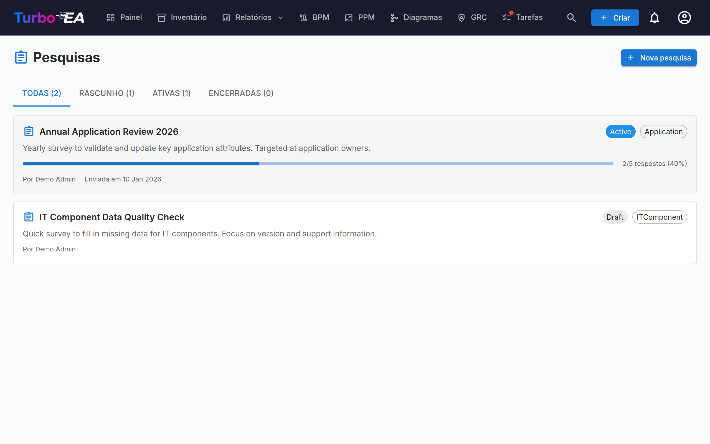

# Pesquisas

O módulo de **Pesquisas** (**Admin > Pesquisas**) permite que administradores criem **pesquisas de manutenção de dados** que coletam informações estruturadas de partes interessadas sobre cards específicos.

## Caso de Uso

Pesquisas ajudam a manter seus dados de arquitetura atualizados, alcançando as pessoas mais próximas de cada componente. Por exemplo:

- Pergunte aos proprietários de aplicações para confirmar a criticidade de negócio e datas do ciclo de vida anualmente
- Colete avaliações de adequação técnica das equipes de TI
- Obtenha atualizações de custos dos responsáveis pelo orçamento

## Ciclo de Vida da Pesquisa

Cada pesquisa progride por três estados:

| Status | Significado |
|--------|-------------|
| **Rascunho** | Sendo projetada, ainda não visível para respondentes |
| **Ativa** | Aberta para respostas, partes interessadas atribuídas a veem em suas Tarefas |
| **Encerrada** | Não aceita mais respostas |

## Criando uma Pesquisa

1. Navegue até **Admin > Pesquisas**
2. Clique em **+ Nova Pesquisa**
3. O **Construtor de Pesquisas** abre com a seguinte configuração:

### Tipo Alvo

Selecione a qual tipo de card a pesquisa se aplica (ex.: Aplicação, Componente de TI). A pesquisa será enviada para cada card deste tipo que corresponda aos seus filtros.

### Filtros

Restrinja opcionalmente o escopo com filtros. Há quatro tipos de filtro disponíveis, que podem ser combinados:

- **Cards específicos** — Escolha um ou mais cards diretamente (restritos ao tipo alvo). Útil para direcionar um único card ou um subconjunto selecionado manualmente.
- **Cards relacionados com** — Inclua apenas cards que tenham uma relação com um dos itens listados (ex.: todas as aplicações relacionadas à organização Vendas).
- **Tags** e **filtros de atributos** — Selecione cards por tag ou por condição de atributo (ex.: custo superior a 10 000, classificação TIME ausente).
- **Última atualização** — Incluir apenas os cards que ninguém altera há algum tempo: 30 dias, 90 dias, 6 meses, 1 ano ou um número personalizado de dias ou meses. O construtor mostra a data-limite correspondente à medida que escolhe. A janela é relativa ao momento do **envio**, e não ao da conceção, pelo que um rascunho deixado de lado continuará a encontrar os cards desatualizados nessa altura. Mede a data de modificação do card — a mesma que a coluna do inventário e o histórico do card apresentam.

### Perguntas

Desenhe suas perguntas. Cada pergunta pode ser:

- **Texto livre** — Resposta aberta
- **Seleção única** — Escolha uma opção de uma lista
- **Seleção múltipla** — Escolha múltiplas opções
- **Número** — Entrada numérica
- **Data** — Seletor de data
- **Booleano** — Escolha numa lista Sim / Não; **Nenhum** equivale a não responder e mantém o valor do cartão como está

### Relações

Além dos atributos, uma pesquisa também pode pedir aos respondentes que mantenham as **relações** de um cartão atualizadas. Na etapa **Campos**, a seção **Relações** lista todas as relações que o tipo de cartão de destino pode ter, em ambas as direções (por exemplo, para uma Aplicação: *suporta → Componente de TI* e *usada por ← Organização*). Um tipo de cartão que suporta linhagem aparece aqui como qualquer outra relação, em ambas as direções e sob os seus próprios verbos: para uma Aplicação, *sucede a* recolhe os cartões que substituiu e *é sucedido por* os que a substituem. Os lados que um administrador ocultou no tipo de cartão não são oferecidos. Para cada uma que você escolher, selecione uma ação:

- **Manter** — O respondente vê os cartões atualmente vinculados e pode adicionar ou remover vínculos usando um seletor de busca.
- **Confirmar** — O respondente apenas reconhece que os vínculos atuais estão corretos, ou desliga a alternância para propor alterações.

Ao aplicar uma resposta desse tipo, o Turbo EA adiciona os novos vínculos e remove os que o respondente retirou. A alteração é registrada no histórico do cartão, assim como uma edição manual de relação.

### Datas do ciclo de vida e funções das partes interessadas

Duas tabelas adicionais no passo **Campos** permitem perguntar sobre coisas que não são atributos:

- **Datas do ciclo de vida** — uma linha por fase (Planejamento, Entrada, Ativo, Saída, Fim de vida). O inquirido vê a data atual do cartão e confirma-a ou propõe outra; limpar a data propõe removê-la. Uma fase datada depois daquela que a deveria seguir é assinalada no formulário, tal como no cartão. A tabela não é oferecida quando o tipo de cartão oculta a sua secção de ciclo de vida.
- **Funções das partes interessadas** — uma linha por função de parte interessada do tipo de cartão alvo. O inquirido vê quem tem hoje a função e edita a lista com um seletor de pessoas. Ao aplicar a resposta, são adicionadas as pessoas que acrescentou e removidas as que retirou; utilizadores desativados nunca são adicionados nem removidos.

Cada um destes campos pode ser **Manter** ou **Confirmar**, como qualquer outro.

### Auto-ações

Configure regras que atualizam automaticamente atributos do card com base nas respostas da pesquisa. Por exemplo, se um respondente selecionar "Missão Crítica" para criticidade de negócio, o campo `businessCriticality` do card pode ser atualizado automaticamente.

## Enviando uma Pesquisa

Uma vez que sua pesquisa está no status **Ativa**:

1. Clique em **Enviar** para distribuir a pesquisa
2. Cada card alvo gera uma tarefa para as partes interessadas atribuídas
3. Partes interessadas veem a pesquisa na aba **Minhas Pesquisas** na [página de Tarefas](../guide/tasks.md)
4. Cada parte interessada recebe **uma** notificação — e um único e-mail, se estiver ativado — independentemente de quantos dos seus cartões entram na pesquisa; o e-mail lista esses cartões, cada um com ligação direta ao respetivo formulário de resposta

!!! note "Um cartão precisa de alguém a quem perguntar"

    Um cartão só é inquirido se pelo menos uma pessoa detiver nele uma das **funções de parte interessada selecionadas**. Os cartões que correspondem aos seus filtros mas não têm essa parte interessada são ignorados; o passo **Pré-visualizar e enviar** indica quantos são, para que possa atribuir responsáveis.

Um inquérito também pode ser criado e enviado por uma extensão instalada — por exemplo, uma regra agendada que pede aos responsáveis de cada cartão que cumpre uma condição que o completem. Esse inquérito não mostra autor, os seus campos são os que o tipo de cartão define e comporta-se como qualquer outro: é aqui que o fecha e aplica as suas respostas. Reverter a execução da extensão em **Admin → Registo de auditoria** fecha o inquérito e retira os pedidos a que ninguém tinha ainda respondido.

## Visualizando Resultados

Navegue até **Admin > Pesquisas > [Nome da Pesquisa] > Resultados** para ver:

- Status de resposta por card (respondido, pendente)
- Respostas individuais com respostas por pergunta
- Uma ação **Aplicar** para executar regras de auto-ação nos atributos dos cards

Aplicar uma resposta passa pelas mesmas verificações que uma edição feita no próprio cartão. Um valor que o cartão recusa — por exemplo, uma opção que já não existe — é assinalado para essa resposta e nada dela é aplicado, enquanto as restantes respostas são aplicadas na mesma. Cada alteração aparece no separador **Histórico** do cartão sob o administrador que a aplicou, com um marcador **através da pesquisa** que nomeia a pesquisa; ao passar o rato por cima vê-se quem respondeu. Toda a aplicação é uma única entrada em **Admin → Registo de auditoria**, pelo que pode ser revertida a partir daí.

## Eliminar uma Pesquisa

Uma pesquisa pode ser eliminada em qualquer estado: abra o menu **⋮** da sua linha em **Admin > Pesquisas**, ou use **Eliminar** no construtor de pesquisas ou na página de resultados. A confirmação indica o que é eliminado com ela: os pedidos ainda à espera de resposta são retirados, juntamente com as suas notificações, e as respostas ainda não aplicadas perdem-se. As alterações já aplicadas permanecem nos cartões, e o histórico do cartão continua a nomear a pesquisa.
