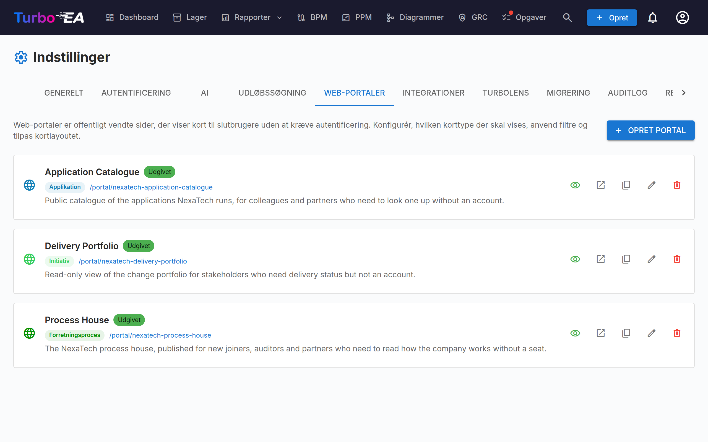
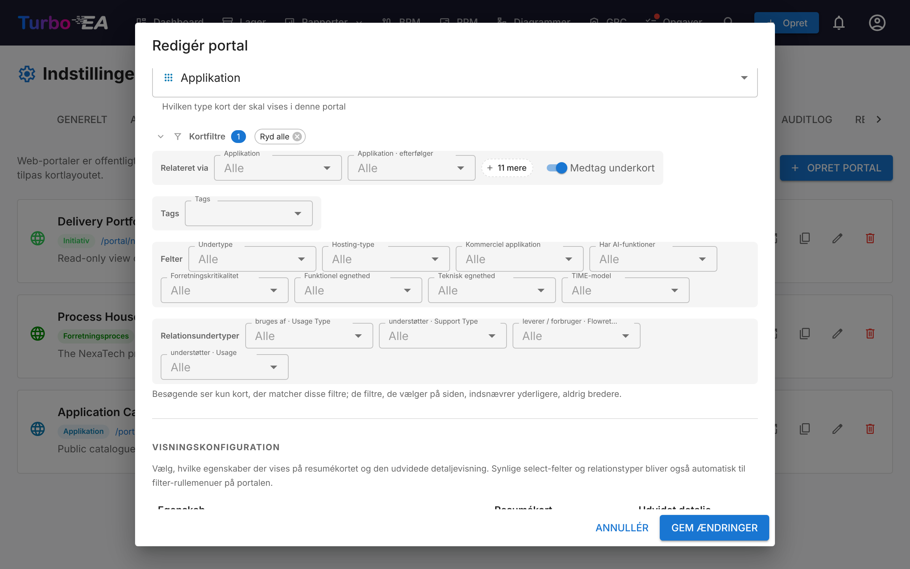

# Webportaler

Funktionen **Webportaler** (**Admin > Indstillinger > Webportaler**) lader dig oprette **offentlige, skrivebeskyttede visninger** af udvalgte kortdata — tilgængelige uden autentificering via en unik URL.



## Anvendelsesscenarie

Webportaler er nyttige til at dele arkitekturinformation med interessenter, der ikke har en Turbo EA-konto:

- **Teknologikatalog** — Del applikationslandskabet med forretningsbrugere
- **Servicekatalog** — Publicér IT-tjenester og deres ejere
- **Capability-kort** — Tilbyd en offentlig visning af forretningskompetencer

## Portaltype

Hver portal offentliggør én af tre visninger, valgt med **Portaltype**:

| Type | Hvad besøgende ser |
|------|--------------------|
| **Kortliste** | Et gitter af kort, der kan søges og filtreres — den klassiske portal, konfigureret med egenskaberne nedenfor. |
| **PPM-porteføljetavle** | Den skrivebeskyttede [PPM-porteføljetavle](../guide/ppm.md) — tidslinje, statusindikatorer og budget over for faktisk forbrug for hvert aktivt initiativ. |
| **Procesnavigator** | Det skrivebeskyttede [Proceshus](../guide/bpm.md) — dit forretningsprocesthierarki og hver proces' offentliggjorte BPMN-flow. |

### PPM-porteføljeportaler

Vælger du **PPM-porteføljetavle**, bliver portalen til en ledelsesvisning af din
projektportefølje, tilgængelig via et offentligt link **uden konto, uden licens og uden
login**. Lavet til det almindelige tilfælde, hvor ledelsen ønsker indblik i porteføljen,
men ikke vil vedligeholde endnu et sæt loginoplysninger.

Tavlen omfatter altid **Initiativ**-kort, så korttypevælgeren er låst. Filtrene for
**undertyper** og **tags** gælder fortsat — det er sådan, du offentliggør ét program i
stedet for hele porteføljen.

Besøgende ser den samme tavle, som dit team bruger inde i Turbo EA: den kvartalsvise
tidslinje, indikatorerne for tid/omkostning/omfang, CapEx- og OpEx-bjælkerne, gruppering
efter enhver relateret korttype og statusrapportoversigten, der vises, når du holder
musen over datoen **Seneste rapport**. Et klik på et initiativ fører ind i Turbo EA bag
det normale login — efter login lander du på det initiativ, du klikkede på.

Tre kontakter styrer, hvad den offentliggjorte tavle viser:

| Kontakt | Standard | Offentliggør |
|---------|----------|--------------|
| **Vis budget og faktisk forbrug** | Til | CapEx- og OpEx-bjælkerne samt det samlede budget |
| **Vis kommentarer fra statusrapporter** | Til | Resumé, resultater og næste skridt i oversigten ved museover. Rapportdato og statusindikatorer vises altid |
| **Vis projektledernes navne** | **Fra** | Navnene på projektledere og rapportforfattere. Slået fra som standard, fordi navne er personoplysninger |

Tavlen åbner desuden med en gruppering og en undertype, du vælger:

| Indstilling | Standard | Virkning |
|-------------|----------|----------|
| **Åbner grupperet efter** | Organisation | Hvilken gruppering tavlen viser først |
| **Åbner med undertype** | Alle | Hvilken undertype der er valgt først |

**Åbner grupperet efter** accepterer også en undertype af Initiativ, så tavlen åbner med én gruppe pr. initiativ af den undertype (se [Projektporteføljestyring](../guide/ppm.md)). En undertype, som portalens eget undertypefilter udelukker, tilbydes ikke: Portalen ville ikke udgive nogen af disse initiativer, så alle rækker ville havne under »Ugrupperet«.

Begge er kun et udgangspunkt — en besøgende kan ændre begge dele, og intet huskes,
så gensyn med portalen vender tilbage til det, du har konfigureret her. Det er ikke
det samme som **undertypefilteret** ovenfor, der afgør, hvilke initiativer der
overhovedet offentliggøres.

!!! note
    Noget offentliggøres aldrig, uanset hvad du vælger: omkostningsfelter gemt på selve
    Initiativ-kortet, brugernes e-mailadresser og alt på et initiativs detaljeside —
    arbejdspakker, milepæle, risici, opgaver og rapporthistorik forbliver bag login.

En porteføljeportal kan SSO-beskyttes som enhver anden portal. Slår du PPM-modulet fra
under **Admin > Indstillinger**, bliver alle porteføljeportaler utilgængelige med det
samme; du behøver ikke afpublicere dem én ad gangen.

### Procesnavigator-portaler

Vælger du **Procesnavigator**, bliver portalen en skrivebeskyttet visning af dit
**Proceshus**, tilgængelig via et offentligt link **uden konto, uden licens og uden
login**. Den findes for dem, der mest har brug for at forstå, hvordan organisationen
arbejder, og mindst sandsynligt har en adgang: nye medarbejdere, revisorer,
frontlinjemedarbejdere og eksterne partnere.

Portalen er altid afgrænset til **Forretningsproces**-kort, så korttypevælgeren er
låst. Filtrene **undertyper** og **tags** gælder stadig — sådan offentliggør du én
gren af huset i stedet for det hele.

Besøgende får det samme hus, som dit team bruger inde i Turbo EA: hierarkiet grupperet
i rækker efter procestype, niveauskyderen, zoom og brødkrummer, søgningen,
farvelægningerne, organisationsfilteret og kolonneantallet. Åbner man en proces, vises
dens overblik, dens trin og dens **offentliggjorte BPMN-flow** — i fuld skærm, med
panorering og zoom, præcis som dit team ser det.

To indstillinger og to åbningstilstande styrer det offentliggjorte hus:

| Indstilling | Standard | Virkning |
|-------------|----------|----------|
| **Vis tilknyttede systemer på hvert trin** | **Fra** | Navnene på de applikationer, dataobjekter, it-komponenter og organisationer, der er knyttet til hvert trin. Slået fra som standard, fordi det afslører, hvilke systemer der driver dine processer |
| **Åbner på niveau** | 2 | Hvor dybt hierarkiet vises først |
| **Åbner farvelagt efter** | Procestype | Hvilken egenskab der farver felterne først |

De sidste to er kun et udgangspunkt — en besøgende kan ændre begge kontroller, og
intet huskes, så genåbning af portalen vender tilbage til det, du har konfigureret her.

!!! note
    Nogle ting offentliggøres aldrig, uanset hvad du vælger: applikationerne,
    dataobjekterne og omkostningerne bag en proces, Proces × Applikation-matricen og
    afhængighedsvisningen samt enhver BPMN, der ikke er **offentliggjort** — udkast,
    afventende, arkiverede og tilbagetrukne revisioner forbliver bag login.

I modsætning til en porteføljeportal, hvis rækker fører ind i Turbo EA bag det normale
login, **linker en procesnavigator-portal ingen steder hen**. Det er med vilje: et hus,
der offentliggøres for læsere uden konto, bør besvare "hvordan gør vi det her" uden at
vise en dør, de ikke kan åbne.

En procesnavigator-portal kan SSO-sikres som enhver anden portal. Slår du BPM-modulet
fra under **Admin > Indstillinger**, slukkes alle procesportaler straks; du behøver ikke
at afpublicere dem én ad gangen.

## Adgangsbeskyttelse

Hver portal har en **adgangstilstand**, der styrer, hvem der kan åbne den:

| Tilstand | Adfærd |
|----------|--------|
| **Alle med linket** | Når portalen er udgivet, er den offentligt læsbar — alle, der kender URL'en, kan se den. Dette er standard og den hidtidige adfærd. |
| **Log ind med SSO** | Besøgende skal godkendes hos din organisations identitetsudbyder, før nogen portaldata vises. |

**SSO-tilstand** genbruger det single sign-on, du allerede har konfigureret under **Admin > Indstillinger > Godkendelse**, og beskytter portaler **uden** at administrere ekstra brugere:

- Besøgende logger ind via din identitetsudbyder, men **oprettes aldrig som Turbo EA-brugere** — ingen konto, ingen rolle, ingen licens.
- Den besøgende får en kortvarig, portalspecifik session. Intet vises, før login er gennemført.
- Du kan eventuelt angive en liste over **tilladte e-maildomæner** for at begrænse adgangen til bestemte domæner (f.eks. `virksomhed.com`). Lad feltet stå tomt for at tillade enhver bruger, som din identitetsudbyder godkender.

!!! note
    **Log ind med SSO** kan først vælges, når single sign-on er konfigureret. Den genbruger den samme redirect-URI hos din identitetsudbyder som normalt login (`/auth/callback`), så **der kræves ingen ekstra konfiguration** — hvis login virker, virker portal-SSO. Besøgende med en aktiv session hos identitetsudbyderen logges ind automatisk uden klik. Afpublicering af en portal tilbagekalder øjeblikkeligt adgangen i alle tilstande.

## Oprettelse af en portal

1. Naviger til **Admin > Indstillinger > Webportaler**
2. Klik på **+ Ny portal**
3. Konfigurer portalen:

| Felt | Beskrivelse |
|-------|-------------|
| **Navn** | Visningsnavn for portalen |
| **Slug** | URL-venlig identifikator (auto-genereret fra navn, redigerbar). Portalen vil være tilgængelig på `/portal/{slug}` |
| **Korttype** | Hvilken korttype der skal vises |
| **Undertyper** | Begræns eventuelt til specifikke undertyper |
| **Vis logo** | Hvorvidt platformlogoet skal vises på portalen |

### Kortfiltre

På en portal af typen **Kortliste** begrænser sektionen **Kortfiltre** portalen til de kort, der matcher. Det er det samme filtersæt som i [applikationsporteføljerapporten](../guide/reports.md):



| Række | Viser kun kort, … |
|-------|--------------------|
| **Relateret via** | der er relateret til et af de valgte kort — ét felt pr. relateret korttype, plus ét pr. relation, når flere relationer når samme type. **Medtag underkort** tæller også et kort, der er relateret til noget under et valg |
| **Tags** | der har et valgt tag: et vilkårligt tag inden for én gruppe og ét fra hver gruppe, du vælger fra |
| **Felter** | med en valgt undertype eller en valgt værdi i et af kortets valg- eller ja/nej-felter Tekst-, tal- og datofelter kan tilføjes via **Tilføj filter**: et tekstfelt beholder de kort, hvis værdi indeholder det, du skriver (uanset store og små bogstaver), et tal- eller procentfelt kortene mellem et minimum og et maksimum, et datofelt kortene mellem to dage |
| **Relationsundertyper** | med en relation, hvis attribut (for eksempel *Anvendelsestype*) har en valgt værdi |

Hvert valgfelt tilbyder også **(tom)** for kort uden værdi, uden relation eller uden undertype; et tekst-, tal- eller datofilter beholder kun kort, der har en værdi. Et portal filtrerer aldrig på omkostningsfelter: dialogen tilbyder dem ikke, uanset dine egne rettigheder. Besøgende ser kun de matchende kort: de filtre, de vælger på portalen, indsnævrer listen yderligere, aldrig udvider den, og selve filterindstillingerne sendes aldrig til den besøgendes browser.

!!! note
    En portal, der er oprettet før version 2.178.0, beholder sine undertype- og tagfiltre, præcis som de var, indtil du gemmer den næste gang. Derefter skal tags valgt fra to forskellige taggrupper begge være på et kort, som i porteføljerapporten.

PPM-porteføljeportaler og procesnavigatorportaler beholder deres egne vælgere for **Undertyper** og **Tags**.

## Konfiguration af synlighed

For hver portal styrer du præcis, hvilken information der er synlig.

Visningstabellen viser rækkerne i grupper: **Generelt** (de indbyggede egenskaber), derefter hver sektion i korttypens layout med sine felter under **Brugerdefinerede felter**, og til sidst **Relaterede elementer**. Hver gruppes overskriftsrække har et afkrydsningsfelt i hver kolonne, der markerer eller fjerner markeringen af alle gruppens rækker på én gang; det er halvt udfyldt, så længe kun nogle er markeret. Pilen i begyndelsen af en overskriftsrække skjuler gruppen, og dens afkrydsningsfelter virker stadig, mens den er skjult, så en lang sektion, f.eks. en som en udvidelse tilføjer, kan slås til eller fra uden at åbne den.

Der er to kontekster:

### Listevisnings-egenskaber

Hvilke kolonner/egenskaber der vises i kortlisten:

- **Indbyggede egenskaber**: beskrivelse, livscyklus, tags, datakvalitet, godkendelsesstatus
- **Brugerdefinerede felter**: Hvert felt fra korttypens skema, grupperet efter sektion, kan slås til/fra enkeltvis eller en hel sektion ad gangen

**Datakvalitets**-bjælken er kortets fuldstændighedsscore — hvor mange af dets felter der er udfyldt — ikke projektets fremdrift. For at udgive et initiativs reelle fremdrift skal du tilføje et **Procent**-felt til Initiative-typen, udfylde det med en beregning over `ppm.completion` og markere feltet her; opskriften står under [Beregninger](calculations.md#show-initiative-progress-on-a-card-or-a-portal).

### Detaljevisnings-egenskaber

Hvilken information der vises, når en besøgende klikker på et kort:

- Samme omskifterkontroller som listevisning, men for det udvidede detaljepanel

### Besøgsfiltre

På en **Kortliste**-portal har visningstabellen en tredje kolonne, **Besøgsfilter**. En afkrydset række vises i de besøgendes filterlinje:

- **Undertype** (en egen række, når korttypen har undertyper), **Tags**, hver **relationstype** og hvert felt, der kan filtreres: valg- og ja/nej-felter (vælg værdier, **(tom)** inkluderet), tekstfelter («indeholder»), tal- og procentfelter (et interval) og datofelter (et interval).
- **Et filter kræver, at egenskaben vises.** En række, der hverken vises på oversigtskortet eller i den udvidede detalje, har sit filterfelt nedtonet: en besøgende kan aldrig filtrere på noget, portalen ikke udgiver.
- **Omkostningsfelter kan aldrig filtreres på en portal** og har ikke noget afkrydsningsfelt.

Indtil du ændrer kolonnen, følger den standarden: undertypen, tags, hvert vist valgfelt med valgmuligheder og hver vist relationstype — den filterlinje, portaler altid har haft — minus felterne i en sektion markeret **Skjult fra filtre** i kortlayoutet. Så længe kolonnen står på standard, gemmes intet, så et felt, der senere føjes til korttypen, følger samme regel.

Under tabellen lader **Besøgende kan tilføje flere filtre** (til som standard) de besøgende tilføje ethvert andet vist felt via en **Tilføj filter**-chip i deres filterlinje. Deres browser husker de tilføjede felter, aldrig værdierne. Undertype-, tag- og relationsfiltre tilbydes ikke dér: de vises kun, når de er afkrydset. Slå den fra, og de besøgende får præcis de afkrydsede filtre; portalen ignorerer ethvert andet filter, den får sendt.

Besøgsfiltre indsnævrer altid de kort, portalens egne kortfiltre beholder, og udvider dem aldrig. Et tagfilter matcher som i rapporterne: et vilkårligt tag inden for en gruppe og et fra hver gruppe, der vælges fra.

## Portal-adgang

Portaler tilgås på:

```
https://your-turbo-ea-domain/portal/{slug}
```

Intet login er påkrævet. Besøgende kan browse kortlisten, søge og se kortdetaljer — men kun de egenskaber, du har aktiveret, vises.

!!! note
    Portaler er skrivebeskyttede. Besøgende kan ikke redigere, kommentere eller interagere med kort. Følsomme data (interessenter, kommentarer, historik) eksponeres aldrig på portaler.
