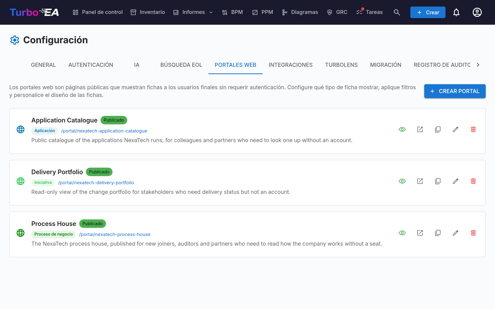
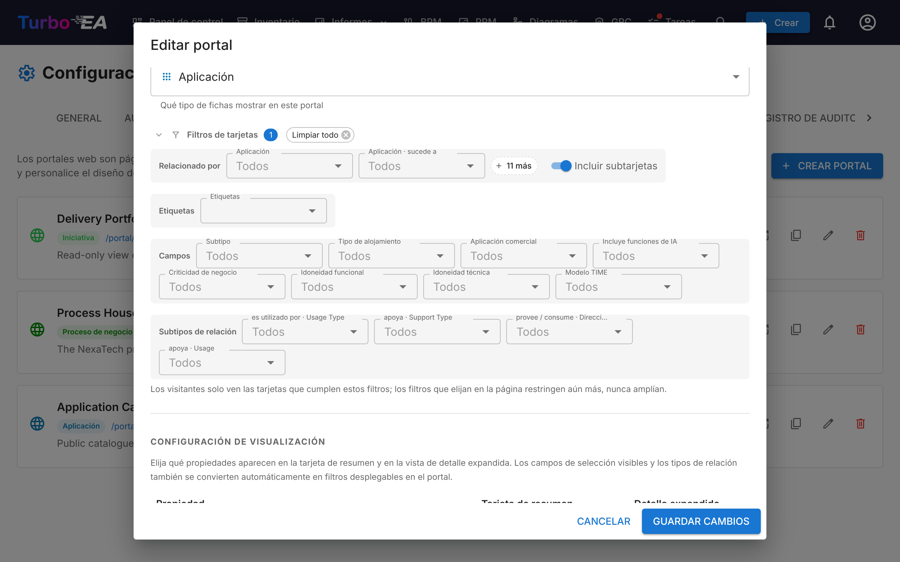

# Portales Web

La función de **Portales Web** (**Administrador > Configuración > Portales Web**) le permite crear **vistas públicas de solo lectura** de datos de fichas seleccionados, accesibles sin autenticación a través de una URL única.



## Caso de Uso

Los portales web son útiles para compartir información de arquitectura con partes interesadas que no tienen una cuenta de Turbo EA:

- **Catálogo tecnológico** — Comparta el panorama de aplicaciones con usuarios de negocio
- **Directorio de servicios** — Publique los servicios de TI y sus responsables
- **Mapa de capacidades** — Proporcione una vista pública de las capacidades de negocio

## Tipo de portal

Cada portal publica una de tres vistas, elegida con **Tipo de portal**:

| Tipo | Lo que ven los visitantes |
|------|---------------------------|
| **Lista de tarjetas** | Una cuadrícula de tarjetas con búsqueda y filtros: el portal clásico, configurado con las propiedades de más abajo. |
| **Tablero de cartera PPM** | El [tablero de cartera PPM](../guide/ppm.md) de solo lectura: cronograma, indicadores de estado y presupuesto frente a real de cada iniciativa activa. |
| **Navegador de procesos** | La [Casa de Procesos](../guide/bpm.md) de solo lectura: su jerarquía de procesos de negocio y el flujo BPMN publicado de cada proceso. |

### Portales de cartera PPM

Elegir **Tablero de cartera PPM** convierte el portal en una vista directiva de su
cartera de proyectos, accesible mediante un enlace público **sin cuenta, sin licencia
y sin inicio de sesión**. Pensado para el caso habitual en el que la dirección quiere
visibilidad de la cartera pero no va a mantener otras credenciales.

El tablero siempre se refiere a tarjetas de **Iniciativa**, por lo que el selector de
tipo de tarjeta queda bloqueado. Los filtros de **subtipos** y **etiquetas** siguen
aplicándose, que es como se publica un único programa en lugar de toda la cartera.

Los visitantes ven el mismo tablero que su equipo dentro de Turbo EA: el cronograma
trimestral, los indicadores de plazo/coste/alcance, las barras de CapEx y OpEx, la
agrupación por cualquier tipo de tarjeta relacionado y la vista emergente del informe
de estado al pasar el ratón sobre la fecha de **Último informe**. Al hacer clic en una
iniciativa se entra en Turbo EA tras el inicio de sesión habitual; una vez dentro,
aterriza en la iniciativa que pulsó.

Tres interruptores controlan lo que revela el tablero publicado:

| Interruptor | Por defecto | Publica |
|-------------|-------------|---------|
| **Mostrar presupuesto y gasto real** | Activado | Las barras de CapEx y OpEx y la cifra de presupuesto total |
| **Mostrar comentarios de los informes de estado** | Activado | Resumen, logros y próximos pasos en la vista emergente. La fecha del informe y los indicadores de estado siempre se muestran |
| **Mostrar nombres de los jefes de proyecto** | **Desactivado** | Los nombres de jefes de proyecto y autores de informes. Desactivado por defecto porque los nombres son datos personales |

El tablero también se abre con una agrupación y un subtipo que usted elige:

| Ajuste | Por defecto | Efecto |
|--------|-------------|--------|
| **Se abre agrupado por** | Organización | Qué agrupación muestra el tablero primero |
| **Se abre mostrando el subtipo** | Todos | Qué subtipo se selecciona primero |

**Se abre agrupado por** también admite un subtipo de iniciativa, con lo que el tablero se abre con un grupo por cada iniciativa de ese subtipo (consulte [Gestión de cartera de proyectos](../guide/ppm.md)). No se ofrece un subtipo que el propio filtro de subtipos del portal excluye: el portal no publicaría ninguna de esas iniciativas y todas las filas acabarían en «Sin grupo».

Ambos son solo un punto de partida: el visitante puede cambiar cualquiera de los
dos y nada se recuerda, así que volver a abrir el portal regresa a lo que usted
configuró. Es distinto del **filtro por subtipos** de más arriba, que decide qué
iniciativas se publican.

!!! note
    Hay cosas que nunca se publican, elija lo que elija: los campos de coste guardados
    en la propia tarjeta de Iniciativa, las direcciones de correo de los usuarios y todo
    lo que hay en la página de detalle de una iniciativa: paquetes de trabajo, hitos,
    riesgos, tareas e historial de informes quedan detrás del inicio de sesión.

Un portal de cartera puede protegerse con SSO como cualquier otro portal. Desactivar el
módulo PPM en **Admin > Configuración** deja inaccesibles de inmediato todos los portales
de cartera, sin necesidad de despublicarlos uno a uno.

### Portales de navegador de procesos

Seleccionar **Navegador de procesos** convierte el portal en una vista de solo
lectura de su **Casa de Procesos**, disponible en un enlace público **sin cuenta,
sin licencia y sin inicio de sesión**. Existe para quienes más necesitan entender
cómo funciona la organización y menos probabilidades tienen de tener acceso: nuevas
incorporaciones, auditores, personal de primera línea y socios externos.

El portal siempre se limita a tarjetas de **Proceso de Negocio**, por lo que el
selector de tipo de tarjeta queda bloqueado. Los filtros de **subtipos** y
**etiquetas** siguen aplicándose: así es como publica una rama de la casa en lugar
de toda ella.

Los visitantes obtienen la misma casa que usa su equipo dentro de Turbo EA: la
jerarquía agrupada en filas por tipo de proceso, el control de nivel, el zoom y las
migas de pan, la búsqueda, los coloreados, el filtro por organización y el número de
columnas. Al abrir un proceso se muestran su resumen, sus pasos y su **flujo BPMN
publicado**: a pantalla completa, con desplazamiento y zoom, tal como lo ve su equipo.

Dos ajustes y dos estados de apertura controlan la casa publicada:

| Ajuste | Predeterminado | Efecto |
|--------|----------------|--------|
| **Mostrar sistemas vinculados en cada paso** | **Desactivado** | Los nombres de las aplicaciones, objetos de datos, componentes de TI y organizaciones vinculados a cada paso. Desactivado por defecto porque revela qué sistemas ejecutan sus procesos |
| **Se abre en el nivel** | 2 | Qué profundidad de jerarquía se muestra primero |
| **Se abre coloreado por** | Tipo de proceso | Qué atributo colorea las cajas primero |

Los dos últimos son solo un punto de partida: un visitante puede cambiar cualquiera
de los controles y no se recuerda nada, así que reabrir el portal vuelve a lo que
usted configuró aquí.

!!! note
    Algunas cosas nunca se publican, elija lo que elija: las aplicaciones, objetos de
    datos y costes detrás de un proceso, la matriz Proceso × Aplicación y la vista de
    dependencias, y cualquier BPMN que no esté **publicado**: borradores, versiones
    pendientes, archivadas y retiradas permanecen detrás del inicio de sesión.

A diferencia de un portal de cartera, cuyas filas llevan a Turbo EA tras el inicio de
sesión habitual, un portal de navegador de procesos **no enlaza a ninguna parte**. Es
deliberado: una casa publicada para lectores sin cuenta debe responder «cómo hacemos
esto» sin mostrar una puerta que no pueden abrir.

Un portal de navegador de procesos puede protegerse con SSO como cualquier otro
portal. Desactivar el módulo BPM en **Admin > Configuración** apaga de inmediato todos
los portales de procesos; no tiene que despublicarlos uno por uno.

## Protección de acceso

Cada portal tiene un **modo de acceso** que controla quién puede abrirlo:

| Modo | Comportamiento |
|------|----------------|
| **Cualquiera con el enlace** | Una vez publicado, el portal es de lectura pública: cualquiera que conozca la URL puede verlo. Es el modo predeterminado y el comportamiento histórico. |
| **Iniciar sesión con SSO** | Los visitantes deben autenticarse con el proveedor de identidad de tu organización antes de mostrar cualquier dato. |

El **modo SSO** reutiliza el inicio de sesión único ya configurado en **Admin > Configuración > Autenticación** y protege los portales **sin** gestionar usuarios adicionales:

- Los visitantes inician sesión con tu proveedor de identidad, pero **nunca se crean como usuarios de Turbo EA**: sin cuenta, sin rol y sin licencia.
- El visitante obtiene una sesión efímera, propia del portal. No se muestra nada hasta completar el inicio de sesión.
- Opcionalmente, define una lista de **dominios de correo permitidos** para restringir el acceso a dominios concretos (p. ej. `empresa.com`). Déjala vacía para permitir cualquier usuario que autentique tu proveedor de identidad.

!!! note
    **Iniciar sesión con SSO** solo se puede elegir cuando el inicio de sesión único está configurado. Reutiliza la misma URI de redirección que el inicio de sesión normal (`/auth/callback`) en tu proveedor de identidad, por lo que **no se necesita configuración adicional** — si funciona el inicio de sesión, funciona el SSO del portal. Los visitantes con una sesión activa en el proveedor de identidad inician sesión automáticamente, sin hacer clic. Despublicar un portal revoca el acceso de inmediato en todos los modos.

## Creación de un Portal

1. Navegue a **Administrador > Configuración > Portales Web**
2. Haga clic en **+ Nuevo Portal**
3. Configure el portal:

| Campo | Descripción |
|-------|-------------|
| **Nombre** | Nombre visible del portal |
| **Slug** | Identificador compatible con URL (generado automáticamente a partir del nombre, editable). El portal será accesible en `/portal/{slug}` |
| **Tipo de Ficha** | Qué tipo de ficha mostrar |
| **Subtipos** | Opcionalmente, restringir a subtipos específicos |
| **Mostrar Logotipo** | Si se muestra el logotipo de la plataforma en el portal |

### Filtros de tarjetas

En un portal de tipo **Lista de tarjetas**, la sección **Filtros de tarjetas** limita el portal a las tarjetas que coinciden. Es el mismo conjunto de filtros que el del [informe de portafolio de aplicaciones](../guide/reports.md):



| Fila | Muestra solo las tarjetas… |
|------|----------------------------|
| **Relacionado por** | relacionadas con alguna de las tarjetas elegidas: un control por tipo de tarjeta relacionado, más uno por relación cuando varias relaciones llegan al mismo tipo. **Incluir subtarjetas** cuenta también una tarjeta relacionada con cualquier elemento por debajo de una selección |
| **Etiquetas** | que llevan una etiqueta elegida: cualquier etiqueta dentro de un grupo, y una de cada grupo del que elija |
| **Campos** | con un subtipo elegido, o un valor elegido en uno de los campos de selección o sí/no de la tarjeta Los campos de texto, número y fecha se pueden añadir mediante **Añadir filtro**: un campo de texto conserva las fichas cuyo valor contiene lo que escriba (sin distinguir mayúsculas), un campo de número o porcentaje las fichas entre un mínimo y un máximo, un campo de fecha las fichas entre dos días |
| **Subtipos de relación** | con una relación cuyo atributo (por ejemplo *Tipo de uso*) tiene un valor elegido |

Cada control de selección ofrece además **(vacío)**, para las fichas sin valor, sin relación o sin subtipo; un filtro de texto, número o fecha conserva solo las fichas que tienen un valor. Un portal nunca filtra por campos de coste: el diálogo no los ofrece, sean cuales sean sus propios permisos. Los visitantes solo ven las fichas coincidentes: los filtros que eligen en el portal reducen aún más la lista, nunca la amplían, y los ajustes de filtro nunca se envían al navegador del visitante.

!!! note
    Un portal creado antes de la versión 2.178.0 conserva sus filtros de subtipos y etiquetas tal como estaban hasta que lo vuelva a guardar. A partir de entonces, las etiquetas elegidas de dos grupos distintos deben estar ambas en una tarjeta, como en el informe de portafolio.

Los portales de portafolio PPM y de navegador de procesos conservan sus propios selectores de **Subtipos** y **Etiquetas**.

## Configuración de Visibilidad

Para cada portal, usted controla exactamente qué información es visible.

La tabla de visualización lista las filas por grupos: **General** (las propiedades incorporadas), después cada sección del diseño del tipo de ficha con sus campos, bajo **Campos personalizados**, y por último **Elementos relacionados**. La fila de encabezado de cada grupo tiene una casilla en cada columna que marca o desmarca de una vez todas las filas del grupo; aparece a medio rellenar mientras solo algunas están marcadas. La flecha al inicio de una fila de encabezado contrae el grupo, y sus casillas siguen funcionando contraído, de modo que una sección larga, como la que añade una extensión, puede activarse o desactivarse sin abrirla.

Hay dos contextos:

### Propiedades de la Vista de Lista

Qué columnas/propiedades aparecen en la lista de fichas:

- **Propiedades incorporadas**: descripción, ciclo de vida, etiquetas, calidad de datos, estado de aprobación
- **Campos personalizados**: Cada campo del esquema del tipo de ficha, agrupado por sección, puede activarse o desactivarse uno a uno o una sección entera a la vez

La barra de **calidad de datos** es la puntuación de completitud de la ficha —cuántos de sus campos están rellenados—, no el avance del proyecto. Para publicar el avance real de una Iniciativa, añada un campo **Porcentaje** al tipo Iniciativa, rellénelo con un cálculo sobre `ppm.completion` y marque ese campo aquí; la receta está en [Cálculos](calculations.md#show-initiative-progress-on-a-card-or-a-portal).

### Propiedades de la Vista de Detalle

Qué información aparece cuando un visitante hace clic en una ficha:

- Los mismos controles de activación que la vista de lista, pero para el panel de detalle expandido

### Filtros de visitante

En un portal de **Lista de fichas**, la tabla de visualización tiene una tercera columna, **Filtro de visitante**. Una fila marcada aparece en la barra de filtros de los visitantes:

- **Subtipo** (una fila propia, cuando el tipo de ficha tiene subtipos), **Etiquetas**, cada **tipo de relación** y cada campo filtrable: campos de selección y sí/no (elegir valores, **(vacío)** incluido), campos de texto («contiene»), campos de número y porcentaje (un rango) y campos de fecha (un rango).
- **Un filtro requiere que la propiedad se muestre.** Una fila que no se muestra ni en la ficha resumen ni en el detalle ampliado tiene su casilla de filtro atenuada: un visitante nunca puede filtrar por algo que el portal no publica.
- **Los campos de coste nunca son filtrables en un portal** y no tienen casilla.

Mientras no cambie la columna, sigue el valor por defecto: el subtipo, las etiquetas, cada campo de selección mostrado con opciones y cada tipo de relación mostrado —la barra de filtros que los portales siempre tuvieron—, menos los campos de una sección marcada como **Oculto en los filtros** en el diseño de la ficha. Mientras la columna siga en su valor por defecto no se almacena nada, de modo que un campo añadido más tarde al tipo de ficha sigue la misma regla.

Debajo de la tabla, **Los visitantes pueden añadir más filtros** (activado por defecto) permite a los visitantes añadir cualquier otro campo mostrado mediante un chip **Añadir filtro** en su barra de filtros. Su navegador recuerda los campos añadidos, nunca los valores. Los filtros de subtipo, etiquetas y relación no se ofrecen allí: solo aparecen si están marcados. Si lo desactiva, los visitantes obtienen exactamente los filtros marcados y el portal ignora cualquier otro filtro que reciba.

Los filtros de visitante siempre reducen las fichas que conservan los filtros de fichas del propio portal, nunca las amplían. Un filtro de etiquetas coincide como en los informes: cualquier etiqueta dentro de un grupo y una de cada grupo elegido.

## Acceso al Portal

Los portales son accesibles en:

```
https://su-dominio-turbo-ea/portal/{slug}
```

No se requiere inicio de sesión. Los visitantes pueden explorar la lista de fichas, buscar y ver los detalles de las fichas, pero solo se muestran las propiedades que usted ha habilitado.

!!! note
    Los portales son de solo lectura. Los visitantes no pueden editar, comentar ni interactuar con las fichas. Los datos sensibles (partes interesadas, comentarios, historial) nunca se exponen en los portales.
