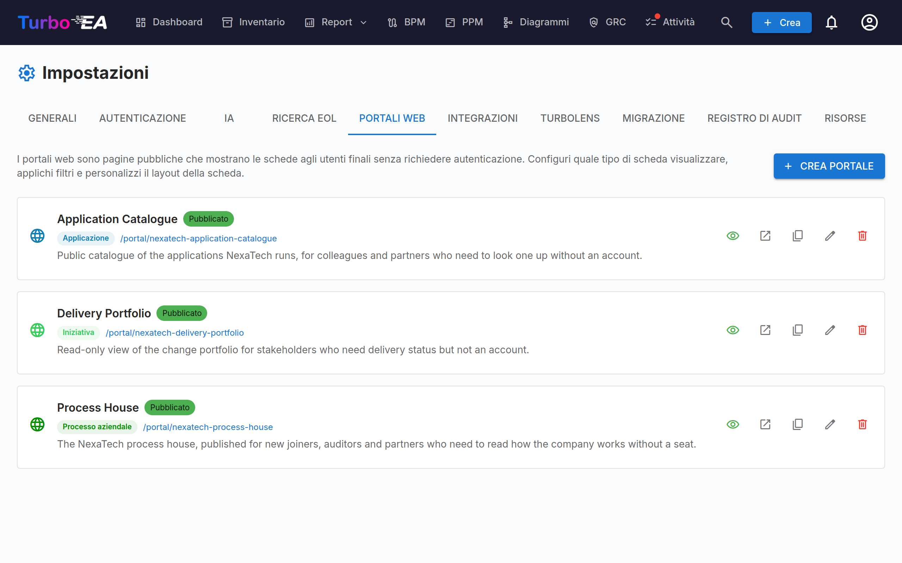
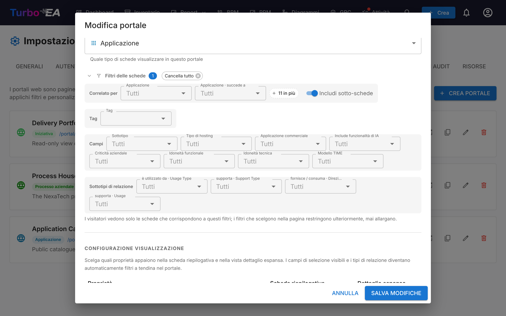

# Portali web

La funzionalità **Portali web** (**Admin > Impostazioni > Portali web**) consente di creare **viste pubbliche di sola lettura** di dati selezionati delle card — accessibili senza autenticazione tramite un URL univoco.



## Caso d'uso

I portali web sono utili per condividere informazioni architetturali con stakeholder che non hanno un account Turbo EA:

- **Catalogo tecnologico** — Condividete il panorama applicativo con gli utenti business
- **Directory dei servizi** — Pubblicate i servizi IT e i loro responsabili
- **Mappa delle capability** — Fornite una vista pubblica delle business capability

## Tipo di portale

Ogni portale pubblica una di tre viste, scelta tramite **Tipo di portale**:

| Tipo | Cosa vedono i visitatori |
|------|--------------------------|
| **Elenco di schede** | Una griglia di schede con ricerca e filtri: il portale classico, configurato con le proprietà indicate sotto. |
| **Bacheca del portfolio PPM** | La [bacheca del portfolio PPM](../guide/ppm.md) in sola lettura: cronologia, indicatori di stato e budget rispetto all'effettivo per ogni iniziativa attiva. |
| **Navigatore di processi** | La [Casa dei Processi](../guide/bpm.md) in sola lettura: la gerarchia dei processi aziendali e il flusso BPMN pubblicato di ogni processo. |

### Portali di portfolio PPM

Scegliendo **Bacheca del portfolio PPM** il portale diventa una vista direzionale del
portfolio progetti, raggiungibile tramite un collegamento pubblico **senza account,
senza licenza e senza accesso**. Pensata per il caso frequente in cui la direzione vuole
visibilità sul portfolio ma non intende gestire altre credenziali.

La bacheca riguarda sempre le schede **Iniziativa**, quindi il selettore del tipo di
scheda è bloccato. I filtri per **sottotipi** e **tag** restano attivi: è così che si
pubblica un singolo programma invece dell'intero portfolio.

I visitatori vedono la stessa bacheca che il vostro team usa dentro Turbo EA: la
cronologia trimestrale, gli indicatori di tempi/costi/ambito, le barre CapEx e OpEx, il
raggruppamento per qualsiasi tipo di scheda collegato e l'anteprima del rapporto di stato
al passaggio del mouse sulla data **Ultimo rapporto**. Facendo clic su un'iniziativa si
entra in Turbo EA dietro il consueto accesso: una volta effettuato, si arriva
sull'iniziativa selezionata.

Tre interruttori controllano cosa rivela la bacheca pubblicata:

| Interruttore | Predefinito | Pubblica |
|--------------|-------------|----------|
| **Mostrare budget e spesa effettiva** | Attivo | Le barre CapEx e OpEx e il budget totale |
| **Mostrare i commenti dei rapporti di stato** | Attivo | Sintesi, risultati raggiunti e prossimi passi nell'anteprima. La data del rapporto e gli indicatori di stato sono sempre visibili |
| **Mostrare i nomi dei project manager** | **Disattivo** | I nomi dei project manager e degli autori dei rapporti. Disattivo per impostazione predefinita perché i nomi sono dati personali |

La bacheca si apre inoltre con un raggruppamento e un sottotipo a vostra scelta:

| Impostazione | Predefinito | Effetto |
|--------------|-------------|---------|
| **Si apre raggruppato per** | Organizzazione | Quale raggruppamento mostra per primo |
| **Si apre mostrando il sottotipo** | Tutti | Quale sottotipo è selezionato per primo |

**Si apre raggruppato per** accetta anche un sottotipo di iniziativa: la bacheca si apre allora con un gruppo per ogni iniziativa di quel sottotipo (vedere [Gestione del portafoglio progetti](../guide/ppm.md)). Un sottotipo escluso dal filtro per sottotipo del portale stesso non viene proposto: il portale non pubblicherebbe nessuna di quelle iniziative e ogni riga finirebbe in «Non raggruppato».

Sono solo un punto di partenza: il visitatore può cambiare entrambi i controlli e
nulla viene memorizzato, quindi riaprendo il portale si torna a quanto configurato
qui. È cosa diversa dal **filtro per sottotipi** sopra, che decide quali iniziative
vengono pubblicate.

!!! note
    Alcune informazioni non vengono mai pubblicate, qualunque sia la scelta: i campi di
    costo memorizzati sulla scheda Iniziativa, gli indirizzi e-mail degli utenti e tutto
    ciò che si trova nella pagina di dettaglio di un'iniziativa — pacchetti di lavoro,
    milestone, rischi, attività e cronologia dei rapporti restano dietro l'accesso.

Un portale di portfolio può essere protetto con SSO come qualsiasi altro portale.
Disattivando il modulo PPM in **Admin > Impostazioni** tutti i portali di portfolio
diventano immediatamente inaccessibili, senza doverli ritirare uno a uno.

### Portali navigatore di processi

Selezionando **Navigatore di processi** il portale diventa una vista in sola lettura
della vostra **Casa dei Processi**, disponibile su un link pubblico **senza account,
senza licenza e senza accesso**. Esiste per chi ha più bisogno di capire come lavora
l'organizzazione e meno probabilità di avere un'utenza: nuovi assunti, revisori,
personale operativo e partner esterni.

Il portale è sempre limitato alle schede **Processo aziendale**, quindi il selettore
del tipo di scheda è bloccato. I filtri **sottotipi** e **tag** restano validi: è così
che si pubblica un ramo della casa anziché l'intera casa.

I visitatori vedono la stessa casa che il vostro team usa in Turbo EA: la gerarchia
raggruppata in righe per tipo di processo, il cursore dei livelli, zoom e briciole di
pane, la ricerca, le colorazioni, il filtro per organizzazione e il numero di colonne.
Aprendo un processo si vedono panoramica, passi e il **flusso BPMN pubblicato** — a
schermo intero, con spostamento e zoom, esattamente come lo vede il vostro team.

Due impostazioni e due stati di apertura governano la casa pubblicata:

| Impostazione | Predefinito | Effetto |
|--------------|-------------|---------|
| **Mostra i sistemi collegati a ogni passo** | **Disattivato** | I nomi di applicazioni, oggetti dati, componenti IT e organizzazioni collegati a ogni passo. Disattivato per impostazione predefinita perché rivela quali sistemi eseguono i vostri processi |
| **Si apre al livello** | 2 | Quanto in profondità viene mostrata la gerarchia all'inizio |
| **Si apre colorato per** | Tipo di processo | Quale attributo colora i riquadri all'inizio |

Gli ultimi due sono solo un punto di partenza: il visitatore può cambiare entrambi i
controlli e nulla viene ricordato, quindi riaprire il portale riporta a quanto
configurato qui.

!!! note
    Alcune cose non vengono mai pubblicate, qualunque sia la scelta: le applicazioni,
    gli oggetti dati e i costi dietro un processo, la matrice Processo × Applicazione
    e la vista delle dipendenze, e ogni BPMN non **pubblicato** — bozze, revisioni in
    attesa, archiviate e ritirate restano dietro l'accesso.

A differenza di un portale portafoglio, le cui righe conducono in Turbo EA dopo il
normale accesso, un portale navigatore di processi **non porta da nessuna parte**. È
voluto: una casa pubblicata per lettori senza account deve rispondere a «come lo
facciamo» senza mostrare una porta che non possono aprire.

Un portale navigatore di processi può essere protetto con SSO come qualsiasi altro
portale. Disattivando il modulo BPM in **Admin > Impostazioni** tutti i portali di
processo si spengono subito; non è necessario ritirarli uno a uno.

## Protezione dell'accesso

Ogni portale ha una **modalità di accesso** che controlla chi può aprirlo:

| Modalità | Comportamento |
|----------|---------------|
| **Chiunque abbia il link** | Una volta pubblicato, il portale è leggibile da tutti: chiunque conosca l'URL può visualizzarlo. È la modalità predefinita e il comportamento storico. |
| **Accedi con SSO** | I visitatori devono autenticarsi con il provider di identità della tua organizzazione prima che vengano mostrati i dati. |

La **modalità SSO** riutilizza il Single Sign-On già configurato in **Admin > Impostazioni > Autenticazione** e protegge i portali **senza** gestire utenti aggiuntivi:

- I visitatori accedono tramite il tuo provider di identità, ma **non vengono mai creati come utenti Turbo EA**: nessun account, nessun ruolo, nessuna licenza.
- Il visitatore ottiene una sessione temporanea, specifica del portale. Nulla viene mostrato prima dell'accesso.
- Facoltativamente, imposta un elenco di **domini email consentiti** per limitare l'accesso a domini specifici (es. `azienda.com`). Lascia vuoto per consentire qualsiasi utente autenticato dal tuo provider di identità.

!!! note
    **Accedi con SSO** è selezionabile solo quando il Single Sign-On è configurato. Riutilizza lo stesso URI di reindirizzamento dell'accesso normale (`/auth/callback`) presso il tuo provider di identità, quindi **non è necessaria alcuna configurazione aggiuntiva** — se l'accesso funziona, funziona anche il SSO del portale. I visitatori con una sessione attiva presso il provider di identità accedono automaticamente, senza clic. Annullare la pubblicazione di un portale revoca immediatamente l'accesso in ogni modalità.

## Creazione di un portale

1. Navigate su **Admin > Impostazioni > Portali web**
2. Cliccate su **+ Nuovo portale**
3. Configurate il portale:

| Campo | Descrizione |
|-------|-------------|
| **Nome** | Nome visualizzato per il portale |
| **Slug** | Identificatore URL-friendly (generato automaticamente dal nome, modificabile). Il portale sarà accessibile su `/portal/{slug}` |
| **Tipo di card** | Quale tipo di card visualizzare |
| **Sottotipi** | Opzionalmente limitate a sottotipi specifici |
| **Mostra logo** | Se visualizzare il logo della piattaforma sul portale |

### Filtri delle schede

In un portale di tipo **Elenco di schede**, la sezione **Filtri delle schede** limita il portale alle schede corrispondenti. È lo stesso insieme di filtri del [report del portafoglio applicativo](../guide/reports.md):



| Riga | Mostra solo le schede… |
|------|------------------------|
| **Correlato per** | collegate a una delle schede scelte: un controllo per ogni tipo di scheda collegato, più uno per relazione quando più relazioni raggiungono lo stesso tipo. **Includi sotto-schede** conta anche una scheda collegata a qualcosa sotto una selezione |
| **Tag** | che hanno un tag scelto: un tag qualsiasi all'interno di un gruppo, e uno di ogni gruppo da cui scegliete |
| **Campi** | con un sottotipo scelto, o un valore scelto in uno dei campi di selezione o sì/no della scheda I campi di testo, numero e data si possono aggiungere tramite **Aggiungi filtro**: un campo di testo mantiene le card il cui valore contiene ciò che digitate (senza distinguere maiuscole e minuscole), un campo numero o percentuale le card comprese tra un minimo e un massimo, un campo data le card comprese tra due giorni |
| **Sottotipi di relazione** | con una relazione il cui attributo (per esempio *Tipo di utilizzo*) ha un valore scelto |

Ogni controllo di selezione offre anche **(vuoto)**, per le card senza valore, senza relazione o senza sottotipo; un filtro di testo, numero o data mantiene solo le card che hanno un valore. Un portale non filtra mai sui campi di costo: la finestra non li offre, qualunque siano i vostri permessi. I visitatori vedono solo le card corrispondenti: i filtri che scelgono nel portale restringono ulteriormente l'elenco, non lo ampliano mai, e le impostazioni di filtro non vengono mai inviate al browser del visitatore.

!!! note
    Un portale creato prima della versione 2.178.0 mantiene i suoi filtri per sottotipi e tag così come sono fino al successivo salvataggio. Da quel momento, i tag scelti da due gruppi di tag diversi devono essere presenti entrambi su una scheda, come nel report del portafoglio.

I portali del portafoglio PPM e del navigatore dei processi mantengono i propri selettori **Sottotipi** e **Tag**.

## Configurazione della visibilità

Per ogni portale, controllate esattamente quali informazioni sono visibili.

La tabella di visualizzazione elenca le righe in gruppi: **Generale** (le proprietà predefinite), poi ogni sezione del layout del tipo di card con i suoi campi, sotto **Campi personalizzati**, quindi **Elementi correlati**. La riga di intestazione di ogni gruppo ha una casella in ogni colonna che seleziona o deseleziona in una volta tutte le righe del gruppo; è semipiena finché ne sono selezionate solo alcune. La freccia all'inizio di una riga di intestazione comprime il gruppo e le sue caselle continuano a funzionare anche da compresso, così una sezione lunga, come quella aggiunta da un'estensione, si può attivare o disattivare senza aprirla.

Ci sono due contesti:

### Proprietà della vista elenco

Quali colonne/proprietà appaiono nell'elenco delle card:

- **Proprietà predefinite**: descrizione, ciclo di vita, tag, qualità dei dati, stato di approvazione
- **Campi personalizzati**: Ogni campo dallo schema del tipo di card, raggruppato per sezione, può essere attivato/disattivato singolarmente o per un'intera sezione alla volta

La barra della **qualità dei dati** è il punteggio di completezza della card — quanti dei suoi campi sono compilati — non l'avanzamento del progetto. Per pubblicare l'avanzamento reale di un'Iniziativa, aggiungete al tipo Iniziativa un campo **Percentuale**, alimentatelo con un calcolo su `ppm.completion` e spuntate quel campo qui; la ricetta è in [Calcoli](calculations.md#show-initiative-progress-on-a-card-or-a-portal).

### Proprietà della vista dettaglio

Quali informazioni appaiono quando un visitatore clicca su una card:

- Stessi controlli toggle della vista elenco, ma per il pannello di dettaglio espanso

### Filtri visitatore

In un portale **Elenco di card**, la tabella di visualizzazione ha una terza colonna, **Filtro visitatore**. Una riga selezionata compare nella barra dei filtri dei visitatori:

- **Sottotipo** (una riga a sé, quando il tipo di card ha sottotipi), **Tag**, ogni **tipo di relazione** e ogni campo filtrabile: campi di selezione e sì/no (scelta di valori, **(vuoto)** incluso), campi di testo («contiene»), campi numero e percentuale (un intervallo) e campi data (un intervallo).
- **Un filtro richiede che la proprietà sia mostrata.** Una riga mostrata né nella card di riepilogo né nel dettaglio esteso ha la casella del filtro disattivata: un visitatore non può mai filtrare su ciò che il portale non pubblica.
- **I campi di costo non sono mai filtrabili in un portale** e non hanno casella.

Finché non modificate la colonna, segue il valore predefinito: il sottotipo, i tag, ogni campo di selezione mostrato con opzioni e ogni tipo di relazione mostrato — la barra dei filtri che i portali hanno sempre avuto — meno i campi di una sezione contrassegnata come **Nascosto dai filtri** nel layout della card. Finché la colonna resta al valore predefinito non viene memorizzato nulla, quindi un campo aggiunto più tardi al tipo di card segue la stessa regola.

Sotto la tabella, **I visitatori possono aggiungere altri filtri** (attivo per impostazione predefinita) consente ai visitatori di aggiungere qualsiasi altro campo mostrato tramite un chip **Aggiungi filtro** nella loro barra dei filtri. Il loro browser ricorda i campi aggiunti, mai i valori. I filtri di sottotipo, tag e relazione non vi sono offerti: compaiono solo se selezionati. Disattivandolo, i visitatori ottengono esattamente i filtri selezionati e il portale ignora qualsiasi altro filtro riceva.

I filtri visitatore restringono sempre le card che i filtri di card del portale mantengono, non le ampliano mai. Un filtro di tag corrisponde come nei report: un tag qualsiasi all'interno di un gruppo e uno per ogni gruppo scelto.

## Accesso al portale

I portali sono accessibili su:

```
https://your-turbo-ea-domain/portal/{slug}
```

Non è richiesto alcun login. I visitatori possono sfogliare l'elenco delle card, cercare e visualizzare i dettagli delle card — ma solo le proprietà che avete abilitato vengono mostrate.

!!! note
    I portali sono di sola lettura. I visitatori non possono modificare, commentare o interagire con le card. I dati sensibili (stakeholder, commenti, cronologia) non vengono mai esposti sui portali.
