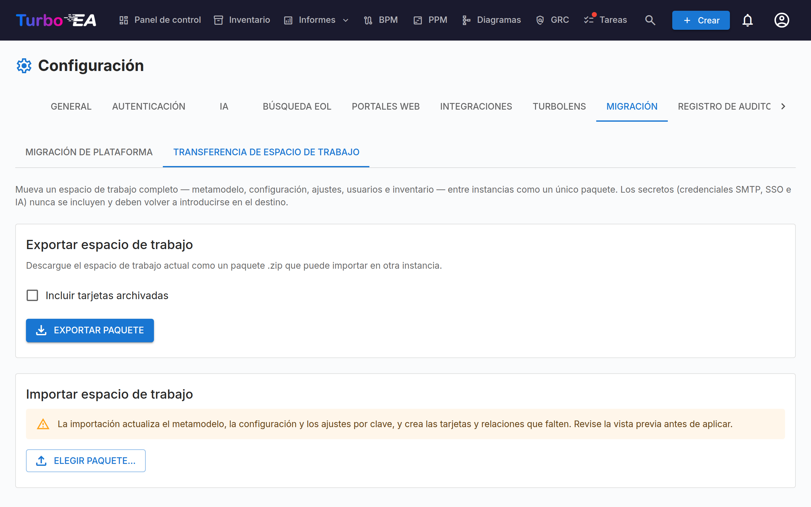

# Transferencia de workspace

La Transferencia de workspace (**Administración → Configuración → Migración → Transferencia de workspace**) traslada un workspace completo de Turbo EA de una instancia a otra como un único paquete autocontenido. El caso de uso principal: construye un workspace en una instancia **local** y necesita promover todo a **Producción**.

## Qué se incluye

La exportación captura el workspace completo como un paquete `.zip` que contiene un libro de Excel (todos los datos estructurados, una hoja por dominio) y, cuando corresponde, una carpeta `assets/` para archivos no estructurados:

- **Metamodelo** — tipos de tarjeta y tipos de relación, incluidos todos los campos personalizados, subtipos, secciones y traducciones.
- **Configuración** — roles, roles de partes interesadas por tipo, grupos de etiquetas y etiquetas, campos calculados, principios de EA y regulaciones de cumplimiento.
- **Ajustes** — moneda, formato de fecha, indicadores de funciones, personalización de la pantalla de inicio de sesión, idiomas habilitados y el resto de los ajustes generales de la aplicación.
- **Usuarios** — correo electrónico, nombre para mostrar, rol e indicador de actividad (se usan para revincular la propiedad y las asignaciones en el destino). Sin contraseñas ni identidades SSO.
- **Partidas de coste** — el catálogo de partidas de coste (claves, etiquetas, traducciones, indicador de archivado) y las partidas de coste de cada Aplicación o Componente de TI por año fiscal.
- **Métricas y tipos de licencia** — las hojas `LicenseMetrics` y `LicenseTypes` (los tipos de cada métrica), y las cantidades de licencias de cada Aplicación o Componente de TI por año fiscal en `CardLicenses`. Un paquete escrito antes de que existieran las métricas de licencia se convierte al importar: las métricas y la métrica de cada tipo se deducen de los datos de las fichas del paquete, y el antiguo campo *Modelo de licencias* se descarta. Un paquete con las hojas nuevas importado en una instancia más antigua no se rechaza, pero la instancia más antigua las ignora.
- **Inventario** — cada tarjeta (con su jerarquía, ciclo de vida y atributos), etiquetas de tarjeta y relaciones.
- **Contexto de tarjeta** — partes interesadas, enlaces a documentos, comentarios, tareas pendientes y archivos adjuntos.
- **Datos de módulos** — BPM (diagramas de proceso, elementos, versiones de flujo, evaluaciones), PPM (informes de estado, costes, presupuestos, riesgos, tareas, WBS, dependencias), el registro de riesgos de GRC (riesgos, tareas de mitigación y sus ocurrencias, enlaces a tarjetas), los hallazgos de cumplimiento de GRC (con las ejecuciones de análisis a las que hacen referencia), decisiones de arquitectura (con sus vínculos a diagramas de dibujo libre) y Statements of Architecture Work (con las imágenes de su texto), diagramas de dibujo libre, informes guardados, marcadores (vistas guardadas del inventario, incluidas sus comparticiones), portales web y encuestas.
- **Activos** — los archivos adjuntos binarios, las imágenes del texto de decisiones y SoAW, el XML de diagramas y BPMN, y el logo/favicon viajan como archivos separados dentro de la carpeta `assets/` del paquete.

La sección **Diagramas** también incluye el dibujo guardado de **Relaciones entre objetos de negocio**. La importación conserva las posiciones de los nodos cuando las fichas y las relaciones reciben nuevos identificadores en el destino. Los borradores se quedan en el navegador donde se editaron. Las eliminaciones pendientes del inventario se quedan en la sesión de edición original.

## Qué nunca se incluye

Por seguridad, **los secretos nunca se exportan**:

- Contraseña SMTP
- Secreto de cliente SSO
- Clave de API del proveedor de IA
- Credenciales de ServiceNow

Debe volver a introducirlos en la instancia de destino después de importar. Esto es inevitable por diseño: los valores cifrados están vinculados a la `SECRET_KEY` de la instancia de origen y no pueden descifrarse en ningún otro lugar.

Algunos otros elementos se quedan atrás por diseño:

- **Los resultados de análisis de TurboLens** (análisis de proveedores, clústeres de duplicados, evaluaciones de modernización, evaluaciones de arquitectura guardadas) y el historial de KPI del panel son locales a la instancia — vuelva a ejecutar los análisis en el destino. Los hallazgos de cumplimiento son la excepción y sí se transfieren.
- **El estado local del navegador** nunca se transfiere: el orden ad hoc de columnas de la cuadrícula del inventario vive en el almacenamiento local de su navegador, no en la base de datos. El diseño de columnas que guardó **dentro de una vista guardada** sí se transfiere con la vista.

## Exportar

1. Abra **Administración → Configuración → Migración → Transferencia de workspace**.
2. (Opcional) marque **Incluir tarjetas archivadas** para añadir el inventario archivado al paquete.
3. Haga clic en **Exportar paquete**. Su navegador descarga `workspace_export_<timestamp>.zip`.

## Importar

1. En la instancia de **destino**, abra **Administración → Configuración → Migración → Transferencia de workspace**.
2. Bajo **Importar workspace**, haga clic en **Elegir paquete…** y seleccione el `.zip` que exportó.
3. Turbo EA analiza el paquete y muestra una **vista previa de simulación** — una tabla por sección de cuántas entidades se crearían, actualizarían, omitirían o están en conflicto. Aún no se escribe nada.
4. Revise la vista previa y, a continuación, haga clic en **Aplicar importación**.

Si el servidor se reinicia mientras se está realizando una importación, deje la página abierta mientras se vuelve a conectar y comprueba el estado de la transferencia. Si indica que se ha interrumpido, revise el espacio de trabajo de destino, haga clic en **Descartar** y vuelva a cargar el archivo para obtener una vista previa nueva.

La importación es **idempotente**: el metamodelo y la configuración se emparejan por clave, las tarjetas por id externo o por tipo + ruta de jerarquía, y los usuarios por correo electrónico. Volver a importar el mismo paquete es seguro — las entidades ya presentes se omiten en lugar de duplicarse. Los tipos de metamodelo built-in existentes conservan su identidad; solo se fusiona su esquema editable. Esto también vale para las tarjetas archivadas incluidas en el paquete: se reconocen en lugar de crearse de nuevo.

La primera importación de un dibujo guardado de **Relaciones entre objetos de negocio** puede incorporarlo a un destino en el que nunca se haya guardado un dibujo de este tipo. Si el destino ya tiene uno guardado, aunque esté vacío, la importación conserva el dibujo y sus posiciones. Consulte el desglose de **Referencias** para ver los objetos de negocio o los vínculos que la importación no pudo resolver. Si en el destino ya hay otra aplicación maestra para un objeto de negocio, el conflicto se indica en los resultados de **Relaciones** y el vínculo nuevo conserva su configuración CRUD.

### Cómo leer la vista previa

- **«Omitido» significa «ya presente — no se requiere ninguna acción».** En una instalación nueva verá normalmente omisiones para el contenido que se distribuye con Turbo EA (roles de partes interesadas, tipos de recurso, ajustes predeterminados), porque la copia del paquete es idéntica a lo que el destino ya tiene. Expanda una fila de sección (la flecha de la izquierda) para ver el desglose por motivo y cualquier mensaje de conflicto o de fallo.
- **Aviso de versión.** La vista previa muestra desde qué versión de Turbo EA se exportó el paquete y advierte cuando difiere de la instancia que importa. La advertencia es solo informativa — la importación se ejecuta igualmente — pero exportar e importar en la misma versión es la vía más segura.
- **Las referencias siguen a las tarjetas.** Las tarjetas, relaciones y etiquetas reciben nuevos identificadores internos en el destino. Todo lo que las referencia — las tarjetas y relaciones dibujadas en un diagrama, las tarjetas vinculadas y los procesos llamados de un flujo de proceso, el alcance y los filtros de un informe guardado, los destinatarios y respuestas de una encuesta, el filtro de etiquetas de un portal o de una vista guardada, el enlace de una tarea — se traduce a los identificadores del destino. Despliegue una sección para ver el desglose **Referencias**. Una entrada contada como *no incluida en el paquete* apunta a una tarjeta archivada o eliminada en el origen y se deja como estaba; marque **Incluir tarjetas archivadas** al exportar para llevar las tarjetas archivadas y todo lo vinculado a ellas.
- **Paquetes de una versión anterior.** Un paquete exportado antes de Turbo EA 2.158.13 no incluye identificadores internos. Sus diagramas se vuelven a vincular por tipo de tarjeta y nombre, usando las tarjetas vinculadas a cada diagrama para distinguir dos tarjetas con el mismo nombre; una forma que sigue coincidiendo con varias tarjetas se deja sin cambios y se indica en los mensajes. Las demás referencias de un paquete así no se pueden traducir: si puede, vuelva a exportar desde un origen con 2.158.13 o posterior.
- **Reparar una importación anterior.** Si importó un paquete con una versión anterior y sus diagramas muestran ahora sus tarjetas como eliminadas, vuelva a importar el mismo paquete. Las filas que siguen exactamente como las dejó la primera importación se reparan y se cuentan como *Filas de una importación anterior reparadas*; lo que se haya editado desde entonces no se toca.

## Después de importar

- Vuelva a introducir cualquier credencial de SMTP, SSO e IA en sus respectivas pestañas de configuración.
- Los usuarios sintéticos referenciados por el paquete se crean **desactivados**; actívelos en **Administración → Usuarios** según sea necesario.
- **Los datos propiedad del usuario siguen al usuario, emparejado por correo electrónico.** Las tareas pendientes, las vistas guardadas, los favoritos y otros datos personales pertenecen a la cuenta cuyo correo electrónico coincide con el del paquete. Si inicia sesión en el destino con un correo distinto al que usó en el origen, sus elementos personales parecerán haber desaparecido — están vinculados a la cuenta coincidente (posiblemente desactivada). Inicie sesión con el mismo correo, o active la cuenta coincidente en **Administración → Usuarios**.
- Las vistas guardadas privadas solo son visibles para su propietario; las vistas compartidas y públicas siguen sus ajustes de visibilidad.
- **Los paquetes exportados antes de la función de partidas de coste (versión 2.188.0)** incluyen el coste total de las Aplicaciones y los Componentes de TI pero ninguna partida de coste, por lo que ese total se descarta la próxima vez que se recalcule el coste. Vuelva a exportar desde el origen actualizado antes de importar.

## Empezar de cero

No existe una función integrada de «deshacer importación». Para restablecer una instancia de destino y volver a importar desde cero, reiníciela una vez con `RESET_DB=true` (elimina y vuelve a crear todas las tablas y, a continuación, vuelve a sembrar los datos), y después vuelva a establecer `RESET_DB=false` **antes** del siguiente reinicio para no borrar los datos recién importados.

## Permisos

La Transferencia de workspace está protegida por dos permisos dedicados, ambos concedidos a los administradores:

- `admin.export_workspace` — exportar el paquete.
- `admin.import_workspace` — previsualizar y aplicar una importación.
