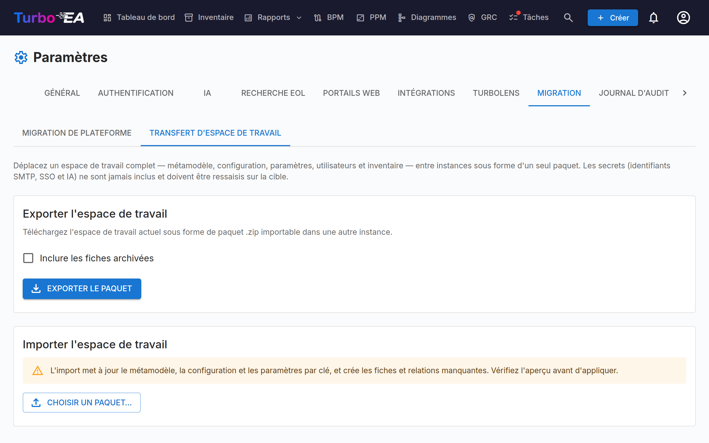

# Transfert de workspace

Le transfert de workspace (**Administration → Paramètres → Migration → Transfert de workspace**) déplace un workspace Turbo EA entier d'une instance vers une autre sous forme d'un bundle unique et autonome. Le cas d'usage principal : vous étoffez un workspace sur une instance **locale** et devez tout promouvoir vers la **Production**.

## Ce qui est inclus

L'export capture le workspace complet dans un bundle `.zip` contenant un classeur Excel (toutes les données structurées, une feuille par domaine) et, le cas échéant, un dossier `assets/` pour les fichiers non structurés :

- **Métamodèle** — types de fiches et types de relations, y compris tous les champs personnalisés, sous-types, sections et traductions.
- **Configuration** — rôles, rôles de parties prenantes par type, groupes de tags et tags, champs calculés, principes EA et réglementations de conformité.
- **Paramètres** — devise, format de date, indicateurs de fonctionnalité, image de marque de connexion, langues activées, et le reste des paramètres généraux de l'application.
- **Utilisateurs** — e-mail, nom affiché, rôle et indicateur d'activité (utilisés pour re-lier la propriété et les affectations sur la cible). Aucun mot de passe ni identité SSO.
- **Inventaire** — chaque fiche (avec sa hiérarchie, son cycle de vie et ses attributs), les tags de fiches et les relations.
- **Contexte de fiche** — parties prenantes, liens vers documents, commentaires, tâches et pièces jointes.
- **Données des modules** — BPM (diagrammes de processus, éléments, versions de flux, évaluations), PPM (rapports de statut, coûts, budgets, risques, tâches, WBS, dépendances), le registre des risques GRC (risques, tâches d'atténuation et occurrences, liaisons de fiches), les constats de conformité GRC (avec les exécutions d'analyse qu'ils référencent), décisions d'architecture et Statements of Architecture Work, diagrammes en dessin libre, rapports enregistrés, favoris (vues enregistrées de l'inventaire, y compris leurs partages), portails web et enquêtes.
- **Assets** — les pièces jointes binaires, le XML des diagrammes et BPMN, ainsi que le logo/favicon voyagent sous forme de fichiers séparés dans le dossier `assets/` du bundle.

## Ce qui n'est jamais inclus

Pour des raisons de sécurité, **les secrets ne sont jamais exportés** :

- Mot de passe SMTP
- Secret client SSO
- Clé API du fournisseur d'IA
- Identifiants ServiceNow

Vous devez les ressaisir sur l'instance cible après l'import. C'est inévitable par conception : les valeurs chiffrées sont liées au `SECRET_KEY` de l'instance source et ne peuvent être déchiffrées nulle part ailleurs.

Quelques autres éléments restent volontairement sur place :

- **Les résultats d'analyse TurboLens** (analyse des fournisseurs, clusters de doublons, évaluations de modernisation, évaluations d'architecture enregistrées) et l'historique des KPI du tableau de bord sont locaux à l'instance — relancez les analyses sur la cible. Les constats de conformité font exception et sont bien transférés.
- **L'état local au navigateur** n'est jamais transféré : l'ordre ad hoc des colonnes de la grille d'inventaire vit dans le stockage local de votre navigateur, pas dans la base de données. La disposition des colonnes que vous avez enregistrée **dans une vue enregistrée** est, elle, transférée avec la vue.

## Exporter

1. Ouvrez **Administration → Paramètres → Migration → Transfert de workspace**.
2. (Optionnel) cochez **Inclure les fiches archivées** pour ajouter l'inventaire archivé au bundle.
3. Cliquez sur **Exporter le bundle**. Votre navigateur télécharge `workspace_export_<timestamp>.zip`.

## Importer

1. Sur l'instance **cible**, ouvrez **Administration → Paramètres → Migration → Transfert de workspace**.
2. Sous **Importer un workspace**, cliquez sur **Choisir un bundle…** et sélectionnez le `.zip` que vous avez exporté.
3. Turbo EA analyse le bundle et affiche un **aperçu à blanc** (dry-run) — un tableau par section indiquant combien d'entités seraient créées, mises à jour, ignorées ou sont en conflit. Rien n'est encore écrit.
4. Examinez l'aperçu, puis cliquez sur **Appliquer l'import**.

L'import est **idempotent** : le métamodèle et la configuration sont appariés par clé, les fiches par identifiant externe ou par type + chemin hiérarchique, et les utilisateurs par e-mail. Réimporter le même bundle est sans risque — les entités déjà présentes sont ignorées plutôt que dupliquées. Les types de métamodèle built-in existants conservent leur identité ; seul leur schéma modifiable est fusionné. C'est aussi vrai pour les fiches archivées incluses dans le bundle : elles sont reconnues au lieu d'être créées à nouveau.

### Lire l'aperçu

- **« Ignoré » signifie « déjà présent — aucune action nécessaire ».** Sur une installation neuve, vous verrez typiquement des éléments ignorés pour le contenu livré avec Turbo EA (rôles de parties prenantes, types de ressources, paramètres par défaut), parce que la copie du bundle est identique à ce que la cible possède déjà. Dépliez une ligne de section (la flèche à gauche) pour voir la répartition par motif ainsi que les éventuels messages de conflit ou d'échec.
- **Avis de version.** L'aperçu indique depuis quelle version de Turbo EA le bundle a été exporté et avertit lorsqu'elle diffère de l'instance qui importe. L'avertissement est purement indicatif — l'import s'exécute quand même — mais exporter et importer sur la même version reste la voie la plus sûre.
- **Les références suivent les fiches.** Les fiches, relations et étiquettes reçoivent de nouveaux identifiants internes sur la cible. Tout ce qui y fait référence — les fiches et relations dessinées sur un diagramme, les fiches liées et processus appelés d'un flux de processus, le périmètre et les filtres d'un rapport enregistré, les cibles et réponses d'une enquête, le filtre d'étiquettes d'un portail ou d'une vue enregistrée, le lien d'une tâche — est converti vers les identifiants de la cible. Dépliez une section pour voir le détail **Références**. Une entrée comptée comme *absente du paquet* désigne une fiche archivée ou supprimée à la source et reste inchangée ; cochez **Inclure les fiches archivées** à l'export pour emporter les fiches archivées et tout ce qui leur est lié.
- **Bundles d'une version antérieure.** Un bundle exporté avant Turbo EA 2.158.13 ne contient pas d'identifiants internes. Ses diagrammes sont reliés à nouveau par type de fiche et nom, en s'appuyant sur les fiches liées à chaque diagramme pour distinguer deux fiches de même nom ; une forme qui correspond encore à plusieurs fiches reste inchangée et est citée dans les messages. Les autres références d'un tel bundle ne peuvent pas être converties : réexportez si possible depuis une source en 2.158.13 ou plus récente.
- **Réparer un import précédent.** Si vous avez importé un bundle avec une version antérieure et que ses diagrammes affichent désormais leurs fiches comme supprimées, importez à nouveau le même bundle. Les lignes encore exactement telles que le premier import les a laissées sont réparées et comptées comme *Lignes d'un import précédent réparées* ; tout ce qui a été modifié depuis reste intact.

## Après l'import

- Ressaisissez tous les identifiants SMTP, SSO et IA dans leurs onglets de paramètres respectifs.
- Les utilisateurs synthétiques référencés par le bundle sont créés **désactivés** ; activez-les sous **Administration → Utilisateurs** selon vos besoins.
- **Les données appartenant aux utilisateurs suivent l'utilisateur, apparié par e-mail.** Les tâches, vues enregistrées, fiches favorites et autres données personnelles appartiennent au compte dont l'e-mail correspond à celui du bundle. Si vous vous connectez à la cible avec un e-mail différent de celui utilisé sur la source, vos éléments personnels sembleront manquants — ils sont rattachés au compte correspondant (éventuellement désactivé). Connectez-vous avec le même e-mail, ou activez le compte correspondant sous **Administration → Utilisateurs**.
- Les vues enregistrées privées ne sont visibles que par leur propriétaire ; les vues partagées et publiques suivent leurs paramètres de visibilité.

## Repartir de zéro

Il n'existe pas d'« annulation d'import » intégrée. Pour réinitialiser une instance cible et réimporter de zéro, redémarrez-la une fois avec `RESET_DB=true` (supprime et recrée toutes les tables, puis relance l'amorçage des données), puis repassez à `RESET_DB=false` **avant** le redémarrage suivant afin de ne pas effacer les données fraîchement importées.

## Permissions

Le transfert de workspace est gardé par deux permissions dédiées, toutes deux accordées aux administrateurs :

- `admin.export_workspace` — exporter le bundle.
- `admin.import_workspace` — prévisualiser et appliquer un import.
