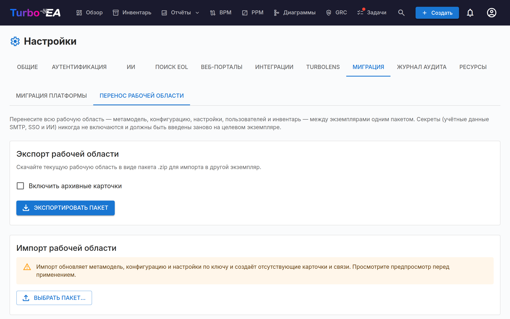

# Перенос workspace

Перенос workspace (**Администрирование → Настройки → Миграция → Перенос workspace**) перемещает целый workspace Turbo EA из одного экземпляра в другой в виде единого самодостаточного пакета. Основной сценарий: вы выстраиваете workspace на **локальном** экземпляре и вам нужно перенести всё в **Production**.

## Что включается

Экспорт фиксирует полный workspace в виде `.zip`-пакета, содержащего одну книгу Excel (все структурированные данные, по одному листу на домен) и, где это применимо, папку `assets/` для неструктурированных файлов:

- **Метамодель** — типы карт и типы связей, включая все пользовательские поля, подтипы, секции и переводы.
- **Конфигурация** — роли, роли заинтересованных сторон по типам, группы тегов и теги, вычисляемые поля, принципы EA и нормативные требования (compliance regulations).
- **Настройки** — валюта, формат даты, флаги функций, брендинг страницы входа, включённые локали и остальные общие настройки приложения.
- **Пользователи** — email, отображаемое имя, роль и флаг активности (используются для повторной привязки владения и назначений на целевом экземпляре). Без паролей и SSO-идентичностей.
- **Инвентарь** — каждая карта (с её иерархией, жизненным циклом и атрибутами), теги карт и связи.
- **Контекст карты** — заинтересованные стороны, ссылки на документы, комментарии, задачи и файловые вложения.
- **Данные модулей** — BPM (диаграммы процессов, элементы, версии потоков, оценки), PPM (отчёты о статусе, затраты, бюджеты, риски, задачи, WBS, зависимости), реестр рисков GRC (риски, задачи по снижению рисков и их экземпляры, связи с картами), находки соответствия GRC (вместе с запусками анализа, на которые они ссылаются), архитектурные решения и Statements of Architecture Work, свободные диаграммы, сохранённые отчёты, закладки (сохранённые представления инвентаря, включая их совместные доступы), веб-порталы и опросы.
- **Активы** — бинарные файловые вложения, XML диаграмм и BPMN, а также логотип/фавиконка переносятся как отдельные файлы внутри папки `assets/` пакета.

## Что никогда не включается

В целях безопасности **секреты никогда не экспортируются**:

- Пароль SMTP
- Секрет клиента SSO
- API-ключ AI-провайдера
- Учётные данные ServiceNow

После импорта их необходимо повторно ввести на целевом экземпляре. Это неизбежно по архитектуре: зашифрованные значения привязаны к `SECRET_KEY` исходного экземпляра и не могут быть расшифрованы где-либо ещё.

Ещё несколько вещей намеренно остаются на месте:

- **Результаты анализа TurboLens** (анализ поставщиков, кластеры дубликатов, оценки модернизации, сохранённые архитектурные оценки) и история KPI дашборда локальны для экземпляра — запустите анализы на целевом экземпляре заново. Находки соответствия — исключение: они переносятся.
- **Локальное состояние браузера** никогда не переносится: настроенный вручную порядок столбцов сетки инвентаря хранится в локальном хранилище вашего браузера, а не в базе данных. Компоновка столбцов, сохранённая **внутри сохранённого представления**, переносится вместе с представлением.

## Экспорт

1. Откройте **Администрирование → Настройки → Миграция → Перенос workspace**.
2. (Опционально) отметьте **Включить архивные карты**, чтобы добавить архивный инвентарь в пакет.
3. Нажмите **Экспортировать пакет**. Браузер скачает `workspace_export_<timestamp>.zip`.

## Импорт

1. На **целевом** экземпляре откройте **Администрирование → Настройки → Миграция → Перенос workspace**.
2. В разделе **Импорт workspace** нажмите **Выбрать пакет…** и выберите экспортированный вами `.zip`.
3. Turbo EA разбирает пакет и показывает **предпросмотр (dry-run)** — таблицу по секциям с количеством сущностей, которые будут созданы, обновлены, пропущены или находятся в конфликте. Пока ничего не записывается.
4. Проверьте предпросмотр, затем нажмите **Применить импорт**.

Импорт **идемпотентен**: метамодель и конфигурация сопоставляются по ключу, карты — по внешнему id либо по типу + пути иерархии, а пользователи — по email. Повторный импорт того же пакета безопасен — уже присутствующие сущности пропускаются, а не дублируются. Существующие встроенные типы метамодели сохраняют свою идентичность; объединяется только их редактируемая схема. Это касается и архивных карточек в пакете: они распознаются, а не создаются заново.

### Как читать предпросмотр

- **«Пропущено» означает «уже присутствует — действий не требуется».** На свежей установке вы, как правило, увидите пропуски для содержимого, поставляемого вместе с Turbo EA (роли заинтересованных сторон, типы ресурсов, настройки по умолчанию), потому что копия в пакете идентична тому, что уже есть на целевом экземпляре. Разверните строку секции (стрелка слева), чтобы увидеть разбивку по причинам и сообщения о конфликтах или сбоях.
- **Предупреждение о версии.** Предпросмотр показывает, из какой версии Turbo EA был экспортирован пакет, и предупреждает, если она отличается от версии импортирующего экземпляра. Предупреждение носит рекомендательный характер — импорт всё равно выполняется — но экспорт и импорт на одной и той же версии остаются самым безопасным путём.
- **Ссылки следуют за карточками.** Карточки, связи и теги получают в целевом экземпляре новые внутренние идентификаторы. Всё, что на них ссылается, — карточки и связи на диаграмме, связанные карточки и вызываемые процессы схемы процесса, область и фильтры сохранённого отчёта, адресаты и ответы опроса, фильтр по тегам портала или сохранённого представления, ссылка задачи — переводится на идентификаторы цели. Разверните раздел, чтобы увидеть сводку **Ссылки**. Запись, учтённая как *нет в пакете*, указывает на карточку, архивированную или удалённую в источнике, и остаётся без изменений; при экспорте отметьте **Включить архивные карты**, чтобы перенести архивные карточки и всё, что с ними связано.
- **Пакеты из более ранней версии.** Пакет, экспортированный до Turbo EA 2.158.13, не содержит внутренних идентификаторов. Его диаграммы связываются заново по типу и имени карточки, а связанные с каждой диаграммой карточки помогают различить две карточки с одинаковым именем; фигура, которая по-прежнему соответствует нескольким карточкам, остаётся без изменений и называется в сообщениях. Остальные ссылки такого пакета перевести нельзя, поэтому по возможности выполните повторный экспорт из источника с версией 2.158.13 или новее.
- **Исправление предыдущего импорта.** Если вы импортировали пакет в более ранней версии и его диаграммы теперь показывают карточки как удалённые, импортируйте тот же пакет ещё раз. Строки, которые остались ровно такими, какими их оставил первый импорт, исправляются и учитываются как *Строки предыдущего импорта исправлены*; всё, что с тех пор редактировалось, не затрагивается.

## После импорта

- Повторно введите все учётные данные SMTP, SSO и AI в соответствующих вкладках настроек.
- Синтетические пользователи, на которых ссылается пакет, создаются **деактивированными**; активируйте их в **Администрирование → Пользователи** по мере необходимости.
- **Данные, принадлежащие пользователю, следуют за пользователем и сопоставляются по email.** Задачи, сохранённые представления, избранное и другие персональные данные принадлежат учётной записи, чей email совпадает с указанным в пакете. Если вы войдёте на целевой экземпляр с другим email, чем использовали на исходном, ваши личные элементы будут казаться пропавшими — они привязаны к совпавшей (возможно, деактивированной) учётной записи. Войдите с тем же email или активируйте совпавшую учётную запись в **Администрирование → Пользователи**.
- Приватные сохранённые представления видны только их владельцу; представления с совместным доступом и публичные следуют своим настройкам видимости.

## Начать заново

Встроенной функции «отменить импорт» нет. Чтобы сбросить целевой экземпляр и импортировать заново с нуля, перезапустите его один раз с `RESET_DB=true` (удаляет и пересоздаёт все таблицы, затем заново заполняет их начальными данными), после чего верните `RESET_DB=false` **до** следующего перезапуска, чтобы не стереть только что импортированные данные.

## Разрешения

Перенос workspace защищён двумя выделенными разрешениями, оба выдаются администраторам:

- `admin.export_workspace` — экспорт пакета.
- `admin.import_workspace` — предпросмотр и применение импорта.
