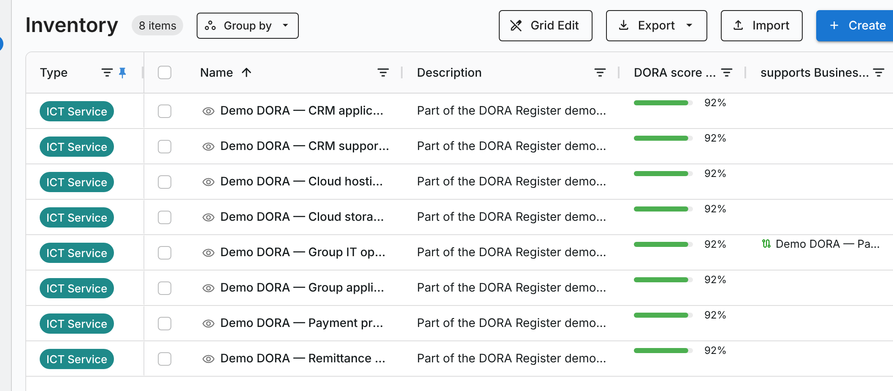
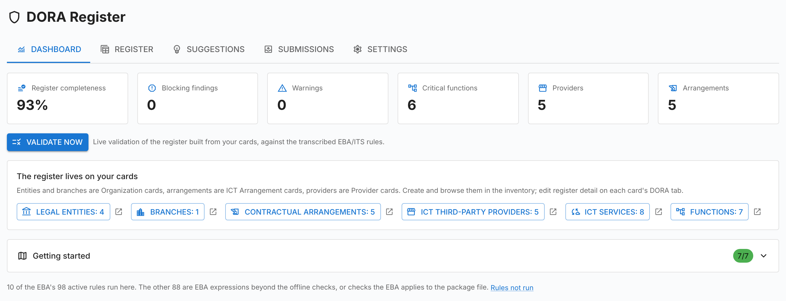

# DORA Register of Information

يتعيّن على كل كيان مالي في الاتحاد الأوروبي أن يمسك **سجل معلومات** بكل ترتيباته مع
مزوّدي خدمات تقنية المعلومات والاتصالات من الأطراف الثالثة، وأن يقدّمه سنويًا عبر
جهته الرقابية — 15 نموذجًا متشابكًا، تُسلَّم بوصفها حزمة xBRL-CSV قابلة للقراءة
آليًا وفق إطار الإبلاغ الصادر عن الهيئة المصرفية الأوروبية. وفي التشغيل التجريبي
للهيئات الأوروبية للإشراف عام 2024 لم تجتز جميع فحوص جودة البيانات سوى 6.5% من
السجلات.

والبيانات التي يحتاجها السجل هي بالضبط ما يحتويه مستودع بنيتكم المؤسسية أصلًا.
وتحوّل إضافة **DORA Register of Information** برنامج Turbo EA إلى سجلّكم.

!!! note "لغة الواجهة"
    واجهة هذه الإضافة متاحة بالإنجليزية والألمانية والفرنسية والإسبانية والإيطالية
    والدنماركية. أما في العربية فتظهر **بالإنجليزية**، ولذا تَرِد التسميات المقتبسة
    أدناه كما تظهر على الشاشة تمامًا.

## السجل يعيش على بطاقاتكم

لا تمسك هذه الإضافة **أي جداول خاصة بها** لمحتوى السجل. فكل كائن في السجل هو بطاقة
أو علاقة:

| كائن السجل | في Turbo EA |
|---|---|
| الكيانات القانونية ضمن النطاق | بطاقات **منظمة** مفعَّل فيها *In DORA register scope* |
| الفروع | بطاقات **منظمة** بالنوع الفرعي **Branch**، تابعة لمقرّها الرئيس |
| مزوّدو تقنية المعلومات من أطراف ثالثة | بطاقات **Provider** |
| الترتيبات التعاقدية | بطاقات **ICT Arrangement** (نوع بطاقة جديد) |
| خدمات تقنية المعلومات | بطاقات **ICT Service** (نوع بطاقة جديد) |
| الوظائف الحرجة أو المهمة | بطاقات **قدرة الأعمال** / **عملية الأعمال** الموسومة بوصفها وظائف في السجل |
| الأطراف الموقّعة والمستخدِمة والمقدِّمة وسلاسل التعاقد من الباطن | **العلاقات** بين تلك البطاقات |

هذا هو التصميم بأكمله: فكل حقل يُحرَّر في عرض البطاقة الخاص بـ Turbo EA، بما فيه من
علامات الإلزام والتحقق ونصوص المساعدة ودرجة جودة البيانات، ويُجمَّع السجل حيًّا من
البطاقات في كل مرة تتحققون فيها أو تُصدِّرون.

!!! note "لا يوجد عمدًا تبويب DORA في البطاقة"
    فالحقول المضافة تظهر بوصفها أقسام سمات عادية في البطاقة، وكل رابط في السجل هو
    علاقة اعتيادية. فليس في إمساك السجل أي وضع خاص.

## لمحة سريعة

| | |
|---|---|
| **الترخيص** | تجارية — يلزم حق ترخيص موقّع |
| **الحد الأدنى لإصدار Turbo EA** | 2.182.0 |
| **الصلاحيات** | `ext.dora-roi.view`، `ext.dora-roi.manage`، `ext.dora-roi.submit`، `ext.dora-roi.admin` |
| **تصاريح الوصول إلى البيانات** | `core.cards.read`، `core.cards.write`، `metamodel.custom_field_types` |
| **هل تلزم إعادة تشغيل الواجهة الخلفية** | نعم — تتضمن شيفرة للواجهة الخلفية |
| **أين تظهر** | **DORA Register** ضمن قائمة **GRC** (مدخل في المستوى الأعلى حين لا تتوفر لكم قائمة GRC) · **التقارير → DORA Register - Dashboard** · قسما **DORA Register** و**DORA Function** في البطاقات · ستة قوالب استبيان |

## ما تضيفه إلى نموذج بياناتكم

**نوعان جديدان من البطاقات**

- **ICT Arrangement** — ترتيب تعاقدي بشأن استخدام خدمات تقنية المعلومات. وهو
  **هرمي**: فالترتيبات الإطارية هي الأصول، والترتيبات اللاحقة أو المرتبطة هي فروعها.
  ويحمل النفقة السنوية والعملة.
- **ICT Service** — بطاقة لكل خدمة تُقدَّم بموجب ترتيب، وتحمل سطر الخدمة (النوع
  والتواريخ ومُهَل الإشعار والقانون الحاكم والمواقع ودرجة الاعتماد) و**تقييمها**
  (قابلية الاستبدال، وخطة الخروج، وإعادة الاستيعاب، وأثر التوقف، والمزوّدون
  البدلاء). وتتيح حقول المواقع الثلاثة فيها — **Country of provision of the
  services** و**Location of the data at rest** و**Location of data management**
  (حيث تُعالَج البيانات) — خيار **Not applicable** لكل منها. والخدمة التي لم يُسجَّل
  لها موقع معالجة البيانات تمنع إنهاء اللقطة: اختاروا الدولة، أو **Not applicable**
  إذا كانت الخدمة لا تنطوي على معالجة بيانات.

**نوع فرعي جديد** — **Branch** على المنظمة.

**أقسام جديدة على أنواع بطاقات قائمة**

| نوع البطاقة | القسم | المحتوى |
|---|---|---|
| **منظمة** | DORA Register | ضمن نطاق سجل DORA، ورمز LEI، والدولة، ونوع الكيان، والموقع في المجموعة، والسلطة المختصة، وإجمالي الأصول، وعملة الإبلاغ، ورمز الفرع |
| **Provider** | DORA Register | رمز LEI، ونوع المعرّف، وEUID، ورمز تعريف آخر، ونوع الشخص، ودولة المقر الرئيس، ومزوّد داخل المجموعة، والنفقة السنوية، والشركة الأم النهائية |
| **قدرة الأعمال** / **عملية الأعمال** | DORA Function | وظيفة في سجل DORA، ومعرّف الوظيفة، والنشاط المرخَّص، وتقييم الأهمية الحرجة أو الجوهرية، ومسوّغات الأهمية، وتاريخ آخر تقييم، وRTO، وRPO، وأثر التوقف |

ويحمل كل قسم أيضًا **درجة DORA (%)** للقراءة فقط — وهي شريط اكتمال يبيّن مقدار
بيانات السجل التي ما زالت مستحقة على تلك البطاقة.

**تسعة أنواع من العلاقات**، يحمل اثنان منها سمات تضبطونها لكل علاقة على حدة:

- **منظمة → ICT Arrangement** (*طرف في*) تحمل سمة **أدوار DORA**: **الكيان
  الموقّع**، و**استخدام خدمات تقنية المعلومات**، و**الكيان المقدِّم (داخل
  المجموعة)**.
- **ICT Service → Provider** (*يقدّمها*) تحمل **رتبة في سلسلة التوريد**:
  **الرتبة 1** هي المزوّد المباشر، والرتب الأعمق هي متعاقدون من الباطن.

كما تضيف الإضافة تنظيم **DORA** إلى [ماسح الامتثال](../guide/compliance.md) في
النواة.

## البدء

تُفتح مساحة العمل على **Dashboard** وفيها قائمة تحقق **Getting started** تتابع هذه
الخطوات السبع وتُظهر مدى التقدم.

1. **اختاروا الكيان المُبلِّغ في Settings** — أي الكيان الذي يخصّه هذا السجل.
2. **علّموا كياناتكم القانونية.** في كل بطاقة منظمة املؤوا قسم **DORA Register**:
   فعّلوا *In DORA register scope* وأدخلوا رمز LEI والدولة ونوع الكيان والموقع في
   المجموعة. والفروع بطاقات منظمة بالنوع الفرعي **Branch**، تابعة لمقرّها الرئيس.
3. **أنشئوا بطاقة ICT Arrangement لكل ترتيب تعاقدي.** واجعلوا العقود اللاحقة
   *فروعًا* للعقد الإطاري — فمن ذلك يُشتقّ نوع الترتيب ومرجع الترتيب الإطاري.
4. **اربطوا كل ترتيب** ببطاقة Provider الخاصة به وبالكيانات التي توقّع أو تستخدم أو
   تقدّم، مع ضبط سمة **أدوار DORA** على كل علاقة.
5. **أنشئوا بطاقة ICT Service لكل خدمة**، ثم اربطوها بعقدها وبالكيانات المستخدِمة لها
   وبالوظائف التي تدعمها وبمزوّديها **مرتّبين بالرتبة**.
6. **علّموا الوظائف.** فعّلوا *DORA register function* على بطاقات قدرة الأعمال أو
   عملية الأعمال التي تُعدّ وظائف حرجة أو مهمة، واملؤوا قسم **DORA Function** فيها —
   أو اقبلوا المقترحات من [Suggestions](#suggestions).
7. **تحقّقوا من السجل وعالجوا الملاحظات.**

!!! tip "اجمعوا البيانات ممن يملكونها"
    تجمع ستة قوالب استبيان في **الإدارة → الاستبيانات → جديد من قالب** البياناتِ
    الإلزامية من المسؤولين عن البطاقات: **DORA entity data**، و**DORA provider
    data**، و**DORA arrangement data**، و**DORA ICT service data**، إضافة إلى
    **DORA function data** للقدرات وللعمليات. ويُفتح كل قالب بوصفه مسودة.

### ما لن تضطروا إلى إدخاله يدويًا أبدًا

يشتقّ السجل ما يلي بدل أن يسألكم عنه: رمز LEI للشركة الأم (من هرمية البطاقات)،
وتواريخ الإدماج والإنهاء (من دورة حياة البطاقة)، ونوع الترتيب ومرجع الترتيب الإطاري
(من هرمية الترتيبات)، وطبيعة الفرع (من النوع الفرعي Branch)، ومتلقّي الخدمة
المتعاقد عليها من الباطن (من ترتيب رتب المزوّدين)، وتاريخ آخر تحديث. كما يُشتقّ
**نطاق المزوّدين** كذلك: فلا يدخل السجلَّ إلا بطاقات Provider التي يشير إليها فعليًا
ترتيبٌ أو سلسلة توريد، فيبقى المورّدون غير المعنيين خارجه تلقائيًا. وتُطبَّق عنكم
أعرافُ التعبئة في معايير ITS (`9999-12-31` للتواريخ غير المحدَّدة، و*not applicable*
للترتيبات غير اللاحقة).

## مساحة العمل

يضم **DORA Register** ضمن قائمة **GRC** خمسة تبويبات. ولوحة المعلومات نفسها متاحة
أيضًا بوصفها تقريرًا قابلًا للحفظ في **التقارير → DORA Register - Dashboard**.

### Dashboard

ستة مربعات — **Register completeness**، و**Blocking findings**، و**Warnings**،
و**Critical functions**، و**Providers**، و**Arrangements** — فوق زر **Validate
now** وسطرٍ يبيّن كم قاعدة نشطة من قواعد الهيئة المصرفية الأوروبية نُفِّذت، مع رابط
**Rules not run** (انظر [التحقق](#التحقق)). وتحتها شريط عدّادات يقود مباشرة إلى
المخزون لكل كائن في السجل، ويعرض جدول **Template completeness** الصفوفَ والملاحظات
لكل نموذج.

والنقر على عدد الملاحظات يفتح **Validation findings**: صف لكل ملاحظة، مع درجة
خطورتها (**Blocking** أو **Warning**) ونموذجها وصف السجل والبطاقة والقاعدة والعمود
والرسالة، ومرشِّحات حسب الخطورة والنموذج ونوع البطاقة والقاعدة. والقاعدة إحدى:
**Missing** أو **Missing key value** أو **Invalid value** أو **Invalid LEI** أو
**Duplicate row** أو **Broken reference** أو **Unknown column** أو **EBA rule**.
والنقر على ملاحظة، أو على إجراء **Open card** فيها، يفتح في لوحة جانبية البطاقة التي
يلزم تصحيحها؛ أما الملاحظة المتعلقة بإعدادات التقديم فتتيح **Open settings** بدلًا من
ذلك. ويفتح زر **Rules not run** القائمة الموصوفة في [التحقق](#التحقق).

### Register

ستة عروض — **Legal entities**، و**Branches**، و**Contractual arrangements**،
و**ICT third-party providers**، و**ICT services**، و**Functions** — كلٌّ منها جدول
للبطاقات التي تؤلّف ذلك الجزء من السجل، مع مربع بحث، وزر **New …** ينشئ بطاقة
بالنوع والعلامات الصحيحة، ورابط **Open in inventory**. والنقر على صف يفتح البطاقة في
لوحة جانبية.

### Suggestions

يجتاز **Find suggestions** علاقاتكم «مزوّد ← تطبيق ← قدرة/عملية» ويقترح تحديثات على
السجل — وظائف لم تعلّموها، وترقيات في الأهمية الحرجة — مع الدليل المسوّغ لكل منها.
ولا يُكتب شيء قبل أن تضغطوا **Accept** على صف؛ أما **Dismiss** فيزيله من القائمة.

### Submissions

يثبّت **New snapshot** السجلَّ عند **تاريخ مرجعي**. ثم تمر كل لقطة بثلاث حالات:

1. **Draft** — اضغطوا **Validate** لفحصها. وتُسرد الملاحظات مع درجة الخطورة والنموذج
   والصف والعمود والرسالة.
2. **Validated** — اضغطوا **Finalize**. ويُرفض ذلك ما دامت هناك ملاحظة **مانعة**
   واحدة، أو ما دام لم يُحدَّد كيان مُبلِّغ يحمل رمز LEI. وتشمل الملاحظات المانعة
   خدمةً لم يُسجَّل لها موقع معالجة البيانات، وأي حقل مفتاحي آخر تُرك فارغًا حيث
   ينطبق، ورمز LEI لمزوّد لا يستوفي صيغة ISO 17442 أو مجموع التدقيق (**Invalid LEI**).
3. **Final** — تصبح اللقطة غير قابلة للتغيير، وتُثبَّت بصمة حزمتها لأغراض التدقيق،
   وتحتفظ بالملاحظات وبتغطية القواعد التي فُحصت بها، ولا يعود بالإمكان حذفها ولا
   إعادة التحقق منها.

وثمة تنزيلان متاحان في أي وقت:

- **xBRL-CSV package** — حزمة تقرير DORA مبنيّة وفق تصنيف إطار الهيئة المصرفية
  الأوروبية 4.0 (وحدة DORA 1.1.0) بصيغة `.zip`، وتحتوي بيانات التقرير الوصفية
  ومؤشرات التقديم والمعاملات وملف CSV لكل نموذج. ويحمل اسم ملفها رمز الدولة
  (ISO) للكيان المُبلِّغ. ويُبلَّغ عن المزوّد الذي لديه رمز LEI وEUID معًا بكليهما:
  رمز LEI بوصفه رمز التعريف، وEUID بوصفه رمز التعريف الإضافي. والحزمة قابلة لإعادة
  الإنتاج بايتًا ببايت، ويُقارَن أي تنزيل جديد للقطة نهائية ببصمتها المثبَّتة.
- **Excel workbook** — مصنّف مراجعة يضم صفحة غلاف، وورقة لكل نموذج بتسميات الأعمدة
  ورموزها لدى الهيئة المصرفية الأوروبية، وورقة للعناصر المرجعية، لتعميم السجل
  داخليًا قبل التقديم.

وقبل كل إصدار يغيّر التصدير، يُتحقَّق من الحزمة المبنية من السجل التجريبي باستخدام
Arelle، معالج XBRL مفتوح المصدر، مقابل تصنيف الإطار 4.0 الذي نشرته الهيئة المصرفية
الأوروبية، بما في ذلك تأكيدات التحقق الواردة في التصنيف نفسه. ويغطي ذلك بنية الحزمة،
لا فحوص الاستلام لدى الهيئة ولا استعلاماتها في السجلات: أما قبول بوابة جهتكم الرقابية
للملف فاختبار مستقل تجرونه بأنفسكم.

### Settings

**Filing** — أي **Filing scope** (**Consolidated (.CON)** أو **Individual
(.IND)**)، و**Reporting currency**، و**Taxonomy version**، و**Reporting entity**
التي يحدّد رمز LEI الخاص بها ودولتها حزمةَ التقرير.

**Definitions (B_99.01)** — تعريفات نصية اختيارية للمصطلحات ذات القوائم المغلقة التي
يستخدمها سجلّكم، وتُقدَّم بوصفها النموذج B_99.01.

**Demo data** — يحمّل **Load demo data** سجلًّا نموذجيًا كاملًا (كيانات مجموعة وفرعًا،
ومزوّدين، وترتيبات إطارية وداخل المجموعة، وسلسلة توريد من ثلاث رتب، ووظائف حرجة،
ومقترحات، ولقطة في حالة مسودة) لتستكشفوا كل الميزات قبل المساس ببيانات حقيقية. وتُسمّى
جميع البطاقات التجريبية *Demo DORA — …* وتُوسم بـ**Demo Dora**؛ أما **Remove demo
data** فيزيلها.

## النماذج الخمسة عشر

| النموذج | المحتوى |
|---|---|
| B_01.01 | الكيان الممسك بسجل المعلومات |
| B_01.02 | قائمة الكيانات ضمن النطاق |
| B_01.03 | قائمة الفروع |
| B_02.01 | الترتيبات التعاقدية – معلومات عامة |
| B_02.02 | الترتيبات التعاقدية – معلومات خاصة |
| B_02.03 | قائمة الترتيبات التعاقدية داخل المجموعة |
| B_03.01 / B_03.02 / B_03.03 | الأطراف الموقّعة |
| B_04.01 | الكيانات المستخدِمة لخدمات تقنية المعلومات |
| B_05.01 | مزوّدو تقنية المعلومات من أطراف ثالثة |
| B_05.02 | سلاسل توريد خدمات تقنية المعلومات |
| B_06.01 | تحديد الوظائف |
| B_07.01 | تقييم خدمات تقنية المعلومات |
| B_99.01 | التعريفات |

## التحقق

يجري التحقق على أربع طبقات: **البنية** (أنواع البيانات، ومجاميع تدقيق رموز LEI،
والتواريخ، والأرقام، إضافة إلى الحقول الإلزامية والمفتاحية بوصفها مانعة حين تكون
فارغة)، و**العناصر المرجعية** (قيم القوائم المغلقة مقابل قوائم رموز التصنيف)،
و**المفاتيح** (اكتمال المفاتيح الأساسية وتفرّدها، والمراجع المتقاطعة بين النماذج)،
و**قواعد التحقق الصادرة عن الهيئة المصرفية الأوروبية التي يمكن تشغيلها دون اتصال**
بدرجات الخطورة المنشورة. والقواعد التي سحبتها الهيئة لا تُنفَّذ.

ويُفحص EUID الخاص بالمزوّد مقابل صيغة EUID: رمز الدولة ومعرّف السجل، ثم نقطة، ثم
رقم التسجيل. وتُبلَّغ القيمة التي بلا نقطة، أو رمز LEI أُدخل بوصفه EUID، على أنها
تحذير. وثمة فحص محلي أشدّ من فحص الهيئة: فرمز التعريف الخاص بمزوّد والمعلن أنه LEI
إذا لم يستوفِ صيغة ISO 17442 أو مجموع التدقيق فهو ملاحظة مانعة **Invalid LEI**، في
حين أن قاعدة الهيئة نفسها مجرد تحذير. أما رمز LEI غير الصالح للشركة الأم النهائية
للمزوّد فيبقى تحذيرًا.

!!! warning "التغطية جزئية — ويُصرَّح بذلك بصدق"
    ينفّذ Turbo EA قواعد الهيئة المصرفية الأوروبية التي يمكن تقييمها دون اتصال،
    وتبيّن لوحة المعلومات كم قاعدة نشطة من قواعد الهيئة نُفِّذت. ويسرد **Rules not
    run**، المفتوح من ذلك البيان أو من ملاحظات التحقق، كل قاعدة أخرى مع نموذجها
    ونص الهيئة نفسها وسبب عدم تشغيلها هنا: إما **EBA expression** تتجاوز الفحوص دون
    اتصال وتقيّمها أنظمة الجهة الرقابية على الملف الذي تقدّمونه، وإما **Package
    check** تطبّقها الهيئة على حزمة التقرير المقدَّمة لا على السجل. كما يسمّي قواعد
    LEI وEUID والدولة التي لا تعمل هنا إلا بوصفها فحوصًا دون اتصال لمجموع التدقيق
    والصيغة وقائمة الرموز، في حين تبحث الهيئة عن الرموز في GLEIF وفي سجلات الشركات
    (BRIS). فاعتبروا التحقق الخالي من الملاحظات فحصًا مسبقًا متينًا، لا ضمانًا
    لقبول الجهة الرقابية.

## الصلاحيات

| الصلاحية | تتيح |
|---|---|
| `ext.dora-roi.view` | الاطلاع على السجل ولوحات المعلومات ونتائج التحقق |
| `ext.dora-roi.manage` | تحرير بيانات السجل والبتّ في المقترحات |
| `ext.dora-roi.submit` | تثبيت لقطات عند تاريخ مرجعي وتنزيل حزم التقرير |
| `ext.dora-roi.admin` | ضبط إعدادات التقديم وتحميل البيانات التجريبية أو إزالتها |

كما يتطلب تحرير بيانات السجل نفسها صلاحياتِ تحرير البطاقات المعتادة لديكم، ما دام كل
حقل في السجل قائمًا على بطاقة.

## إذا انتهى الترخيص أو عُطِّلت الإضافة

تختفي مساحة العمل وتقاريرها ويتوقف جسر بيانات البطاقات، لكن **لا يُحذف شيء**. فسجلّكم
يعيش على بطاقات وعلاقات اعتيادية، ومن ثمّ تبقى كل قيمة حيث هي بالضبط، ظاهرةً وقابلة
للتحرير في المخزون. وتُحفظ اللقطات والإعدادات. ويعيد ترخيصٌ مُجدَّد مساحةَ العمل
فورًا.

وإذا ظهرت الرسالة *The card-data bridge is unavailable*، فذلك يعني أن الإضافة مثبّتة
لكن غير مرخَّصة، أو أن الواجهة الخلفية لم يُعَد تشغيلها منذ تثبيتها.

## ملاحظات وحدود

- **الإصدار 2.0.0 حمل تغييرًا كاسرًا.** فالسجلات المبنية على إصدارات أسبق كانت تخزّن
  الخدمات والوظائف في جداول الإضافة الخاصة؛ وتلك الصفوف لا تُرحَّل. فأعيدوا إدخالها
  بوصفها بطاقات ICT Service وبطاقات وظائف (أو أعيدوا تحميل البيانات التجريبية)، ثم
  شغّلوا **Find suggestions** من جديد.
- وتُسلَّم القوالب وقوائم الرموز والقواعد بوصفها بيانات ذات إصدارات مولَّدة من إطار
  الهيئة المصرفية الأوروبية المنشور، ولذا يصل إصدار جديد من الإطار بوصفه تحديثًا
  للإضافة مع تبديل **Taxonomy version**.
- و**درجة DORA** على البطاقة إشارة فرز لا حكمًا بالامتثال. فملاحظات لوحة المعلومات هي
  المرجع المعتمد لبيان الثغرات.
- ولا تُنتَج نسخ Excel مخصّصة لجهة رقابية بعينها؛ فحزمة xBRL-CSV هي مُخرَج التقديم.
