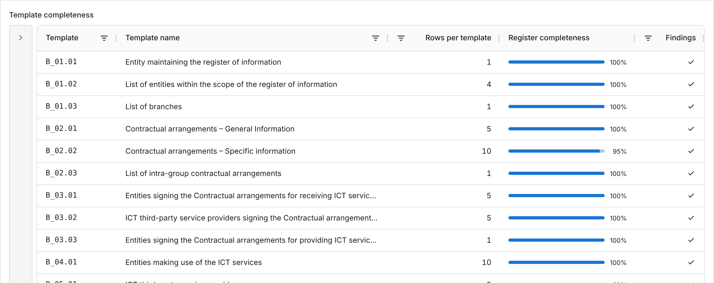

# DORA Register of Information

Toda entidad financiera de la UE debe mantener un **registro de información**
sobre todos sus acuerdos con proveedores TIC terceros y presentarlo anualmente a
través de su supervisor: 15 plantillas entrelazadas, entregadas como un paquete
xBRL-CSV legible por máquina conforme al marco de la ABE. En el simulacro de las
AES de 2024, solo el 6,5 % de los registros superó todas las comprobaciones de
calidad de los datos.

Los datos que necesita el registro son exactamente los que ya contiene su
repositorio de EA. **DORA Register of Information** convierte Turbo EA en su
registro.

## El registro vive en sus tarjetas

Esta extensión no mantiene **ninguna tabla propia** para el contenido del
registro. Cada objeto del registro es una tarjeta o una relación:

| Objeto del registro | En Turbo EA |
|---|---|
| Entidades jurídicas dentro del alcance | Tarjetas **Organización** con *In DORA register scope* activado |
| Sucursales | Tarjetas **Organización** con el subtipo **Branch**, hijas de su sede |
| Proveedores TIC terceros | Tarjetas **Provider** |
| Acuerdos contractuales | Tarjetas **ICT Arrangement** (un nuevo tipo de tarjeta) |
| Servicios TIC | Tarjetas **ICT Service** (un nuevo tipo de tarjeta) |
| Funciones críticas o importantes | Tarjetas de **Capacidad de negocio** / **Proceso de negocio** marcadas como funciones del registro |
| Partes firmantes, usuarias y prestadoras, cadenas de subcontratación | **Relaciones** entre esas tarjetas |

Ese es todo el diseño: cada campo se edita en la propia vista de tarjeta de
Turbo EA, con sus marcadores de obligatoriedad, su validación, su ayuda
contextual y su puntuación de calidad de datos, y el registro se ensambla en vivo
a partir de las tarjetas cada vez que valida o exporta.

!!! note "No hay, deliberadamente, una pestaña DORA en la tarjeta"
    Los campos aportados se muestran como secciones de atributos normales en una
    tarjeta, y cada vínculo del registro es una relación corriente. Nada del
    mantenimiento del registro es un modo especial.

## De un vistazo

| | |
|---|---|
| **Licencia** | Comercial — se requiere un derecho firmado |
| **Versión mínima de Turbo EA** | 2.182.0 |
| **Permisos** | `ext.dora-roi.view`, `ext.dora-roi.manage`, `ext.dora-roi.submit`, `ext.dora-roi.admin` |
| **Permisos de acceso a datos** | `core.cards.read`, `core.cards.write`, `metamodel.custom_field_types` |
| **Requiere reiniciar el backend** | sí — incluye código de backend |
| **Dónde aparece** | **Registro DORA** en el menú **GRC** (una entrada de primer nivel cuando el menú GRC no está disponible para usted) · **Informes → Registro DORA - Panel** · secciones **DORA Register** y **DORA Function** en las tarjetas · seis plantillas de encuesta |

## Qué añade a su metamodelo

**Dos nuevos tipos de tarjeta**

- **ICT Arrangement** — un acuerdo contractual sobre el uso de servicios TIC. Es
  **jerárquico**: los acuerdos marco son los padres y los acuerdos posteriores o
  asociados sus hijos. Lleva el gasto anual y la moneda.
- **ICT Service** — uno por servicio prestado al amparo de un acuerdo, con la
  línea de servicio (tipo, fechas, preavisos, ley aplicable, ubicaciones,
  grado de dependencia) y su **evaluación** (sustituibilidad, plan de
  salida, reintegración, impacto de una interrupción, proveedores alternativos).
  Sus tres campos de ubicación — **Country of provision of the services**,
  **Location of the data at rest** y **Location of data management** (donde se
  tratan los datos) — ofrecen cada uno **Not applicable**. Un servicio sin
  ubicación del tratamiento de datos registrada impide finalizar una instantánea:
  elija el país, o **Not applicable** si el servicio no implica tratamiento de
  datos.

**Un nuevo subtipo** — **Branch** en Organización.

**Nuevas secciones en tipos de tarjeta existentes**

| Tipo de tarjeta | Sección | Contenido |
|---|---|---|
| **Organización** | DORA Register | Dentro del alcance del registro DORA, LEI, País, Tipo de entidad, Posición en el grupo, Autoridad competente, Total de activos, Moneda de declaración, Código de sucursal |
| **Provider** | DORA Register | LEI, Tipo de identificador, EUID, Otro código de identificación, Tipo de persona, País de la sede, Proveedor intragrupo, gasto anual, matriz última |
| **Capacidad de negocio** / **Proceso de negocio** | DORA Function | Función del registro DORA, Identificador de función, Actividad autorizada, Evaluación de criticidad o importancia, Motivos de criticidad, Fecha de la última evaluación, RTO, RPO, Impacto de una interrupción |

Cada sección lleva además una **puntuación DORA (%)** de solo lectura: una barra
de completitud que muestra cuántos datos de registro debe todavía esa tarjeta.

**Nueve tipos de relación**, dos de los cuales llevan atributos que usted define
relación a relación:

- **Organización → ICT Arrangement** (*es parte de*) lleva el atributo **roles
  DORA**: **Entidad firmante**, **Uso de los servicios TIC**, **Entidad
  prestadora (intragrupo)**.
- **ICT Service → Provider** (*es prestado por*) lleva un **rango en la cadena de
  suministro**: el **rango 1** es el proveedor directo y los rangos posteriores
  son subcontratistas.

La extensión añade además una regulación **DORA** al
[escáner de cumplimiento](../guide/compliance.md) del núcleo.

## Primeros pasos

El espacio de trabajo se abre en un **Panel** con una lista de comprobación
**Getting started** que sigue estos siete pasos y muestra el avance.

1. **Elija la entidad declarante en Ajustes** — la entidad cuyo registro es este.
2. **Marque sus entidades jurídicas.** En cada tarjeta de Organización, rellene la
   sección **DORA Register**: active *In DORA register scope* e indique el LEI, el
   país, el tipo de entidad y la posición en el grupo. Las sucursales son tarjetas
   de Organización con el subtipo **Branch**, dependientes de su sede.
3. **Cree una tarjeta ICT Arrangement por cada acuerdo contractual.** Haga que los
   contratos posteriores sean *hijos* del contrato marco: de ahí se derivan el
   tipo de acuerdo y la referencia del acuerdo marco.
4. **Relacione cada acuerdo** con su tarjeta Provider y con las entidades que
   firman, usan o prestan, indicando en cada una el atributo **roles DORA**.
5. **Cree una tarjeta ICT Service por servicio** y relaciónela con su contrato, con
   las entidades que lo usan, con las funciones a las que da soporte y con sus
   proveedores **por rango**.
6. **Marque las funciones.** Active *DORA register function* en las tarjetas de
   Capacidad de negocio o Proceso de negocio que sean funciones críticas o
   importantes y complete su sección **DORA Function**, o acepte las propuestas de
   [Sugerencias](#sugerencias).
7. **Valide el registro y resuelva los hallazgos.**

!!! tip "Recoja los datos de quienes los tienen"
    Seis plantillas de encuesta en **Admin → Encuestas → Nuevo desde plantilla**
    recogen los datos obligatorios de las personas responsables de las tarjetas:
    **DORA entity data**, **DORA provider data**, **DORA arrangement data**,
    **DORA ICT service data** y **DORA function data** para capacidades y para
    procesos. Cada una se abre como borrador.

### Lo que nunca tendrá que escribir

El registro deriva lo siguiente en lugar de pedirlo: el LEI de la matriz (de la
jerarquía de tarjetas), las fechas de integración y baja (del ciclo de vida de la
tarjeta), el tipo de acuerdo y la referencia del acuerdo marco (de la jerarquía de
acuerdos), la naturaleza de la sucursal (del subtipo Branch), el destinatario de
un servicio subcontratado (del orden de rangos de proveedores) y la fecha de
última actualización. El **alcance de proveedores** también se deriva: solo entran
en el registro las tarjetas Provider a las que realmente hace referencia un
acuerdo o una cadena de suministro, de modo que los proveedores ajenos quedan
fuera automáticamente. Las convenciones de cumplimentación de las ITS
(`9999-12-31` para fechas sin término, *not applicable* para acuerdos no
posteriores) se aplican por usted.

## El espacio de trabajo

**Registro DORA** en el menú **GRC** tiene cinco pestañas. El mismo panel
está también disponible como informe guardable en **Informes → Registro DORA - Panel**.

### Panel

Seis indicadores — **Register completeness**, **Blocking findings**, **Warnings**,
**Critical functions**, **Providers**, **Arrangements** — sobre un botón
**Validate now** y una línea que indica cuántas de las reglas activas de la ABE se
ejecutaron, con un enlace **Rules not run** (véase [Validación](#validacion)).
Debajo, una barra de recuentos enlaza directamente con el inventario para cada
objeto del registro, y la tabla **Template completeness** muestra filas y
hallazgos por plantilla.

Al pulsar un número de hallazgos se abre **Validation findings**: una fila por
hallazgo, con su gravedad (**Blocking** o **Warning**), plantilla, fila de
registro, tarjeta, regla, columna y mensaje, y filtros por gravedad, plantilla,
tipo de tarjeta y regla. La regla es una de **Missing**, **Missing key value**,
**Invalid value**, **Invalid LEI**, **Duplicate row**, **Broken reference**,
**Unknown column** o **EBA rule**. Al pulsar un hallazgo, o su acción **Open
card**, se abre en un panel lateral la tarjeta que hay que corregir; un hallazgo
sobre los ajustes de presentación ofrece **Open settings** en su lugar. El botón
**Rules not run** abre la lista descrita en [Validación](#validacion).

### Registro

Seis vistas — **Legal entities**, **Branches**, **Contractual arrangements**,
**ICT third-party providers**, **ICT services** y **Functions** —, cada una como
una tabla de las tarjetas que componen esa parte del registro, con un campo de
búsqueda, un botón **New …** que crea una tarjeta con el tipo y los indicadores
correctos, y un enlace **Open in inventory**. Al pulsar una fila se abre la tarjeta
en un panel lateral.

### Sugerencias

**Find suggestions** recorre sus relaciones Proveedor → Aplicación →
Capacidad/Proceso y propone actualizaciones del registro — funciones sin marcar y
elevaciones de criticidad —, cada una con la evidencia en que se basa. No se
escribe nada hasta que pulsa **Accept** en una fila; **Dismiss** la retira de la
lista.

### Presentaciones

**New snapshot** fija el registro en una **fecha de referencia**. Cada instantánea
recorre después tres estados:

1. **Draft** — pulse **Validate** para comprobarla. Los hallazgos se enumeran con
   gravedad, plantilla, fila, columna y mensaje.
2. **Validated** — pulse **Finalize**. Se rechaza mientras quede algún hallazgo
   **bloqueante** o no se haya definido una entidad declarante con LEI. Los
   hallazgos bloqueantes incluyen un servicio sin ubicación del tratamiento de
   datos, cualquier otro campo clave que quede vacío donde corresponda, y un LEI de
   proveedor que no cumple el formato ISO 17442 o su suma de control (**Invalid
   LEI**).
3. **Final** — la instantánea es inmutable, el hash de su paquete queda fijado para
   auditoría, conserva los hallazgos y la cobertura de reglas con los que se
   comprobó, y ya no puede eliminarse ni volver a validarse.

Hay dos descargas disponibles en todo momento:

- **xBRL-CSV package** — un paquete de informe DORA construido conforme a la
  taxonomía del marco 4.0 de la ABE (módulo DORA 1.1.0), en `.zip`, con los
  metadatos del informe, los indicadores de presentación, los parámetros y un CSV
  por plantilla. Su nombre de archivo incluye el código de país ISO de la entidad
  declarante. Un proveedor que tiene tanto LEI como EUID se declara con ambos: el
  LEI como código de identificación y el EUID como código de identificación
  adicional. El paquete es reproducible byte a byte, y una nueva descarga de una
  instantánea final se comprueba contra su hash fijado.
- **Excel workbook** — un libro de revisión con portada, una hoja por plantilla
  con las etiquetas y códigos de columna de la ABE y una hoja de miembros, para
  hacer circular el registro internamente antes de presentarlo.

Antes de cada versión que modifica la exportación, el paquete generado a partir
del registro de demostración se valida con Arelle, el procesador XBRL de código
abierto, frente a la taxonomía del marco 4.0 publicada por la ABE, incluidas las
aserciones de validación de la propia taxonomía. Eso cubre la estructura del
paquete, no las comprobaciones de recepción de la ABE ni sus consultas a
registros: que el portal de su supervisor acepte el archivo es una prueba aparte
que debe realizar usted.

### Ajustes

**Filing** — el **Filing scope** (**Consolidated (.CON)** o **Individual
(.IND)**), la **Reporting currency**, la **Taxonomy version** y la **Reporting
entity**, cuyo LEI y país determinan el paquete de informe.

**Definitions (B_99.01)** — definiciones libres opcionales para los términos de
listas cerradas que emplee su registro, presentadas como plantilla B_99.01.

**Demo data** — **Load demo data** carga un registro de ejemplo completo
(entidades de grupo y una sucursal, proveedores, acuerdos marco e intragrupo, una
cadena de suministro de tres niveles, funciones críticas, sugerencias y una
instantánea en borrador) para explorar todas las funciones antes de tocar datos
reales. Todas las tarjetas de demostración se llaman *Demo DORA — …* y llevan la
etiqueta **Demo Dora**; **Remove demo data** las retira.

## Las 15 plantillas

| Plantilla | Contenido |
|---|---|
| B_01.01 | Entidad que mantiene el registro de información |
| B_01.02 | Lista de entidades dentro del alcance |
| B_01.03 | Lista de sucursales |
| B_02.01 | Acuerdos contractuales – información general |
| B_02.02 | Acuerdos contractuales – información específica |
| B_02.03 | Lista de acuerdos contractuales intragrupo |
| B_03.01 / B_03.02 / B_03.03 | Partes firmantes |
| B_04.01 | Entidades que utilizan los servicios TIC |
| B_05.01 | Proveedores TIC terceros |
| B_05.02 | Cadenas de suministro de los servicios TIC |
| B_06.01 | Identificación de funciones |
| B_07.01 | Evaluación de los servicios TIC |
| B_99.01 | Definiciones |

## Validación

La validación se ejecuta en cuatro capas: **estructura** (tipos de datos, sumas de
control de los LEI, fechas, números y los campos obligatorios y clave como
bloqueantes cuando están vacíos), **miembros** (valores de listas cerradas frente
a las listas de códigos de la taxonomía), **claves** (completitud y unicidad de
las claves primarias y referencias entre plantillas) y las **reglas de validación
de la ABE que pueden ejecutarse sin conexión**, con las gravedades publicadas. Las
reglas que la ABE ha retirado no se ejecutan.

El EUID de un proveedor se comprueba con el formato EUID: el código de país y el
identificador del registro, un punto y después el número de registro. Un valor sin
punto, o un LEI introducido como EUID, se notifica como advertencia. Una
comprobación local es más estricta que la de la ABE: un código de identificación
de proveedor declarado como LEI que no cumple el formato ISO 17442 o su suma de
control es un hallazgo bloqueante **Invalid LEI**, mientras que la regla propia de
la ABE es una advertencia. Un LEI no válido de la matriz última de un proveedor
sigue siendo una advertencia.

!!! warning "La cobertura es parcial, y se indica con honestidad"
    Turbo EA ejecuta las reglas de la ABE que puede evaluar sin conexión, y el
    panel indica cuántas de las reglas activas de la ABE se ejecutaron. **Rules not
    run**, que se abre desde esa indicación o desde los hallazgos de validación,
    enumera todas las demás reglas con su plantilla, el texto propio de la ABE y el
    motivo por el que no se ejecutan aquí: una **EBA expression** que excede las
    comprobaciones sin conexión, que los sistemas del supervisor evalúan sobre el
    archivo que usted presenta, o una **Package check** que la ABE aplica al
    paquete de informe presentado y no al registro. También nombra las reglas de
    LEI, EUID y país que aquí solo se ejecutan como comprobaciones sin conexión de
    suma de control, formato y lista de códigos, mientras que la ABE consulta los
    códigos en GLEIF y en los registros mercantiles (BRIS). Considere una
    validación limpia como una comprobación previa sólida, no como una garantía de
    aceptación por parte del supervisor.

## Permisos

| Permiso | Permite |
|---|---|
| `ext.dora-roi.view` | Ver el registro, los paneles y los resultados de validación |
| `ext.dora-roi.manage` | Editar los datos del registro y decidir sobre las sugerencias |
| `ext.dora-roi.submit` | Fijar instantáneas en una fecha de referencia y descargar los paquetes de informe |
| `ext.dora-roi.admin` | Configurar los ajustes de presentación y cargar o retirar los datos de demostración |

Editar los datos del registro utiliza además sus derechos normales de edición de
tarjetas, ya que cada campo del registro reside en una tarjeta.

## Si la licencia caduca o la extensión se desactiva

El espacio de trabajo y sus informes desaparecen y el puente de datos de tarjetas
se detiene, pero **no se elimina nada**. Su registro vive en tarjetas y relaciones
normales, de modo que cada valor permanece exactamente donde está, visible y
editable en el inventario. Las instantáneas y los ajustes se conservan. Una
licencia renovada restaura el espacio de trabajo de inmediato.

Si aparece *The card-data bridge is unavailable*, la extensión está instalada pero
sin licencia, o el backend no se ha reiniciado desde que se instaló.

## Notas y limitaciones

- **La versión 2.0.0 introdujo un cambio incompatible.** Los registros construidos
  sobre versiones anteriores guardaban servicios y funciones en tablas propias de
  la extensión; esas filas no se migran. Vuelva a introducirlos como tarjetas ICT
  Service y de función (o recargue los datos de demostración) y ejecute de nuevo
  **Find suggestions**.
- Las plantillas, listas de códigos y reglas se entregan como datos versionados
  generados a partir del marco publicado por la ABE, así que una nueva versión del
  marco llega como una actualización de la extensión más un cambio de
  **Taxonomy version**.
- La **puntuación DORA** de una tarjeta es una señal de triaje, no un veredicto de
  cumplimiento. Los hallazgos del panel son la lista de carencias que cuenta.
- No se generan variantes de Excel específicas de cada supervisor; el paquete
  xBRL-CSV es el artefacto de presentación.
