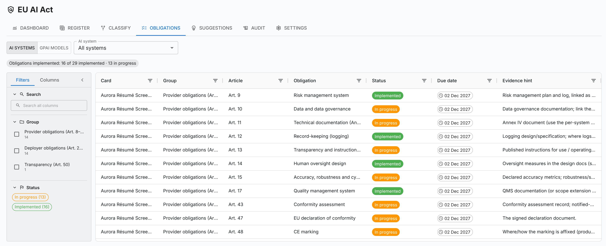

# EU AI Act Register

Der EU AI Act gilt stufenweise, und jeder Anbieter und Betreiber von KI-Systemen
muss dieselben vier Fragen beantworten: Welche Ihrer Systeme sind KI-Systeme,
welcher Risikoklasse gehört jedes an, welche Pflichten ergeben sich aus Ihrer
Rolle, und wo liegt der Nachweis?

**EU AI Act Register** beantwortet sie auf den Karten, die Ihr EA-Repository
bereits enthält. Es richtet sich an Anbieter und Betreiber von KI-Systemen und
KI-Modellen mit allgemeinem Verwendungszweck (GPAI), die ihre IT-Landschaft in
Turbo EA führen oder führen möchten.

!!! warning "Es hält Ihre Bewertung fest — es ist keine Rechtsberatung"
    Das Register ist an der Verordnung (EU) 2024/1689 in der durch die
    Verordnung (EU) 2026/1744 geänderten Fassung ausgerichtet. Es erfasst und
    ordnet die eigene Compliance-Arbeit Ihrer Organisation und die
    Entscheidungen Ihrer Mitarbeitenden. Es ist keine Rechtsberatung und
    garantiert keine Konformität.

## Das Register lebt auf Ihren Karten

Das Register führt für seine Inhalte **keine eigenen Tabellen**. Jedes
regulatorische Attribut ist ein Feld auf einer Karte, bearbeitet in Turbo EAs
eigener Kartenansicht, mit einem Hilfetext, der den Artikel nennt:

| Registerobjekt | In Turbo EA |
|---|---|
| KI-Systeme | **Anwendungs**-Karten mit aktiviertem *In AI Act scope* |
| KI-Modelle mit allgemeinem Verwendungszweck | **IT-Komponenten**-Karten mit aktiviertem *GPAI model (Art. 3(63))* |
| KI-Governance einer Organisation | **Organisations**-Karten |

Die Erweiterung fügt diese Abschnitte hinzu:

| Kartentyp | Abschnitt | Enthält |
|---|---|---|
| **Anwendung** | EU AI Act | In AI Act scope, Operator role, Risk tier, Annex III category, Annex I regime, Placed on the market before the high-risk date (Art. 111(2)), Art. 6(3) derogation claimed, Art. 6(3) rationale, Intended purpose, Art. 50 transparency duties, Substantially modified (Art. 25), AI Act classification completeness (%) |
| **Anwendung** | EU AI Act — Provider obligations | ein Status je Anbieterpflicht, Art. 9 bis Art. 73 |
| **Anwendung** | EU AI Act — Deployer obligations | ein Status je Betreiberpflicht nach Art. 26, die FRIA (FRIA required, ihr Status und Datum) und die Registrierung nach Art. 49(3) |
| **IT-Komponente** | EU AI Act — GPAI / Model | GPAI model (Art. 3(63)), Model origin, Systemic risk (Art. 51), Training compute (log10 FLOPs), die Pflichtstatus nach Art. 53 und Art. 55, AI Act classification completeness (%) |
| **Organisation** | AI governance (EU AI Act) | AI literacy programme (Art. 4), Body governed by public law, AI governance contact |

Jeder Pflichtstatus ist einer von **Not started**, **In progress**,
**Implemented** oder **Not applicable**.

Die Felder erscheinen nur, wo sie relevant sind. Eine Anwendung zeigt nur den
Schalter *In AI Act scope*, bis sie als im Anwendungsbereich gespeichert ist.
Danach erscheint jeder Pflichtstatus nur dort, wo die Pflicht für Rolle,
Risikoklasse und Bedingungen der Karte gelten kann, das Feld *Placed on the
market before the high-risk date (Art. 111(2))* erscheint bei Hochrisiko-Systemen,
und die GPAI-Felder einer IT-Komponente folgen ihrem GPAI-Schalter. Ein bereits
ausgefüllter Status bleibt sichtbar, damit er geleert werden kann, und
ausgeblendete Werte bleiben erhalten und werden nie gelöscht.

**Der Chip in der Kopfzeile.** Jede Karte eines KI-Systems und eines GPAI-Modells
zeigt in ihrer Kopfzeile **Obligations implemented** — zum Beispiel
*Obligations implemented: 0 of 1*. Sein Tooltip listet auf, was noch offen ist,
mit Status und Fälligkeitsdatum jeder Pflicht, und nennt jede fehlende
Klassifizierungsangabe; ein Klick öffnet die offenen Pflichten dieses Systems im
Arbeitsbereich. Wo es nichts zu zählen gibt, steht dort **No AI Act obligations
apply**, **AI Act obligations: classify first** oder **Prohibited practice
(Art. 5)**.

### Zwei Kennzahlen

Das Register weist zwei Werte aus, und sie beantworten verschiedene Fragen — ein
System kann vollständig klassifiziert sein und trotzdem nichts umgesetzt haben.

| | Classification completeness | Obligations implemented |
|---|---|---|
| **Frage** | Wie viel der Klassifizierung ist erfasst? | Wie viele der geltenden Pflichten sind erfüllt? |
| **KI-Systeme** | Operator role, Risikoklasse, Zweckbestimmung und bei Hochrisiko-Systemen die Kategorie nach Anhang III oder das Regime nach Anhang I | Die Pflichten, die für das System nach Rolle, Risikoklasse und gewählten Pflichten gelten |
| **GPAI-Modelle** | Modellherkunft und Einstufung des systemischen Risikos | Die Pflichten nach Art. 53, bei einem Modell mit systemischem Risiko zusätzlich nach Art. 55 |
| **Angezeigt** | Im Kartenfeld *AI Act classification completeness (%)*, im Dashboard | Im Chip der Kartenkopfzeile, im Dashboard, im Register und im Reiter Obligations |

**Implemented** und **Not applicable** zählen als erfüllt; **In progress** und
**Not started** nicht. Wo es keinen Prozentwert gibt, nennt das Register den
Grund: **No obligations apply**, **Classify first** (Rolle oder Risikoklasse noch
nicht gesetzt) oder **Prohibited practice** (nichts umzusetzen — das System muss
eingestellt oder so umgestaltet werden, dass es nicht mehr unter Art. 5 fällt).

## Auf einen Blick

| | |
|---|---|
| **Lizenz** | Kommerziell — eine signierte Berechtigung ist erforderlich |
| **Mindestversion von Turbo EA** | 2.186.0 |
| **Berechtigungen** | `ext.eu-ai-act.view`, `ext.eu-ai-act.manage`, `ext.eu-ai-act.submit`, `ext.eu-ai-act.admin` |
| **Datenzugriffs-Grants** | `core.cards.read`, `core.cards.write`, `core.users.read`, `metamodel.custom_field_types` |
| **Backend-Neustart nötig** | ja — die Erweiterung enthält Backend-Code |
| **Wo sie erscheint** | **EU-KI-Verordnung** im Menü **GRC**, mit sieben Reitern (ein Eintrag auf oberster Ebene, wenn Ihnen das Menü GRC nicht zur Verfügung steht) · **Berichte → EU-KI-Verordnung - Dashboard** (das Dashboard als speicherbarer Bericht) · die Abschnitte EU AI Act und der Chip **Obligations implemented** auf Karten · vier Umfragevorlagen · die Excel-Registermappe und die Word-Dokumente Annex IV / FRIA |

Sie ergänzt außerdem die Verordnung **EU AI Act** des
[Compliance-Scanners](../guide/compliance.md) des Kerns, dessen KI-Befunde die
[Vorschläge](#vorschlage) speisen.

## Erste Schritte

1. **Öffnen Sie EU AI Act → Settings.** Prüfen Sie die **Taxonomy baseline**,
   setzen Sie ein **Reference date**, falls Fristen gegen ein anderes Datum als
   heute bewertet werden sollen, und laden Sie optional die Demodaten.
2. **Finden Sie die KI-Systeme, die Sie bereits haben.** Klicken Sie unter
   **Suggestions** auf **Find suggestions** und übernehmen Sie die Systeme und
   Modelle, die in den Anwendungsbereich gehören.
3. **Klassifizieren Sie jedes System** unter **Classify** und übernehmen Sie das
   Ergebnis auf seine Karte.
4. **Verfolgen Sie die Pflichten** unter **Obligations** und erfassen Sie jeden
   Status auf der Karte.
5. **Frieren Sie eine Momentaufnahme ein** unter **Audit** und laden Sie die
   Registermappe sowie die Dokumente Annex IV und FRIA aus dem **Register**
   herunter.

!!! tip "Erfassen Sie die Daten bei denen, die sie besitzen"
    Vier Umfragevorlagen unter **Admin → Umfragen → Neu aus Vorlage** erfassen die
    AI-Act-Felder bei den Karteneigentümern: **AI system intake (EU AI Act)**,
    **Provider obligations check (EU AI Act)**, **Deployer obligations check (EU
    AI Act)** und **GPAI model check (EU AI Act)**. Jede wird als Entwurf
    geöffnet, adressiert an die verantwortlichen Stakeholder der Karten.

## Der Arbeitsbereich

**EU-KI-Verordnung** im Menü **GRC** hat sieben Reiter: **Dashboard**, **Register**,
**Classify**, **Obligations**, **Suggestions**, **Audit** und **Settings**. Jede
Liste darin ist ein Turbo-EA-Grid mit derselben Seitenleiste wie das Inventar —
ein Reiter **Filters** (Suche über alle Spalten sowie Facetten wie Risikoklasse,
Rolle, Status, Schweregrad oder Frist) und ein Reiter **Columns** (Spalten
ein- und ausblenden und fixieren, pro Grid gemerkt). Eine Zeile, die eine Karte
nennt, öffnet sie im Kartenbereich.

### Übersicht

Fünf Kacheln — **AI systems in scope**, **High-risk**, **Unclassified**, **GPAI
models** und **Overdue obligations** —, die jeweils die Zeilen hinter ihrer Zahl
öffnen, und eine Zeile **Validation** mit den blockierenden Befunden und
Warnungen sowie einem Link **Open audit**. Darunter:

- **Risk-tier distribution** über die Systeme im Anwendungsbereich.
- **Compliance quadrant** — jedes System, aufgetragen nach regulatorischer
  Exposition (den geltenden Pflichten) gegen **Obligations implemented**, in vier
  Bereichen: **Act now**, **On track**, **Monitor** und **Comfortable**. Systeme
  an derselben Position teilen sich eine Scheibe, die zeigt, wie viele dort
  liegen. Systeme ohne Prozentwert werden nicht eingezeichnet; eine Zeile unter
  dem Diagramm zählt sie.
- **Ranked by urgency** — dieselben Systeme als Liste, mit einer Spalte je
  Kennzahl. Ein Klick auf ein System öffnet seinen **Statusdialog**: beide
  Kennzahlen mit ihrer Aufschlüsselung, die noch fehlenden Klassifizierungsangaben
  und die offenen Pflichten mit Status und Fälligkeitsdatum, mit **Open card** und
  **Show in Obligations**.
- **Applicability timeline (Art. 113)** — die Meilensteine aus der Tabelle unter
  [Pflichten](#pflichten), jeweils als in Kraft oder als Countdown markiert.

### Register

Zwei Ansichten — **AI systems** und **GPAI models** —, je ein Grid der Karten im
Register. Für ein System zeigt es Risikoklasse, Rolle, Klassifizierungsgrundlage,
**Obligations implemented** (ein Klick öffnet die offenen Pflichten dieses
Systems) und die Zahl überfälliger Pflichten; für ein Modell Herkunft, systemisches
Risiko, Trainingsrechenaufwand und die Systeme, die es verwenden. **New AI
system** und **New GPAI model** legen eine Karte mit passendem Typ und gesetztem
Schalter an, und **Open in inventory** listet dieselben Karten im Inventar auf.
Eine Registerzeile *ist* ihre Karte: Klicken Sie sie an, um die AI-Act-Abschnitte
in der Kartenansicht zu bearbeiten.

Die Spalte **Documents** der Ansicht AI systems bietet je System zwei
Word-Downloads, aus dem Repository vorbefüllt: **Annex IV.docx**, die technische
Dokumentation nach Anhang IV, und **FRIA.docx**, das Gerüst der Grundrechte-
Folgenabschätzung nach Art. 27. Beide beginnen mit einem Hinweis auf das
vereinfachte Anhang-IV-Formular für KMU und kleine Midcaps (Art. 11(1)) und auf die
Wiederverwendung der Datenschutz-Folgenabschätzung (Art. 27(4)).

### Classify

Der Klassifizierungsassistent stellt geführte Fragen zu einem System und schlägt
eine Risikoklasse vor, mit dem Artikel hinter jeder Begründung. Wählen Sie das
System unter **Classify a system** und beantworten Sie:

1. **AI system or not** — ist dies ein KI-System im Sinne von Art. 3(1)? Wenn
   nicht, lautet das Ergebnis **Out of scope**.
2. **Role** — die Betreiberrolle Ihrer Organisation für dieses System und ob Sie
   es wesentlich verändert, unter eigenem Namen vertrieben oder seine
   Zweckbestimmung geändert haben (wodurch Sie nach Art. 25 zu seinem Anbieter
   werden können).
3. **Prohibited practices (Art. 5)** — einschließlich der beiden Praktiken, die
   die Verordnung (EU) 2026/1744 ab dem 2. Dezember 2026 verbietet:
   realistisches intimes oder sexuell explizites Material einer identifizierbaren
   Person ohne Einwilligung (Art. 5(1)(ba)) und Material über sexuellen
   Kindesmissbrauch (Art. 5(1)(bb)). Jede nennt, wer betroffen ist, als Anbieter
   oder als Betreiber. Ein Anbieter eines Systems, das Bilder, Video, Audio oder
   Text erzeugt, wird außerdem gefragt, ob das System solches Material erzeugen
   könnte und ob Schutzvorkehrungen dies zuverlässig verhindern; erst die Antwort,
   dass solche Vorkehrungen fehlen, macht es zu einer verbotenen Praxis.
4. **High risk under Annex I** — ein Produkt oder die Sicherheitskomponente eines
   Produkts nach den aufgeführten Rechtsvorschriften der Union. Nach einem Regime
   fragt der Assistent, ob ein Grund aus Art. 6(1a)–(1c) das System aus
   Art. 6(1) herausnimmt: Es wird ausschließlich für nicht sicherheitsbezogene
   Aspekte verwendet, oder das Produkt wird nur hinsichtlich anderer Risiken als
   Gesundheit und Sicherheit von einer dritten Stelle bewertet.
5. **High risk under Annex III** — ob die Zweckbestimmung unter einen
   Anwendungsfall des Anhangs III fällt und ob das System natürliche Personen
   profiliert.
6. **The Art. 6(3) derogation** — ob eine Ausnahmebedingung zutrifft. Eine
   geltend gemachte Ausnahme muss unter **Art. 6(4) rationale** dokumentiert
   werden; dieser Text wird auf die Karte geschrieben, und die Validierung
   blockiert ohne ihn.
7. **Transparency duties (Art. 50)** — Offenlegung bei Chatbots, Kennzeichnung
   synthetischer Inhalte, Hinweise bei Emotionserkennung, Kennzeichnung von
   Deepfakes und von Texten im öffentlichen Interesse.

**Evaluate** zeigt die **Proposed classification** mit ihren durch Artikel
belegten Begründungen und schreibt nichts auf die Karte. **Accept & write to
card** schreibt die Klassifizierungsfelder auf die Karte — Rolle, Risikoklasse,
Grundlage, Ausnahme und Transparenzpflichten — und hält die Bewertung als die
akzeptierte fest.

Der Assistent erfordert die Verwaltungsberechtigung der Erweiterung und eine Karte,
die Sie öffnen dürfen; das Akzeptieren erfordert zusätzlich Bearbeitungsrechte auf
dieser Karte. Dürfen Sie die Karte öffnen, aber nicht bearbeiten, können Sie den
Assistenten trotzdem ausführen und den Vorschlag sehen, doch **Accept & write to
card** ist ausgegraut und nennt den Grund: *You may not edit this card, so the
classification cannot be written to it.*

**Der Bewertungsverlauf ist der Prüfpfad.** Jeder Lauf wird aufbewahrt — wer
welches System wann und warum klassifiziert hat —, sodass die Frage *«Warum ist
dieses System hochriskant, und wer hat entschieden?»* auch nach Jahren
beantwortbar bleibt. Jede Zeile nennt die Karte (eine archivierte Karte ist mit
**archived** markiert, eine nicht mehr vorhandene Karte heißt **Deleted card**),
die ausführende Person unter **By**, die Risikoklasse und den Status: **Draft**,
**Accepted** oder **Superseded**. Ein erneuter Lauf des Assistenten fügt einen
neuen Eintrag hinzu; sein Akzeptieren markiert den zuvor akzeptierten als
**Superseded** und ändert ihn nie. Die Details einer Bewertung zeigen **Run by**,
**Accepted by** und, sobald eine spätere sie ersetzt hat, **Superseded by** mit
Datum — ein abgelöster Eintrag behält, wer ihn akzeptiert hat. Bei Einträgen, die
vor Version 1.6.0 abgelöst wurden, ist nur die Person bekannt, die sie ersetzt
hat; daher steht bei **Accepted by** «—». Der Verlauf listet nur Bewertungen von
Karten, die Sie öffnen dürfen. Die Spalte **Taxonomy baseline** ist standardmäßig
ausgeblendet; schalten Sie sie unter **Columns** ein.

### Pflichten

Jede geltende Pflicht jedes KI-Systems — oder, auf **GPAI model** umgeschaltet,
jedes GPAI-Modells — in einem Grid: die Karte, Gruppe, Pflicht, Artikel, Status,
Fälligkeitsdatum, Meilenstein und ein **Evidence hint**, der sagt, welchen
Nachweis die Pflicht erwartet. Filtern Sie nach Status, Gruppe und Frist
(überfällig, **Due soon**, **Later**) oder wählen Sie in der Symbolleiste eine
einzelne Karte. Die Status sind Kartenfelder, Sie erfassen sie also durch Öffnen
der Karte; eine bis zu ihrem Datum nicht erfüllte Pflicht ist überfällig, und eine
noch nicht fällige zeigt **Due soon** ab 180 Tagen vor ihrem Datum.

Welche Pflichten gelten, ergibt sich aus Rolle, Risikoklasse und Bedingungen jedes
Systems — insgesamt 32 Pflichten für Anbieter, Betreiber und GPAI-Modelle auf der
geänderten Baseline. Ihre Termine sind gestaffelt, wie durch die Verordnung (EU)
2026/1744 geändert:

| Datum | Meilenstein | Artikel |
|---|---|---|
| 2. Februar 2025 | Verbotene Praktiken und KI-Kompetenz | Art. 113(a) |
| 2. August 2025 | Pflichten für KI-Modelle mit allgemeinem Verwendungszweck | Art. 113(b) |
| 2. August 2026 | Allgemeine Anwendung (einschl. Transparenz nach Art. 50) | Art. 113 |
| 2. Dezember 2026 | Weitere verbotene Praktiken (Art. 5(1)(ba), (bb)) | Art. 113(a) |
| 2. Dezember 2027 | Hochrisiko-KI-Systeme nach Anhang III | Art. 113(c)(i) |
| 2. August 2028 | Hochrisiko-KI in regulierten Produkten nach Anhang I | Art. 113(c)(ii) |
| 2. August 2030 | Bereits in Verkehr gebrachte Hochrisiko-KI, bestimmt für Behörden | Art. 111(2) |

Fristen werden gegen das **Reference date** in den Settings bewertet (heute, wenn
es leer ist). Drei Regeln prägen die Liste:

- **Anhang I Abschnitt B (Art. 2(2)).** Ein System, das nur über ein Produkt
  nach Anhang I Abschnitt B hochriskant ist — Fahrzeuge, Luftfahrt,
  Schiffsausrüstung, Schienenverkehr und Maschinen —, trägt im Register keine
  AI-Act-Pflicht und zeigt **No obligations apply**. Bereits erfasste Status
  bleiben auf der Karte, ungezählt. Ein System, das zusätzlich unter einen
  Anwendungsfall des Anhangs III fällt, behält alle seine Pflichten.
- **Bereits in Verkehr gebrachte Systeme (Art. 111(2)).** Erfassen Sie auf der
  Karte eines Hochrisiko-Systems, ob es *Placed on the market before the
  high-risk date (Art. 111(2))* wurde. Vor diesem Datum in Verkehr gebracht und
  in seiner Konzeption nicht erheblich geändert: Die Hochrisiko-Pflichten
  entfallen (die Transparenz nach Art. 50 zählt weiterhin); vor diesem Datum in
  Verkehr gebracht und zur Nutzung durch Behörden bestimmt: Sie verschieben sich
  auf den 2. August 2030; erheblich geändert, nicht vor diesem Datum in Verkehr
  gebracht oder leer gelassen: Sie gelten in vollem Umfang.
- **Registrierung eines Systems mit Ausnahme (Art. 49(2)).** Ein Anbieter, der die
  Ausnahme nach Art. 6(3) geltend macht, hat eine Pflicht mehr: das System in
  der EU-Datenbank als nicht hochriskant bewertet zu registrieren.

### Vorschläge

**Find suggestions** durchläuft Ihre Karten und schlägt Registerentscheidungen
vor, jeweils mit ihrer Evidenz:

- **AI Act scope** — eine Anwendung, über die noch nicht entschieden wurde und die
  einen der KI-Subtypen des Kerns trägt (**AI Agent**, **MCP Server**) oder vom
  Compliance-Scanner als Anwendung mit KI-Funktionen markiert wurde.
- **GPAI check** — eine IT-Komponente, über die noch nicht entschieden wurde, mit
  dem Subtyp **AI Model**, einer Scanner-Markierung oder Verwendung durch Systeme,
  die bereits im Anwendungsbereich liegen.
- **Bootstrap checklist** — ein Hochrisiko-System, bei dem keine seiner geltenden
  Pflichten schon einen Status hat; das Akzeptieren setzt jede auf **Not
  started**, damit die Arbeit sichtbar wird.

Eine Leiste über der Liste verlinkt die EU-AI-Act-Befunde des Compliance-Scanners.

Nichts wird auf eine Karte geschrieben, bevor eine Person in einer Zeile auf
**Accept** klickt; **Dismiss** entfernt sie aus der Liste. Der Status —
**Proposed**, **Accepted** oder **Dismissed** — wird in der Seitenleiste gewählt.
Das Akzeptieren erfordert Bearbeitungsrechte auf der Karte sowie die
Verwaltungsberechtigung; ohne sie ist **Accept** ausgegraut und nennt den Grund:
*You may not edit this card, so the suggestion cannot be written to it.*

### Audit

- **Live validation** — die Befunde für das Register in seinem aktuellen Stand zum
  Stichtag, jeweils mit Schweregrad (**Blocking** oder **Warning**), Regel,
  Artikel, Karte und Meldung; **Open card** öffnet die zu korrigierende Karte.
- **Rule coverage** — die Regeln, die eine Maschine nicht prüfen kann. Sie werden
  als nicht ausgeführt gemeldet, weil sie einen Menschen brauchen, statt still
  übersprungen zu werden.
- **Snapshots** — **Freeze snapshot** hält das Register zu einem **Reference date**
  fest. Jede Momentaufnahme durchläuft dann drei Zustände:
    1. **Draft** — mit **Validate** prüfen.
    2. **Validated** — **Finalize** klicken. Das wird verweigert, solange ein
       blockierender Befund besteht.
    3. **Final** — die Momentaufnahme ist unveränderlich, Teil des Prüfpfads und
       kann weder erneut validiert noch gelöscht werden.

  **XLSX** lädt eine Momentaufnahme als Excel-Registermappe herunter (dafür ist die
  Einreichungsberechtigung nötig). Eine finale Momentaufnahme wird immer unverändert
  heruntergeladen: Ihr Inhalt wird gegen den beim Finalisieren fixierten Hash
  geprüft. Eine Entwurfs-Momentaufnahme behält die Daten und Befunde, mit denen sie
  erstellt wurde — erstellen Sie nach einem Upgrade, das die Regeln ändert, eine
  neue.

### Einstellungen

**Taxonomy baseline** — die Verordnung, aus der jede Projektion und jede Frist
abgeleitet wird. **ai-act-2026-omnibus**, die durch die Verordnung (EU) 2026/1744
geänderte Verordnung, ist der Standard; **ai-act-2024**, die Verordnung wie
beschlossen mit ihren ursprünglichen Terminen, bleibt wählbar, damit dagegen
vorgenommene Bewertungen und Momentaufnahmen lesbar bleiben.

**Reference date** — Fristen werden gegen dieses Datum bewertet; leer bedeutet
heute.

**Demo data** — **Load demo data** legt eine kleine Demolandschaft an: jede
Risikoklasse, ein GPAI-Modell mit systemischem Risiko, einen akzeptierten
Bewertungsverlauf und Material für Vorschläge. Alle Demokarten tragen *(AI demo)*
im Namen; **Remove demo data** löscht sie wieder.

## Wer was sieht und darf

- **Sie sehen nur die Systeme, deren Karten Sie öffnen dürfen.** Das Register, die
  Pflichten, die Kennzahlen und die Timeline des Dashboards, die Befunde, die
  Vorschläge, der Bewertungsverlauf und die Dokumente Annex IV / FRIA zeigen einer
  Person nur die Systeme, deren Karten sie im Inventar öffnen darf, und jede
  Kennzahl — Anzahlen, Prozentwerte, überfällige Punkte, blockierende Befunde —
  wird über das berechnet, was sie sehen kann. Eine Karte, auf die sich ein
  sichtbares System bezieht, die Sie aber nicht öffnen dürfen, heißt **Card not
  accessible**. Wo etwas weggelassen wurde, sagen es das Dashboard und das
  Register in einer Zeile: *Some systems are not shown because you do not have
  access to their cards.* Wo nichts mehr anzuzeigen bleibt, zeigen das Dashboard
  und der Reiter Obligations dieselbe Zeile statt einer leeren Liste. Eine Rolle,
  die nur die Berechtigung der Erweiterung, aber keinen Zugriff auf die Karten
  hat, sieht daher keine Systeme.
- **Momentaufnahmen umfassen das gesamte Register.** Momentaufnahmen und ihre
  Excel-Downloads sind das maßgebliche Register: Sie enthalten jedes System und
  werden nie gefiltert, wer auch immer hinsieht. Jeder mit der Ansichtsberechtigung
  sieht die Liste der Momentaufnahmen im Reiter Audit; ein Download erfordert die
  Einreichungsberechtigung. Über die API wird der gespeicherte Inhalt einer
  Momentaufnahme Personen mit der Einreichungsberechtigung und Personen geliefert,
  denen das Register nichts vorenthält; andere erhalten nur Datum, Baseline und
  Status.
- **Das Akzeptieren erfordert zwei Rechte.** **Accept & write to card** und das
  Akzeptieren eines Vorschlags erfordern die Berechtigung
  `ext.eu-ai-act.manage` der Erweiterung **und** Bearbeitungsrechte auf der Karte.
  Wer die Karte öffnen, aber nicht bearbeiten darf, kann den Assistenten trotzdem
  ausführen und den Vorschlag sehen; die Schaltfläche ist mit ihrem Grund
  ausgegraut, und nichts wird geschrieben. Damit er akzeptieren kann, geben Sie
  seiner Rolle Bearbeitungsrechte auf dem Kartentyp oder machen Sie ihn zum
  Stakeholder der Karte in einer Rolle, die bearbeiten darf. Der Lauf des
  Assistenten oder das Akzeptieren oder Verwerfen eines Vorschlags auf einer Karte,
  die Sie nicht öffnen dürfen, wird abgelehnt.
- **Die Kartenhistorie nennt, wer akzeptiert hat.** Ab Turbo EA 2.209.0 wird eine
  Änderung durch **Accept & write to card** oder durch einen akzeptierten
  Vorschlag im Reiter Historie der Karte unter dem Namen der Person erfasst, die
  sie vorgenommen hat, mit dem Chip **Extension**. Frühere Versionen zeigen
  **System**. Das Laden oder Entfernen der Demodaten wird als die Erweiterung
  erfasst.
- **Der Bewertungsverlauf zeigt nur Anzeigenamen** — nie eine E-Mail-Adresse. Wo
  Namen nicht gelesen werden können, steht «—».

## Berechtigungen

| Berechtigung | Gewährt |
|---|---|
| `ext.eu-ai-act.view` | Das Register der KI-Systeme, Dashboards und Validierungsergebnisse ansehen |
| `ext.eu-ai-act.manage` | Klassifizierungen ausführen, AI-Act-Daten bearbeiten und über Vorschläge entscheiden |
| `ext.eu-ai-act.submit` | Register-Momentaufnahmen einfrieren und Register-Exporte herunterladen |
| `ext.eu-ai-act.admin` | AI-Act-Einstellungen konfigurieren (Taxonomie-Version, Stichtag, Demodaten) |

Das Bearbeiten der Registerdaten selbst nutzt zusätzlich Ihre normalen
Karten-Bearbeitungsrechte, da jedes AI-Act-Feld auf einer Karte liegt.

## Wenn die Lizenz abläuft oder die Erweiterung deaktiviert wird

Der Arbeitsbereich und sein Bericht verschwinden, aber **nichts wird gelöscht**.
Ihre AI-Act-Daten liegen auf gewöhnlichen Karten, sodass jeder Wert genau dort
bleibt, sichtbar und bearbeitbar im Inventar. Das Einspielen einer erneuerten
Lizenz stellt den Arbeitsbereich sofort wieder her.

## Hinweise und Einschränkungen

- Die Validierung deckt ab, was eine Maschine prüfen kann. Die Regeln, die sie
  nicht prüfen kann, werden unter **Rule coverage** als nicht ausgeführt
  aufgeführt; verstehen Sie eine saubere Validierung als Checkliste, nicht als
  Konformitätsurteil.
- Die Kartenfelder werden von beiden Baselines gemeinsam genutzt, und eine Karte
  kann nicht erkennen, welche ausgewählt ist. Unter **ai-act-2024** blendet eine
  Hochrisiko-Karte mit einem Regime nach Anhang I Abschnitt B Pflichtstatus aus,
  die diese Baseline noch zählt, und das Feld zu Art. 111(2) erscheint, obwohl
  diese Baseline es ignoriert. Das Register, das Dashboard und die Exporte folgen
  immer der ausgewählten Baseline.
- Die Antwortoptionen des Assistenten werden in Ihrer Sprache angezeigt, wo die
  Baseline eine Übersetzung bereitstellt.
- Führen Sie nach dem Upgrade von einer früheren Version den Assistenten erneut
  aus für KI in regulierten Produkten (die Gründe nach Anhang I) und für Inhalte
  erzeugende Systeme (die Frage zu Schutzvorkehrungen), und erfassen Sie den
  Status nach Art. 111(2) der Hochrisiko-Systeme, die bereits in Verkehr sind.
