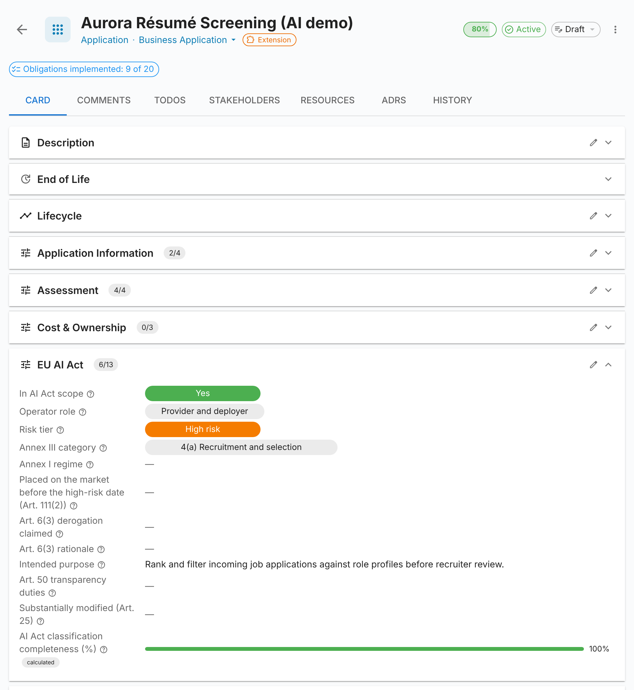

# EU AI Act Register

Le règlement européen sur l'IA s'applique par étapes, et chaque fournisseur et
déployeur de systèmes d'IA doit répondre aux mêmes quatre questions : lesquels de
vos systèmes sont des systèmes d'IA, quel niveau de risque a chacun, quelles
obligations découlent de votre rôle, et où se trouve la preuve ?

**EU AI Act Register** y répond sur les fiches que votre référentiel EA contient
déjà. Il s'adresse aux fournisseurs et déployeurs de systèmes d'IA et de modèles
d'IA à usage général (GPAI) qui tiennent, ou souhaitent tenir, leur paysage
informatique dans Turbo EA.

!!! warning "Il consigne votre évaluation — ce n'est pas un conseil juridique"
    Le registre est structuré selon le règlement (UE) 2024/1689 tel que modifié
    par le règlement (UE) 2026/1744. Il consigne et organise le travail de
    conformité propre à votre organisation et les décisions de vos équipes. Ce
    n'est pas un conseil juridique et il ne garantit pas la conformité.

## Le registre vit sur vos fiches

Le registre ne tient **aucune table propre** pour son contenu. Chaque attribut
réglementaire est un champ d'une fiche, modifié dans la vue de fiche de Turbo EA,
avec un texte d'aide citant l'article :

| Objet du registre | Dans Turbo EA |
|---|---|
| Systèmes d'IA | Fiches **Application** avec *In AI Act scope* activé |
| Modèles d'IA à usage général | Fiches **Composant IT** avec *GPAI model (Art. 3(63))* activé |
| Gouvernance de l'IA d'une organisation | Fiches **Organisation** |

L'extension ajoute ces sections :

| Type de fiche | Section | Contient |
|---|---|---|
| **Application** | EU AI Act | In AI Act scope, Operator role, Risk tier, Annex III category, Annex I regime, Placed on the market before the high-risk date (Art. 111(2)), Art. 6(3) derogation claimed, Art. 6(3) rationale, Intended purpose, Art. 50 transparency duties, Substantially modified (Art. 25), AI Act classification completeness (%) |
| **Application** | EU AI Act — Provider obligations | un statut par obligation du fournisseur, de l'Art. 9 à l'Art. 73 |
| **Application** | EU AI Act — Deployer obligations | un statut par obligation du déployeur de l'Art. 26, l'analyse d'impact FRIA (FRIA required, son statut et sa date) et l'enregistrement de l'Art. 49(3) |
| **Composant IT** | EU AI Act — GPAI / Model | GPAI model (Art. 3(63)), Model origin, Systemic risk (Art. 51), Training compute (log10 FLOPs), les statuts des obligations des Art. 53 et Art. 55, AI Act classification completeness (%) |
| **Organisation** | AI governance (EU AI Act) | AI literacy programme (Art. 4), Body governed by public law, AI governance contact |

Chaque statut d'obligation est l'un de **Not started**, **In progress**,
**Implemented** ou **Not applicable**.

Les champs ne s'affichent que là où ils sont pertinents. Une Application n'affiche
que l'interrupteur *In AI Act scope* tant qu'elle n'est pas enregistrée comme
relevant du périmètre. Ensuite, chaque statut d'obligation n'apparaît que là où
son obligation peut s'appliquer au rôle, au niveau de risque et aux conditions de
la fiche, le champ *Placed on the market before the high-risk date (Art. 111(2))*
apparaît sur les systèmes à haut risque, et les champs GPAI d'un Composant IT
suivent son interrupteur GPAI. Un statut déjà renseigné reste visible afin de
pouvoir être effacé, et les valeurs masquées sont conservées, jamais supprimées.

**La pastille d'en-tête.** Chaque fiche de système d'IA et de modèle GPAI affiche
**Obligations implemented** dans son en-tête — par exemple *Obligations
implemented: 0 of 1*. Son infobulle liste ce qui reste ouvert, avec le statut et
l'échéance de chaque obligation, et nomme toute donnée de classification
manquante ; un clic ouvre les obligations ouvertes de ce système dans l'espace de
travail. Lorsqu'il n'y a rien à compter, elle indique **No AI Act obligations
apply**, **AI Act obligations: classify first** ou **Prohibited practice
(Art. 5)**.

### Deux mesures

Le registre produit deux chiffres, et ils répondent à des questions différentes —
un système peut être entièrement classé sans que rien ne soit mis en œuvre.

| | Classification completeness | Obligations implemented |
|---|---|---|
| **Question** | Quelle part de la classification est renseignée ? | Combien des obligations applicables sont satisfaites ? |
| **Systèmes d'IA** | Operator role, niveau de risque, finalité prévue et, pour les systèmes à haut risque, la catégorie de l'annexe III ou le régime de l'annexe I | Les obligations qui s'appliquent au système selon son rôle, son niveau de risque et les devoirs retenus |
| **Modèles GPAI** | Origine du modèle et classification du risque systémique | Les obligations de l'Art. 53, plus celles de l'Art. 55 pour un modèle à risque systémique |
| **Affiché** | Le champ de fiche *AI Act classification completeness (%)*, le tableau de bord | La pastille d'en-tête de fiche, le tableau de bord, le Registre et l'onglet Obligations |

**Implemented** et **Not applicable** comptent comme satisfaites ; **In progress**
et **Not started** non. Lorsqu'il n'y a pas de pourcentage, le registre en donne la
raison : **No obligations apply**, **Classify first** (rôle ou niveau de risque pas
encore défini) ou **Prohibited practice** (rien à mettre en œuvre — le système doit
être abandonné ou repensé pour sortir de l'Art. 5).

## En bref

| | |
|---|---|
| **Licence** | Commerciale — un droit signé est requis |
| **Version minimale de Turbo EA** | 2.186.0 |
| **Permissions** | `ext.eu-ai-act.view`, `ext.eu-ai-act.manage`, `ext.eu-ai-act.submit`, `ext.eu-ai-act.admin` |
| **Accès aux données (grants)** | `core.cards.read`, `core.cards.write`, `core.users.read`, `metamodel.custom_field_types` |
| **Redémarrage du backend nécessaire** | Oui — elle livre du code backend |
| **Où elle apparaît** | **Règlement IA de l'UE** dans le menu **GRC**, avec sept onglets (une entrée de premier niveau lorsque le menu GRC ne vous est pas accessible) · **Rapports → Règlement IA de l'UE - Tableau de bord** (le tableau de bord sous forme de rapport enregistrable) · les sections EU AI Act et la pastille **Obligations implemented** sur les fiches · quatre modèles d'enquête · le classeur Excel du registre et les documents Word Annex IV / FRIA |

Elle enrichit aussi la réglementation **EU AI Act** du
[scanner de conformité](../guide/compliance.md) du cœur, dont les constats d'IA
alimentent les [Suggestions](#suggestions).

## Premiers pas

1. **Ouvrez EU AI Act → Settings.** Vérifiez la **Taxonomy baseline**, définissez
   une **Reference date** si les échéances doivent être évaluées par rapport à une
   date autre qu'aujourd'hui, et chargez éventuellement les données de démo.
2. **Trouvez les systèmes d'IA que vous avez déjà.** Dans **Suggestions**, cliquez
   sur **Find suggestions** et acceptez les systèmes et modèles qui relèvent du
   périmètre.
3. **Classez chaque système** dans **Classify** et acceptez le résultat sur sa
   fiche.
4. **Suivez les obligations** dans **Obligations**, en consignant chaque statut
   sur la fiche.
5. **Figez un instantané** dans **Audit** et téléchargez le classeur du registre,
   ainsi que les documents Annex IV et FRIA depuis le **Register**.

!!! tip "Collectez les données auprès de ceux qui les détiennent"
    Quatre modèles d'enquête dans **Admin → Enquêtes → Nouveau depuis un modèle**
    collectent les champs AI Act auprès des propriétaires de fiches : **AI system
    intake (EU AI Act)**, **Provider obligations check (EU AI Act)**, **Deployer
    obligations check (EU AI Act)** et **GPAI model check (EU AI Act)**. Chacun
    s'ouvre en brouillon, adressé aux parties prenantes responsables des fiches.

## L'espace de travail

**Règlement IA de l'UE** dans le menu **GRC** comporte sept onglets : **Dashboard**,
**Register**, **Classify**, **Obligations**, **Suggestions**, **Audit** et
**Settings**. Chaque liste est une grille Turbo EA avec la même barre latérale que
l'Inventaire — un onglet **Filters** (recherche dans toutes les colonnes, plus des
facettes comme le niveau de risque, le rôle, le statut, la gravité ou l'échéance)
et un onglet **Columns** (afficher, masquer et figer des colonnes, mémorisé par
grille). Une ligne qui désigne une fiche l'ouvre dans le panneau de fiche.

### Tableau de bord

Cinq tuiles — **AI systems in scope**, **High-risk**, **Unclassified**, **GPAI
models** et **Overdue obligations** — qui ouvrent chacune les lignes derrière leur
chiffre, et une ligne **Validation** avec les constats bloquants et les
avertissements, ainsi qu'un lien **Open audit**. En dessous :

- **Risk-tier distribution** sur les systèmes du périmètre.
- **Compliance quadrant** — chaque système placé selon l'exposition réglementaire
  (les obligations applicables) en regard de **Obligations implemented**, en
  quatre zones : **Act now**, **On track**, **Monitor** et **Comfortable**. Les
  systèmes à la même position partagent un disque indiquant leur nombre. Les
  systèmes sans pourcentage ne sont pas tracés ; une ligne sous le graphique les
  compte.
- **Ranked by urgency** — les mêmes systèmes sous forme de liste, avec une colonne
  par mesure. Un clic sur un système ouvre sa **boîte de dialogue d'état** : les
  deux mesures avec leur détail, les données de classification encore manquantes et
  les obligations ouvertes avec statut et échéance, avec **Open card** et **Show in
  Obligations**.
- **Applicability timeline (Art. 113)** — les jalons du tableau sous
  [Obligations](#obligations), chacun marqué comme en vigueur ou en compte à
  rebours.

### Registre

Deux vues — **AI systems** et **GPAI models** — chacune une grille des fiches du
registre. Pour un système, elle affiche le niveau de risque, le rôle, la base de
classification, **Obligations implemented** (un clic ouvre les obligations ouvertes
de ce système) et le nombre d'obligations en retard ; pour un modèle, son origine,
son risque systémique, sa puissance de calcul d'entraînement et les systèmes qui
l'utilisent. **New AI system** et **New GPAI model** créent une fiche du bon type
avec l'interrupteur préréglé, et **Open in inventory** liste les mêmes fiches dans
l'Inventaire. Une ligne du registre *est* sa fiche : cliquez dessus pour modifier
les sections AI Act dans le détail de la fiche.

La colonne **Documents** de la vue AI systems propose deux téléchargements Word par
système, préremplis depuis le référentiel : **Annex IV.docx**, la documentation
technique de l'annexe IV, et **FRIA.docx**, la trame de l'analyse d'impact sur les
droits fondamentaux de l'Art. 27. Les deux commencent par une note sur le
formulaire simplifié de l'annexe IV pour les PME et les petites entreprises de
taille intermédiaire (Art. 11(1)) et sur la réutilisation de l'analyse d'impact
relative à la protection des données (Art. 27(4)).

### Classify

L'assistant de classification pose une série de questions guidées sur un système et
propose un niveau de risque, avec l'article derrière chaque motif. Choisissez le
système sous **Classify a system** et répondez :

1. **AI system or not** — est-ce un système d'IA au sens de l'Art. 3(1) ? Sinon, le
   résultat est **Out of scope**.
2. **Role** — le rôle d'opérateur de votre organisation pour ce système, et si vous
   l'avez modifié substantiellement, apposé votre marque ou changé sa finalité
   prévue (ce qui peut faire de vous son fournisseur au titre de l'Art. 25).
3. **Prohibited practices (Art. 5)** — y compris les deux pratiques que le
   règlement (UE) 2026/1744 interdit à partir du 2 décembre 2026 : du matériel
   intime ou sexuellement explicite réaliste d'une personne identifiable sans son
   consentement (Art. 5(1)(ba)), et du matériel pédopornographique (Art. 5(1)(bb)).
   Chacune précise qui est concerné, comme fournisseur ou comme déployeur. Un
   fournisseur d'un système qui génère des images, de la vidéo, de l'audio ou du
   texte est aussi interrogé sur la possibilité que le système produise un tel
   matériel et sur l'existence de garde-fous qui l'empêchent de façon fiable ;
   seule la réponse selon laquelle de tels garde-fous ne sont pas en place en fait
   une pratique interdite.
4. **High risk under Annex I** — un produit, ou le composant de sécurité d'un
   produit, relevant de la législation de l'Union énumérée. Après un régime,
   l'assistant demande si un motif de l'Art. 6(1a)–(1c) sort le système de
   l'Art. 6(1) : il est utilisé uniquement pour des aspects non liés à la sécurité,
   ou le produit n'est évalué par un tiers que pour des risques autres que la santé
   et la sécurité.
5. **High risk under Annex III** — si la finalité prévue relève d'un cas d'usage de
   l'annexe III, et si le système établit le profil de personnes physiques.
6. **The Art. 6(3) derogation** — si une condition de dérogation s'applique. Une
   dérogation invoquée doit être documentée dans **Art. 6(4) rationale** ; ce texte
   est écrit sur la fiche, et la validation bloque sans lui.
7. **Transparency duties (Art. 50)** — information sur les chatbots, marquage des
   contenus synthétiques, avis de reconnaissance des émotions, étiquetage des
   hypertrucages et des textes d'intérêt public.

**Evaluate** affiche la **Proposed classification** avec ses motifs étayés par des
articles, et n'écrit rien sur la fiche. **Accept & write to card** écrit les champs
de classification sur la fiche — rôle, niveau de risque, base, dérogation et devoirs
de transparence — et consigne l'évaluation comme celle qui est acceptée.

L'exécution de l'assistant exige la permission de gestion de l'extension et une
fiche que vous pouvez ouvrir ; l'acceptation exige en outre le droit de modifier
cette fiche. Si vous pouvez ouvrir la fiche sans pouvoir la modifier, vous pouvez
quand même exécuter l'assistant et voir la proposition, mais **Accept & write to
card** est grisé et en indique la raison : *You may not edit this card, so the
classification cannot be written to it.*

**L'historique des évaluations est la piste d'audit.** Chaque exécution est
conservée — qui a classé quel système, quand et pourquoi — de sorte que la
question *« pourquoi ce système est-il à haut risque, et qui l'a décidé ? »* reste
vérifiable des années plus tard. Chaque ligne nomme la fiche (une fiche
archivée est marquée **archived**, une fiche qui n'existe plus indique **Deleted
card**), la personne qui l'a exécutée sous **By**, le niveau de risque et le
statut : **Draft**, **Accepted** ou **Superseded**. Une nouvelle exécution de
l'assistant ajoute une entrée ; l'accepter marque la précédente acceptée comme
**Superseded** sans jamais la modifier. Les détails d'une évaluation montrent **Run
by**, **Accepted by** et, une fois qu'une évaluation ultérieure l'a remplacée,
**Superseded by** avec la date — une entrée remplacée conserve celui qui l'a
acceptée. Pour les entrées remplacées avant la version 1.6.0, seule la personne qui
les a remplacées est connue ; **Accepted by** affiche donc « — ». L'historique ne
liste que les évaluations de fiches que vous pouvez ouvrir. La colonne **Taxonomy
baseline** est masquée par défaut ; activez-la dans **Columns**.

### Obligations

Chaque obligation applicable de chaque système d'IA — ou, en basculant sur **GPAI
model**, de chaque modèle GPAI — dans une seule grille : la fiche, le groupe,
l'obligation, l'article, le statut, l'échéance, le jalon et un **Evidence hint**
indiquant quelle preuve l'obligation attend. Filtrez par statut, groupe et
échéance (en retard, **Due soon**, **Later**), ou choisissez une fiche unique dans
la barre d'outils. Les statuts sont des champs de fiche : vous les consignez donc
en ouvrant la fiche ; une obligation non satisfaite à sa date est en retard, et
une obligation pas encore échue affiche **Due soon** à partir de 180 jours avant sa
date.

Les obligations applicables découlent du rôle, du niveau de risque et des
conditions de chaque système — 32 obligations au total pour les fournisseurs, les
déployeurs et les modèles GPAI, sur la base de référence modifiée. Leurs dates sont
échelonnées comme modifiées par le règlement (UE) 2026/1744 :

| Date | Jalon | Article |
|---|---|---|
| 2 février 2025 | Pratiques interdites et maîtrise de l'IA | Art. 113(a) |
| 2 août 2025 | Obligations relatives aux modèles d'IA à usage général | Art. 113(b) |
| 2 août 2026 | Application générale (dont la transparence de l'Art. 50) | Art. 113 |
| 2 décembre 2026 | Autres pratiques interdites (Art. 5(1)(ba), (bb)) | Art. 113(a) |
| 2 décembre 2027 | Systèmes d'IA à haut risque de l'annexe III | Art. 113(c)(i) |
| 2 août 2028 | IA à haut risque dans les produits réglementés de l'annexe I | Art. 113(c)(ii) |
| 2 août 2030 | IA à haut risque déjà sur le marché, destinée aux autorités publiques | Art. 111(2) |

Les échéances sont évaluées par rapport à la **Reference date** des Settings
(aujourd'hui lorsqu'elle est vide). Trois règles façonnent la liste :

- **Annexe I section B (Art. 2(2)).** Un système qui n'est à haut risque qu'à
  travers un produit couvert par l'annexe I section B — véhicules, aviation,
  équipements marins, rail et machines — ne porte aucune obligation AI Act dans le
  registre et affiche **No obligations apply**. Les statuts déjà consignés restent
  sur la fiche, non comptés. Un système qui relève aussi d'un cas d'usage de
  l'annexe III conserve toutes ses obligations.
- **Systèmes déjà sur le marché (Art. 111(2)).** Consignez sur la fiche d'un
  système à haut risque s'il a été *Placed on the market before the high-risk date
  (Art. 111(2))*. Mis sur le marché avant cette date sans changement significatif
  de sa conception : les obligations de haut risque sont écartées (la transparence
  de l'Art. 50 compte toujours) ; mis sur le marché avant cette date et destiné à
  être utilisé par des autorités publiques : elles passent au 2 août 2030 ;
  modifié de façon significative, non mis sur le marché avant cette date, ou
  laissé vide : elles s'appliquent pleinement.
- **Enregistrer un système dérogatoire (Art. 49(2)).** Un fournisseur qui invoque
  la dérogation de l'Art. 6(3) a une obligation de plus : enregistrer le système
  dans la base de données de l'UE comme évalué non à haut risque.

### Suggestions

**Find suggestions** parcourt vos fiches et propose des décisions de registre,
chacune avec ses éléments de preuve :

- **AI Act scope** — une Application sur laquelle il n'a pas encore été statué,
  portant l'un des sous-types d'IA du cœur (**AI Agent**, **MCP Server**) ou
  signalée par le scanner de conformité comme ayant des fonctions d'IA.
- **GPAI check** — un Composant IT sur lequel il n'a pas encore été statué, avec le
  sous-type **AI Model**, un signalement du scanner, ou utilisé par des systèmes
  déjà dans le périmètre.
- **Bootstrap checklist** — un système à haut risque dont aucune des obligations
  applicables n'a encore de statut ; l'accepter met chacune à **Not started**, afin
  que le travail devienne visible.

Un bandeau au-dessus de la liste renvoie aux constats EU AI Act du scanner de
conformité.

Rien n'est écrit sur une fiche tant qu'une personne n'a pas cliqué sur **Accept**
sur une ligne ; **Dismiss** la retire de la liste. Le statut — **Proposed**,
**Accepted** ou **Dismissed** — se choisit dans la barre latérale. L'acceptation
exige le droit de modifier la fiche en plus de la permission de gestion ; sans eux,
**Accept** est grisé et indique : *You may not edit this card, so the suggestion
cannot be written to it.*

### Audit

- **Live validation** — les constats pour le registre dans son état actuel à la
  date de référence, chacun avec sa gravité (**Blocking** ou **Warning**), sa règle,
  son article, sa fiche et son message ; **Open card** ouvre la fiche à corriger.
- **Rule coverage** — les règles qu'une machine ne peut pas vérifier. Elles sont
  signalées comme non exécutées, parce qu'elles requièrent un humain, plutôt que
  silencieusement ignorées.
- **Snapshots** — **Freeze snapshot** capture le registre à une **Reference date**.
  Chaque instantané passe ensuite par trois états :
    1. **Draft** — cliquez sur **Validate** pour le vérifier.
    2. **Validated** — cliquez sur **Finalize**. Refusé tant qu'un constat bloquant
       subsiste.
    3. **Final** — l'instantané est immuable, fait partie de la piste d'audit, et ne
       peut plus être revalidé ni supprimé.

  **XLSX** télécharge un instantané sous forme de classeur Excel du registre (cela
  exige la permission de soumission). Un instantané final se télécharge toujours à
  l'identique : son contenu est vérifié par rapport au hachage fixé lors de sa
  finalisation. Un instantané brouillon conserve les dates et les constats avec
  lesquels il a été pris — prenez-en un nouveau après une mise à niveau qui modifie
  les règles.

### Paramètres

**Taxonomy baseline** — la réglementation dont dérivent toutes les projections et
toutes les échéances. **ai-act-2026-omnibus**, le règlement tel que modifié par le
règlement (UE) 2026/1744, est la valeur par défaut ; **ai-act-2024**, le règlement
tel qu'adopté avec ses dates d'origine, reste sélectionnable afin que les
évaluations et instantanés pris par rapport à lui restent lisibles.

**Reference date** — les échéances sont évaluées par rapport à cette date ; vide
signifie aujourd'hui.

**Demo data** — **Load demo data** charge un petit paysage de démo : tous les
niveaux de risque, un modèle GPAI à risque systémique, une piste d'évaluations
acceptées et de la matière pour les suggestions. Toutes les fiches de démo portent
*(AI demo)* dans leur nom ; **Remove demo data** les supprime à nouveau.

## Qui voit quoi et qui peut faire quoi

- **Vous ne voyez que les systèmes dont vous pouvez ouvrir les fiches.** Le
  registre, les obligations, les chiffres et la chronologie du tableau de bord, les
  constats, les suggestions, l'historique des évaluations et les documents Annex IV
  / FRIA ne montrent à une personne que les systèmes dont elle peut ouvrir les
  fiches dans l'Inventaire, et chaque chiffre — nombres, pourcentages, éléments en
  retard, constats bloquants — est calculé sur ce qu'elle peut voir. Une fiche à
  laquelle renvoie un système visible mais que vous ne pouvez pas ouvrir indique
  **Card not accessible**. Lorsque quelque chose a été omis, le tableau de bord et
  le registre le disent en une ligne : *Some systems are not shown because you do
  not have access to their cards.* Lorsqu'il ne reste rien à afficher, le tableau de
  bord et l'onglet Obligations affichent la même ligne à la place d'une liste vide.
  Un rôle qui ne détient que la permission de l'extension et aucun accès aux fiches
  ne voit donc aucun système.
- **Les instantanés couvrent tout le registre.** Les instantanés et leurs
  téléchargements Excel sont le registre de référence : ils contiennent tous les
  systèmes et ne sont jamais filtrés, quel que soit le lecteur. Toute personne
  ayant la permission de consultation voit la liste des instantanés dans l'onglet
  Audit ; en télécharger un exige la permission de soumission. Via l'API, le contenu
  stocké d'un instantané est renvoyé aux personnes ayant la permission de
  soumission et à celles à qui le registre ne cache rien ; les autres n'en reçoivent
  que la date, la base de référence et le statut.
- **Accepter exige deux droits.** **Accept & write to card**, et l'acceptation d'une
  suggestion, exigent la permission `ext.eu-ai-act.manage` de l'extension **et** le
  droit de modifier la fiche. Quelqu'un qui peut ouvrir la fiche sans la modifier
  peut quand même exécuter l'assistant et voir la proposition ; le bouton est
  grisé avec sa raison, et rien n'est écrit. Pour lui permettre d'accepter, donnez
  à son rôle le droit de modifier le type de fiche, ou faites-en une partie
  prenante de la fiche dans un rôle autorisé à modifier. Exécuter l'assistant, ou
  accepter ou rejeter une suggestion, sur une fiche que vous ne pouvez pas ouvrir
  est refusé.
- **L'historique de la fiche nomme celui qui a accepté.** À partir de Turbo EA
  2.209.0, une modification faite par **Accept & write to card** ou par une
  suggestion acceptée est consignée dans l'onglet Historique de la fiche au nom de
  la personne qui l'a faite, avec la pastille **Extension**. Les versions
  antérieures affichent **System**. Le chargement ou la suppression des données de
  démo est consigné comme l'extension.
- **L'historique des évaluations ne montre que des noms d'affichage** — jamais un
  e-mail. Lorsque les noms ne peuvent pas être lus, il affiche « — ».

## Permissions

| Permission | Accorde |
|---|---|
| `ext.eu-ai-act.view` | Consulter le registre des systèmes d'IA, les tableaux de bord et les résultats de validation |
| `ext.eu-ai-act.manage` | Exécuter des classifications, modifier les données AI Act et statuer sur les suggestions |
| `ext.eu-ai-act.submit` | Figer des instantanés du registre et télécharger les exports du registre |
| `ext.eu-ai-act.admin` | Configurer les paramètres AI Act (version de la taxonomie, date de référence, données de démo) |

La modification des données du registre elle-même utilise aussi vos droits
habituels de modification de fiche, puisque chaque champ AI Act vit sur une fiche.

## Si la licence expire ou si l'extension est désactivée

L'espace de travail et son rapport disparaissent, mais **rien n'est supprimé**. Vos
données AI Act vivent sur des fiches ordinaires, de sorte que chaque valeur reste
exactement où elle est, visible et modifiable dans l'inventaire. Appliquer une
licence renouvelée rétablit immédiatement l'espace de travail.

## Notes et limites

- La validation couvre ce qu'une machine peut vérifier. Les règles qu'elle ne peut
  pas vérifier sont listées sous **Rule coverage** comme non exécutées ; considérez
  une validation propre comme une liste de contrôle, non comme un verdict de
  conformité.
- Les champs de fiche sont partagés par les deux bases de référence, et une fiche
  ne peut pas savoir laquelle est sélectionnée. Sous **ai-act-2024**, une fiche à
  haut risque avec un régime de l'annexe I section B masque des statuts
  d'obligation que cette base compte encore, et le champ de l'Art. 111(2)
  s'affiche alors que cette base l'ignore. Le registre, le tableau de bord et les
  exports suivent toujours la base de référence sélectionnée.
- Les options de réponse de l'assistant sont affichées dans votre langue lorsque la
  base de référence fournit une traduction.
- Après une mise à niveau depuis une version antérieure, réexécutez l'assistant
  pour l'IA dans les produits réglementés (les motifs de l'annexe I) et pour les
  systèmes générateurs de contenu (la question des garde-fous), et consignez le
  statut de l'Art. 111(2) des systèmes à haut risque déjà sur le marché.
