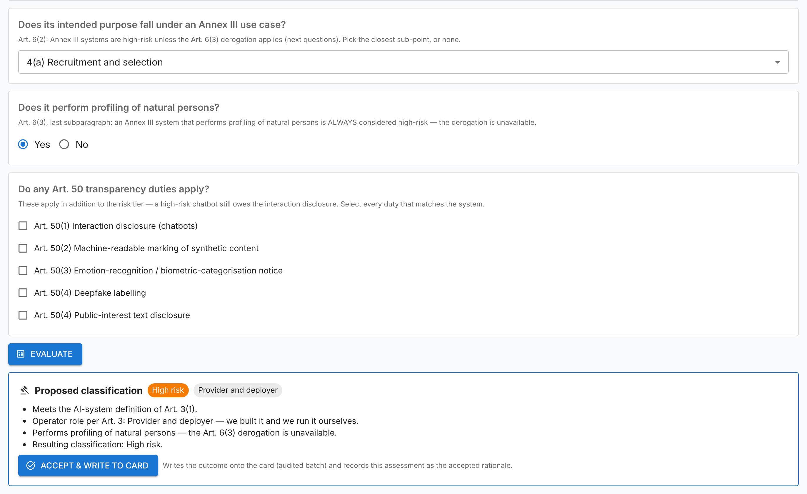

# EU AI Act Register

Il Regolamento UE sull'IA si applica per fasi, e ogni fornitore e deployer di
sistemi di IA deve rispondere alle stesse quattro domande: quali dei vostri
sistemi sono sistemi di IA, che livello di rischio ha ciascuno, quali obblighi
derivano dal vostro ruolo e dove sono le evidenze?

**EU AI Act Register** vi risponde sulle schede che il vostro repository EA
contiene già. È pensato per fornitori e deployer di sistemi di IA e di modelli di
IA per finalità generali (GPAI) che tengono, o vogliono tenere, il proprio
panorama IT in Turbo EA.

!!! warning "Registra la vostra valutazione — non è una consulenza legale"
    Il registro è strutturato sul Regolamento (UE) 2024/1689 come modificato dal
    Regolamento (UE) 2026/1744. Registra e organizza il lavoro di conformità della
    vostra organizzazione e le decisioni delle vostre persone. Non è una
    consulenza legale e non garantisce la conformità.

## Il registro vive sulle vostre schede

Il registro **non tiene tabelle proprie** per i suoi contenuti. Ogni attributo
normativo è un campo di una scheda, modificato nella vista scheda di Turbo EA con
un testo di aiuto che cita l'articolo:

| Oggetto del registro | In Turbo EA |
|---|---|
| Sistemi di IA | Schede **Applicazione** con *In AI Act scope* attivato |
| Modelli di IA per finalità generali | Schede **Componente IT** con *GPAI model (Art. 3(63))* attivato |
| Governance dell'IA di un'organizzazione | Schede **Organizzazione** |

L'estensione aggiunge queste sezioni:

| Tipo di scheda | Sezione | Contiene |
|---|---|---|
| **Applicazione** | EU AI Act | In AI Act scope, Operator role, Risk tier, Annex III category, Annex I regime, Placed on the market before the high-risk date (Art. 111(2)), Art. 6(3) derogation claimed, Art. 6(3) rationale, Intended purpose, Art. 50 transparency duties, Substantially modified (Art. 25), AI Act classification completeness (%) |
| **Applicazione** | EU AI Act — Provider obligations | uno stato per ogni obbligo del fornitore, dall'Art. 9 all'Art. 73 |
| **Applicazione** | EU AI Act — Deployer obligations | uno stato per ogni obbligo del deployer dell'Art. 26, la FRIA (FRIA required, il suo stato e la data) e la registrazione dell'Art. 49(3) |
| **Componente IT** | EU AI Act — GPAI / Model | GPAI model (Art. 3(63)), Model origin, Systemic risk (Art. 51), Training compute (log10 FLOPs), gli stati degli obblighi degli Art. 53 e Art. 55, AI Act classification completeness (%) |
| **Organizzazione** | AI governance (EU AI Act) | AI literacy programme (Art. 4), Body governed by public law, AI governance contact |

Ogni stato di un obbligo è uno tra **Not started**, **In progress**,
**Implemented** o **Not applicable**.

I campi compaiono solo dove sono pertinenti. Un'Applicazione mostra soltanto
l'interruttore *In AI Act scope* finché non viene salvata come rientrante
nell'ambito. Dopo, ogni stato di obbligo compare solo dove il suo obbligo può
applicarsi al ruolo, al livello di rischio e alle condizioni della scheda, il campo
*Placed on the market before the high-risk date (Art. 111(2))* compare sui sistemi
ad alto rischio, e i campi GPAI di un Componente IT seguono il suo interruttore
GPAI. Uno stato già compilato resta visibile per poter essere cancellato, e i
valori nascosti vengono conservati, mai eliminati.

**Il chip nell'intestazione.** Ogni scheda di sistema di IA e di modello GPAI
mostra **Obligations implemented** nella sua intestazione — per esempio
*Obligations implemented: 0 of 1*. Il suo tooltip elenca ciò che è ancora aperto,
con lo stato e la scadenza di ogni obbligo, e indica ogni dato di classificazione
mancante; un clic apre gli obblighi aperti di quel sistema nell'area di lavoro. Dove
non c'è nulla da contare, riporta **No AI Act obligations apply**, **AI Act
obligations: classify first** o **Prohibited practice (Art. 5)**.

### Due misure

Il registro riporta due cifre, e rispondono a domande diverse — un sistema può
essere interamente classificato e non avere nulla di implementato.

| | Classification completeness | Obligations implemented |
|---|---|---|
| **Domanda** | Quanta parte della classificazione è registrata? | Quanti degli obblighi applicabili sono soddisfatti? |
| **Sistemi di IA** | Operator role, livello di rischio, finalità prevista e, per i sistemi ad alto rischio, la categoria dell'allegato III o il regime dell'allegato I | Gli obblighi che si applicano al sistema in base a ruolo, livello di rischio e doveri selezionati |
| **Modelli GPAI** | Origine del modello e classificazione del rischio sistemico | Gli obblighi dell'Art. 53, più quelli dell'Art. 55 per un modello a rischio sistemico |
| **Mostrata** | Il campo della scheda *AI Act classification completeness (%)*, il cruscotto | Il chip nell'intestazione della scheda, il cruscotto, il Registro e la scheda Obligations |

**Implemented** e **Not applicable** contano come soddisfatti; **In progress** e
**Not started** no. Dove non c'è una percentuale, il registro ne spiega il motivo:
**No obligations apply**, **Classify first** (ruolo o livello di rischio non ancora
impostati) o **Prohibited practice** (niente da implementare — il sistema deve
essere dismesso o riprogettato per uscire dall'Art. 5).

## In sintesi

| | |
|---|---|
| **Licenza** | Commerciale — è richiesto un diritto d'uso firmato |
| **Versione minima di Turbo EA** | 2.186.0 |
| **Permessi** | `ext.eu-ai-act.view`, `ext.eu-ai-act.manage`, `ext.eu-ai-act.submit`, `ext.eu-ai-act.admin` |
| **Concessioni di accesso ai dati** | `core.cards.read`, `core.cards.write`, `core.users.read`, `metamodel.custom_field_types` |
| **Riavvio del backend necessario** | Sì — include codice backend |
| **Dove compare** | **Regolamento IA dell'UE** nel menu **GRC**, con sette schede (una voce di primo livello quando il menu GRC non è disponibile per voi) · **Report → Regolamento IA dell'UE - Dashboard** (il cruscotto come report salvabile) · le sezioni EU AI Act e il chip **Obligations implemented** sulle schede · quattro modelli di sondaggio · la cartella di lavoro Excel del registro e i documenti Word Annex IV / FRIA |

Arricchisce inoltre la normativa **EU AI Act** dello
[scanner di conformità](../guide/compliance.md) del nucleo, i cui riscontri sull'IA
alimentano i [Suggerimenti](#suggerimenti).

## Primi passi

1. **Aprite EU AI Act → Settings.** Controllate la **Taxonomy baseline**, impostate
   una **Reference date** se le scadenze devono essere valutate rispetto a una data
   diversa da oggi e, facoltativamente, caricate i dati demo.
2. **Trovate i sistemi di IA che avete già.** In **Suggestions**, premete **Find
   suggestions** e accettate i sistemi e i modelli che rientrano nell'ambito.
3. **Classificate ogni sistema** in **Classify** e accettate il risultato sulla sua
   scheda.
4. **Seguite gli obblighi** in **Obligations**, registrando ogni stato sulla
   scheda.
5. **Congelate uno snapshot** in **Audit** e scaricate la cartella di lavoro del
   registro, e i documenti Annex IV e FRIA dal **Register**.

!!! tip "Raccogliete i dati da chi li possiede"
    Quattro modelli di sondaggio in **Amministrazione → Sondaggi → Nuovo da
    modello** raccolgono i campi dell'AI Act dai proprietari delle schede: **AI
    system intake (EU AI Act)**, **Provider obligations check (EU AI Act)**,
    **Deployer obligations check (EU AI Act)** e **GPAI model check (EU AI Act)**.
    Ognuno si apre come bozza, indirizzata agli stakeholder responsabili delle
    schede.

## L'area di lavoro

**Regolamento IA dell'UE** nel menu **GRC** ha sette schede: **Dashboard**, **Register**,
**Classify**, **Obligations**, **Suggestions**, **Audit** e **Settings**. Ogni
elenco è una griglia Turbo EA con la stessa barra laterale dell'Inventario — una
scheda **Filters** (ricerca su tutte le colonne, più faccette come livello di
rischio, ruolo, stato, gravità o scadenza) e una scheda **Columns** (mostrare,
nascondere e bloccare le colonne, ricordato per griglia). Una riga che nomina una
scheda la apre nel pannello della scheda.

### Cruscotto

Cinque riquadri — **AI systems in scope**, **High-risk**, **Unclassified**, **GPAI
models** e **Overdue obligations** — che aprono ciascuno le righe dietro il loro
numero, e una riga **Validation** con i riscontri bloccanti e gli avvisi, più un
link **Open audit**. Sotto:

- **Risk-tier distribution** sui sistemi nell'ambito.
- **Compliance quadrant** — ogni sistema collocato secondo l'esposizione normativa
  (gli obblighi applicabili) rispetto a **Obligations implemented**, in quattro
  aree: **Act now**, **On track**, **Monitor** e **Comfortable**. I sistemi nella
  stessa posizione condividono un disco che mostra quanti sono. I sistemi senza
  percentuale non vengono tracciati; una riga sotto il grafico li conta.
- **Ranked by urgency** — gli stessi sistemi come elenco, con una colonna per ogni
  misura. Un clic su un sistema apre la sua **finestra di stato**: le due misure con
  il loro dettaglio, i dati di classificazione ancora mancanti e gli obblighi aperti
  con stato e scadenza, con **Open card** e **Show in Obligations**.
- **Applicability timeline (Art. 113)** — le tappe della tabella sotto
  [Obblighi](#obblighi), ciascuna segnata come in vigore o in conto alla rovescia.

### Registro

Due viste — **AI systems** e **GPAI models** — ciascuna una griglia delle schede nel
registro. Per un sistema mostra il livello di rischio, il ruolo, la base di
classificazione, **Obligations implemented** (un clic apre gli obblighi aperti di
quel sistema) e il numero di quelli scaduti; per un modello la sua origine, il
rischio sistemico, la potenza di calcolo di addestramento e i sistemi che lo
usano. **New AI system** e **New GPAI model** creano una scheda del tipo giusto con
l'interruttore preimpostato, e **Open in inventory** elenca le stesse schede
nell'Inventario. Una riga del registro *è* la sua scheda: cliccatela per modificare
le sezioni dell'AI Act nel dettaglio della scheda.

La colonna **Documents** della vista AI systems offre due download Word per
sistema, precompilati dal repository: **Annex IV.docx**, la documentazione tecnica
dell'allegato IV, e **FRIA.docx**, lo scheletro della valutazione d'impatto sui
diritti fondamentali dell'Art. 27. Entrambi iniziano con una nota sul modulo
semplificato dell'allegato IV per le PMI e le piccole imprese a media
capitalizzazione (Art. 11(1)) e sul riutilizzo della valutazione d'impatto sulla
protezione dei dati (Art. 27(4)).

### Classify

La procedura guidata di classificazione pone una serie guidata di domande su un
sistema e propone un livello di rischio, con l'articolo dietro ogni motivo.
Scegliete il sistema in **Classify a system** e rispondete:

1. **AI system or not** — è un sistema di IA ai sensi dell'Art. 3(1)? In caso
   contrario, l'esito è **Out of scope**.
2. **Role** — il ruolo di operatore della vostra organizzazione per questo sistema,
   e se lo avete modificato in modo sostanziale, rimarchiato o ne avete cambiato la
   finalità prevista (il che può farvi diventare il suo fornitore ai sensi
   dell'Art. 25).
3. **Prohibited practices (Art. 5)** — comprese le due pratiche che il
   Regolamento (UE) 2026/1744 vieta dal 2 dicembre 2026: materiale intimo o
   sessualmente esplicito realistico di una persona identificabile senza il suo
   consenso (Art. 5(1)(ba)) e materiale pedopornografico (Art. 5(1)(bb)). Ciascuna
   indica chi è interessato, come fornitore o come deployer. A un fornitore di un
   sistema che genera immagini, video, audio o testo viene inoltre chiesto se il
   sistema potrebbe produrre tale materiale e se misure di salvaguardia lo
   impediscano in modo affidabile; solo la risposta che tali misure non sono in
   atto ne fa una pratica vietata.
4. **High risk under Annex I** — un prodotto, o il componente di sicurezza di un
   prodotto, ai sensi della normativa dell'Unione elencata. Dopo un regime, la
   procedura chiede se un motivo dell'Art. 6(1a)–(1c) esclude il sistema
   dall'Art. 6(1): è usato esclusivamente per aspetti non legati alla sicurezza,
   oppure il prodotto è valutato da una terza parte solo per rischi diversi dalla
   salute e dalla sicurezza.
5. **High risk under Annex III** — se la finalità prevista rientra in un caso d'uso
   dell'allegato III, e se il sistema profila persone fisiche.
6. **The Art. 6(3) derogation** — se si applica una condizione di deroga. Una deroga
   invocata deve essere documentata in **Art. 6(4) rationale**; quel testo viene
   scritto sulla scheda, e la convalida blocca in sua assenza.
7. **Transparency duties (Art. 50)** — informativa sui chatbot, marcatura dei
   contenuti sintetici, avvisi di riconoscimento delle emozioni, etichettatura di
   deepfake e di testi di interesse pubblico.

**Evaluate** mostra la **Proposed classification** con i suoi motivi supportati da
articoli e non scrive nulla sulla scheda. **Accept & write to card** scrive i campi
di classificazione sulla scheda — ruolo, livello di rischio, base, deroga e doveri
di trasparenza — e registra la valutazione come quella accettata.

L'esecuzione della procedura richiede il permesso di gestione dell'estensione e una
scheda che potete aprire; l'accettazione richiede anche i diritti di modifica su
quella scheda. Se potete aprire la scheda ma non modificarla, potete comunque
eseguire la procedura e vedere la proposta, ma **Accept & write to card** è
disattivato e ne indica il motivo: *You may not edit this card, so the
classification cannot be written to it.*

**La cronologia delle valutazioni è la traccia di audit.** Ogni esecuzione viene
conservata — chi ha classificato quale sistema, quando e perché — così che la
domanda *«perché questo sistema è ad alto rischio, e chi lo ha deciso?»* resti
risolvibile anni dopo. Ogni riga nomina la scheda (una scheda archiviata è
contrassegnata **archived**, una scheda che non esiste più riporta **Deleted
card**), la persona che l'ha eseguita sotto **By**, il livello di rischio e lo
stato: **Draft**, **Accepted** o **Superseded**. Rieseguire la procedura aggiunge
una nuova voce; accettarla contrassegna come **Superseded** quella accettata
prima e non la modifica mai. I dettagli di una valutazione mostrano **Run by**,
**Accepted by** e, una volta che una successiva l'ha sostituita, **Superseded by**
con la data — una voce sostituita conserva chi l'ha accettata. Per le voci
sostituite prima della versione 1.6.0 è nota solo la persona che le ha sostituite,
quindi **Accepted by** riporta «—». La cronologia elenca solo le valutazioni di
schede che potete aprire. La colonna **Taxonomy baseline** è nascosta per impostazione
predefinita; attivatela in **Columns**.

### Obblighi

Ogni obbligo applicabile di ogni sistema di IA — o, passando a **GPAI model**, di
ogni modello GPAI — in un'unica griglia: la scheda, il gruppo, l'obbligo,
l'articolo, lo stato, la scadenza, la tappa e un **Evidence hint** che indica quale
prova l'obbligo si aspetta. Filtrate per stato, gruppo e scadenza (scaduto, **Due
soon**, **Later**), oppure scegliete una singola scheda nella barra degli
strumenti. Gli stati sono campi della scheda, quindi li registrate aprendo la
scheda; un obbligo non soddisfatto alla sua data è scaduto, e uno non ancora
scaduto mostra **Due soon** da 180 giorni prima della sua data.

Quali obblighi si applicano dipende da ruolo, livello di rischio e condizioni di
ciascun sistema — 32 obblighi in tutto per fornitori, deployer e modelli GPAI, sulla
baseline modificata. Le loro date sono scaglionate come modificate dal
Regolamento (UE) 2026/1744:

| Data | Tappa | Articolo |
|---|---|---|
| 2 febbraio 2025 | Pratiche vietate e alfabetizzazione in materia di IA | Art. 113(a) |
| 2 agosto 2025 | Obblighi dei modelli di IA per finalità generali | Art. 113(b) |
| 2 agosto 2026 | Applicazione generale (incl. trasparenza dell'Art. 50) | Art. 113 |
| 2 dicembre 2026 | Ulteriori pratiche vietate (Art. 5(1)(ba), (bb)) | Art. 113(a) |
| 2 dicembre 2027 | Sistemi di IA ad alto rischio dell'allegato III | Art. 113(c)(i) |
| 2 agosto 2028 | IA ad alto rischio nei prodotti regolamentati dell'allegato I | Art. 113(c)(ii) |
| 2 agosto 2030 | IA ad alto rischio già sul mercato, destinata alle autorità pubbliche | Art. 111(2) |

Le scadenze sono valutate rispetto alla **Reference date** in Settings (oggi quando
è vuota). Tre regole plasmano l'elenco:

- **Allegato I sezione B (Art. 2(2)).** Un sistema che è ad alto rischio solo
  tramite un prodotto coperto dall'allegato I sezione B — veicoli, aviazione,
  attrezzature marittime, ferrovie e macchine — non ha alcun obbligo dell'AI Act
  nel registro e riporta **No obligations apply**. Gli stati già registrati restano
  sulla scheda, non conteggiati. Un sistema che rientra anche in un caso d'uso
  dell'allegato III mantiene tutti i suoi obblighi.
- **Sistemi già sul mercato (Art. 111(2)).** Registrate sulla scheda di un sistema
  ad alto rischio se è stato *Placed on the market before the high-risk date
  (Art. 111(2))*. Immesso sul mercato prima di quella data senza modifiche
  significative alla progettazione: gli obblighi per l'alto rischio sono messi da
  parte (la trasparenza dell'Art. 50 conta ancora); immesso sul mercato prima di
  quella data e destinato all'uso da parte di autorità pubbliche: slittano al
  2 agosto 2030; modificato in modo significativo, non immesso sul mercato prima di
  quella data o lasciato vuoto: si applicano per intero.
- **Registrare un sistema in deroga (Art. 49(2)).** Un fornitore che invoca la
  deroga dell'Art. 6(3) ha un obbligo in più: registrare il sistema nella banca dati
  dell'UE come valutato non ad alto rischio.

### Suggerimenti

**Find suggestions** scorre le vostre schede e propone decisioni di registro, ciascuna
con le sue evidenze:

- **AI Act scope** — un'Applicazione su cui non si è ancora deciso, che porta uno dei
  sottotipi di IA del nucleo (**AI Agent**, **MCP Server**) o che lo scanner di
  conformità ha segnalato come dotata di funzionalità di IA.
- **GPAI check** — un Componente IT su cui non si è ancora deciso, con il sottotipo
  **AI Model**, una segnalazione dello scanner, o usato da sistemi già nell'ambito.
- **Bootstrap checklist** — un sistema ad alto rischio in cui nessuno degli obblighi
  applicabili ha ancora uno stato; accettarla imposta ciascuno su **Not started**,
  così il lavoro diventa visibile.

Una fascia sopra l'elenco rimanda ai riscontri EU AI Act dello scanner di
conformità.

Nulla viene scritto su una scheda finché una persona non preme **Accept** su una
riga; **Dismiss** la rimuove dall'elenco. Lo stato — **Proposed**, **Accepted** o
**Dismissed** — si sceglie nella barra laterale. Accettare richiede i diritti di
modifica sulla scheda oltre al permesso di gestione; senza di essi **Accept** è
disattivato e indica: *You may not edit this card, so the suggestion cannot be
written to it.*

### Audit

- **Live validation** — i riscontri sul registro così com'è alla data di
  riferimento, ciascuno con gravità (**Blocking** o **Warning**), regola, articolo,
  scheda e messaggio; **Open card** apre la scheda da correggere.
- **Rule coverage** — le regole che una macchina non può verificare. Sono riportate
  come non eseguite, perché richiedono una persona, anziché essere saltate in
  silenzio.
- **Snapshots** — **Freeze snapshot** cattura il registro a una **Reference date**.
  Ogni snapshot attraversa poi tre stati:
    1. **Draft** — premete **Validate** per verificarlo.
    2. **Validated** — premete **Finalize**. Rifiutato finché resta un riscontro
       bloccante.
    3. **Final** — lo snapshot è immutabile, fa parte della traccia di audit e non
       può più essere riconvalidato né eliminato.

  **XLSX** scarica uno snapshot come cartella di lavoro Excel del registro (richiede
  il permesso di invio). Uno snapshot finale si scarica sempre invariato: il suo
  contenuto è verificato rispetto all'hash fissato alla finalizzazione. Uno snapshot
  in bozza conserva le date e i riscontri con cui è stato preso — createne uno nuovo
  dopo un aggiornamento che modifica le regole.

### Impostazioni

**Taxonomy baseline** — la normativa da cui derivano ogni proiezione e ogni
scadenza. **ai-act-2026-omnibus**, il regolamento come modificato dal Regolamento
(UE) 2026/1744, è il valore predefinito; **ai-act-2024**, il regolamento come
adottato con le sue date originali, resta selezionabile affinché le valutazioni e
gli snapshot presi rispetto a esso restino leggibili.

**Reference date** — le scadenze sono valutate rispetto a questa data; vuota
significa oggi.

**Demo data** — **Load demo data** crea un piccolo panorama demo: ogni livello di
rischio, un modello GPAI a rischio sistemico, una traccia di valutazioni accettate e
materiale per i suggerimenti. Tutte le schede demo riportano *(AI demo)* nel nome;
**Remove demo data** le elimina di nuovo.

## Chi vede e può fare che cosa

- **Vedete solo i sistemi le cui schede potete aprire.** Il registro, gli obblighi,
  le cifre e la cronologia del cruscotto, i riscontri, i suggerimenti, la
  cronologia delle valutazioni e i documenti Annex IV / FRIA mostrano a una persona
  solo i sistemi le cui schede può aprire nell'Inventario, e ogni cifra — conteggi,
  percentuali, elementi scaduti, riscontri bloccanti — è calcolata su ciò che può
  vedere. Una scheda cui rimanda un sistema visibile ma che non potete aprire riporta
  **Card not accessible**. Dove qualcosa è stato omesso, il cruscotto e il Registro lo
  dicono in una riga: *Some systems are not shown because you do not have access to
  their cards.* Dove non resta nulla da mostrare, il cruscotto e la scheda
  Obligations mostrano la stessa riga al posto di un elenco vuoto. Un ruolo che ha
  solo il permesso dell'estensione e nessun accesso alle schede non vede quindi alcun
  sistema.
- **Gli snapshot coprono l'intero registro.** Gli snapshot e i loro download Excel
  sono il registro ufficiale: contengono ogni sistema e non vengono mai filtrati,
  chiunque guardi. Chiunque abbia il permesso di visualizzazione vede l'elenco degli
  snapshot nella scheda Audit; scaricarne uno richiede il permesso di invio.
  Tramite l'API, il contenuto memorizzato di uno snapshot viene restituito a chi ha
  il permesso di invio e a chi il registro non nasconde nulla; gli altri ricevono
  solo data, baseline e stato.
- **Accettare richiede due diritti.** **Accept & write to card**, e l'accettazione
  di un suggerimento, richiedono il permesso `ext.eu-ai-act.manage` dell'estensione
  **e** i diritti di modifica sulla scheda. Chi può aprire la scheda ma non
  modificarla può comunque eseguire la procedura e vedere la proposta; il pulsante è
  disattivato con il suo motivo e nulla viene scritto. Per consentirgli di accettare,
  date al suo ruolo i diritti di modifica sul tipo di scheda, oppure rendetelo
  stakeholder della scheda in un ruolo che può modificare. Eseguire la procedura, o
  accettare o scartare un suggerimento, su una scheda che non potete aprire viene
  rifiutato.
- **La cronologia della scheda nomina chi ha accettato.** Da Turbo EA 2.209.0 in poi,
  una modifica fatta da **Accept & write to card** o da un suggerimento accettato è
  registrata nella scheda Cronologia della scheda a nome della persona che l'ha
  fatta, con il chip **Extension**. Le versioni precedenti mostrano **System**.
  Caricare o rimuovere i dati demo è registrato come l'estensione.
- **La cronologia delle valutazioni mostra solo nomi visualizzati** — mai un'e-mail.
  Dove i nomi non possono essere letti, mostra «—».

## Permessi

| Permesso | Concede |
|---|---|
| `ext.eu-ai-act.view` | Visualizzare il registro dei sistemi di IA, i cruscotti e i risultati di convalida |
| `ext.eu-ai-act.manage` | Eseguire classificazioni, modificare i dati dell'AI Act e decidere sui suggerimenti |
| `ext.eu-ai-act.submit` | Congelare snapshot del registro e scaricare le esportazioni del registro |
| `ext.eu-ai-act.admin` | Configurare le impostazioni dell'AI Act (versione della tassonomia, data di riferimento, dati demo) |

La modifica dei dati del registro stessi usa anche i vostri normali diritti di
modifica delle schede, poiché ogni campo dell'AI Act vive su una scheda.

## Se la licenza scade o l'estensione viene disattivata

L'area di lavoro e il suo report scompaiono, ma **nulla viene eliminato**. I vostri
dati dell'AI Act vivono su schede ordinarie, quindi ogni valore resta esattamente
dov'è, visibile e modificabile nell'inventario. Applicare una licenza rinnovata
ripristina subito l'area di lavoro.

## Note e limitazioni

- La convalida copre ciò che una macchina può verificare. Le regole che non può
  verificare sono elencate in **Rule coverage** come non eseguite; considerate una
  convalida pulita come una lista di controllo, non come un giudizio di conformità.
- I campi della scheda sono condivisi da entrambe le baseline, e una scheda non può
  sapere quale sia selezionata. Con **ai-act-2024**, una scheda ad alto rischio con
  un regime dell'allegato I sezione B nasconde stati di obbligo che quella baseline
  conta ancora, e il campo dell'Art. 111(2) compare anche se quella baseline lo
  ignora. Il registro, il cruscotto e le esportazioni seguono sempre la baseline
  selezionata.
- Le opzioni di risposta della procedura sono mostrate nella vostra lingua dove la
  baseline fornisce una traduzione.
- Dopo l'aggiornamento da una versione precedente, rieseguite la procedura per l'IA
  nei prodotti regolamentati (i motivi dell'allegato I) e per i sistemi che generano
  contenuti (la domanda sulle misure di salvaguardia), e registrate lo stato
  dell'Art. 111(2) dei sistemi ad alto rischio già sul mercato.
