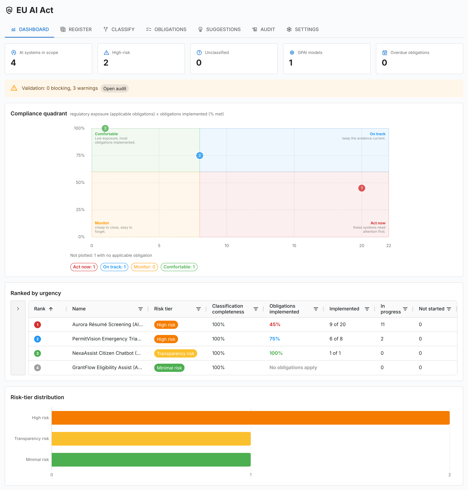

# EU AI Act Register

The EU AI Act applies in stages, and every provider and deployer of AI systems
has to answer the same four questions: which of your systems are AI systems,
what risk tier is each one, which obligations follow from your role, and where
is the evidence?

**EU AI Act Register** answers them on the cards your EA repository already
holds. It is meant for providers and deployers of AI systems and
general-purpose AI (GPAI) models that keep, or want to keep, their IT landscape
in Turbo EA.

!!! warning "It records your assessment — it is not legal advice"
    The register is structured against Regulation (EU) 2024/1689 as amended by
    Regulation (EU) 2026/1744. It records and organises your organisation's own
    compliance work and the decisions your people take. It is not legal advice
    and does not guarantee conformity.

## The register lives on your cards

The register keeps **no tables of its own** for its content. Every regulatory
attribute is a field on a card, edited in Turbo EA's own card detail with help
text citing the article:

| Register object | In Turbo EA |
|---|---|
| AI systems | **Application** cards with *In AI Act scope* switched on |
| General-purpose AI models | **IT Component** cards with *GPAI model (Art. 3(63))* switched on |
| AI governance of an organisation | **Organization** cards |

The extension adds these sections:

| Card type | Section | Contains |
|---|---|---|
| **Application** | EU AI Act | In AI Act scope, Operator role, Risk tier, Annex III category, Annex I regime, Placed on the market before the high-risk date (Art. 111(2)), Art. 6(3) derogation claimed, Art. 6(3) rationale, Intended purpose, Art. 50 transparency duties, Substantially modified (Art. 25), AI Act classification completeness (%) |
| **Application** | EU AI Act — Provider obligations | one status per provider obligation, Art. 9 to Art. 73 |
| **Application** | EU AI Act — Deployer obligations | one status per deployer obligation of Art. 26, the FRIA (FRIA required, its status and date) and the Art. 49(3) registration |
| **IT Component** | EU AI Act — GPAI / Model | GPAI model (Art. 3(63)), Model origin, Systemic risk (Art. 51), Training compute (log10 FLOPs), the Art. 53 and Art. 55 obligation statuses, AI Act classification completeness (%) |
| **Organization** | AI governance (EU AI Act) | AI literacy programme (Art. 4), Body governed by public law, AI governance contact |

Every obligation status is one of **Not started**, **In progress**,
**Implemented** or **Not applicable**.

The fields show only where they are relevant. An Application shows just the
*In AI Act scope* switch until it is saved as in scope. After that, each
obligation status appears only where its obligation can apply to the card's
role, risk tier and conditions, the *Placed on the market before the high-risk
date (Art. 111(2))* field appears on high-risk systems, and an IT Component's
GPAI fields follow its GPAI switch. A status already filled in stays visible so
it can be cleared, and hidden values are kept, never deleted.

**The header chip.** Every AI system and GPAI model card shows **Obligations
implemented** in its header — for example *Obligations implemented: 0 of 1*.
Its tooltip lists what is still open, with each obligation's status and due
date, and names any classification input that is missing; a click opens that
system's open obligations in the workbench. Where there is nothing to count it
reads **No AI Act obligations apply**, **AI Act obligations: classify first**
or **Prohibited practice (Art. 5)**.

### Two measures

The register reports two figures, and they answer different questions — a
system can be fully classified and still have nothing implemented.

| | Classification completeness | Obligations implemented |
|---|---|---|
| **Question** | How much of the classification is recorded? | How many of the obligations that apply are met? |
| **AI systems** | Operator role, risk tier, intended purpose and, for high-risk systems, the Annex III category or Annex I regime | The obligations that apply to the system by role, risk tier and selected duties |
| **GPAI models** | Model origin and systemic-risk classification | The Art. 53 obligations, plus Art. 55 for a systemic-risk model |
| **Shown** | The card field *AI Act classification completeness (%)*, the dashboard | The card header chip, the dashboard, the Register and the Obligations tab |

**Implemented** and **Not applicable** count as met; **In progress** and **Not
started** do not. Where there is no percentage, the register says why:
**No obligations apply**, **Classify first** (role or risk tier not set yet) or
**Prohibited practice** (nothing to implement — the system must be discontinued
or redesigned out of Art. 5).

## At a glance

| | |
|---|---|
| **Licence** | Commercial — a signed entitlement is required |
| **Minimum Turbo EA version** | 2.186.0 |
| **Permissions** | `ext.eu-ai-act.view`, `ext.eu-ai-act.manage`, `ext.eu-ai-act.submit`, `ext.eu-ai-act.admin` |
| **Data access grants** | `core.cards.read`, `core.cards.write`, `core.users.read`, `metamodel.custom_field_types` |
| **Backend restart needed** | Yes — it ships backend code |
| **Where it appears** | **EU AI Act** under the **GRC** menu, with seven tabs (a top-level entry when the GRC menu is not available to you) · **Reports → EU AI Act - Dashboard** (the dashboard as a saveable report) · the EU AI Act sections and the **Obligations implemented** header chip on cards · four survey templates · the Excel register workbook and the Annex IV / FRIA Word documents |

It also enriches the **EU AI Act** regulation of the core
[compliance scanner](../guide/compliance.md), whose AI findings feed the
[Suggestions](#suggestions).

## Getting started

1. **Open EU AI Act → Settings.** Check the **Taxonomy baseline**, set a
   **Reference date** if deadlines should be evaluated against a date other
   than today, and optionally load the demo data.
2. **Find the AI systems you already have.** On **Suggestions**, press **Find
   suggestions** and accept the systems and models that belong in scope.
3. **Classify each system** in **Classify** and accept the result onto its card.
4. **Track the obligations** in **Obligations**, recording each status on the
   card.
5. **Freeze a snapshot** in **Audit** and download the register workbook, and
   the Annex IV and FRIA documents from the **Register**.

!!! tip "Collect the data from the people who own it"
    Four survey templates on **Admin → Surveys → New from template** collect the
    AI Act fields from card owners: **AI system intake (EU AI Act)**, **Provider
    obligations check (EU AI Act)**, **Deployer obligations check (EU AI Act)**
    and **GPAI model check (EU AI Act)**. Each opens as a draft, addressed to the
    cards' responsible stakeholders.

## The workbench

**EU AI Act** under the **GRC** menu has seven tabs: **Dashboard**,
**Register**, **Classify**, **Obligations**, **Suggestions**, **Audit** and
**Settings**. Every list in it is a Turbo EA grid with the same sidebar as the
Inventory — a **Filters** tab (search across all columns, plus facets such as
risk tier, role, status, severity or deadline) and a **Columns** tab (show, hide
and freeze columns, remembered per grid). A row that names a card opens it in
the card panel.

### Dashboard

Five tiles — **AI systems in scope**, **High-risk**, **Unclassified**, **GPAI
models** and **Overdue obligations** — each opening the rows behind its number,
and a **Validation** line with the blocking findings and warnings and an **Open
audit** link. Below them:

- **Risk-tier distribution** across the systems in scope.
- **Compliance quadrant** — every system plotted on regulatory exposure (the
  obligations that apply) against **Obligations implemented**, in four areas:
  **Act now**, **On track**, **Monitor** and **Comfortable**. Systems on the same
  position share one disc showing how many sit there. Systems without a
  percentage are not plotted; a line under the plot counts them.
- **Ranked by urgency** — the same systems as a list, with a column for each
  measure. Clicking a system opens its **status dialog**: both measures with
  their breakdown, the classification inputs still missing and the open
  obligations with status and due date, with **Open card** and **Show in
  Obligations**.
- **Applicability timeline (Art. 113)** — the milestones in the table under
  [Obligations](#obligations), each marked as in force or counting down.

### Register

Two views — **AI systems** and **GPAI models** — each a grid of the cards in the
register. For a system it shows the risk tier, role, classification basis,
**Obligations implemented** (a click opens that system's open obligations) and
overdue count; for a model its origin, systemic risk, training compute and the
systems that use it. **New AI system** and **New GPAI model** create a card with
the right type and switch preset, and **Open in inventory** lists the same cards
in the Inventory. A register row *is* its card: click it to edit the AI Act
sections in the card detail.

The **Documents** column of the AI systems view offers two Word downloads per
system, pre-filled from the repository: **Annex IV.docx**, the Annex IV
technical documentation, and **FRIA.docx**, the skeleton of the Art. 27
fundamental rights impact assessment. Both start with a note on the simplified Annex IV form
for SMEs and small mid-caps (Art. 11(1)) and on reusing the data protection
impact assessment (Art. 27(4)).

### Classify

The classification wizard asks a guided set of questions about one system and
proposes a risk tier with the article behind each reason. Pick the system under
**Classify a system** and answer:

1. **AI system or not** — is this an AI system in the Art. 3(1) sense? If not,
   the outcome is **Out of scope**.
2. **Role** — your organisation's operator role for this system, and whether you
   substantially modified it, rebranded it or changed its intended purpose
   (which can make you its provider under Art. 25).
3. **Prohibited practices (Art. 5)** — including the two practices Regulation
   (EU) 2026/1744 prohibits from 2 December 2026: realistic intimate or sexually
   explicit material of an identifiable person without consent (Art. 5(1)(ba)),
   and child sexual abuse material (Art. 5(1)(bb)). Each says who is concerned,
   as provider or as deployer. A provider of a system that generates images,
   video, audio or text is also asked whether the system could produce such
   material and whether safeguards reliably prevent it; only the answer that
   such safeguards are not in place makes it a prohibited practice.
4. **High risk under Annex I** — a product, or the safety component of a
   product, under the listed Union legislation. After a regime, the wizard asks
   whether a ground of Art. 6(1a)–(1c) takes the system out of Art. 6(1): it is
   used solely for non-safety aspects, or the product is assessed by a third
   party only for risks other than health and safety.
5. **High risk under Annex III** — whether the intended purpose falls under an
   Annex III use case, and whether the system profiles natural persons.
6. **The Art. 6(3) derogation** — whether a derogation condition applies. A
   claimed derogation must be documented in **Art. 6(4) rationale**; that text
   is written to the card, and validation blocks without it.
7. **Transparency duties (Art. 50)** — chatbot disclosure, marking of synthetic
   content, emotion-recognition notices, deepfake and public-interest text
   labelling.

**Evaluate** shows the **Proposed classification** with its article-cited
reasons, and writes nothing to the card. **Accept & write to card** writes the
classification fields onto the card — role, risk tier, basis, derogation and
transparency duties — and records the assessment as the accepted one.

Running the wizard needs the extension's manage permission and a card you may
open; accepting also needs edit rights on that card. If you may open the card
but not edit it, you can still run the wizard and see the proposal, but
**Accept & write to card** is greyed out and says why: *You may not edit this
card, so the classification cannot be written to it.*

**The assessment history is the audit trail.** Every run is kept — who
classified which system, when and why — so *«why is this system high-risk, and
who decided?»* stays answerable years later. Each row names the card (an
archived card is marked **archived**, a card that no longer exists reads
**Deleted card**), the person who ran it under **By**, the risk tier and the
status: **Draft**, **Accepted** or **Superseded**. Running the wizard again adds
a new entry; accepting it marks the previously accepted one **Superseded** and
never changes it. An assessment's details show **Run by**, **Accepted by** and,
once a later one replaced it, **Superseded by** with the date — a superseded
entry keeps who accepted it. For entries superseded before version 1.6.0 only
the person who replaced them is known, so **Accepted by** reads «—». The
history lists only assessments of cards you may open. The **Taxonomy baseline**
column is hidden by default; switch it on under **Columns**.

### Obligations

Every applicable obligation of every AI system — or, switched to **GPAI model**,
of every GPAI model — in one grid: the card, group, obligation, article,
status, due date, milestone and an **Evidence hint** saying what proof the
obligation expects. Filter by status, group and deadline (overdue, **Due
soon**, **Later**), or pick a single card in the toolbar. The statuses are card
fields, so you record them by opening the card; an obligation not met by its
date is overdue, and one not yet due shows **Due soon** from 180 days before its
date.

Which obligations apply follows from each system's role, risk tier and
conditions — 32 obligations in all for providers, deployers and GPAI models, on
the amended baseline. Their dates are staged as amended by Regulation (EU)
2026/1744:

| Date | Milestone | Article |
|---|---|---|
| 2 February 2025 | Prohibited practices and AI literacy | Art. 113(a) |
| 2 August 2025 | General-purpose AI model obligations | Art. 113(b) |
| 2 August 2026 | General application (incl. Art. 50 transparency) | Art. 113 |
| 2 December 2026 | Further prohibited practices (Art. 5(1)(ba), (bb)) | Art. 113(a) |
| 2 December 2027 | High-risk AI systems under Annex III | Art. 113(c)(i) |
| 2 August 2028 | High-risk AI in Annex I regulated products | Art. 113(c)(ii) |
| 2 August 2030 | High-risk AI already on the market, intended for public authorities | Art. 111(2) |

Deadlines are evaluated against the **Reference date** in Settings (today when
it is empty). Three rules shape the list:

- **Annex I Section B (Art. 2(2)).** A system that is high-risk only through a
  product covered by Annex I Section B — vehicles, aviation, marine equipment,
  rail and machinery — carries no AI Act obligation in the register and reads
  **No obligations apply**. Statuses already recorded stay on the card,
  uncounted. A system that also falls under an Annex III use case keeps all its
  obligations.
- **Systems already on the market (Art. 111(2)).** Record on a high-risk
  system's card whether it was *Placed on the market before the high-risk date
  (Art. 111(2))*. Placed before that date with its design not significantly
  changed sets the high-risk obligations aside (Art. 50 transparency still
  counts); placed before that date and intended to be used by public
  authorities moves them to 2 August 2030; significantly changed, not placed
  before that date, or left empty, and they apply in full.
- **Registering a derogated system (Art. 49(2)).** A provider who claims the
  Art. 6(3) derogation has one more obligation: registering the system in the EU
  database as one assessed as not high-risk.

### Suggestions

**Find suggestions** walks your cards and proposes register decisions, each
with its evidence:

- **AI Act scope** — an Application not yet decided on, carrying one of the core
  AI subtypes (**AI Agent**, **MCP Server**) or flagged by the compliance
  scanner as having AI features.
- **GPAI check** — an IT Component not yet decided on, with the **AI Model**
  subtype, a scanner flag, or used by systems already in scope.
- **Bootstrap checklist** — a high-risk system none of whose applicable
  obligations has a status yet; accepting it sets each of them to **Not
  started**, so the work becomes visible.

A strip above the list links the compliance scanner's own EU AI Act findings.

Nothing is written to a card until a person presses **Accept** on a row;
**Dismiss** removes it from the list. The status — **Proposed**, **Accepted**
or **Dismissed** — is picked in the sidebar. Accepting needs edit rights on the
card as well as the manage permission; without them **Accept** is greyed out
and says *You may not edit this card, so the suggestion cannot be written to
it.*

### Audit

- **Live validation** — the findings for the register as it stands at the
  reference date, each with its severity (**Blocking** or **Warning**), rule,
  article, card and message; **Open card** opens the card that needs fixing.
- **Rule coverage** — the rules a machine cannot check. They are reported as
  not executed, because they need a human, rather than silently skipped.
- **Snapshots** — **Freeze snapshot** captures the register at a **Reference
  date**. Each snapshot then moves through three states:
    1. **Draft** — press **Validate** to check it.
    2. **Validated** — press **Finalize**. This is refused while any blocking
       finding remains.
    3. **Final** — the snapshot is immutable, part of the audit trail, and can
       no longer be validated again or deleted.

  **XLSX** downloads a snapshot as the Excel register workbook (this needs the
  submit permission). A final snapshot always downloads unchanged: its content
  is checked against the hash pinned when it was finalized. A draft snapshot
  keeps the dates and findings it was taken with — take a new one after an
  upgrade that changes the rules.

### Settings

**Taxonomy baseline** — the regulation every projection and deadline derives
from. **ai-act-2026-omnibus**, the regulation as amended by Regulation (EU)
2026/1744, is the default; **ai-act-2024**, the regulation as adopted with its
original dates, stays selectable so that assessments and snapshots taken
against it remain readable.

**Reference date** — deadlines are evaluated against this date; empty means
today.

**Demo data** — **Load demo data** seeds a small demo landscape: every risk
tier, a systemic-risk GPAI model, an accepted assessment trail and material for
suggestions. All demo cards carry *(AI demo)* in their name; **Remove demo
data** deletes them again.

## Who sees and may do what

- **You see only the systems whose cards you may open.** The register, the
  obligations, the dashboard figures and timeline, the findings, the
  suggestions, the assessment history and the Annex IV / FRIA documents show a
  person only the systems whose cards they may open in the Inventory, and every
  figure — counts, percentages, overdue items, blocking findings — is computed
  over what they can see. A card a visible system refers to but you may not
  open reads **Card not accessible**. Where something was left out, the
  Dashboard and the Register say so in one line: *Some systems are not shown
  because you do not have access to their cards.* Where nothing is left to show,
  the Dashboard and the Obligations tab show the same line in place of an empty
  list. A role that holds only the extension's permission and no access to the
  cards therefore sees no systems.
- **Snapshots cover the whole register.** Snapshots and their Excel downloads
  are the register of record: they hold every system and are never filtered,
  whoever looks. Everyone with the view permission sees the list of snapshots
  on the Audit tab; downloading one needs the submit permission. Through the
  API, a snapshot's stored content is returned to people with the submit
  permission and to people the register withholds nothing from; others receive
  its date, baseline and status only.
- **Accepting needs two rights.** **Accept & write to card**, and accepting a
  suggestion, need the extension's `ext.eu-ai-act.manage` permission **and**
  edit rights on the card. Someone who may open the card but not edit it can
  still run the wizard and see the proposal; the button is greyed out with its
  reason, and nothing is written. To let them accept, give their role edit
  rights on the card type, or make them a stakeholder of the card in a role that
  may edit it. Running the wizard, or accepting or dismissing a suggestion, on a
  card you may not open is refused.
- **The card history names who accepted.** On Turbo EA 2.209.0 and later, a
  change made by **Accept & write to card** or by an accepted suggestion is
  recorded in the card's History tab under the name of the person who made it,
  with the **Extension** chip. Earlier versions show **System**. Loading or
  removing the demo data is recorded as the extension.
- **The assessment history shows display names only** — never an email. Where
  names cannot be read, it shows «—».

## Permissions

| Permission | Grants |
|---|---|
| `ext.eu-ai-act.view` | View the AI system register, dashboards and validation results |
| `ext.eu-ai-act.manage` | Run classifications, edit AI Act data and decide suggestions |
| `ext.eu-ai-act.submit` | Freeze register snapshots and download register exports |
| `ext.eu-ai-act.admin` | Configure AI Act settings (taxonomy version, reference date, demo data) |

Editing the register data itself also uses your normal card-edit rights, since
every AI Act field lives on a card.

## If the licence lapses or the extension is disabled

The workbench and its report disappear, but **nothing is deleted**. Your AI
Act data lives on ordinary cards, so every value stays exactly where it is,
visible and editable in the inventory. Applying a renewed licence restores the
workbench immediately.

## Notes and limitations

- Validation covers what a machine can check. The rules it cannot check are
  listed under **Rule coverage** as not executed; treat a clean validation as a
  checklist, not as a verdict of conformity.
- The card fields are shared by both baselines, and a card cannot tell which one
  is selected. Under **ai-act-2024**, a high-risk card with an Annex I Section B
  regime hides obligation statuses that baseline still counts, and the
  Art. 111(2) field shows although that baseline ignores it. The register, the
  dashboard and the exports always follow the selected baseline.
- The wizard's answer options are shown in your language where the baseline
  provides a translation.
- After upgrading from an earlier version, re-run the wizard for AI in
  regulated products (the Annex I grounds) and for content-generating systems
  (the safeguards question), and record the Art. 111(2) status of high-risk
  systems already on the market.
