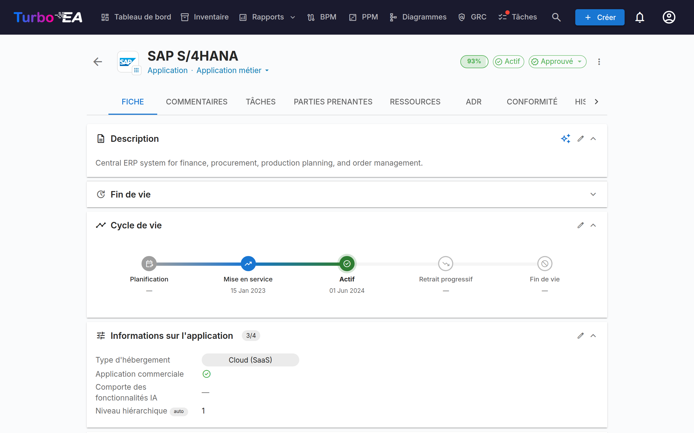
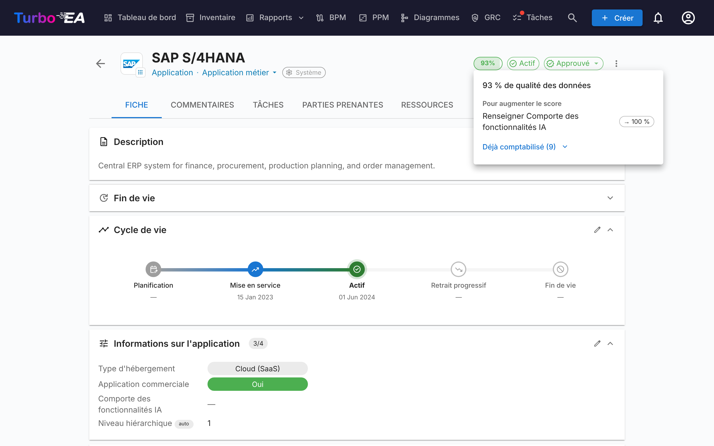
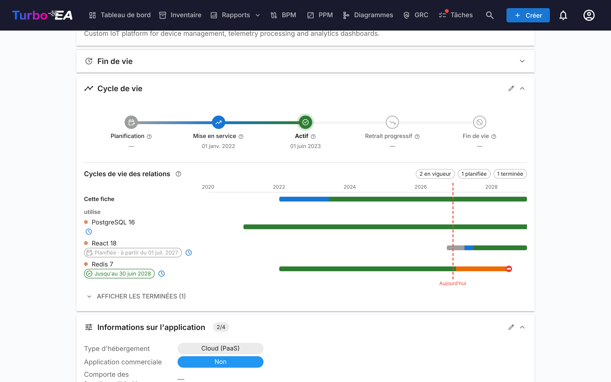
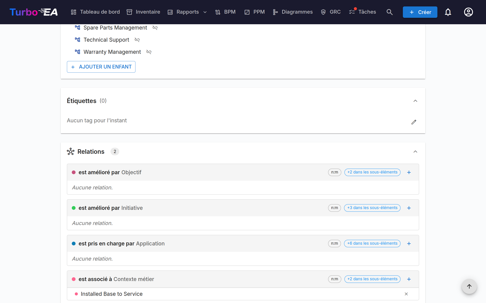
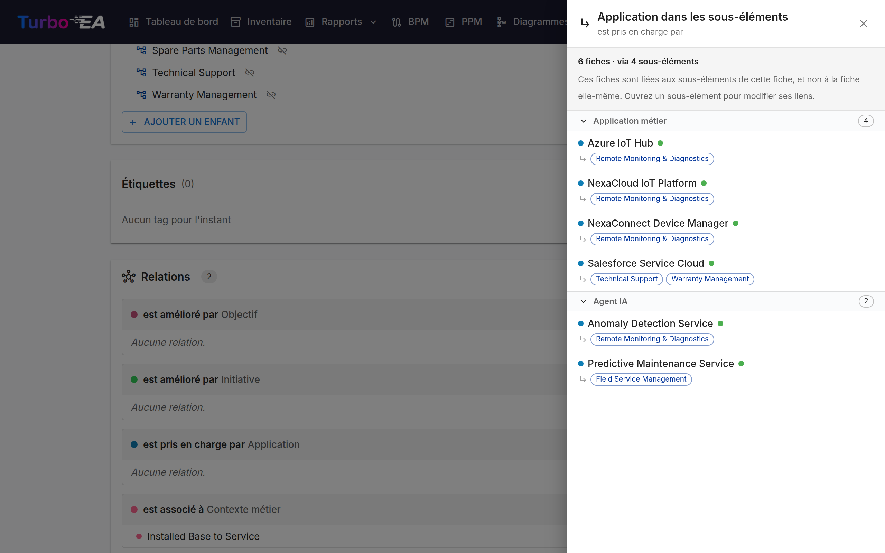
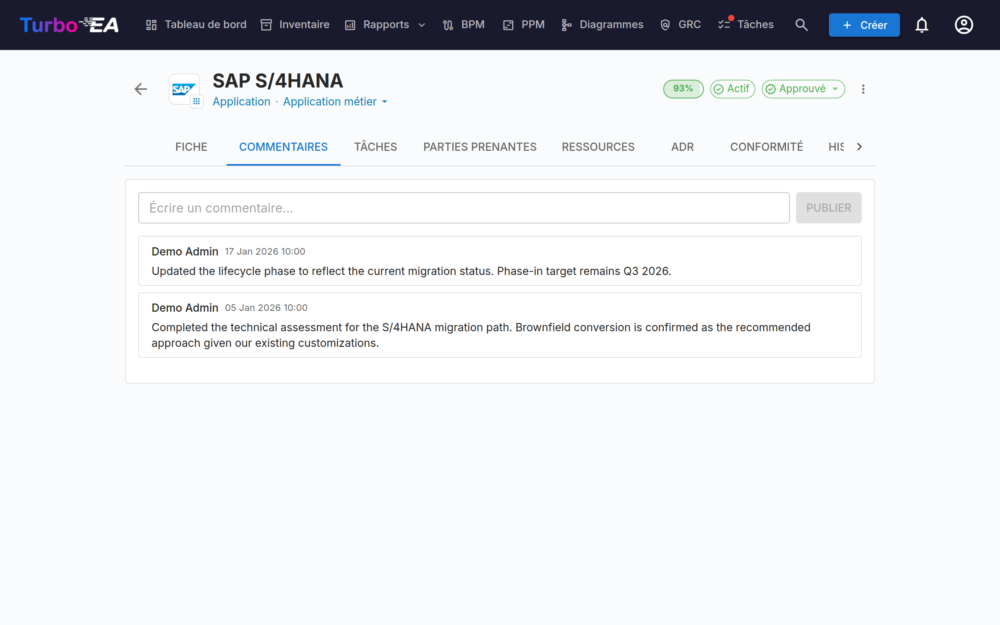
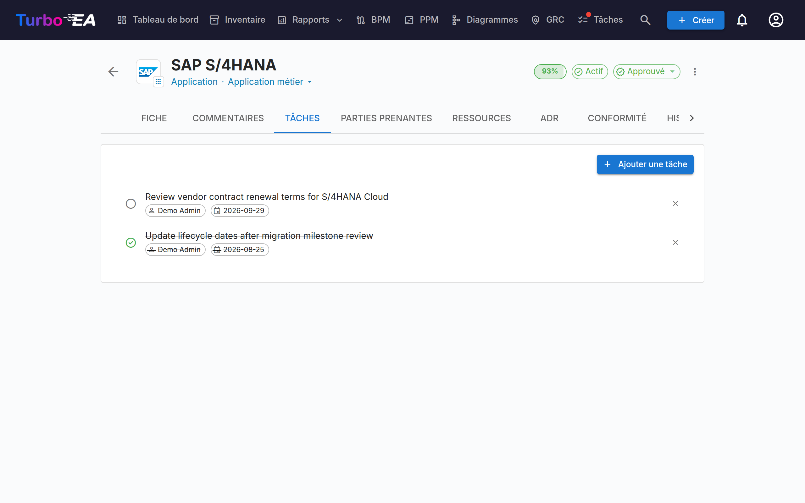
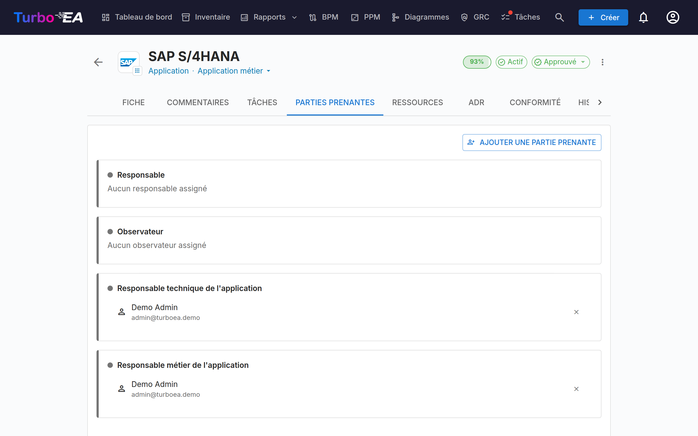
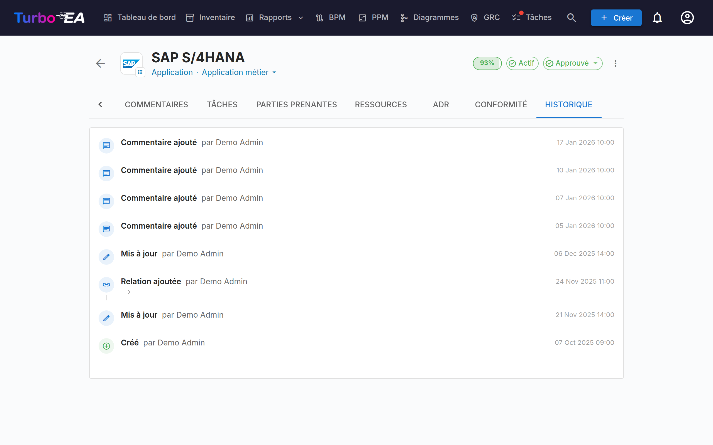

# Détail des fiches

Cliquer sur n'importe quelle fiche dans l'inventaire ouvre la **vue détaillée** où vous pouvez consulter et modifier toutes les informations sur le composant.

## En-tête de la fiche

Le haut de la fiche affiche :

- **Icône et libellé du type** -- Indicateur du type de fiche codé par couleur
- **Nom de la fiche** -- Modifiable en ligne
- **Alias** -- L'autre nom de la fiche, affiché sous le titre lorsqu'il est renseigné. Le crayon d'édition du titre permet de modifier le nom et l'alias ensemble. Les alias sont pris en compte par tous les champs de recherche : une fiche se retrouve donc par le nom réellement employé dans votre organisation.
- **Sous-type** -- Classification secondaire (le cas échéant)
- **Pastille d'origine** -- Affichée lorsque la fiche n'a pas été créée dans l'interface web : **MCP** pour une fiche créée par un assistant IA via le [serveur MCP](../admin/mcp.md), **API** pour un script ou une intégration, **Extension** pour une extension installée, **Système** pour une tâche de fond. Survolez-la pour voir qui a créé la fiche et quand — la personne reste le créateur ; la pastille indique le canal utilisé. Les fiches créées dans l'interface web, ainsi que celles créées avant que Turbo EA ne consigne le canal, n'affichent aucune pastille.
- **Badge de statut d'approbation** -- Brouillon, Approuvé, Cassé ou Rejeté
- **Bouton de suggestion IA** -- Cliquez pour générer une description avec l'IA (visible lorsque l'IA est activée pour ce type de fiche et que l'utilisateur a la permission de modification)
- **Anneau de qualité des données** -- Indicateur visuel de complétude des informations (0-100 %). Survolez-le pour voir les trois éléments qui augmenteraient le plus le score, chacun avec le nombre de points qu'il ajouterait (par exemple *Renseigner Criticité métier +12,5 %*). Cliquez dessus (ou donnez-lui le focus et appuyez sur Entrée) pour ouvrir le détail complet dans un panneau à droite de la page, qui reste ouvert pendant que vous modifiez : chaque élément restant à renseigner, classé selon sa contribution, et une liste **Déjà comptabilisé** de ce qui est en place. Chaque élément restant à renseigner est un lien : un clic ouvre la section où il se renseigne **en mode édition**, avec ce champ sélectionné (ou la boîte de dialogue **Ajouter une relation** pour le type de relation, l'éditeur de tags, ou le formulaire d'ajout de l'onglet **Parties prenantes**), le panneau restant ouvert. Sans le droit de modifier cette partie de la fiche, le lien ouvre seulement la section et y fait défiler la page. Tant qu'un champ obligatoire est vide, le score reste à 0 % ; le détail nomme ces champs et indique le score sans eux. Fermez le panneau avec le bouton **Fermer** de son en-tête ; votre navigateur mémorise s'il est ouvert, il est donc encore là sur la fiche suivante. Sur une fenêtre de moins de 900 px de large, il s'ouvre à la place sous forme de tiroir, qui se ferme lorsque vous suivez l'un de ses liens.

Lorsqu'un administrateur active le [mode TurboRPG](../admin/settings.md#turborpg-qualité-des-données-gamifiée) (qualité des données gamifiée), chaque enregistrement qui augmente le score est célébré comme un gain de vie dans un jeu : un **+X%** lumineux quitte la section que vous venez d'enregistrer, file vers le score et le frappe – l'anneau s'illumine et rayonne, son remplissage grandit jusqu'au nouveau score et le chiffre s'incrémente. Dès que vous dépassez l'en-tête, une fine barre de score épinglée sous la barre supérieure garde le score en vue et le gain s'y pose à la place. Cliquez sur le score de la barre — la pastille avec le chevron — pour ouvrir le même détail que celui de l'anneau. L'entrée dans la zone verte (80%) et l'atteinte de 100% sont des paliers avec une courte pluie de confettis. Effacer ou supprimer des données joue l'inverse atténué : un **−X%** rouge quitte le score et retourne vers la section, et la barre se vide et décompte, sans éclat ni confettis. Si la réduction des animations est activée dans votre système d'exploitation, rien ne s'envole ; vous voyez à la place un **+X%** ou **−X%** statique.
- **Menu d'actions** -- Archiver, supprimer et actions d'approbation. Contient aussi une option en un clic **Observer cette fiche** (lorsque le type de fiche définit un rôle Observateur) qui permet à tout utilisateur disposant d'un accès en lecture de suivre la fiche sans passer par l'onglet Parties prenantes.

### Logo personnalisé

Les fiches d'un type qui l'autorise peuvent porter leur propre **logo** à la
place de l'icône générique du type — une Application pour SAP, Kafka ou Jira
affiche ainsi la marque du produit. Des logos reconnaissables rendent un
inventaire bien plus rapide à parcourir, en particulier pour les personnes qui
le consultent sans le maintenir.

Survolez l'icône en haut à gauche de la fiche et cliquez dessus pour
**téléverser**, **remplacer** ou **supprimer** l'image. L'icône du type ne
disparaît pas : elle se déplace sous forme de petit badge dans le coin du logo,
si bien que l'on distingue toujours d'un coup d'œil le type de fiche consulté.

- **Formats acceptés** — PNG, JPEG, WebP ou GIF, jusqu'à 1 Mo. Le format SVG
  est refusé, car il peut contenir des scripts.
- **Où il apparaît** — l'en-tête de la fiche, la colonne **Logo** facultative
  de l'[Inventaire](inventory.md) et tout portail web publié fondé sur ce type
  de fiche.
- **En l'absence de logo** — la fiche revient à son icône de type, comme avant.

Les logos sont disponibles pour les types de fiches qu'un administrateur a
activés ; par défaut, il s'agit d'Application et de Composant informatique.
Voir [Métamodèle](../admin/metamodel.md).

Cliquez sur le logo et choisissez **Choisir un logo de marque…** pour puiser
dans un jeu intégré de plusieurs milliers de marques : recherchez le produit par
son nom et sélectionnez-le, aucun fichier image n'est nécessaire. **Téléverser**
permet d'utiliser votre propre fichier. Un assistant IA connecté via
[MCP](../admin/mcp.md) peut définir les logos de la même façon en masse et, si un
produit ne figure pas dans le jeu, il récupère la marque lui-même.

Le même menu est disponible depuis la colonne **Logo** de
l'[Inventaire](inventory.md) — survolez une cellule Logo et cliquez —, ce qui
permet d'apposer des marques sur un paysage fraîchement importé sans ouvrir
chaque fiche. C'est volontairement fiche par fiche : le logo n'est proposé ni
au remplissage vers le bas ni à l'édition en masse.

### Workflow d'approbation

Les fiches peuvent passer par un cycle d'approbation :

| Statut | Signification |
|--------|---------------|
| **Brouillon** | État par défaut, pas encore examiné |
| **Approuvé** | Examiné et accepté par un responsable |
| **Cassé** | Était approuvé, mais a été modifié depuis -- nécessite un réexamen |
| **Rejeté** | Examiné et rejeté, nécessite des corrections |

Lorsqu'une fiche approuvée est modifiée, son statut passe automatiquement à **Cassé** pour indiquer qu'elle nécessite un réexamen. L'archivage d'une fiche parente produit le même effet sur les fiches enfants approuvées qu'il déplace dans la hiérarchie. Toutes les personnes ayant un rôle de partie prenante sur la fiche sont averties — sauf celle qui a fait la modification — et le changement est consigné dans l'onglet **Historique** de la fiche. Une action qui casse plusieurs fiches, comme une modification en masse, envoie à chacun un récapitulatif unique plutôt qu'une notification par fiche.

## Onglet Détail (Principal)

L'onglet détail est organisé en **sections** qui peuvent être réorganisées et configurées par un administrateur par type de fiche (voir [Éditeur de mise en page des fiches](../admin/metamodel.md#card-layout-editor)).

### Section Description

- **Description** -- Description en texte riche du composant. Prend en charge la fonctionnalité de suggestion IA pour la génération automatique
- **Champs de description supplémentaires** -- Un administrateur peut rattacher n'importe quel champ propre à un type de fiche à la section description ; celle-ci peut donc porter d'autres champs que la description elle-même
- **Liens** -- Une adresse web (`http://` ou `https://`) saisie dans la description, dans n'importe quel champ texte, un commentaire ou une tâche devient un lien qui s'ouvre dans un nouvel onglet

### Section Cycle de vie {: #lifecycle-section }

Le modèle de cycle de vie suit un composant à travers cinq phases :

| Phase | Description |
|-------|-------------|
| **Planification** | En cours d'évaluation, pas encore démarré |
| **Mise en service** | En cours d'implémentation ou de déploiement |
| **Actif** | Actuellement opérationnel |
| **Retrait progressif** | En cours de mise hors service |
| **Fin de vie** | Plus utilisé ni supporté |

Chaque phase dispose d'un **sélecteur de date** pour enregistrer quand le composant est entré ou entrera dans cette phase. Une barre chronologique visuelle montre la position du composant dans son cycle de vie.

Si une phase est datée après une phase qui devrait la suivre — par exemple **Retrait progressif** après **Fin de vie** —, une icône d'avertissement apparaît à côté de cette date, et le même avertissement s'affiche sous le champ pendant la modification. Ce n'est qu'une indication : les dates peuvent tout de même être enregistrées telles quelles.

Une icône d'information à côté de chaque phase dans la chronologie explique ce que la phase signifie – survolez-la pour lire la définition. Elle affiche une explication par défaut, sauf si votre administrateur l'a modifiée pour décrire l'usage de la phase dans votre organisation, ou l'a supprimée. La chronologie, avec ses icônes, reste affichée pendant la modification des dates. Les textes se définissent sous **Admin → Métamodèle → Phases du cycle de vie** (voir [Phases du cycle de vie](../admin/metamodel.md#lifecycle-phases)).

**Dates définies automatiquement** — Une extension installée peut tenir à jour d'elle-même certaines dates de cycle de vie d'une fiche, par exemple à partir des dates de ses relations. Une telle phase porte une pastille **Automatique** sur la frise ; survolez-la pour voir quelle extension la définit. Pendant la modification de la section, le champ de date de cette phase est grisé et seules les autres phases peuvent être modifiées. Leurs sélecteurs de date sont maintenus dans l'ordre avec les dates automatiques (une indication sous le champ le précise), et à l'enregistrement Turbo EA peut déplacer une date que vous avez saisie pour qu'elle reste dans l'ordre avec une date automatique. Lorsque toutes les phases sont définies automatiquement, la section n'a pas de bouton de modification. Ces mêmes dates ne peuvent pas non plus être modifiées par un import de tableur, l'API REST ou un assistant IA : un import les laisse telles quelles et indique combien il en a ignoré, les autres sont refusés avec un message nommant l'extension. Le verrou ne dure que tant que l'extension est activée et sous licence — voir [Dates de cycle de vie définies par une extension](../admin/extensions.md#lifecycle-dates-set-by-an-extension).

**Cycles de vie des relations** — Lorsque certaines relations de la fiche ont leurs propres dates (voir [Quand une relation s'applique](#when-a-relation-applies)), la section Cycle de vie se termine par un bloc **Cycles de vie des relations**. Il les place sur le même axe temporel que la fiche elle-même : la ligne du haut, **Cette fiche**, dessine les phases propres de la fiche, et en dessous chaque relation est une fine barre de phases à part, regroupée sous son verbe tel qu'on le lit depuis cette fiche (par exemple *est utilisée par*). Une ligne pointillée **Aujourd'hui** traverse chaque ligne, ce qui permet de voir d'un coup d'œil quelles relations sont planifiées, lesquelles sont en vigueur et lesquelles sont terminées — et si les relations de la fiche s'alignent sur ses propres phases. L'en-tête compte les relations en vigueur, planifiées et terminées. Chaque ligne nomme l'autre fiche (cliquez dessus pour l'ouvrir) avec la même puce que la section Relations, et une icône d'avertissement lorsque la relation est encore en vigueur après la **Fin de vie** de cette fiche. Là où vous pouvez gérer les relations et où le type de relation suit le cycle de vie, l'horloge à côté d'une ligne en modifie les dates ; un changement fait ici ou dans la section Relations apparaît aussitôt aux deux endroits. Les relations terminées sont repliées derrière **Afficher les terminées**, et une longue liste montre ses huit premières lignes avec **Tout afficher**. Une fiche sans relation datée n'affiche pas ce bloc. Le bloc apparaît aussi dans le panneau latéral de la fiche.

### Sections d'attributs personnalisés

Selon le type de fiche, vous verrez des sections supplémentaires avec des **champs personnalisés** configurés dans le métamodèle. Les types de champs incluent :

- **Texte** -- Saisie de texte libre
- **Texte multiligne** -- Saisie de texte libre qui préserve les retours à la ligne, affichée comme une zone de texte à hauteur automatique
- **Nombre** -- Valeur numérique
- **Coût** -- Valeur numérique affichée avec la devise configurée de la plateforme. Les champs de coût sont affichés aux utilisateurs dont le rôle détient l'autorisation `costs.view` (listée sous **Costs** dans l'éditeur de rôles), ainsi qu'aux parties prenantes d'une fiche lorsque leur [rôle de partie prenante](../admin/metamodel.md) l'autorise. Tous les autres voient *Restreint* à la place et ne peuvent pas modifier la valeur. Observer une fiche n'en révèle pas les coûts
- **Booléen** -- Choix dans une liste Oui / Non, **Aucun** pour l'effacer ; affiché sous forme de pastille verte *Oui* ou bleue *Non*, — s'il n'est pas renseigné
- **Date** -- Sélecteur de date
- **URL** -- Lien cliquable (validé pour http/https/mailto)
- **Sélection unique** -- Liste déroulante avec options prédéfinies
- **Sélection multiple** -- Multi-sélection avec affichage en puces

Lorsque votre administrateur a rédigé un **texte d'aide** pour un champ, une icône d'information apparaît à côté de son libellé : survolez-la (ou atteignez-la au clavier avec la touche Tab) pour lire ce que signifie le champ. Pendant la modification de la section, la même icône se trouve à côté du champ. Dans l'Inventaire, survoler l'en-tête de colonne du champ l'affiche également.

Les champs marqués comme **calculés** affichent un badge et ne peuvent pas être modifiés manuellement -- leurs valeurs sont calculées par des [formules définies par l'administrateur](../admin/calculations.md).

### Section Hiérarchie

Pour les types de fiches qui prennent en charge la hiérarchie (par ex. Organisation, Capacité Métier, Application) :

- **Parent** -- Le parent de la fiche dans la hiérarchie (cliquer pour naviguer)
- **Enfants** -- Liste des fiches enfants (cliquer sur l'une d'elles pour naviguer)
- **Ouvrir dans un nouvel onglet** -- Le parent, les enfants et le fil d'Ariane sont des liens : clic du milieu ou Ctrl/Cmd-clic (ou clic droit → *Ouvrir dans un nouvel onglet*) pour ouvrir cette fiche dans un nouvel onglet du navigateur tout en gardant la fiche actuelle en place
- **Grouper par sous-type** — Lorsqu'une fiche a de nombreux enfants de sous-types différents (par exemple des unités opérationnelles, des régions et des équipes sous une même société), ils sont automatiquement regroupés en sections repliables par sous-type, chacune avec son nombre, suivies d'une section **Aucun sous-type** pour les enfants non classés. Le bouton grouper/liste à côté du nombre d'**enfants** bascule entre la vue groupée et la liste simple.
- **Fil d'Ariane hiérarchique** -- Affiche le chemin complet de la racine à la fiche actuelle
- **Type de lien** -- Lorsqu'un administrateur a configuré des types de lien pour ce type de fiche, chaque lien parent-enfant peut être qualifié -- par exemple une filiale *commerciale* et une autre *vente*. Le libellé appartient à la fiche enfant : la fiche parente l'affiche à côté de chaque enfant, et la fiche enfant à côté de son parent. Retirer une fiche ou la remonter au niveau supérieur efface son libellé, et la modification est consignée dans l'onglet **Historique**.

### Section Relations

Affiche toutes les connexions avec d'autres fiches, groupées par type de relation. Pour chaque relation :

- **Nom de la fiche liée** -- Cliquer pour naviguer vers la fiche liée. Clic du milieu ou Ctrl/Cmd-clic (ou clic droit → *Ouvrir dans un nouvel onglet*) pour l'ouvrir plutôt dans un nouvel onglet du navigateur — cela fonctionne aussi dans la liste **+N dans les sous-éléments**, dans les listes de filiation (Lineage) et dans la fiche survolée d'une partie prenante
- **Type de relation** -- La nature de la connexion (par ex. « utilise », « s'exécute sur », « dépend de »)
- **Ajouter une relation** -- Cliquez sur **+** pour ouvrir la boîte de dialogue de cette relation. Elle liste les fiches correspondantes au fil de la saisie (les meilleures correspondances d'abord, d'autres se chargent au défilement) et masque celles déjà liées, avec une légende indiquant leur nombre. Cliquer sur une fiche la lie aussitôt et elle apparaît sous forme de puce en haut -- cliquez sur le **×** d'une puce pour annuler cet ajout. La boîte de dialogue reste ouverte pour en ajouter autant que vous voulez, et sur téléphone elle s'ouvre en plein écran. Les relations sans section propre sont accessibles via le bouton **Ajouter une relation** en bas de la section. Lorsque le type lié est hiérarchique (capacité métier, organisation, etc.), la boîte de dialogue l'affiche sous forme d'arborescence indentée plutôt qu'en liste alphabétique, ce qui permet de choisir une sous-capacité par sa branche. La recherche conserve les parents d'un résultat pour le contexte, et les fiches non sélectionnables (déjà liées, tout juste ajoutées, ou la fiche elle-même) restent à leur place en grisé afin que les niveaux alentour restent lisibles. Lorsque le type de relation suit le cycle de vie, un bloc replié **Dates de la relation** dans la boîte de dialogue permet de dater les relations que vous ajoutez : les dates s'appliquent à chaque fiche ajoutée ensuite, et leur modification met à jour les relations déjà ajoutées pendant cette ouverture (des dates vides signifient toujours en vigueur).
- **Tri** -- Les fiches liées sont listées par ordre alphabétique
- **Supprimer une relation** -- Cliquez sur l'icône de suppression pour retirer une relation
- **Grouper par sous-type** — Lorsqu'une section de relations contient de nombreuses fiches liées, elles sont automatiquement regroupées en groupes de sous-types repliables (chacun avec un décompte), avec un groupe final **Aucun sous-type** pour les fiches non classées. Utilisez le bouton de bascule dans l'en-tête de la section pour passer de la vue groupée à la vue en liste.
- **Fiches liées aux sous-éléments** — Lorsqu'une fiche possède des sous-éléments, chaque groupe de relations affiche une puce **+N dans les sous-éléments** comptant les fiches liées plus bas dans la hiérarchie — par exemple les applications rattachées aux sous-capacités d'une capacité. Un clic ouvre une liste en lecture seule où chaque ligne nomme le sous-élément qui porte le lien (une fiche atteinte via plusieurs sous-éléments apparaît une seule fois, avec chacun d'eux listé). Le décompte n'inclut que les fiches absentes du groupe ci-dessus. Pour modifier un lien, ouvrez le sous-élément qui le détient. La liste est organisée en sections de sous-types repliables : le sous-type est ainsi indiqué une fois par section plutôt que sur chaque ligne. Au sein d'une section, les fiches dont la phase de cycle de vie demande une attention particulière apparaissent en premier (fin de vie, puis retrait progressif), et la phase de chaque fiche est signalée par une pastille de couleur à côté de son nom — survolez-la pour afficher le nom de la phase.

#### Quand une relation s'applique {: #when-a-relation-applies }

Une relation peut porter son propre **cycle de vie** — les cinq mêmes phases qu'une fiche (Planification, Mise en service, Actif, Retrait progressif, Fin de vie). Il sert aux faits qui ne valent que pendant une période : une application globale utilisée par plusieurs organisations, chacune à partir d'une date différente, ou une organisation qui cesse d'utiliser une application l'an prochain alors que d'autres continuent. Une relation sans dates est simplement en vigueur, comme toute relation l'était auparavant.

- **Définir les dates** — lorsqu'un administrateur a activé **Suivre le cycle de vie** pour le type de relation (voir [Types de relation](../admin/metamodel.md#relation-types)), chaque ligne de relation porte une icône d'**horloge** à côté de son bouton de suppression, pour toute personne autorisée à gérer les relations. L'icône est grisée avec un contour en pointillés tant que la relation n'a pas de dates. Cliquez dessus pour ouvrir un champ de date par phase ; enregistrez pour appliquer, ou utilisez **Effacer les dates** pour que la relation soit de nouveau toujours en vigueur. Vous pouvez aussi dater les relations au moment de les ajouter (le bloc **Dates de la relation** de la boîte de dialogue d'ajout), et depuis la fenêtre contextuelle de la cellule de relation de l'inventaire, qui porte la même horloge sur chaque relation. Les champs avertissent — sans bloquer l'enregistrement — lorsqu'une phase est datée après une phase qui devrait la suivre, exactement comme pour le cycle de vie d'une fiche.
- **Planifiée** — une relation dont la date **Actif** est encore à venir (ou qui a une date de Planification ou de Mise en service mais pas encore de date Actif) n'a pas commencé. Sa ligne reste dans la liste avec une pastille du type *Planifiée · à partir du 1 mars 2027*.
- **Jusqu'au** — une relation en vigueur dont la date de **Fin de vie** est encore à venir affiche *Jusqu'au …* avec cette date.
- **Terminée** — dès que la date de **Fin de vie** arrive, la relation est terminée. Les relations terminées restent enregistrées mais sont mises à l'écart : chaque groupe propose **Afficher les terminées (N)** pour les lister, avec une pastille *Terminée le …*.

Seules les relations **en vigueur aujourd'hui** comptent. Une relation planifiée ou terminée ne compte pas dans les rapports, l'indicateur d'orphelin, les tableaux de bord, les champs calculés ni le score de qualité des données, et une relation obligatoire qui n'a que des relations planifiées ou terminées est toujours signalée comme manquante — le groupe l'indique. Le nombre à côté du titre de la section compte lui aussi les relations en vigueur. Rien n'est recalculé à la main : lorsque la date de début ou de fin d'une relation arrive, les fiches aux deux extrémités sont actualisées pendant la nuit.

Les dates d'une relation sont affichées quelle que soit leur origine — import LeanIX, transfert d'espace de travail, API, assistant IA ou extension — même si le type de relation ne propose pas l'horloge. Une paire de fiches a une relation par type de relation, donc une relation n'a qu'une seule période : une organisation qui cesse d'utiliser une application puis la réadopte plus tard ne peut pas être représentée par deux périodes sur la même relation. Les modifications des dates d'une relation apparaissent dans l'onglet **Historique** des deux fiches, sous la relation concernée. Pour voir les relations datées d'une fiche sur un axe temporel, ouvrez sa section **Cycle de vie** (voir [Section Cycle de vie](#lifecycle-section)), ou le [Rapport Cycle de vie](reports.md#lifecycle-report), qui liste sous chaque fiche ses relations datées.

### Section Dépendances

Une [Layered Dependency View](reports.md) de la fiche et de tout ce qui se trouve à un lien de distance, regroupé selon les quatre couches d'architecture. Maj-cliquez sur une fiche pour recentrer la vue et parcourir le paysage sans quitter la page.

L'icône **ouvrir dans un nouvel onglet** de la barre d'outils ouvre le [rapport Dépendances](reports.md) complet dans un nouvel onglet, centré sur la fiche sur laquelle la vue est centrée à cet instant — donc la fiche vers laquelle vous avez navigué, pas nécessairement celle de départ. Utile lorsque vous avez besoin de ce que le rapport ajoute autour de la même image : le voyage dans le temps, les repères de transition, la vue tableau et l'enregistrement de la vue comme rapport.

### Section Tags

Appliquez des tags à partir des [groupes de tags](../admin/tags.md) configurés. Selon le mode du groupe, vous pouvez sélectionner un tag (sélection unique) ou plusieurs tags (sélection multiple).

### Onglet Ressources

L'onglet **Ressources** regroupe tous les documents de support d'une fiche :

- **Pièces jointes** -- Téléchargez et gérez des fichiers (documents, feuilles de calcul, présentations, fichiers OpenDocument et Office hérités, images, archives, messages Outlook et e-mails, CSV, Markdown, JSON et XML — jusqu'à 20 Mo). Lors du téléchargement, sélectionnez une **catégorie de document** parmi : Architecture, Sécurité, Conformité, Opérations, Notes de réunion, Design ou Autre. La catégorie s'affiche sous forme de puce à côté de chaque fichier. Utilisez l'icône de remplacement à côté d'un fichier pour téléverser une nouvelle version à sa place — l'entrée est alors datée et attribuée comme un nouvel envoi, et la version précédente ne subsiste que dans l'onglet Historique de la fiche — et l'icône crayon pour le renommer ou changer sa catégorie ; l'extension doit rester la même.
- **Liens de documents** -- Références de documents basées sur des URL. Lors de l'ajout d'un lien, sélectionnez un **type de lien** parmi : Documentation, Sécurité, Conformité, Architecture, Opérations, Support ou Autre. Le type de lien s'affiche sous forme de puce à côté de chaque lien, et l'icône change en fonction du type sélectionné. Utilisez l'icône crayon à côté d'un lien pour modifier son nom, son URL ou son type de lien ; l'URL doit commencer par `http://`, `https://` ou `mailto:`, et chaque modification est consignée dans l'onglet Historique de la fiche.
- **Diagrammes** -- Liez des [diagrammes](diagrams.fr.md) existants à cette fiche. Les diagrammes liés s'affichent sous forme de miniatures que vous pouvez cliquer pour ouvrir dans l'éditeur de diagrammes. Utilisez le bouton **Lier un diagramme** pour rechercher et attacher un diagramme existant, ou cliquez sur l'icône de déliaison pour supprimer l'association.

### Section EOL

Affichée par défaut sur les Applications et les Composants IT, et sur tout autre type de fiche pour lequel l'administrateur l'a [activée](../admin/eol.md#fin-de-vie-sur-dautres-types-de-fiches). Si la fiche est liée à un produit [endoflife.date](https://endoflife.date/) (via [Administration EOL](../admin/eol.md)) :

- **Nom du produit et version** -- un produit personnalisé porte son titre comme nom et est marqué **Personnalisé**
- **Statut de support** -- Code couleur, selon la même règle que le rapport EOL : Supporté, Approchant la fin de vie (à moins de six mois de la date de fin de vie, ou une fois le support actif terminé), Fin de vie
- **Dates clés** -- Date de sortie, fin du support actif, date de fin de vie, dernière version et sa date de publication
- **Notes de version** -- un lien vers la page du produit sur endoflife.date, ou la **Page éditeur** d'un produit personnalisé

**Lier**, **Modifier** et **Dissocier** n'apparaissent que si vous pouvez modifier la fiche. Les utilisateurs disposant de la permission **Gérer l'EOL** peuvent définir un [produit EOL personnalisé](../admin/eol.md) directement depuis cette section, via le lien **Le définir comme produit personnalisé…** sous la recherche de produit : le formulaire s'ouvre avec le nom de la fiche (ou ce que vous avez saisi) comme nom de produit, et la fiche est liée au nouveau produit à l'enregistrement. Ils disposent aussi d'un raccourci vers **Gérer les produits personnalisés** dans les paramètres et peuvent ajouter un cycle de version manquant depuis la liste des cycles. Les autres utilisateurs voient une invitation à solliciter un gestionnaire EOL lorsque endoflife.date n'a aucune correspondance. Les produits personnalisés se comportent partout ailleurs comme les produits endoflife.date.

## Onglet Commentaires

- **Ajouter des commentaires** -- Laissez des notes, questions ou décisions concernant le composant
- **Horodatages** -- Voyez quand chaque commentaire a été publié et par qui. Un commentaire publié par un assistant IA via le serveur MCP porte une pastille **MCP** à côté de l'auteur
- **Liens** -- Une adresse web dans un commentaire est cliquable et s'ouvre dans un nouvel onglet
- **Supprimer des commentaires** -- Un commentaire peut être supprimé par son auteur et par toute personne autorisée à gérer les commentaires, que ce soit par son rôle ou par un rôle de partie prenante qui l'accorde sur la fiche. Le bouton **Supprimer** se trouve à droite du commentaire et demande une confirmation avant de retirer quoi que ce soit. Supprimer un commentaire supprime aussi les réponses qui s'y rattachent, quel qu'en soit l'auteur, et la confirmation indique combien il y en a. La suppression est définitive : le commentaire, ses réponses et les notifications dans l'application qui les citaient disparaissent (les e-mails déjà envoyés ne peuvent pas être rappelés), et l'**Historique** de la fiche indique seulement qu'un commentaire a été supprimé, pas ce qu'il disait

## Onglet Tâches

- **Créer des tâches** -- Ajoutez des tâches liées à cette fiche spécifique
- **Assigner** -- Définissez un responsable pour chaque tâche
- **Date d'échéance** -- Fixez des délais
- **Statut** -- Basculer entre Ouvert et Terminé
- **Récurrent** -- Activez **Répéter** pour qu'une tâche se répète selon un calendrier (tous les N jours, semaines, mois ou années) ; sa réalisation crée automatiquement la prochaine occurrence

## Onglet Parties prenantes

Les parties prenantes sont des personnes ayant un **rôle** spécifique sur cette fiche. Les rôles disponibles dépendent du type de fiche (configurés dans le [métamodèle](../admin/metamodel.md)). Les rôles courants incluent :

- **Responsable applicatif** -- Responsable des décisions métier
- **Responsable technique** -- Responsable des décisions techniques
- **Rôles personnalisés** -- Rôles supplémentaires définis par votre administrateur

Les affectations de parties prenantes affectent les **permissions** : les permissions effectives d'un utilisateur sur une fiche sont la combinaison de son rôle au niveau de l'application et de tous les rôles de parties prenantes qu'il détient sur cette fiche.

Lorsqu'une **couleur** est définie pour un rôle dans le métamodèle, son groupe en est marqué, ce qui permet de distinguer un propriétaire d'un observateur d'un coup d'œil.

Les rôles apparaissent dans l'ordre défini par votre administrateur pour le type de fiche. Les rôles qui ne font de personne un responsable de la fiche, comme **Observateur**, viennent en dernier sous **Suivent cette fiche** : les personnes listées ici suivent la fiche et restent informées, mais elles ne comptent ni comme ses responsables ni pour sa qualité des données.

Lorsqu'un rôle possède une **description**, une icône d'information apparaît à côté de son nom : survolez-la pour lire ce que signifie le rôle. La description s'affiche aussi sous le nom du rôle dans le sélecteur de rôle lorsque vous ajoutez une partie prenante.

### Recherche et invitation

Choisissez une partie prenante via l'**autocomplétion recherchable** — commencez à taper et la liste déroulante filtre à la fois sur le nom et sur l'e-mail (l'e-mail apparaît sur une ligne secondaire, pour que deux utilisateurs portant le même nom soient distinguables d'un coup d'œil).

Si l'e-mail que vous tapez ne correspond à aucun utilisateur existant, une option **« Inviter «email» comme nouvel utilisateur »** apparaît à la fin du menu déroulant. La sélectionner développe un mini-formulaire en ligne directement dans le sélecteur — modifiez éventuellement le nom affiché et soumettez. Le nouvel utilisateur reçoit le **rôle par défaut** défini dans [Utilisateurs et rôles](../admin/users.md#roles). Le nouvel utilisateur est invité via l'e-mail d'invitation standard **et** assigné au rôle de partie prenante choisi sur la fiche en une seule action, vous n'avez donc jamais besoin de quitter la fiche pour intégrer un contributeur.

Le chemin d'invitation nécessite la permission **`users.invite`**, une forme déléguée de `admin.users` que les administrateurs peuvent accorder aux membres de confiance. Un garde-fou anti-élévation de privilèges empêche les non-administrateurs d'inviter des utilisateurs dans tout autre rôle : sans `admin.users`, un utilisateur invité ne peut recevoir que le rôle par défaut, Membre ou Lecteur.

## Onglet Historique

Une modification qui ne vient pas de l'interface web porte une pastille à côté du nom de la personne : **MCP** lorsqu'un assistant IA l'a effectuée via le [serveur MCP](../admin/mcp.md) au nom de cette personne, **API**, **Extension** ou **Système** dans les autres cas.

Une modification effectuée par une extension lorsqu'une personne l'a utilisée — en appuyant sur un bouton d'une page d'extension, par exemple — peut être enregistrée au nom de cette personne, avec la pastille **Extension** à côté. Les modifications qu'une extension effectue d'elle-même, comme une synchronisation planifiée, affichent **Système** comme auteur.

Affiche la **piste d'audit complète** des modifications apportées à la fiche : **qui** a effectué la modification, **quand** elle a été effectuée, et **ce qui** a été modifié (valeur précédente vs nouvelle valeur). Cela permet une traçabilité complète de toutes les modifications au fil du temps.

Tout ce qui déplace la date **Modifié** de la fiche apparaît ici — une modification manuelle, un import de tableur, une migration de plateforme ou une synchronisation ServiceNow, un changement d'étiquette, une modification en masse, ou un déplacement hiérarchique qui a entraîné cette fiche. La maintenance système ne change ni l'un ni l'autre : le recalcul des scores de qualité des données, la ré-exécution des champs calculés et le remplissage des niveaux hiérarchiques ou des identifiants de fiche laissent l'historique et la date **Modifié** intacts.

## Onglet ADR

Chaque fiche dispose d'un onglet **ADR** qui répertorie les [décisions d'architecture](delivery.md) qui lui sont liées — la révision actuelle de chaque décision, plus toute révision en cours de rédaction — avec la référence, le titre, la validité (ou le statut tant que la décision n'est pas encore signée), toutes les fiches liées et la date de dernière modification. Cliquez sur une ligne pour ouvrir la décision ; les révisions antérieures sont accessibles depuis celle-ci.

Si vous êtes autorisé à gérer les liens ADR, l'onglet propose également **Lier une ADR** pour rattacher une décision existante et **Créer une ADR** pour en créer une déjà liée à cette fiche, ainsi qu'une action de dissociation sur chaque ligne. Sur les fiches sans décision liée, l'onglet est masqué sauf si vous disposez de cette permission : les utilisateurs en lecture seule ne voient donc jamais d'onglet vide.

Sous la liste, **Mentionné dans** répertorie les décisions et les Statements of Architecture Work dont le texte mentionne cette fiche, ainsi que ceux dont la discussion la mentionne (signalés *dans la discussion*), avec la référence ou la révision de chaque document et sa validité ou son statut. Une mention ne lie pas la fiche à la décision ; elle s'affiche seulement ici. La liste ne montre que les documents que vous pouvez ouvrir et n'apparaît pas lorsqu'il n'y en a aucun. Voir [Mentions](grc.md#decision-mentions).

## Onglet Risques (GRC activé, le cas échéant)

Quand le [module GRC](grc.md) est activé **et** que la fiche a au moins un risque lié, un onglet **Risques** apparaît, listant chaque risque lié à la fiche avec un chemin en un clic vers le [Registre des risques](risks.md). L'onglet est masqué automatiquement quand aucun risque n'est lié, de sorte que les fiches sans activité GRC ne traînent pas d'onglet vide.

## Onglet Conformité (GRC activé, le cas échéant)

Quand le [module GRC](grc.md) est activé **et** que la fiche a au moins un constat de conformité lié, un onglet **Conformité** apparaît, listant chaque constat actuellement lié à la fiche. Les mêmes actions Acquitter / Accepter / **Créer un risque** / **Ouvrir le risque** que dans la [grille de Conformité GRC](compliance.md) sont disponibles, de sorte que le propriétaire de la fiche peut trier ses propres constats sans quitter la fiche. Auto-masqué quand aucun constat n'est lié.

## Onglet Flux de processus (fiches Processus Métier uniquement)

Pour les fiches **Processus Métier**, un onglet supplémentaire **Flux de processus** apparaît avec un visualiseur/éditeur de diagramme BPMN intégré. Voir [BPM](bpm.md) pour les détails sur la gestion des flux de processus.

## Onglet PPM (fiches Initiative uniquement)

Lorsque le [module PPM](ppm.md) est activé, les fiches **Initiative** affichent un onglet **PPM** supplémentaire en dernière position. Cliquer sur cet onglet ouvre la vue détaillée PPM de l'initiative, où vous pouvez gérer les rapports de statut, budgets, risques, tâches et diagrammes de Gantt.

## Archivage

Les fiches peuvent être **archivées** (supprimées de manière logique) via le menu d'actions. Les fiches archivées :

- Sont masquées de la vue d'inventaire par défaut (visibles uniquement avec le filtre « Afficher les archives »)
- Sont automatiquement **supprimées définitivement après 30 jours**
- Peuvent être restaurées avant l'expiration du délai de 30 jours
