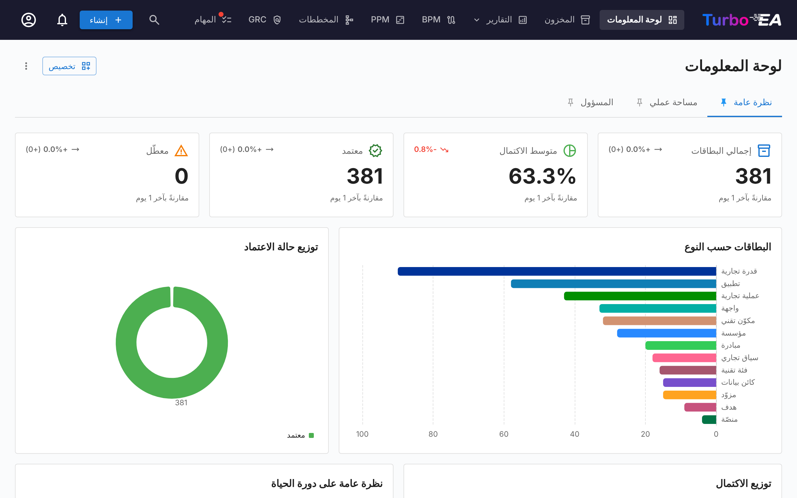
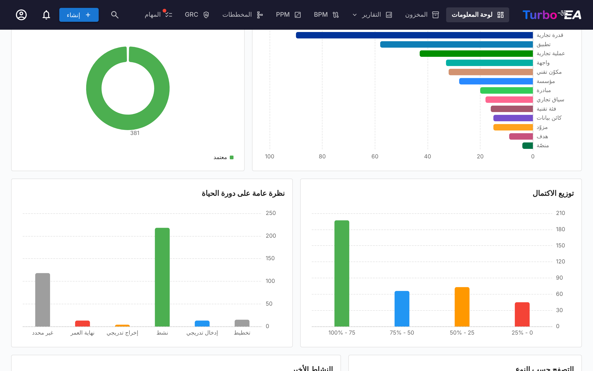
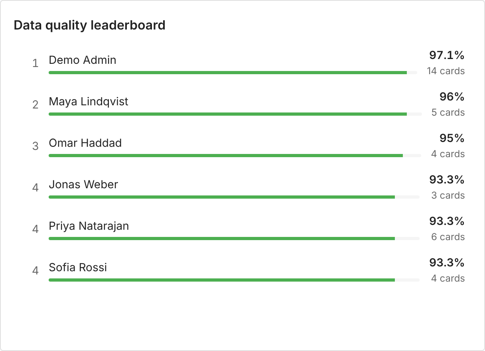
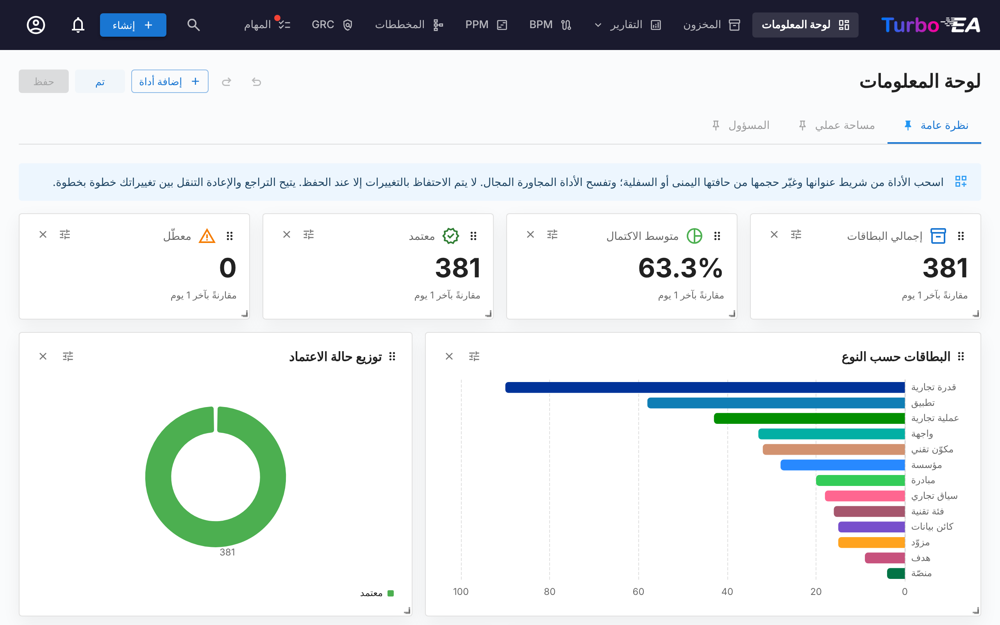

# لوحة المعلومات

لوحة المعلومات هي أول شاشة تراها بعد تسجيل الدخول. وهي توفّر **نظرة عامة سريعة** على حالة هندسة المؤسسة بأكملها.

## شريط التنقّل العلوي

في أعلى الشاشة، ستجد **شريط التنقّل الرئيسي** مع العناصر التالية:

- **Turbo EA** (الشعار): انقر للعودة إلى لوحة المعلومات من أي قسم
- **لوحة المعلومات**: نظرة عامة على حالة الهندسة
- **المخزون**: قائمة كاملة بجميع البطاقات
- **التقارير**: تقارير مرئية وتحليلية
- **BPM**: إدارة عمليات الأعمال (إذا كانت مفعّلة)
- **المخططات**: محرّر مخططات الهندسة المرئي
- **تسليم هندسة المؤسسة**: إدارة مبادرات الهندسة
- **المهام**: المهام المعلّقة والاستبيانات المُسنَدة
- **بحث البطاقات**: شريط بحث سريع مع الإكمال التلقائي
- **+ إنشاء**: زر لإنشاء بطاقات جديدة بسرعة
- **جرس الإشعارات**: تنبيهات النظام و[الإشعارات](notifications.md)
- **أيقونة الملف الشخصي**: اختيار اللغة، وتبديل السمة، وتفضيلات الإشعارات، والوصول إلى الإدارة
- **ادعم**: زر بلون أرجواني وردي بجوار رقم الإصدار في قائمة الملف الشخصي يفتح نافذة توضح أهمية الرعاية، مع رابط للمدونة وخيارات لمرة واحدة أو شهرية عبر GitHub Sponsors

## لوحات المعلومات والأدوات

تتكوّن الصفحة الرئيسية من **لوحات معلومات** تظهر كعلامات تبويب في أعلى الصفحة. يتضمن Turbo EA ثلاث لوحات:

| لوحة المعلومات | ما تعرضه |
|----------------|----------|
| **نظرة عامة** | حالة المشهد بأكمله: مربعات مؤشرات الأداء والمخططات وأنواع البطاقات للتصفح وآخر الأنشطة |
| **مساحة عملي** | كل ما أُسند إليك — المفضلة والأدوار والمهام والاستبيانات وتغييراتك الأخيرة (راجع [علامة تبويب مساحة العمل](#workspace-tab)) |
| **المسؤول** | نشاط المستخدمين وتغطية أصحاب المصلحة وعمليات الاعتماد المنتظرة ودليل أصحاب المصلحة (راجع [علامة تبويب المسؤول](#admin-tab-stakeholder-directory)) |

كل لوحة معلومات عبارة عن شبكة من **الأدوات**. لا ترى سوى الأدوات التي يسمح بها دورك — تتطلب أدوات «نظرة عامة» الإذن `reports.ea_dashboard` وتتطلب أدوات المسؤول الإذن `admin.users` — وتختفي علامة التبويب عندما لا تكون أي من أدواتها مرئية لك. يمكن للمسؤولين تعديل لوحات المعلومات المدمجة وإضافة لوحاتهم الخاصة (راجع [تخصيص لوحات المعلومات](#customizing-dashboards)).

انقر على أيقونة **الدبوس** في علامة تبويب لجعلها لوحة المعلومات التي تفتح عند دخولك إلى Turbo EA.

## مربعات مؤشرات الأداء

يعرض صف المربعات في أعلى لوحة «نظرة عامة» الأرقام الرئيسية للمشهد:

- **إجمالي البطاقات**: عدد جميع المكوّنات المسجَّلة في المنصة
- **متوسط جودة البيانات**: متوسط اكتمال جميع البطاقات — انقر عليه لفتح [تقرير جودة البيانات](reports.md)
- **المعتمدة** و**المكسورة**: عدد البطاقات التي تحمل كل حالة اعتماد

يعرض كل مربع **سهم اتجاه** يقارن قيمة اليوم بالقيمة عند بداية نافذة المقارنة — 30 يومًا أو أقل ما دام السجل التاريخي قيد التجميع. يذكر النص تحت المربعات النافذة المستخدمة فعليًا. تُلتقط اللقطات كل يوم عند الساعة 02:00 بالتوقيت العالمي المنسّق. تصف الاتجاهات المشهد بأكمله، لذا لا تُعرض إلا للمستخدمين القادرين على قراءة كل البطاقات؛ أما المستخدم الذي يخفي دوره بعض البطاقات فيرى القيمة دون السهم.

## المخططات والقوائم

تحت المربعات، تعرض لوحة «نظرة عامة»:

- **البطاقات حسب النوع**: نسبة كل نوع من البطاقات في مشهدك
- **حالة الاعتماد**: عدد البطاقات المعتمدة أو المعلّقة أو المكسورة أو المرفوضة
- **توزيع الاكتمال**: عدد البطاقات التي تقع في كل نطاق من نطاقات جودة البيانات
- **نظرة عامة على دورة الحياة**: عدد البطاقات في كل مرحلة من مراحل دورة الحياة
- **التصفح حسب النوع**: كل نوع من البطاقات مع عددها — انقر على أحدها لفتح [المخزون](inventory.md) مصفّى مسبقًا بحسب ذلك النوع
- **النشاط الأخير**: تدفق لآخر التغييرات — من عدّل ماذا ومتى
- **لوحة صدارة جودة البيانات**: الأشخاص الذين يحافظون على اكتمال بطاقاتهم (انظر أدناه)

يؤدي النقر على شريط أو شريحة في مخطط إلى فتح ما وراءه: [المخزون](inventory.md) مصفّى على تلك البطاقات بالنسبة إلى نوع البطاقة أو حالة الاعتماد، وتقرير دورة الحياة بالنسبة إلى مرحلة دورة الحياة، وتقرير جودة البيانات بالنسبة إلى نطاق الاكتمال.

### لوحة صدارة جودة البيانات

تُرتّب **لوحة صدارة جودة البيانات** الأشخاص الذين يشغلون دور صاحب مصلحة في البطاقات. وهي تُرتّبهم افتراضيًا حسب **متوسط جودة بيانات** بطاقاتهم؛ بدّلها إلى **عدد البطاقات** لمعرفة من يملك أكبر عدد منها. يعرض كل صف ترتيب الشخص واسمه وشريطًا بلون شريحة جودة البيانات لمتوسطه والمتوسط وعدد البطاقات التي يملكها. يتشارك الأشخاص ذوو القيمة نفسها الترتيب نفسه.

يظهر الشخص بمجرد أن يملك **حدًا أدنى من البطاقات** (ثلاث افتراضيًا)، فلا تتصدّر بطاقة واحدة مثالية اللوحة. تُحتسب البطاقة مرة واحدة لكل شخص مهما كان عدد أدواره عليها، ولا تُحتسب إلا البطاقات النشطة. افتراضيًا لا تُحتسب إلا الأدوار التي تُؤخذ في الحسبان لجودة البيانات — فالدور السلبي مثل *Observer* لا يمنح مكانًا أبدًا؛ ويمكن لإعدادات الأداة حصرها في بعض أنواع البطاقات أو الأدوار أو احتساب جميع الأدوار. لا يظهر المستخدمون المعطّلون أبدًا. تُحسب اللوحة لأجلك: فالبطاقة التي لا يحق لك رؤيتها لا تضيف إلى عدد أي شخص ولا تغيّر متوسطه، لذا قد يرى قارئان بصلاحيات مختلفة أرقامًا مختلفة. تُعرض الأسماء فقط، ولا تُعرض عناوين البريد الإلكتروني أبدًا.

تتطلب اللوحة الصلاحية `reports.ea_dashboard` شأنها شأن بقية لوحة معلومات النظرة العامة، ويمكن أن تحتوي لوحة المعلومات على عدة لوحات صدارة — واحدة لكل نوع بطاقة مثلًا.

## علامة تبويب مساحة العمل { #workspace-tab }

تجمع لوحة **مساحة عملي** كل ما أُسند إليك: المفضلة والتقارير المحفوظة والمهام والاستبيانات المعلّقة والبطاقات التي أنشأتها والنشاط الأخير على بطاقاتك وقسم **البطاقات التي لي فيها دور**. كل من هذه العناصر أداة، لذا يمكن للمسؤول إعادة ترتيبها أو وضعها في لوحة معلومات أخرى.

يجمّع القسم الأخير البطاقات بحسب دور صاحب المصلحة الذي تشغله (Application Owner وBusiness Owner وغيرهما) ويسرد البطاقات تحت كل دور. إذا كان دورك يمنح الإذن `stakeholders.view` (أدوار admin وmember وviewer افتراضيًا)، فإن أيقونة صغيرة لـ**البحث عن شخص** بجوار عنوان القسم تتيح لك توجيهه إلى **شخص آخر** — اختر مستخدمًا من الإكمال التلقائي فيُعاد تحميل القسم بأدوار ذلك المستخدم وبطاقاته. يتحول العنوان إلى «الأدوار التي يشغلها {name}». انقر على أيقونة الإغلاق الصغيرة للعودة إلى أدوارك. مفيد للإجابة عن «ماذا يملك هذا الشخص؟» بنقرة واحدة.

## علامة تبويب المسؤول — دليل أصحاب المصلحة { #admin-tab-stakeholder-directory }

تُعرض لوحة **المسؤول** للأدوار التي لديها `admin.users`. إلى جانب مربعات مؤشرات الأداء فيها (المستخدمون النشطون والبطاقات بلا أصحاب مصلحة والمهام المتأخرة وعمليات الاعتماد المتعثرة والجودة الإجمالية) وقوائمها (أبرز المساهمين وتغطية أصحاب المصلحة والمستخدمون الخاملون وخط أنابيب الاعتماد ونشاط النظام والمهام غير المُسندة)، تنتهي بأداة **دليل أصحاب المصلحة**. تسرد كل نوع بطاقة له صاحب مصلحة واحد على الأقل، مع عدد الحائزين المختلفين. وسّع نوع بطاقة لرؤية أدواره، وداخل كل دور المستخدمين الذين يشغلونه مع عدد البطاقات التي يغطونها. انقر على شارة مستخدم لتوسيع قائمة بطاقاته في مكانها — وكل اسم بطاقة هو نفسه رابط إلى صفحة تفاصيل البطاقة. تُجلب الشجرة كاملة (نوع البطاقة ← الدور ← المستخدم ← البطاقات) في طلب واحد، لذا فالتنقل فوري.

يضيّق **مرشح الاسم** في أعلى الأداة الشجرة إلى المستخدمين الذين يطابق اسمهم أو بريدهم الإلكتروني ما كُتب؛ وتتوسع أنواع البطاقات المطابقة تلقائيًا لتظهر النتائج دون نقرة إضافية. استخدمه للإجابة عن «أين تظهر Alice في المؤسسة؟» في ثانية واحدة.

وإلى جانب الدليل، تُفتح **نافذة منبثقة عند التمرير** كلما توقف المؤشر على اسم صاحب مصلحة في موضع آخر من التطبيق — في علامة تبويب أصحاب المصلحة لبطاقة، أو على مالك مخاطرة في سجل المخاطر، أو في صفحة تفاصيل المخاطرة — وتعرض محفظة أصحاب المصلحة الكاملة لذلك المستخدم مجمّعة حسب الدور. انقر على أي بطاقة في النافذة للانتقال إليها. تجلب النافذة البيانات مرة واحدة لكل مستخدم في كل جلسة.

## تخصيص لوحات المعلومات { #customizing-dashboards }

يمكن للمستخدمين الذين يمنح دورهم `admin.dashboards` (**إدارة لوحات معلومات الصفحة الرئيسية** — دور المسؤول افتراضيًا) تعديل كل لوحة معلومات وإنشاء لوحات جديدة. أما الآخرون فيرون لوحات المعلومات كما هي مهيّأة.

### وضع التخصيص

انقر على **تخصيص** بجوار علامات تبويب لوحات المعلومات لتحرير لوحة المعلومات الحالية. عرض التخطيط 12 عمودًا؛ في نافذة أضيق تُعاد ترتيب الأدوات في ستة أعمدة، وعلى الهاتف في عمود واحد، بحسب ترتيب وضعها. في وضع التخصيص:

- **انقل** أداة بسحب مقبضها؛ عرض الشبكة 12 عمودًا، وتفسح الأدوات الأخرى المجال.
- **غيّر حجم** أداة من حافتها اليمنى أو السفلية أو من الزاوية، بالفأرة أو باللمس (في الهاتف أو اللوح الإلكتروني عند حمله عموديًا يكون التخطيط للقراءة فقط). تتكيّف الأداة المجاورة أثناء السحب: تضيق عندما تكبر جارتها وتتسع من جديد عندما تصغر؛ وإذا لم يعد بإمكانها التضيّق فإنها تنتقل إلى الصف التالي. وتنزل الصفوف الموجودة أسفلها وتصعد من جديد تلقائيًا. تلتصق الأداة بالشبكة أثناء السحب، وفي وضع التخصيص تُبقي الصفحة أربعة صفوف فارغة أسفل آخر أداة ليمكن سحب الصف الأخير إلى ارتفاع أكبر؛ مرّر الصفحة أولًا حتى يصبح المقبض داخل النافذة بوضوح.
- **أزل** أداة بزر الإغلاق الخاص بها.
- **اضبط** مربع مؤشر أداء أو مخططًا أو تدفق النشاط أو لوحة صدارة جودة البيانات بزر الترس الخاص به.
- **تراجع** و**إعادة**: يتنقل زرا **تراجع** و**إعادة** بين التغييرات التي أُجريت منذ فتح وضع التخصيص خطوة بخطوة (نقل أو تغيير حجم أو إضافة أو إزالة أو ضبط واحد في كل مرة) — عبر الزرين في شريط الأدوات أو بالاختصار Ctrl+Z / Ctrl+Shift+Z (⌘ على جهاز Mac). ويظل **تجاهل** يُسقطها كلها دفعة واحدة.

انقر على **حفظ** للاحتفاظ بالتغييرات للجميع، أو على **تجاهل التغييرات** للعودة إلى لوحة المعلومات كما كانت.

### إضافة الأدوات واستعادتها

تفتح **إضافة أداة** درجًا يسرد كل الأدوات، مجمّعة في **مؤشرات الأداء** و**المخططات** و**نظرة عامة** و**مساحة عملي** و**المسؤول**. انقر على أداة لإضافتها إلى لوحة المعلومات؛ ويفتح مربع مؤشر الأداء أو المخطط إعداداته أولًا. تبقى كل أداة مدمجة في الفهرس، لذا تُستعاد أداة أُزيلت بالخطأ — **النشاط الأخير** مثلًا — بإضافتها من جديد. أما الأدوات التي لا يمكن أن تظهر إلا مرة واحدة في لوحة معلومات فتظهر باهتة ومعلَّمة بأنها مضافة بالفعل عندما تكون موجودة.

تحتفظ الأداة بإذنها الخاص أينما وُضعت: أداة المسؤول المضافة إلى لوحة «نظرة عامة» لا تزال تُعرض فقط للمستخدمين الذين لديهم `admin.users`.

### إعداد مربع مؤشر أداء

يعرض مربع مؤشر الأداء إما أحد المقاييس المدمجة (إجمالي البطاقات وجودة البيانات والمهام المفتوحة وغيرها) أو رقمًا تحدده أنت:

- **نوع البطاقة** (اختياري): عدّ بطاقات نوع واحد فقط، ويمكن تضييقها إلى نوع فرعي أو حالة اعتماد أو مرحلة دورة حياة أو [المرشحات](#filters) الواردة أدناه.
- **المقياس**: **عدد** البطاقات، أو **مجموع** أو **متوسط** حقل رقمي أو حقل تكلفة أو حقل نسبة مئوية من ذلك النوع أو من [قياس](#measures)، أو **نسبة** — العدد المضيَّق كنسبة مئوية من البطاقات نفسها بلا المرشحات (مثل نسبة التطبيقات المعتمدة).
- **الارتفاع يُعد**: **جيدًا** أو **سيئًا** — يحدد ما إذا كان الاتجاه التصاعدي يُعرض بالأخضر أم بالأحمر.
- **مخطط مصغّر**: يرسم آخر 30 قيمة يومية للمربع تحت الرقم.
- **رقم ثانوي**: عند تضييق العدد، يعرض بجانب الرقم **من N** (العدد غير المُرشَّح) أو **نسبة الإجمالي**.

يسجّل مربع مؤشر الأداء الجديد قيمته الأولى لحظة حفظ لوحة المعلومات، لذا يبدأ اتجاهه في اليوم التالي. ولا يُعرض مجموع حقل التكلفة أو متوسطه إلا للمستخدمين المسموح لهم برؤية التكاليف، ولا يحتسب إلا البطاقات القائمة في السنة المالية الحالية (القاعدة التي يعتمدها تقرير التكلفة)، ويذكر تلك السنة تحت القيمة.

تُدرج في الكتالوج المربعات التي يغذّيها تقرير وحدة (المخاطر المفتوحة والمخاطر المتأخرة ودرجة الامتثال والمبادرات المعرّضة للخطر والعمليات بلا مخطط) عندما تكون الوحدة مفعّلة ويكون لديك إذنها؛ ولا تعرض اتجاهًا لأن تقارير الوحدات لا تحتفظ بسجل تاريخي.

### إعداد مخطط

يجمّع المخطط البطاقات بحسب **بُعد** واحد ويقيس كل مجموعة بـ**مقياس**:

| البُعد | يجمّع البطاقات بحسب |
|--------|----------------------|
| **نوع البطاقة** | نوع البطاقة |
| **النوع الفرعي** | النوع الفرعي لنوع البطاقة المختار |
| **حالة الاعتماد** | معتمدة، معلّقة، مكسورة، مرفوضة |
| **مرحلة دورة الحياة** | مرحلة دورة الحياة الحالية |
| **جودة البيانات** | نطاق جودة البيانات (0–25 %، 25–50 %، …) |
| **شهر الإنشاء** | الشهر الذي أُنشئت فيه البطاقة |
| **حقل** | أي حقل اختيار واحد أو نعم/لا لنوع البطاقة المختار |
| **كل بطاقة** | مجموعة واحدة لكل بطاقة من النوع المختار — مخطط شجري لتكلفة كل تطبيق، أو التطبيقات الأكثر مكوّنات تقنية معلومات. تُحفظ أكبر المجموعات (**الفئات المعروضة (كحد أقصى)**، عشرون افتراضيًا وحتى مئتين) وتُدمج البقية تحت *أخرى* — أو تُستبعد من المتوسط أو النسبة اللذين لا يمكن جمعهما. وعندئذٍ تذكر الأداة ذلك أسفل المخطط: «يتم عرض أكبر 20 بطاقة؛ 37 إضافية ضمن «أخرى»». والنقر على بطاقة يفتحها |
| **البطاقة المرتبطة** | البطاقة في الطرف الآخر من نوع علاقة — التطبيقات لكل مؤسسة، ومكوّنات تقنية المعلومات لكل مزوّد، والتكلفة لكل قدرة أعمال. تُحتسب البطاقة المرتبطة بعدة بطاقات تحت كل منها؛ وتندرج البطاقات التي لا ارتباط لها تحت *بلا*؛ ويُحتفظ بأكبر عشرين مجموعة وتُدمج البقية تحت *أخرى* |
| **تغطية نهاية العمر** | هل لدى التطبيق أو مكوّن تقنية المعلومات رابط إلى endoflife.date أو تاريخ نهاية عمر يدوي أو لا هذا ولا ذاك |
| **شهر الإطلاق** / **شهر نهاية العمر** | الشهر الذي يقع فيه تاريخ نشاط البطاقة أو تاريخ نهاية عمرها، على مدى 18 شهرًا: ستة للخلف وأحد عشر للأمام — عمليات الإطلاق في كل شهر أو تقويم نهاية العمر |

قائمة الأبعاد مجمّعة: **البطاقة** و**التواريخ** و**الحقول** و**البطاقات المرتبطة** و**الصحة**.

#### القياسات

المقياس هو **عدد البطاقات**، أو **مجموع** أو **متوسط** حقل رقمي أو حقل تكلفة أو حقل نسبة مئوية، أو أحد هذه القياسات: **علاقات من نوع معيّن** في كل بطاقة (كم مكوّنًا من مكوّنات تقنية المعلومات يستخدمه تطبيق) أو درجة **جودة البيانات** فيها. تعرض **النسبة** العدد المضيَّق كنسبة مئوية من العدد غير المُرشَّح لكل مجموعة. لا تُعرض إلا أنواع البطاقات التي يمكنك قراءتها، ولا تُعرض حقول التكلفة إلا للمستخدمين المسموح لهم برؤية التكاليف؛ والتكلفة لا تحتسب إلا البطاقات القائمة في السنة المالية الحالية، ويذكر المخطط تلك السنة.

#### المرشحات

إضافةً إلى حالة الاعتماد ومرحلة دورة الحياة، يمكن تضييق المخطط أو مؤشر الأداء إلى البطاقات **اليتيمة** (بلا أي علاقة) أو **القديمة** (لم تُحدَّث منذ 90 يومًا) أو **بدون** أصحاب مصلحة، أو التي لها نهاية عمر **مفقودة**، أو التي **لها** علاقة من نوع معيّن أو **تفتقر** إليها — بالتعريفات نفسها التي تستخدمها مرشحات المخزون وتقرير جودة البيانات.

| المخطط | الأنسب لـ |
|--------|-----------|
| **أشرطة أفقية** / **أعمدة** | مقارنة المجموعات، أفقيًا أو رأسيًا |
| **أعمدة مكدّسة** | بُعدان على شكل أشرطة مكدّسة مع مفتاح — نوع البطاقة حسب مرحلة دورة الحياة، ومستوى القدرة حسب حالة الاعتماد |
| **خطي** | اتجاه عبر الزمن، مثل البطاقات المنشأة شهريًا |
| **دائري** / **حلقي** | حصص من كل |
| **مقياس** | معدل مقابل هدف: نسبة (التطبيقات المعتمدة)، أو متوسط جودة البيانات، أو حقل نسبة مئوية، أو درجة امتثال على قرص من 0 إلى 100، أو عدد أو مجموع مقابل **الهدف**. يقسّم حدّان (**تحذير فوق**، **جيد فوق**) القرص إلى نطاقات حمراء وكهرمانية وخضراء، ويُعكس ذلك عندما يكون الارتفاع سيئًا؛ ويوجد في الكتالوج مقياسان جاهزان: **جودة البيانات** و**التطبيقات المعتمدة** |
| **خريطة حرارية** | بُعدان معًا — مثل مرحلة دورة الحياة مقابل حالة الاعتماد؛ **إظهار القيم على المخطط** يطبع الرقم في كل خلية |
| **خريطة شجرية** | الحصص عند وجود مجموعات كثيرة؛ **إظهار القيم على المخطط** يطبع الرقم على كل مربع |
| **مخطط سانكي** | تدفق نوع علاقة بين البطاقات التي يربطها، مع بُعد من اختيارك عند كل طرف |

يأخذ مخطط سانكي نوع علاقة ويجمّع **كل طرف** على حدة: حسب نوع البطاقة أو النوع الفرعي أو حالة الاعتماد أو مرحلة دورة الحياة أو جودة البيانات أو حقل من نوع ذلك الطرف أو **البطاقات نفسها** — المؤسسة ← التطبيق يوضّح أي المؤسسات تستخدم أي التطبيقات، مع الاحتفاظ بأكبر عشرين بطاقة عند كل طرف ودمج البقية تحت *أخرى*؛ وتذكر الأداة ذلك أسفل المخطط عند حدوثه، ويرفع **الفئات المعروضة (كحد أقصى)** الحد. يؤدي النقر على عقدة بطاقة إلى فتح البطاقة.

يمكن للمخططات أيضًا رسم تقرير وحدة: المخاطر حسب المستوى أو الحالة، ودرجات الامتثال حسب اللائحة، وسلامة الجدول الزمني في PPM، ونضج BPM؛ وهي مدرجة في الكتالوج عندما تكون الوحدة مفعّلة ويكون لديك إذنها. ولا يمكن استخدام الوسوم بعدُ كبُعد أو مرشح.

توجد أربعة مخططات جاهزة في عائلة **المخططات** من الكتالوج، ويُعرض كل منها عندما يحتوي نموذجك الوصفي على العناصر اللازمة: **التطبيقات لكل مؤسسة**، و**تقويم نهاية العمر**، و**البطاقات القديمة حسب النوع**، ومخطط سانكي **المؤسسة ← التطبيق**.

فعّل النقر للتعمق ليتمكن القراء من فتح [المخزون](inventory.md) أو التقرير الكامن وراء شريط أو شريحة (المخططات الشريطية والعمودية والأعمدة المكدّسة والخطية والدائرية والحلقية والخريطة الشجرية، وعقد البطاقات في مخطط سانكي). **إظهار القيم على المخطط** يطبع الرقم على كل شريط أو عمود أو مربع أو خلية (المخططات الشريطية والعمودية والأعمدة المكدّسة والخريطة الشجرية والخريطة الحرارية). تعرض معاينة في مربع الحوار المخطط كما سيظهر.

### إدارة لوحات المعلومات

تعمل القائمة **⋮** بجوار علامات التبويب على لوحة المعلومات الحالية:

| الإجراء | ما يفعله |
|---------|----------|
| **لوحة معلومات جديدة** | تنشئ لوحة معلومات فارغة جاهزة لملئها بالأدوات |
| **تكرار** | تنسخ لوحة المعلومات بجميع أدواتها — بداية سريعة لنسخة مختلفة من لوحة معلومات مدمجة |
| **الإعدادات** | الاسم والوصف والأيقونة و**الوصول**: الأدوار المسموح لها برؤية لوحة المعلومات. اترك الوصول فارغًا لعرضها للجميع؛ تأتي لوحة معلومات المسؤول المدمجة وقد ضُبط وصولها على الأدوار المسموح لها بإدارة المستخدمين (دور المسؤول في التثبيت الجديد). تُدرج أسفل الحقل الأذونات التي تحتاجها أدوات اللوحة: الدور الذي لا يملكها لا يرى شيئًا هناك مهما كان الوصول. يرى المستخدمون الذين لديهم `admin.dashboards` كل لوحات المعلومات دائمًا |
| **إخفاء** / **إظهار** | تزيل لوحة المعلومات من علامات تبويب الجميع دون حذفها |
| **نقل لليسار** / **نقل لليمين** | تغيّر ترتيب علامات التبويب |
| **إعادة إلى الوضع الافتراضي** | لوحات المعلومات المدمجة فقط: تعيد الأدوات والتخطيط اللذين يأتي بهما Turbo EA وللوحة المسؤول الأدوار التي يسردها وصولها |
| **حذف** | لوحات المعلومات المخصصة فقط: تحذف لوحة المعلومات للجميع |

لا تستبدل ترقية Turbo EA أبدًا لوحة معلومات قمت بتغييرها. وعندما يحسّن إصدار لوحة معلومات مدمجة، تجلب **إعادة إلى الوضع الافتراضي** النسخة الجديدة.

يُسجَّل كل تغيير في لوحة معلومات — إنشاء أو تحرير أو تكرار أو إعادة تعيين أو حذف، بما في ذلك الأدوات التي أُضيفت أو أُزيلت — في [سجل التدقيق](../admin/audit-log.md#administrative-actions). وتنتقل لوحات المعلومات مع [نقل مساحة العمل](../admin/workspace-transfer.md).
