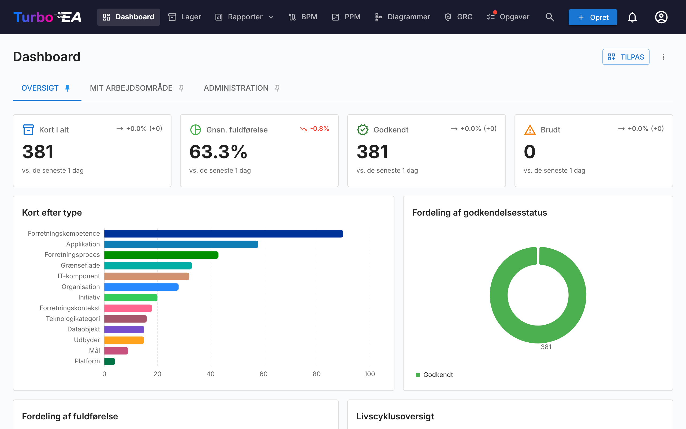
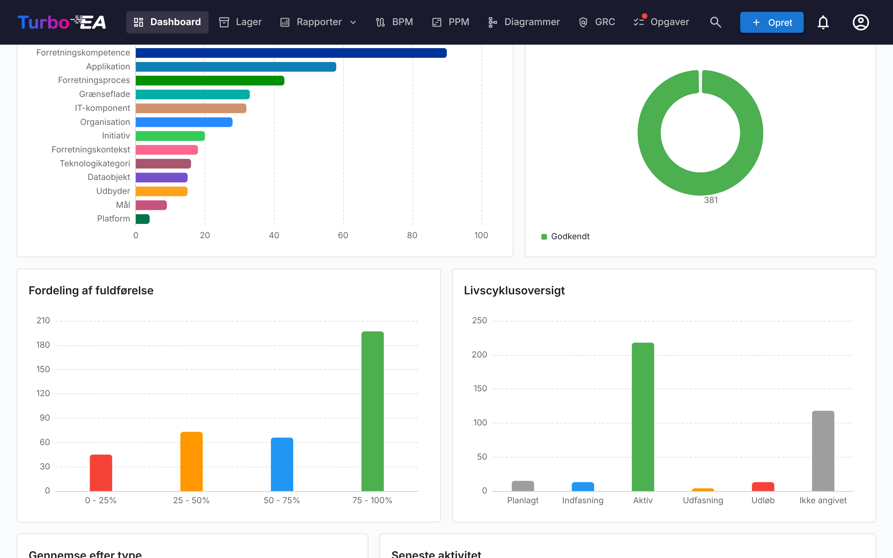
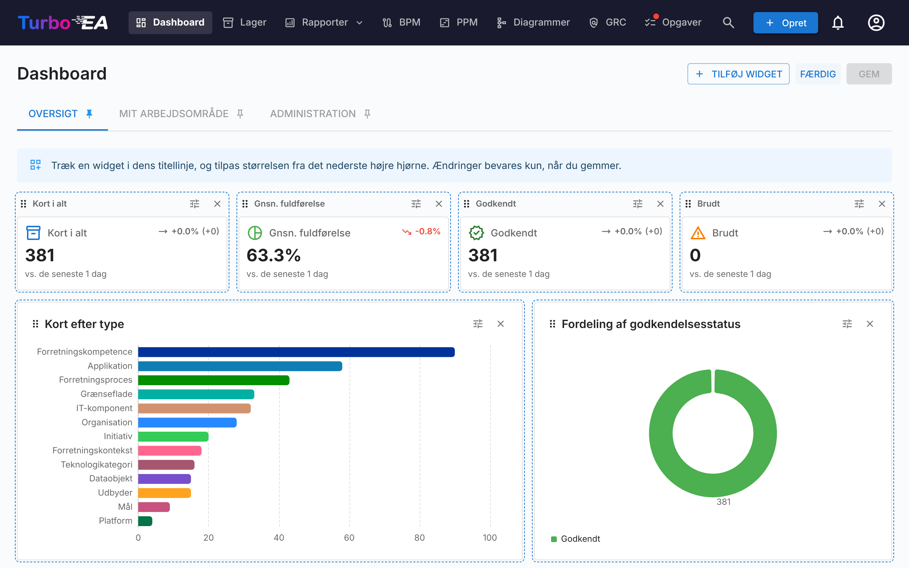

# Dashboard

Dashboardet er den første skærm, du ser efter login. Det giver et **hurtigt overblik** over hele enterprise-arkitekturstatussen.

## Topnavigationslinje

Øverst på skærmen finder du **hovednavigationslinjen** med følgende elementer:

- **Turbo EA** (logo): Klik for at vende tilbage til dashboardet fra en hvilken som helst sektion
- **Dashboard**: Oversigt over arkitekturstatussen
- **Lager**: Komplet fortegnelse over alle kort
- **Rapporter**: Visuelle og analytiske rapporter
- **BPM**: Business Process Management (hvis aktiveret)
- **Diagrammer**: Visuel arkitekturdiagrameditor
- **EA-levering**: Styring af arkitekturinitiativer
- **Opgaver**: Ventende opgaver og tildelte undersøgelser
- **Søg kort**: Hurtig søgelinje med autoudfyldning
- **+ Opret**: Knap til hurtigt at oprette nye kort
- **Notifikationsklokke**: Systemadvarsler og [notifikationer](notifications.md)
- **Profilikon**: Sprogvalg, temaskifter, notifikationspræferencer og adgang til administration
- **Støt**: En lilla-lyserød knap ved siden af versionsnummeret i profilmenuen åbner en dialog, der forklarer, hvorfor sponsorering er vigtig, med et link til bloggen og engangs- eller månedlige muligheder via GitHub Sponsors

## Dashboards og widgets

Startsiden består af **dashboards**, der vises som faner øverst på siden. Turbo EA leveres med tre dashboards:

| Dashboard | Hvad det viser |
|-----------|----------------|
| **Oversigt** | Tilstanden for hele landskabet: KPI-felter, diagrammer, de korttyper, der kan gennemses, og den seneste aktivitet |
| **Mit arbejdsområde** | Alt, der er tildelt dig — favoritter, roller, opgaver, undersøgelser og dine seneste ændringer (se [Arbejdsområde-fane](#workspace-tab)) |
| **Administration** | Brugeraktivitet, interessentdækning, ventende godkendelser og interessentkataloget (se [Admin-fane](#admin-tab-stakeholder-directory)) |

Hvert dashboard er et gitter af **widgets**. Du ser kun de widgets, som din rolle tillader — widgets i Oversigt kræver tilladelsen `reports.ea_dashboard`, admin-widgets kræver `admin.users` — og en fane forsvinder, når ingen af dens widgets er synlige for dig. Administratorer kan ændre de indbyggede dashboards og tilføje deres egne (se [Tilpasning af dashboards](#customizing-dashboards)).

Klik på **nåle**-ikonet på en fane for at gøre den til det dashboard, du lander på, når du åbner Turbo EA.

## KPI-felter

Rækken af felter øverst på dashboardet Oversigt viser landskabets nøgletal:

- **Kort i alt**: Antal af alle komponenter, der er registreret på platformen
- **Gennemsnitlig datakvalitet**: Den gennemsnitlige fuldstændighed af alle kort — klik på den for at åbne [datakvalitetsrapporten](reports.md)
- **Godkendt** og **Brudt**: Hvor mange kort der har den pågældende godkendelsesstatus

Hvert felt viser en **tendenspil**, der sammenligner dagens værdi med værdien ved starten af sammenligningsvinduet — 30 dage eller færre, mens historikken stadig indsamles. Billedteksten under felterne angiver det vindue, der faktisk er brugt. Der tages et øjebliksbillede hver dag kl. 02:00 UTC. Tendenser beskriver hele landskabet og vises derfor kun for brugere, der kan læse alle kort; en bruger, hvis rolle skjuler nogle kort, ser værdien uden pilen.

## Diagrammer og lister

Under felterne viser dashboardet Oversigt:

- **Kort efter type**: Andelen af hver korttype i dit landskab
- **Godkendelsesstatus**: Hvor mange kort der er godkendte, afventende, brudte eller afviste
- **Fordeling af fuldstændighed**: Hvor mange kort der falder i hvert datakvalitetsinterval
- **Livscyklusoversigt**: Hvor mange kort der er i hver livscyklusfase
- **Gennemse efter type**: Hver korttype med sit antal — klik på en for at åbne [Inventar](inventory.md) forhåndsfiltreret til den type
- **Seneste aktivitet**: Et feed med de seneste ændringer — hvem der redigerede hvad og hvornår
- **Rangliste over datakvalitet**: De personer, der holder deres kort fuldstændige (se nedenfor)

Et klik på en søjle eller et udsnit i et diagram åbner det, der ligger bag: [Inventar](inventory.md) filtreret til de kort for en korttype eller en godkendelsesstatus, livscyklusrapporten for en livscyklusfase og datakvalitetsrapporten for et fuldstændighedsinterval.

### Rangliste over datakvalitet

**Ranglisten over datakvalitet** rangerer de personer, der har en interessentrolle på kort. Som standard rangerer den dem efter den **gennemsnitlige datakvalitet** af deres kort; skift til **antal kort** for at se, hvem der har flest. Hver række viser personens placering, navn, en bjælke i farven for datakvalitetsbåndet for deres gennemsnit, gennemsnittet og antallet af kort, de har. Personer med samme tal deler en placering.

En person vises, når vedkommende har et **minimum antal kort** (som standard tre), så ét enkelt perfekt kort ikke placerer nogen i toppen. Et kort tæller én gang pr. person, uanset hvor mange roller vedkommende har på det, og kun aktive kort tæller. Som standard tæller kun de roller, der tæller med i datakvaliteten — en passiv rolle som *Observer* giver aldrig en plads; widgettens indstillinger kan indsnævre ranglisten til nogle korttyper eller roller eller tælle alle roller. Deaktiverede brugere vises aldrig. Ranglisten beregnes for dig: Et kort, du ikke må se, lægger hverken til nogens antal eller ændrer deres gennemsnit, så to læsere med forskellige tilladelser kan se forskellige tal. Kun navne vises, aldrig e-mailadresser.

Ranglisten kræver tilladelsen `reports.ea_dashboard`, ligesom resten af Oversigts-dashboardet, og et dashboard kan indeholde flere — for eksempel én pr. korttype.

## Arbejdsområde-fane { #workspace-tab }

Dashboardet **Mit arbejdsområde** samler alt, der er tildelt dig: favoritter, gemte rapporter, opgaver, ventende undersøgelser, de kort, du har oprettet, seneste aktivitet på dine kort og sektionen **Kort, hvor jeg har en rolle**. Hver af disse er en widget, så en administrator kan omarrangere dem eller placere dem på et andet dashboard.

Den sidste sektion grupperer kort efter den interessentrolle, du har (Application Owner, Business Owner osv.), og viser kortene under hver rolle. Hvis din rolle giver tilladelsen `stakeholders.view` (roller som admin, member og viewer som standard), lader et lille **personsøgnings**-ikon ved siden af sektionens titel dig pege den mod **en anden** — vælg en bruger i autofuldførelsen, og sektionen genindlæses med den brugers roller og kort. Titlen skifter til «Roller, som {name} har». Klik på det lille lukkeikon for at vende tilbage til dine egne roller. Nyttigt til at besvare «hvad ejer den person?» med ét klik.

## Admin-fane — interessentkatalog { #admin-tab-stakeholder-directory }

Dashboardet **Administration** vises for roller med `admin.users`. Ud over sine KPI-felter (aktive brugere, kort uden interessenter, forfaldne opgaver, fastlåste godkendelser, samlet kvalitet) og lister (de mest aktive bidragydere, interessentdækning, inaktive brugere, godkendelsespipeline, systemaktivitet, ikke-tildelte opgaver) slutter det med en widget, **Interessentkatalog**. Den viser hver korttype, der har mindst én interessent, med antallet af forskellige indehavere. Udvid en korttype for at se dens roller, og inde i hver rolle de brugere, der har den, sammen med antallet af kort, de dækker. Klik på en brugers chip for at udvide dennes kortliste direkte — hvert kortnavn er selv et link til kortets detaljeside. Hele træet (korttype → rolle → bruger → kort) hentes i ét enkelt kald, så navigationen er øjeblikkelig.

Et **navnefilter** øverst i widgetten indsnævrer træet til brugere, hvis navn eller e-mail matcher det indtastede; matchende korttyper udvides automatisk, så resultaterne er synlige uden et ekstra klik. Brug det til at besvare «hvor optræder Alice i organisationen?» på et sekund.

Ud over kataloget åbner en lille **hover-popover**, når markøren hviler på en interessents navn andre steder i appen — på et korts fane Interessenter, på en risikoejer i risikoregisteret eller på risikoens detaljeside — og viser den brugers fulde interessentportefølje grupperet efter rolle. Klik på et vilkårligt kort i popoveren for at springe til det. Popoveren henter data én gang pr. bruger pr. session.

## Tilpasning af dashboards { #customizing-dashboards }

Brugere, hvis rolle giver `admin.dashboards` (**Administrer dashboards på startsiden** — som standard Admin-rollen), kan ændre alle dashboards og oprette nye. Alle andre ser dashboards, som de er konfigureret.

### Tilpasningstilstand

Klik på **Tilpas** ved siden af dashboardfanerne for at redigere det aktuelle dashboard. Layoutet er 12 kolonner bredt; i et smallere vindue omarrangeres widgets til seks kolonner, og på en telefon til én, i den rækkefølge de er placeret. I tilpasningstilstand:

- **Flyt** en widget ved at trække i dens håndtag; gitteret er 12 kolonner bredt, og de andre widgets giver plads.
- **Tilpas størrelsen** på en widget fra dens højre kant, nederste kant eller hjørnet, med mus eller berøring (på en telefon eller tablet holdt lodret er layoutet skrivebeskyttet). Widgetten ved siden af tilpasser sig, mens du trækker: den bliver smallere, når naboen vokser, og bredere igen, når naboen skrumper; kan den ikke blive smallere, flyttes den til næste række. Rækkerne nedenunder flytter sig ned og op igen af sig selv. Widgetten flugter med gitteret, mens du trækker, og i tilpasningstilstand holder siden fire tomme rækker fri under den sidste widget, så den nederste række kan trækkes højere; rul først, indtil håndtaget sidder godt inde i vinduet.
- **Fjern** en widget med dens lukkeknap.
- **Konfigurer** et KPI-felt, et diagram, aktivitetsfeedet eller en rangliste over datakvalitet med tandhjulsknappen.
- **Fortryd** og **gentag** ændringer: **Fortryd** og **Gentag** gennemgår trin for trin de ændringer, der er foretaget, siden Tilpas blev åbnet (ét flyt, én størrelsesændring, tilføjelse, fjernelse eller konfiguration ad gangen) — med de to knapper på værktøjslinjen eller med Ctrl+Z / Ctrl+Shift+Z (⌘ på Mac). **Kassér** fjerner stadig alle på én gang.

Klik på **Gem** for at beholde ændringerne for alle, eller **Kassér ændringer** for at vende tilbage til dashboardet, som det var.

### Tilføjelse og gendannelse af widgets

**Tilføj widget** åbner en skuffe med alle widgets, grupperet som **KPI'er**, **Diagrammer**, **Oversigt**, **Mit arbejdsområde** og **Administration**. Klik på en for at tilføje den til dashboardet; et KPI-felt eller et diagram åbner først sin konfiguration. Hver indbygget widget forbliver i kataloget, så en widget, der er fjernet ved en fejl — for eksempel **Seneste aktivitet** — gendannes ved at tilføje den igen. Widgets, der kun kan forekomme én gang på et dashboard, er nedtonede og markeret som allerede tilføjet, når de er der.

En widget beholder sin egen tilladelse, uanset hvor den placeres: En admin-widget, der er tilføjet til dashboardet Oversigt, vises stadig kun for brugere med `admin.users`.

### Konfiguration af et KPI-felt

Et KPI-felt viser enten en af de indbyggede målinger (kort i alt, datakvalitet, åbne opgaver osv.) eller et tal, du selv definerer:

- **Korttype** (valgfri): Tæl kun kort af én type, eventuelt indsnævret til en undertype, en godkendelsesstatus, en livscyklusfase eller [filtrene](#filters) nedenfor.
- **Måling**: **Antal** kort, **Sum** eller **Gennemsnit** af et tal-, omkostnings- eller procentfelt for den type eller af et [mål](#measures), eller en **Andel** — det indsnævrede antal som procent af de samme kort uden filtrene (for eksempel andelen af godkendte applikationer).
- **En stigning er**: **God** eller **Dårlig** — bestemmer, om en stigende tendens vises i grønt eller rødt.
- **Sparkline**: tegner feltets seneste 30 daglige værdier under tallet.
- **Sekundært tal**: for et indsnævret antal vises **af N** (det ufiltrerede antal) eller **andelen af det samlede** ved siden af tallet.

Et nyt KPI-felt registrerer sin første værdi i det øjeblik, dashboardet gemmes, så dets tendens starter den følgende dag. En sum eller et gennemsnit af et omkostningsfelt vises kun for brugere, der må se omkostninger, tæller kun de kort, der er aktive i det nuværende regnskabsår (reglen i omkostningsrapporten), og nævner det år under værdien.

Felter, der får data fra en modulrapport (åbne risici, forfaldne risici, compliancescore, initiativer i fare, processer uden diagram), står i kataloget, når modulet er aktiveret, og du har dets tilladelse; de viser ingen tendens, fordi modulrapporterne ikke gemmer nogen historik.

### Konfiguration af et diagram

Et diagram grupperer kort efter én **dimension** og måler hver gruppe med en **måling**:

| Dimension | Grupperer kort efter |
|-----------|----------------------|
| **Korttype** | Korttype |
| **Undertype** | Undertype for den valgte korttype |
| **Godkendelsesstatus** | Godkendt, afventende, brudt, afvist |
| **Livscyklusfase** | Den aktuelle livscyklusfase |
| **Datakvalitet** | Datakvalitetsinterval (0–25 %, 25–50 %, …) |
| **Oprettelsesmåned** | Måneden, hvor kortet blev oprettet |
| **Et felt** | Ethvert enkeltvalgs- eller ja/nej-felt for den valgte korttype |
| **Hvert kort** | Én gruppe pr. kort af den valgte type — et trækort over omkostning pr. applikation, de applikationer med flest IT-komponenter. De største grupper beholdes (**Viste kategorier (højst)**, som standard tyve, op til to hundrede), og resten samles under *Andet* — eller udelades fra et gennemsnit eller en andel, som ikke kan summeres. Widgetten fortæller det under diagrammet: «Viser de 20 største kort; 37 mere er i «Andet»». Et klik på et kort åbner det |
| **Relateret kort** | Kortet i den anden ende af en relationstype — applikationer pr. organisation, IT-komponenter pr. leverandør, omkostninger pr. forretningsevne. Et kort, der er knyttet til flere relaterede kort, tælles under hvert af dem; kort uden nogen falder under *Ingen*; de tyve største grupper beholdes, og resten samles under *Andre* |
| **EOL-dækning** | Om en applikation eller IT-komponent har et link til endoflife.date, en manuel end-of-life-dato eller ingen af delene |
| **Go-live-måned** / **Måned for livscyklusafslutning** | Den måned, kortets aktive dato eller slutdato for livscyklus falder i, over 18 måneder: seks tilbage og elleve frem — go-lives pr. måned eller en kalender for livscyklusafslutning |

Dimensionsmenuen er grupperet: **Kort**, **Datoer**, **Felter**, **Relaterede kort** og **Sundhed**.

#### Mål

Målingen er **Antal kort**, **Sum** eller **Gennemsnit** af et tal-, omkostnings- eller procentfelt eller af et af disse mål: **relationer af en type** på hvert kort (hvor mange IT-komponenter en applikation bruger) eller dets **datakvalitets**score. **Andel** viser det indsnævrede antal som procent af det ufiltrerede pr. gruppe. Kun de korttyper, du kan læse, tilbydes, og omkostningsfelter kun til brugere, der må se omkostninger; en omkostning tæller kun de kort, der er aktive i det nuværende regnskabsår, og diagrammet nævner det år.

#### Filtre

Ud over en godkendelsesstatus og en livscyklusfase kan et diagram eller en KPI indsnævres til kort, der er **forladte** (ingen relation overhovedet), **forældede** (ikke opdateret i 90 dage), **uden interessenter**, med et **manglende** end-of-life, eller som **har** eller **mangler** en relation af en given type — med de samme definitioner som Inventar-filtrene og datakvalitetsrapporten bruger.

| Diagram | Bedst til |
|---------|-----------|
| **Vandret søjle** / **Søjle** | Sammenligning af grupper, vandret eller lodret |
| **Stablet søjle** | To dimensioner som stablede søjler med en signaturforklaring — korttype efter livscyklusfase, evneniveau efter godkendelsesstatus |
| **Linje** | En tendens over tid, f.eks. kort oprettet pr. måned |
| **Cirkel** / **Donut** | Andele af en helhed |
| **Måler** | En rate i forhold til et mål: en andel (de godkendte applikationer), den gennemsnitlige datakvalitet, et procentfelt eller en compliance-score på en skala fra 0–100, eller et antal eller en sum i forhold til et **Mål**. To tærskler (**Advarsel over**, **God over**) deler skalaen i røde, ravgule og grønne bånd, omvendt når en stigning er dårlig; to færdige målere, **Datakvalitet** og **Godkendte applikationer**, findes i kataloget |
| **Heatmap** | To dimensioner på én gang — for eksempel livscyklusfase mod godkendelsesstatus; **Vis værdier på diagrammet** skriver tallet i hver celle |
| **Treemap** | Andele, når der er mange grupper; **Vis værdier på diagrammet** skriver tallet på hver flise |
| **Sankey** | Strømmen af en relationstype mellem de kort, den forbinder, med en dimension efter eget valg i hver ende |

Et Sankey-diagram tager en relationstype og grupperer **hver ende** for sig: efter korttype, undertype, godkendelsesstatus, livscyklusfase, datakvalitet, et felt for den ende af typen eller **selve kortene** — Organisation → Applikation viser, hvilke organisationer der bruger hvilke applikationer, hvor de tyve største kort i hver ende beholdes, og resten samles under *Andet*; widgetten fortæller det under diagrammet, og **Viste kategorier (højst)** hæver grænsen. Et klik på en kortknude åbner kortet.

Diagrammer kan også tegne en modulrapport: risici efter niveau eller status, compliancescorer efter regulering, tidsplansstatus i PPM og BPM-modenhed står i kataloget, når modulet er aktiveret, og du har dets tilladelse. Tags kan endnu ikke bruges som dimension eller filter.

Fire færdige diagrammer findes i familien **Diagrammer** i kataloget, hvert tilbudt, når din metamodel har de nødvendige dele: **Applikationer pr. organisation**, **Kalender for livscyklusafslutning**, **Forældede kort efter type** og Sankey-diagrammet **Organisation → Applikation**.

Slå klik-igennem til, så læsere kan åbne [Inventar](inventory.md) eller rapporten bag en søjle eller et udsnit (søjle-, stablede søjle-, linje-, cirkel-, donut- og treemap-diagrammer samt kortknuderne i et Sankey-diagram). **Vis værdier på diagrammet** skriver tallet på hver søjle, flise eller celle (søjle-, stablede søjle-, treemap- og heatmap-diagrammer). En forhåndsvisning i dialogen viser diagrammet, som det vil se ud.

### Administration af dashboards

Menuen **⋮** ved siden af fanerne virker på det aktuelle dashboard:

| Handling | Hvad den gør |
|----------|--------------|
| **Nyt dashboard** | Opretter et tomt dashboard, klar til at blive fyldt med widgets |
| **Duplikér** | Kopierer dashboardet med alle dets widgets — en hurtig start på en variant af et indbygget dashboard |
| **Indstillinger** | Navn, beskrivelse, ikon og **Adgang**: de roller, der må se dashboardet. Lad adgang være tom for at vise det for alle; det indbyggede Admin-dashboard leveres med adgang sat til de roller, der må administrere brugere (Admin-rollen på en ny installation). Under feltet står de rettigheder, dashboardets widgets har brug for: en rolle uden dem ser intet der, uanset hvad adgang er sat til. Brugere med `admin.dashboards` ser altid alle dashboards |
| **Skjul** / **Vis** | Fjerner dashboardet fra alle andres faner uden at slette det |
| **Flyt til venstre** / **Flyt til højre** | Ændrer rækkefølgen af fanerne |
| **Nulstil til standard** | Kun indbyggede dashboards: gendanner de widgets og det layout, Turbo EA leveres med — og for Admin-dashboardet de roller, dets adgang angiver |
| **Slet** | Kun brugerdefinerede dashboards: sletter dashboardet for alle |

En opgradering af Turbo EA overskriver aldrig et dashboard, du har ændret. Når en udgivelse forbedrer et indbygget dashboard, henter **Nulstil til standard** den nye version.

Enhver ændring af et dashboard — oprettet, redigeret, duplikeret, nulstillet eller slettet, herunder hvilke widgets der blev tilføjet eller fjernet — registreres i [revisionsloggen](../admin/audit-log.md#administrative-actions). Dashboards følger med en [overførsel af arbejdsområde](../admin/workspace-transfer.md).
