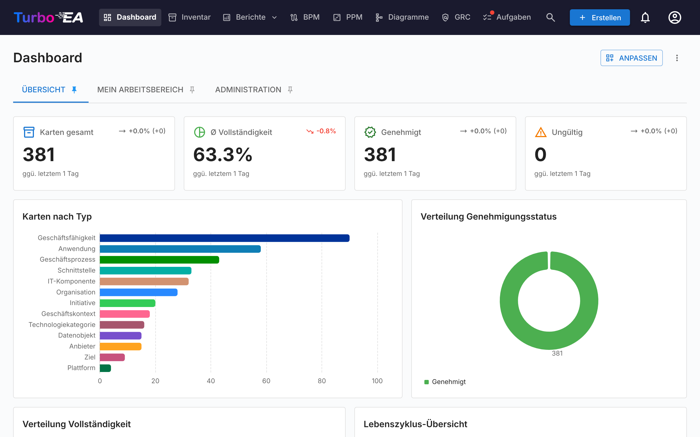
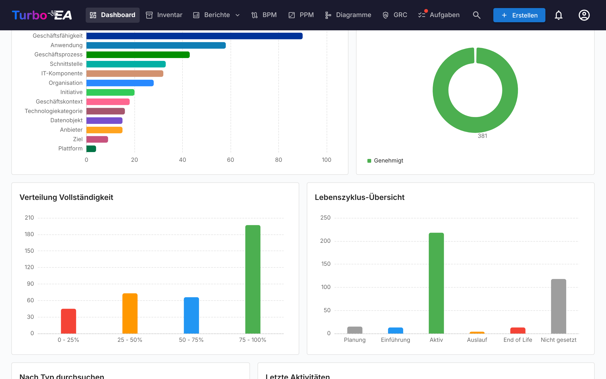
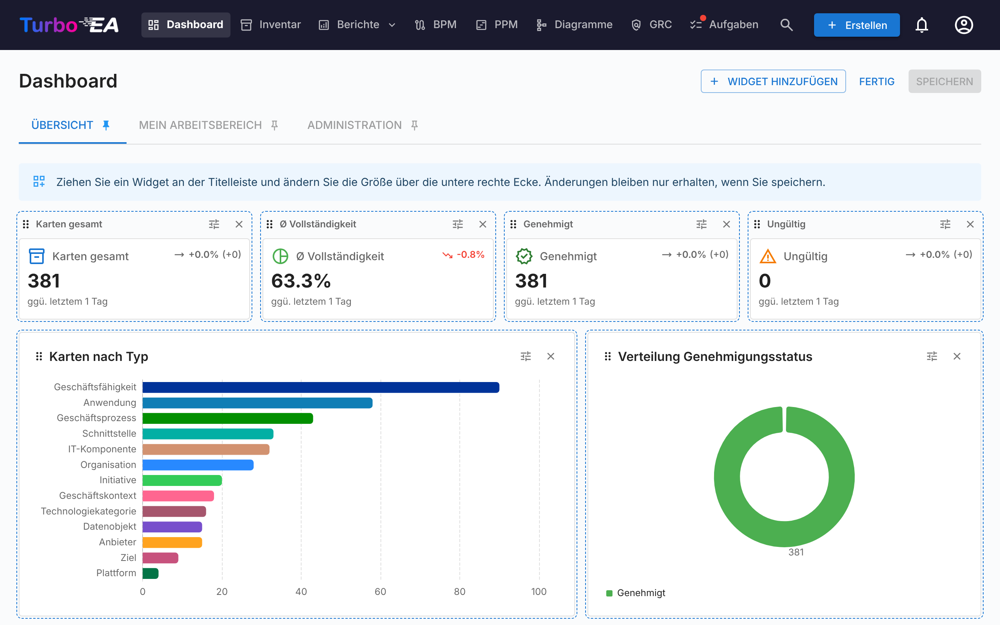

# Dashboard

Das Dashboard ist der erste Bildschirm, den Sie nach der Anmeldung sehen. Es bietet einen **schnellen Überblick** über den gesamten Status der Unternehmensarchitektur.

## Obere Navigationsleiste

Am oberen Bildschirmrand finden Sie die **Hauptnavigationsleiste** mit folgenden Elementen:

- **Turbo EA** (Logo): Klicken Sie, um von jedem Bereich aus zum Dashboard zurückzukehren
- **Dashboard**: Übersicht über den Architekturstatus
- **Inventar**: Vollständige Auflistung aller Karten
- **Berichte**: Visuelle und analytische Berichte
- **BPM**: Business Process Management (wenn aktiviert)
- **Diagramme**: Visueller Architekturdiagramm-Editor
- **EA Delivery**: Verwaltung von Architekturinitiativen
- **Aufgaben**: Anstehende Aufgaben und zugewiesene Umfragen
- **Karten suchen**: Schnellsuchleiste mit Autovervollständigung
- **+ Erstellen**: Schaltfläche zum schnellen Erstellen neuer Karten
- **Benachrichtigungsglocke**: Systemhinweise und [Benachrichtigungen](notifications.md)
- **Profilsymbol**: Sprachauswahl, Design-Umschaltung, Benachrichtigungseinstellungen und Zugang zur Administration
- **Unterstützen**: Eine lila-pinke Schaltfläche neben der Versionsnummer im Profilmenü öffnet einen Dialog, der erklärt, warum Sponsoring wichtig ist, mit einem Link zum Blog und einmaligen oder monatlichen Optionen über GitHub Sponsors

## Dashboards und Widgets

Die Startseite besteht aus **Dashboards**, die als Tabs am oberen Seitenrand angezeigt werden. Turbo EA liefert drei Dashboards mit:

| Dashboard | Was es zeigt |
|-----------|--------------|
| **Übersicht** | Den Zustand der gesamten Landschaft: KPI-Kacheln, Diagramme, die Kartentypen zum Durchsuchen und die neuesten Aktivitäten |
| **Mein Arbeitsbereich** | Alles, was Ihnen zugewiesen ist — Favoriten, Rollen, Aufgaben, Umfragen, Ihre jüngsten Änderungen (siehe [Tab «Arbeitsbereich»](#workspace-tab)) |
| **Administration** | Benutzeraktivität, Stakeholder-Abdeckung, wartende Freigaben und das Stakeholder-Verzeichnis (siehe [Admin-Tab](#admin-tab-stakeholder-directory)) |

Jedes Dashboard ist ein Raster aus **Widgets**. Sie sehen nur die Widgets, die Ihre Rolle zulässt — die Widgets der Übersicht benötigen die Berechtigung `reports.ea_dashboard`, die Admin-Widgets `admin.users` — und ein Tab verschwindet, wenn keines seiner Widgets für Sie sichtbar ist. Administratoren können die integrierten Dashboards ändern und eigene hinzufügen (siehe [Dashboards anpassen](#customizing-dashboards)).

Klicken Sie auf das **Pin**-Symbol eines Tabs, um ihn zum Dashboard zu machen, auf dem Sie beim Öffnen von Turbo EA landen.

## KPI-Kacheln

Die Kachelreihe oben im Dashboard «Übersicht» zeigt die wichtigsten Kennzahlen der Landschaft:

- **Karten gesamt**: Anzahl aller in der Plattform erfassten Komponenten
- **Durchschnittliche Datenqualität**: Die durchschnittliche Vollständigkeit aller Karten — klicken Sie darauf, um den [Datenqualitätsbericht](reports.md) zu öffnen
- **Genehmigt** und **Ungültig**: Wie viele Karten den jeweiligen Genehmigungsstatus tragen

Jede Kachel zeigt einen **Trendpfeil**, der den heutigen Wert mit dem Wert zu Beginn des Vergleichszeitraums vergleicht — 30 Tage oder weniger, solange der Verlauf noch erfasst wird. Die Beschriftung unter den Kacheln nennt den tatsächlich verwendeten Zeitraum. Die Momentaufnahmen werden täglich um 02:00 UTC erstellt. Trends beschreiben die gesamte Landschaft und werden daher nur Benutzern angezeigt, die jede Karte lesen können; ein Benutzer, dessen Rolle einige Karten ausblendet, sieht den Wert ohne Pfeil.

## Diagramme und Listen

Unterhalb der Kacheln zeigt das Dashboard «Übersicht»:

- **Karten nach Typ**: Der Anteil jedes Kartentyps in Ihrer Landschaft
- **Genehmigungsstatus**: Wie viele Karten genehmigt, ausstehend, ungültig oder abgelehnt sind
- **Verteilung der Vollständigkeit**: Wie viele Karten in welche Datenqualitätsstufe fallen
- **Lebenszyklus-Übersicht**: Wie viele Karten sich in welcher Lebenszyklusphase befinden
- **Nach Typ durchsuchen**: Jeder Kartentyp mit seiner Anzahl — ein Klick öffnet das [Inventar](inventory.md), vorgefiltert nach diesem Typ
- **Letzte Aktivitäten**: Ein Feed der neuesten Änderungen — wer hat was wann bearbeitet

Ein Klick auf einen Balken oder ein Segment eines Diagramms öffnet, was dahintersteht: das [Inventar](inventory.md), gefiltert auf diese Karten, bei einem Kartentyp oder einem Genehmigungsstatus, den Lebenszyklusbericht bei einer Lebenszyklusphase, den Datenqualitätsbericht bei einer Vollständigkeitsstufe.

## Tab «Arbeitsbereich» { #workspace-tab }

Das Dashboard **Mein Arbeitsbereich** bündelt alles, was Ihnen zugewiesen ist: Favoriten, gespeicherte Berichte, Aufgaben, ausstehende Umfragen, die von Ihnen erstellten Karten, jüngste Aktivitäten auf Ihren Karten und den Abschnitt **Karten mit meiner Rolle**. Jedes davon ist ein Widget, sodass ein Administrator sie umordnen oder auf einem anderen Dashboard platzieren kann.

Letzterer gruppiert Karten nach der Stakeholder-Rolle, die Sie innehaben (Application Owner, Business Owner usw.), und listet die Karten unter jeder Rolle auf. Wenn Ihre Rolle die Berechtigung `stakeholders.view` umfasst (standardmäßig Admin, Member und Viewer), erscheint ein kleines **Personensuche**-Symbol neben dem Abschnittstitel: Wählen Sie damit einen anderen Benutzer aus der Autovervollständigung, und der Abschnitt wird mit dessen Rollen und Karten neu geladen. Der Titel ändert sich zu «Rollen von {name}». Mit dem kleinen Schließen-Symbol kehren Sie zu Ihren eigenen Rollen zurück. Praktisch für die Frage «Wem gehört was?» mit einem Klick.

## Admin-Tab — Stakeholder-Verzeichnis { #admin-tab-stakeholder-directory }

Das Dashboard **Administration** wird Rollen mit `admin.users` angezeigt. Neben seinen KPI-Kacheln (aktive Benutzer, Karten ohne Stakeholder, überfällige Aufgaben, festgefahrene Freigaben, Gesamtqualität) und seinen Listen (Top-Mitwirkende, Stakeholder-Abdeckung, inaktive Benutzer, Freigabe-Pipeline, Systemaktivität, nicht zugewiesene Aufgaben) endet es mit einem Widget **Stakeholder-Verzeichnis**. Es listet jeden Kartentyp mit mindestens einem Stakeholder auf, jeweils mit der Anzahl der eindeutigen Inhaber. Klappen Sie einen Kartentyp auf, um seine Rollen zu sehen, und innerhalb jeder Rolle die Benutzer mit der Anzahl ihrer Karten. Klicken Sie auf einen Benutzer-Chip, um seine Kartenliste direkt darunter aufzuklappen — jeder Kartenname ist ein Link zur Karten-Detailseite. Der gesamte Baum (Kartentyp → Rolle → Benutzer → Karten) wird in einer einzigen Abfrage geladen, die Navigation ist also sofort.

Ein **Namensfilter** oben im Widget schränkt den Baum auf Benutzer ein, die dem eingegebenen Namen oder der E-Mail entsprechen; passende Kartentypen werden automatisch aufgeklappt, damit die Treffer ohne weiteren Klick sichtbar sind. Damit beantworten Sie «Wo erscheint Alice in der Organisation?» in einer Sekunde.

Über das Verzeichnis hinaus öffnet sich ein kleines **Hover-Popover**, sobald der Cursor an anderer Stelle in der App über einem Stakeholder-Namen pausiert — im Stakeholder-Tab einer Karte, beim Risikoeigentümer im Risikoregister oder auf der Risiko-Detailseite — und zeigt das vollständige rollenbasierte Stakeholder-Portfolio dieses Benutzers. Klicken Sie auf eine Karte im Popover, um zu ihr zu springen. Das Popover ruft pro Benutzer und Sitzung nur einmal die Daten ab.

## Dashboards anpassen { #customizing-dashboards }

Benutzer, deren Rolle `admin.dashboards` (**Dashboards der Startseite verwalten** — standardmäßig die Admin-Rolle) umfasst, können jedes Dashboard ändern und neue erstellen. Alle anderen sehen die Dashboards wie konfiguriert.

### Anpassungsmodus

Klicken Sie neben den Dashboard-Tabs auf **Anpassen**, um das aktuelle Dashboard zu bearbeiten. Im Anpassungsmodus:

- **Verschieben** Sie ein Widget, indem Sie es am Griff ziehen; das Raster ist 12 Spalten breit, und die anderen Widgets machen Platz.
- **Ändern Sie die Größe** eines Widgets an seiner unteren rechten Ecke.
- **Entfernen** Sie ein Widget mit seiner Schließen-Schaltfläche.
- **Konfigurieren** Sie eine KPI-Kachel, ein Diagramm oder den Aktivitäts-Feed mit der Zahnrad-Schaltfläche.

Klicken Sie auf **Speichern**, um die Änderungen für alle zu übernehmen, oder auf **Verwerfen**, um zum Dashboard im bisherigen Zustand zurückzukehren.

### Widgets hinzufügen und wiederherstellen

**Widget hinzufügen** öffnet eine Seitenleiste mit allen Widgets, gruppiert nach **KPIs**, **Diagramme**, **Übersicht**, **Mein Arbeitsbereich** und **Administration**. Klicken Sie auf eines, um es zum Dashboard hinzuzufügen; bei einer KPI-Kachel oder einem Diagramm öffnet sich zuerst die Konfiguration. Jedes integrierte Widget bleibt im Katalog, sodass ein versehentlich entferntes Widget — etwa **Letzte Aktivitäten** — durch erneutes Hinzufügen wiederhergestellt wird. Widgets, die nur einmal pro Dashboard vorkommen dürfen, sind ausgegraut und als bereits hinzugefügt markiert, wenn sie vorhanden sind.

Ein Widget behält seine eigene Berechtigung, wo immer es platziert wird: Ein zum Dashboard «Übersicht» hinzugefügtes Admin-Widget wird weiterhin nur Benutzern mit `admin.users` angezeigt.

### Eine KPI-Kachel konfigurieren

Eine KPI-Kachel zeigt entweder eine der integrierten Kennzahlen (Karten gesamt, Datenqualität, offene Aufgaben usw.) oder eine von Ihnen definierte Zahl:

- **Kartentyp** (optional): Nur Karten eines Typs zählen, optional eingeschränkt auf einen Untertyp, einen Genehmigungsstatus oder eine Lebenszyklusphase.
- **Messgröße**: **Anzahl** der Karten oder **Summe** bzw. **Durchschnitt** eines Zahlen-, Kosten- oder Prozentfelds dieses Typs.
- **Ein Anstieg ist**: **Gut** oder **Schlecht** — legt fest, ob ein Aufwärtstrend grün oder rot dargestellt wird.

Eine neue KPI-Kachel erfasst ihren ersten Wert, sobald das Dashboard gespeichert wird; ihr Trend beginnt daher am nächsten Tag. Eine Summe oder ein Durchschnitt eines Kostenfelds wird nur Benutzern angezeigt, die Kosten sehen dürfen.

### Ein Diagramm konfigurieren

Ein Diagramm gruppiert Karten nach einer **Dimension** und misst jede Gruppe mit einer **Messgröße**:

| Dimension | Gruppiert Karten nach |
|-----------|-----------------------|
| **Kartentyp** | Kartentyp |
| **Untertyp** | Untertyp des gewählten Kartentyps |
| **Genehmigungsstatus** | Genehmigt, ausstehend, ungültig, abgelehnt |
| **Lebenszyklusphase** | Der aktuellen Lebenszyklusphase |
| **Datenqualität** | Datenqualitätsstufe (0–25 %, 25–50 %, …) |
| **Erstellungsmonat** | Monat, in dem die Karte erstellt wurde |
| **Ein Feld** | Jedes Einfachauswahl- oder Ja/Nein-Feld des gewählten Kartentyps |

Die Messgröße ist **Anzahl der Karten** oder die **Summe** bzw. der **Durchschnitt** eines Zahlen-, Kosten- oder Prozentfelds. Angeboten werden nur Kartentypen, die Sie lesen können, und Kostenfelder nur Benutzern, die Kosten sehen dürfen.

| Diagramm | Am besten für |
|----------|---------------|
| **Balken** / **Säulen** | Gruppen vergleichen, horizontal oder vertikal |
| **Linie** | Einen Verlauf über die Zeit, etwa pro Monat erstellte Karten |
| **Kreis** / **Ring** | Anteile an einem Ganzen |
| **Tachometer** | Einen Wert gegenüber einem Maximum (ohne Gruppierung) |
| **Heatmap** | Zwei Dimensionen gleichzeitig — zum Beispiel Lebenszyklusphase gegen Genehmigungsstatus |
| **Treemap** | Anteile bei vielen Gruppen |
| **Sankey** | Den Fluss eines Beziehungstyps zwischen den verbundenen Karten |

Aktivieren Sie den Klick-Durchgriff, damit Leser das [Inventar](inventory.md) oder den Bericht hinter einem Balken oder Segment öffnen können (Balken-, Säulen-, Linien-, Kreis-, Ring- und Treemap-Diagramme). Eine Vorschau im Dialog zeigt das Diagramm so, wie es erscheinen wird.

### Dashboards verwalten

Das Menü **⋮** neben den Tabs wirkt auf das aktuelle Dashboard:

| Aktion | Was sie bewirkt |
|--------|-----------------|
| **Neues Dashboard** | Erstellt ein leeres Dashboard, das Sie mit Widgets füllen können |
| **Duplizieren** | Kopiert das Dashboard mit allen Widgets — ein schneller Einstieg für eine Variante eines integrierten Dashboards |
| **Einstellungen** | Name, Beschreibung, Symbol und **Zugriff**: die Rollen, die das Dashboard sehen dürfen. Lassen Sie den Zugriff leer, um es allen anzuzeigen. Benutzer mit `admin.dashboards` sehen immer jedes Dashboard |
| **Ausblenden** / **Einblenden** | Entfernt das Dashboard aus den Tabs aller anderen, ohne es zu löschen |
| **Nach links verschieben** / **Nach rechts verschieben** | Ändert die Reihenfolge der Tabs |
| **Auf Standard zurücksetzen** | Nur integrierte Dashboards: stellt die Widgets und das Layout wieder her, die Turbo EA mitliefert |
| **Löschen** | Nur benutzerdefinierte Dashboards: löscht das Dashboard für alle |

Ein Upgrade von Turbo EA überschreibt nie ein von Ihnen geändertes Dashboard. Wenn ein Release ein integriertes Dashboard verbessert, bringt **Auf Standard zurücksetzen** die neue Version ein.

Jede Änderung an einem Dashboard — erstellt, bearbeitet, dupliziert, zurückgesetzt oder gelöscht, einschließlich der hinzugefügten oder entfernten Widgets — wird im [Audit-Log](../admin/audit-log.md#administrative-actions) aufgezeichnet. Dashboards werden bei einem [Workspace-Transfer](../admin/workspace-transfer.md) mitgenommen.
