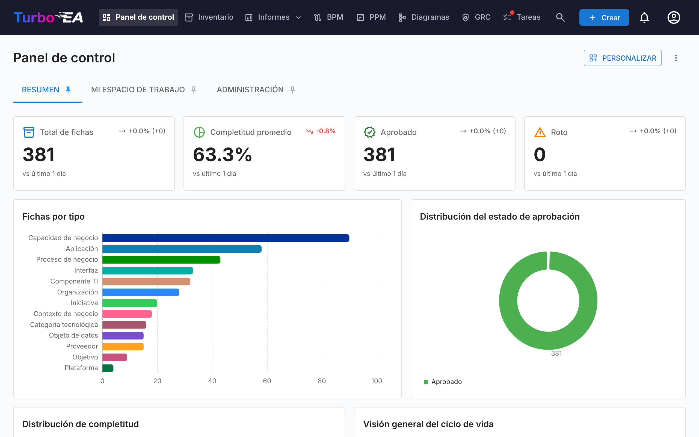
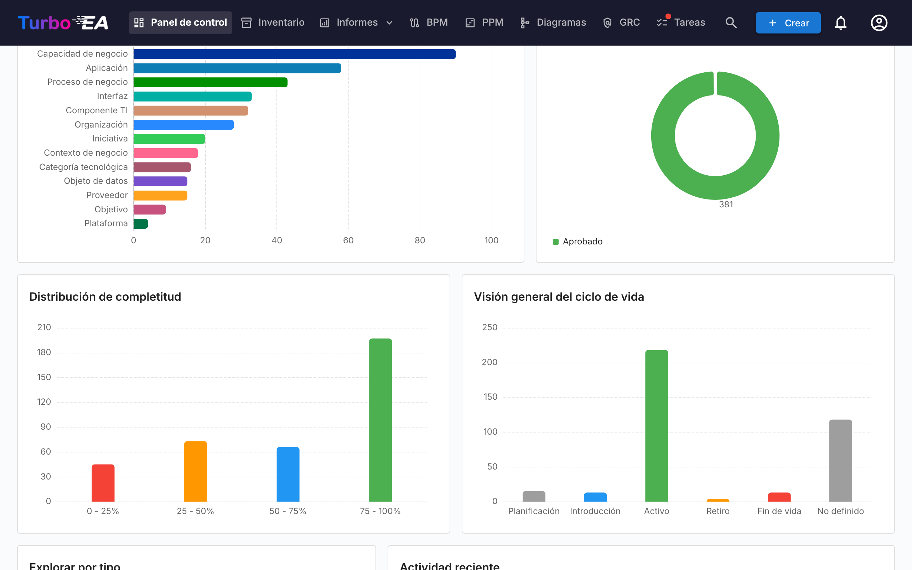
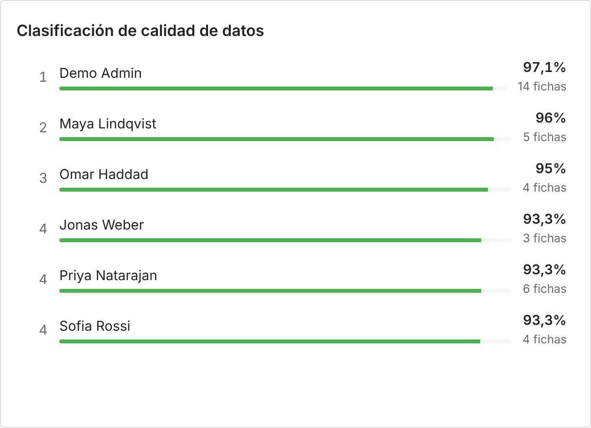
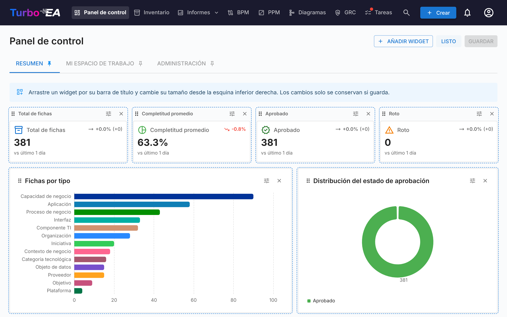

# Panel de Control

El Panel de Control es la primera pantalla que ve después de iniciar sesión. Proporciona una **visión rápida** del estado general de toda la arquitectura empresarial.

## Barra de Navegación Superior

En la parte superior de la pantalla encontrará la **barra de navegación principal** con los siguientes elementos:

- **Turbo EA** (logo): Haga clic para volver al Panel de Control desde cualquier sección
- **Panel de control**: Vista general del estado de la arquitectura
- **Inventario**: Listado completo de todas las fichas
- **Informes**: Informes visuales y analíticos
- **BPM**: Gestión de Procesos de Negocio (si está habilitado)
- **Diagramas**: Editor visual de diagramas de arquitectura
- **Entrega EA**: Gestión de iniciativas de arquitectura
- **Tareas**: Tareas pendientes y encuestas asignadas
- **Buscar fichas**: Barra de búsqueda rápida con autocompletado
- **+ Crear**: Botón para crear nuevas fichas rápidamente
- **Campana de notificaciones**: Alertas del sistema y [notificaciones](notifications.es.md)
- **Icono de perfil**: Selección de idioma, cambio de tema, preferencias de notificaciones y acceso a administración
- **Patrocinar**: Un botón de color púrpura a rosa junto al número de versión en el menú de perfil abre un cuadro de diálogo que explica por qué importa el patrocinio, con un enlace al blog y opciones únicas o mensuales a través de GitHub Sponsors

## Paneles y widgets

La página de inicio se compone de **paneles**, que se muestran como pestañas en la parte superior de la página. Turbo EA incluye tres paneles:

| Panel | Qué muestra |
|-------|-------------|
| **Resumen** | El estado de todo el panorama: tarjetas KPI, gráficos, los tipos de ficha para explorar y la actividad más reciente |
| **Mi espacio de trabajo** | Todo lo que se le ha asignado: favoritos, roles, tareas, encuestas y sus cambios recientes (véase [Pestaña «Espacio de trabajo»](#workspace-tab)) |
| **Administración** | Actividad de los usuarios, cobertura de partes interesadas, aprobaciones pendientes y el directorio de partes interesadas (véase [Pestaña «Administración»](#admin-tab-stakeholder-directory)) |

Cada panel es una cuadrícula de **widgets**. Solo ve los widgets que permite su rol: los widgets de Resumen requieren el permiso `reports.ea_dashboard` y los de Administración `admin.users`; además, una pestaña desaparece cuando ninguno de sus widgets es visible para usted. Los administradores pueden modificar los paneles integrados y añadir los suyos (véase [Personalizar paneles](#customizing-dashboards)).

Haga clic en el icono de **chincheta** de una pestaña para convertirla en el panel que se abre al entrar en Turbo EA.

## Tarjetas KPI

La fila de tarjetas de la parte superior del panel Resumen muestra las cifras principales del panorama:

- **Total de fichas**: número de todos los componentes registrados en la plataforma
- **Calidad media de los datos**: la completitud media de todas las fichas; haga clic para abrir el [informe de Calidad de datos](reports.md)
- **Aprobadas** y **Rotas**: cuántas fichas tienen cada estado de aprobación

Cada tarjeta muestra una **flecha de tendencia** que compara el valor de hoy con el del inicio de la ventana de comparación: 30 días, o menos mientras se sigue recopilando el historial. La leyenda bajo las tarjetas indica la ventana realmente utilizada. Las instantáneas se toman todos los días a las 02:00 UTC. Las tendencias describen todo el panorama, por lo que solo se muestran a los usuarios que pueden leer todas las fichas; un usuario cuyo rol oculta algunas fichas ve el valor sin la flecha.

## Gráficos y listas

Bajo las tarjetas, el panel Resumen muestra:

- **Fichas por tipo**: la proporción de cada tipo de ficha en su panorama
- **Estado de aprobación**: cuántas fichas están aprobadas, pendientes, rotas o rechazadas
- **Distribución de completitud**: cuántas fichas hay en cada tramo de calidad de datos
- **Visión general del ciclo de vida**: cuántas fichas hay en cada fase del ciclo de vida
- **Explorar por tipo**: cada tipo de ficha con su recuento; haga clic en uno para abrir el [Inventario](inventory.md) prefiltrado por ese tipo
- **Actividad reciente**: un feed de los últimos cambios: quién editó qué y cuándo
- **Clasificación de calidad de datos**: las personas que mantienen sus fichas completas (véase más abajo)

Al hacer clic en una barra o en un sector de un gráfico se abre lo que hay detrás: el [Inventario](inventory.md) filtrado por esas fichas para un tipo de ficha o un estado de aprobación, el informe de Ciclo de vida para una fase del ciclo de vida y el informe de Calidad de datos para un tramo de completitud.

### Clasificación de calidad de datos

La **Clasificación de calidad de datos** ordena a las personas que tienen un rol de parte interesada en fichas. De forma predeterminada las ordena por la **calidad de datos media** de sus fichas; cámbiela a **número de fichas** para ver quién tiene más. Cada fila muestra la posición de la persona, su nombre, una barra del color del nivel de calidad de datos de su media, la media y cuántas fichas tiene. Las personas con la misma cifra comparten posición.

Una persona aparece cuando tiene un **número mínimo de fichas** (tres de forma predeterminada), de modo que una sola ficha perfecta no encabece la clasificación. Una ficha cuenta una vez por persona, sin importar cuántos roles tenga en ella, y solo cuentan las fichas activas. De forma predeterminada solo cuentan los roles que importan para la calidad de datos: un rol pasivo como *Observer* nunca da un puesto; los ajustes del widget permiten limitarla a algunos tipos de ficha o roles, o contar todos los roles. Los usuarios desactivados nunca aparecen. La clasificación se calcula para usted: una ficha que no tiene permiso para ver no suma al recuento de nadie ni modifica su media, por lo que dos lectores con permisos distintos pueden ver cifras distintas. Solo se muestran los nombres, nunca las direcciones de correo.

La clasificación requiere el permiso `reports.ea_dashboard`, como el resto del panel Resumen, y un panel puede contener varias, por ejemplo una por tipo de ficha.

## Pestaña «Espacio de trabajo» { #workspace-tab }

El panel **Mi espacio de trabajo** reúne todo lo que se le ha asignado: favoritos, informes guardados, tareas, encuestas pendientes, las fichas que ha creado, actividad reciente en sus fichas y la sección **Fichas en las que tengo un rol**. Cada uno de estos elementos es un widget, por lo que un administrador puede reorganizarlos o colocarlos en otro panel.

Esta última sección agrupa las fichas por el rol de parte interesada que usted desempeña (Application Owner, Business Owner, etc.) y enumera las fichas bajo cada rol. Si su rol concede el permiso `stakeholders.view` (roles admin, member y viewer por defecto), un pequeño icono de **búsqueda de persona** junto al título de la sección le permite dirigirla a **otra persona**: elija un usuario en el autocompletado y la sección se vuelve a cargar con los roles y las fichas de ese usuario. El título cambia a «Roles de {name}». Haga clic en el pequeño icono de cierre para volver a sus propios roles. Útil para responder a «¿de qué es responsable esta persona?» con un clic.

## Pestaña «Administración» — Directorio de partes interesadas { #admin-tab-stakeholder-directory }

El panel **Administración** se muestra a los roles con `admin.users`. Además de sus tarjetas KPI (usuarios activos, fichas sin partes interesadas, tareas vencidas, aprobaciones atascadas, calidad general) y sus listas (principales colaboradores, cobertura de partes interesadas, usuarios inactivos, flujo de aprobación, actividad del sistema, tareas sin asignar), termina con un widget **Directorio de partes interesadas**. Enumera cada tipo de ficha que tiene al menos una parte interesada, con el número de titulares distintos. Expanda un tipo de ficha para ver sus roles y, dentro de cada rol, los usuarios que lo ocupan junto con el número de fichas que cubren. Haga clic en la etiqueta de un usuario para desplegar su lista de fichas en línea; cada nombre de ficha es a su vez un enlace a la página de detalle de la ficha. Todo el árbol (tipo de ficha → rol → usuario → fichas) llega en una sola petición, por lo que la navegación es instantánea.

Un **filtro por nombre** en la parte superior del widget reduce el árbol a los usuarios cuyo nombre o correo coincide con lo escrito; los tipos de ficha coincidentes se expanden automáticamente para que los resultados sean visibles sin un clic adicional. Úselo para responder a «¿dónde aparece Alice en la organización?» en un segundo.

Más allá del directorio, aparece una pequeña **ventana emergente al pasar el cursor** cuando este se detiene sobre el nombre de una parte interesada en otro lugar de la aplicación —en la pestaña Partes interesadas de una ficha, en el propietario de un riesgo en el Registro de riesgos o en la página de detalle del riesgo— y muestra la cartera completa de ese usuario agrupada por rol. Haga clic en cualquier ficha de la ventana para ir a ella. La ventana solo consulta los datos una vez por usuario y sesión.

## Personalizar paneles { #customizing-dashboards }

Los usuarios cuyo rol concede `admin.dashboards` (**Gestionar los paneles de la página de inicio**; por defecto, el rol Admin) pueden modificar todos los paneles y crear otros nuevos. El resto ve los paneles tal como están configurados.

### Modo de personalización

Haga clic en **Personalizar**, junto a las pestañas de los paneles, para editar el panel actual. El diseño tiene 12 columnas de ancho; en una ventana más estrecha los widgets se reorganizan en seis columnas, y en un teléfono en una, en el orden en que están dispuestos. En el modo de personalización:

- **Mueva** un widget arrastrándolo por su asa; la cuadrícula tiene 12 columnas de ancho y los demás widgets le hacen sitio.
- **Cambie el tamaño** de un widget desde su borde derecho, su borde inferior o la esquina, con el ratón o con el tacto (en un móvil o una tableta en vertical el diseño es de solo lectura). El widget contiguo se ajusta mientras arrastra: se estrecha cuando su vecino crece y vuelve a ensancharse cuando este se reduce; si ya no puede estrecharse más, pasa a la fila siguiente. Las filas de debajo bajan y vuelven a subir por sí solas. El widget se ajusta a la cuadrícula mientras se arrastra, y en el modo de personalización la página deja cuatro filas vacías bajo el último widget para poder alargar la fila inferior; desplácese primero hasta que el asa quede bien dentro de la ventana.
- **Elimine** un widget con su botón de cierre.
- **Configure** una tarjeta KPI, un gráfico, el feed de actividad o una clasificación de calidad de datos con su botón de engranaje.
- **Deshaga** y **rehaga** los cambios: **Deshacer** y **Rehacer** recorren paso a paso los cambios realizados desde que se abrió Personalizar (un movimiento, cambio de tamaño, adición, eliminación o configuración cada vez) — con los dos botones de la barra de herramientas o con Ctrl+Z / Ctrl+Mayús+Z (⌘ en Mac). **Descartar** sigue eliminándolos todos a la vez.

Haga clic en **Guardar** para conservar los cambios para todos, o en **Descartar** para volver al panel tal como estaba.

### Añadir y restaurar widgets

**Añadir widget** abre un cajón con todos los widgets, agrupados en **KPI**, **Gráficos**, **Resumen**, **Mi espacio de trabajo** y **Administración**. Haga clic en uno para añadirlo al panel; una tarjeta KPI o un gráfico abre primero su configuración. Todos los widgets integrados permanecen en el catálogo, de modo que un widget eliminado por error —**Actividad reciente**, por ejemplo— se restaura añadiéndolo de nuevo. Los widgets que solo pueden aparecer una vez en un panel aparecen atenuados y marcados como ya añadidos cuando están presentes.

Un widget conserva su propio permiso dondequiera que se coloque: un widget de Administración añadido al panel Resumen sigue mostrándose solo a los usuarios con `admin.users`.

### Configurar una tarjeta KPI

Una tarjeta KPI muestra una de las métricas integradas (total de fichas, calidad de los datos, tareas abiertas, etc.) o una cifra que usted define:

- **Tipo de ficha** (opcional): contar solo las fichas de un tipo, acotadas opcionalmente a un subtipo, un estado de aprobación, una fase del ciclo de vida o los [filtros](#filters) que se describen más abajo.
- **Medida**: **Número** de fichas, **Suma** o **Media** de un campo numérico, de coste o de porcentaje de ese tipo o de un [indicador](#measures), o un **Porcentaje** — el recuento acotado como porcentaje de las mismas fichas sin los filtros (por ejemplo, el porcentaje de aplicaciones aprobadas).
- **Un aumento es**: **Bueno** o **Malo**: determina si una tendencia al alza se muestra en verde o en rojo.
- **Minigráfico**: dibuja bajo la cifra los últimos 30 valores diarios de la tarjeta.
- **Cifra secundaria**: para un recuento acotado, muestra **de N** (el recuento sin filtrar) o el **porcentaje del total** junto a la cifra.

Una nueva tarjeta KPI registra su primer valor en cuanto se guarda el panel, por lo que su tendencia empieza al día siguiente. Una suma o media de un campo de coste solo se muestra a los usuarios que pueden ver los costes, cuenta únicamente las fichas activas en el ejercicio fiscal en curso (la regla que usa el informe de costes) e indica ese ejercicio bajo el valor.

Las tarjetas alimentadas por un informe de módulo (riesgos abiertos, riesgos vencidos, puntuación de cumplimiento, iniciativas en riesgo, procesos sin diagrama) aparecen en el catálogo cuando el módulo está activado y usted tiene su permiso; no muestran tendencia, porque los informes de módulo no conservan historial.

### Configurar un gráfico

Un gráfico agrupa las fichas por una **dimensión** y mide cada grupo con una **medida**:

| Dimensión | Agrupa las fichas por |
|-----------|-----------------------|
| **Tipo de ficha** | Tipo de ficha |
| **Subtipo** | Subtipo del tipo de ficha elegido |
| **Estado de aprobación** | Aprobada, pendiente, rota, rechazada |
| **Fase del ciclo de vida** | La fase actual del ciclo de vida |
| **Calidad de los datos** | Tramo de calidad de datos (0–25 %, 25–50 %, …) |
| **Mes de creación** | Mes en que se creó la ficha |
| **Un campo** | Cualquier campo de selección única o de sí/no del tipo de ficha elegido |
| **Cada ficha** | Un grupo por cada ficha del tipo elegido: un treemap del coste por aplicación, las aplicaciones con más componentes de TI. Se conservan los grupos más grandes (**Categorías mostradas (como máximo)**, veinte por defecto, hasta doscientas) y el resto se agrupa en *Otros*, o se deja fuera de un promedio o de una proporción, que no pueden sumarse. En ese caso el widget lo indica bajo el gráfico: «Se muestran las 20 fichas más grandes; 37 más están en «Otros»». Al hacer clic en una ficha, esta se abre |
| **Ficha relacionada** | La ficha del otro extremo de un tipo de relación: aplicaciones por organización, componentes de TI por proveedor, coste por capacidad de negocio. Una ficha vinculada a varias fichas relacionadas cuenta en cada una; las fichas sin ninguna quedan en *Ninguna*; se conservan los veinte grupos más grandes y el resto se agrupa en *Otros* |
| **Cobertura de EOL** | Si una aplicación o un componente de TI tiene un vínculo con endoflife.date, una fecha de fin de vida manual, o ninguno de los dos |
| **Mes de puesta en producción** / **Mes de fin de vida** | El mes en que cae la fecha de activación o de fin de vida de la ficha, a lo largo de 18 meses: seis hacia atrás y once hacia delante: las puestas en producción por mes, o un calendario de fin de vida |

El menú de dimensiones está agrupado: **Ficha**, **Fechas**, **Campos**, **Fichas relacionadas** y **Estado de salud**.

#### Indicadores

La medida es el **Número de fichas**, la **Suma** o la **Media** de un campo numérico, de coste o de porcentaje, o de uno de estos indicadores: las **relaciones de un tipo** de cada ficha (cuántos componentes de TI utiliza una aplicación) o su puntuación de **calidad de los datos**. **Porcentaje** muestra, por grupo, el recuento acotado como porcentaje del recuento sin filtrar. Solo se ofrecen los tipos de ficha que usted puede leer, y los campos de coste únicamente a los usuarios que pueden ver los costes; un coste cuenta solo las fichas activas en el ejercicio fiscal en curso, y el gráfico indica ese ejercicio.

#### Filtros

Además de un estado de aprobación y una fase del ciclo de vida, un gráfico o KPI puede acotarse a las fichas **huérfanas** (sin ninguna relación), **obsoletas** (sin actualizar desde hace 90 días), **sin partes interesadas**, con un fin de vida **ausente**, o que **tienen** o **no tienen** una relación de un tipo dado, con las mismas definiciones que usan los filtros del Inventario y el informe de calidad de los datos.

| Gráfico | Ideal para |
|---------|------------|
| **Barras** / **Columnas** | Comparar grupos, en horizontal o en vertical |
| **Columnas apiladas** | Dos dimensiones como barras apiladas con leyenda: tipo de ficha por fase del ciclo de vida, nivel de capacidad por estado de aprobación |
| **Líneas** | Una tendencia en el tiempo, como las fichas creadas por mes |
| **Circular** / **Anillo** | Partes de un todo |
| **Indicador** | Una tasa frente a un objetivo: una proporción (las aplicaciones aprobadas), la calidad media de los datos, un campo de porcentaje o una puntuación de cumplimiento en una esfera de 0–100, o un recuento o una suma frente a un **Objetivo**. Dos umbrales (**Advertencia por encima de**, **Bueno por encima de**) dividen la esfera en franjas roja, ámbar y verde, invertidas cuando un aumento es malo; dos indicadores predefinidos, **Calidad de los datos** y **Aplicaciones aprobadas**, figuran en el catálogo |
| **Mapa de calor** | Dos dimensiones a la vez; por ejemplo, la fase del ciclo de vida frente al estado de aprobación; **Mostrar los valores en el gráfico** muestra la cifra en cada celda |
| **Treemap** | Partes cuando hay muchos grupos; **Mostrar los valores en el gráfico** muestra la cifra en cada bloque |
| **Sankey** | El flujo de un tipo de relación entre las fichas que conecta, con una dimensión a su elección en cada extremo |

Un diagrama de Sankey toma un tipo de relación y agrupa **cada extremo** por separado: por tipo de ficha, subtipo, estado de aprobación, fase del ciclo de vida, calidad de los datos, un campo del tipo de ese extremo o las **propias fichas**: Organización → Aplicación muestra qué organizaciones usan qué aplicaciones, conservando las veinte fichas más grandes de cada extremo y agrupando el resto en *Otros*; en ese caso el widget lo indica bajo el gráfico, y **Categorías mostradas (como máximo)** amplía el límite. Al hacer clic en un nodo de ficha se abre la ficha.

Los gráficos también pueden representar un informe de módulo: riesgos por nivel o estado, puntuaciones de cumplimiento por normativa, estado del calendario de PPM y madurez de BPM figuran en el catálogo cuando el módulo está activado y usted tiene su permiso. Las etiquetas aún no pueden usarse como dimensión ni como filtro.

Cuatro gráficos predefinidos están en la familia **Gráficos** del catálogo, y cada uno se ofrece cuando su metamodelo tiene las piezas necesarias: **Aplicaciones por organización**, **Calendario de fin de vida**, **Fichas obsoletas por tipo** y el diagrama de Sankey **Organización → Aplicación**.

Active el clic para que los lectores puedan abrir el [Inventario](inventory.md) o el informe que hay detrás de una barra o un sector (gráficos de barras, columnas, columnas apiladas, líneas, circulares, anillo y treemap, y los nodos de ficha de un diagrama de Sankey). **Mostrar los valores en el gráfico** muestra la cifra en cada barra, columna, bloque o celda (gráficos de barras, columnas, columnas apiladas, treemap y mapa de calor). Una vista previa en el cuadro de diálogo muestra el gráfico tal como aparecerá.

### Gestionar paneles

El menú **⋮** junto a las pestañas actúa sobre el panel actual:

| Acción | Qué hace |
|--------|----------|
| **Nuevo panel** | Crea un panel vacío, listo para llenar con widgets |
| **Duplicar** | Copia el panel con todos sus widgets: un buen punto de partida para una variante de un panel integrado |
| **Ajustes** | Nombre, descripción, icono y **Acceso**: los roles autorizados a ver el panel. Deje el acceso vacío para mostrarlo a todos; el panel Admin integrado se entrega con el acceso limitado a los roles que pueden gestionar usuarios (el rol Admin en una instalación nueva). Bajo el campo se enumeran los permisos que necesitan los widgets del panel: un rol que no los tenga no ve nada allí, sea cual sea el acceso. Los usuarios con `admin.dashboards` siempre ven todos los paneles |
| **Ocultar** / **Mostrar** | Quita el panel de las pestañas de los demás sin eliminarlo |
| **Mover a la izquierda** / **Mover a la derecha** | Cambia el orden de las pestañas |
| **Restablecer valores predeterminados** | Solo paneles integrados: restaura los widgets y el diseño con los que se entrega Turbo EA y, en el panel Admin, los roles que lista su acceso |
| **Eliminar** | Solo paneles personalizados: elimina el panel para todos |

Actualizar Turbo EA nunca sobrescribe un panel que haya modificado. Cuando una versión mejora un panel integrado, **Restablecer valores predeterminados** incorpora la nueva versión.

Cada cambio en un panel —creado, editado, duplicado, restablecido o eliminado, incluidos los widgets añadidos o eliminados— se registra en el [Registro de auditoría](../admin/audit-log.md#administrative-actions). Los paneles viajan con una [transferencia de espacio de trabajo](../admin/workspace-transfer.md).
