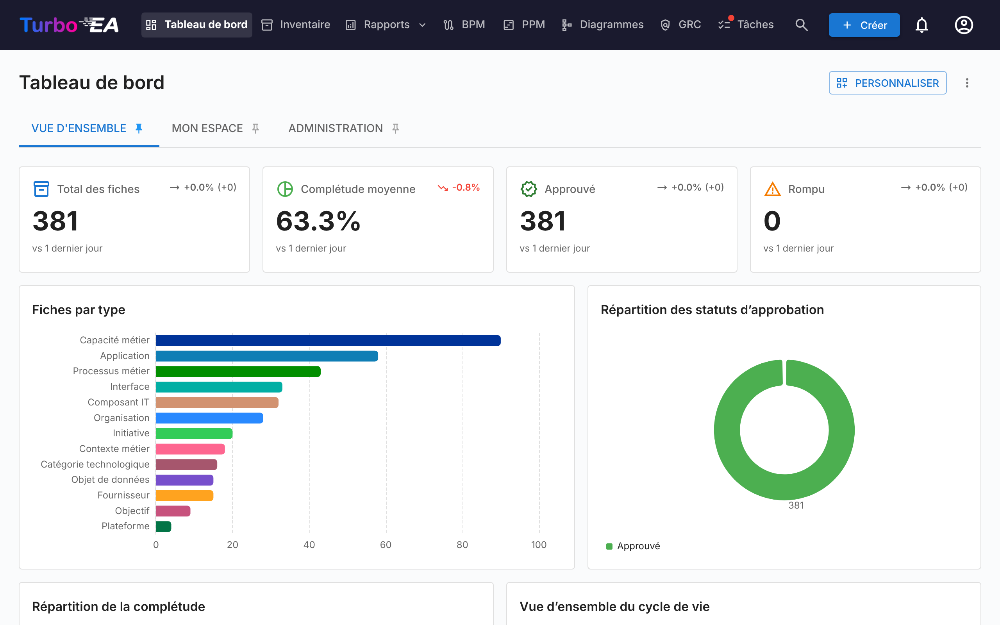
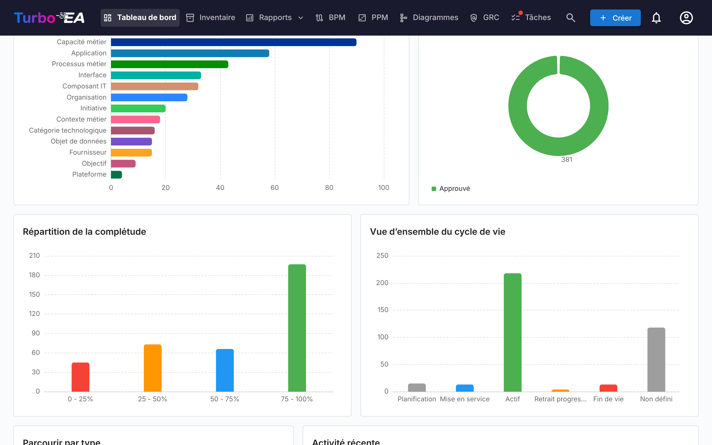
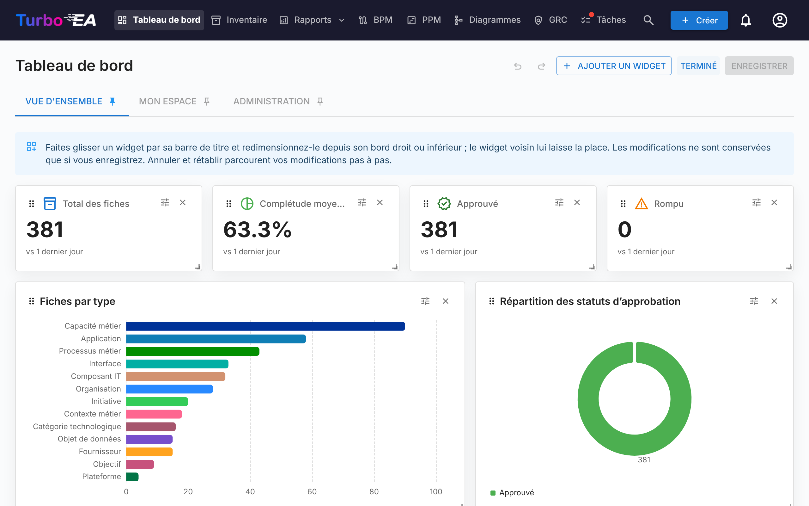

# Tableau de bord

Le tableau de bord est le premier écran que vous voyez après la connexion. Il fournit un **aperçu rapide** de l'état global de l'architecture d'entreprise.

## Barre de navigation supérieure

En haut de l'écran, vous trouverez la **barre de navigation principale** avec les éléments suivants :

- **Turbo EA** (logo) : Cliquez pour revenir au tableau de bord depuis n'importe quelle section
- **Tableau de bord** : Aperçu de l'état de l'architecture
- **Inventaire** : Liste complète de toutes les fiches
- **Rapports** : Rapports visuels et analytiques
- **BPM** : Gestion des processus métier (si activé)
- **Diagrammes** : Éditeur visuel de diagrammes d'architecture
- **EA Delivery** : Gestion des initiatives d'architecture
- **Tâches** : Tâches en attente et enquêtes assignées
- **Rechercher des fiches** : Barre de recherche rapide avec autocompletion
- **+ Créer** : Bouton pour créer rapidement de nouvelles fiches
- **Cloche de notification** : Alertes système et [notifications](notifications.md)
- **Icône de profil** : Sélection de la langue, bascule de thème, préférences de notification et accès à l'administration
- **Soutenir** : Un bouton violet-rose à côté du numéro de version dans le menu de profil ouvre une boîte de dialogue expliquant pourquoi le parrainage est important, avec un lien vers le blog et des options ponctuelles ou mensuelles via GitHub Sponsors

## Tableaux de bord et widgets

La page d’accueil est composée de **tableaux de bord**, affichés sous forme d’onglets en haut de la page. Trois tableaux de bord sont livrés avec Turbo EA :

| Tableau de bord | Ce qu’il affiche |
|-----------------|------------------|
| **Vue d’ensemble** | L’état de l’ensemble du paysage : tuiles KPI, graphiques, les types de fiche à parcourir et les dernières activités |
| **Mon espace** | Tout ce qui vous est attribué — favoris, rôles, tâches, enquêtes, vos modifications récentes (voir [Onglet «Espace de travail»](#workspace-tab)) |
| **Administration** | L’activité des utilisateurs, la couverture des parties prenantes, les approbations en attente et l’annuaire des parties prenantes (voir [Onglet «Administration»](#admin-tab-stakeholder-directory)) |

Chaque tableau de bord est une grille de **widgets**. Vous ne voyez que les widgets autorisés par votre rôle — les widgets de la vue d’ensemble nécessitent la permission `reports.ea_dashboard`, ceux d’administration `admin.users` — et un onglet disparaît lorsqu’aucun de ses widgets ne vous est visible. Les administrateurs peuvent modifier les tableaux de bord intégrés et ajouter les leurs (voir [Personnaliser les tableaux de bord](#customizing-dashboards)).

Cliquez sur l’icône **épingle** d’un onglet pour en faire le tableau de bord affiché à l’ouverture de Turbo EA.

## Tuiles KPI

La rangée de tuiles en haut du tableau de bord « Vue d’ensemble » affiche les chiffres clés du paysage :

- **Total des fiches** : nombre de tous les composants enregistrés dans la plateforme
- **Qualité moyenne des données** : la complétude moyenne de toutes les fiches — cliquez dessus pour ouvrir le [rapport Qualité des données](reports.md)
- **Approuvées** et **Cassées** : nombre de fiches portant chaque statut d’approbation

Chaque tuile affiche une **flèche de tendance** comparant la valeur du jour à celle du début de la fenêtre de comparaison — 30 jours, ou moins tant que l’historique est en cours de constitution. La légende sous les tuiles indique la fenêtre réellement utilisée. Les instantanés sont pris chaque jour à 02:00 UTC. Les tendances décrivent l’ensemble du paysage ; elles ne sont donc affichées qu’aux utilisateurs qui peuvent lire toutes les fiches : un utilisateur dont le rôle masque certaines fiches voit la valeur sans la flèche.

## Graphiques et listes

Sous les tuiles, le tableau de bord « Vue d’ensemble » affiche :

- **Fiches par type** : la proportion de chaque type de fiche dans votre paysage
- **Statut d’approbation** : combien de fiches sont approuvées, en attente, cassées ou rejetées
- **Répartition de la complétude** : combien de fiches se trouvent dans chaque tranche de qualité des données
- **Vue d’ensemble du cycle de vie** : combien de fiches se trouvent dans chaque phase du cycle de vie
- **Parcourir par type** : chaque type de fiche avec son nombre — cliquez sur l’un d’eux pour ouvrir l’[Inventaire](inventory.md) pré-filtré sur ce type
- **Activité récente** : un fil des dernières modifications — qui a modifié quoi et quand

Cliquer sur une barre ou une portion de graphique ouvre ce qui se cache derrière : l’[Inventaire](inventory.md) filtré sur ces fiches pour un type de fiche ou un statut d’approbation, le rapport Cycle de vie pour une phase du cycle de vie, le rapport Qualité des données pour une tranche de complétude.

## Onglet «Espace de travail» { #workspace-tab }

Le tableau de bord **Mon espace** rassemble tout ce qui vous est attribué : favoris, rapports enregistrés, tâches, enquêtes en attente, les fiches que vous avez créées, l’activité récente sur vos fiches et la section **Fiches où j’ai un rôle**. Chacun de ces éléments est un widget : un administrateur peut donc les réorganiser ou les placer sur un autre tableau de bord.

Cette dernière section regroupe les fiches selon le rôle de partie prenante que vous détenez (Application Owner, Business Owner, etc.) et liste les fiches sous chaque rôle. Si votre rôle accorde la permission `stakeholders.view` (rôles admin, member et viewer par défaut), une petite icône de **recherche de personne** à côté du titre de la section vous permet de la pointer vers **quelqu’un d’autre** : choisissez un utilisateur dans la saisie semi-automatique et la section se recharge avec les rôles et les fiches de cet utilisateur. Le titre devient « Rôles détenus par {name} ». Cliquez sur la petite icône de fermeture pour revenir à vos propres rôles. Utile pour répondre à « qu’est-ce que cette personne possède ? » en un clic.

## Onglet «Administration» — Annuaire des parties prenantes { #admin-tab-stakeholder-directory }

Le tableau de bord **Administration** est affiché aux rôles disposant de `admin.users`. Outre ses tuiles KPI (utilisateurs actifs, fiches sans partie prenante, tâches en retard, approbations bloquées, qualité globale) et ses listes (principaux contributeurs, couverture des parties prenantes, utilisateurs inactifs, pipeline d’approbation, activité système, tâches non attribuées), il se termine par un widget **Annuaire des parties prenantes**. Il liste chaque type de fiche comptant au moins une partie prenante, avec le nombre de détenteurs distincts. Développez un type de fiche pour voir ses rôles et, dans chaque rôle, les utilisateurs qui le détiennent avec le nombre de fiches qu’ils couvrent. Cliquez sur la pastille d’un utilisateur pour déplier sa liste de fiches sur place — chaque nom de fiche est lui-même un lien vers la page de détail de la fiche. L’arbre complet (type de fiche → rôle → utilisateur → fiches) est récupéré en un seul aller-retour, la navigation est donc instantanée.

Un **filtre par nom** en haut du widget restreint l’arbre aux utilisateurs dont le nom ou l’e-mail correspond à la saisie ; les types de fiche correspondants se déplient automatiquement pour que les résultats soient visibles sans clic supplémentaire. Utilisez-le pour répondre à « où Alice apparaît-elle dans l’organisation ? » en une seconde.

Au-delà de l’annuaire, une petite **bulle au survol** s’ouvre dès que le curseur s’arrête sur un nom de partie prenante ailleurs dans l’application — sur l’onglet Parties prenantes d’une fiche, sur le propriétaire d’un risque dans le registre des risques ou sur la page de détail du risque — et affiche le portefeuille complet de cet utilisateur, regroupé par rôle. Cliquez sur n’importe quelle fiche dans la bulle pour y accéder. La bulle ne récupère les données qu’une fois par utilisateur et par session.

## Personnaliser les tableaux de bord { #customizing-dashboards }

Les utilisateurs dont le rôle accorde `admin.dashboards` (**Gérer les tableaux de bord de la page d’accueil** — le rôle Admin par défaut) peuvent modifier chaque tableau de bord et en créer de nouveaux. Tous les autres voient les tableaux de bord tels qu’ils sont configurés.

### Mode de personnalisation

Cliquez sur **Personnaliser** à côté des onglets de tableaux de bord pour modifier le tableau de bord actuel. La disposition fait 12 colonnes de large ; dans une fenêtre plus étroite, les widgets se réorganisent sur six colonnes, et sur un téléphone sur une seule, dans l’ordre de leur disposition. En mode de personnalisation :

- **Déplacez** un widget en le faisant glisser par sa poignée ; la grille compte 12 colonnes de large et les autres widgets lui laissent la place.
- **Redimensionnez** un widget depuis son bord droit, son bord inférieur ou son coin, à la souris ou au toucher (sur un téléphone ou une tablette tenus à la verticale, la disposition est en lecture seule). Le widget voisin s’ajuste pendant le glissement : il se rétrécit quand son voisin s’agrandit et s’élargit de nouveau quand celui-ci rétrécit ; s’il ne peut plus se rétrécir, il passe à la ligne suivante. Les lignes du dessous descendent puis remontent d’elles-mêmes. Le widget s’aligne sur la grille pendant le glissement, et en mode de personnalisation la page garde quatre lignes vides sous le dernier widget, afin de pouvoir agrandir la dernière ligne en hauteur ; faites d’abord défiler la page jusqu’à ce que la poignée soit bien à l’intérieur de la fenêtre.
- **Retirez** un widget avec son bouton de fermeture.
- **Configurez** une tuile KPI, un graphique ou le fil d’activité avec son bouton en forme d’engrenage.
- **Annulez** et **rétablissez** vos modifications : **Annuler** et **Rétablir** parcourent pas à pas les changements effectués depuis l’ouverture de Personnaliser (un déplacement, un redimensionnement, un ajout, un retrait ou une configuration à la fois) — avec les deux boutons de la barre d’outils ou Ctrl+Z / Ctrl+Maj+Z (⌘ sur Mac). **Abandonner** les supprime toujours tous d’un coup.

Cliquez sur **Enregistrer** pour conserver les modifications pour tout le monde, ou sur **Annuler** pour revenir au tableau de bord tel qu’il était.

### Ajouter et restaurer des widgets

**Ajouter un widget** ouvre un panneau listant tous les widgets, regroupés en **KPI**, **Graphiques**, **Vue d’ensemble**, **Mon espace** et **Administration**. Cliquez sur l’un d’eux pour l’ajouter au tableau de bord ; une tuile KPI ou un graphique ouvre d’abord sa configuration. Chaque widget intégré reste dans le catalogue : un widget retiré par erreur — **Activité récente**, par exemple — est restauré en l’ajoutant de nouveau. Les widgets qui ne peuvent apparaître qu’une seule fois sur un tableau de bord sont grisés et marqués comme déjà ajoutés lorsqu’ils sont présents.

Un widget conserve sa propre permission où qu’il soit placé : un widget d’administration ajouté au tableau de bord « Vue d’ensemble » n’est toujours affiché qu’aux utilisateurs disposant de `admin.users`.

### Configurer une tuile KPI

Une tuile KPI affiche soit l’une des mesures intégrées (total des fiches, qualité des données, tâches ouvertes, etc.), soit un chiffre que vous définissez :

- **Type de fiche** (facultatif) : ne compter que les fiches d’un type, éventuellement restreint à un sous-type, un statut d’approbation, une phase du cycle de vie ou les [filtres](#filters) ci-dessous.
- **Mesure** : **Nombre** de fiches, **Somme** ou **Moyenne** d’un champ numérique, de coût ou de pourcentage de ce type ou d’un [indicateur](#measures), ou une **Part** — le nombre restreint en pourcentage des mêmes fiches sans les filtres (par exemple la part des applications approuvées).
- **Une hausse est** : **Positive** ou **Négative** — détermine si une tendance à la hausse s’affiche en vert ou en rouge.
- **Courbe de tendance** : trace les 30 dernières valeurs quotidiennes de la tuile sous le chiffre.
- **Chiffre secondaire** : pour un nombre restreint, affiche **sur N** (le nombre non filtré) ou la **part du total** à côté du chiffre.

Une nouvelle tuile KPI enregistre sa première valeur dès que le tableau de bord est enregistré ; sa tendance démarre donc le lendemain. Une somme ou une moyenne d’un champ de coût n’est affichée qu’aux utilisateurs autorisés à voir les coûts, ne compte que les fiches actives pendant l’exercice fiscal en cours (la règle du rapport de coûts) et nomme cet exercice sous la valeur.

Les tuiles alimentées par un rapport de module (risques ouverts, risques en retard, score de conformité, initiatives à risque, processus sans diagramme) figurent au catalogue lorsque le module est activé et que vous en détenez la permission ; elles n’affichent pas de tendance, car les rapports de module ne conservent aucun historique.

### Configurer un graphique

Un graphique regroupe les fiches selon une **dimension** et mesure chaque groupe avec une **mesure** :

| Dimension | Regroupe les fiches par |
|-----------|-------------------------|
| **Type de fiche** | Type de fiche |
| **Sous-type** | Sous-type du type de fiche choisi |
| **Statut d’approbation** | Approuvée, en attente, cassée, rejetée |
| **Phase du cycle de vie** | La phase actuelle du cycle de vie |
| **Qualité des données** | Tranche de qualité des données (0–25 %, 25–50 %, …) |
| **Mois de création** | Mois de création de la fiche |
| **Un champ** | Tout champ à choix unique ou oui/non du type de fiche choisi |
| **Chaque fiche** | Un groupe par fiche du type choisi — une treemap du coût par application, les applications ayant le plus de composants IT. Les plus grands groupes sont conservés (**Catégories affichées (au maximum)**, vingt par défaut, jusqu’à deux cents) et le reste est regroupé sous *Autres* — ou écarté d’une moyenne ou d’une part, qui ne peuvent pas être additionnées. Le widget l’indique alors sous le graphique : « Affichage des 20 plus grandes fiches ; 37 autres sont dans « Autres » ». Un clic sur une fiche l’ouvre |
| **Fiche liée** | La fiche à l’autre extrémité d’un type de relation — applications par organisation, composants IT par fournisseur, coût par capacité métier. Une fiche liée à plusieurs fiches est comptée sous chacune ; les fiches sans lien tombent sous *Aucune* ; les vingt plus grands groupes sont conservés et le reste est regroupé sous *Autres* |
| **Couverture EOL** | Si une application ou un composant IT a un lien endoflife.date, une date de fin de vie manuelle, ou aucun des deux |
| **Mois de mise en service** / **Mois de fin de vie** | Le mois dans lequel tombe la date d’activité ou de fin de vie de la fiche, sur 18 mois : six en arrière et onze en avant — les mises en service par mois, ou un calendrier de fin de vie |

Le menu des dimensions est groupé : **Fiche**, **Dates**, **Champs**, **Fiches liées** et **Santé**.

#### Indicateurs

La mesure est le **Nombre de fiches**, la **Somme** ou la **Moyenne** d’un champ numérique, de coût ou de pourcentage, ou de l’un de ces indicateurs : les **relations d’un type** sur chaque fiche (combien de composants IT une application utilise) ou son score de **qualité des données**. **Part** affiche, pour chaque groupe, le nombre restreint en pourcentage du nombre non filtré. Seuls les types de fiche que vous pouvez lire sont proposés, et les champs de coût uniquement aux utilisateurs autorisés à voir les coûts ; un coût ne compte que les fiches actives pendant l’exercice fiscal en cours, et le graphique nomme cet exercice.

#### Filtres

Outre un statut d’approbation et une phase du cycle de vie, un graphique ou un KPI peut être restreint aux fiches **orphelines** (aucune relation), **obsolètes** (non mises à jour depuis 90 jours), **sans parties prenantes**, avec une fin de vie **manquante**, ou qui **ont** ou **n’ont pas** une relation d’un type donné — avec les mêmes définitions que les filtres de l’Inventaire et le rapport de qualité des données.

| Graphique | Idéal pour |
|-----------|------------|
| **Barres** / **Colonnes** | Comparer des groupes, horizontalement ou verticalement |
| **Colonnes empilées** | Deux dimensions en barres empilées avec une légende — type de fiche par phase du cycle de vie, niveau de capacité par statut d’approbation |
| **Courbe** | Une tendance dans le temps, comme les fiches créées par mois |
| **Secteurs** / **Anneau** | Les parts d’un tout |
| **Jauge** | Un taux par rapport à une cible : une part (les applications approuvées), la qualité moyenne des données, un champ en pourcentage ou un score de conformité sur un cadran de 0 à 100, ou un nombre ou une somme par rapport à une **Cible**. Deux seuils (**Avertissement au-dessus de**, **Bon au-dessus de**) répartissent le cadran en zones rouge, orange et verte, inversées lorsqu’une hausse est mauvaise ; deux jauges prêtes à l’emploi, **Qualité des données** et **Applications approuvées**, figurent dans le catalogue |
| **Carte de chaleur** | Deux dimensions à la fois — par exemple la phase du cycle de vie en fonction du statut d’approbation; **Afficher les valeurs sur le graphique** inscrit la valeur dans chaque cellule |
| **Treemap** | Les parts lorsqu’il y a de nombreux groupes; **Afficher les valeurs sur le graphique** inscrit la valeur sur chaque tuile |
| **Sankey** | Le flux d’un type de relation entre les fiches qu’il relie, avec une dimension de votre choix à chaque extrémité |

Un diagramme de Sankey prend un type de relation et regroupe **chaque extrémité** séparément : par type de fiche, sous-type, statut d’approbation, phase du cycle de vie, qualité des données, un champ du type de cette extrémité, ou les **fiches elles-mêmes** — Organisation → Application montre quelles organisations utilisent quelles applications, les vingt plus grandes fiches de chaque extrémité étant conservées et le reste regroupé sous *Autres* ; le widget l’indique alors sous le graphique, et **Catégories affichées (au maximum)** relève la limite. Cliquer sur un nœud de fiche ouvre la fiche.

Les graphiques peuvent aussi représenter un rapport de module : risques par niveau ou statut, scores de conformité par réglementation, état du calendrier PPM et maturité BPM figurent au catalogue lorsque le module est activé et que vous en détenez la permission. Les tags ne peuvent pas encore servir de dimension ni de filtre.

Quatre graphiques prêts à l’emploi figurent dans la famille **Graphiques** du catalogue, chacun proposé lorsque votre métamodèle contient les éléments nécessaires : **Applications par organisation**, **Calendrier de fin de vie**, **Fiches obsolètes par type** et le diagramme de Sankey **Organisation → Application**.

Activez le clic pour permettre aux lecteurs d’ouvrir l’[Inventaire](inventory.md) ou le rapport derrière une barre ou une portion (graphiques en barres, colonnes, colonnes empilées, courbe, secteurs, anneau et treemap, ainsi que les nœuds de fiche d’un diagramme de Sankey). **Afficher les valeurs sur le graphique** inscrit la valeur sur chaque barre, colonne, tuile ou cellule (graphiques en barres, colonnes, colonnes empilées, treemap et carte de chaleur). Un aperçu dans la boîte de dialogue montre le graphique tel qu’il apparaîtra.

### Gérer les tableaux de bord

Le menu **⋮** à côté des onglets agit sur le tableau de bord actuel :

| Action | Ce qu’elle fait |
|--------|-----------------|
| **Nouveau tableau de bord** | Crée un tableau de bord vide, prêt à recevoir des widgets |
| **Dupliquer** | Copie le tableau de bord avec tous ses widgets — un bon point de départ pour une variante d’un tableau de bord intégré |
| **Paramètres** | Nom, description, icône et **Accès** : les rôles autorisés à voir le tableau de bord. Laissez l’accès vide pour l’afficher à tout le monde ; le tableau de bord Admin intégré est livré avec un accès réservé aux rôles autorisés à gérer les utilisateurs (le rôle Admin sur une installation neuve). Sous le champ figurent les permissions dont les widgets du tableau de bord ont besoin : un rôle qui ne les a pas n’y voit rien, quel que soit l’accès. Les utilisateurs disposant de `admin.dashboards` voient toujours tous les tableaux de bord |
| **Masquer** / **Afficher** | Retire le tableau de bord des onglets de tous les autres sans le supprimer |
| **Déplacer vers la gauche** / **Déplacer vers la droite** | Modifie l’ordre des onglets |
| **Réinitialiser par défaut** | Tableaux de bord intégrés uniquement : restaure les widgets et la disposition livrés avec Turbo EA — et, pour le tableau de bord Admin, les rôles que liste son accès |
| **Supprimer** | Tableaux de bord personnalisés uniquement : supprime le tableau de bord pour tout le monde |

Une mise à niveau de Turbo EA n’écrase jamais un tableau de bord que vous avez modifié. Lorsqu’une version améliore un tableau de bord intégré, **Réinitialiser par défaut** apporte la nouvelle version.

Chaque modification d’un tableau de bord — création, modification, duplication, réinitialisation ou suppression, y compris les widgets ajoutés ou retirés — est consignée dans le [Journal d’audit](../admin/audit-log.md#administrative-actions). Les tableaux de bord sont inclus dans un [transfert d’espace de travail](../admin/workspace-transfer.md).
