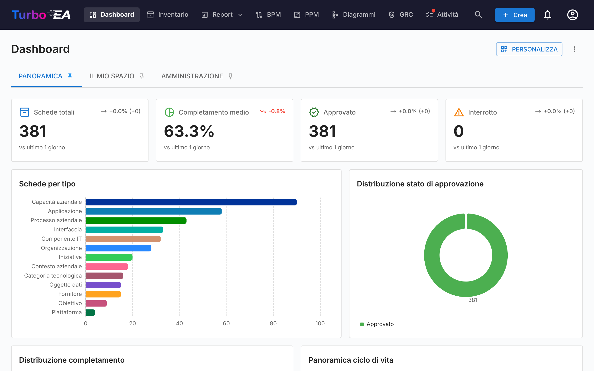
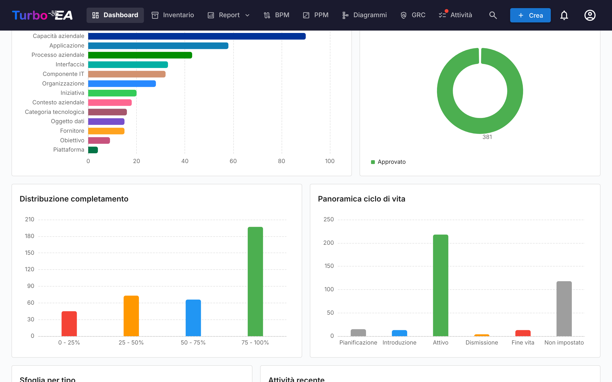
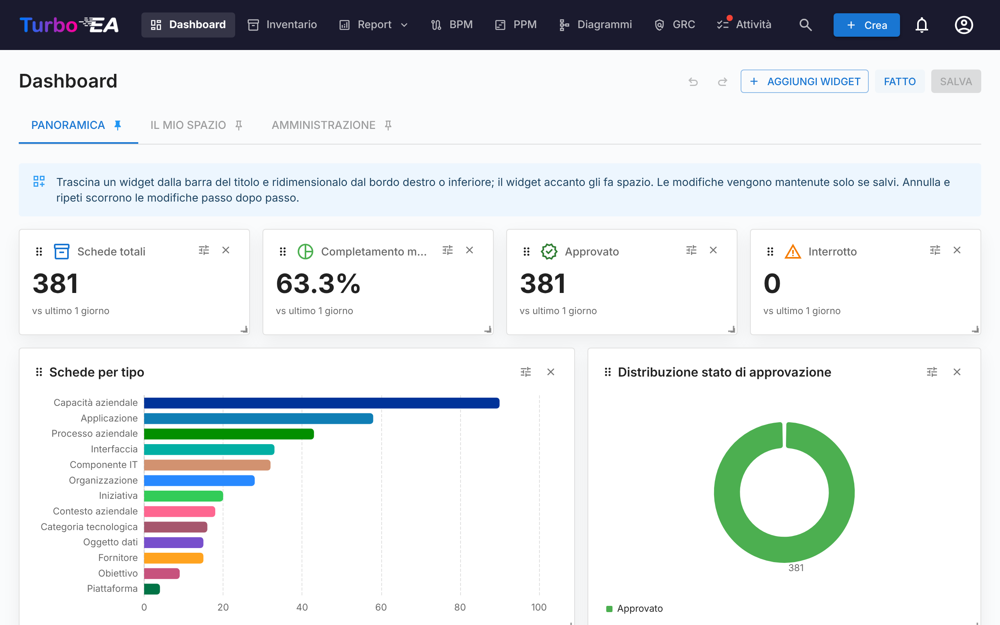

# Dashboard

La Dashboard è la prima schermata visualizzata dopo il login. Fornisce una **panoramica rapida** dell'intero stato dell'enterprise architecture.

## Barra di navigazione superiore

Nella parte superiore dello schermo si trova la **barra di navigazione principale** con i seguenti elementi:

- **Turbo EA** (logo): Cliccate per tornare alla Dashboard da qualsiasi sezione
- **Dashboard**: Panoramica dello stato dell'architettura
- **Inventario**: Elenco completo di tutte le card
- **Report**: Report visivi e analitici
- **BPM**: Business Process Management (se abilitato)
- **Diagrammi**: Editor visivo di diagrammi architetturali
- **EA Delivery**: Gestione delle iniziative architetturali
- **Todo**: Attività in sospeso e sondaggi assegnati
- **Cerca card**: Barra di ricerca rapida con autocompletamento
- **+ Crea**: Pulsante per creare rapidamente nuove card
- **Campanella delle notifiche**: Avvisi di sistema e [notifiche](notifications.md)
- **Icona profilo**: Selezione della lingua, cambio tema, preferenze di notifica e accesso all'amministrazione
- **Sostieni**: Un pulsante viola-rosa accanto al numero di versione nel menu del profilo apre una finestra che spiega perché le sponsorizzazioni sono importanti, con un collegamento al blog e opzioni una tantum o mensili tramite GitHub Sponsors

## Dashboard e widget

La home page è composta da **dashboard**, mostrate come schede in cima alla pagina. Turbo EA ne include tre:

| Dashboard | Che cosa mostra |
|-----------|-----------------|
| **Panoramica** | Lo stato dell'intero panorama: tile KPI, grafici, i tipi di card da esplorare e le ultime attività |
| **Il mio spazio** | Tutto ciò che ti è assegnato: preferiti, ruoli, attività, sondaggi, le tue modifiche recenti (vedi [Scheda «Spazio di lavoro»](#workspace-tab)) |
| **Amministrazione** | Attività degli utenti, copertura degli stakeholder, approvazioni in attesa e directory degli stakeholder (vedi [Scheda «Amministrazione»](#admin-tab-stakeholder-directory)) |

Ogni dashboard è una griglia di **widget**. Vedi solo i widget consentiti dal tuo ruolo — i widget della Panoramica richiedono il permesso `reports.ea_dashboard`, quelli di Amministrazione `admin.users` — e una scheda scompare quando nessuno dei suoi widget è visibile per te. Gli amministratori possono modificare le dashboard integrate e aggiungerne di proprie (vedi [Personalizzare le dashboard](#customizing-dashboards)).

Fai clic sull'icona della **puntina** di una scheda per renderla la dashboard che si apre all'avvio di Turbo EA.

## Tile KPI

La riga di tile in cima alla dashboard Panoramica mostra i dati principali del panorama:

- **Card totali**: numero di tutti i componenti registrati nella piattaforma
- **Qualità media dei dati**: la completezza media di tutte le card — fai clic per aprire il [report Qualità dei dati](reports.md)
- **Approvate** e **Broken**: quante card hanno ciascuno stato di approvazione

Ogni tile mostra una **freccia di tendenza** che confronta il valore di oggi con quello all'inizio della finestra di confronto — 30 giorni, o meno finché lo storico è in raccolta. La didascalia sotto i tile indica la finestra effettivamente usata. Gli snapshot vengono eseguiti ogni giorno alle 02:00 UTC. Le tendenze descrivono l'intero panorama, perciò sono mostrate solo agli utenti che possono leggere ogni card; un utente il cui ruolo nasconde alcune card vede il valore senza la freccia.

## Grafici ed elenchi

Sotto i tile, la dashboard Panoramica mostra:

- **Card per tipo**: la proporzione di ogni tipo di card nel tuo panorama
- **Stato di approvazione**: quante card sono approvate, in sospeso, broken o rifiutate
- **Distribuzione della completezza**: quante card rientrano in ciascuna fascia di qualità dei dati
- **Panoramica del ciclo di vita**: quante card si trovano in ciascuna fase del ciclo di vita
- **Esplora per tipo**: ogni tipo di card con il suo conteggio — fai clic su uno per aprire l'[Inventario](inventory.md) pre-filtrato su quel tipo
- **Attività recente**: un feed delle ultime modifiche — chi ha modificato cosa e quando

Facendo clic su una barra o su una fetta di un grafico si apre ciò che c'è dietro: l'[Inventario](inventory.md) filtrato su quelle card per un tipo di card o uno stato di approvazione, il report Ciclo di vita per una fase del ciclo di vita, il report Qualità dei dati per una fascia di completezza.

## Scheda «Spazio di lavoro» { #workspace-tab }

La dashboard **Il mio spazio** riunisce tutto ciò che ti è assegnato: preferiti, report salvati, attività, sondaggi in sospeso, le card che hai creato, l'attività recente sulle tue card e la sezione **Card in cui ho un ruolo**. Ognuno di questi elementi è un widget, quindi un amministratore può riorganizzarli o collocarli in un'altra dashboard.

Quest'ultima sezione raggruppa le card in base al ruolo di stakeholder che ricopri (Application Owner, Business Owner, ecc.) ed elenca le card sotto ciascun ruolo. Se il tuo ruolo concede il permesso `stakeholders.view` (ruoli admin, member e viewer per impostazione predefinita), una piccola icona di **ricerca persona** accanto al titolo della sezione ti permette di puntarla su **qualcun altro**: scegli un utente dall'autocompletamento e la sezione si ricarica con i ruoli e le card di quell'utente. Il titolo diventa «Ruoli ricoperti da {name}». Fai clic sulla piccola icona di chiusura per tornare ai tuoi ruoli. Utile per rispondere a «di cosa è responsabile questa persona?» con un clic.

## Scheda «Amministrazione» — Directory degli stakeholder { #admin-tab-stakeholder-directory }

La dashboard **Amministrazione** è mostrata ai ruoli con `admin.users`. Oltre ai suoi tile KPI (utenti attivi, card senza stakeholder, attività scadute, approvazioni bloccate, qualità complessiva) e alle sue liste (principali collaboratori, copertura degli stakeholder, utenti inattivi, pipeline di approvazione, attività di sistema, attività non assegnate), si chiude con un widget **Directory degli stakeholder**. Elenca ogni tipo di card che ha almeno uno stakeholder, con il numero di titolari distinti. Espandi un tipo di card per vederne i ruoli e, all'interno di ciascun ruolo, gli utenti che lo ricoprono insieme al numero di card che coprono. Fai clic sul chip di un utente per espandere in linea il suo elenco di card — ogni nome di card è a sua volta un link alla pagina di dettaglio della card. L'intero albero (tipo di card → ruolo → utente → card) arriva in un'unica richiesta, quindi la navigazione è istantanea.

Un **filtro per nome** in cima al widget restringe l'albero agli utenti il cui nome o e-mail corrisponde a quanto digitato; i tipi di card corrispondenti si espandono automaticamente così le corrispondenze sono visibili senza un clic in più. Usalo per rispondere a «dove compare Alice nell'organizzazione?» in un secondo.

Oltre alla directory, un piccolo **popover al passaggio del mouse** si apre quando il cursore si ferma sul nome di uno stakeholder altrove nell'app — nella scheda Stakeholder di una card, sul responsabile di un rischio nel Registro dei rischi o nella pagina di dettaglio del rischio — e mostra il portafoglio completo di quell'utente raggruppato per ruolo. Fai clic su una card nel popover per aprirla. Il popover recupera i dati una sola volta per utente e per sessione.

## Personalizzare le dashboard { #customizing-dashboards }

Gli utenti il cui ruolo concede `admin.dashboards` (**Gestisci le dashboard della home page** — il ruolo Admin per impostazione predefinita) possono modificare ogni dashboard e crearne di nuove. Tutti gli altri vedono le dashboard come configurate.

### Modalità di personalizzazione

Fai clic su **Personalizza** accanto alle schede delle dashboard per modificare la dashboard corrente. Il layout è largo 12 colonne; in una finestra più stretta i widget si riorganizzano su sei colonne, e su un telefono su una, nell'ordine in cui sono disposti. In modalità di personalizzazione:

- **Sposta** un widget trascinandolo per la sua maniglia; la griglia è larga 12 colonne e gli altri widget gli fanno spazio.
- **Ridimensiona** un widget dal suo bordo destro, dal bordo inferiore o dall'angolo, con il mouse o con il tocco (su uno smartphone o un tablet tenuto in verticale il layout è di sola lettura). Il widget accanto si adatta mentre trascini: si restringe quando il vicino cresce e si allarga di nuovo quando questo si riduce; se non può restringersi ulteriormente, passa alla riga successiva. Le righe sottostanti scendono e risalgono da sole. Il widget si aggancia alla griglia durante il trascinamento e, in modalità di personalizzazione, la pagina lascia quattro righe vuote sotto l'ultimo widget, così l'ultima riga può essere allungata; scorri prima finché la maniglia è ben all'interno della finestra.
- **Rimuovi** un widget con il suo pulsante di chiusura.
- **Configura** un tile KPI, un grafico o il feed delle attività con il suo pulsante a forma di ingranaggio.
- **Annulla** e **ripeti** le modifiche: **Annulla** e **Ripeti** scorrono passo dopo passo le modifiche fatte da quando è stato aperto Personalizza (uno spostamento, ridimensionamento, aggiunta, rimozione o configurazione alla volta) — con i due pulsanti della barra degli strumenti o con Ctrl+Z / Ctrl+Maiusc+Z (⌘ su Mac). **Scarta** continua ad annullarle tutte in una volta.

Fai clic su **Salva** per mantenere le modifiche per tutti, oppure su **Annulla modifiche** per tornare alla dashboard com'era.

### Aggiungere e ripristinare i widget

**Aggiungi widget** apre un pannello che elenca tutti i widget, raggruppati in **KPI**, **Grafici**, **Panoramica**, **Il mio spazio** e **Amministrazione**. Fai clic su uno per aggiungerlo alla dashboard; un tile KPI o un grafico apre prima la sua configurazione. Ogni widget integrato resta nel catalogo, quindi un widget rimosso per errore — **Attività recente**, per esempio — si ripristina aggiungendolo di nuovo. I widget che possono comparire una sola volta in una dashboard sono in grigio e contrassegnati come già aggiunti quando sono presenti.

Un widget mantiene il proprio permesso ovunque sia collocato: un widget di Amministrazione aggiunto alla dashboard Panoramica è comunque mostrato solo agli utenti con `admin.users`.

### Configurare un tile KPI

Un tile KPI mostra una delle metriche integrate (card totali, qualità dei dati, attività aperte, ecc.) oppure un valore che definisci tu:

- **Tipo di card** (facoltativo): conta solo le card di un tipo, eventualmente ristrette a un sottotipo, uno stato di approvazione, una fase del ciclo di vita o i [filtri](#filters) descritti più sotto.
- **Misura**: **Numero** di card, **Somma** o **Media** di un campo numerico, di costo o percentuale di quel tipo o di un [indicatore](#measures), oppure una **Quota** — il conteggio ristretto come percentuale delle stesse card senza i filtri (per esempio la quota di applicazioni approvate).
- **Un aumento è**: **Positivo** o **Negativo** — stabilisce se una tendenza al rialzo è mostrata in verde o in rosso.
- **Sparkline**: disegna sotto il numero gli ultimi 30 valori giornalieri del tile.
- **Valore secondario**: per un conteggio ristretto, mostra accanto al numero **di N** (il conteggio non filtrato) o la **quota sul totale**.

Un nuovo tile KPI registra il suo primo valore nel momento in cui la dashboard viene salvata, perciò la sua tendenza parte il giorno dopo. Una somma o una media di un campo di costo è mostrata solo agli utenti che possono vedere i costi, conta solo le card attive nell'anno fiscale corrente (la regola usata dal report dei costi) e indica quell'anno sotto il valore.

I tile alimentati da un report di modulo (rischi aperti, rischi scaduti, punteggio di conformità, iniziative a rischio, processi senza diagramma) compaiono nel catalogo quando il modulo è abilitato e hai il relativo permesso; non mostrano una tendenza, perché i report dei moduli non conservano uno storico.

### Configurare un grafico

Un grafico raggruppa le card per una **dimensione** e misura ogni gruppo con una **misura**:

| Dimensione | Raggruppa le card per |
|------------|-----------------------|
| **Tipo di card** | Tipo di card |
| **Sottotipo** | Sottotipo del tipo di card scelto |
| **Stato di approvazione** | Approvata, in sospeso, broken, rifiutata |
| **Fase del ciclo di vita** | La fase attuale del ciclo di vita |
| **Qualità dei dati** | Fascia di qualità dei dati (0–25 %, 25–50 %, …) |
| **Mese di creazione** | Mese in cui la card è stata creata |
| **Un campo** | Qualsiasi campo a selezione singola o sì/no del tipo di card scelto |
| **Ogni card** | Un gruppo per ogni card del tipo scelto — una treemap del costo per applicazione, le applicazioni con più componenti IT. I gruppi più grandi vengono mantenuti (**Categorie mostrate (al massimo)**, venti per impostazione predefinita, fino a duecento) e il resto viene raggruppato in *Altro*, oppure escluso da una media o da una quota, che non si possono sommare. In tal caso il widget lo segnala sotto il grafico: «Vengono mostrate le 20 card più grandi; altre 37 sono in «Altro»». Facendo clic su una card, questa si apre |
| **Card correlata** | La card all'altro capo di un tipo di relazione — applicazioni per organizzazione, componenti IT per fornitore, costo per capacità di business. Una card collegata a più card correlate viene contata sotto ciascuna; le card senza collegamenti finiscono sotto *Nessuna*; i venti gruppi più grandi sono mantenuti e il resto è raggruppato in *Altro* |
| **Copertura EOL** | Se un'applicazione o un componente IT ha un collegamento a endoflife.date, una data di fine vita manuale o nessuno dei due |
| **Mese di go-live** / **Mese di fine vita** | Il mese in cui cade la data di attivazione o di fine vita della card, su 18 mesi: sei indietro e undici avanti — i go-live per mese, oppure un calendario di fine vita |

Il menu delle dimensioni è raggruppato: **Scheda**, **Date**, **Campi**, **Schede correlate** e **Salute**.

#### Indicatori

La misura è il **Numero di card**, la **Somma** o la **Media** di un campo numerico, di costo o percentuale, oppure di uno di questi indicatori: le **relazioni di un tipo** su ciascuna card (quanti componenti IT usa un'applicazione) o il suo punteggio di **qualità dei dati**. **Quota** mostra, per ogni gruppo, il conteggio ristretto come percentuale di quello non filtrato. Sono offerti solo i tipi di card che puoi leggere, e i campi di costo solo agli utenti che possono vedere i costi; un costo conta solo le card attive nell'anno fiscale corrente e il grafico indica quell'anno.

#### Filtri

Oltre a uno stato di approvazione e a una fase del ciclo di vita, un grafico o un KPI può essere ristretto alle card **orfane** (nessuna relazione), **obsolete** (non aggiornate da 90 giorni), **senza stakeholder**, con una fine vita **mancante**, oppure che **hanno** o **non hanno** una relazione di un dato tipo — con le stesse definizioni usate dai filtri dell'Inventario e dal report sulla qualità dei dati.

| Grafico | Ideale per |
|---------|------------|
| **Barre** / **Colonne** | Confrontare gruppi, in orizzontale o in verticale |
| **Colonne impilate** | Due dimensioni come barre impilate con legenda — tipo di card per fase del ciclo di vita, livello di capacità per stato di approvazione |
| **Linee** | Una tendenza nel tempo, come le card create al mese |
| **Torta** / **Ciambella** | Quote di un tutto |
| **Indicatore** | Un tasso rispetto a un obiettivo: una quota (le applicazioni approvate), la qualità media dei dati, un campo percentuale o un punteggio di conformità su un quadrante 0–100, oppure un conteggio o una somma rispetto a un **Obiettivo**. Due soglie (**Avviso sopra**, **Buono sopra**) dividono il quadrante in fasce rossa, ambra e verde, invertite quando un aumento è negativo; due indicatori pronti all'uso, **Qualità dei dati** e **Applicazioni approvate**, sono nel catalogo |
| **Mappa di calore** | Due dimensioni insieme — per esempio fase del ciclo di vita contro stato di approvazione; **Mostra i valori nel grafico** stampa il valore in ogni cella |
| **Treemap** | Quote quando i gruppi sono molti; **Mostra i valori nel grafico** stampa il valore su ogni riquadro |
| **Sankey** | Il flusso di un tipo di relazione tra le card che collega, con una dimensione a scelta a ciascuna estremità |

Un diagramma Sankey prende un tipo di relazione e raggruppa **ciascuna estremità** separatamente: per tipo di card, sottotipo, stato di approvazione, fase del ciclo di vita, qualità dei dati, un campo del tipo di quell'estremità o le **card stesse** — Organizzazione → Applicazione mostra quali organizzazioni usano quali applicazioni, mantenendo le venti card più grandi a ciascuna estremità e raggruppando il resto in *Altro*; in tal caso il widget lo segnala sotto il grafico, e **Categorie mostrate (al massimo)** alza il limite. Facendo clic su un nodo card si apre la card.

I grafici possono anche rappresentare un report di modulo: rischi per livello o stato, punteggi di conformità per normativa, stato della pianificazione PPM e maturità BPM sono nel catalogo quando il modulo è abilitato e hai il relativo permesso. I tag non possono ancora essere usati come dimensione o filtro.

Quattro grafici pronti all'uso si trovano nella famiglia **Grafici** del catalogo, ciascuno offerto quando il tuo metamodello ha gli elementi necessari: **Applicazioni per organizzazione**, **Calendario di fine vita**, **Schede obsolete per tipo** e il diagramma Sankey **Organizzazione → Applicazione**.

Attiva il clic per consentire ai lettori di aprire l'[Inventario](inventory.md) o il report dietro una barra o una fetta (grafici a barre, colonne, colonne impilate, linee, torta, ciambella e treemap, e i nodi card di un Sankey). **Mostra i valori nel grafico** stampa il valore su ogni barra, colonna, riquadro o cella (grafici a barre, colonne, colonne impilate, treemap e mappa di calore). Un'anteprima nella finestra di dialogo mostra il grafico come apparirà.

### Gestire le dashboard

Il menu **⋮** accanto alle schede agisce sulla dashboard corrente:

| Azione | Che cosa fa |
|--------|-------------|
| **Nuova dashboard** | Crea una dashboard vuota, pronta per essere riempita di widget |
| **Duplica** | Copia la dashboard con tutti i suoi widget — un buon punto di partenza per una variante di una dashboard integrata |
| **Impostazioni** | Nome, descrizione, icona e **Accesso**: i ruoli autorizzati a vedere la dashboard. Lascia l'accesso vuoto per mostrarla a tutti; la dashboard Admin integrata viene fornita con l'accesso impostato sui ruoli che possono gestire gli utenti (il ruolo Admin in un'installazione nuova). Sotto il campo sono elencati i permessi di cui hanno bisogno i widget della dashboard: un ruolo che non li ha non vede nulla, qualunque sia l'accesso. Gli utenti con `admin.dashboards` vedono sempre ogni dashboard |
| **Nascondi** / **Mostra** | Rimuove la dashboard dalle schede di tutti gli altri senza eliminarla |
| **Sposta a sinistra** / **Sposta a destra** | Cambia l'ordine delle schede |
| **Ripristina valori predefiniti** | Solo dashboard integrate: ripristina i widget e il layout forniti con Turbo EA — e, per la dashboard Admin, i ruoli elencati nel suo accesso |
| **Elimina** | Solo dashboard personalizzate: elimina la dashboard per tutti |

L'aggiornamento di Turbo EA non sovrascrive mai una dashboard che hai modificato. Quando una release migliora una dashboard integrata, **Ripristina valori predefiniti** porta la nuova versione.

Ogni modifica a una dashboard — creata, modificata, duplicata, ripristinata o eliminata, compresi i widget aggiunti o rimossi — viene registrata nel [Registro di audit](../admin/audit-log.md#administrative-actions). Le dashboard viaggiano con un [trasferimento dell'area di lavoro](../admin/workspace-transfer.md).
