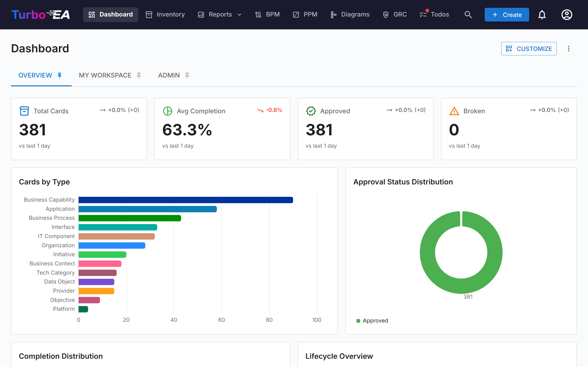
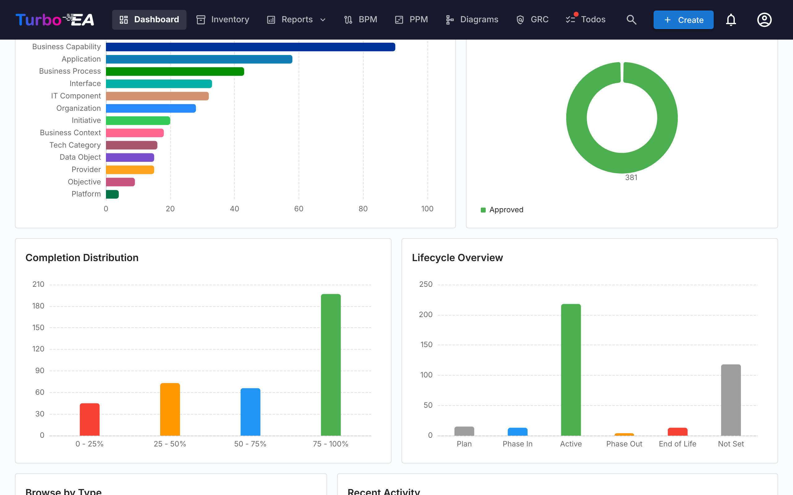
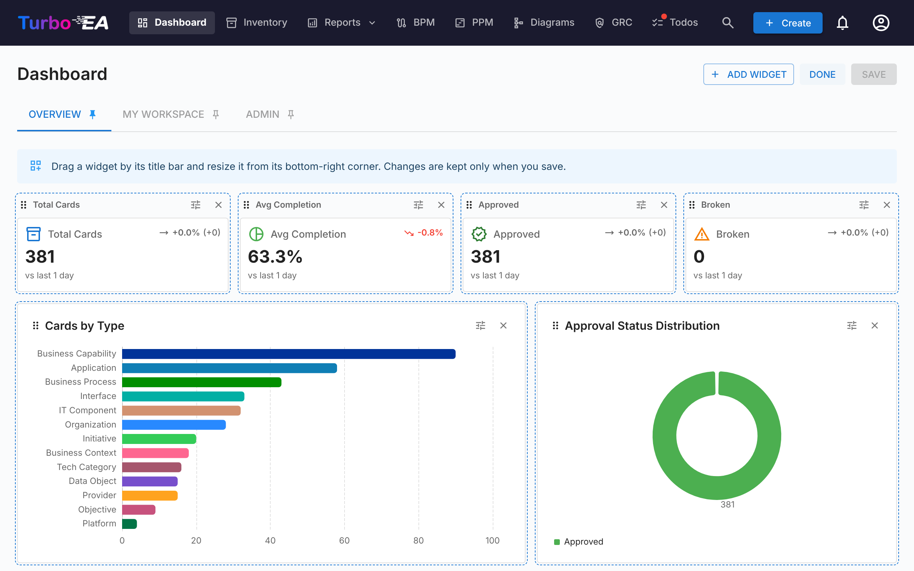

# Dashboard

The Dashboard is the first screen you see after logging in. It provides a **quick overview** of the entire enterprise architecture status.

## Top Navigation Bar

At the top of the screen, you will find the **main navigation bar** with the following elements:

- **Turbo EA** (logo): Click to return to the Dashboard from any section
- **Dashboard**: Overview of the architecture status
- **Inventory**: Complete listing of all cards
- **Reports**: Visual and analytical reports
- **BPM**: Business Process Management (if enabled)
- **Diagrams**: Visual architecture diagram editor
- **EA Delivery**: Architecture initiative management
- **Todos**: Pending tasks and assigned surveys
- **Search cards**: Quick search bar with autocomplete
- **+ Create**: Button to quickly create new cards
- **Notification bell**: System alerts and [notifications](notifications.md)
- **Profile icon**: Language selection, theme toggle, notification preferences, and administration access
- **Sponsor**: A purple-to-pink button next to the version number in the profile menu opens a dialog explaining why sponsorship matters, with a link to the blog and one-time or monthly options via GitHub Sponsors

## Dashboards and widgets

The homepage is made of **dashboards**, shown as tabs at the top of the page. Three dashboards ship with Turbo EA:

| Dashboard | What it shows |
|-----------|---------------|
| **Overview** | The state of the whole landscape: KPI tiles, charts, the card types to browse and the latest activity |
| **My Workspace** | Everything assigned to you — favorites, roles, todos, surveys, your recent changes (see [Workspace tab](#workspace-tab)) |
| **Admin** | User activity, stakeholder coverage, approvals waiting and the stakeholder directory (see [Admin tab](#admin-tab-stakeholder-directory)) |

Each dashboard is a grid of **widgets**. You only see the widgets your role allows — the Overview widgets need the `reports.ea_dashboard` permission, the Admin widgets need `admin.users` — and a tab disappears when none of its widgets is visible to you. Administrators can change the built-in dashboards and add their own (see [Customizing dashboards](#customizing-dashboards)).

Click the **pin** icon on a tab to make it the dashboard you land on when you open Turbo EA.

## KPI tiles

The row of tiles at the top of the Overview dashboard shows the headline figures of the landscape:

- **Total cards**: Count of all components registered in the platform
- **Average data quality**: The average completeness of all cards — click it to open the [Data Quality report](reports.md)
- **Approved** and **Broken**: How many cards carry each approval status

Each tile shows a **trend arrow** comparing today's value with the value at the start of the comparison window — 30 days, or less while the history is still being collected. The caption under the tiles names the window actually used. Snapshots are taken every day at 02:00 UTC. Trends describe the whole landscape, so they are shown only to users who can read every card; a user whose role hides some cards sees the value without the arrow.

## Charts and lists

Below the tiles, the Overview dashboard shows:

- **Cards by type**: The proportion of each card type in your landscape
- **Approval status**: How many cards are approved, pending, broken or rejected
- **Completion distribution**: How many cards fall into each data-quality bucket
- **Lifecycle overview**: How many cards are in each lifecycle phase
- **Browse by type**: Every card type with its count — click one to open the [Inventory](inventory.md) pre-filtered to that type
- **Recent activity**: A feed of the latest changes — who edited what and when
- **Data quality leaderboard**: The people who keep their cards complete (see below)

Clicking a bar or a slice of a chart opens what is behind it: the [Inventory](inventory.md) filtered to those cards for a card type or an approval status, the Lifecycle report for a lifecycle phase, the Data Quality report for a completion bucket.

### Data quality leaderboard

The **Data quality leaderboard** ranks the people who hold a stakeholder role on cards. By default it ranks them by the **average data quality** of their cards; switch it to **number of cards** to see who carries the most. Each row shows the person's rank, their name, a bar in the colour of their average's data-quality band, the average and how many cards they hold. People with the same figure share a rank.

Someone appears once they hold a **minimum number of cards** (three by default), so a single perfect card does not top the board. A card counts once per person, however many roles they hold on it, and only active cards count. By default only the roles that count for data quality do — a passive role such as *Observer* never earns a place; the widget's settings can narrow it to some card types or roles, or count every role. Deactivated users never appear. The board is computed for you: a card you are not allowed to see neither adds to anyone's count nor moves their average, so two readers with different permissions can see different figures. Only names are shown, never email addresses.

The leaderboard needs the `reports.ea_dashboard` permission, like the rest of the Overview dashboard, and a dashboard can hold several of them — one per card type, say.

## Workspace tab

The **My Workspace** dashboard pulls together everything assigned to you: favorites, saved reports, todos, pending surveys, the cards you created, recent activity on your cards, and the **Cards I Have a Role In** section. Each of these is a widget, so an administrator can rearrange them or place them on another dashboard.

That last section groups cards by the stakeholder role you hold (Application Owner, Business Owner, etc.) and lists the cards under each. If your role grants the `stakeholders.view` permission (admin, member and viewer roles by default), a small **person search** icon next to the section title lets you point it at **someone else** — pick a user from the autocomplete and the section refetches and re-renders with that user's roles and cards. The section title flips to "Roles held by {name}". Click the small close icon to return to your own roles. Useful for answering "what does this person own?" in one click.

## Admin tab — Stakeholder directory

The **Admin** dashboard is shown to roles with `admin.users`. Next to its KPI tiles (active users, cards without stakeholders, overdue todos, approvals stuck, overall quality) and its lists (top contributors, stakeholder coverage, idle users, approval pipeline, system activity, unassigned todos), it ends with a **Stakeholder directory** widget. It lists every card type that has at least one stakeholder, with the count of distinct holders for each. Expand a card type to see its roles, and inside each role the users who hold it together with the number of cards they cover. Click a user chip to expand its card list inline — each card name is itself a link to the card detail page. The whole tree (card type → role → user → cards) comes back in a single round-trip, so navigation is instant.

A **name filter** at the top of the widget narrows the tree to users matching the typed name or email; matching card types auto-expand so the matches are visible without an extra click. Use it to answer "where does Alice appear in the org?" in one second.

Beyond the directory, a small **hover popover** opens whenever the cursor pauses on a stakeholder name elsewhere in the app — on a card's Stakeholders tab, on a risk owner in the Risk Register, or on the Risk Detail page — and shows that user's full role-grouped stakeholder portfolio. Click any card in the popover to jump to it. The popover fetches once per user per session.

## Customizing dashboards

Users whose role grants `admin.dashboards` (**Manage homepage dashboards** — the Admin role by default) can change every dashboard and create new ones. Everyone else sees the dashboards as configured.

### Customize mode

Click **Customize** next to the dashboard tabs to edit the current dashboard. The layout is 12 columns wide; on a narrower window the widgets reflow to six columns, and on a phone to one, in the order they are laid out. In customize mode:

- **Move** a widget by dragging its handle; the grid is 12 columns wide and the other widgets make room.
- **Resize** a widget from its right edge, its bottom edge or the corner, by mouse or by touch (on a phone or a tablet held upright the layout is read-only). The widget beside it adjusts as you drag: it narrows when its neighbour grows and widens back when it shrinks; if it cannot narrow any further, it moves to the next row. Rows below move down and back up on their own. The widget snaps to the grid as you drag, and in customize mode the page keeps four empty rows under the last widget, so the bottom row can be dragged taller; scroll until the handle sits well inside the window first.
- **Remove** a widget with its close button.
- **Configure** a KPI tile, a chart, the activity feed or a data quality leaderboard with its gear button.
- **Undo** and **Redo** step through the changes made since Customize was opened, one move, resize, addition, removal or configuration at a time — with the two toolbar buttons or Ctrl+Z / Ctrl+Shift+Z (⌘ on a Mac). **Discard** still drops them all at once.

Click **Save** to keep the changes for everyone, or **Discard** to return to the dashboard as it was.

### Adding and restoring widgets

**Add widget** opens a drawer listing every widget, grouped as **KPIs**, **Charts**, **Overview**, **My Workspace** and **Admin**. Click one to add it to the dashboard; a KPI tile or a chart opens its configuration first. Every built-in widget stays in the catalogue, so a widget removed by mistake — **Recent activity**, say — is restored by adding it again. Widgets that can appear only once on a dashboard are greyed out and marked as already added when they are there.

A widget keeps its own permission wherever it is placed: an Admin widget added to the Overview dashboard is still shown only to users with `admin.users`.

### Configuring a KPI tile

A KPI tile shows either one of the built-in metrics (total cards, data quality, open todos, and so on) or a figure you define:

- **Card type** (optional): Count only cards of one type, optionally narrowed to a subtype, an approval status, a lifecycle phase or the [filters](#filters) below.
- **Metric**: **Count** of cards, the **Sum** or **Average** of a number, cost or percentage field of that type or of a [measure](#measures), or a **Share** — the narrowed count as a percentage of the same cards without the filters (for example the share of Applications that are approved).
- **A rise is**: **Good** or **Bad** — sets whether an upward trend is shown in green or in red.
- **Sparkline**: draws the tile's last 30 daily values under the number.
- **Secondary figure**: for a narrowed count, shows **of N** (the unfiltered count) or the **share of total** next to the number.

A new KPI tile records its first value the moment the dashboard is saved, so its trend starts the next day. A sum or average of a cost field is shown only to users who may see costs, counts only the cards live in the current fiscal year (the rule the Cost report uses) and names that year under the value.

Tiles fed by a module report (open risks, overdue risks, compliance score, initiatives at risk, processes without a diagram) are listed in the catalogue when the module is enabled and you hold its permission; they show no trend, because the module reports keep no history.

### Configuring a chart

A chart groups cards by one **dimension** and measures each group with a **metric**:

| Dimension | Groups cards by |
|-----------|-----------------|
| **Card type** | Card type |
| **Subtype** | Subtype of the chosen card type |
| **Approval status** | Approved, pending, broken, rejected |
| **Lifecycle phase** | The current lifecycle phase |
| **Data quality** | Data-quality bucket (0–25 %, 25–50 %, …) |
| **Month created** | Month the card was created |
| **A field** | Any single-select or yes/no field of the chosen card type |
| **Each card** | One group per card of the chosen type — a treemap of cost per application, the applications with the most IT components. The largest groups are kept (**Categories shown (at most)**, twenty by default, up to two hundred) and the rest folded into *Other* — or left out of an average or a share, which cannot be summed. When that happens the widget says so under the chart: «Showing the 20 largest cards; 37 more are in Other». Clicking a card opens it |
| **Related card** | The card at the other end of a relation type — Applications per Organization, IT Components per Provider, cost per Business Capability. A card linked to several related cards counts under each; cards with none fall under *None*; the twenty largest groups are kept and the rest folded into *Other* |
| **EOL coverage** | Whether an Application or IT Component has an endoflife.date link, a manual end-of-life date, or neither |
| **Go-live month** / **End-of-life month** | The month the card's active or end-of-life date falls in, over 18 months: six back and eleven ahead — go-lives per month, or an end-of-life calendar |

The dimension menu is grouped: **Card**, **Dates**, **Fields**, **Related cards** and **Health**.

#### Measures

The metric is **Number of cards**, the **Sum** or **Average** of a number, cost or percentage field, or of one of these measures: **relations of a type** on each card (how many IT Components an Application uses) or its **data quality** score. **Share** shows the narrowed count as a percentage of the unfiltered one, per group. Only the card types you can read are offered, and cost fields only to users who may see costs; a cost counts only the cards live in the current fiscal year, and the chart names that year.

#### Filters

Besides an approval status and a lifecycle phase, a chart or KPI can be narrowed to cards that are **orphaned** (no relation at all), **stale** (not updated for 90 days), **without stakeholders**, with a **missing** end-of-life, or that **have** or **lack** a relation of a given type — the same definitions the Inventory filters and the Data Quality report use.

| Chart | Best for |
|-------|----------|
| **Bar** / **Column** | Comparing groups, horizontally or vertically |
| **Stacked column** | Two dimensions as stacked bars with a legend — card type by lifecycle phase, capability level by approval status |
| **Line** | A trend over time, such as cards created per month |
| **Pie** / **Donut** | Shares of a whole |
| **Gauge** | A rate against a target: a share (the approved Applications), the average data quality, a percentage field or a compliance score on a 0–100 dial, or a count or sum against a **Target**. Two thresholds (**Warn above**, **Good above**) split the dial into red, amber and green bands, reversed when a rise is bad; two ready-made gauges, **Data quality** and **Approved applications**, sit in the catalogue |
| **Heatmap** | Two dimensions at once — for example lifecycle phase against approval status; **Show values on the chart** prints the figure in each cell |
| **Treemap** | Shares when there are many groups; **Show values on the chart** prints the figure on each tile |
| **Sankey** | The flow of a relation type between the cards it connects, with a dimension of your choice at each end |

A sankey takes a relation type and groups **each end** on its own: by card type, subtype, approval status, lifecycle phase, data quality, a field of that end's type, or the **cards themselves** — Organization → Application shows which organizations use which applications, with the twenty largest cards on each end kept and the rest folded into *Other*; the widget says so under the chart when it happens, and **Categories shown (at most)** raises the limit. Clicking a card node opens the card.

Charts can also draw a module report: risks by level or status, compliance scores by regulation, PPM schedule health and BPM maturity are in the catalogue when the module is enabled and you hold its permission. Tags cannot be used as a dimension or filter yet.

Four ready-made charts sit in the **Charts** family of the catalogue, each offered when your metamodel has the pieces it needs: **Applications per organization**, **End-of-life calendar**, **Stale cards by type** and the **Organization → Application** sankey.

Turn on click-through to let readers open the [Inventory](inventory.md) or report behind a bar or slice (bar, column, stacked column, line, pie, donut and treemap charts, and the card nodes of a sankey). **Show values on the chart** prints the figure on each bar, column, tile or cell (bar, column, stacked column, treemap and heatmap charts). A preview in the dialog shows the chart as it will appear.

### Managing dashboards

The **⋮** menu next to the tabs acts on the current dashboard:

| Action | What it does |
|--------|--------------|
| **New dashboard** | Creates an empty dashboard, ready to fill with widgets |
| **Duplicate** | Copies the dashboard with all its widgets — a quick start for a variant of a built-in dashboard |
| **Settings** | Name, description, icon and **Access**: the roles allowed to see the dashboard. Leave Access empty to show it to everyone; the built-in Admin dashboard ships with Access set to the roles that may manage users (the admin role on a fresh install). Under the field, the permissions the dashboard's widgets need are listed: a role without them sees nothing there whatever Access says. Users with `admin.dashboards` always see every dashboard |
| **Hide** / **Show** | Removes the dashboard from everyone else's tabs without deleting it |
| **Move left** / **Move right** | Changes the order of the tabs |
| **Reset to default** | Built-in dashboards only: restores the widgets and layout Turbo EA ships with — and, for the Admin dashboard, the roles its Access lists |
| **Delete** | Custom dashboards only: deletes the dashboard for everyone |

Upgrading Turbo EA never overwrites a dashboard you have changed. When a release improves a built-in dashboard, **Reset to default** brings in the new version.

Every change to a dashboard — created, edited, duplicated, reset or deleted, including which widgets were added or removed — is recorded in the [Audit log](../admin/audit-log.md#administrative-actions). Dashboards travel with a [workspace transfer](../admin/workspace-transfer.md).
