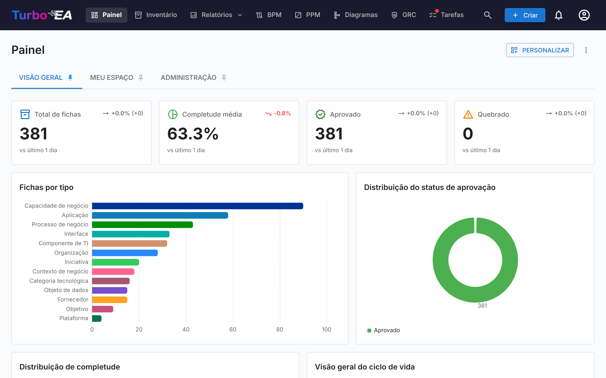
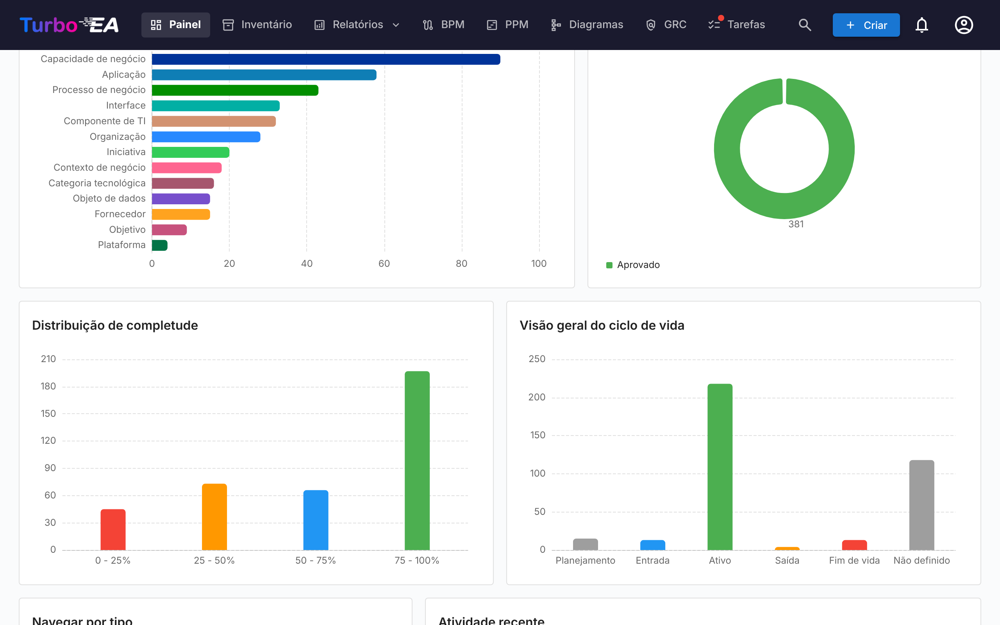
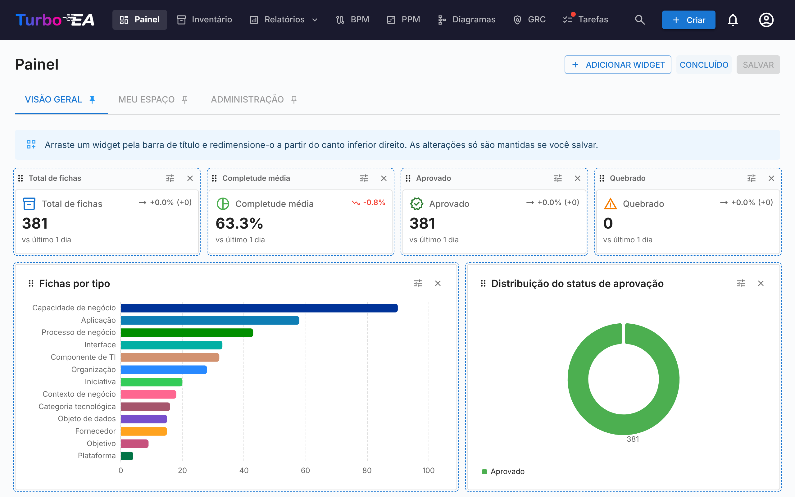

# Painel Principal

O Painel Principal é a primeira tela que você vê após fazer login. Ele fornece uma **visão geral rápida** de todo o status da arquitetura empresarial.

## Barra de Navegação Superior

Na parte superior da tela, você encontrará a **barra de navegação principal** com os seguintes elementos:

- **Turbo EA** (logo): Clique para retornar ao Painel Principal de qualquer seção
- **Painel**: Visão geral do status da arquitetura
- **Inventário**: Listagem completa de todos os cards
- **Relatórios**: Relatórios visuais e analíticos
- **BPM**: Business Process Management (se habilitado)
- **Diagramas**: Editor visual de diagramas de arquitetura
- **Entrega EA**: Gestão de iniciativas de arquitetura
- **Tarefas**: Tarefas pendentes e pesquisas atribuídas
- **Pesquisar cards**: Barra de busca rápida com autocompletar
- **+ Criar**: Botão para criar rapidamente novos cards
- **Sino de notificações**: Alertas do sistema e [notificações](notifications.md)
- **Ícone de perfil**: Seleção de idioma, alternância de tema, preferências de notificação e acesso à administração
- **Apoiar**: Um botão roxo a rosa ao lado do número da versão no menu de perfil abre uma caixa de diálogo que explica por que o patrocínio é importante, com uma ligação para o blogue e opções únicas ou mensais através do GitHub Sponsors

## Painéis e widgets

A página inicial é composta por **painéis**, apresentados como abas no topo da página. O Turbo EA inclui três painéis:

| Painel | O que mostra |
|--------|--------------|
| **Visão geral** | O estado de todo o panorama: blocos de KPI, gráficos, os tipos de card para explorar e a atividade mais recente |
| **Meu espaço** | Tudo o que lhe foi atribuído — favoritos, papéis, tarefas, pesquisas, as suas alterações recentes (ver [Aba «Espaço de trabalho»](#workspace-tab)) |
| **Administração** | Atividade dos utilizadores, cobertura de partes interessadas, aprovações em espera e o diretório de partes interessadas (ver [Aba «Administração»](#admin-tab-stakeholder-directory)) |

Cada painel é uma grelha de **widgets**. Só vê os widgets que o seu papel permite — os widgets da Visão geral exigem a permissão `reports.ea_dashboard`, os de Administração exigem `admin.users` — e uma aba desaparece quando nenhum dos seus widgets lhe é visível. Os administradores podem alterar os painéis integrados e adicionar os seus próprios (ver [Personalizar painéis](#customizing-dashboards)).

Clique no ícone de **alfinete** de uma aba para a tornar o painel que abre ao entrar no Turbo EA.

## Blocos de KPI

A fila de blocos no topo do painel Visão geral mostra os números principais do panorama:

- **Total de cards**: número de todos os componentes registados na plataforma
- **Qualidade média dos dados**: a completude média de todos os cards — clique para abrir o [relatório de Qualidade de dados](reports.md)
- **Aprovados** e **Quebrados**: quantos cards têm cada status de aprovação

Cada bloco mostra uma **seta de tendência** que compara o valor de hoje com o do início da janela de comparação — 30 dias, ou menos enquanto o histórico ainda está a ser recolhido. A legenda sob os blocos indica a janela efetivamente utilizada. Os instantâneos são feitos todos os dias às 02:00 UTC. As tendências descrevem todo o panorama, pelo que só são mostradas aos utilizadores que podem ler todos os cards; um utilizador cujo papel oculta alguns cards vê o valor sem a seta.

## Gráficos e listas

Abaixo dos blocos, o painel Visão geral mostra:

- **Cards por tipo**: a proporção de cada tipo de card no seu panorama
- **Status de aprovação**: quantos cards estão aprovados, pendentes, quebrados ou rejeitados
- **Distribuição de completude**: quantos cards se encontram em cada faixa de qualidade de dados
- **Visão geral do ciclo de vida**: quantos cards estão em cada fase do ciclo de vida
- **Explorar por tipo**: cada tipo de card com a sua contagem — clique num para abrir o [Inventário](inventory.md) pré-filtrado por esse tipo
- **Atividade recente**: um feed das últimas alterações — quem editou o quê e quando

Clicar numa barra ou numa fatia de um gráfico abre o que está por trás: o [Inventário](inventory.md) filtrado por esses cards para um tipo de card ou um status de aprovação, o relatório de Ciclo de vida para uma fase do ciclo de vida, o relatório de Qualidade de dados para uma faixa de completude.

## Aba «Espaço de trabalho» { #workspace-tab }

O painel **Meu espaço** reúne tudo o que lhe foi atribuído: favoritos, relatórios salvos, tarefas, pesquisas pendentes, os cards que criou, atividade recente nos seus cards e a secção **Cards em que tenho um papel**. Cada um destes elementos é um widget, pelo que um administrador pode reorganizá-los ou colocá-los noutro painel.

Esta última secção agrupa os cards pelo papel de parte interessada que desempenha (Application Owner, Business Owner, etc.) e lista os cards sob cada papel. Se o seu papel conceder a permissão `stakeholders.view` (papéis admin, member e viewer por predefinição), um pequeno ícone de **pesquisa de pessoa** junto ao título da secção permite apontá-la para **outra pessoa**: escolha um utilizador no preenchimento automático e a secção é recarregada com os papéis e os cards desse utilizador. O título muda para «Papéis de {name}». Clique no pequeno ícone de fechar para voltar aos seus próprios papéis. Útil para responder a «pelo que é responsável esta pessoa?» com um clique.

## Aba «Administração» — Diretório de partes interessadas { #admin-tab-stakeholder-directory }

O painel **Administração** é mostrado aos papéis com `admin.users`. Além dos seus blocos de KPI (utilizadores ativos, cards sem partes interessadas, tarefas em atraso, aprovações bloqueadas, qualidade geral) e das suas listas (principais colaboradores, cobertura de partes interessadas, utilizadores inativos, pipeline de aprovação, atividade do sistema, tarefas não atribuídas), termina com um widget **Diretório de partes interessadas**. Lista cada tipo de card que tem pelo menos uma parte interessada, com o número de titulares distintos. Expanda um tipo de card para ver os seus papéis e, dentro de cada papel, os utilizadores que o ocupam, juntamente com o número de cards que cobrem. Clique no chip de um utilizador para expandir a sua lista de cards no próprio local — cada nome de card é ele próprio um link para a página de detalhe do card. Toda a árvore (tipo de card → papel → utilizador → cards) chega numa única chamada, pelo que a navegação é instantânea.

Um **filtro por nome** no topo do widget restringe a árvore aos utilizadores cujo nome ou e-mail corresponde ao texto escrito; os tipos de card correspondentes expandem-se automaticamente para que os resultados fiquem visíveis sem um clique adicional. Use-o para responder a «onde aparece a Alice na organização?» em um segundo.

Para além do diretório, um pequeno **popover ao passar o cursor** abre-se sempre que o cursor pára sobre o nome de uma parte interessada noutro ponto da aplicação — na aba Partes interessadas de um card, no responsável por um risco no Registo de riscos ou na página de detalhe do risco — e mostra o portefólio completo desse utilizador agrupado por papel. Clique em qualquer card no popover para ir até ele. O popover só obtém os dados uma vez por utilizador e por sessão.

## Personalizar painéis { #customizing-dashboards }

Os utilizadores cujo papel concede `admin.dashboards` (**Gerir os painéis da página inicial** — o papel Admin por predefinição) podem alterar todos os painéis e criar novos. Todos os outros veem os painéis tal como estão configurados.

### Modo de personalização

Clique em **Personalizar**, junto às abas dos painéis, para editar o painel atual. No modo de personalização:

- **Mova** um widget arrastando-o pela sua pega; a grelha tem 12 colunas de largura e os outros widgets abrem espaço.
- **Redimensione** um widget a partir do seu canto inferior direito.
- **Remova** um widget com o seu botão de fechar.
- **Configure** um bloco de KPI, um gráfico ou o feed de atividade com o seu botão de engrenagem.

Clique em **Salvar** para manter as alterações para todos, ou em **Descartar** para voltar ao painel como estava.

### Adicionar e restaurar widgets

**Adicionar widget** abre uma gaveta com todos os widgets, agrupados em **KPIs**, **Gráficos**, **Visão geral**, **Meu espaço** e **Administração**. Clique num para o adicionar ao painel; um bloco de KPI ou um gráfico abre primeiro a sua configuração. Todos os widgets integrados permanecem no catálogo, pelo que um widget removido por engano — **Atividade recente**, por exemplo — é restaurado adicionando-o novamente. Os widgets que só podem aparecer uma vez num painel ficam a cinzento e marcados como já adicionados quando estão presentes.

Um widget mantém a sua própria permissão onde quer que seja colocado: um widget de Administração adicionado ao painel Visão geral continua a ser mostrado apenas aos utilizadores com `admin.users`.

### Configurar um bloco de KPI

Um bloco de KPI mostra uma das métricas integradas (total de cards, qualidade dos dados, tarefas abertas, etc.) ou um valor que você define:

- **Tipo de card** (opcional): contar apenas os cards de um tipo, opcionalmente restringidos a um subtipo, um status de aprovação ou uma fase do ciclo de vida.
- **Medida**: **Número** de cards, ou **Soma** ou **Média** de um campo numérico, de custo ou de percentagem desse tipo.
- **Um aumento é**: **Bom** ou **Mau** — define se uma tendência ascendente é mostrada a verde ou a vermelho.

Um novo bloco de KPI regista o seu primeiro valor no momento em que o painel é salvo, pelo que a sua tendência começa no dia seguinte. Uma soma ou média de um campo de custo só é mostrada aos utilizadores que podem ver os custos.

### Configurar um gráfico

Um gráfico agrupa os cards por uma **dimensão** e mede cada grupo com uma **medida**:

| Dimensão | Agrupa os cards por |
|----------|---------------------|
| **Tipo de card** | Tipo de card |
| **Subtipo** | Subtipo do tipo de card escolhido |
| **Status de aprovação** | Aprovado, pendente, quebrado, rejeitado |
| **Fase do ciclo de vida** | A fase atual do ciclo de vida |
| **Qualidade dos dados** | Faixa de qualidade de dados (0–25 %, 25–50 %, …) |
| **Mês de criação** | Mês em que o card foi criado |
| **Um campo** | Qualquer campo de seleção única ou de sim/não do tipo de card escolhido |

A medida é o **Número de cards**, ou a **Soma** ou a **Média** de um campo numérico, de custo ou de percentagem. Só são oferecidos os tipos de card que pode ler, e os campos de custo apenas aos utilizadores que podem ver os custos.

| Gráfico | Ideal para |
|---------|------------|
| **Barras** / **Colunas** | Comparar grupos, na horizontal ou na vertical |
| **Linhas** | Uma tendência ao longo do tempo, como os cards criados por mês |
| **Pizza** / **Rosca** | Partes de um todo |
| **Indicador** | Um valor face a um máximo (sem agrupamento) |
| **Mapa de calor** | Duas dimensões em simultâneo — por exemplo, a fase do ciclo de vida face ao status de aprovação |
| **Treemap** | Partes quando há muitos grupos |
| **Sankey** | O fluxo de um tipo de relação entre os cards que liga |

Ative o clique para permitir que os leitores abram o [Inventário](inventory.md) ou o relatório por trás de uma barra ou fatia (gráficos de barras, colunas, linhas, pizza, rosca e treemap). Uma pré-visualização na caixa de diálogo mostra o gráfico tal como vai aparecer.

### Gerir painéis

O menu **⋮** junto às abas atua sobre o painel atual:

| Ação | O que faz |
|------|-----------|
| **Novo painel** | Cria um painel vazio, pronto para ser preenchido com widgets |
| **Duplicar** | Copia o painel com todos os seus widgets — um bom ponto de partida para uma variante de um painel integrado |
| **Definições** | Nome, descrição, ícone e **Acesso**: os papéis autorizados a ver o painel. Deixe o acesso vazio para o mostrar a todos. Os utilizadores com `admin.dashboards` veem sempre todos os painéis |
| **Ocultar** / **Mostrar** | Retira o painel das abas de todos os outros sem o eliminar |
| **Mover para a esquerda** / **Mover para a direita** | Altera a ordem das abas |
| **Repor o padrão** | Apenas painéis integrados: restaura os widgets e o esquema com que o Turbo EA é fornecido |
| **Eliminar** | Apenas painéis personalizados: elimina o painel para todos |

Atualizar o Turbo EA nunca substitui um painel que tenha alterado. Quando uma versão melhora um painel integrado, **Repor o padrão** traz a nova versão.

Cada alteração a um painel — criado, editado, duplicado, reposto ou eliminado, incluindo os widgets adicionados ou removidos — fica registada no [Registo de auditoria](../admin/audit-log.md#administrative-actions). Os painéis acompanham uma [transferência de workspace](../admin/workspace-transfer.md).
